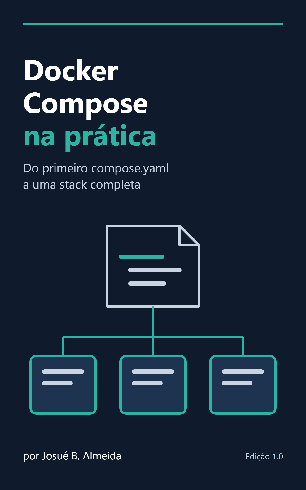

# Docker Compose na prática

Do primeiro compose.yaml a uma stack completa

Para quem já roda contêineres com `docker run` e quer subir um projeto com vários serviços. Ao terminar, você vai descrever uma aplicação com API, banco e proxy num `compose.yaml` e subi-la, desenvolvê-la e configurá-la com um comando, em desenvolvimento e em produção. Referência: Docker Compose v5.7.0 e Docker Engine 29.9.3.

## Comece aqui

- [Como estudar este livro](chapters/00-como-estudar-este-livro.md): organização, ritmos e hábitos de estudo.
- [Teste de nivelamento](chapters/00-como-estudar-este-livro.md#-teste-de-nivelamento): descubra por qual capítulo começar, se você já usou o Compose.

## 📇 O livro numa página

![O livro numa página, em sete cartões. 1-2, o arquivo e a instalação: serviço é a receita e contêiner a instância; docker compose version; plugin, não docker-compose. 3-4, subir e construir: up -d, ps, logs, down; build: . e image com build; up -d --build recria. 5-6, variáveis e rede: ${VAR:-padrão} e .env; o nome do serviço é o endereço; ports só para fora da rede. 7-8, volumes e saúde: volume nomeado guarda o banco; down -v apaga os dados; service_healthy com --wait. 9-10, dia a dia e watch: exec, run --rm, cp; restart não aplica mudança; develop.watch com sync e rebuild. 11-12, perfis e segredos: --profile e compose.override; -f soma listas e troca valores; secrets em /run/secrets. 13-14, escala e projeto final: limits de cpus e memory; --scale api=3 atrás do proxy; base, override e prod.](img/c00-o-livro-numa-pagina.svg)

<!-- map:start -->
## 🗺️ Mapa do livro

- [0. Como estudar este livro](chapters/00-como-estudar-este-livro.md)
- [1. Por que um arquivo para o projeto](chapters/01-por-que-um-arquivo-para-o-projeto.md) · ⏱️ ~35 min
- [2. Instalar e conferir o Compose](chapters/02-instalar-e-conferir-o-compose.md) · ⏱️ ~25 min
- [3. Primeiro compose.yaml](chapters/03-primeiro-compose-yaml.md) · ⏱️ ~40 min
- [4. Build pelo Compose](chapters/04-build-pelo-compose.md) · ⏱️ ~40 min
- [5. Variáveis, .env e configuração](chapters/05-variaveis-env-e-configuracao.md) · ⏱️ ~40 min
- [6. Vários serviços e a rede do projeto](chapters/06-varios-servicos-e-a-rede-do-projeto.md) · ⏱️ ~50 min
- [7. Volumes no Compose](chapters/07-volumes-no-compose.md) · ⏱️ ~40 min
- [8. Ordem de início e saúde](chapters/08-ordem-de-inicio-e-saude.md) · ⏱️ ~45 min
- [9. Comandos do dia a dia](chapters/09-comandos-do-dia-a-dia.md) · ⏱️ ~55 min
- [10. Desenvolvimento com watch](chapters/10-desenvolvimento-com-watch.md) · ⏱️ ~45 min
- [11. Perfis e arquivos sobrepostos](chapters/11-perfis-e-arquivos-sobrepostos.md) · ⏱️ ~45 min
- [12. Segredos e dados sensíveis](chapters/12-segredos-e-dados-sensiveis.md) · ⏱️ ~40 min
- [13. Recursos e escala](chapters/13-recursos-e-escala.md) · ⏱️ ~40 min
- [14. Projeto final: stack completa](chapters/14-projeto-final-stack-completa.md) · ⏱️ ~80 min
- [15. Simulado final](chapters/15-simulado-final.md)
- [Glossário](chapters/glossario.md)
<!-- map:end -->

## Sobre este livro

> Escrito com IA (Claude) a partir das fontes citadas em cada capítulo. Conferido em 21/11/2026. Revisão humana: não. Edição 1.2.

### Histórico de edições

- **1.2** (21/11/2026): portas presas a `127.0.0.1` também no `vitrine` (capítulo 10) e no desenvolvimento do `stack` (capítulo 14), e as notas sobre WSL dos capítulos 7 e 10 com os testes feitos pelo próprio WSL.
- **1.1** (21/11/2026): porta da API presa a `127.0.0.1` no capítulo 6 (e no contador dali em diante), nota para Windows com WSL nos capítulos 7 e 10, e uma analogia nos capítulos 1, 6 e 8.
- **1.0** (21/11/2026): primeira edição, com 14 capítulos, teste de nivelamento, simulado final e glossário.

## Erratas

Nenhuma errata registrada até agora. Achou um erro? Anote o capítulo, o trecho e o que você esperava ver, e envie ao autor.

<!-- editions:start -->
## 🗒️ Edições

- **1.3.2** (2026-11-26): Acrescentado 'O livro numa página' (sete cartões) no README e no capítulo 0; nada mudou no que o leitor faz.
- **1.3.1** (2026-11-21): Erratas: distribuição real dos pedidos entre as réplicas (cap. 14) e porta aberta explicada no exercício do cap. 13.
- **1.3** (2026-11-21): Portas presas a 127.0.0.1 desde o capítulo 1 e portas de produção com 0.0.0.0 explicado; tamanho do db_senha.txt corrigido para 17 bytes; registro de testes só local; linhas longas quebradas; projetos contador e vitrine montáveis
<!-- editions:end -->

<!-- credit:start -->
📘 *Criado pela skill Claude Syllabook - Joshpcbrrj* · [github.com/Joshpcbrrj/syllabook](https://github.com/Joshpcbrrj/syllabook)
<!-- credit:end -->
