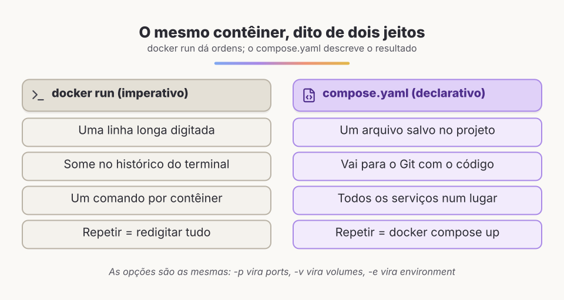
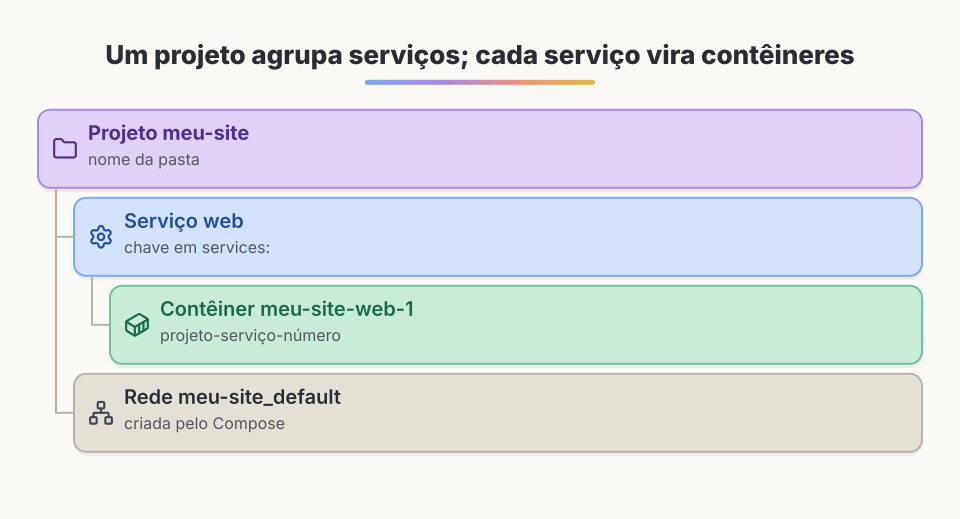

# 1. Por que um arquivo para o projeto

> 🗺️ **Neste capítulo:** você vai ver o problema que o Compose resolve e reescrever um `docker run` comprido como um arquivo `compose.yaml`. · ⏱️ ~35 min

## Imperativo e declarativo

Você já sabe subir um contêiner com `docker run` (visto em *Docker do zero*). Para um site estático servido pelo nginx, com porta, pasta montada, fuso horário e reinício automático, o comando fica assim:

```bash
docker run -d --name meu-site -p 127.0.0.1:8080:80 \
  -v "$(pwd)/site:/usr/share/nginx/html:ro" \
  -e TZ=America/Sao_Paulo \
  --restart unless-stopped \
  nginx:1.27-alpine
```

A barra invertida no fim da linha só quebra o comando em várias linhas para facilitar a leitura; o shell junta tudo numa linha só. No PowerShell, troque a `\` pela crase (`` ` ``).

Funciona. O problema aparece depois: para subir de novo amanhã, você precisa lembrar de cada opção na ordem certa. Para um colega subir o mesmo site, você manda a linha por mensagem e torce para ele copiar tudo. E quando o projeto ganhar um banco e uma API, serão três linhas assim, uma para cada contêiner.

Esse jeito de trabalhar é **imperativo** (*imperative*): você dá ordens, uma por uma, e o resultado depende de você lembrar de todas. O jeito oposto é o **declarativo** (*declarative*).

**Configuração declarativa é descrever num arquivo o estado que você quer, e deixar uma ferramenta fazer o necessário para chegar nele.**

O Docker Compose é essa ferramenta para contêineres. Você descreve os contêineres do projeto num arquivo YAML chamado `compose.yaml`, e um único comando, `docker compose up`, lê o arquivo e cria tudo.

> 💡 **Analogia:** pense no quadro de funcionários de uma loja, a folha que diz “dois caixas, um estoquista, um gerente”. A dona da loja não telefona para cada pessoa dizendo o que fazer naquele dia. Ela mantém o quadro em dia, e o encarregado confere o quadro, vê quem já está na loja e chama ou troca só quem falta ou está diferente.
>
> - O `compose.yaml` é o quadro: diz o que deve existir, e não os passos para chegar lá.
> - O Compose é o encarregado, e o `docker compose up` é o momento em que ele confere o quadro e age.
> - Cada linha do quadro (“um caixa”) é um componente do projeto; a pessoa que ocupa o cargo hoje é o contêiner, que pode ser trocada sem mudar o quadro. A próxima seção dá nome a essa diferença.
> - O `docker compose down` dispensa todo mundo, mas o quadro fica guardado, pronto para o próximo `up`.
>
> **Onde a analogia para de valer:** o encarregado de verdade observa a loja o dia todo e interpreta o quadro quando falta alguma coisa. O Compose só age quando você roda um comando, e faz exatamente o que está escrito, nem mais nem menos.

Antes de ver o arquivo, preveja: cada opção do `docker run` acima precisa aparecer em algum lugar dele. Onde você acha que vão parar o `-p`, o `-v` e o `-e`?

**meu-site/compose.yaml**

```yaml
services:
  # o nome diz o papel do componente; o contêiner herda esse nome
  web:
    image: nginx:1.27-alpine
    # endereço, porta do host e porta do contêiner (como no -p)
    ports:
      - "127.0.0.1:8080:80"
    # caminho relativo à pasta do arquivo: dispensa o $(pwd)
    volumes:
      - ./site:/usr/share/nginx/html:ro
    environment:
      TZ: America/Sao_Paulo
    restart: unless-stopped
```

Cada opção virou uma chave com nome legível: `-p` virou `ports`, `-v` virou `volumes`, `-e` virou `environment`, `--restart` virou `restart`. O nome da imagem fica em `image`. A indentação de dois espaços diz o que pertence a quê: `ports` pertence a `web`, que pertence a `services`.

O `127.0.0.1` na frente da porta faz o site atender só a sua máquina. Sem ele, o Docker publica a porta em todos os endereços do computador, e qualquer aparelho da mesma rede (o Wi-Fi do café, por exemplo) chega ao contêiner. Todos os exemplos do livro começam assim; o capítulo 6 mostra a diferença na prática.

> ⚠️ **Corrigido na edição 1.3:** até a edição 1.2, os exemplos dos capítulos 1 a 5 publicavam as portas sem endereço, como `"8080:80"`, o que as abre para a rede toda. Agora eles usam `"127.0.0.1:8080:80"`, e a porta só é aberta para a rede quando o exemplo precisa disso e diz por quê.

Com o arquivo salvo na pasta `meu-site`, ao lado da subpasta `site` com um `index.html`, um comando sobe tudo. Você vai estudar `up` em detalhe no capítulo 3; por enquanto, veja só o que ele faz:

```bash
cd meu-site
docker compose up -d
```

Saída (Compose v5.7.0; num terminal interativo, as mesmas etapas aparecem com animação de progresso):

```text
 Network meu-site_default Creating
 Network meu-site_default Creating
 Network meu-site_default Created
 Network meu-site_default Created
 Container meu-site-web-1 Creating
 Container meu-site-web-1 Created
 Container meu-site-web-1 Starting
 Container meu-site-web-1 Started
```

Cada etapa aparece duas vezes: quando começa (`Creating`, `Starting`) e quando termina (`Created`, `Started`). A linha da rede pode sair repetida; o que importa é a última de cada item. Primeiro o Compose criou a rede `meu-site_default`, depois o contêiner `meu-site-web-1`, e então o iniciou.

E o site responde como antes:

```bash
curl -s localhost:8080
```

```text
<h1>Olá, Compose!</h1>
```

Para desfazer tudo, há também um comando só: `docker compose down`, que para e remove o contêiner e a rede.



A diferença principal não está em digitar menos. Está em **onde a configuração mora**: no seu histórico do terminal, ou num arquivo que fica na pasta do projeto, entra no Git junto com o código e pode ser lido e revisado por qualquer pessoa.

> ⚠️ **Erro comum:** achar que o Compose é um Docker diferente. Ele é um plugin do próprio Docker: usa o mesmo Engine, as mesmas imagens e cria contêineres comuns. Tudo o que você aprendeu com `docker run` continua valendo; o Compose só lê as opções de um arquivo em vez da linha de comando.

## Serviços

Repare na primeira linha do arquivo: `services:`. O Compose não fala em “contêineres” no arquivo, e sim em serviços. Há um motivo. Um contêiner é uma coisa que existe agora, com um ID, e que pode ser apagada e recriada. O que você quer guardar no arquivo é a receita, que continua igual quando o contêiner é recriado.

**Um serviço é a descrição de um componente do projeto (imagem e configuração), que o Compose roda como um ou mais contêineres.**

No quadro da loja, o serviço é o cargo, e o contêiner é a pessoa que o ocupa agora.

No exemplo, `web` é o nome do serviço. Você escolhe o nome: ele deve dizer o papel do componente (`web`, `api`, `db`), não a tecnologia. Quando o projeto crescer, cada componente vira um serviço no mesmo arquivo:

```yaml
# um serviço por componente, todos no mesmo arquivo
services:
  web:
    image: nginx:1.27-alpine
  api:
    image: minha-api:1.0
  db:
    image: postgres:17
```

Esse trecho só mostra a forma; ele ainda não roda, porque falta configurar a API e o banco. Você vai montar essa aplicação de verdade a partir do capítulo 6.

Quando o Compose cria o contêiner de um serviço, ele dá ao contêiner um nome no formato `<projeto>-<serviço>-<número>`. Foi por isso que a saída mostrou `meu-site-web-1`: projeto `meu-site`, serviço `web`, primeiro contêiner. O número existe porque um serviço pode ter várias cópias do mesmo contêiner (as réplicas, no capítulo 13).

| | Serviço | Contêiner |
| --- | --- | --- |
| O que é | a receita, escrita no `compose.yaml` | uma instância rodando |
| Exemplo | `web` | `meu-site-web-1` |
| Quantos | um por componente | um ou mais por serviço |
| Quando muda | quando você edita o arquivo | a cada recriação, ganha um novo ID |

> ⚠️ **Erro comum:** usar o nome do serviço onde o Docker espera o nome do contêiner, ou o contrário. `docker logs web` falha com `Error response from daemon: No such container: web`, porque não existe contêiner chamado `web`; o contêiner se chama `meu-site-web-1`. Os comandos `docker compose ...` (capítulo 3) aceitam o nome do serviço; os comandos `docker ...` comuns pedem o do contêiner.

## Projeto

Se você tiver dois sites, cada um com seu `compose.yaml` e um serviço `web`, por que os contêineres não se misturam? Porque cada arquivo pertence a um projeto diferente.

**Um projeto é o conjunto de serviços, redes e volumes que o Compose cria a partir de um `compose.yaml`, identificado por um nome.**

Se você não disser nada, o nome do projeto é o nome da pasta onde está o arquivo. Por isso o exemplo criou `meu-site-web-1` e a rede `meu-site_default`: a pasta se chama `meu-site`. O Compose usa o nome do projeto como prefixo de tudo o que cria; é assim que ele sabe o que é dele na hora do `down`.

O comando `docker compose config` mostra o arquivo do jeito que o Compose o entendeu, já com o nome do projeto. Na pasta `meu-site`, as primeiras linhas e as últimas são:

```bash
docker compose config
```

```text
name: meu-site
services:
  web:
    restart: unless-stopped
...
networks:
  default:
    name: meu-site_default
```

Você também pode fixar o nome com a chave `name` no topo do arquivo. Com `name: loja` na primeira linha, o mesmo comando mostra `name: loja` e a rede passa a se chamar `loja_default`. Isso ajuda quando a pasta tem um nome genérico, como `app` ou `projeto`.



O arquivo precisa estar na pasta onde você roda o comando. O nome preferido é `compose.yaml`; o Compose também aceita `compose.yml` e, por compatibilidade com versões antigas, `docker-compose.yaml` e `docker-compose.yml`. Se houver mais de um, ele usa `compose.yaml`.

> ⚠️ **Erro comum:** rodar `docker compose` fora da pasta do projeto. O comando procura o arquivo na pasta atual e, se não acha, para com:
>
> ```text
> no configuration file provided: not found
> ```
>
> Entre na pasta com `cd` (ou indique o arquivo com `-f`, que você vai ver no capítulo 11).

## 🧪 Lab: do docker run ao compose.yaml

Você vai repetir, na sua máquina, o caminho do capítulo. Se ainda não tiver o Compose instalado, faça antes o capítulo 2 e volte aqui.

1. Crie a pasta do projeto e a página:

   ```bash
   mkdir -p meu-site/site
   cd meu-site
   echo '<h1>Olá, Compose!</h1>' > site/index.html
   ```

2. Crie o arquivo `compose.yaml` com o conteúdo mostrado na seção “Imperativo e declarativo”. Use espaços, não tabulação.
3. Confira como o Compose leu o arquivo: `docker compose config`. A primeira linha deve ser `name: meu-site`.
4. Suba o projeto: `docker compose up -d`.
5. Abra `http://localhost:8080` no navegador ou rode `curl -s localhost:8080`. Deve aparecer `Olá, Compose!`.
6. Derrube tudo: `docker compose down`.

Se o passo 4 reclamar que a porta 8080 já está em uso, outro programa (talvez um contêiner antigo) está usando a porta. Troque para `"127.0.0.1:8081:80"` no arquivo e acesse `localhost:8081`.

## 🏋️ Pratique

### 1. Exemplo resolvido

Comando de partida:

```bash
docker run -d --name cache -p 127.0.0.1:6379:6379 \
  --restart always redis:7-alpine
```

Passo a passo:

1. O contêiner é um cache, então o serviço se chama `cache`.
2. A imagem `redis:7-alpine` vai para `image`.
3. `-p 127.0.0.1:6379:6379` vira um item de `ports`, entre aspas: `"127.0.0.1:6379:6379"`.
4. `--restart always` vira `restart: always`.
5. `-d` não entra no arquivo: rodar em segundo plano é escolha do comando (`docker compose up -d`), não do serviço.
6. `--name cache` também não entra: o Compose dá o nome do contêiner a partir do projeto e do serviço.

**cache/compose.yaml**

```yaml
services:
  cache:
    image: redis:7-alpine
    # aspas para o YAML ler a porta como texto
    ports:
      - "127.0.0.1:6379:6379"
    restart: always
```

Na pasta `cache`, `docker compose config` confirma a leitura:

```text
name: cache
services:
  cache:
    restart: always
    image: redis:7-alpine
...
```

As aspas em `"127.0.0.1:6379:6379"` evitam que o YAML tente ler o valor como outra coisa que não texto; use-as sempre em portas.

### 2. Complete

Comando:

```bash
docker run -d --name adminer -p 127.0.0.1:8081:8080 \
  -e ADMINER_DESIGN=dracula \
  --restart unless-stopped \
  adminer:4
```

Complete as lacunas:

```yaml
# cada opção do docker run vira uma chave do serviço
services:
  adminer:
    image: ________
    ports:
      - "________"
    ________:
      ADMINER_DESIGN: dracula
    restart: ________
```

<details>
<summary>Ver resposta</summary>

```yaml
services:
  adminer:
    image: adminer:4
    # 8081 no host leva à 8080, onde o Adminer escuta
    ports:
      - "127.0.0.1:8081:8080"
    environment:
      ADMINER_DESIGN: dracula
    restart: unless-stopped
```

Numa pasta `painel-db`, `docker compose config` lê esse arquivo sem erro e mostra `name: painel-db`. Os erros mais comuns aqui: inverter a porta (`"127.0.0.1:8080:8081"`), quando a ordem é sempre `endereço:host:contêiner`; e escrever `env:` em vez de `environment:`, chave que o Compose não reconhece.

</details>

### 3. Sozinho

Escreva o `compose.yaml` para este comando, numa pasta chamada `blog`:

```bash
# o mesmo nginx do capítulo, agora servindo a pasta posts
docker run -d --name blog -p 127.0.0.1:8082:80 \
  -v "$(pwd)/posts:/usr/share/nginx/html:ro" \
  -e TZ=America/Recife \
  nginx:1.27-alpine
```

Depois responda: qual nome o contêiner vai receber?

<details>
<summary>Ver resposta</summary>

```yaml
services:
  blog:
    image: nginx:1.27-alpine
    ports:
      - "127.0.0.1:8082:80"
    # ./posts parte da pasta do compose.yaml
    volumes:
      - ./posts:/usr/share/nginx/html:ro
    environment:
      TZ: America/Recife
```

O contêiner vai se chamar `blog-blog-1`: projeto `blog` (o nome da pasta), serviço `blog`, número 1. Não é `blog`, porque o `--name` do `docker run` não passa para o arquivo. Repare também que `$(pwd)/posts` virou `./posts`: no `compose.yaml`, caminhos relativos partem da pasta do arquivo, então não é preciso montar o caminho completo. Se você pôs `restart`, não está errado, mas o comando original não tinha essa opção.

</details>

### 4. Desafio

Você tem dois sites estáticos, e hoje sobe cada um com seu `docker run`:

```bash
# um comando por site: são dois contêineres para lembrar
docker run -d -p 127.0.0.1:8080:80 \
  -v "$(pwd)/site:/usr/share/nginx/html:ro" nginx:1.27-alpine
docker run -d -p 127.0.0.1:8081:80 \
  -v "$(pwd)/docs:/usr/share/nginx/html:ro" nginx:1.27-alpine
```

Junte os dois num único `compose.yaml`, na pasta `painel`. Antes de subir, preveja: quais nomes os dois contêineres vão ter, e qual será o nome da rede?

<details>
<summary>Ver resposta</summary>

**painel/compose.yaml**

```yaml
# dois serviços, a mesma imagem, portas diferentes no host
services:
  site:
    image: nginx:1.27-alpine
    ports:
      - "127.0.0.1:8080:80"
    volumes:
      - ./site:/usr/share/nginx/html:ro
  docs:
    image: nginx:1.27-alpine
    ports:
      - "127.0.0.1:8081:80"
    volumes:
      - ./docs:/usr/share/nginx/html:ro
```

Depois de `docker compose up -d`, liste os contêineres pedindo só as colunas de nome, serviço e estado:

```bash
docker compose ps --format 'table {{.Name}}\t{{.Service}}\t{{.Status}}'
```

```text
NAME            SERVICE   STATUS
painel-docs-1   docs      Up 1 second
painel-site-1   site      Up Less than a second
```

A rede criada foi `painel_default`. Os dois serviços usam a mesma imagem e isso não é problema: o serviço é a receita, e duas receitas podem usar o mesmo ingrediente. O que não pode se repetir é a porta do host: se você deixou as duas em `8080`, um dos contêineres não sobe e o Compose mostra um erro que termina em `Bind for 127.0.0.1:8080 failed: port is already allocated`. Também não pode haver dois serviços com o mesmo nome na mesma chave `services`.

</details>

## 🧠 Revisão rápida

1. Que diferença há entre configurar contêineres de modo imperativo e de modo declarativo?
2. No contêiner `loja-api-1`, qual é o projeto e qual é o serviço?
3. Por que a opção `-d` do `docker run` não aparece no `compose.yaml`?
4. Você rodou `docker compose up -d` e recebeu `no configuration file provided: not found`. O que aconteceu?
5. (De *Docker do zero*) No `-p 8080:80`, qual número é a porta do host e qual é a do contêiner?

<details>
<summary>Ver resposta</summary>

1. No imperativo, você dá cada ordem na linha de comando e precisa lembrar de todas; no declarativo, descreve o resultado num arquivo e a ferramenta faz o necessário para chegar nele.
2. Projeto `loja`, serviço `api`; o `1` diz que é o primeiro contêiner desse serviço.
3. Porque rodar em segundo plano é uma escolha de como você executa o comando (`docker compose up -d`), não uma característica do serviço.
4. Você estava numa pasta sem `compose.yaml`. Entre na pasta do projeto e rode de novo.
5. `8080` é a porta do host (a que você acessa no navegador) e `80` é a porta dentro do contêiner.

</details>

## 🤖 Estude com um tutor de IA

Copie e cole num assistente de IA:

```text
Estou aprendendo Docker Compose. Faça 5 perguntas, uma de cada vez,
sobre a diferença entre serviço, contêiner e projeto no Compose.
Espere minha resposta antes de comentar e não me dê as respostas antes.
```

```text
Converti este docker run em compose.yaml.
Aponte meus erros sem me dar a solução pronta.
Comando: <cole aqui o docker run>
Meu arquivo: <cole aqui o seu compose.yaml>
```

> ➡️ **Próximo passo:** antes de escrever arquivos maiores, você vai conferir se o Compose está instalado e em qual versão, no Docker Desktop e no Linux.

## 📌 Resumo

| Item | Em uma frase |
| --- | --- |
| Imperativo | Dar cada ordem na linha de comando, como no `docker run` |
| Declarativo | Descrever o resultado num arquivo e deixar a ferramenta chegar nele |
| `compose.yaml` | O arquivo que descreve os serviços do projeto; fica na pasta do projeto |
| Serviço | A receita de um componente (imagem e configuração), rodada como um ou mais contêineres |
| Nome do contêiner | `<projeto>-<serviço>-<número>`, como `meu-site-web-1` |
| Projeto | O conjunto do que o Compose cria a partir de um arquivo; o nome padrão é o da pasta |
| `docker compose config` | Mostra como o Compose leu o arquivo, já com o nome do projeto |

## 📚 Fontes

- [How Compose works](https://docs.docker.com/compose/intro/compose-application-model/) (conferido em 20/11/2026)
- [Networking in Compose](https://docs.docker.com/compose/how-tos/networking/) (conferido em 20/11/2026)
- [docker compose up](https://docs.docker.com/reference/cli/docker/compose/up/) (conferido em 20/11/2026)
- [docker compose down](https://docs.docker.com/reference/cli/docker/compose/down/) (conferido em 20/11/2026)

<!-- nav:start -->
---

[◀ Capítulo anterior](00-como-estudar-este-livro.md) · [Mapa do livro](../README.md) · [Próximo capítulo ▶](02-instalar-e-conferir-o-compose.md)
<!-- nav:end -->
