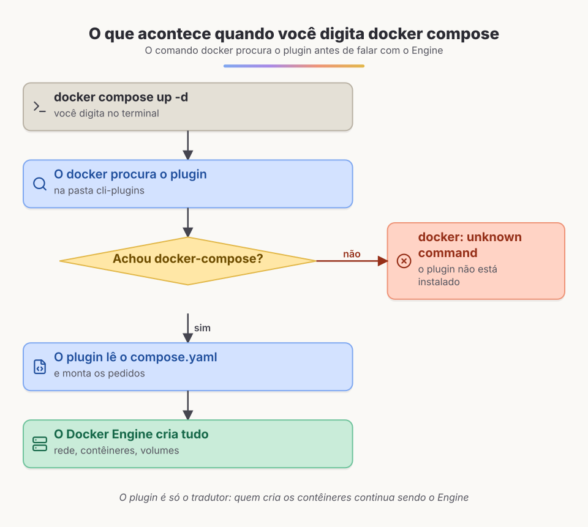

# 2. Instalar e conferir o Compose

> 🗺️ **Neste capítulo:** você vai descobrir de onde vem o comando `docker compose`, conferir se ele está na sua máquina e instalá-lo num Linux, na versão usada pelo livro. · ⏱️ ~25 min

> 🔥 **Aquecimento:** na pasta `loja`, o `compose.yaml` tem um serviço `api`. Que nome o Compose dá ao contêiner, e qual nome você usa em `docker logs`?
>
> <details>
> <summary>Ver resposta</summary>
>
> `loja-api-1`: projeto `loja` (o nome da pasta), serviço `api`, primeiro contêiner. O `docker logs` comum pede o nome do contêiner, então é `docker logs loja-api-1`; `docker logs api` falha com `No such container` (capítulo 1).
>
> </details>

## De onde paramos

No capítulo 1 você viu que um `compose.yaml` descreve os serviços do projeto e que `docker compose up -d` cria tudo a partir dele. Antes de escrever arquivos maiores, falta garantir que esse comando existe na sua máquina, e em qual versão.

## O plugin do Compose

O comando `docker` que você usa desde *Docker do zero* não sabe ler um `compose.yaml`. Quem sabe é outro programa, instalado ao lado dele. Por isso pode acontecer de `docker run` funcionar e `docker compose` não.

**O plugin do Compose é um programa separado, chamado `docker-compose`, que o comando `docker` encontra numa pasta de plugins e executa quando você digita `docker compose`.**

O plugin lê o arquivo e traduz cada serviço em pedidos ao Docker Engine, os mesmos pedidos que um `docker run` faria. Quem cria a rede e os contêineres continua sendo o Engine.



O comando `docker info` lista os plugins que o `docker` encontrou. Antes de rodar, preveja: onde o Compose deve aparecer nessa lista?

```bash
docker info
```

Saída no Windows 11 com Docker Desktop (trecho; o nome de usuário foi trocado por `<usuário>`):

```text
  compose: Docker Compose (Docker Inc.)
    Version:  v5.7.0
    Path:     C:\Users\<usuário>\.docker\cli-plugins\docker-compose.exe
```

Três informações numa linha cada: o nome do plugin (`compose`, a palavra que vem depois de `docker`), a versão dele e o arquivo do programa. Repare na pasta `cli-plugins`: é lá que o `docker` procura. No Linux, o pacote oficial põe o plugin em `/usr/libexec/docker/cli-plugins/docker-compose`, como você vai ver no lab.

> ⚠️ **Erro comum:** achar que, se o `docker run` funciona, o Compose também está instalado. Os dois são programas diferentes. Sem o plugin, o `docker` não reconhece a palavra `compose` e responde:
>
> ```text
> docker: unknown command: docker compose
>
> Run 'docker --help' for more information
> ```
>
> A mensagem não fala em arquivo nem em projeto: o comando nem chegou a procurar o `compose.yaml`. A solução é instalar o plugin.

## Docker Desktop

No Windows e no macOS, o Docker roda dentro do Docker Desktop, um aplicativo que instala o Engine, o comando `docker` e os plugins de uma vez. A documentação oficial chama esse caminho de “the easiest and recommended way” para ter o Compose: ele já vem incluído, e as atualizações do Desktop atualizam também o plugin.

**O Docker Desktop é o aplicativo da Docker que instala e atualiza juntos o Engine, a linha de comando e os plugins, incluindo o Compose.**

Se você fez *Docker do zero* no Windows ou no macOS, o Compose provavelmente já está aí. Para conferir pelo aplicativo, abra o menu do Docker e escolha **About Docker Desktop**: é ali que a documentação manda conferir a versão do Compose. Pelo terminal, o caminho é o mesmo em qualquer sistema, e você vai vê-lo na seção sobre `docker compose version`.

O Docker Desktop também existe para Linux, mas lá é comum instalar só o Engine e os pacotes da linha de comando, sem o aplicativo. É o caso dos servidores. A tabela resume as diferenças:

| | Docker Desktop | Linux sem Desktop |
| --- | --- | --- |
| Sistemas | Windows, macOS e Linux | Linux (servidores, máquinas virtuais, WSL) |
| Como vem o Compose | já incluído | pacote `docker-compose-plugin`, instalado à parte |
| Como atualiza | atualizando o Desktop | pelo gerenciador de pacotes (`apt`, `yum`) |
| Onde fica o plugin (testado) | `C:\Users\<usuário>\.docker\cli-plugins` (Windows) | `/usr/libexec/docker/cli-plugins` (Ubuntu) |

O livro foi testado no Windows 11 com Docker Desktop 4.99.0 e num Ubuntu 24.04 com os pacotes oficiais. No macOS os comandos do terminal são os mesmos, mas não foram executados para este livro.

> ⚠️ **Erro comum:** seguir um tutorial que instala o Compose baixando um arquivo à mão, numa máquina que já tem o Docker Desktop. Você fica com duas cópias, e a baixada à mão não se atualiza sozinha. No Desktop, não instale nada: confira a versão e pronto.

## Plugin no Linux

Num Linux sem Desktop, o Compose chega por um pacote próprio, `docker-compose-plugin`, publicado no repositório oficial da Docker. É o mesmo repositório de onde vêm o Engine e o comando `docker`. Se você instalou o Docker por ele com as opções padrão, o plugin provavelmente já veio junto: o pacote `docker-ce-cli` o recomenda, e o `apt` instala as recomendações. Se não veio, falta uma linha.

**O pacote `docker-compose-plugin` instala o plugin do Compose na pasta de plugins do `docker`, e o gerenciador de pacotes passa a cuidar das atualizações dele.**

No Ubuntu e no Debian:

```bash
sudo apt-get update
sudo apt-get install docker-compose-plugin
```

Nas distribuições com pacotes RPM (Fedora, RHEL, Rocky Linux e outras):

```bash
sudo yum update
sudo yum install docker-compose-plugin
```

Os comandos com `apt-get` foram testados (no lab, sem `sudo`); os com `yum` vêm da documentação oficial e não foram executados para este livro.

Esses comandos instalam a versão mais nova do repositório. Em 20 de novembro de 2026, era a v5.8.0, mais nova que a v5.7.0 usada neste livro. Para ter as saídas iguais às do livro, peça a versão pelo nome completo do pacote. O comando `apt list --all-versions docker-compose-plugin` lista as disponíveis, no formato `5.7.0-1~ubuntu.24.04~noble` (a parte depois do `-1~` muda com a versão do Ubuntu):

```bash
sudo apt-get install docker-compose-plugin=5.7.0-1~ubuntu.24.04~noble
```

> ⚠️ **Erro comum:** digitar `docker-compose`, com hífen, em vez de `docker compose`. O comando com hífen vem da instalação avulsa do Compose (*standalone*), que a documentação marca como legada e mantém só por compatibilidade. Num Ubuntu só com o pacote do plugin, o shell responde `docker-compose: command not found`. No Docker Desktop para Windows o hífen funciona, porque o Desktop traz, por compatibilidade, uma cópia com esse nome, e isso esconde o problema até o script rodar num servidor. Neste livro, use sempre `docker compose`, com espaço.

## docker compose version

As saídas deste livro foram capturadas com uma versão exata do Compose. Com outra versão, quase tudo funciona igual, mas uma mensagem ou uma linha de saída pode sair diferente. Antes de comparar o seu terminal com o livro, confira a sua versão.

**`docker compose version` mostra a versão do plugin do Compose que o comando `docker` está usando.**

Antes de rodar, preveja: se o plugin não estivesse instalado, o que apareceria?

```bash
docker compose version
```

Saída na máquina em que o livro foi escrito:

```text
Docker Compose version v5.7.0
```

Sem o plugin, você veria o `docker: unknown command: docker compose` da seção “O plugin do Compose”. Ou seja, esse comando confere duas coisas de uma vez: se o plugin existe e qual é a versão.

Para usar a versão num script, a opção `--short` imprime só o número:

```bash
docker compose version --short
```

```text
5.7.0
```

A versão do Engine sai de outro comando, porque o Engine é outro programa. A opção `--format` escolhe o que imprimir (testado no Bash; no PowerShell, não foi executado para este livro):

```bash
docker version --format 'CLI {{.Client.Version}} / Engine {{.Server.Version}}'
```

```text
CLI 29.9.3 / Engine 29.9.3
```

A referência deste livro é **Docker Compose v5.7.0 e Docker Engine 29.9.3**. Se a sua versão for mais nova, siga em frente: diferenças pequenas de texto nas saídas são esperadas, e o livro avisa quando um recurso depende da versão. Se for bem mais antiga, atualize o Docker Desktop ou o pacote antes do capítulo 3.

> ⚠️ **Erro comum:** confundir a versão do Compose com a do Engine. São números diferentes (5.7.0 e 29.9.3) de programas diferentes. Uma mensagem de erro do `compose.yaml` depende da versão do Compose; um erro de rede ou de porta vem do Engine.

## 🧪 Lab: instalar o plugin num Linux de teste

Você vai ver, num Ubuntu descartável, o `docker` sem o Compose, o erro que aparece, e a instalação da versão do livro. O Ubuntu roda num contêiner, então o lab funciona no Windows, no macOS e no Linux, e nada muda na sua máquina.

1. Abra um terminal e entre num Ubuntu 24.04 novo:

   ```bash
   docker run -it --rm ubuntu:24.04 bash
   ```

   O prompt muda para algo como `root@3f2a...:/#`. Dentro do contêiner você é o usuário `root`, por isso os comandos a seguir não levam `sudo`.

2. Configure o repositório oficial da Docker (são os passos da página “Install Docker Engine on Ubuntu”):

   ```bash
   apt update
   apt install -y ca-certificates curl
   # a chave prova que os pacotes vieram mesmo da Docker
   install -m 0755 -d /etc/apt/keyrings
   curl -fsSL https://download.docker.com/linux/ubuntu/gpg \
     -o /etc/apt/keyrings/docker.asc
   chmod a+r /etc/apt/keyrings/docker.asc
   # diz ao apt onde fica o repositório e qual chave confere
   tee /etc/apt/sources.list.d/docker.sources <<EOF
   Types: deb
   URIs: https://download.docker.com/linux/ubuntu
   Suites: $(. /etc/os-release && echo "${UBUNTU_CODENAME:-$VERSION_CODENAME}")
   Components: stable
   Architectures: $(dpkg --print-architecture)
   Signed-By: /etc/apt/keyrings/docker.asc
   EOF
   # relê as listas, agora com os pacotes da Docker
   apt update
   ```

3. Instale só a linha de comando do Docker. A opção `--no-install-recommends` impede que o `apt` traga os plugins junto, que é o que você quer ver agora:

   ```bash
   apt install -y --no-install-recommends docker-ce-cli
   ```

4. Tente usar o Compose:

   ```bash
   docker compose version
   ```

   ```text
   docker: unknown command: docker compose

   Run 'docker --help' for more information
   ```

5. Veja as versões disponíveis do plugin (as primeiras linhas):

   ```bash
   apt list --all-versions docker-compose-plugin
   ```

   ```text
   docker-compose-plugin/noble 5.8.0-1~ubuntu.24.04~noble amd64
   docker-compose-plugin/noble 5.7.2-1~ubuntu.24.04~noble amd64
   docker-compose-plugin/noble 5.7.1-1~ubuntu.24.04~noble amd64
   docker-compose-plugin/noble 5.7.0-1~ubuntu.24.04~noble amd64
   ```

   A lista que você vir pode começar por uma versão mais nova.

6. Instale a versão do livro e confira:

   ```bash
   apt install -y docker-compose-plugin=5.7.0-1~ubuntu.24.04~noble
   docker compose version
   ```

   ```text
   Docker Compose version v5.7.0
   ```

   Durante a instalação, o `apt` avisa que vai instalar também o `docker-buildx-plugin`, outro plugin que o pacote do Compose recomenda.

7. Veja onde o plugin foi parar:

   ```bash
   ls /usr/libexec/docker/cli-plugins/
   ```

   ```text
   docker-buildx
   docker-compose
   ```

8. Saia com `exit`. Por causa do `--rm`, o contêiner é apagado, e com ele tudo o que você instalou.

Repare que o passo 6 funcionou sem nenhum Engine dentro do contêiner: o plugin e o comando `docker` são programas de linha de comando. Se você rodar `docker compose up` ali, ele vai falhar ao tentar falar com o Engine, porque não há um.

## 🏋️ Pratique

### 1. Exemplo resolvido

Num servidor Ubuntu novo, alguém instalou o Docker com `apt install --no-install-recommends docker-ce docker-ce-cli containerd.io` e agora vê:

```text
docker: unknown command: docker compose
```

Passo a passo do diagnóstico:

1. A mensagem diz que o `docker` não conhece a palavra `compose`. Não é erro no `compose.yaml`: o arquivo nem foi lido.
2. Se a palavra é desconhecida, falta o plugin. Confirme com `docker info`: na seção `Plugins`, não há linha `compose:`.
3. O Docker veio do repositório oficial, então o plugin vem do mesmo lugar, pelo pacote `docker-compose-plugin`. Ele ficou de fora por causa do `--no-install-recommends`: o pacote `docker-ce-cli` recomenda o plugin, e sem essa opção o `apt` o teria instalado junto.
4. Para ter a versão do livro, instale pelo nome completo:

   ```bash
   sudo apt-get install docker-compose-plugin=5.7.0-1~ubuntu.24.04~noble
   ```

5. Confira com `docker compose version`. A resposta esperada é `Docker Compose version v5.7.0`.

### 2. Complete

Você quer conferir, num Linux, quais versões do plugin existem, instalar a v5.7.0 e confirmar só o número dela. Complete as lacunas:

```bash
# lista as versões disponíveis no repositório
apt list --all-versions ________
# instala a versão do livro pelo nome completo do pacote
sudo apt-get install docker-compose-plugin=________
# mostra só o número, sem o texto em volta
docker compose version ________
```

<details>
<summary>Ver resposta</summary>

```bash
apt list --all-versions docker-compose-plugin
sudo apt-get install docker-compose-plugin=5.7.0-1~ubuntu.24.04~noble
docker compose version --short
```

A última linha imprime `5.7.0`. Erros comuns: usar `docker-compose` (com hífen) como nome de pacote, mas o pacote é `docker-compose-plugin`; escrever só `=5.7.0` depois do nome, que o `apt` não aceita, porque a versão do pacote tem o sufixo da distribuição (`-1~ubuntu.24.04~noble`); e usar `-v` em vez de `--short`.

</details>

### 3. Sozinho

Escreva os dois comandos que imprimem, numa linha cada, só o número da versão do Compose e só o número da versão do Engine. Depois diga o que eles imprimem numa máquina com a configuração de referência deste livro.

<details>
<summary>Ver resposta</summary>

```bash
docker compose version --short
docker version --format '{{.Server.Version}}'
```

Na configuração de referência, eles imprimem `5.7.0` e `29.9.3`. São dois comandos porque são dois programas: o primeiro pergunta ao plugin do Compose; o segundo pergunta ao Engine (`.Server`). Se você usou `{{.Client.Version}}`, recebeu a versão da linha de comando, que pode ser diferente da do Engine; nesta máquina as duas são `29.9.3`.

</details>

### 4. Desafio

Um colega escreveu um script de deploy no notebook, com Docker Desktop no Windows. A linha principal é:

```bash
docker-compose up -d
```

No notebook, funciona. No servidor Ubuntu, que tem o Docker e o `docker-compose-plugin` instalados pelo `apt`, o script para com `docker-compose: command not found`. Ao conferir, o colega vê que o servidor tem o Compose v5.8.0. Responda: por que a mesma linha funciona num lugar e não no outro? O que muda no script? E a versão 5.8.0 é um problema?

<details>
<summary>Ver resposta</summary>

O Docker Desktop traz, por compatibilidade, uma cópia do Compose com o nome `docker-compose`; o pacote `docker-compose-plugin` instala só o plugin, que se usa como `docker compose`. Por isso o hífen funciona no notebook e não existe no servidor. A correção é trocar a linha por `docker compose up -d`, que funciona nos dois lugares.

A versão 5.8.0 não impede nada: o comando existe e o plugin está lá. Ela só é mais nova que a referência do livro, então algumas saídas podem ter pequenas diferenças de texto. Se o colega quiser que o servidor fique igual ao livro, pode instalar `docker-compose-plugin=5.7.0-1~ubuntu.24.04~noble`.

Uma resposta completa explica as três partes: a origem do `docker-compose` no Desktop, a troca por `docker compose` e por que a versão não é a causa do erro. Um erro comum é instalar a cópia avulsa do Compose no servidor para o hífen funcionar: resolve hoje, mas deixa um programa que não se atualiza pelo `apt`.

</details>

## 🧠 Revisão rápida

1. O comando `docker run` funciona, mas `docker compose version` responde `docker: unknown command: docker compose`. O que falta?
2. Onde o comando `docker` procura o plugin do Compose?
3. Por que instalar `docker-compose-plugin` sem indicar a versão pode deixar as saídas diferentes das do livro?
4. Qual comando mostra a versão do Engine, e por que não é o mesmo que mostra a do Compose?
5. (Capítulo 1) Na pasta `meu-site`, qual é o nome da rede que `docker compose up -d` cria?

<details>
<summary>Ver resposta</summary>

1. O plugin do Compose. O `docker` está instalado, mas não achou o programa `docker-compose` na pasta de plugins.
2. Numa pasta `cli-plugins`: no Windows com Docker Desktop, `C:\Users\<usuário>\.docker\cli-plugins`; no Ubuntu com o pacote oficial, `/usr/libexec/docker/cli-plugins`.
3. Porque o `apt` instala a versão mais nova do repositório (v5.8.0 em novembro de 2026), e o livro foi testado com a v5.7.0.
4. `docker version` (por exemplo, com `--format '{{.Server.Version}}'`). O Engine e o plugin do Compose são programas diferentes, cada um com sua versão.
5. `meu-site_default`: o nome do projeto (a pasta) seguido de `_default`.

</details>

## 🤖 Estude com um tutor de IA

Copie e cole num assistente de IA:

```text
Estou aprendendo Docker Compose. Faça 5 perguntas, uma de cada vez,
sobre o plugin do Compose: o que ele é, onde fica, como instalar no Linux
e como conferir a versão. Espere minha resposta antes de comentar
e não me dê as respostas antes.
```

```text
Rodei estes comandos e recebi esta saída. Me ajude a descobrir
o que está faltando na instalação, sem me dar a solução pronta:
primeiro me faça perguntas sobre o meu sistema.
Comandos e saída: <cole aqui>
```

> ➡️ **Próximo passo:** com o Compose conferido, você vai escrever seu primeiro `compose.yaml` completo e usar os quatro comandos do dia a dia: `up`, `ps`, `logs` e `down`.

## 📌 Resumo

| Item | Em uma frase |
| --- | --- |
| Plugin do Compose | O programa `docker-compose` que o `docker` acha na pasta `cli-plugins` e executa quando você digita `docker compose` |
| `docker: unknown command: docker compose` | O plugin não está instalado; o `compose.yaml` nem foi lido |
| Docker Desktop | Já traz o Compose e o atualiza junto; no Desktop, não instale nada à parte |
| `docker-compose-plugin` | O pacote do Linux que instala o plugin; sem versão, traz a mais nova |
| `docker compose version` | Mostra se o plugin existe e qual a versão; `--short` imprime só o número |
| `docker version --format` | Mostra a versão do Engine, que é outro programa |
| Referência do livro | Docker Compose v5.7.0 e Docker Engine 29.9.3 |
| `docker-compose` (com hífen) | Comando da instalação avulsa, legada; use sempre `docker compose` |

## 📚 Fontes

- [Overview of installing Docker Compose](https://docs.docker.com/compose/install/) (conferido em 20/11/2026)
- [Install the Docker Compose plugin](https://docs.docker.com/compose/install/linux/) (conferido em 20/11/2026)
- [Install Docker Engine on Ubuntu](https://docs.docker.com/engine/install/ubuntu/) (conferido em 20/11/2026)
- [Docker Compose releases](https://github.com/docker/compose/releases) (conferido em 20/11/2026)

> 🔁 **Revise hoje:** capítulo 1

<!-- nav:start -->
---

[◀ Capítulo anterior](01-por-que-um-arquivo-para-o-projeto.md) · [Mapa do livro](../README.md) · [Próximo capítulo ▶](03-primeiro-compose-yaml.md)
<!-- nav:end -->
