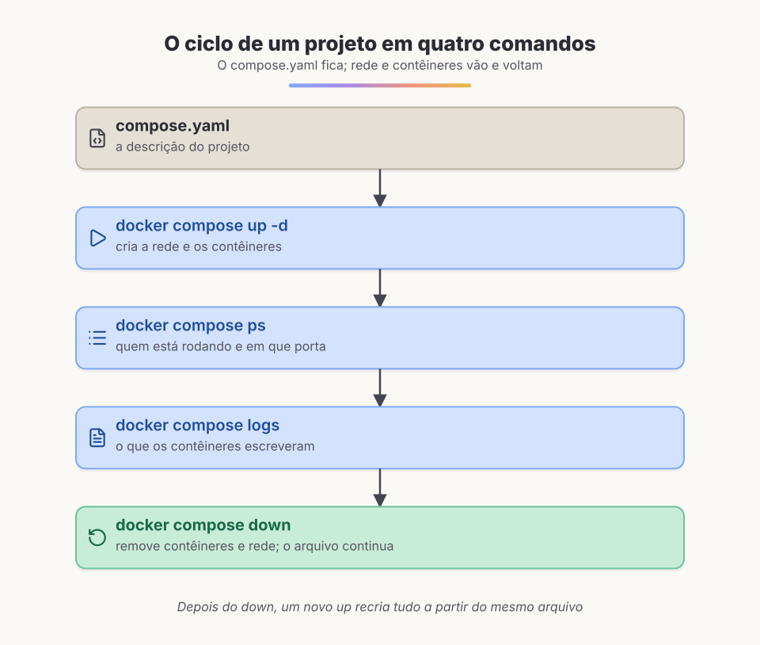

# 3. Primeiro compose.yaml

> 🗺️ **Neste capítulo:** você vai entender as regras do arquivo `compose.yaml` e usar os quatro comandos do dia a dia: `up -d` para subir, `ps` para listar, `logs` para ler o que os contêineres escrevem e `down` para derrubar. · ⏱️ ~40 min

> 🔥 **Aquecimento:** (1) Que comando confirma, numa linha só, a versão do Compose instalada? (2) Na pasta `meu-site`, que nome tem a rede que o Compose cria?
>
> <details>
> <summary>Ver resposta</summary>
>
> (1) `docker compose version --short`, que imprime só o número, como `5.7.0` (capítulo 2). (2) `meu-site_default`: o nome do projeto, que vem da pasta, seguido de `_default` (capítulo 1).
>
> </details>

## De onde paramos

No capítulo 1 você viu um `compose.yaml` pronto e um `up -d` que subia tudo; no capítulo 2 conferiu que o Compose está instalado. Agora você vai escrever o arquivo sabendo por que cada linha está onde está e controlar o projeto do começo ao fim.

## Estrutura do arquivo

O Compose lê o arquivo antes de criar qualquer coisa. Se uma linha estiver no lugar errado, ele recusa o arquivo inteiro. Por isso vale entender as poucas regras do formato antes de escrever arquivos maiores.

**O `compose.yaml` é um arquivo YAML cuja chave principal, `services`, guarda um bloco por serviço, e cada bloco guarda as chaves de configuração daquele serviço.**

O YAML organiza tudo por indentação. Três formas aparecem no arquivo do projeto `meu-site`:

**meu-site/compose.yaml**

```yaml
# a única chave obrigatória no topo: os serviços
services:
  # dentro de services, um bloco por serviço, com o nome que você escolhe
  web:
    # chave: valor, um texto simples
    image: nginx:1.27-alpine
    # chave seguida de uma lista: cada item começa com "- "
    ports:
      - "127.0.0.1:8080:80"
    volumes:
      - ./site:/usr/share/nginx/html:ro
```

- **Mapa:** `chave: valor`. `image: nginx:1.27-alpine` é um mapa de uma chave.
- **Bloco aninhado:** uma chave cujo valor são outras chaves, indentadas abaixo dela. `web` pertence a `services`; `image` pertence a `web`.
- **Lista:** itens começando com `- `, também indentados. `ports` recebe uma lista, porque um serviço pode publicar várias portas.

A indentação é de espaços, nunca de tabulação. O padrão do livro é de dois espaços por nível.

Antes de rodar, preveja: o que acontece se a linha `image` ficar alinhada com `web`, em vez de dois espaços mais para dentro?

```yaml
# errado de propósito: image saiu de dentro de web
services:
  web:
  image: nginx:1.27-alpine
```

```bash
docker compose config
```

```text
services.image must be a mapping
```

Alinhada com `web`, a linha `image` virou um segundo serviço, chamado `image`, cujo valor é um texto em vez de um bloco. A mensagem diz exatamente isso: `services.image` deveria ser um mapa (*mapping*). Leia o caminho com pontos como um endereço: `services` → `image`.

O `docker compose config`, que você viu no capítulo 1, é o seu conferente: ele lê o arquivo sem criar nada e mostra o erro, se houver. Rode-o sempre que mexer no arquivo.



A figura mostra o caminho que o resto do capítulo percorre: do arquivo ao `up -d`, passando por `ps` e `logs`, até o `down`.

> ⚠️ **Erro comum:** indentar com a tecla Tab. Muitos editores inserem um caractere de tabulação, que o YAML não aceita. Com um Tab antes de `web`, o `config` responde:
>
> ```text
> go-yaml load error in scanner (while scanning for the next token) at L2.C1: found character that cannot start any token
> ```
>
> `L2.C1` é a linha 2, coluna 1: o Tab está ali. Configure o editor para inserir espaços.

Outros dois erros de estrutura aparecem logo nos primeiros arquivos. Esquecer a chave `services` e começar direto por `web:` gera `additional properties 'web' not allowed`: no topo do arquivo, `web` não é uma chave válida. E escrever `ports: "127.0.0.1:8080:80"` sem o hífen gera `services.web.ports must be a array`: o Compose esperava uma lista (*array*).

Se você copiar um arquivo antigo da internet, ele pode começar com `version: "3.8"`. Essa chave não é mais usada; o Compose v5.7.0 avisa que ela é obsoleta (`` the attribute `version` is obsolete, it will be ignored ``) e segue em frente. Apague a linha.

## docker compose up -d

O `up` lê o arquivo, cria o que falta (rede, contêineres) e inicia os contêineres. A dúvida é o que fazer com o terminal enquanto eles rodam.

**`docker compose up` cria e inicia os serviços do projeto; com `-d` (*detach*), ele devolve o terminal assim que os contêineres sobem, e eles continuam rodando em segundo plano.**

Primeiro, sem o `-d`, na pasta `meu-site`:

```bash
docker compose up
```

Saída (trecho):

```text
 Container meu-site-web-1 Created
Attaching to web-1
 Container meu-site-web-1 Starting
web-1  | /docker-entrypoint.sh: Configuration complete; ready for start up
web-1  | 2026/11/21 03:46:42 [notice] 1#1: nginx/1.27.5
```

`Attaching to web-1` quer dizer que o Compose ligou o seu terminal à saída do contêiner. Daí em diante, cada linha que o nginx escreve aparece ali, com o prefixo `web-1  |`, e o terminal fica preso. Para sair, aperte Ctrl+C:

```text
 Compose Stopping Gracefully Stopping... press Ctrl+C again to force
 Container meu-site-web-1 Stopping
 Container meu-site-web-1 Stopped
```

O Ctrl+C **parou** o contêiner, mas não o removeu. Para o dia a dia, use o `-d`:

```bash
docker compose up -d
```

```text
 Network meu-site_default Creating
 Network meu-site_default Creating
 Network meu-site_default Created
 Network meu-site_default Created
 Container meu-site-web-1 Creating
 Container meu-site-web-1 Created
 Container meu-site-web-1 Starting
 Container meu-site-web-1 Started
```

O terminal volta logo depois da última linha, e o site continua no ar em `localhost:8080`. Sem terminal preso, você precisa de outro jeito de saber o que está rodando e o que os contêineres escreveram. É o trabalho do `ps` e do `logs`.

> ⚠️ **Erro comum:** rodar `docker compose up` sem `-d`, ver as linhas pararem de chegar e achar que o terminal travou. Ele está esperando novas linhas do contêiner. Aperte Ctrl+C (o contêiner para) e suba de novo com `-d`.

## docker compose ps

Com o projeto rodando em segundo plano, a primeira pergunta é: está tudo de pé, e em que porta?

**`docker compose ps` lista os contêineres do projeto da pasta atual, com o serviço, o estado e as portas publicadas.**

Ele mostra só os contêineres deste projeto, diferente do `docker ps`, que mostra todos os da máquina.

```bash
docker compose ps
```

No terminal, cada contêiner ocupa uma linha só, larga. Aqui, cada linha foi quebrada em duas, a partir da coluna `SERVICE`, para caber na página:

```text
NAME             IMAGE               COMMAND
  SERVICE   CREATED        STATUS                  PORTS
meu-site-web-1   nginx:1.27-alpine   "/docker-entrypoint.…"
  web       1 second ago   Up Less than a second   127.0.0.1:8080->80/tcp
```

As colunas que você mais vai usar são `NAME` (o contêiner), `SERVICE` (o serviço do arquivo), `STATUS` (`Up` quer dizer rodando) e `PORTS` (`127.0.0.1:8080->80/tcp`: a porta 8080 do host, só nesta máquina, leva à 80 do contêiner). Para ver só essas, use `--format`, como no desafio do capítulo 1:

```bash
docker compose ps --format 'table {{.Name}}\t{{.Service}}\t{{.Status}}'
```

```text
NAME             SERVICE   STATUS
meu-site-web-1   web       Up 2 seconds
```

Por padrão, o `ps` lista só os contêineres rodando. Lembra do Ctrl+C, que parou o contêiner sem removê-lo? Naquele momento, `docker compose ps` mostraria só o cabeçalho, e `docker compose ps -a` (de *all*) mostraria o contêiner parado:

```text
NAME             STATUS
meu-site-web-1   Exited (0) Less than a second ago
```

`Exited (0)` quer dizer que o processo terminou com código 0, sem erro.

> ⚠️ **Erro comum:** ver a lista vazia no `ps` e concluir que não sobrou nada do projeto. Contêineres parados só aparecem com `-a`. E se você estiver em outra pasta, o `ps` olha outro projeto (ou nenhum): confira a pasta antes de concluir qualquer coisa.

## docker compose logs

O contêiner escreve o que está fazendo: mensagens de início, cada acesso recebido, cada erro. Sem o terminal preso a ele, essas linhas ficam guardadas pelo Docker até você pedir.

**`docker compose logs` mostra o que os contêineres do projeto escreveram na saída, com o nome de cada contêiner como prefixo.**

Para ter o que ler, acesse uma página que existe e outra que não existe:

```bash
curl -s localhost:8080
curl -s localhost:8080/nada
```

Antes de rodar o próximo comando, preveja: quantas linhas o nginx escreveu para o acesso a `/nada`?

```bash
docker compose logs -n 2 web
```

Cada linha do log foi quebrada em várias para caber na página; no terminal, são só duas:

```text
web-1  | 2026/11/21 03:46:52 [error] 31#31: *2
  open() "/usr/share/nginx/html/nada" failed (2: No such file or directory),
  client: 172.20.0.1, server: localhost, request: "GET /nada HTTP/1.1",
  host: "localhost:8080"
web-1  | 172.20.0.1 - - [21/Nov/2026:03:46:52 +0000] "GET /nada HTTP/1.1"
  404 153 "-" "curl/8.22.0" "-"
```

Duas linhas para um único acesso: uma de erro (o arquivo `nada` não existe na pasta do site) e uma de registro de acesso, com o código `404`. O comando tem três partes:

- `-n 2` (ou `--tail 2`): só as últimas 2 linhas. Sem ele, vem tudo desde o início do contêiner.
- `web`: só o serviço `web`. Sem o nome, vêm os logs de todos os serviços, misturados e identificados pelo prefixo.
- O prefixo `web-1  |` diz de qual contêiner veio a linha. Com `--no-log-prefix`, ele some.

Para acompanhar ao vivo, use `-f` (de *follow*): `docker compose logs -f web` fica mostrando as linhas novas conforme chegam, até você apertar Ctrl+C. Aqui o Ctrl+C só fecha a leitura; o contêiner continua rodando.

> ⚠️ **Erro comum:** passar o nome do contêiner em vez do nome do serviço. Os comandos `docker compose` usam o nome do serviço do arquivo. `docker compose logs banco`, num projeto sem esse serviço, responde `no such service: banco`. No `meu-site`, o certo é `web`, não `meu-site-web-1` (este é o nome para o `docker logs` comum, como no capítulo 1).

## docker compose down

Quando você termina, o projeto deixa para trás um contêiner e uma rede. Apagá-los um por um com comandos do Docker dá trabalho e é fácil esquecer algo.

**`docker compose down` para e remove os contêineres dos serviços e as redes que o `up` criou; o `compose.yaml` e as imagens baixadas continuam onde estavam.**

```bash
docker compose down
```

```text
 Container meu-site-web-1 Stopping
 Container meu-site-web-1 Stopped
 Container meu-site-web-1 Removing
 Container meu-site-web-1 Removed
 Network meu-site_default Removing
 Network meu-site_default Removed
```

A ordem é a inversa do `up`: primeiro o contêiner para e é removido, depois a rede. Agora tanto `docker compose ps` quanto `docker compose ps -a` mostram só o cabeçalho:

```text
NAME      IMAGE     COMMAND   SERVICE   CREATED   STATUS    PORTS
```

Um novo `docker compose up -d` recria tudo do zero, a partir do mesmo arquivo. É isso que torna o `down` seguro: o que importa está no `compose.yaml`. A exceção são os dados guardados em volumes, que o `down` não apaga; você vai estudá-los no capítulo 7.

> ⚠️ **Erro comum:** apagar o contêiner à mão com `docker rm -f meu-site-web-1`. O contêiner some, mas a rede `meu-site_default` fica, e `docker network ls` continua mostrando-a. Deixe a limpeza com o `down`, que sabe tudo o que o projeto criou. Se você já apagou à mão, rode `docker compose down` mesmo assim: ele remove a rede que sobrou.

## 🧪 Lab: o ciclo completo do meu-site

Você vai percorrer o ciclo do capítulo e provocar um erro de propósito.

1. Na pasta `meu-site` do capítulo 1, deixe o `compose.yaml` igual ao da seção “Estrutura do arquivo”. Se não tiver a pasta, crie-a:

   ```bash
   mkdir -p meu-site/site
   cd meu-site
   echo '<h1>Olá, Compose!</h1>' > site/index.html
   ```

2. Confira o arquivo com `docker compose config`. A primeira linha deve ser `name: meu-site`.
3. Suba sem `-d`: `docker compose up`. Veja as linhas do nginx chegarem e aperte Ctrl+C.
4. Rode `docker compose ps` e depois `docker compose ps -a`. Só o segundo mostra o contêiner, com `Exited (0)`.
5. Suba de novo, agora com `docker compose up -d`, e confira com `docker compose ps`: o estado deve ser `Up`.
6. Gere acessos com `curl -s localhost:8080` e `curl -s localhost:8080/nada` (ou abra as duas páginas no navegador) e leia o resultado com `docker compose logs -n 2 web`. A última linha deve ter `404`.
7. Erro de propósito: tire dois espaços da linha `image`, deixando-a alinhada com `web`, e rode `docker compose config`. Deve aparecer `services.image must be a mapping`. Desfaça a mudança e rode `config` de novo.
8. Derrube tudo: `docker compose down`. Confira com `docker compose ps -a`: só o cabeçalho.

## 🏋️ Pratique

### 1. Exemplo resolvido

Um colega mandou este arquivo e disse que “o Compose não aceita”:

```yaml
# a porta saiu sem o hífen da lista
services:
  web:
    image: nginx:1.27-alpine
    ports: "127.0.0.1:8080:80"
```

O `docker compose config` responde (trecho):

```text
services.web.ports must be a array
```

Passo a passo:

1. Leia o caminho da mensagem: `services` → `web` → `ports`. O problema está na chave `ports` do serviço `web`.
2. Leia o que ela pede: `must be a array`, ou seja, uma lista.
3. Compare com o arquivo: `ports` recebeu um texto, `"127.0.0.1:8080:80"`, na mesma linha. Faltou o formato de lista.
4. Corrija pondo o valor na linha de baixo, indentado e com `- `:

   ```yaml
   # cada porta publicada é um item da lista
   services:
     web:
       image: nginx:1.27-alpine
       ports:
         - "127.0.0.1:8080:80"
   ```

5. Rode `docker compose config` de novo: agora ele mostra o arquivo inteiro, sem erro.

### 2. Complete

Na pasta `meu-site`, você quer subir o projeto sem prender o terminal, ver só as 5 últimas linhas do serviço `web`, acompanhar as novas linhas ao vivo e, no fim, remover tudo. Complete:

```bash
# sobe sem prender o terminal
docker compose up ____
# só as 5 últimas linhas do serviço web
docker compose logs ____ ____
# acompanha ao vivo até o Ctrl+C
docker compose logs ____ web
# remove contêineres e rede
docker compose ____
```

<details>
<summary>Ver resposta</summary>

```bash
# -n 5 é o mesmo que --tail 5
docker compose up -d
docker compose logs -n 5 web
docker compose logs -f web
docker compose down
```

No lugar de `-n 5`, `--tail 5` também vale. Erros comuns: escrever `docker compose logs -n 5 meu-site-web-1`, que falha com `no such service`, porque o comando quer o nome do serviço; e usar `docker compose stop` no fim, que só para o contêiner, sem removê-lo nem remover a rede.

</details>

### 3. Sozinho

Na pasta `cache`, use o `compose.yaml` do exemplo resolvido do capítulo 1 (Redis na porta 6379, `restart: always`). Suba o projeto em segundo plano, liste o contêiner mostrando nome, serviço e estado, leia as 2 últimas linhas de log do serviço e derrube tudo. Antes de rodar, preveja o nome do contêiner e o da rede.

<details>
<summary>Ver resposta</summary>

```bash
# o ps e o logs só funcionam enquanto o projeto existe: down por último
docker compose up -d
docker compose ps --format 'table {{.Name}}\t{{.Service}}\t{{.Status}}'
docker compose logs -n 2 cache
docker compose down
```

Saídas na máquina de teste (as horas mudam):

```text
NAME            SERVICE   STATUS
cache-cache-1   cache     Up 2 seconds
```

```text
cache-1  | 1:M 21 Nov 2026 03:47:50.627 * Server initialized
cache-1  | 1:M 21 Nov 2026 03:47:50.628 * Ready to accept connections tcp
```

O contêiner é `cache-cache-1` (projeto `cache`, serviço `cache`) e a rede é `cache_default`, que aparece no fim do `down` com `Network cache_default Removed`. A linha `Ready to accept connections` é o Redis dizendo que está pronto. Se você esqueceu o `-d`, o terminal ficou preso nos logs: Ctrl+C e suba de novo. Se o `up` falhou com `port is already allocated`, outro programa usa a 6379: troque a porta do host, por exemplo `"6380:6379"`.

</details>

### 4. Desafio

Uma colega subiu o `meu-site` com `docker compose up`, sem `-d`, e fechou com Ctrl+C. Agora `docker compose ps` mostra só o cabeçalho, e ela concluiu que o Compose apagou tudo. Ela quer saber: (a) se está certa; (b) como provar; (c) o que fazer para deixar a máquina limpa; (d) como subir de novo sem prender o terminal. Responda as quatro partes com os comandos.

<details>
<summary>Ver resposta</summary>

(a) Não está certa. O Ctrl+C no `up` sem `-d` **para** os contêineres, mas não os remove, nem remove a rede.

(b) `docker compose ps -a` mostra o contêiner parado:

```text
NAME             STATUS
meu-site-web-1   Exited (0) Less than a second ago
```

(c) `docker compose down` remove o contêiner parado e a rede `meu-site_default`.

(d) `docker compose up -d`, e depois `docker compose logs -f web` quando quiser ver as linhas ao vivo; o Ctrl+C do `logs -f` não para nada.

Uma resposta completa separa **parar** (o contêiner existe, em `Exited`) de **remover** (o contêiner deixa de existir), e liga cada um a um comando: Ctrl+C no `up` para; `down` remove. Um erro comum é responder com `docker rm -f meu-site-web-1`: o contêiner some, mas a rede fica.

</details>

## 🧠 Revisão rápida

1. Por que `image` precisa estar dois espaços mais para dentro que `web`?
2. Qual a diferença entre `docker compose up` e `docker compose up -d`?
3. O `docker compose ps` está vazio, mas você acha que há um contêiner do projeto parado. Como confirmar?
4. O que o `docker compose down` remove, e o que fica?
5. (Capítulo 2) Você roda `docker compose up -d` e recebe `docker: unknown command: docker compose`. O problema está no `compose.yaml`?

<details>
<summary>Ver resposta</summary>

1. Porque a indentação diz a quem a chave pertence. Alinhada com `web`, `image` vira um serviço, e o `config` reclama com `services.image must be a mapping`.
2. Sem `-d`, o terminal fica preso aos logs dos contêineres e o Ctrl+C os para. Com `-d`, o terminal volta logo e os contêineres seguem rodando em segundo plano.
3. Com `docker compose ps -a`, que lista também os contêineres parados (por exemplo, `Exited (0)`).
4. Remove os contêineres dos serviços e as redes que o `up` criou. Ficam o `compose.yaml`, as imagens baixadas e os volumes (capítulo 7).
5. Não. O `docker` nem reconheceu a palavra `compose`, então o arquivo não foi lido: falta o plugin do Compose.

</details>

## 🤖 Estude com um tutor de IA

Copie e cole num assistente de IA:

```text
Estou aprendendo Docker Compose. Faça 5 perguntas, uma de cada vez,
sobre os comandos up -d, ps, logs e down: o que cada um faz e o que
cada um deixa para trás. Espere minha resposta antes de comentar
e não me dê as respostas antes.
```

```text
Meu compose.yaml dá erro no docker compose config. Me ajude a ler
a mensagem e achar a linha errada, sem me dar o arquivo corrigido.
Mensagem: <cole aqui>
Arquivo: <cole aqui>
```

> ➡️ **Próximo passo:** até aqui o Compose só usou imagens prontas. No capítulo 4, ele vai construir a imagem do seu próprio código a partir de um Dockerfile.

## 📌 Resumo

| Item | Em uma frase |
| --- | --- |
| `services` | A chave do topo que guarda um bloco por serviço |
| Indentação | Espaços, nunca Tab; diz a que bloco cada chave pertence |
| Lista no YAML | Itens começando com `- `, como em `ports` e `volumes` |
| `docker compose config` | Lê o arquivo sem criar nada e aponta o erro com um caminho como `services.web.ports` |
| `up` / `up -d` | Cria e inicia os serviços; com `-d`, devolve o terminal |
| Ctrl+C no `up` | Para os contêineres, sem removê-los |
| `ps` / `ps -a` | Lista os contêineres do projeto; com `-a`, inclui os parados |
| `logs -n N servico` | As últimas N linhas de um serviço; `-f` acompanha ao vivo |
| `down` | Remove contêineres e redes do projeto; arquivo, imagens e volumes ficam |

## 📚 Fontes

- [docker compose up](https://docs.docker.com/reference/cli/docker/compose/up/) (conferido em 20/11/2026)
- [docker compose ps](https://docs.docker.com/reference/cli/docker/compose/ps/) (conferido em 20/11/2026)
- [docker compose logs](https://docs.docker.com/reference/cli/docker/compose/logs/) (conferido em 20/11/2026)
- [docker compose down](https://docs.docker.com/reference/cli/docker/compose/down/) (conferido em 20/11/2026)
- [Services (Compose file reference)](https://docs.docker.com/reference/compose-file/services/) (conferido em 20/11/2026)

> 🔁 **Revise hoje:** capítulo 2

<!-- nav:start -->
---

[◀ Capítulo anterior](02-instalar-e-conferir-o-compose.md) · [Mapa do livro](../README.md) · [Próximo capítulo ▶](04-build-pelo-compose.md)
<!-- nav:end -->
