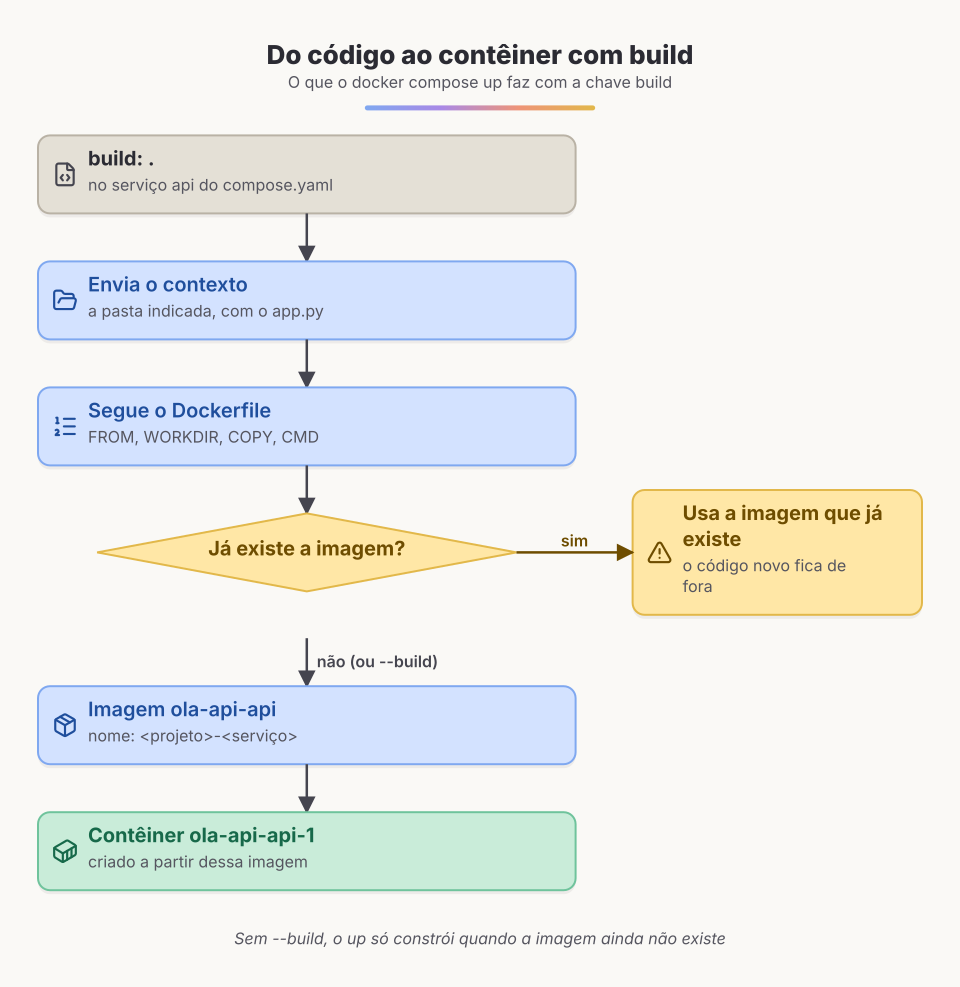

# 4. Build pelo Compose

> 🗺️ **Neste capítulo:** você vai pedir ao Compose que construa a imagem do seu próprio código a partir de um Dockerfile, escolher a pasta e o Dockerfile usados e reconstruir a imagem quando o código mudar. · ⏱️ ~40 min

> 🔥 **Aquecimento:** (1) Que comando mostra as 3 últimas linhas de log do serviço `web`? (2) Depois de um `docker compose down`, as imagens baixadas continuam na máquina?
>
> <details>
> <summary>Ver resposta</summary>
>
> (1) `docker compose logs -n 3 web`, com o nome do serviço, não o do contêiner (capítulo 3). (2) Continuam: o `down` remove contêineres e redes, mas não as imagens (capítulo 3).
>
> </details>

## De onde paramos

No capítulo 3 você subiu e derrubou projetos que usavam imagens prontas, como `nginx:1.27-alpine` e `redis:7-alpine`. Mas o seu código não está em nenhuma imagem pronta. Em *Docker do zero* você aprendeu a escrever um Dockerfile e a construí-lo com `docker build`; agora o Compose vai fazer esse passo por você.

## A chave build

Sem o Compose, rodar o seu código num contêiner leva dois comandos: `docker build -t ola-api .` para construir a imagem e `docker run -d -p 127.0.0.1:8000:8000 ola-api` para rodá-la. A cada mudança, os dois de novo. O `compose.yaml` pode guardar os dois passos.

**A chave `build` diz ao Compose para construir a imagem do serviço a partir de um Dockerfile, em vez de baixar uma imagem pronta.**

O projeto deste capítulo é uma API mínima em Python, que responde a qualquer acesso com uma frase e um número de versão. Ela usa só a biblioteca padrão do Python, então não há nada para instalar. Crie a pasta `ola-api` com três arquivos:

**ola-api/app.py**

```python
from http.server import BaseHTTPRequestHandler, HTTPServer

VERSAO = "1"


class Ola(BaseHTTPRequestHandler):
    def do_GET(self):
        corpo = f"Olá do Compose! versão {VERSAO}\n".encode()
        self.send_response(200)
        self.send_header("Content-Type", "text/plain; charset=utf-8")
        self.end_headers()
        self.wfile.write(corpo)


# 0.0.0.0 para aceitar conexões vindas de fora do contêiner
HTTPServer(("0.0.0.0", 8000), Ola).serve_forever()
```

**ola-api/Dockerfile**

```dockerfile
FROM python:3.13-slim
WORKDIR /app
COPY app.py .
# -u: sem buffer, as mensagens do Python chegam na hora ao docker compose logs
CMD ["python", "-u", "app.py"]
```

**ola-api/compose.yaml**

```yaml
services:
  api:
    # o ponto é a pasta do compose.yaml, onde está o Dockerfile
    build: .
    ports:
      - "127.0.0.1:8000:8000"
```

Não confunda os dois endereços. O `0.0.0.0` do `app.py` vale dentro do contêiner e deixa o Docker entregar as conexões à API. O `127.0.0.1` em `ports` vale no seu computador e diz que só ele chega à porta 8000.

No lugar de `image`, o serviço tem `build: .`. Antes de rodar, preveja: o `up` vai dar erro por falta de imagem, ou vai construí-la? E que nome a imagem vai receber?

```bash
cd ola-api
docker compose up -d
```

Saída (trecho; as linhas que começam com `#` são o progresso do build e foram cortadas):

```text
 Image ola-api-api Building
 Image ola-api-api Built
 Network ola-api_default Creating
 Network ola-api_default Creating
 Network ola-api_default Created
 Network ola-api_default Created
 Container ola-api-api-1 Creating
 Container ola-api-api-1 Created
 Container ola-api-api-1 Starting
 Container ola-api-api-1 Started
```

O `up` percebeu que a imagem não existia, construiu-a (`Building`, `Built`) e só depois criou a rede e o contêiner. A API responde:

```bash
curl -s localhost:8000
```

```text
Olá do Compose! versão 1
```

A imagem ganhou o nome `ola-api-api`: o nome do projeto (`ola-api`, a pasta), um hífen e o nome do serviço (`api`). Confira na lista de imagens:

```bash
docker image ls --format '{{.Repository}}:{{.Tag}}'
```

Saída (trecho):

```text
ola-api-api:latest
```

Para escolher o nome, ponha `image` junto com `build`. Com `image: ola-api:1.0` no serviço, o Compose constrói a imagem e a chama de `ola-api:1.0`. Antes de construir, porém, ele tenta baixá-la, e a saída mostra essa tentativa falhando (a segunda linha foi quebrada para caber na página):

```text
 Image ola-api:1.0 Pulling
 Image ola-api:1.0 pull access denied for ola-api, repository does not exist
   or may require 'docker login'
 Image ola-api:1.0 Building
 Image ola-api:1.0 Built
```

A linha `pull access denied` assusta, mas aqui é esperada: não existe nenhuma `ola-api` no Docker Hub, então o Compose desiste do download e constrói. O contêiner sobe normalmente.



> ⚠️ **Erro comum:** achar que o `build` exige um registro de imagens ou um `docker login`. A imagem é construída e guardada na sua máquina, como no `docker build`. A mensagem `pull access denied` com `image` + `build` só diz que o Compose não achou a imagem para baixar, e por isso foi construí-la.

## Contexto e Dockerfile

Em projetos reais, o código da API não fica na mesma pasta do `compose.yaml`. Fica numa subpasta, às vezes com um Dockerfile de nome diferente para desenvolvimento. O `build: .` não dá conta disso.

**O contexto (*context*) é a pasta enviada para o build, de onde o Dockerfile copia arquivos; o `dockerfile` é o nome do Dockerfile, procurado dentro do contexto.**

Imagine o projeto `loja`, com a API na subpasta `api` e um Dockerfile chamado `Dockerfile.dev`:

```text
loja/
├── compose.yaml
└── api/
    ├── app.py
    └── Dockerfile.dev
```

O `build` passa a ter duas chaves, no formato longo:

**loja/compose.yaml**

```yaml
services:
  api:
    build:
      # pasta enviada ao build, relativa ao compose.yaml
      context: ./api
      # relativo ao contexto: é api/Dockerfile.dev
      dockerfile: Dockerfile.dev
    image: loja-api:1.0
    ports:
      - "127.0.0.1:8000:8000"
```

O `docker compose up -d` nessa pasta constrói `loja-api:1.0` e sobe o contêiner `loja-api-1`. Quando só a pasta muda e o Dockerfile se chama `Dockerfile`, existe um atalho: `build: ./api` é o mesmo que `context: ./api` sem a linha `dockerfile`.

O `docker compose config` mostra como o Compose leu isso. No projeto `ola-api`, até o `build: .` aparece por extenso (trecho; o caminho completo da pasta foi cortado):

```text
    build:
      context: ...\ola-api
      dockerfile: Dockerfile
```

O Compose transformou o `.` num caminho completo e preencheu `dockerfile: Dockerfile`, o valor padrão.

> ⚠️ **Erro comum:** escrever o caminho do Dockerfile a partir da pasta do `compose.yaml`, como `dockerfile: api/Dockerfile.dev`. Esse caminho é relativo ao **contexto**, que já é `./api`, então o Compose procura `api/api/Dockerfile.dev` e falha. No Windows, a mensagem termina com `...\loja\api\api: The system cannot find the file specified.` Repare no `api\api`. Quando o arquivo não existe dentro do contexto, a mensagem é outra:
>
> ```text
> failed to solve: failed to read dockerfile: open Dockerfile: no such file or directory
> ```
>
> E se a pasta do contexto estiver errada (`./apii`), o build para em `unable to prepare context: path "...apii" not found`.

## up --build

Agora o problema que todo mundo encontra na primeira semana. Mude o código da API para a versão 2:

```python
VERSAO = "2"
```

Antes de rodar, preveja: depois de `docker compose up -d`, a API responde versão 1 ou 2?

```bash
docker compose up -d
curl -s localhost:8000
```

```text
 Container ola-api-api-1 Running
Olá do Compose! versão 1
```

Versão 1. O `up` viu que a imagem `ola-api-api` já existia e que o contêiner estava rodando (`Running`) e não fez nada. Ele constrói a imagem só quando ela ainda não existe; não confere se o código mudou.

**`docker compose up --build` constrói de novo as imagens dos serviços que têm `build` antes de subir, e recria os contêineres que mudaram.**

```bash
docker compose up -d --build
curl -s localhost:8000
```

```text
 Image ola-api-api Built
 Container ola-api-api-1 Recreate
 Container ola-api-api-1 Recreated
 Container ola-api-api-1 Starting
 Container ola-api-api-1 Started
Olá do Compose! versão 2
```

O Compose reconstruiu a imagem com o `app.py` novo, viu que o contêiner rodava a imagem antiga e o recriou (`Recreate`, `Recreated`).

Há também o comando que só constrói, sem subir nada: `docker compose build`. Ele é útil para conferir que o Dockerfile funciona antes de subir. Depois dele, um `docker compose up -d` comum já usa a imagem nova e recria o contêiner.

| Você rodou | Constrói a imagem? | Contêiner |
| --- | --- | --- |
| `up -d` (imagem não existe) | sim | criado |
| `up -d` (imagem já existe) | não, mesmo com código novo | continua igual |
| `up -d --build` | sim, sempre | recriado se a imagem mudou |
| `build` | sim | não mexe |

> ⚠️ **Erro comum:** tentar resolver com `down` e `up -d`. Com a API na versão 3 no código, `docker compose down` seguido de `docker compose up -d` respondeu `Olá do Compose! versão 2`. O `down` remove o contêiner, mas não a imagem, e o `up` seguinte reaproveita a imagem antiga. Mudou o código, use `--build`.

## 🧪 Lab: construir e reconstruir a ola-api

1. Crie a pasta `ola-api` com os três arquivos da seção “A chave build”: `app.py`, `Dockerfile` e `compose.yaml`.
2. Suba com `docker compose up -d`. Procure as linhas `Image ola-api-api Building` e `Built` na saída.
3. Teste com `curl -s localhost:8000` (ou abra `http://localhost:8000` no navegador). Deve aparecer `Olá do Compose! versão 1`.
4. Confira o nome da imagem com `docker image ls --format '{{.Repository}}:{{.Tag}}'`. Deve haver `ola-api-api:latest`.
5. Mude `VERSAO = "1"` para `VERSAO = "2"` no `app.py`, rode `docker compose up -d` e teste de novo. Ainda deve aparecer a versão 1.
6. Rode `docker compose up -d --build` e teste. Agora deve aparecer a versão 2, e a saída deve ter `Recreate`.
7. Derrube com `docker compose down`.

Se você já fez este lab antes, a imagem `ola-api-api` da vez anterior continua na máquina, e o passo 3 pode mostrar outra versão: é o mesmo efeito do passo 5. Comece com `docker compose up -d --build`.

Se o passo 2 falhar com `failed to read dockerfile`, confira o nome do arquivo: `Dockerfile`, com D maiúsculo e sem extensão. Veja se o editor não acrescentou uma, como `.txt`.

## 🏋️ Pratique

### 1. Exemplo resolvido

Hoje você roda a `ola-api` com dois comandos:

```bash
# primeiro constrói, depois roda a imagem construída
docker build -t ola-api:1.0 .
docker run -d -p 127.0.0.1:8000:8000 ola-api:1.0
```

Passo a passo para levar isso ao `compose.yaml`:

1. O `docker build` usa a pasta atual (`.`) como contexto e o `Dockerfile` padrão. Isso vira `build: .`.
2. O `-t ola-api:1.0` dá nome à imagem. No Compose, quem faz isso é `image: ola-api:1.0`, junto com o `build`.
3. O `-p 127.0.0.1:8000:8000` vira um item de `ports`.
4. O `-d` fica no comando: `docker compose up -d`.

**ola-api/compose.yaml**

```yaml
services:
  api:
    build: .
    # com build, image passa a ser o nome da imagem construída
    image: ola-api:1.0
    ports:
      - "127.0.0.1:8000:8000"
```

Depois do `docker compose up -d`, o `ps` confirma o nome da imagem:

```bash
docker compose ps --format '{{.Name}} {{.Image}}'
```

```text
ola-api-api-1 ola-api:1.0
```

### 2. Complete

O projeto `vendas` tem o código da API em `servicos/api`, e o Dockerfile dessa pasta se chama `Dockerfile.prod`. Complete:

```yaml
# formato longo: a pasta e o Dockerfile são diferentes do padrão
services:
  api:
    build:
      ________: ./servicos/api
      ________: ________
    ports:
      - "127.0.0.1:8000:8000"
```

<details>
<summary>Ver resposta</summary>

```yaml
services:
  api:
    build:
      # a pasta do código; o Dockerfile é procurado dentro dela
      context: ./servicos/api
      dockerfile: Dockerfile.prod
    ports:
      - "127.0.0.1:8000:8000"
```

O `dockerfile` leva apenas `Dockerfile.prod`, porque ele é procurado dentro do contexto. O erro mais comum é escrever `dockerfile: servicos/api/Dockerfile.prod`, que faz o Compose procurar o arquivo em `servicos/api/servicos/api`. Sem `image`, a imagem vai se chamar `vendas-api`.

</details>

### 3. Sozinho

Na pasta `estoque`, a API (os mesmos `app.py` e `Dockerfile` da `ola-api`) fica na subpasta `backend`. Escreva o `compose.yaml` mais curto possível que construa a imagem e publique a porta 8000. Antes de subir, preveja o nome da imagem e o do contêiner.

<details>
<summary>Ver resposta</summary>

**estoque/compose.yaml**

```yaml
services:
  api:
    # atalho: só a pasta, com o Dockerfile de nome padrão
    build: ./backend
    ports:
      - "127.0.0.1:8000:8000"
```

O `docker compose up -d` mostra `Image estoque-api Built` e `Container estoque-api-1 Started`. A imagem é `estoque-api` (projeto `estoque`, serviço `api`), e o contêiner é `estoque-api-1`. Usar o formato longo com `context: ./backend` também está certo, mas é mais comprido; a pergunta pedia o mais curto. Se você escreveu `build: .`, o Compose procurou o Dockerfile na pasta `estoque` e não achou: `failed to read dockerfile`.

</details>

### 4. Desafio

Um colega mudou o `app.py` da `ola-api` da versão 2 para a 3. Rodou `docker compose down` e depois `docker compose up -d`, “para garantir que tudo seria recriado”. O `curl` continua respondendo versão 2. Explique por que o `down` não ajudou, diga qual comando resolve e por que esse comando é melhor que apagar a imagem à mão com `docker image rm`.

<details>
<summary>Ver resposta</summary>

O `down` removeu o contêiner e a rede, mas não a imagem `ola-api-api`, que foi construída com o código da versão 2. No `up -d` seguinte, o Compose achou essa imagem e a usou, sem olhar o `app.py`. Foi o que aconteceu no teste deste capítulo: depois de `down` e `up -d`, a resposta continuou `Olá do Compose! versão 2`.

O comando que resolve é `docker compose up -d --build`: ele reconstrói a imagem com o código atual e recria o contêiner. Também funciona `docker compose build` seguido de `docker compose up -d`.

Apagar a imagem à mão até funciona, porque o próximo `up` não a acha e constrói de novo, mas exige saber o nome da imagem e dá mais trabalho. O `--build` descreve o que você quer (“construa com o código atual”) e funciona para todos os serviços com `build` do projeto de uma vez.

Uma resposta completa liga a causa (a imagem antiga continua na máquina), o comportamento do `up` (constrói só quando a imagem não existe) e a solução (`--build`).

</details>

## 🧠 Revisão rápida

1. Qual a diferença entre um serviço com `image: nginx:1.27-alpine` e um com `build: .`?
2. Que nome recebe a imagem do serviço `api`, com `build` e sem `image`, no projeto `loja`?
3. Com `context: ./api`, onde o Compose procura `dockerfile: Dockerfile.dev`?
4. Você mudou o código. Por que `docker compose up -d` não basta?
5. (Capítulo 1) Na tabela serviço × contêiner, o serviço `api` do projeto `loja` vira qual contêiner?

<details>
<summary>Ver resposta</summary>

1. Com `image`, o Compose usa (e baixa, se preciso) uma imagem pronta. Com `build`, ele constrói a imagem a partir de um Dockerfile.
2. `loja-api`: o nome do projeto, um hífen e o nome do serviço.
3. Dentro do contexto: em `api/Dockerfile.dev`, a partir da pasta do `compose.yaml`.
4. Porque o `up` reaproveita a imagem que já existe e não confere se o código mudou. Use `docker compose up -d --build`.
5. `loja-api-1`: projeto `loja`, serviço `api`, primeiro contêiner.

</details>

## 🤖 Estude com um tutor de IA

Copie e cole num assistente de IA:

```text
Estou aprendendo Docker Compose. Faça 5 perguntas, uma de cada vez,
sobre a chave build: context, dockerfile, o nome da imagem construída
e quando usar up --build. Espere minha resposta antes de comentar
e não me dê as respostas antes.
```

```text
Este é o meu compose.yaml e a estrutura de pastas do projeto.
O build falha. Me ajude a achar o caminho errado, sem me dar
o arquivo corrigido.
Pastas: <cole aqui>
Arquivo: <cole aqui>
Erro: <cole aqui>
```

> ➡️ **Próximo passo:** a porta 8000 e o número da versão estão escritos direto nos arquivos. No capítulo 5, você vai trocar valores assim por variáveis, guardadas num arquivo `.env`, sem editar o `compose.yaml`.

## 📌 Resumo

| Item | Em uma frase |
| --- | --- |
| `build: .` | Constrói a imagem do serviço com o Dockerfile da pasta do `compose.yaml` |
| Nome da imagem | `<projeto>-<serviço>`, como `ola-api-api`, ou o valor de `image`, se houver |
| `image` + `build` | Dá nome à imagem construída; a tentativa de download que falha é esperada |
| `context` | A pasta enviada ao build, relativa ao `compose.yaml` |
| `dockerfile` | O nome do Dockerfile, procurado dentro do contexto |
| `up -d` | Constrói só se a imagem ainda não existe |
| `up -d --build` | Reconstrói e recria os contêineres que mudaram |
| `docker compose build` | Só constrói, sem subir nada |

## 📚 Fontes

- [Compose Build Specification](https://docs.docker.com/reference/compose-file/build/) (conferido em 20/11/2026)
- [docker compose up](https://docs.docker.com/reference/cli/docker/compose/up/) (conferido em 20/11/2026)

> 🔁 **Revise hoje:** capítulos 1 e 3

<!-- nav:start -->
---

[◀ Capítulo anterior](03-primeiro-compose-yaml.md) · [Mapa do livro](../README.md) · [Próximo capítulo ▶](05-variaveis-env-e-configuracao.md)
<!-- nav:end -->
