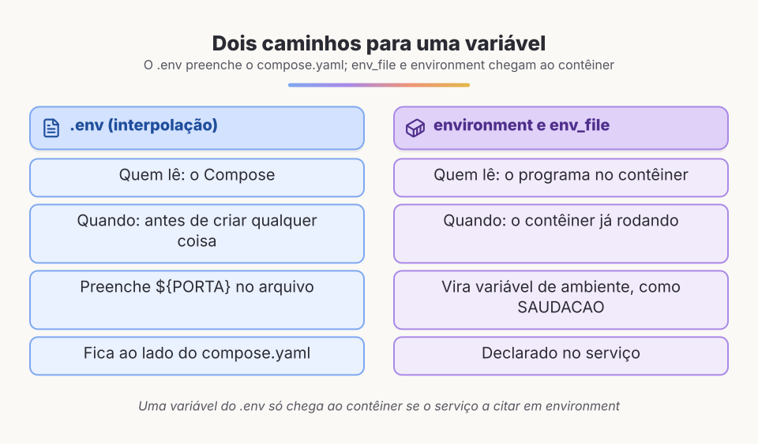

# 5. Variáveis, .env e configuração

> 🗺️ **Neste capítulo:** você vai trocar valores fixos do `compose.yaml` por variáveis, guardar os valores num arquivo `.env`, entregar variáveis de ambiente ao contêiner com `environment` e `env_file` e conferir tudo com `docker compose config`. · ⏱️ ~40 min

> 🔥 **Aquecimento:** (1) Você mudou o `app.py` da `ola-api`. Que comando sobe o projeto já com o código novo? (2) Que comando lê o `compose.yaml` e mostra como o Compose o entendeu, sem criar nada?
>
> <details>
> <summary>Ver resposta</summary>
>
> (1) `docker compose up -d --build`: sem o `--build`, o `up` reaproveita a imagem antiga (capítulo 4). (2) `docker compose config` (capítulo 3).
>
> </details>

## De onde paramos

No capítulo 4 a `ola-api` passou a ser construída pelo Compose, mas a porta 8000 continua escrita no arquivo. Se um colega já usa a 8000 para outra coisa, ele precisa editar o `compose.yaml`, e a mudança dele vai parar no Git. Neste capítulo, cada pessoa ajusta os valores sem mexer no arquivo do projeto.

## Interpolação

O `compose.yaml` é de todos: fica no Git e é o mesmo para a equipe inteira. Mas alguns valores mudam de máquina para máquina, como a porta livre ou a saudação de teste. É preciso um jeito de deixar um espaço em branco no arquivo e preenchê-lo de fora.

**Interpolação é a troca, feita pelo Compose ao ler o arquivo, de cada `${NOME}` pelo valor da variável `NOME`.**

A `ola-api` deste capítulo ganhou uma novidade: a saudação vem de uma variável de ambiente, `SAUDACAO`, em vez de estar fixa no código.

**ola-api/app.py**

```python
import os
from http.server import BaseHTTPRequestHandler, HTTPServer

# lida uma vez, na partida: mudar a variável pede um novo contêiner
SAUDACAO = os.environ.get("SAUDACAO", "Olá")


class Ola(BaseHTTPRequestHandler):
    def do_GET(self):
        corpo = f"{SAUDACAO} do Compose!\n".encode()
        self.send_response(200)
        self.send_header("Content-Type", "text/plain; charset=utf-8")
        self.end_headers()
        self.wfile.write(corpo)


# 0.0.0.0 para aceitar conexões vindas de fora do contêiner
HTTPServer(("0.0.0.0", 8000), Ola).serve_forever()
```

O `Dockerfile` é o mesmo do capítulo 4. No `compose.yaml`, a porta do host e a saudação viram variáveis:

**ola-api/compose.yaml**

```yaml
services:
  api:
    build: .
    ports:
      # porta do host vem de PORTA; sem ela, 8000
      - "127.0.0.1:${PORTA:-8000}:8000"
    environment:
      SAUDACAO: ${SAUDACAO:-Olá}
```

A forma `${PORTA:-8000}` diz: use o valor de `PORTA`; se ela não existir ou estiver vazia, use `8000`. O valor depois de `:-` é o padrão (*default*).

Antes de rodar, preveja: sem nenhuma variável definida, que porta e que saudação o Compose vai usar?

```bash
docker compose config
```

Saída (trecho):

```text
      SAUDACAO: Olá
        published: "8000"
```

Os dois padrões entraram. A interpolação aconteceu antes de qualquer contêiner existir: o `config` já mostra o arquivo com os valores no lugar das variáveis.

Há outras formas, para outros casos:

| Forma | Sem a variável | Variável vazia |
| --- | --- | --- |
| `${PORTA}` | texto vazio, com aviso | texto vazio |
| `${PORTA:-8000}` | `8000` | `8000` |
| `${PORTA-8000}` | `8000` | texto vazio |
| `${PORTA:?mensagem}` | erro com a mensagem | erro com a mensagem |

A última serve para valores sem padrão possível, que a pessoa precisa definir. Com `SAUDACAO: ${SAUDACAO:?defina SAUDACAO no .env}` e sem a variável, o Compose recusa o arquivo (linha quebrada para caber na página):

```text
error while interpolating services.api.environment.SAUDACAO:
  required variable SAUDACAO is missing a value: defina SAUDACAO no .env
```

> ⚠️ **Erro comum:** escrever `${SAUDACAO}` sem padrão e não perceber que a variável faltou. O Compose não para; ele avisa e segue com um valor vazio:
>
> ```text
> level=warning msg="The \"SAUDACAO\" variable is not set. Defaulting to a blank string."
> ```
>
> No meio de outras linhas, o aviso passa batido, e o contêiner sobe com `SAUDACAO: ""`. Dê um padrão com `:-` ou exija o valor com `:?`.

## O arquivo .env

Definir as variáveis no terminal antes de cada comando não é prático, e some quando o terminal fecha. O Compose procura os valores num arquivo.

**O `.env` é um arquivo de texto, na pasta do projeto ao lado do `compose.yaml`, com uma variável por linha no formato `NOME=valor`, que o Compose lê automaticamente para fazer a interpolação.**

**ola-api/.env**

```text
PORTA=8081
SAUDACAO=Bom dia
```

Antes de rodar, preveja: o `config` vai mostrar os padrões ou os valores do `.env`?

```bash
docker compose config
```

Saída (trecho):

```text
      SAUDACAO: Bom dia
        published: "8081"
```

Os valores do `.env` venceram os padrões. Agora suba e teste na porta nova:

```bash
docker compose up -d --build
curl -s localhost:8081
```

```text
Bom dia do Compose!
```

Para mudar um valor, edite o `.env` e rode `docker compose up -d` de novo. Com `SAUDACAO=Boa tarde`, o Compose percebe que a configuração do serviço mudou e recria o contêiner sozinho, sem `--build`, porque a imagem é a mesma:

```text
 Container ola-api-api-1 Recreate
 Container ola-api-api-1 Recreated
 Container ola-api-api-1 Starting
 Container ola-api-api-1 Started
```

O `curl` passa a responder `Boa tarde do Compose!`. As aspas no `.env` são opcionais: `SAUDACAO="Bom dia"` e `SAUDACAO=Bom dia` deram o mesmo resultado.

Como o `.env` guarda valores de cada máquina, ele não costuma ir para o Git. O comum é versionar um modelo, como `.env.exemplo`, com nomes e valores de exemplo, e cada pessoa copiar para `.env`. No capítulo 12 você vai ver que senhas pedem mais cuidado do que isso.

Para usar outro arquivo no lugar do `.env`, passe `--env-file`. Com `prod.env` contendo só `PORTA=9000`, o comando `docker compose --env-file prod.env config` mostrou `published: "9000"` e `SAUDACAO: Olá`: o `.env` não foi lido, e a saudação voltou ao padrão.

> ⚠️ **Erro comum:** ter uma variável com o mesmo nome definida no terminal. Ela vence o `.env`, sem aviso. No Bash, `PORTA=8082 docker compose config` mostrou `published: "8082"`, mesmo com `PORTA=8081` no `.env`. A ordem é: variável do terminal, depois `--env-file`, depois `.env`. Se o `config` mostra um valor que você não reconhece, confira o terminal com `echo $PORTA` (no Bash). No PowerShell a variável seria `$env:PORTA`; esse caso não foi testado para este livro.

## environment e env_file

A interpolação preenche o `compose.yaml`. Mas o programa dentro do contêiner, a `ola-api`, lê variáveis de ambiente do próprio contêiner. São dois lugares diferentes, e uma variável do `.env` não passa sozinha de um para o outro.

**`environment` define variáveis de ambiente do contêiner, uma a uma, no `compose.yaml`; `env_file` aponta um arquivo com variáveis que vão inteiras para o contêiner.**

No arquivo da `ola-api`, a linha `SAUDACAO: ${SAUDACAO:-Olá}` faz as duas coisas em sequência: a interpolação busca o valor no `.env` e o `environment` entrega o resultado ao contêiner.



Quando há muitas variáveis para o contêiner, listá-las uma a uma em `environment` alonga o arquivo. O `env_file` lê de um arquivo próprio:

**ola-api/app.env**

```text
SAUDACAO=Boa noite
```

```yaml
# as variáveis de app.env vão direto para o contêiner
services:
  api:
    build: .
    ports:
      - "127.0.0.1:8000:8000"
    env_file:
      - app.env
```

Com esse `compose.yaml`, o `curl -s localhost:8000` respondeu `Boa noite do Compose!`, e o `config` mostrou o conteúdo do arquivo como `environment`:

```text
    environment:
      SAUDACAO: Boa noite
```

O caminho de `env_file` é relativo ao `compose.yaml`. Se o arquivo não existir, o Compose para (trecho; caminho cortado e linha quebrada para caber na página):

```text
env file ...\apps.env not found: GetFileAttributesEx ...\apps.env:
  The system cannot find the file specified.
```

Quando a mesma variável aparece nos dois, `environment` vence: com `SAUDACAO=Boa noite` no `app.env` e `SAUDACAO: Oi` em `environment`, o `config` mostrou `SAUDACAO: Oi`.

| | `.env` | `env_file` |
| --- | --- | --- |
| Quem lê | o Compose | o contêiner |
| Para quê | preencher `${...}` no `compose.yaml` | definir variáveis de ambiente do serviço |
| Como é achado | automaticamente, na pasta do projeto | só se o serviço citar o arquivo |
| Vale para | o arquivo todo | o serviço que o cita |

> ⚠️ **Erro comum:** pôr `SAUDACAO=Bom dia` no `.env` e esperar que o contêiner a receba. Num teste com o `.env` do capítulo e um serviço sem `SAUDACAO` em `environment`, a porta 8081 funcionou (a interpolação de `${PORTA}` usou o `.env`), mas a resposta foi `Olá do Compose!`, o padrão do código. O `.env` só chega ao contêiner por uma linha de `environment` que o cite, ou se você o usar também como `env_file`.

## docker compose config

Com padrões, `.env`, variáveis do terminal, `env_file` e `environment`, o valor final de uma chave pode vir de vários lugares. Adivinhar não funciona; é preciso ver o resultado.

**`docker compose config` mostra o `compose.yaml` como o Compose vai usá-lo: com as variáveis já trocadas, os `env_file` lidos e os erros apontados.**

Você já usou o `config` para achar erros de estrutura no capítulo 3. Aqui, ele responde de onde veio cada valor: se o `config` mostra `published: "8082"` e o seu `.env` diz `8081`, a variável veio de outro lugar (o terminal). Para ver só as variáveis que o Compose usou na interpolação, use `--environment`:

```bash
docker compose config --environment
```

Saída (trecho; a lista traz também as variáveis do seu terminal):

```text
PORTA=8081
SAUDACAO=Bom dia
```

Crie o hábito: mudou o `.env` ou o `compose.yaml`, rode `docker compose config` antes do `up`.

> ⚠️ **Erro comum:** copiar a saída do `config` para o lugar do `compose.yaml`, “porque está mais completa”. Ela já tem os valores da sua máquina no lugar das variáveis, e caminhos completos da sua pasta (como o `context` do capítulo 4). O arquivo do projeto continua sendo o seu, com as variáveis; o `config` serve para conferir.

## 🧪 Lab: a ola-api configurável

1. Na pasta `ola-api` do capítulo 4, troque o `app.py` e o `compose.yaml` pelos da seção “Interpolação”. O `Dockerfile` continua o mesmo.
2. Rode `docker compose config` e confira `SAUDACAO: Olá` e `published: "8000"`.
3. Crie o `.env` com `PORTA=8081` e `SAUDACAO=Bom dia`. Rode o `config` de novo: os valores devem mudar.
4. Suba com `docker compose up -d --build` e teste: `curl -s localhost:8081` deve responder `Bom dia do Compose!`.
5. Mude a saudação no `.env` para `Boa tarde`, rode `docker compose up -d` e procure `Recreate` na saída. Teste de novo.
6. No Bash, rode `PORTA=8082 docker compose config` e veja o terminal vencer o `.env`. Depois rode o `config` sem o `PORTA=8082` na frente: volta `8081`.
7. Derrube com `docker compose down`.

## 🏋️ Pratique

### 1. Exemplo resolvido

O `meu-site` dos capítulos 1 e 3 tem a porta e o fuso horário fixos. Você quer que cada pessoa possa trocá-los sem editar o arquivo, mantendo os valores de hoje como padrão.

1. Ache os valores que variam: a porta do host (`8080`) e o fuso (`America/Sao_Paulo`). A porta do contêiner (`80`) não muda, porque é a do nginx.
2. Dê nomes claros às variáveis: `PORTA_SITE` e `FUSO`.
3. Troque cada valor por `${NOME:-valor de hoje}`, para que o projeto funcione mesmo sem `.env`.

**meu-site/compose.yaml**

```yaml
services:
  web:
    image: nginx:1.27-alpine
    ports:
      # só a porta do host varia; a 80 é a do nginx
      - "127.0.0.1:${PORTA_SITE:-8080}:80"
    volumes:
      - ./site:/usr/share/nginx/html:ro
    environment:
      TZ: ${FUSO:-America/Sao_Paulo}
```

4. Confira sem `.env`: o `config` mostra `published: "8080"` e `TZ: America/Sao_Paulo`.
5. Crie um `.env` com `PORTA_SITE=8090` e `FUSO=America/Manaus` e confira de novo: `published: "8090"` e `TZ: America/Manaus`.

### 2. Complete

No projeto `ola-api`, a saudação deve ter `Olá` como padrão, e a porta do host não pode ter padrão: quem rodar o projeto precisa escolher uma. Complete:

```yaml
# PORTA é obrigatória; SAUDACAO tem padrão
services:
  api:
    build: .
    ports:
      - "127.0.0.1:${PORTA____escolha uma porta no .env}:8000"
    environment:
      SAUDACAO: ${SAUDACAO____Olá}
```

<details>
<summary>Ver resposta</summary>

```yaml
services:
  api:
    build: .
    ports:
      # :? para com erro se PORTA faltar ou estiver vazia
      - "127.0.0.1:${PORTA:?escolha uma porta no .env}:8000"
    environment:
      SAUDACAO: ${SAUDACAO:-Olá}
```

Sem `PORTA`, o `config` para com `required variable PORTA is missing a value: escolha uma porta no .env`. Erros comuns: usar `-` sem os dois-pontos, que aceita variável vazia como valor válido; e trocar os sinais, pondo `:?` na saudação, o que obrigaria todos a defini-la.

</details>

### 3. Sozinho

O projeto `cache` (Redis, dos capítulos 1 e 3) publica a porta 6379. Faça a porta do host vir da variável `PORTA_CACHE`, com 6379 como padrão. Depois crie um `.env` que use a 6380. Antes de subir, preveja o que o `docker compose ps` vai mostrar na coluna de portas.

<details>
<summary>Ver resposta</summary>

**cache/compose.yaml**

```yaml
services:
  cache:
    image: redis:7-alpine
    ports:
      # a porta de dentro continua 6379: é a do Redis
      - "127.0.0.1:${PORTA_CACHE:-6379}:6379"
```

**cache/.env**

```text
PORTA_CACHE=6380
```

Sem o `.env`, o `config` mostra `published: "6379"`; com ele, `published: "6380"`. Depois do `up -d`, o `docker compose ps --format '{{.Name}} {{.Ports}}'` mostrou:

```text
cache-cache-1 127.0.0.1:6380->6379/tcp
```

A porta do host é a 6380 e a do contêiner continua 6379. Se você pôs a variável também do lado direito (`${PORTA_CACHE}:${PORTA_CACHE}`), o host fica certo, mas o Redis continua escutando na 6379 dentro do contêiner e a porta 6380 de dentro não leva a lugar nenhum.

</details>

### 4. Desafio

Uma colega tem este `.env` na `ola-api`:

```text
PORTA=8081
SAUDACAO=Bom dia
```

E reclama de duas coisas. Primeira: o `docker compose config` mostra `published: "8082"`. Segunda: num `compose.yaml` que ela mesma escreveu, sem a chave `environment`, a API responde `Olá do Compose!`, e não `Bom dia`. Explique cada problema, diga como confirmar a causa e como corrigir.

<details>
<summary>Ver resposta</summary>

**Porta 8082.** Existe uma variável `PORTA=8082` no terminal dela, e a variável do terminal vence o `.env`, sem aviso. Para confirmar, `echo $PORTA` no Bash mostra `8082`, e `docker compose config --environment` também mostra `PORTA=8082`. Para corrigir, feche e abra o terminal, ou remova a variável com `unset PORTA` (Bash).

**Saudação padrão.** O `.env` serve para a interpolação: ele só preenche `${...}` no `compose.yaml`. Sem uma linha em `environment` que cite `SAUDACAO`, a variável não chega ao contêiner, e o código usa o padrão `Olá`. Para corrigir, acrescente ao serviço:

```yaml
    # leva o valor do .env até o contêiner
    environment:
      SAUDACAO: ${SAUDACAO:-Olá}
```

Uma resposta completa nomeia as duas regras: a ordem de prioridade (terminal, depois `--env-file`, depois `.env`) e a separação entre interpolação (`.env`, lido pelo Compose) e ambiente do contêiner (`environment` e `env_file`). Um erro comum é tentar resolver a segunda pondo `env_file: .env`: funciona, mas manda ao contêiner todas as variáveis do `.env`, inclusive a `PORTA`, que ele não usa.

</details>

## 🧠 Revisão rápida

1. O que a forma `${PORTA:-8000}` faz quando `PORTA` não existe? E quando existe com o valor `8081`?
2. Onde fica o arquivo `.env`, e quem o lê?
3. Por que uma variável do `.env` pode não chegar ao contêiner?
4. Você mudou só a `SAUDACAO` no `.env`. Precisa de `--build`?
5. (Capítulo 4) Com `context: ./api` e `dockerfile: Dockerfile.dev`, qual é o caminho do Dockerfile a partir da pasta do `compose.yaml`?

<details>
<summary>Ver resposta</summary>

1. Sem a variável, o Compose usa `8000`; com `PORTA=8081`, usa `8081`.
2. Na pasta do projeto, ao lado do `compose.yaml`. Quem o lê é o Compose, para trocar os `${...}` do arquivo.
3. Porque o `.env` só serve à interpolação. A variável chega ao contêiner por `environment` (como `SAUDACAO: ${SAUDACAO}`) ou por um `env_file`.
4. Não. A imagem é a mesma; muda só a configuração do contêiner, e um `docker compose up -d` o recria.
5. `api/Dockerfile.dev`, porque o `dockerfile` é relativo ao contexto.

</details>

## 🤖 Estude com um tutor de IA

Copie e cole num assistente de IA:

```text
Estou aprendendo Docker Compose. Faça 5 perguntas, uma de cada vez,
sobre interpolação de variáveis, o arquivo .env, environment e env_file.
Misture perguntas de "o que acontece se..." com perguntas de prioridade.
Espere minha resposta antes de comentar e não me dê as respostas antes.
```

```text
Este é o meu compose.yaml, o meu .env e a saída do docker compose config.
Um valor não está como eu esperava. Me ajude a descobrir de onde ele
veio, sem me dar a resposta direto: me faça perguntas.
Arquivos e saída: <cole aqui>
```

> ➡️ **Próximo passo:** até aqui cada projeto teve um serviço só. No capítulo 6, a API ganha um banco de dados, e você vai ver como um serviço encontra o outro pela rede do projeto, usando o nome do serviço como endereço.

## 📌 Resumo

| Item | Em uma frase |
| --- | --- |
| Interpolação | O Compose troca cada `${NOME}` pelo valor da variável ao ler o arquivo |
| `${NOME:-padrão}` | Usa o padrão se a variável faltar ou estiver vazia |
| `${NOME:?mensagem}` | Para com erro se a variável faltar ou estiver vazia |
| `.env` | Arquivo `NOME=valor` ao lado do `compose.yaml`, lido pelo Compose para a interpolação |
| Prioridade | Terminal, depois `--env-file`, depois `.env` |
| `environment` | Variáveis de ambiente do contêiner, uma a uma, no serviço |
| `env_file` | Arquivo de variáveis que vão inteiras para o contêiner; `environment` vence |
| `docker compose config` | Mostra os valores finais; `--environment` lista as variáveis usadas |

## 📚 Fontes

- [Variable interpolation](https://docs.docker.com/compose/how-tos/environment-variables/variable-interpolation/) (conferido em 20/11/2026)
- [Environment variables precedence](https://docs.docker.com/compose/how-tos/environment-variables/envvars-precedence/) (conferido em 20/11/2026)
- [Set environment variables within your container's environment](https://docs.docker.com/compose/how-tos/environment-variables/set-environment-variables/) (conferido em 20/11/2026)

> 🔁 **Revise hoje:** capítulos 2 e 4

<!-- nav:start -->
---

[◀ Capítulo anterior](04-build-pelo-compose.md) · [Mapa do livro](../README.md) · [Próximo capítulo ▶](06-varios-servicos-e-a-rede-do-projeto.md)
<!-- nav:end -->
