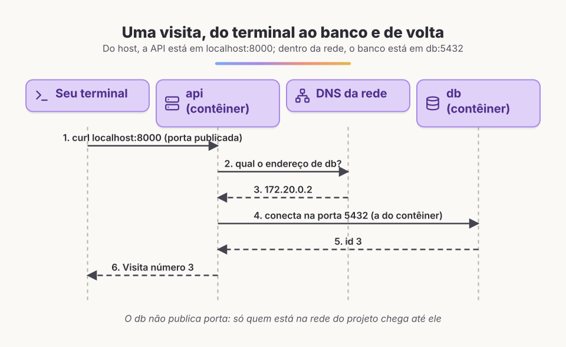

# 6. Vários serviços e a rede do projeto

> 🗺️ **Neste capítulo:** você vai montar um projeto com dois serviços, uma API e um banco PostgreSQL, e fazer a API achar o banco pelo nome do serviço, sem IP e sem publicar a porta do banco. No fim, você vê o que o `127.0.0.1` na frente das portas evita. · ⏱️ ~45 min

> 🔥 **Aquecimento:** (1) No `compose.yaml`, o que faz `${DB_SENHA:?defina DB_SENHA no .env}` quando a variável falta? (2) Uma variável que está só no `.env` chega sozinha ao contêiner?
>
> <details>
> <summary>Ver resposta</summary>
>
> (1) O Compose para com um erro que termina na mensagem `defina DB_SENHA no .env` (capítulo 5). (2) Não: o `.env` serve à interpolação; a variável chega ao contêiner por `environment` ou `env_file` (capítulo 5).
>
> </details>

## De onde paramos

No capítulo 5 a `ola-api` ficou configurável por variáveis. Mas ela ainda vive sozinha: não guarda nada e não conversa com ninguém. Aplicações reais têm pelo menos um banco de dados, e é aqui que o Compose mostra para que serve descrever **vários** serviços no mesmo arquivo.

## A rede padrão do projeto

Em *Docker do zero*, para dois contêineres conversarem, você criava uma rede com `docker network create` e lembrava de pôr `--network` em cada `docker run`. Esquecer em um deles bastava para a conversa falhar.

**A rede do projeto é uma rede que o Compose cria no `up`, com o nome `<projeto>_default`, e na qual liga todos os serviços do arquivo, sem que você precise declará-la.**

Você já viu essa rede em todas as saídas de `up` e `down` desde o capítulo 1, como `meu-site_default`. Até agora ela tinha um só contêiner. Neste capítulo, ela ganha dois.

O projeto é um contador de visitas: a cada acesso, a API grava uma linha numa tabela do PostgreSQL e responde com o número da visita. Crie a pasta `contador` com quatro arquivos.

<!-- project: contador | run: cd contador && docker compose config --services | expect: db -->

**contador/app.py**

```python
import os
from http.server import BaseHTTPRequestHandler, HTTPServer

import psycopg

# o endereço do banco vem do compose.yaml: o nome do serviço
CONEXAO = {
    "host": os.environ.get("DB_HOST", "db"),
    "port": os.environ.get("DB_PORTA", "5432"),
    "user": "postgres",
    "password": os.environ["DB_SENHA"],
    "connect_timeout": 3,
}


class Contador(BaseHTTPRequestHandler):
    def do_GET(self):
        try:
            # uma conexão por acesso: a API não cai se o banco sumir
            with psycopg.connect(**CONEXAO) as banco:
                banco.execute(
                    "CREATE TABLE IF NOT EXISTS visitas (id serial PRIMARY KEY)"
                )
                linha = banco.execute(
                    "INSERT INTO visitas DEFAULT VALUES RETURNING id"
                ).fetchone()
            status, texto = 200, f"Visita número {linha[0]}\n"
        except psycopg.OperationalError as erro:
            status, texto = 503, f"Sem banco: {erro}\n"
        corpo = texto.encode()
        self.send_response(status)
        self.send_header("Content-Type", "text/plain; charset=utf-8")
        self.end_headers()
        self.wfile.write(corpo)


# 0.0.0.0 para aceitar conexões vindas de fora do contêiner
HTTPServer(("0.0.0.0", 8000), Contador).serve_forever()
```

A API usa a biblioteca `psycopg` para falar com o PostgreSQL. Quando não consegue se conectar, ela não cai: responde com `Sem banco:` e a mensagem do erro, o que vai ajudar a diagnosticar problemas de rede neste capítulo.

**contador/Dockerfile**

```dockerfile
FROM python:3.13-slim
WORKDIR /app
# versão fixa: o build de amanhã instala a mesma biblioteca
RUN pip install --no-cache-dir "psycopg[binary]==3.3.9"
COPY app.py .
CMD ["python", "-u", "app.py"]
```

**contador/.env**

```text
DB_SENHA=troque-esta-senha
```

**contador/compose.yaml**

```yaml
services:
  api:
    build: .
    ports:
      - "127.0.0.1:8000:8000"
    environment:
      # o nome do serviço do banco, logo abaixo, é o endereço
      DB_HOST: db
      DB_SENHA: ${DB_SENHA:?defina DB_SENHA no .env}
  db:
    image: postgres:17
    # sem ports: o banco não fica acessível pelo host
    environment:
      POSTGRES_PASSWORD: ${DB_SENHA:?defina DB_SENHA no .env}
```

A mesma variável `DB_SENHA` serve aos dois serviços: a imagem `postgres` cria o usuário `postgres` com a senha de `POSTGRES_PASSWORD`, e a API usa a mesma senha para entrar. A senha num `.env` de texto é provisória; o capítulo 12 mostra como entregá-la com mais cuidado.

Antes de rodar, preveja: quantos contêineres e quantas redes o `up` vai criar?

```bash
cd contador
docker compose up -d
```

Saída (trecho; as linhas do build e do download das imagens foram cortadas):

```text
 Image contador-api Built
 Network contador_default Creating
 Network contador_default Creating
 Network contador_default Created
 Network contador_default Created
 Container contador-db-1 Creating
 Container contador-api-1 Creating
 Container contador-api-1 Created
 Container contador-db-1 Created
 Container contador-db-1 Starting
 Container contador-api-1 Starting
 Container contador-db-1 Started
 Container contador-api-1 Started
```

Uma rede e dois contêineres, criados e iniciados ao mesmo tempo. Espere uns cinco segundos, para o PostgreSQL terminar de iniciar, e acesse a API duas vezes:

```bash
curl -s localhost:8000
curl -s localhost:8000
```

```text
Visita número 1
Visita número 2
```

A API achou o banco e gravou duas visitas. Para conferir quem está na rede, peça ao Docker os contêineres ligados a ela:

```bash
docker network inspect contador_default \
  --format '{{range .Containers}}{{.Name}} {{.IPv4Address}}{{"\n"}}{{end}}'
```

```text
contador-api-1 172.20.0.3/16
contador-db-1 172.20.0.2/16
```

Os dois contêineres estão na mesma rede, cada um com um IP. Você não precisou escrever nenhuma linha sobre rede no `compose.yaml`.

> ⚠️ **Erro comum:** acessar a API logo depois do `up -d` e estranhar uma resposta vazia ou um `Sem banco:`. O `Started` quer dizer que o contêiner começou, não que o programa dentro dele está pronto: o PostgreSQL leva alguns segundos para aceitar conexões. Espere e tente de novo. O capítulo 8 resolve isso de vez, fazendo a API esperar o banco.

## O nome do serviço como endereço

Os IPs da saída anterior, `172.20.0.2` e `172.20.0.3`, foram escolhidos pelo Docker e podem mudar a cada `up`. Se a API dependesse do IP do banco, quebraria na próxima vez.

**Na rede do projeto, o nome de cada serviço funciona como endereço: quando um contêiner procura `db`, o Docker responde com o IP atual do contêiner do serviço `db`.**

É por isso que o `compose.yaml` diz `DB_HOST: db`, e é o mesmo nome escrito como chave em `services`. O nome do serviço é o endereço; o nome do contêiner (`contador-db-1`) e o IP ficam por conta do Docker.

> 💡 **Analogia:** volte à loja do capítulo 1, a do quadro de funcionários. Lá dentro há um telefone interno, com um ramal para cada cargo. Quem precisa do estoque disca “estoque”, e não o número da mesa de quem está no estoque hoje.
>
> - A rede do projeto é a central de ramais da loja: só quem trabalha na loja está ligado a ela.
> - O nome do serviço (`db`) é o nome do ramal. O IP do contêiner é a mesa, que muda quando a pessoa do cargo é trocada.
> - O DNS da rede é a telefonista: na hora da chamada, ela liga o nome do ramal à mesa certa.
> - O `ports` é a linha externa: só por ela alguém de fora da loja consegue ligar, e só para o número que foi publicado.
>
> **Onde a analogia para de valer:** a telefonista diz onde o ramal está, mas não confere se alguém vai atender. Um `Connection refused` com o nome já resolvido, como no erro da porta 15432, mais adiante, é o ramal certo tocando numa mesa onde ninguém atende. Saber se há alguém pronto para atender é o assunto do capítulo 8.



Antes de rodar, preveja: se o `compose.yaml` disser `DB_HOST: banco`, um nome que não é de nenhum serviço, o que a API responde?

```text
Sem banco: failed to resolve host 'banco': [Errno -2] Name or service not known
```

`failed to resolve host`: ninguém na rede se chama `banco`. O nome precisa ser exatamente o de um serviço do arquivo.

> ⚠️ **Erro comum:** usar `localhost` como endereço do banco, porque “o banco está na minha máquina”. Dentro de um contêiner, `localhost` é o próprio contêiner. Com `DB_HOST: localhost`, a API procura o PostgreSQL dentro do contêiner da API, onde ele não existe (trecho):
>
> ```text
> Sem banco: connection failed: connection to server at "127.0.0.1", port 5432 failed: Connection refused
> 	Is the server running on that host and accepting TCP/IP connections?
> ```
>
> `Connection refused` em `127.0.0.1` quer dizer “cheguei ao endereço, mas ninguém atende nessa porta”. Troque `localhost` pelo nome do serviço.

## ports e a rede interna

Repare que o serviço `db` não tem `ports`. Mesmo assim a API chegou a ele. Isso confunde quem vem do `docker run`, onde o `-p` parecia necessário para “abrir” um contêiner.

**`ports` publica uma porta do contêiner no host, para quem está fora da rede do projeto; entre serviços da mesma rede, todas as portas do contêiner já estão alcançáveis, sem `ports`.**

O `docker compose ps` mostra a diferença:

```bash
docker compose ps \
  --format 'table {{.Name}}\t{{.Service}}\t{{.Status}}\t{{.Ports}}'
```

```text
NAME             SERVICE   STATUS         PORTS
contador-api-1   api       Up 7 seconds   127.0.0.1:8000->8000/tcp
contador-db-1    db        Up 7 seconds   5432/tcp
```

A API tem a seta `127.0.0.1:8000->8000`: a porta 8000 do host, só nesta máquina, leva à 8000 do contêiner, e é por ela que o seu `curl` entra. O banco mostra só `5432/tcp`, sem seta: a porta existe dentro da rede, mas não foi publicada no host. Do seu terminal, ninguém chega ao banco; só os serviços do projeto chegam.

| | Do host (seu terminal, navegador) | De outro serviço do projeto |
| --- | --- | --- |
| Endereço | `localhost` | o nome do serviço, como `db` |
| Porta | a publicada, a da esquerda em `ports` | a do contêiner, a da direita |
| Precisa de `ports`? | sim | não |
| Exemplo | `localhost:8000` | `db:5432` |

Deixar o banco sem `ports` é a escolha mais segura: um banco publicado fica ao alcance de qualquer programa da sua máquina, e às vezes da rede em volta dela.

## Publicar só para a sua máquina

Desde o capítulo 1, toda porta deste livro tem `127.0.0.1` na frente. Muitos tutoriais, e a própria documentação do Docker, escrevem só `"8000:8000"`. Com essa forma, a linha da API no `ps` seria `0.0.0.0:8000->8000/tcp, [::]:8000->8000/tcp`. O `0.0.0.0` (e o `[::]`, a mesma ideia no IPv6) quer dizer “todos os endereços desta máquina”. Isso inclui o `localhost` e também o endereço que o seu computador tem no Wi-Fi de casa, do café ou do escritório. Quem estiver nessa rede e digitar esse endereço com `:8000` pode chegar à sua API, se o firewall da máquina deixar.

**Uma porta escrita com um endereço na frente, como `"127.0.0.1:8000:8000"`, é publicada só nesse endereço do host; com `127.0.0.1`, só a própria máquina chega a ela. Sem endereço, o Docker publica a porta em todos os endereços do host.**

A documentação do Docker avisa, em destaque, que publicar portas é *insecure by default*, inseguro por padrão, justamente porque a porta fica aberta para fora da máquina. Na sua máquina de desenvolvimento, quase sempre só você precisa chegar à API.

Para ver onde uma porta foi publicada, há dois comandos: `docker compose port`, com o nome do serviço e a porta do contêiner, e `docker port`, com o nome do contêiner. Num teste feito para a edição 1.2 deste livro, com o contador de pé e `"8000:8000"`, sem endereço, eles mostraram:

```bash
docker compose port api 8000
docker port contador-api-1
```

```text
0.0.0.0:8000
8000/tcp -> 0.0.0.0:8000
8000/tcp -> [::]:8000
```

O `docker compose port` responde com um endereço só; o `docker port` lista todos, e mostra que a porta estava aberta no IPv4 e no IPv6. No mesmo teste, a API respondeu também pelo endereço que a máquina tinha na rede local, `192.168.1.15`, do jeito que um colega chegaria a ela do notebook dele:

```bash
curl -s 192.168.1.15:8000
```

```text
Visita número 3
```

Esse teste não está no lab, de propósito: ele abre a sua API para a rede em que você estiver. Com o `compose.yaml` deste capítulo, que já tem o `127.0.0.1`, confira o contrário. Para achar o endereço da sua máquina na rede local, use `ipconfig` no Windows ou `hostname -I` no Linux, e ponha-o no lugar de `192.168.1.15`. Antes de rodar, preveja: o `curl` em `localhost:8000` funciona? E pelo endereço da rede?

```bash
# confere onde a porta abriu e tenta de dentro e de fora
docker compose port api 8000
docker port contador-api-1
curl -s localhost:8000
curl -sS 192.168.1.15:8000
```

Saída (a última linha foi quebrada para caber na página):

```text
127.0.0.1:8000
8000/tcp -> 127.0.0.1:8000
Visita número 3
curl: (7) Failed to connect to 192.168.1.15:8000 after 2022 ms:
  Could not connect to server
```

Os dois comandos mostram só `127.0.0.1:8000`, sem a linha do IPv6. O `localhost` funciona, porque o seu terminal está na própria máquina, e o endereço da rede não responde.

Abrir a porta para outras máquinas fica para quando você precisa disso de verdade, como a porta 80 de um servidor de produção, no capítulo 11. Nesse caso, o livro escreve o endereço `0.0.0.0` por extenso, para a escolha ficar visível no arquivo.

| `ports` | Onde a porta abre | Quem chega a ela |
| --- | --- | --- |
| `"8000:8000"` | todos os endereços do host (`0.0.0.0` e `[::]`) | a sua máquina e quem estiver na mesma rede |
| `"127.0.0.1:8000:8000"` | só o endereço local (`127.0.0.1`) | só a sua máquina |

> ⚠️ **Erro comum:** no Windows, trocar a porta e rodar o `up -d` logo depois de vários `curl`. No teste, a API não subiu, com esta mensagem (trecho):
>
> ```text
> Error response from daemon: ports are not available: exposing port TCP 127.0.0.1:8000 -> 127.0.0.1:0: listen tcp4 127.0.0.1:8000: bind: Only one usage of each socket address (protocol/network address/port) is normally permitted.
> ```
>
> O Windows ainda guardava, por alguns segundos, as conexões dos `curl` anteriores nesse endereço. Esperar um pouco e rodar o `docker compose up -d` de novo resolveu. Se o erro continuar, outro programa está usando a porta: troque o número da esquerda.

> ⚠️ **Erro comum:** publicar o banco com uma porta diferente, como `"127.0.0.1:15432:5432"`, e configurar a API com a porta publicada (`DB_PORTA: 15432`). A API está dentro da rede, onde vale a porta do contêiner, e responde:
>
> ```text
> Sem banco: connection failed: connection to server at "172.20.0.3", port 15432 failed: Connection refused
> ```
>
> O nome `db` foi resolvido (veja o IP), mas o PostgreSQL atende na 5432 dentro do contêiner. Entre serviços, use sempre a porta da direita.

## 🧪 Lab: o contador de visitas

1. Crie a pasta `contador` com os quatro arquivos da seção “A rede padrão do projeto”: `app.py`, `Dockerfile`, `.env` e `compose.yaml`.
2. Confira com `docker compose config`. Se a primeira coisa na tela for um erro com `defina DB_SENHA no .env`, o `.env` não está na pasta.
3. Suba com `docker compose up -d`. O primeiro `up` demora mais: ele baixa a imagem do PostgreSQL e instala o `psycopg`.
4. Espere uns cinco segundos e acesse `curl -s localhost:8000` três vezes. Os números devem subir: 1, 2, 3.
5. Rode o `ps` com `--format` da seção “ports e a rede interna” e confira que só a API tem seta na coluna `PORTS`.
6. Rode `docker port contador-api-1` e confira que aparece só `127.0.0.1:8000`, sem `0.0.0.0` nem `[::]`. Se tiver outro aparelho na mesma rede, tente abrir `http://<IP da sua máquina>:8000` nele: a página não deve abrir.
7. Leia as últimas linhas dos dois serviços juntos com `docker compose logs -n 2`. Cada linha começa com `api-1` ou `db-1`.
8. Erro de propósito: no `compose.yaml`, troque `DB_HOST: db` por `DB_HOST: banco`, rode `docker compose up -d` (ele recria a API) e acesse de novo. Deve aparecer `failed to resolve host 'banco'`. Desfaça, suba de novo e confira que o contador volta a responder.
9. Derrube com `docker compose down`.

## 🏋️ Pratique

### 1. Exemplo resolvido

Um colega escreveu `DB_HOST: localhost` no `compose.yaml` do contador e recebe, a cada acesso, `Sem banco: ... connection to server at "127.0.0.1", port 5432 failed: Connection refused`. Ele jura que o banco está rodando, e o `docker compose ps` mostra `contador-db-1` com `Up`.

Passo a passo:

1. A mensagem tem dois dados: o endereço tentado (`127.0.0.1`, que é `localhost`) e o resultado (`Connection refused`: o endereço existe, mas ninguém atende na porta 5432).
2. Quem tentou a conexão foi a API, dentro do contêiner `contador-api-1`. Para ela, `localhost` é o próprio contêiner da API.
3. O PostgreSQL roda em outro contêiner, o do serviço `db`. Ele está de pé, como o `ps` mostra, mas em outro endereço.
4. A correção é usar o nome do serviço: `DB_HOST: db`.
5. Depois de `docker compose up -d`, que recria a API com a variável nova, o `curl -s localhost:8000` volta a responder `Visita número ...`.

Repare que o `curl` do seu terminal continua usando `localhost:8000`, e está certo: o terminal está fora da rede, no host, onde a porta 8000 foi publicada.

### 2. Complete

Um projeto tem a API e um Redis como cache. A API lê o endereço e a porta do cache das variáveis `CACHE_HOST` e `CACHE_PORTA`. O Redis atende na porta 6379 do contêiner e não deve ficar acessível pelo host. Complete:

```yaml
# a API acha o cache pelo nome do serviço, na porta do contêiner
services:
  api:
    build: .
    ports:
      - "127.0.0.1:8000:8000"
    environment:
      CACHE_HOST: ________
      CACHE_PORTA: ________
  cache:
    image: redis:7-alpine
```

<details>
<summary>Ver resposta</summary>

```yaml
services:
  api:
    build: .
    ports:
      - "127.0.0.1:8000:8000"
    environment:
      # o nome da chave em services, não o nome do contêiner
      CACHE_HOST: cache
      CACHE_PORTA: 6379
  cache:
    image: redis:7-alpine
```

`cache` é o nome do serviço, e `6379` é a porta do contêiner. O serviço `cache` não tem `ports`, como pedido: a API chega a ele pela rede do projeto. Erros comuns: `CACHE_HOST: localhost`, que aponta para o contêiner da API; `CACHE_HOST: <projeto>-cache-1`, o nome do contêiner, que até pode funcionar, mas muda com o nome do projeto; e acrescentar `ports: ["6379:6379"]` “para a API achar”, o que só expõe o cache ao host.

</details>

### 3. Sozinho

Acrescente ao projeto `contador` o Adminer, a ferramenta web de banco de dados do capítulo 1 (`adminer:4`, que escuta na porta 8080 do contêiner), publicado na porta 8081 do host. O banco continua sem `ports`. Depois responda: na tela de login do Adminer, em `http://localhost:8081`, o que vai no campo do servidor, e por que não é `localhost`?

<details>
<summary>Ver resposta</summary>

Acrescente ao fim do `compose.yaml`, no mesmo nível de `api` e `db`:

```yaml
  adminer:
    image: adminer:4
    # o navegador está no host: aqui sim precisa publicar
    ports:
      - "127.0.0.1:8081:8080"
```

Na tela de login, escolha o sistema PostgreSQL e ponha `db` no campo do servidor, `postgres` no usuário e a senha do `.env`. (Os rótulos da tela mudam com o idioma do navegador; o teste deste livro fez o login direto pelo endereço do Adminer, sem abrir a tela.) Quem se conecta ao banco é o Adminer, de dentro do contêiner dele, que está na rede do projeto; para ele, o banco se chama `db`. O navegador só conversa com o Adminer, pela porta publicada 8081. No teste deste livro, o login com `db` funcionou e a tabela `visitas` apareceu no esquema `public`.

O `ps` mostra as portas certas: `adminer` e `api` com seta, `db` só com `5432/tcp`. Pôr `localhost` no campo do servidor faz o Adminer procurar o banco dentro do próprio contêiner, o mesmo erro do exemplo resolvido.

</details>

### 4. Desafio

Uma colega quer acessar o banco do contador com um programa instalado no notebook dela, fora do Docker. Ela acrescentou `ports: ["127.0.0.1:5433:5432"]` ao serviço `db` e mudou a API para `DB_PORTA: 5433`, “para ficar tudo igual”. O `up` falhou com (trecho):

```text
Bind for 127.0.0.1:5433 failed: port is already allocated
```

Ela trocou as duas linhas para 15432 (`"127.0.0.1:15432:5432"` e `DB_PORTA: 15432`). Agora o `up` funciona, mas a API responde (trecho, quebrado para caber na página):

```text
Sem banco: connection failed: connection to server at "172.20.0.3",
  port 15432 failed: Connection refused
```

Explique cada resultado e diga como ficaria o `compose.yaml` certo para o que ela quer.

<details>
<summary>Ver resposta</summary>

O primeiro vem do Engine: outro programa da máquina já usa a porta 5433 do host, então o Docker não consegue publicá-la. Trocar para uma porta livre resolve essa parte.

O segundo vem da API: o nome `db` foi resolvido (o IP aparece na mensagem), mas a API tentou a porta 15432 **dentro da rede**, onde o PostgreSQL atende na 5432. A porta publicada só existe no host.

O certo é separar os dois públicos: a porta publicada para o programa do notebook, e a porta do contêiner para a API.

```yaml
# uma porta livre no host, presa ao endereço local
  db:
    image: postgres:17
    ports:
      - "127.0.0.1:15432:5432"
```

A API continua com `DB_HOST: db` e sem `DB_PORTA` (o padrão do código é 5432), e o programa do notebook se conecta em `localhost:15432`. Com o `127.0.0.1` na frente, o banco fica ao alcance só do notebook dela, e não de quem estiver na mesma rede: no teste, o `docker compose port db 5432` mostrou `127.0.0.1:15432`. Uma resposta completa explica que cada porta tem um público e diz que publicar o banco é uma decisão a tomar com cuidado: só faça isso enquanto precisar do acesso externo, e preso ao `127.0.0.1`.

</details>

## 🧠 Revisão rápida

1. Que rede o Compose cria para o projeto `contador`, e quais serviços entram nela?
2. Por que a API usa `db` como endereço do banco, e não um IP?
3. Dentro do contêiner da API, para onde aponta `localhost`?
4. O banco precisa de `ports` para a API chegar a ele? E para um programa no seu notebook?
5. Qual a diferença entre `"8000:8000"` e `"127.0.0.1:8000:8000"`, e que comando mostra onde a porta foi publicada?
6. (Capítulo 3) Que comando mostra só as 2 últimas linhas de log do serviço `db`?

<details>
<summary>Ver resposta</summary>

1. A rede `contador_default`, com todos os serviços do arquivo: `api` e `db`.
2. Porque o IP é escolhido pelo Docker e pode mudar a cada `up`; o nome do serviço continua o mesmo, e o Docker o traduz para o IP atual.
3. Para o próprio contêiner da API. O banco está em outro contêiner.
4. Para a API, não: os dois estão na mesma rede, e a API usa a porta do contêiner, 5432. Para o programa no notebook, sim: ele está no host e só alcança portas publicadas.
5. Sem endereço, a porta abre em todos os endereços do host, e quem estiver na mesma rede chega a ela; com `127.0.0.1` na frente, só a própria máquina chega. `docker compose port api 8000` (ou `docker port <contêiner>`) mostra o endereço: `0.0.0.0:8000` num caso, `127.0.0.1:8000` no outro.
6. `docker compose logs -n 2 db`.

</details>

## 🤖 Estude com um tutor de IA

Copie e cole num assistente de IA:

```text
Estou aprendendo Docker Compose. Faça 5 perguntas, uma de cada vez,
sobre a rede padrão do projeto, o nome do serviço como endereço e a
diferença entre a porta publicada e a porta do contêiner, inclusive
a porta presa a 127.0.0.1. Espere minha
resposta antes de comentar e não me dê as respostas antes.
```

```text
Meu serviço não consegue falar com outro serviço do mesmo compose.yaml.
Me ajude a achar o problema fazendo perguntas, sem me dar a solução.
Arquivo: <cole aqui>
Erro: <cole aqui>
```

> ➡️ **Próximo passo:** derrube o contador com `down`, suba de novo e acesse: a contagem volta para 1. No capítulo 7 você vai ver por quê, e como um volume nomeado guarda os dados do banco entre um `down` e outro.

## 📌 Resumo

| Item | Em uma frase |
| --- | --- |
| Rede do projeto | `<projeto>_default`, criada no `up`, com todos os serviços ligados a ela |
| Nome do serviço | É o endereço do serviço dentro da rede, como `db` |
| IP do contêiner | Escolhido pelo Docker; não use no código |
| `localhost` no contêiner | O próprio contêiner, nunca outro serviço |
| `ports` | Publica uma porta no host, para quem está fora da rede |
| Entre serviços | Vale a porta do contêiner, a da direita em `ports`, como `db:5432` |
| Banco sem `ports` | Só os serviços do projeto chegam a ele |
| `"127.0.0.1:8000:8000"` | Publica a porta só no endereço local: só a sua máquina chega a ela |
| `docker compose port` / `docker port` | Mostram em que endereço do host a porta foi publicada |

## 📚 Fontes

- [Networking in Compose](https://docs.docker.com/compose/how-tos/networking/) (conferido em 20/11/2026)
- [Services (Compose file reference)](https://docs.docker.com/reference/compose-file/services/) (conferido em 20/11/2026)
- [Port publishing and mapping](https://docs.docker.com/engine/network/port-publishing/) (conferido em 21/11/2026)
- [postgres (imagem oficial no Docker Hub)](https://hub.docker.com/_/postgres) (conferido em 21/11/2026)

> 🔁 **Revise hoje:** capítulos 3 e 5

<!-- nav:start -->
---

[◀ Capítulo anterior](05-variaveis-env-e-configuracao.md) · [Mapa do livro](../README.md) · [Próximo capítulo ▶](07-volumes-no-compose.md)
<!-- nav:end -->
