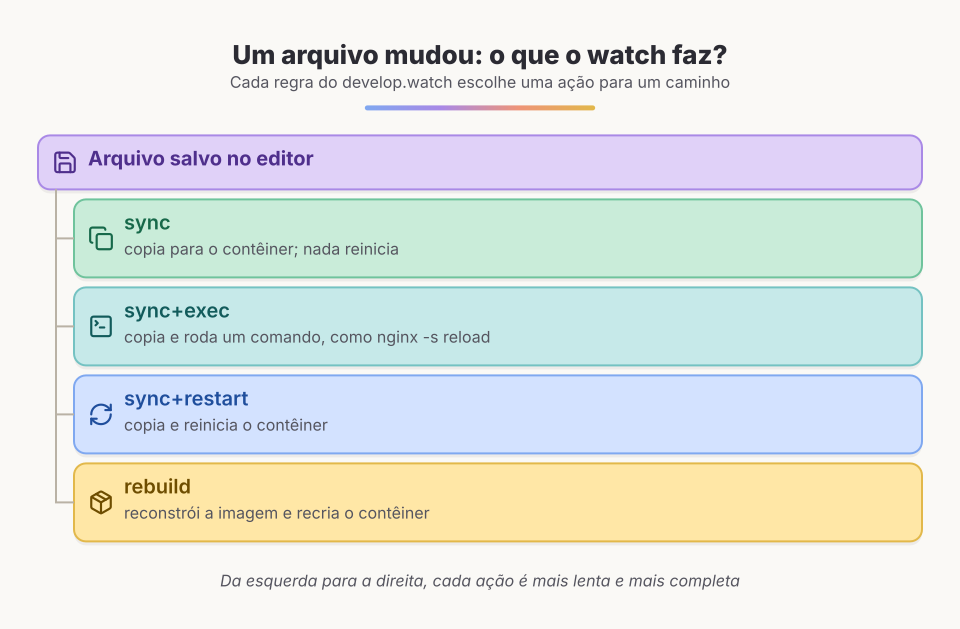

# 10. Desenvolvimento com watch

> 🗺️ **Neste capítulo:** você vai deixar o Compose vigiar os arquivos do projeto e, a cada mudança, copiá-los para o contêiner, rodar um comando, reiniciar o serviço ou reconstruir a imagem, conforme o que mudou. · ⏱️ ~45 min

> 🔥 **Aquecimento:** (1) Que comando roda um comando dentro de um contêiner que já está rodando? (2) Você mudou o código da API. Sem `watch`, que comando aplica a mudança?
>
> <details>
> <summary>Ver resposta</summary>
>
> (1) `docker compose exec <serviço> <comando>`, como `docker compose exec db psql ...` (capítulo 9). (2) `docker compose up -d --build`: reconstrói a imagem com o código novo e recria o contêiner (capítulo 4).
>
> </details>

## De onde paramos

No capítulo 4 você aprendeu que mudar o código pede `up -d --build`, e no capítulo 9, que `restart` não aplica mudanças. Funciona, mas, ao desenvolver, você salva o arquivo dezenas de vezes por hora. Reconstruir a imagem a cada vez é lento, e esquecer o `--build` faz você testar o código velho achando que é o novo. O `watch` automatiza essa parte.

## develop.watch

O projeto deste capítulo, `vitrine`, tem dois serviços com `build`: um site estático servido pelo nginx e a `ola-api` do capítulo 4. A estrutura de pastas:

```text
vitrine/
├── compose.yaml
├── web/
│   ├── Dockerfile
│   ├── default.conf
│   └── site/
│       └── index.html
└── api/
    ├── Dockerfile
    └── app.py
```

O `api/app.py` e o `api/Dockerfile` são os da `ola-api` do capítulo 4, com `VERSAO = "1"`. Se você não os tiver à mão, copie-os daqui:

<!-- project: vitrine | run: cd vitrine && docker compose config --services | expect: api -->

<details>
<summary>Ver os arquivos da API</summary>

**vitrine/api/app.py**

```python
from http.server import BaseHTTPRequestHandler, HTTPServer

VERSAO = "1"


class Ola(BaseHTTPRequestHandler):
    def do_GET(self):
        corpo = f"Olá do Compose! versão {VERSAO}\n".encode()
        self.send_response(200)
        self.send_header("Content-Type", "text/plain; charset=utf-8")
        self.end_headers()
        self.wfile.write(corpo)


# 0.0.0.0 para aceitar conexões vindas de fora do contêiner
HTTPServer(("0.0.0.0", 8000), Ola).serve_forever()
```

**vitrine/api/Dockerfile**

```dockerfile
FROM python:3.13-slim
WORKDIR /app
COPY app.py .
# -u: sem buffer, as mensagens do Python chegam na hora ao docker compose logs
CMD ["python", "-u", "app.py"]
```

</details>

O site tem uma página e uma configuração própria do nginx:

**vitrine/web/site/index.html**

```html
<h1>Vitrine versão 1</h1>
```

**vitrine/web/default.conf**

```nginx
server {
    listen 80;
    root /usr/share/nginx/html;
    # cabeçalho para ver, com curl -I, qual configuração está valendo
    add_header X-Config "1";
}
```

**vitrine/web/Dockerfile**

```dockerfile
FROM nginx:1.27-alpine
# a configuração e as páginas vão para dentro da imagem
COPY default.conf /etc/nginx/conf.d/default.conf
COPY site/ /usr/share/nginx/html/
```

Repare que o site não usa bind mount, como o `meu-site`: as páginas e a configuração estão **dentro da imagem**. É o que acontece com a maioria dos projetos, em que o código vai na imagem. Sem nada mais, mudar `index.html` exigiria um build.

**`develop.watch` é a lista de regras que dizem ao Compose quais caminhos do projeto vigiar e o que fazer com o contêiner quando um deles muda.**

Cada regra tem um `path` (o caminho no seu projeto, relativo ao `compose.yaml`), uma `action` (o que fazer) e, conforme a ação, um `target` (o caminho dentro do contêiner).

**vitrine/compose.yaml**

```yaml
services:
  web:
    build: ./web
    ports:
      # 127.0.0.1: só esta máquina chega às portas (capítulo 6)
      - "127.0.0.1:8080:80"
    develop:
      watch:
        # páginas: copiar basta, o nginx lê o arquivo a cada acesso
        - path: ./web/site
          action: sync
          target: /usr/share/nginx/html
        # configuração: copiar e pedir ao nginx para recarregá-la
        - path: ./web/default.conf
          action: sync+exec
          target: /etc/nginx/conf.d/default.conf
          exec:
            command: nginx -s reload
        # a receita da imagem mudou: só um build resolve
        - path: ./web/Dockerfile
          action: rebuild
  api:
    build: ./api
    ports:
      - "127.0.0.1:8000:8000"
    develop:
      watch:
        # o Python lê o código na partida: copiar e reiniciar
        - path: ./api/app.py
          action: sync+restart
          target: /app/app.py
        - path: ./api/Dockerfile
          action: rebuild
```

Para ligar a vigilância, suba com `--watch`:

```bash
docker compose up --watch
```

Saída (trecho):

```text
 Container vitrine-web-1 Created
        ⦿ Watch enabled
Attaching to api-1, web-1
 Container vitrine-web-1 Started
 Container vitrine-api-1 Started
```

`Watch enabled` diz que a vigilância começou. Como no `up` sem `-d`, o terminal fica preso aos logs (capítulo 3), e o Ctrl+C para a vigilância e os contêineres (`Gracefully Stopping...`). Há também o comando `docker compose watch`, que sobe o projeto sem mostrar os logs dos serviços, só as mensagens do `watch`. Ele tem outra diferença: no teste, o Ctrl+C encerrou a vigilância e deixou os dois contêineres rodando (`Up 15 seconds`); para pará-los, use `docker compose down` ou `stop`.

> ⚠️ **Erro comum:** esperar que o `watch` funcione com `up -d`. Sem `--watch` (ou sem o comando `docker compose watch`), as regras de `develop` são ignoradas. E deixe o terminal do `watch` aberto: ao fechá-lo, a vigilância para.

> 💡 **No Windows com WSL:** quem vigia os arquivos é o próprio `docker compose`, na sua máquina, e não o contêiner. No Linux, ele percebe a mudança pelas notificações do sistema de arquivos. Se você roda o `watch` pelo WSL, guarde o projeto no disco do Linux, como `~/projetos/vitrine`, e não em `/mnt/c/...`: a documentação do Docker Desktop recomenda o disco do Linux para pastas usadas pelos contêineres, por ser mais rápido, e avisa que as notificações de mudança só chegam quando os arquivos estão nele. Para editar com um programa do Windows, abra a pasta pelo caminho `\\wsl.localhost\<distribuição>\home\<usuário>\projetos`.
>
> Testes no WSL deste livro (Ubuntu 26.04), com o `docker compose watch` rodando no próprio WSL e o projeto `vitrine` em duas pastas:
>
> | Mudança no `index.html` | Projeto em `~/projetos` | Projeto em `/mnt/c` |
> | --- | --- | --- |
> | feita pelo WSL | `Syncing service "web" after 1 changes were detected` e a página nova no contêiner | nada: depois de 30 s, o contêiner ainda tinha a versão 1 |
> | feita por um programa do Windows, pelo caminho `\wsl.localhost\...` ou `C:\...` | `Syncing service "web" after 1 changes were detected` e a página nova no contêiner | nada |
>
> Em `/mnt/c`, o arquivo mudou no disco e o `watch` continuava rodando, mas não percebeu nenhuma das duas mudanças. Um programa simples que escutava as notificações do Linux nas duas pastas teve o mesmo resultado. No terminal do Windows, com o projeto no disco `C:`, o `watch` dos testes deste capítulo percebeu todas as mudanças: o problema é a combinação do WSL com `/mnt/c`.

## sync

A ação mais leve é para arquivos que o programa lê a cada uso, como as páginas de um site.

**A ação `sync` copia para o contêiner, no caminho `target`, cada arquivo que muda dentro de `path`, sem reiniciar nada.**

Com o `watch` rodando, troque a página no seu editor para `<h1>Vitrine versão 2</h1>` e salve. No terminal do `watch`:

```text
        ⦿ Syncing service "web" after 1 changes were detected
```

E, noutro terminal:

```bash
curl -s localhost:8080
```

```text
<h1>Vitrine versão 2</h1>
```

A página nova chegou ao contêiner em poucos segundos, sem build e sem reinício. O `target` da regra é uma pasta (`/usr/share/nginx/html`), porque o `path` também é uma pasta (`./web/site`): tudo o que muda lá dentro vai para o lugar correspondente no contêiner.

Para copiar arquivos, a imagem precisa ter os comandos `stat`, `mkdir` e `rmdir`, que as imagens comuns (Alpine, Debian, Python) já têm.

> ⚠️ **Erro comum:** usar `sync` para o código de um programa que só o lê na partida. O arquivo chega ao contêiner, mas o programa continua rodando o código antigo, que já estava na memória. É o caso do `app.py`: para ele, a ação certa é `sync+restart`.

## sync+restart

A `ola-api` lê o `app.py` uma vez, quando o Python inicia. Copiar o arquivo não muda nada até o processo começar de novo.

**A ação `sync+restart` copia os arquivos para o contêiner e, em seguida, reinicia o contêiner do serviço.**

Mude `VERSAO = "1"` para `VERSAO = "2"` no `api/app.py` e salve:

```text
        ⦿ Syncing service "api" after 1 changes were detected
 Container vitrine-api-1 Restarting
 Container vitrine-api-1 Started
        ⦿ service(s) ["api"] restarted
```

```bash
curl -s localhost:8000
```

```text
Olá do Compose! versão 2
```

O reinício é o mesmo do `docker compose restart` do capítulo 9: o contêiner é o mesmo, com o arquivo novo dentro. Leva um ou dois segundos, bem menos que um build.

## sync+exec

A configuração do nginx fica entre os dois casos. Copiar o `default.conf` não basta, porque o nginx lê a configuração na partida. Reiniciar o contêiner funciona, mas derruba as conexões abertas. O nginx tem um jeito melhor: `nginx -s reload` relê a configuração sem parar de atender.

**A ação `sync+exec` copia os arquivos para o contêiner e, em seguida, roda dentro dele o comando de `exec.command`, sem reiniciar o contêiner.**

O comando roda como num `docker compose exec` (capítulo 9). A chave `exec` aceita também `user`, `working_dir` e `environment`, para quando o comando precisa de outro usuário, de outra pasta ou de variáveis extras; aqui, `command` basta.

Antes de testar, confira a configuração que está valendo, pelo cabeçalho `X-Config`:

```bash
curl -sI localhost:8080
```

Saída (trecho):

```text
X-Config: 1
```

Mude a linha para `add_header X-Config "2";` e salve. O `watch` copia o arquivo e roda o `reload`; nos logs do nginx aparece o pedido de reconfiguração (trecho; a última linha foi quebrada para caber na página):

```text
        ⦿ Syncing service "web" after 1 changes were detected
web-1   | 2026/11/21 04:31:28 [notice] 1#1: signal 1 (SIGHUP) received from 34,
  reconfiguring
```

E o cabeçalho muda:

```text
X-Config: 2
```

Sobre o `target` nesta ação, a documentação se contradiz: uma frase diz que o `target` só vale para `sync`, mas o exemplo oficial de `sync+exec` usa `target`. Os testes com o Compose v5.7.0 resolvem a dúvida:

| `target` na regra do `default.conf` | O que aconteceu |
| --- | --- |
| sem `target` | o Compose recusa o arquivo: `target is required for non-rebuild actions` |
| `/etc/nginx/conf.d/default.conf` (o arquivo) | copiou, recarregou, `X-Config: 2` |
| `/etc/nginx/conf.d/` (a pasta) | não copiou: aviso `cannot overwrite directory "etc/nginx/conf.d" with non-directory` |
| `/etc/nginx/default.conf` (caminho errado) | copiou para o lugar errado e recarregou; continuou `X-Config: 1`, sem erro |

A regra prática: o `target` é obrigatório no `sync+exec` e é do mesmo tipo que o `path`. Se o `path` é um arquivo, o `target` é o caminho completo do arquivo no contêiner; se é uma pasta, o `target` é uma pasta, como no exemplo oficial.

> ⚠️ **Erro comum:** errar o `target` e não perceber. No último caso da tabela, o Compose não reclama: ele cria `/etc/nginx/default.conf`, um arquivo que o nginx não lê, e o `reload` recarrega a configuração antiga. Se a mudança não aparece, confira onde o arquivo foi parar: `docker compose exec web ls /etc/nginx` mostrou o `default.conf` sobrando ao lado de `conf.d`.

## rebuild

Algumas mudanças não cabem numa cópia: um `Dockerfile` novo, uma biblioteca a mais para instalar. Para elas, só um build resolve.

**A ação `rebuild` reconstrói a imagem do serviço quando um arquivo de `path` muda e recria o contêiner com a imagem nova, como um `up --build`.**

Acrescente uma linha de comentário ao `web/Dockerfile` e salve:

```text
        ⦿ Rebuilding service(s) ["web"] after changes were detected...
        ⦿ service(s) ["web"] successfully built
 Container vitrine-web-1 Recreate
 Container vitrine-web-1 Recreated
 Container vitrine-web-1 Starting
 Container vitrine-web-1 Started
```

As linhas do build, que começam com `#`, foram cortadas. O site continuou respondendo `Vitrine versão 2` e `X-Config: 2`: a imagem nova foi construída a partir dos arquivos atuais da pasta, que já tinham as duas mudanças.



| Ação | O que faz | Precisa de `target`? | Bom para |
| --- | --- | --- | --- |
| `sync` | copia | sim | páginas, arquivos lidos a cada uso |
| `sync+exec` | copia e roda um comando | sim | configuração com recarga, como a do nginx |
| `sync+restart` | copia e reinicia | sim | código lido na partida, como o `app.py` |
| `rebuild` | reconstrói e recria | não | `Dockerfile`, dependências |

> ⚠️ **Erro comum:** pôr uma regra `rebuild` num serviço que só tem `image`. Sem um `build`, não há o que reconstruir, e o Compose recusa: `can't watch service "web" with action rebuild without a build context`. As outras ações funcionam com `image`: num teste com o nginx só com `image`, uma regra `sync` copiou a página normalmente.

## 🧪 Lab: a vitrine ao vivo

1. Crie a pasta `vitrine` com a estrutura da seção “develop.watch”. Copie o `app.py` e o `Dockerfile` da `ola-api` do capítulo 4 para `api/`, com `VERSAO = "1"`.
2. Confira o arquivo com `docker compose config`.
3. Suba com `docker compose up --watch --build` e espere `Watch enabled`. O `--build` garante imagens com os arquivos atuais, caso você já tenha feito o lab antes (capítulo 4). Deixe esse terminal aberto e abra outro para os passos seguintes.
4. **sync:** mude o `index.html` para `versão 2`, salve e rode `curl -s localhost:8080`.
5. **sync+restart:** mude a `VERSAO` do `api/app.py` para `"2"`, salve e rode `curl -s localhost:8000`. No primeiro terminal, procure `Restarting`.
6. **sync+exec:** mude o `X-Config` do `default.conf` para `"2"`, salve e rode `curl -sI localhost:8080`. Procure a linha `X-Config: 2`.
7. **rebuild:** acrescente uma linha de comentário ao `web/Dockerfile` e procure `Rebuilding` e `Recreate` no primeiro terminal.
8. Volte ao primeiro terminal e aperte Ctrl+C. Depois, `docker compose down`.

## 🏋️ Pratique

### 1. Exemplo resolvido

Um colega escreveu esta regra para a configuração do nginx, copiando o formato do exemplo oficial, que termina o `target` com uma barra:

```yaml
# o target aponta para a pasta, mas o path é um arquivo
        - path: ./web/default.conf
          action: sync+exec
          target: /etc/nginx/conf.d/
          exec:
            command: nginx -s reload
```

Ele muda o `X-Config`, salva, e o cabeçalho continua `X-Config: 1`.

Passo a passo:

1. O terminal do `watch` mostrou `Syncing service "web" after 1 changes were detected`: a mudança foi vista. O problema está na cópia, não na vigilância.
2. Logo abaixo, há um aviso (quebrado em linhas para caber na página):

   ```text
   level=warning msg="Error handling changed files: copying files to
     3f975a0fcbff...: Error response from daemon: cannot overwrite directory
     \"etc/nginx/conf.d\" with non-directory \"/\""
   ```

3. Leia o aviso: o Compose tentou pôr um **arquivo** no lugar da **pasta** `conf.d`, e o Docker recusou. A cópia não aconteceu.
4. A causa é a combinação: `path` é um arquivo (`default.conf`), `target` é uma pasta. No exemplo oficial, os dois são pastas (`./etc/config` e `/etc/config/`).
5. A correção é o caminho completo do arquivo no `target`:

   ```yaml
   # path é um arquivo, então target também é o caminho de um arquivo
           - path: ./web/default.conf
             action: sync+exec
             target: /etc/nginx/conf.d/default.conf
             exec:
               command: nginx -s reload
   ```

6. Como mudou o `compose.yaml`, pare o `watch` com Ctrl+C e suba de novo com `docker compose up --watch`. Salve o `default.conf` mais uma vez: agora aparece `X-Config: 2`.

### 2. Complete

A API de um projeto é em Python: o código fica em `./api/app.py` (copiado para `/app/app.py` na imagem) e as bibliotecas são instaladas a partir de `./api/requirements.txt` durante o build. Complete as regras:

```yaml
# código: copiar e reiniciar; bibliotecas: só um build instala
  api:
    build: ./api
    develop:
      watch:
        - path: ./api/app.py
          action: ________
          target: ________
        - path: ./api/requirements.txt
          action: ________
```

<details>
<summary>Ver resposta</summary>

```yaml
  api:
    build: ./api
    develop:
      watch:
        # o Python só lê o código ao iniciar
        - path: ./api/app.py
          action: sync+restart
          target: /app/app.py
        # bibliotecas são instaladas no build, não copiadas
        - path: ./api/requirements.txt
          action: rebuild
```

O `rebuild` não leva `target`: ele não copia nada, reconstrói a imagem. Erros comuns: `sync` no `app.py`, que copia o arquivo, mas deixa o Python rodando o código antigo; `sync` no `requirements.txt`, que põe a lista nova no contêiner sem instalar nenhuma biblioteca; e `target: /app`, uma pasta, para um `path` que é um arquivo.

</details>

### 3. Sozinho

O `meu-site` usa um bind mount para a pasta `site`. Um colega quer trocar o bind mount por `watch`, para o site funcionar igual numa máquina em que bind mounts são lentos. O serviço usa `image: nginx:1.27-alpine`, sem `build`. Escreva o serviço `web` com a regra de `watch`, diga qual ação usar e responda: por que aqui não dá para ter uma regra `rebuild`?

<details>
<summary>Ver resposta</summary>

```yaml
services:
  web:
    image: nginx:1.27-alpine
    ports:
      - "127.0.0.1:8080:80"
    develop:
      watch:
        # o nginx lê cada página a cada acesso: copiar basta
        - path: ./site
          action: sync
          target: /usr/share/nginx/html
```

A ação é `sync`: o nginx lê os arquivos a cada acesso, então não precisa de reinício nem de comando. O `path` e o `target` são pastas. Num teste com esse arquivo e `docker compose up --watch`, mudar `index.html` mostrou `Syncing service "web"` e o arquivo novo chegou ao contêiner.

Não dá para usar `rebuild` porque o serviço não tem `build`: não há imagem própria para reconstruir. O Compose recusa com `can't watch service "web" with action rebuild without a build context`.

</details>

### 4. Desafio

Uma colega configurou o `sync+exec` do nginx com `target: /etc/nginx/default.conf`. O `watch` mostra `Syncing service "web"`, o nginx registra `signal 1 (SIGHUP) received ... reconfiguring`, nenhum aviso aparece, e mesmo assim o cabeçalho continua `X-Config: 1`. Ela desconfia que o `reload` não funciona. Diga como provar onde está o problema, qual é a causa e como corrigir.

<details>
<summary>Ver resposta</summary>

O `reload` funcionou: o `SIGHUP ... reconfiguring` mostra que o nginx releu a configuração. O que ele releu é que estava velho.

Para provar, olhe dentro do contêiner onde o arquivo foi parar:

```bash
# lista a pasta de configuração do nginx
docker compose exec web ls /etc/nginx
```

No teste, a lista mostrou `conf.d default.conf fastcgi.conf ...`: um `default.conf` novo, solto em `/etc/nginx`, ao lado da pasta `conf.d`. O nginx desta imagem lê a configuração do site em `/etc/nginx/conf.d/`, onde o arquivo continuou com `X-Config "1"`.

A causa é o `target` errado. Como é um caminho de arquivo válido, o Compose não tem como saber que é o lugar errado: copia, roda o comando e não avisa nada. A correção é `target: /etc/nginx/conf.d/default.conf`, o mesmo caminho do `COPY` no `web/Dockerfile`. Depois de mudar o `compose.yaml`, reinicie o `watch`.

Uma resposta completa separa as três etapas (cópia, comando, efeito), mostra que as duas primeiras funcionaram e acha a falha no destino da cópia. Uma dica para não errar: o `target` de um arquivo costuma ser o mesmo destino do `COPY` desse arquivo no `Dockerfile`.

</details>

## 🧠 Revisão rápida

1. O que acontece com as regras de `develop.watch` num `docker compose up -d` comum?
2. Qual a diferença entre `sync` e `sync+restart`, e quando cada uma serve?
3. Por que o `sync+exec` é melhor que o `sync+restart` para a configuração do nginx?
4. Que ação usar quando muda o `Dockerfile`, e por que ela não leva `target`?
5. (Capítulo 9) O `docker compose restart` aplica uma mudança feita no `compose.yaml`?

<details>
<summary>Ver resposta</summary>

1. São ignoradas. A vigilância só funciona com `up --watch` ou com `docker compose watch`.
2. `sync` só copia, e serve para arquivos lidos a cada uso, como páginas. `sync+restart` copia e reinicia, e serve para código lido na partida, como o `app.py`.
3. Porque o `nginx -s reload` relê a configuração sem parar o servidor; o reinício derruba o contêiner e as conexões abertas por um instante.
4. `rebuild`. Ela não copia arquivos para o contêiner: reconstrói a imagem e recria o contêiner, então não há destino de cópia.
5. Não. O `restart` reinicia os mesmos contêineres com a configuração antiga; para aplicar, use `up -d`.

</details>

## 🤖 Estude com um tutor de IA

Copie e cole num assistente de IA:

```text
Estou aprendendo Docker Compose. Faça 5 perguntas, uma de cada vez,
sobre docker compose watch e as ações sync, sync+exec, sync+restart
e rebuild. Em cada pergunta, descreva um arquivo que mudou e me peça
a ação certa. Espere minha resposta antes de comentar.
```

```text
Minha regra de watch não está funcionando. Vou colar a regra, a saída
do terminal do watch e o Dockerfile do serviço. Me ajude a achar
o problema com perguntas, sem me dar a regra corrigida.
Regra, saída e Dockerfile: <cole aqui>
```

> ➡️ **Próximo passo:** o `compose.yaml` da vitrine está bom para desenvolver, mas um servidor não precisa de `watch` nem de portas de depuração. No capítulo 11 você vai separar o que é de desenvolvimento e o que é de produção, com perfis e arquivos sobrepostos.

## 📌 Resumo

| Item | Em uma frase |
| --- | --- |
| `develop.watch` | Lista de regras: que caminho vigiar e o que fazer quando ele muda |
| `up --watch` / `watch` | Ligam a vigilância; com `up -d`, as regras são ignoradas |
| `path` | O caminho no seu projeto, relativo ao `compose.yaml` |
| `target` | O caminho no contêiner; do mesmo tipo que o `path` (arquivo ou pasta) |
| `sync` | Copia, sem reiniciar |
| `sync+restart` | Copia e reinicia o contêiner |
| `sync+exec` | Copia e roda `exec.command` no contêiner; `target` obrigatório |
| `rebuild` | Reconstrói a imagem e recria o contêiner; exige `build` |

## 📚 Fontes

- [Use Compose Watch](https://docs.docker.com/compose/how-tos/file-watch/) (conferido em 20/11/2026)
- [Compose Develop Specification](https://docs.docker.com/reference/compose-file/develop/) (conferido em 21/11/2026)
- [Docker Compose releases](https://github.com/docker/compose/releases) (conferido em 21/11/2026)
- [WSL 2 best practices for Docker Desktop on Windows](https://docs.docker.com/desktop/features/wsl/best-practices/) (conferido em 21/11/2026)

> 🔁 **Revise hoje:** capítulos 3, 7 e 9

<!-- nav:start -->
---

[◀ Capítulo anterior](09-comandos-do-dia-a-dia.md) · [Mapa do livro](../README.md) · [Próximo capítulo ▶](11-perfis-e-arquivos-sobrepostos.md)
<!-- nav:end -->
