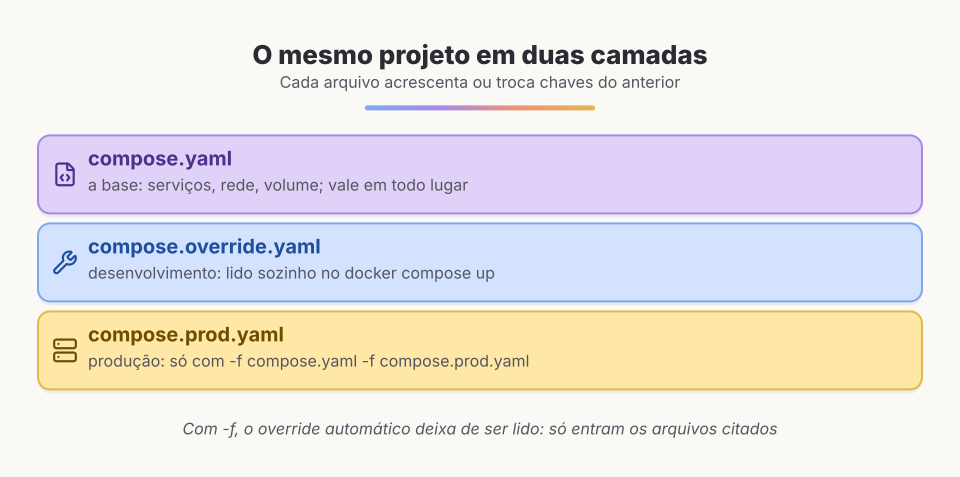

# 11. Perfis e arquivos sobrepostos

> 🗺️ **Neste capítulo:** você vai separar as ferramentas de apoio do projeto com perfis (`profiles`), que só sobem quando você pede, e montar configurações de desenvolvimento e produção a partir de um mesmo `compose.yaml`, com arquivos sobrepostos. · ⏱️ ~45 min

> 🔥 **Aquecimento:** (1) Com `docker compose up -d`, as regras de `develop.watch` funcionam? (2) O `docker compose restart` aplica mudanças feitas no `compose.yaml`?
>
> <details>
> <summary>Ver resposta</summary>
>
> (1) Não: elas só valem com `up --watch` ou `docker compose watch` (capítulo 10). (2) Não: ele reinicia os mesmos contêineres; para aplicar mudanças, use `up -d` (capítulo 9).
>
> </details>

## De onde paramos

O contador do capítulo 8 sobe a API e o banco na ordem certa. No capítulo 6, um exercício acrescentou o Adminer para olhar o banco, e outro publicou o banco na porta 15432 para um programa do notebook. Úteis ao desenvolver, mas nenhum dos dois deveria estar num servidor. Este capítulo resolve isso sem manter dois `compose.yaml` quase iguais.

## Perfis

O Adminer é uma ferramenta de apoio: você a usa às vezes, para conferir uma tabela, e não quer que ela suba (nem publique a porta 8081) toda vez que roda `docker compose up`.

**Um perfil (*profile*) é um nome que você dá a um grupo de serviços com a chave `profiles`; esses serviços só sobem quando o perfil é ativado, e os serviços sem perfil sobem sempre.**

No `compose.yaml` do contador do capítulo 8, acrescente o Adminer no fim de `services`, com um perfil:

```yaml
# trecho: no fim de services, antes de volumes
  adminer:
    image: adminer:4
    # só sobe quando o perfil ferramentas estiver ativo
    profiles: [ferramentas]
    ports:
      - "127.0.0.1:8081:8080"
```

Antes de rodar, preveja: o `docker compose up -d` vai subir o Adminer?

```bash
docker compose up -d --wait
docker compose ps -a --format '{{.Service}}:{{.State}}'
```

```text
api:running
db:running
```

Não subiu. O `config` mostra a mesma coisa: `docker compose config --services` lista só `db` e `api`. Para ativar o perfil, use `--profile`:

```bash
docker compose --profile ferramentas up -d
```

Saída (trecho):

```text
 Container contador-adminer-1 Creating
 Container contador-adminer-1 Created
 Container contador-adminer-1 Starting
 Container contador-adminer-1 Started
```

Agora os três serviços estão rodando. Há outras formas de ativar:

| Forma | Ativa |
| --- | --- |
| `--profile ferramentas` | o perfil `ferramentas`; repita a opção para ativar mais de um |
| `COMPOSE_PROFILES=ferramentas` | o mesmo, por variável de ambiente (vários: `a,b`) |
| `--profile "*"` | todos os perfis do arquivo |
| `docker compose up -d adminer` | só o serviço citado (e as dependências dele), mesmo com o perfil desligado |

No último caso, o teste subiu apenas o `adminer`, porque ele não depende de ninguém.

> ⚠️ **Erro comum:** derrubar o projeto sem o perfil. Com o Adminer rodando, um `docker compose down` comum remove a API e o banco, mas não o Adminer, que é de um perfil desligado. A rede, ainda em uso por ele, também fica:
>
> ```text
>  Network contador_default Removing
>  Network contador_default Resource is still in use
> ```
>
> E o `docker ps` mostra `contador-adminer-1 Up 5 seconds`. Derrube com o mesmo perfil com que subiu: `docker compose --profile ferramentas down`.

## compose.override.yaml

A porta 15432 do banco é útil na sua máquina, para um programa de banco de dados do notebook. Num servidor, é uma porta a mais exposta. Pôr e tirar a linha `ports` do arquivo à mão, conforme o lugar, é pedir para esquecer.

**O `compose.override.yaml` é um segundo arquivo, ao lado do `compose.yaml`, que o Compose lê automaticamente e junta por cima dele: o que estiver no override acrescenta chaves ao arquivo base ou troca as que já existem.**

<!-- project: contador | run: cd contador && docker compose -f compose.yaml -f compose.prod.yaml config | expect: producao -->

**contador/compose.override.yaml**

```yaml
# só na máquina de desenvolvimento: o banco acessível pelo host
services:
  db:
    ports:
      # preso ao 127.0.0.1, como a API (capítulo 6)
      - "127.0.0.1:15432:5432"
```

O override não repete nada: diz só o serviço e a chave que muda. Antes de rodar, preveja: o `docker compose ps` vai mostrar a porta do banco publicada?

```bash
docker compose up -d --wait
docker compose ps --format '{{.Service}} {{.Ports}}'
```

```text
api 127.0.0.1:8000->8000/tcp
db 127.0.0.1:15432->5432/tcp
```

Sim: sem nenhuma opção, o `up` leu os dois arquivos. O `docker compose config` mostra o resultado da junção, com o `published: "15432"` no serviço `db`. É o melhor jeito de conferir o que valeu.

A ideia é o `compose.yaml` ter o que vale em todo lugar, e o override ter o que só vale na máquina de quem desenvolve. Como o override é pessoal, há projetos que o deixam fora do Git; outros o versionam como a configuração padrão de desenvolvimento da equipe. O Compose aceita os dois jeitos.

> ⚠️ **Erro comum:** esquecer que o override existe. Um colega clona o projeto, vê no `compose.yaml` que o banco não tem `ports` e estranha o banco aparecer em `localhost:15432`. Quando o comportamento não bate com o `compose.yaml`, procure um `compose.override.yaml` na pasta e rode `docker compose config`.

## -f múltiplos

Para produção, o projeto precisa de outras mudanças: reinício automático (capítulo 9), uma variável dizendo o modo e a API na porta 80. E **sem** a porta de desenvolvimento do banco.

**A opção `-f`, repetida, diz exatamente quais arquivos o Compose deve ler e em que ordem: cada arquivo é juntado por cima dos anteriores, e o `compose.override.yaml` automático deixa de ser lido.**

**contador/compose.prod.yaml**

```yaml
# produção: reinício automático e a API na porta 80
services:
  api:
    restart: unless-stopped
    ports:
      # 0.0.0.0 por extenso: no servidor, o público chega pela porta 80
      - "0.0.0.0:80:8000"
    environment:
      MODO: producao
  db:
    restart: unless-stopped
```

Esta é a primeira porta do livro aberta para a rede, e é de propósito: num servidor, a porta 80 é a que o público usa. O `0.0.0.0` escrito por extenso deixa essa escolha visível para quem lê o arquivo. Na sua máquina de desenvolvimento, confira a junção com o `config`, sem subir nada, para não abrir a porta 80 para a rede em que você estiver:

```bash
docker compose -f compose.yaml -f compose.prod.yaml config
```

Saída (trecho: as portas da API):

```text
    ports:
      - mode: ingress
        host_ip: 127.0.0.1
        target: 8000
        published: "8000"
        protocol: tcp
      - mode: ingress
        host_ip: 0.0.0.0
        target: 8000
        published: "80"
        protocol: tcp
```

E o banco ficou sem `ports`: com `-f`, o `compose.override.yaml` não foi lido, e nenhuma linha do `config` tem `15432`.

Mas a API ficou com **duas** portas, a 8000 do `compose.yaml`, presa ao `127.0.0.1`, e a 80 do `compose.prod.yaml`. A seção seguinte explica por quê.

Todos os comandos desse projeto, inclusive `ps`, `logs` e `down`, precisam dos mesmos `-f`, senão o Compose olha outra configuração. Os caminhos relativos dentro de todos os arquivos (como `build: .`) partem da pasta do primeiro `-f`.



## Merge: como as chaves se juntam

Juntar dois arquivos não é colar um no outro. Cada tipo de chave tem uma regra, e conhecê-las evita surpresas como a porta dobrada.

**O merge é a junção de dois arquivos do Compose: valores únicos são trocados, mapas são juntados chave por chave e listas como `ports` são somadas.**

As três regras, com o que os testes mostraram:

| Tipo de chave | Regra | No teste |
| --- | --- | --- |
| Valor único (`image`, `restart`) | o último arquivo vence | `image: postgres:17.12` num arquivo extra trocou o `postgres:17` |
| Mapa (`environment`, `healthcheck`) | junta chave por chave; nas repetidas, o último vence | `environment` ficou com `DB_HOST`, `DB_SENHA` e `MODO`; um `healthcheck` com só `interval: 5s` manteve `test`, `timeout` e `retries` da base |
| Lista (`ports`, `expose`, `dns`) | soma os itens | `ports` ficou com `127.0.0.1:8000:8000` e `0.0.0.0:80:8000` |

Para **trocar** uma lista inteira, em vez de somar, a referência do Compose tem a marcação `!override`:

```yaml
# !override: substitui a lista da base, em vez de somar
services:
  api:
    ports: !override
      - "0.0.0.0:80:8000"
```

Com ela, o `config` mostrou só a porta 80. E, para **apagar** uma chave da base, existe `!reset`: `ports: !reset []` num arquivo extra deixou o `db` sem nenhuma porta, mesmo com o override de desenvolvimento na lista de `-f`.

Outra saída, muitas vezes mais clara, é não pôr no `compose.yaml` aquilo que muda de lugar para lugar: sem `ports` na API da base, o override de desenvolvimento publica a 8000 e o arquivo de produção publica a 80, e nada precisa ser apagado.

> ⚠️ **Erro comum:** achar que um arquivo de produção “troca” as portas do `compose.yaml`. Ele soma: a API ficou publicada em 8000 **e** em 80. Com uma base sem `127.0.0.1` na frente, um servidor que deveria expor só a 80 expõe as duas. Depois de montar uma combinação de arquivos, rode `docker compose -f ... config` e confira as portas antes do `up`.

## 🧪 Lab: um projeto, dois ambientes

1. No `compose.yaml` do contador (o do capítulo 8), acrescente o serviço `adminer` com `profiles: [ferramentas]`, da seção “Perfis”.
2. Suba com `docker compose up -d --wait` e confira com `docker compose ps`: só `api` e `db`.
3. Suba o Adminer com `docker compose --profile ferramentas up -d` e abra `http://localhost:8081`.
4. Derrube com `docker compose --profile ferramentas down` e confira com `docker ps -a` que não sobrou nenhum contêiner `contador-`.
5. Crie o `compose.override.yaml` da seção “compose.override.yaml”, suba com `docker compose up -d --wait` e confira que o `db` aparece com `15432` no `ps`. Derrube com `docker compose down`.
6. Crie o `compose.prod.yaml` da seção “-f múltiplos” e veja o resultado da junção sem subir nada: `docker compose -f compose.yaml -f compose.prod.yaml config`. Procure as duas portas da API.
7. No `compose.prod.yaml`, troque `ports:` por `ports: !override` e rode o `config` de novo: agora só a 80.
8. Não suba a produção na sua máquina: o `0.0.0.0:80` abriria a porta 80 para a rede em que você estiver. O `config` do passo 7 já mostra o que o servidor vai receber: a API só com `host_ip: 0.0.0.0` e `published: "80"`.

## 🏋️ Pratique

### 1. Exemplo resolvido

Depois de usar o Adminer, um colega rodou `docker compose down` e recebeu `Network contador_default Resource is still in use`. Ele quer entender o que sobrou e limpar.

1. A mensagem diz que a rede não pôde ser removida porque alguém ainda a usa. Algum contêiner do projeto continua de pé.
2. O `docker ps -a --filter name=contador` mostra quem é: `contador-adminer-1 Up 5 seconds`.
3. O Adminer tem `profiles: [ferramentas]`. Sem o perfil ativo, o `down` trata o serviço como desligado e o deixa em paz.
4. A correção é repetir o perfil no `down`:

   ```bash
   # o mesmo perfil do up, para o down enxergar o adminer
   docker compose --profile ferramentas down
   ```

5. A saída mostra `Container contador-adminer-1 Stopped`, `Removed` e, por fim, a rede removida.

Para derrubar só o Adminer, deixando o resto no ar, `docker compose down adminer` ou `docker compose stop adminer` também funcionam: o serviço citado pelo nome é atendido mesmo com o perfil desligado.

### 2. Complete

O contador ganhou um serviço `carga`, que preenche o banco com visitas de teste e só deve rodar quando você pedir. Complete o serviço e os dois comandos:

```yaml
# o serviço de carga fica fora do up comum
  carga:
    build: .
    command: python -c "print('carga de teste')"
    ________: [________]
    depends_on:
      db:
        condition: service_healthy
```

```bash
# sobe tudo, inclusive a carga
docker compose ________ testes up -d
# derruba tudo, inclusive a carga
docker compose ________ ________ down
```

<details>
<summary>Ver resposta</summary>

```yaml
  carga:
    build: .
    command: python -c "print('carga de teste')"
    # perfil testes: fora do up comum
    profiles: [testes]
    depends_on:
      db:
        condition: service_healthy
```

```bash
docker compose --profile testes up -d
docker compose --profile testes down
```

O `db` não tem perfil, então sobe sempre e pode ser dependência da `carga`. Erros comuns: escrever `profile:` no singular, chave que o Compose não reconhece; esquecer o perfil no `down`, que deixa a `carga` para trás; e pôr o `db` no perfil `testes`, que faria o banco deixar de subir no `up` comum.

</details>

### 3. Sozinho

No contador, você quer que **só na sua máquina** o banco fique acessível em `localhost:15432` e o Adminer suba sem precisar de perfil. O `compose.yaml` não pode mudar. Escreva o `compose.override.yaml` e diga o que o `docker compose ps` mostra depois de um `docker compose up -d`, e o que muda com `docker compose -f compose.yaml up -d`.

<details>
<summary>Ver resposta</summary>

No `compose.override.yaml`:

```yaml
services:
  db:
    # o programa do notebook chega ao banco por aqui
    ports:
      - "127.0.0.1:15432:5432"
  adminer:
    # lista vazia: o adminer deixa de ter perfil nesta máquina
    profiles: !reset []
```

Com `docker compose up -d`, o override é lido: o `db` aparece com `127.0.0.1:15432->5432/tcp` e o Adminer sobe junto, sem `--profile`. Com `docker compose -f compose.yaml up -d`, o override não é lido: o `db` fica só com `5432/tcp` e o Adminer volta a depender do perfil.

O `!reset []` apaga a lista de perfis da base, e um serviço sem perfil sobe sempre. Se você escreveu `profiles: []` sem o `!reset`, a lista vazia é somada à da base (regra das listas), e o perfil continua lá. Confira sempre com `docker compose config --services`: o `adminer` tem de aparecer na lista sem nenhum `--profile`.

</details>

### 4. Desafio

O `compose.yaml` de uma colega publica a API com `"8000:8000"`, sem endereço, e o `compose.prod.yaml` dela publica a API na porta 80. No servidor, um teste de segurança acusou a porta 8000 aberta, e ela jura que “o arquivo de produção troca a porta”. Explique o que aconteceu, mostre como ela poderia ter visto isso antes de subir e dê duas correções diferentes, dizendo qual você prefere e por quê.

<details>
<summary>Ver resposta</summary>

Na junção, listas como `ports` são **somadas**: a API ficou com a `8000:8000` do `compose.yaml` e a `80:8000` do `compose.prod.yaml`. Num teste com `"8000:8000"` na base, o `ps` mostrou as duas: `0.0.0.0:8000->8000/tcp` e `0.0.0.0:80->8000/tcp`. Com a base do contador, que prende a 8000 ao `127.0.0.1`, o teste de segurança não acharia a 8000 de fora, mas a porta extra continuaria lá: o `ps` mostrou `127.0.0.1:8000->8000/tcp` ao lado de `0.0.0.0:80->8000/tcp`.

Para ver antes de subir: `docker compose -f compose.yaml -f compose.prod.yaml config` mostra a lista final de `ports` da API, com os dois itens.

Correção 1, no arquivo de produção:

```yaml
# substitui a lista da base, em vez de somar
    ports: !override
      - "0.0.0.0:80:8000"
```

Correção 2, na organização dos arquivos: tirar `ports` da API no `compose.yaml` e pôr `127.0.0.1:8000:8000` no `compose.override.yaml` e `0.0.0.0:80:8000` no `compose.prod.yaml`. Nenhum arquivo precisa apagar nada do outro.

As duas funcionam. A segunda costuma ser mais clara: quem lê o `compose.yaml` não vê uma porta que, na produção, não existe. A primeira é a mudança menor, quando a base é de outra equipe e não pode ser mexida. Uma resposta completa explica a regra da soma, mostra o `config` como prova e justifica a escolha.

</details>

## 🧠 Revisão rápida

1. Um serviço sem a chave `profiles` sobe quando um perfil está ativo? E quando nenhum está?
2. Por que o `down` precisa do mesmo `--profile` do `up`?
3. Quando o Compose lê o `compose.override.yaml` sozinho, e quando deixa de ler?
4. Na junção de dois arquivos, o que acontece com `image`, com `environment` e com `ports`?
5. (Capítulo 8) Por que o `adminer` pode subir sozinho, com `docker compose up -d adminer`, sem esperar o banco ficar `healthy`?

<details>
<summary>Ver resposta</summary>

1. Sobe nos dois casos: serviços sem perfil estão sempre ativos.
2. Porque, sem o perfil, o `down` deixa de fora os serviços daquele perfil; eles continuam rodando e seguram a rede.
3. Lê sempre que você roda o comando sem `-f`, se o arquivo existir na pasta. Com `-f`, só os arquivos citados são lidos.
4. `image` (valor único) é trocado pelo último arquivo; `environment` (mapa) é juntado chave por chave; `ports` (lista) é somado.
5. Porque o `adminer` não tem `depends_on`: o Compose só espera a saúde de um serviço quando outro depende dele com `condition: service_healthy`.

</details>

## 🤖 Estude com um tutor de IA

Copie e cole num assistente de IA:

```text
Estou aprendendo Docker Compose. Faça 5 perguntas, uma de cada vez,
sobre profiles, compose.override.yaml, vários -f e as regras de merge
(valor único, mapa e lista). Em pelo menos duas, me mostre dois arquivos
e peça o resultado da junção. Espere minha resposta antes de comentar.
```

```text
Vou colar meu compose.yaml, meu arquivo de produção e o comando que uso.
Me ajude a prever o resultado da junção com perguntas, sem me dar
a saída do docker compose config pronta.
Arquivos e comando: <cole aqui>
```

> ➡️ **Próximo passo:** a configuração de produção está separada, mas a senha do banco continua num `.env` de texto e aparece no `docker compose config`. No capítulo 12, você vai entregá-la aos serviços com `secrets`.

## 📌 Resumo

| Item | Em uma frase |
| --- | --- |
| `profiles` | Põe o serviço num grupo que só sobe quando o perfil é ativado |
| `--profile` / `COMPOSE_PROFILES` | Ativam perfis; use o mesmo perfil no `down` |
| Serviço sem perfil | Sobe sempre |
| `compose.override.yaml` | Lido sozinho junto com o `compose.yaml`, por cima dele |
| `-f a -f b` | Lê só esses arquivos, nessa ordem; desliga o override automático |
| Merge | Valor único é trocado; mapa junta por chave; lista soma |
| `!override` | Substitui uma lista ou chave inteira, em vez de juntar |
| `!reset` | Apaga uma chave vinda do arquivo anterior |
| `docker compose config` | Mostra o resultado da junção antes do `up` |

## 📚 Fontes

- [Using profiles with Compose](https://docs.docker.com/compose/how-tos/profiles/) (conferido em 21/11/2026)
- [Merge Compose files](https://docs.docker.com/compose/how-tos/multiple-compose-files/merge/) (conferido em 21/11/2026)
- [Merge (Compose file reference)](https://docs.docker.com/reference/compose-file/merge/) (conferido em 21/11/2026)

> 🔁 **Revise hoje:** capítulos 4, 8 e 10

<!-- nav:start -->
---

[◀ Capítulo anterior](10-desenvolvimento-com-watch.md) · [Mapa do livro](../README.md) · [Próximo capítulo ▶](12-segredos-e-dados-sensiveis.md)
<!-- nav:end -->
