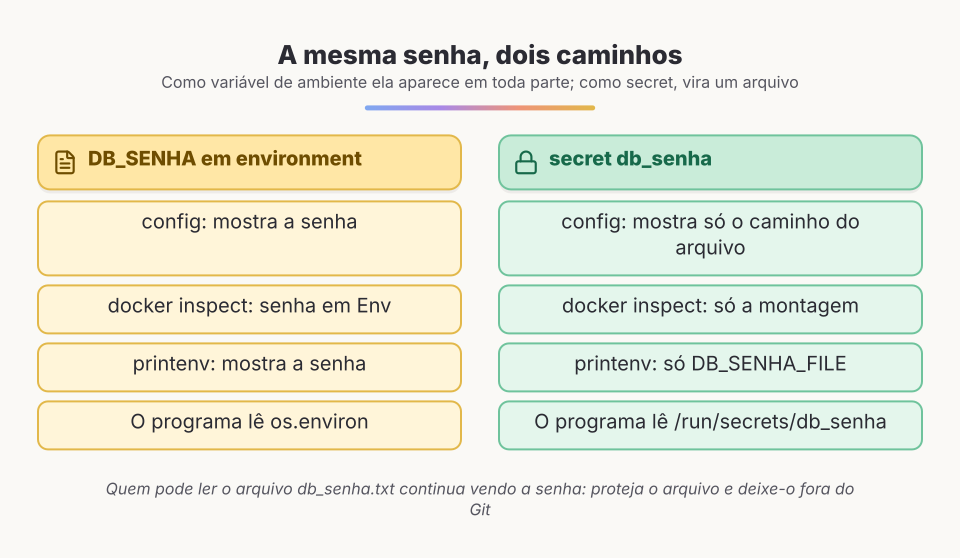

# 12. Segredos e dados sensíveis

> 🗺️ **Neste capítulo:** você vai tirar a senha do banco do `.env` e das variáveis de ambiente e entregá-la aos serviços como um arquivo, com `secrets`, e vai ensinar a API e o PostgreSQL a ler esse arquivo. · ⏱️ ~40 min

> 🔥 **Aquecimento:** (1) Sem nenhuma opção, que arquivos o `docker compose up` lê? (2) Que comando mostra o resultado final da configuração, depois da interpolação e da junção dos arquivos?
>
> <details>
> <summary>Ver resposta</summary>
>
> (1) O `compose.yaml` e, se existir na pasta, o `compose.override.yaml` (capítulo 11). (2) `docker compose config` (capítulos 5 e 11).
>
> </details>

## De onde paramos

No capítulo 11, o contador ganhou uma configuração de desenvolvimento e outra de produção. Falta cuidar de um detalhe que acompanha o projeto desde o capítulo 6: a senha do banco. Ela está no `.env` e chega aos dois serviços como variável de ambiente, `DB_SENHA` na API e `POSTGRES_PASSWORD` no banco.

## secrets de arquivo

Com o contador do capítulo 8 rodando, veja onde a senha aparece:

```bash
docker compose config | grep -i -e senha -e password
docker inspect contador-db-1 --format '{{json .Config.Env}}'
docker compose exec api printenv DB_SENHA
```

Saída (a do `inspect`, cortada):

```text
      DB_SENHA: troque-esta-senha
      POSTGRES_PASSWORD: troque-esta-senha
["POSTGRES_PASSWORD=troque-esta-senha","PATH=/usr/local/sbin:...
troque-esta-senha
```

Três lugares, e nenhum deles feito para guardar segredo. A saída do `config` é colada em pedidos de ajuda e em registros de CI; o `docker inspect` mostra a senha para qualquer pessoa com acesso ao Docker da máquina; e as variáveis de ambiente passam para todos os programas que o processo inicia e costumam aparecer em mensagens de erro e em relatórios de falha.

**Um *secret* do Compose é um dado sensível declarado na chave `secrets`, no topo do arquivo, e entregue só aos serviços que o pedem, como um arquivo dentro do contêiner, em vez de uma variável de ambiente.**

São dois passos, parecidos com os de um volume nomeado (capítulo 7): declarar o secret no topo e citá-lo no serviço que vai usá-lo. Primeiro, a senha vai para um arquivo próprio:

```bash
# printf não põe quebra de linha no fim; o arquivo fica só com a senha
printf 'troque-esta-senha' > db_senha.txt
```

No PowerShell, `Set-Content db_senha.txt 'troque-esta-senha' -NoNewline` faz o mesmo: no teste, os dois arquivos ficaram com 17 bytes, o tamanho exato da senha.

> ⚠️ **Corrigido na edição 1.3:** até a edição 1.2, este parágrafo e o lab diziam 16 bytes. A senha `troque-esta-senha` tem 17 caracteres, e é esse o tamanho que o `wc -c` e o `(Get-Item db_senha.txt).Length` mostram para um arquivo sem quebra de linha no fim.

No `compose.yaml`, declare o secret e cite-o nos dois serviços:

```yaml
# trecho: o secret citado em cada serviço que precisa dele
services:
  api:
    # ...
    secrets:
      - db_senha
  db:
    # ...
    secrets:
      - db_senha

# no topo, ao lado de volumes: de onde vem o conteúdo do secret
secrets:
  db_senha:
    file: ./db_senha.txt
```

O caminho de `file` é relativo à pasta do `compose.yaml`, como o `build: .`. O nome `db_senha` é seu: é por ele que os serviços pedem o secret.

O arquivo `db_senha.txt` não pode ir para o Git, senão a senha volta para o histórico do projeto, agora num arquivo à parte. Acrescente-o ao `.gitignore`:

<!-- project: contador | run: cd contador && docker compose config | expect: db_senha -->

**contador/.gitignore**

```text
db_senha.txt
```

O `.env` também saiu do projeto: depois desta mudança, nenhum serviço usa mais `DB_SENHA`, e o teste com o `.env` apagado subiu normalmente.

> ⚠️ **Erro comum:** citar no serviço um secret que não foi declarado no topo. Com `- db_senh` (falta uma letra) no serviço `api`, o `docker compose config` recusa o arquivo:
>
> ```text
> service "api" refers to undefined secret db_senh: invalid compose project
> ```
>
> É o mesmo tipo de erro do volume não declarado (capítulo 7): o nome no serviço tem de existir no `secrets` do topo.

## /run/secrets

Declarar o secret é metade do caminho. Falta saber onde ele aparece dentro do contêiner, porque é lá que o programa vai buscá-lo.

**Cada secret citado num serviço aparece dentro do contêiner como um arquivo somente leitura em `/run/secrets/<nome>`, com o conteúdo do arquivo de origem.**

Antes de rodar, preveja: depois do `up`, o `printenv` da API ainda mostra a senha?

```bash
docker compose up -d --wait
# o que o contêiner da API recebeu: o arquivo e o ambiente
docker compose exec api ls /run/secrets
docker compose exec api cat /run/secrets/db_senha
docker compose exec api printenv | grep -i senha
```

```text
db_senha
troque-esta-senha
DB_SENHA_FILE=/run/secrets/db_senha
```

A senha está no arquivo, e o ambiente tem só o **caminho** até ele (a variável `DB_SENHA_FILE`, da próxima seção). O `docker compose config` também mudou: no lugar da senha, aparecem o nome e o arquivo de origem.

```text
secrets:
  db_senha:
    name: contador_db_senha
    file: .../contador/db_senha.txt
```

E o `docker inspect contador-api-1 --format '{{json .Mounts}}'` mostra como o Compose entrega o secret na sua máquina: uma montagem do tipo `bind`, do `db_senha.txt` para `/run/secrets/db_senha`, com `"RW":false`, somente leitura. Um teste de escrita dentro do contêiner confirmou:

```text
sh: 1: cannot create /run/secrets/db_senha: Read-only file system
```

Os secrets valem para contêineres Linux, que são os deste livro.



O secret não é um cofre. Quem pode ler o `db_senha.txt` no host, ou rodar `docker compose exec` no contêiner, continua vendo a senha. O ganho é ela deixar de vazar por onde ninguém esperava: config, inspect, variáveis herdadas e o Git.

> ⚠️ **Erro comum:** subir o projeto sem o arquivo do secret. No teste, com o `db_senha.txt` fora da pasta, o `up -d` não reclamou: o Docker criou no lugar uma **pasta vazia** chamada `db_senha.txt` e a montou em `/run/secrets/db_senha`. O banco subiu (ele já tinha a senha guardada no volume), e a API caiu ao abrir o arquivo:
>
> ```text
> api-1  | IsADirectoryError: [Errno 21] Is a directory: '/run/secrets/db_senha'
> ```
>
> É o mesmo comportamento do bind mount com pasta inexistente (capítulo 7). Para corrigir: `docker compose down`, apague a pasta criada por engano, crie o arquivo de novo e suba outra vez. O teste foi no Docker Desktop para Windows.

## _FILE nas imagens

O arquivo está no contêiner, mas o PostgreSQL e a API ainda procuram a senha numa variável de ambiente. Alguém precisa ensinar cada programa a ler o arquivo.

**A convenção `_FILE` é um acordo das imagens, não do Compose: em vez da variável com o valor (`POSTGRES_PASSWORD`), você passa uma variável com o mesmo nome e `_FILE` no fim, apontando o caminho do arquivo, e o programa lê o valor de lá.**

A imagem oficial do PostgreSQL aceita `POSTGRES_PASSWORD_FILE`. Muitas imagens oficiais fazem o mesmo com as suas variáveis, mas confira na página de cada imagem: se ela não conhece a variável `_FILE`, essa variável não tem efeito nenhum.

No banco, troque a variável:

```yaml
# trecho do serviço db
  db:
    image: postgres:17
    environment:
      # a imagem lê a senha do arquivo, não da variável
      POSTGRES_PASSWORD_FILE: /run/secrets/db_senha
    secrets:
      - db_senha
```

A API é sua, então quem segue a convenção é o seu código. O `app.py` ganha uma função que lê o arquivo, e o `CONEXAO` passa a usá-la:

**contador/app.py**

```python
import os
from http.server import BaseHTTPRequestHandler, HTTPServer

import psycopg


def ler_senha():
    # o segredo chega como arquivo; strip() tira a quebra de linha do fim
    with open(os.environ["DB_SENHA_FILE"]) as arquivo:
        return arquivo.read().strip()


# o endereço do banco vem do compose.yaml: o nome do serviço
CONEXAO = {
    "host": os.environ.get("DB_HOST", "db"),
    "port": os.environ.get("DB_PORTA", "5432"),
    "user": "postgres",
    "password": ler_senha(),
    "connect_timeout": 3,
}


class Contador(BaseHTTPRequestHandler):
    def do_GET(self):
        # rota de saúde: responde sem tocar no banco nem contar visita
        if self.path == "/saude":
            self.responder(200, "ok\n")
            return
        try:
            # uma conexão por acesso: a API não cai se o banco sumir
            with psycopg.connect(**CONEXAO) as banco:
                banco.execute(
                    "CREATE TABLE IF NOT EXISTS visitas (id serial PRIMARY KEY)"
                )
                linha = banco.execute(
                    "INSERT INTO visitas DEFAULT VALUES RETURNING id"
                ).fetchone()
            self.responder(200, f"Visita número {linha[0]}\n")
        except psycopg.OperationalError as erro:
            self.responder(503, f"Sem banco: {erro}\n")

    def responder(self, status, texto):
        corpo = texto.encode()
        self.send_response(status)
        self.send_header("Content-Type", "text/plain; charset=utf-8")
        self.end_headers()
        self.wfile.write(corpo)


# 0.0.0.0 para aceitar conexões vindas de fora do contêiner
HTTPServer(("0.0.0.0", 8000), Contador).serve_forever()
```

O `compose.yaml` completo, com as duas variáveis `_FILE` e o secret no topo:

**contador/compose.yaml**

```yaml
services:
  api:
    build: .
    ports:
      - "127.0.0.1:8000:8000"
    environment:
      DB_HOST: db
      # o caminho do arquivo, nunca a senha
      DB_SENHA_FILE: /run/secrets/db_senha
    secrets:
      - db_senha
    depends_on:
      db:
        condition: service_healthy
    healthcheck:
      test:
        - CMD
        - python
        - -c
        - "import urllib.request as u; u.urlopen('http://localhost:8000/saude')"
      interval: 2s
      timeout: 3s
      retries: 10
  db:
    image: postgres:17
    environment:
      POSTGRES_PASSWORD_FILE: /run/secrets/db_senha
    secrets:
      - db_senha
    volumes:
      - db-data:/var/lib/postgresql/data
    healthcheck:
      # -h localhost: testa pela rede, o mesmo caminho que a API usa
      test: ["CMD-SHELL", "pg_isready -h localhost -U postgres"]
      interval: 2s
      timeout: 3s
      retries: 10

volumes:
  db-data:

secrets:
  db_senha:
    file: ./db_senha.txt
```

```bash
# --build: o app.py mudou
docker compose up -d --build --wait
curl -s localhost:8000
```

Saída (as últimas linhas do `up` e o `curl`):

```text
 Container contador-db-1 Healthy
 Container contador-api-1 Healthy
Visita número 14
```

A contagem continuou de onde estava: o volume é o mesmo, e a senha do arquivo é a mesma do `.env` antigo.

Por que o `strip()`? Um arquivo criado com `echo` ou salvo por um editor costuma terminar com uma quebra de linha, e ela faz parte do conteúdo. No teste, `echo 'nova-senha-forte' > db_senha.txt` gerou 17 bytes, um a mais que a senha. A imagem do PostgreSQL descarta essa quebra ao ler o arquivo (um banco novo criado com esse arquivo aceitou a senha sem ela), mas o seu código só descarta se você mandar. Sem o `strip()`, a API mandou a senha com a quebra e o banco recusou (linha quebrada para caber na página):

```text
Sem banco: connection failed: ... FATAL:  password authentication failed
  for user "postgres"
```

> ⚠️ **Erro comum:** trocar a senha no `db_senha.txt` e esperar que o banco mude junto. O `POSTGRES_PASSWORD_FILE`, como o `POSTGRES_PASSWORD`, só é usado quando o volume está vazio, para criar o banco. No teste, com `nova-senha-forte` no arquivo, o `up -d` nem recriou os contêineres; depois de um `docker compose restart api`, a API leu a senha nova e recebeu o mesmo `password authentication failed`. O banco guardado no volume continua com a senha antiga. Para trocá-la de verdade, mude também dentro do banco:
>
> ```bash
> # dentro do contêiner, o psql entra sem senha
> docker compose exec db psql -U postgres \
>   -c "ALTER USER postgres PASSWORD 'nova-senha-forte'"
> ```
>
> A saída foi `ALTER ROLE`, e a API voltou a contar visitas. Em desenvolvimento, outra saída é `down -v`, que apaga o volume e os dados com ele (capítulo 7).

## 🧪 Lab: a senha sai do ambiente

1. Na pasta do contador, rode os três comandos do início da seção “secrets de arquivo” e anote onde a senha aparece.
2. Crie o `db_senha.txt` com `printf 'troque-esta-senha' > db_senha.txt` (ou `Set-Content ... -NoNewline` no PowerShell), usando a mesma senha do `.env`, e confira o tamanho com `wc -c db_senha.txt` (ou `(Get-Item db_senha.txt).Length`): 17 bytes.
3. Crie o `.gitignore` com a linha `db_senha.txt`.
4. Troque o `app.py` e o `compose.yaml` pelos da seção “_FILE nas imagens”.
5. Rode `docker compose config` e confira que a senha não aparece mais, só o arquivo de origem.
6. Suba com `docker compose up -d --build --wait` e teste com `curl -s localhost:8000`: a contagem continua.
7. Confira com `docker compose exec api ls /run/secrets` e `docker compose exec api printenv | grep -i senha`: o arquivo está lá, e o ambiente tem só `DB_SENHA_FILE`.
8. Apague o `.env`, rode `docker compose up -d --wait` de novo e confira que nada reclamou.

No Git Bash do Windows, um caminho como `/run/secrets` no `exec` vira um caminho do Windows antes de chegar ao Docker (`C:/Program Files/Git/run/secrets: No such file or directory`). Rode `export MSYS_NO_PATHCONV=1` antes, ou use o PowerShell.

## 🏋️ Pratique

### 1. Exemplo resolvido

Uma colega trocou a senha no `db_senha.txt` para `nova-senha-forte`, rodou `docker compose up -d` e, mais tarde, `docker compose restart api`. Agora a API responde `Sem banco: ... password authentication failed for user "postgres"`. Ela quer entender o que houve e voltar a funcionar sem perder as visitas.

1. A mensagem vem do banco: ele recebeu uma senha e não a aceitou. A rede e o nome do serviço estão certos, senão o erro seria outro (capítulo 6).
2. O `docker compose exec api cat /run/secrets/db_senha` mostra `nova-senha-forte`: a API está mandando a senha nova.
3. O banco guarda a senha dentro do volume, desde que foi criado. O `POSTGRES_PASSWORD_FILE` só vale com o volume vazio, então o banco continua esperando `troque-esta-senha`.
4. Por que só falhou depois do `restart`? A API lê a senha uma vez, ao iniciar. O `up -d` não recriou nada, e a API seguiu com a senha velha na memória até ser reiniciada.
5. Para não perder dados, a senha muda dentro do banco:

   ```bash
   docker compose exec db psql -U postgres \
     -c "ALTER USER postgres PASSWORD 'nova-senha-forte'"
   ```

6. A saída é `ALTER ROLE`, e o `curl -s localhost:8000` volta a mostrar `Visita número ...`.

### 2. Complete

Numa pasta `notas`, um PostgreSQL deve receber a senha pelo secret `senha_notas`, guardado em `segredos/notas.txt`. Complete:

```yaml
# a senha do banco notas vem de um arquivo, pelo secret
services:
  db:
    image: postgres:17
    environment:
      POSTGRES_PASSWORD________: /run/secrets/________
    ________:
      - senha_notas

________:
  senha_notas:
    ________: ./segredos/notas.txt
```

<details>
<summary>Ver resposta</summary>

```yaml
services:
  db:
    image: postgres:17
    environment:
      # _FILE: a imagem lê a senha do arquivo
      POSTGRES_PASSWORD_FILE: /run/secrets/senha_notas
    secrets:
      - senha_notas

secrets:
  senha_notas:
    file: ./segredos/notas.txt
```

O nome dentro de `/run/secrets` é o nome do secret (`senha_notas`), não o do arquivo de origem (`notas.txt`). Erros comuns: escrever `/run/secrets/notas.txt`, caminho que não existe no contêiner; esquecer o `_FILE` e escrever `POSTGRES_PASSWORD: /run/secrets/senha_notas`, que transforma o caminho na própria senha; e esquecer o `secrets` do topo, que dá `refers to undefined secret senha_notas`. E lembre de pôr `segredos/` no `.gitignore`.

</details>

### 3. Sozinho

Um colega criou o `db_senha.txt` com `echo 'nova-senha-forte' > db_senha.txt`, num banco novo, e escreveu na API `return arquivo.read()`, sem `strip()`. O `pg_isready` passa e o banco aceita a senha pelo `psql`, mas a API responde `password authentication failed`. Explique por que um aceita e o outro não, e dê duas correções.

<details>
<summary>Ver resposta</summary>

O `echo` põe uma quebra de linha no fim: o arquivo tem 17 bytes, a senha mais `\n`. A imagem do PostgreSQL descarta essa quebra ao ler o `POSTGRES_PASSWORD_FILE`, então a senha do banco ficou `nova-senha-forte`. A API lê o arquivo inteiro, com a quebra, e manda `nova-senha-forte\n`, que é outra senha.

Correção 1: no código, `arquivo.read().strip()`, que também resolve a quebra `\r\n` de arquivos salvos no Windows. Correção 2: recriar o arquivo sem a quebra, com `printf 'nova-senha-forte' > db_senha.txt` (ou `Set-Content ... -NoNewline`), e conferir 16 bytes com `wc -c`.

A primeira é a mais segura, porque não depende de como cada pessoa cria o arquivo. O `pg_isready` passava porque ele só testa se o banco aceita conexões, sem senha.

</details>

### 4. Desafio

No servidor de CI da empresa, não há arquivo de senha: o sistema de CI entrega a senha numa variável de ambiente, `DB_SENHA`, para o processo que roda o `docker compose`. A equipe não quer voltar a usar `environment` nos serviços. Como entregar a senha como secret mesmo assim? Escreva o bloco `secrets` do topo e diga o que muda no `config` e dentro do contêiner.

<details>
<summary>Ver resposta</summary>

O secret pode ter como origem uma variável de ambiente do processo que roda o Compose, em vez de um arquivo:

```yaml
# a origem é a variável DB_SENHA de quem roda o docker compose
secrets:
  db_senha:
    environment: DB_SENHA
```

Os serviços não mudam: continuam com `secrets: [db_senha]` e `DB_SENHA_FILE: /run/secrets/db_senha`. No teste, `DB_SENHA=nova-senha-forte docker compose up -d --wait` subiu o contador, e o `cat /run/secrets/db_senha` dentro da API mostrou a senha. O `config` mostra só `environment: DB_SENHA`, o nome da variável, nunca o valor.

A senha continua no ambiente do servidor de CI, mas não nos contêineres: dentro deles, ela é um arquivo. Uma resposta completa troca `file` por `environment`, mantém os serviços como estavam e diz que o `config` mostra só o nome da variável.

</details>

## 🧠 Revisão rápida

1. Cite dois lugares onde uma senha passada em `environment` aparece sem ninguém pedir.
2. Onde fica, dentro do contêiner, o secret `db_senha`? Ele pode ser alterado lá dentro?
3. O `POSTGRES_PASSWORD_FILE` é um recurso do Compose ou da imagem? Por que a diferença importa?
4. Você trocou a senha no arquivo do secret e o banco passou a recusar a API. Por quê?
5. (Capítulo 7) Por que um arquivo de secret que não existe vira uma pasta vazia dentro do contêiner?

<details>
<summary>Ver resposta</summary>

1. Na saída do `docker compose config`, no `docker inspect` (em `Env`) e no `printenv` dentro do contêiner; qualquer dois servem.
2. Em `/run/secrets/db_senha`. Não: o arquivo é montado somente leitura (`Read-only file system`).
3. Da imagem. O Compose só cria o arquivo; quem decide ler a variável `_FILE` é o programa. Uma imagem que não conhece a variável a ignora, e a senha não chega.
4. Porque o banco guardou a senha antiga no volume ao ser criado. A variável `_FILE` só vale com o volume vazio; a senha precisa ser trocada dentro do banco, com `ALTER USER`.
5. Porque, na máquina do teste, o secret é entregue como um bind mount, e um bind mount com origem inexistente faz o Docker criar uma pasta vazia nesse lugar.

</details>

## 🤖 Estude com um tutor de IA

Copie e cole num assistente de IA:

```text
Estou aprendendo Docker Compose. Faça 5 perguntas, uma de cada vez,
sobre secrets: declaração no topo, uso no serviço, /run/secrets,
a convenção _FILE das imagens e por que trocar a senha no arquivo
não muda o banco existente. Espere minha resposta antes de comentar.
```

```text
Vou colar meu compose.yaml e o erro que aparece quando a API tenta
usar o secret. Me ajude a achar a causa com perguntas, sem me dar
a correção pronta.
Arquivo e erro: <cole aqui>
```

> ➡️ **Próximo passo:** a senha está protegida, mas nada impede a API de consumir toda a memória da máquina, nem há como rodar mais de uma cópia dela. No capítulo 13, você vai limitar CPU e memória e subir réplicas com `--scale`.

## 📌 Resumo

| Item | Em uma frase |
| --- | --- |
| `secrets` (no topo) | Declara o secret e de onde vem o conteúdo: `file` ou `environment` |
| `secrets` (no serviço) | Entrega o secret só aos serviços que o citam |
| `/run/secrets/<nome>` | Onde o secret aparece no contêiner, como arquivo somente leitura |
| `_FILE` | Convenção das imagens: a variável aponta o arquivo de onde ler o valor |
| `strip()` | Tira a quebra de linha do fim ao ler o arquivo no seu código |
| `.gitignore` | Mantém o arquivo do secret fora do Git |
| Senha no volume | Trocar o arquivo não troca a senha de um banco já criado |

## 📚 Fontes

- [Manage secrets securely in Docker Compose](https://docs.docker.com/compose/how-tos/use-secrets/) (conferido em 20/11/2026)
- [postgres (Docker Official Image)](https://hub.docker.com/_/postgres) (conferido em 21/11/2026)
- [Services (Compose file reference)](https://docs.docker.com/reference/compose-file/services/) (conferido em 20/11/2026)

> 🔁 **Revise hoje:** capítulos 5, 9 e 11

<!-- nav:start -->
---

[◀ Capítulo anterior](11-perfis-e-arquivos-sobrepostos.md) · [Mapa do livro](../README.md) · [Próximo capítulo ▶](13-recursos-e-escala.md)
<!-- nav:end -->
