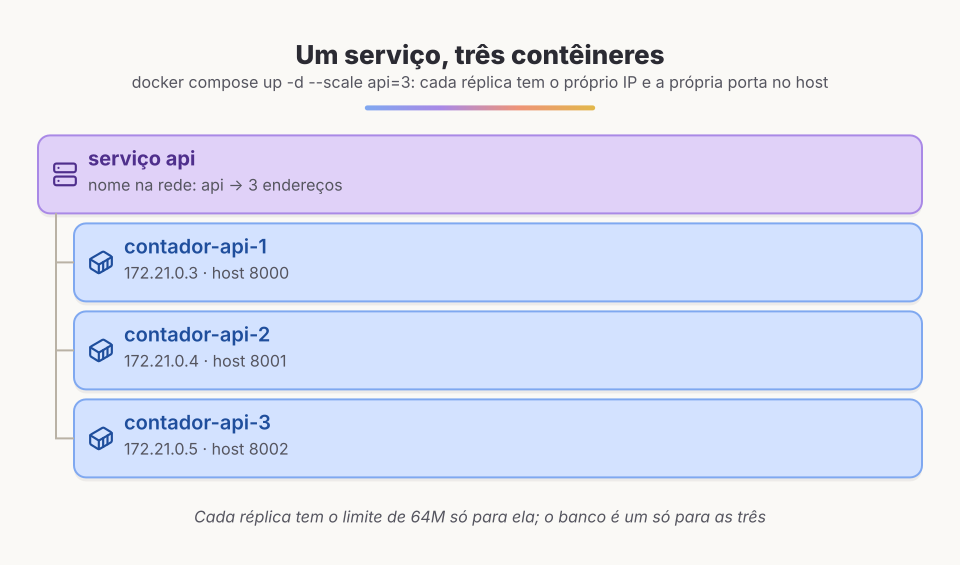

# 13. Recursos e escala

> 🗺️ **Neste capítulo:** você vai pôr um teto de CPU e de memória na API, ver o consumo de cada contêiner com `docker stats` e subir várias cópias do mesmo serviço com `--scale`, resolvendo o conflito de portas que isso cria. · ⏱️ ~40 min

> 🔥 **Aquecimento:** (1) Onde aparece, dentro do contêiner, um secret chamado `db_senha`? (2) Com `ports: - "8000:8000"` na API e outro arquivo, passado com `-f`, que diz `ports: - "80:8000"`, quantas portas a API publica?
>
> <details>
> <summary>Ver resposta</summary>
>
> (1) Em `/run/secrets/db_senha`, como arquivo somente leitura (capítulo 12). (2) Duas, a 8000 e a 80: na junção, as listas são somadas (capítulo 11).
>
> </details>

## De onde paramos

No capítulo 12, a senha saiu das variáveis de ambiente. O contador está bem configurado, mas cada contêiner ainda pode usar toda a CPU e toda a memória da máquina, e a API é uma só: se ela estiver ocupada, quem chega espera. Este capítulo trata das duas coisas.

## deploy.resources

Um contêiner sem limite usa o que precisar. Na maioria das vezes, isso é pouco; mas um laço infinito ou um vazamento de memória na API pode deixar o banco, e a máquina inteira, sem recursos.

**A chave `deploy.resources.limits` de um serviço define o máximo que cada contêiner dele pode usar: `cpus` em número de núcleos (`"0.50"` é meio núcleo) e `memory` em bytes, com unidade (`64M`, `1G`).**

No serviço `api` do contador do capítulo 12, acrescente o bloco `deploy`:

```yaml
# trecho do serviço api, depois do healthcheck
    deploy:
      resources:
        limits:
          # meio núcleo e 64 MB: a API não tira recursos do banco
          cpus: "0.50"
          memory: 64M
```

```bash
docker compose up -d --wait
docker inspect contador-api-1 \
  --format '{{.HostConfig.NanoCpus}} {{.HostConfig.Memory}}'
```

```text
500000000 67108864
```

O Docker guardou os limites nas unidades dele: 500.000.000 bilionésimos de núcleo (meio núcleo) e 67.108.864 bytes (64 × 1.024 × 1.024).

Antes de testar, preveja: o que acontece se um programa dentro da API tentar ocupar 200 MB?

```bash
# reserva 200 MB de uma vez, acima do limite de 64M
docker compose exec api \
  python -c "x = bytearray(200 * 2**20); print('alocou')"
echo "código de saída: $?"
```

```text
código de saída: 137
```

O `print` nunca rodou. O sistema encerrou o processo por falta de memória, e 137 é o código de um processo morto à força (128 + 9, o sinal `SIGKILL`). Como o processo era o `python` do `exec`, só ele morreu: a API seguiu `Up ... (healthy)`.

A CPU é diferente: o processo não morre, fica mais lento. Um laço infinito rodado com `docker compose exec -d api python -c "while True: pass"` ficou preso em cerca de 50%, como mostra a próxima seção.

> ⚠️ **Erro comum:** dar ao serviço menos memória do que o próprio programa precisa para iniciar. Com `memory: 6M`, a API não chegou a responder: o `up --wait` terminou com `container contador-api-1 exited (137)`, e o `docker inspect contador-api-1 --format '{{.State.OOMKilled}}'` mostrou `true`. Meça o consumo normal antes de escolher o limite (próxima seção) e deixe uma folga.

Dois outros erros que o Compose e o Docker recusam na hora:

| No arquivo | Mensagem |
| --- | --- |
| `cpus: "64"` numa máquina com 6 núcleos | `range of CPUs is from 0.01 to 6.00, as there are only 6 CPUs available` |
| `memory: 64 megas` | `'services[api].deploy.resources.limits.memory' invalid suffix: 'megas'` |

### 🔎 Para ir além: reservas e processos

Além de `limits`, existe `reservations`, com `cpus` e `memory`: o mínimo que o serviço espera ter. E `limits` também aceita `pids`, o número máximo de processos no contêiner, uma defesa contra programas que criam processos sem parar. A referência completa está na especificação `deploy` do Compose (link nas fontes).

## docker stats

Escolher um limite sem medir é chute. Antes de decidir `64M`, você precisa saber quanto a API usa num dia normal.

**O `docker stats` mostra, ao vivo, o consumo de CPU, de memória e o número de processos de cada contêiner; o `docker compose stats` faz o mesmo só com os contêineres do projeto.**

```bash
# --no-stream: uma leitura só, em vez da tela que se atualiza
docker compose stats --no-stream \
  --format 'table {{.Name}}\t{{.CPUPerc}}\t{{.MemUsage}}'
```

Com o laço infinito do teste anterior rodando na API:

```text
NAME             CPU %     MEM USAGE / LIMIT
contador-api-1   49.19%    19.48MiB / 64MiB
contador-db-1    9.04%     20.68MiB / 15.54GiB
```

A coluna `MEM USAGE / LIMIT` mostra o uso e o teto. A API está em 19,48 MiB de 64 MiB. O banco, sem limite, aparece com o total disponível para o Docker: 15,54 GiB na máquina do teste. A CPU da API parou perto de 50%, o meio núcleo do `cpus: "0.50"`.

Sem `--no-stream`, a tela se atualiza a cada poucos segundos até você apertar Ctrl+C, bom para acompanhar um teste de carga. O `docker stats` (sem `compose`) mostra **todos** os contêineres da máquina, inclusive os de outros projetos, o que ajuda a descobrir quem está pesando.

Para escolher o limite, rode a aplicação como no dia a dia, olhe o maior consumo que aparecer e dê uma folga. Neste livro, a API ficou entre 19 e 32 MiB nos testes, e 64M cobre isso com sobra.

> ⚠️ **Erro comum:** ler a porcentagem de CPU como fração da máquina inteira. No `docker stats`, 100% é **um núcleo**: um contêiner sem limite numa máquina de 6 núcleos pode chegar a 600%. O 49,19% da API é quase meio núcleo, exatamente o limite.

## --scale

Uma API que atende um pedido por vez fica lenta quando muita gente chega junto. Uma saída é rodar várias cópias dela e repartir os pedidos.

**Uma réplica é mais um contêiner criado a partir do mesmo serviço; a opção `--scale <serviço>=<n>` do `up` diz quantas réplicas o serviço deve ter, e o Compose cria ou remove contêineres até chegar a esse número.**

Antes de rodar, preveja: com o contador como está, com `ports: - "127.0.0.1:8000:8000"`, o que acontece com três réplicas da API?

```bash
docker compose up -d --scale api=3 --wait
```

Saída (trecho, com o meio da mensagem cortado e as linhas quebradas para caber na página):

```text
 Container contador-api-2 Error response from daemon: ...
   Bind for 127.0.0.1:8000 failed: port is already allocated
 Container contador-api-3 not started:
   interrupted by the failure of Container contador-api-2
```

A `contador-api-1` já ocupa a porta 8000 do host, e duas réplicas não podem publicar a mesma porta. O `ps -a` mostrou a `api-2` e a `api-3` como `Created`, criadas e paradas. A próxima seção resolve.

As réplicas seguem o padrão de nomes do capítulo 1: `<projeto>-<serviço>-<n>`, com `n` subindo de 1 em 1. Para diminuir, rode o `up` com um número menor: `--scale api=1` parou e removeu a `contador-api-2`, e a saída mostrou `Stopping`, `Stopped`, `Removing` e `Removed` para ela.

O número também pode ficar no arquivo, com `deploy.replicas`:

```yaml
# trecho do serviço api: três réplicas a cada up
    deploy:
      replicas: 3
```

No teste, o `up -d` comum subiu as três, e um `--scale api=2` na linha de comando venceu o arquivo, deixando duas.

> ⚠️ **Erro comum:** dar um nome fixo ao contêiner com `container_name` num serviço que vai ter réplicas. Nomes de contêiner são únicos na máquina, e o Compose não tem como dar o mesmo nome a três. Com `deploy.replicas: 3`, o arquivo foi recusado:
>
> ```text
> services.deploy.replicas: can't set container_name and api as container name must be unique: invalid compose project
> ```
>
> Com `--scale api=2`, apareceu um aviso, e o serviço ficou com um contêiner só:
>
> ```text
> WARNING: The "api" service is using the custom container name "contador-api". Docker requires each container to have a unique name. Remove the custom name to scale the service
> ```

## Portas e réplicas

As réplicas existem, mas como alguém chega a elas? Cada uma precisa de uma porta própria no host, ou de nenhuma.

**Para publicar réplicas, use uma faixa de portas no host (`"127.0.0.1:8000-8002:8000"`), uma porta por réplica, ou deixe só a porta do contêiner (`"8000"`) e o Docker escolhe uma porta livre para cada uma; dentro da rede do projeto, o nome do serviço responde com o endereço de todas as réplicas.**

Troque a porta da API por uma faixa:

```yaml
# trecho do serviço api: uma porta do host para cada réplica
    ports:
      - "127.0.0.1:8000-8002:8000"
```

```bash
docker compose down
docker compose up -d --scale api=3 --wait
docker compose ps --format '{{.Name}} {{.Ports}}'
```

```text
contador-api-1 127.0.0.1:8000->8000/tcp
contador-api-2 127.0.0.1:8001->8000/tcp
contador-api-3 127.0.0.1:8002->8000/tcp
contador-db-1 5432/tcp
```

Antes de testar, preveja: os três `curl` vão mostrar a mesma visita ou visitas diferentes?

```bash
for p in 8000 8001 8002; do curl -s localhost:$p; done
```

```text
Visita número 21
Visita número 22
Visita número 23
```

Visitas diferentes e em sequência: as três réplicas gravam no mesmo banco, e quem numera as visitas é ele. Por isso a API pode ter réplicas sem problema, mas o banco, não: cada réplica de um `postgres` teria o próprio processo tentando usar os mesmos arquivos, e o Compose não transforma um banco em vários.

Dentro da rede, o nome `api` agora tem três endereços. O Python, perguntando de dentro da própria API:

```bash
# pergunta à rede todos os endereços do nome api
docker compose exec api python -c \
  "import socket as s; print(sorted(s.gethostbyname_ex('api')[2]))"
```

```text
['172.21.0.3', '172.21.0.4', '172.21.0.5']
```

Os endereços mudam quando a rede é recriada; o que importa é haver três.



Um programa que chame `api:8000` de dentro da rede cai numa das réplicas. Os limites também valem por réplica: o `docker compose stats` mostrou as três com `/ 64MiB` cada uma, 192 MiB no total.

Publicar uma porta por réplica funciona para testes, mas quem usa a aplicação não vai escolher entre 8000, 8001 e 8002. O certo é ter **uma** porta na frente que distribua os pedidos entre as réplicas, um proxy reverso. É o primeiro passo do capítulo 14.

> ⚠️ **Erro comum:** escalar para mais réplicas do que a faixa tem portas. Com `"127.0.0.1:8000-8002:8000"` e `--scale api=4`, a quarta réplica não achou porta livre na faixa:
>
> ```text
> Error response from daemon: failed to set up container networking: driver failed programming external connectivity on endpoint contador-api-4 (...): all ports are allocated
> ```
>
> Faixa e número de réplicas precisam combinar; ou use `"8000"`, sem porta do host, e confira no `ps` qual porta cada uma ganhou.

## 🧪 Lab: medir, limitar, multiplicar

1. Com o contador do capítulo 12 rodando, rode `docker compose stats --no-stream` e anote quanto a API usa de memória.
2. Acrescente à API o bloco `deploy.resources.limits` com `cpus: "0.50"` e `memory: 64M`, suba com `docker compose up -d --wait` e confira o `/ 64MiB` no `docker compose stats --no-stream`.
3. Teste o limite de memória com o `bytearray` de 200 MB da seção “deploy.resources” e confira o código 137 e a API ainda `healthy` no `docker compose ps`.
4. Rode `docker compose exec -d api python -c "while True: pass"`, espere uns segundos e veja a CPU da API perto de 50% no `stats`. Depois, `docker compose restart api` encerra o laço.
5. Tente `docker compose up -d --scale api=3 --wait` com a porta `127.0.0.1:8000:8000` e leia o erro.
6. Troque a porta por `"127.0.0.1:8000-8002:8000"`, rode `docker compose down` e `docker compose up -d --scale api=3 --wait`, e teste as três portas com `curl`.
7. Volte para uma réplica com `docker compose up -d --scale api=1 --wait` e confira com `docker compose ps`.

## 🏋️ Pratique

### 1. Exemplo resolvido

Depois de pôr `memory: 6M` na API para “economizar”, um colega viu o `docker compose up -d --wait` terminar com `container contador-api-1 exited (137)`. Os logs da API estão vazios. Ele quer saber o que houve.

1. O código 137 é 128 + 9: o processo principal foi morto com `SIGKILL`, não terminou com um erro do Python. Por isso não há mensagem nos logs.
2. Quem mata assim, sem aviso, costuma ser o sistema, por falta de memória. A confirmação:

   ```bash
   # true: o contêiner passou do limite de memória e foi encerrado
   docker inspect contador-api-1 --format '{{.State.OOMKilled}}'
   ```

   A saída é `true`.
3. O Python sozinho, com a biblioteca `psycopg` carregada, usa mais de 6 MB só para iniciar; no `stats`, a API ficava em torno de 20 MiB.
4. A correção é medir e dar folga: voltar a `memory: 64M` e subir de novo com `docker compose up -d --wait`.

### 2. Complete

O serviço `cache` (Redis, exercício do capítulo 6) deve usar no máximo um quarto de núcleo e 32 MB. Complete:

```yaml
# o cache não pode pesar mais que a API
  cache:
    image: redis:7-alpine
    ________:
      ________:
        limits:
          ________: "0.25"
          ________: ________
```

E o comando que mostra, uma vez só, o uso de memória do cache e o teto: `docker compose ________ --no-stream cache`.

<details>
<summary>Ver resposta</summary>

```yaml
  cache:
    image: redis:7-alpine
    deploy:
      resources:
        limits:
          # um quarto de núcleo e 32 MB
          cpus: "0.25"
          memory: 32M
```

O comando é `docker compose stats --no-stream cache`; no teste, a coluna de memória mostrou `3.836MiB / 32MiB`. Erros comuns, todos recusados pelo Compose: `limits` direto no serviço, sem `deploy` e `resources` (`services.cache.limits false schema`); `memory: 32` sem unidade e sem aspas (`limits.memory must be a string`); e `cpu` no singular (`additional properties 'cpu' not allowed`).

</details>

### 3. Sozinho

Você quer cinco réplicas da API do contador, acessíveis de fora, sem escolher as portas à mão. Escreva a linha de `ports`, o comando para subir e o comando que mostra qual porta do host cada réplica recebeu.

<details>
<summary>Ver resposta</summary>

```yaml
# só a porta do contêiner: o Docker escolhe uma porta livre do host
    ports:
      # 0.0.0.0 por extenso: o exercício pede as réplicas acessíveis de fora
      - "0.0.0.0::8000"
```

```bash
docker compose up -d --scale api=5 --wait
docker compose ps --format '{{.Name}} {{.Ports}}'
```

Os dois-pontos seguidos separam o endereço da porta do contêiner e deixam a porta do host em branco, para o Docker escolher. O `0.0.0.0` escrito por extenso mostra a quem lê o arquivo que a porta fica aberta para a rede, e isso só se justifica porque o enunciado pede acesso de fora. Se só você precisa das réplicas, use `"127.0.0.1::8000"`. Cada linha do `ps` mostra uma porta diferente do host: num teste com `"127.0.0.1::8000"`, saíram cinco portas seguidas, de `127.0.0.1:59032->8000/tcp` a `127.0.0.1:59036->8000/tcp`. Com `0.0.0.0`, o `ps` mostra esse endereço no lugar do `127.0.0.1`, e na sua máquina os números serão outros. A outra resposta certa é a faixa `"0.0.0.0:8000-8004:8000"`, com exatamente cinco portas. Erros comuns: manter `"8000:8000"`, que dá `port is already allocated` na segunda réplica; usar uma faixa menor que o número de réplicas; e pôr `container_name` no serviço.

> ⚠️ **Corrigido na edição 1.3.1:** até a edição 1.3, esta resposta usava `"8000"` e `"8000-8004:8000"`, sem endereço, o que abre as portas para a rede sem que o arquivo diga isso. Agora o `0.0.0.0` aparece por extenso, com o motivo.

</details>

### 4. Desafio

Uma equipe pôs `deploy.replicas: 3` no serviço `db` (PostgreSQL) “para o banco aguentar mais”. Explique por que isso é uma má ideia neste projeto, o que de fato aguenta mais carga e como você conferiria, com os comandos deste capítulo, que a mudança certa funcionou.

<details>
<summary>Ver resposta</summary>

O Compose criaria três contêineres `postgres`, cada um com o próprio processo, e todos com o mesmo volume `db-data` em `/var/lib/postgresql/data`. O PostgreSQL não foi feito para vários servidores escreverem nos mesmos arquivos ao mesmo tempo. E o nome `db` passaria a responder com três endereços, então cada visita poderia cair num banco diferente. Replicar um banco de verdade pede recursos do próprio PostgreSQL, fora do escopo do Compose.

O que escala neste projeto é a API: ela não guarda nada, e todas as réplicas usam o mesmo banco. Para conferir: `docker compose up -d --scale api=3 --wait`, `docker compose ps` com as três réplicas e `curl` em cada porta, com visitas em sequência (21, 22, 23), prova de que o banco é um só; e `docker compose stats --no-stream`, para ver a carga repartida e cada réplica com o próprio teto de memória.

Uma resposta completa diz por que o banco não deve ter réplicas aqui (os mesmos arquivos e o nome com vários endereços), aponta a API como o que escala e usa `ps`, `curl` e `stats` como prova.

</details>

## 🧠 Revisão rápida

1. O que acontece com um processo que passa do limite de memória? E com um que passa do limite de CPU?
2. No `docker stats`, o que significa 100% de CPU?
3. Por que duas réplicas não podem ter `ports: - "8000:8000"`?
4. Dentro da rede do projeto, o que o nome `api` devolve quando há três réplicas?
5. (Capítulo 6) Por que a API pode ter réplicas e continuar contando visitas em sequência?

<details>
<summary>Ver resposta</summary>

1. Passou da memória: é encerrado (código 137, `OOMKilled` quando é o processo principal). Passou da CPU: não morre, fica mais lento, preso no teto.
2. Um núcleo inteiro. Com vários núcleos, um contêiner sem limite pode passar de 100%.
3. Porque uma porta do host só pode ser publicada por um contêiner; a segunda réplica falha com `port is already allocated`.
4. O endereço das três réplicas, um por contêiner.
5. Porque todas as réplicas se conectam ao mesmo banco, pelo nome `db`, e quem numera as visitas é o banco.

</details>

## 🤖 Estude com um tutor de IA

Copie e cole num assistente de IA:

```text
Estou aprendendo Docker Compose. Faça 5 perguntas, uma de cada vez,
sobre deploy.resources.limits (cpus e memory), docker stats, --scale,
deploy.replicas e portas com réplicas. Em pelo menos uma, me mostre
uma mensagem de erro real e peça a causa. Espere minha resposta.
```

```text
Vou colar a saída do docker compose stats --no-stream do meu projeto.
Me ajude a escolher limites de CPU e memória para cada serviço com
perguntas, sem me dar os números prontos.
Saída: <cole aqui>
```

> ➡️ **Próximo passo:** as réplicas estão no ar, mas cada uma numa porta. No capítulo 14, o projeto final, um proxy reverso vai receber tudo numa porta só e repassar para a API, com desenvolvimento e produção num comando cada.

## 📌 Resumo

| Item | Em uma frase |
| --- | --- |
| `deploy.resources.limits` | Teto de `cpus` e `memory` para cada contêiner do serviço |
| Limite de memória | Quem passa é encerrado (código 137) |
| Limite de CPU | Quem passa fica mais lento, sem morrer |
| `docker stats` / `docker compose stats` | Consumo de CPU, memória e processos, ao vivo ou com `--no-stream` |
| `--scale api=3` | Cria ou remove réplicas até o número pedido; vence o `deploy.replicas` |
| `deploy.replicas` | Número de réplicas escrito no arquivo |
| Portas e réplicas | Faixa (`"8000-8002:8000"`) ou só a porta do contêiner (`"8000"`) |
| Nome do serviço | Com réplicas, responde com o endereço de todas |

## 📚 Fontes

- [Compose Deploy Specification](https://docs.docker.com/reference/compose-file/deploy/) (conferido em 20/11/2026)
- [docker compose up (CLI reference)](https://docs.docker.com/reference/cli/docker/compose/up/) (conferido em 20/11/2026)
- [Services (Compose file reference)](https://docs.docker.com/reference/compose-file/services/) (conferido em 20/11/2026)
- [Networking in Compose](https://docs.docker.com/compose/how-tos/networking/) (conferido em 20/11/2026)

> 🔁 **Revise hoje:** capítulos 6, 10 e 12

<!-- nav:start -->
---

[◀ Capítulo anterior](12-segredos-e-dados-sensiveis.md) · [Mapa do livro](../README.md) · [Próximo capítulo ▶](14-projeto-final-stack-completa.md)
<!-- nav:end -->
