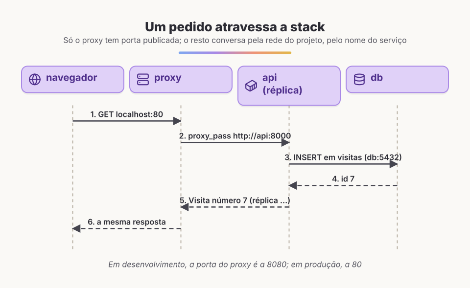

# 14. Projeto final: stack completa

> 🗺️ **Neste capítulo:** você vai montar a stack final do livro, com proxy reverso, API em réplicas e banco, separar as imagens de desenvolvimento e de produção com um build multi-stage, publicar a de produção num registro e subir cada ambiente com um comando, usando quase tudo o que aprendeu desde o capítulo 1. · ⏱️ ~80 min

> 🔥 **Aquecimento:** (1) Por que três réplicas da API não podem ter `ports: - "8000:8000"`? (2) Onde a API encontra a senha do banco, depois do capítulo 12?
>
> <details>
> <summary>Ver resposta</summary>
>
> (1) Porque uma porta do host só pode ser publicada por um contêiner; a segunda réplica falha com `port is already allocated` (capítulo 13). (2) No arquivo `/run/secrets/db_senha`, cujo caminho chega pela variável `DB_SENHA_FILE` (capítulo 12).
>
> </details>

## De onde paramos

No capítulo 13, a API ganhou limites e réplicas, mas cada réplica ficou numa porta do host, 8000, 8001 e 8002, e quem usa a aplicação não vai escolher entre elas. Falta uma porta só na frente de tudo, e falta juntar num projeto as peças dos capítulos 4 a 13. É o que este capítulo faz.

## Proxy reverso

Com uma porta para cada réplica, cada nova réplica pede uma porta nova e uma mudança em quem acessa. E a API, publicada direto no host, fica exposta a qualquer pedido, sem nada na frente para receber, registrar ou repassar.

**Um proxy reverso (*reverse proxy*) é um servidor que recebe os pedidos de fora numa única porta e os repassa a outros serviços da rede interna, devolvendo a resposta a quem pediu; quem acessa só enxerga o proxy.**

Neste projeto, o proxy é um nginx (o mesmo servidor do capítulo 1) com uma configuração própria. Ele é o **único** serviço com porta publicada; a API e o banco ficam só na rede do projeto.

<!-- project: stack | run: cd stack && docker compose config --services | expect: proxy -->

**stack/proxy/default.conf**

```nginx
server {
    listen 80;

    # tudo o que chega ao proxy vai para o serviço api, pela rede do projeto
    location / {
        proxy_pass http://api:8000;
        # repassa à API o endereço que o navegador usou
        proxy_set_header Host $host;
        proxy_set_header X-Forwarded-For $proxy_add_x_forwarded_for;
    }
}
```

O `proxy_pass http://api:8000` usa o nome do serviço como endereço (capítulo 6) e a porta do contêiner, não a do host. No `compose.yaml`, o proxy monta essa configuração por bind mount, somente leitura (capítulo 7), e espera a API ficar `healthy` (capítulo 8):

```yaml
# trecho do compose.yaml: o serviço proxy
  proxy:
    image: nginx:1.27-alpine
    volumes:
      # a configuração vem do projeto, somente leitura
      - ./proxy/default.conf:/etc/nginx/conf.d/default.conf:ro
    depends_on:
      api:
        condition: service_healthy
    healthcheck:
      # 127.0.0.1, não localhost: o nginx deste projeto só escuta em IPv4
      test: ["CMD", "wget", "-q", "--spider", "http://127.0.0.1/saude"]
      interval: 2s
      timeout: 3s
      retries: 10
```

O teste de saúde do proxy pede `/saude`, que o proxy repassa à API. Se passar, o caminho inteiro funciona: proxy, rede e API.

Para mostrar qual réplica atendeu cada pedido, a API acrescenta à resposta o nome do contêiner, que é o que `socket.gethostname()` devolve dentro dele:

```python
# trecho do app.py: a resposta de uma visita
            # o nome do contêiner mostra qual réplica atendeu
            replica = socket.gethostname()
            texto = f"Visita número {linha[0]} (réplica {replica})\n"
            self.responder(200, texto)
```

Antes de rodar, preveja: com o proxy na porta 8080 e a API sem `ports`, o `curl` na 8080 responde? E na 8000?

```bash
docker compose up -d --build --wait
curl -s localhost:8080
# a API não tem porta publicada: 000 quer dizer sem resposta
curl -s -o /dev/null -w '%{http_code}\n' localhost:8000
```

```text
Visita número 1 (réplica b074752a3a2d)
000
```

A visita passou pelo proxy, e a API não atende de fora. O nome `b074752a3a2d` é o identificador curto do contêiner da API; o seu será outro.



Com réplicas, o nginx reparte os pedidos entre elas, mas não em partes exatamente iguais. Na produção deste capítulo, com três réplicas, 30 pedidos seguidos deram 13, 7 e 10, e cada rodada deu uma divisão diferente, sempre perto de 10 para cada:

```bash
# conta quantos pedidos cada réplica atendeu
for i in $(seq 1 30); do curl -s localhost:80; done \
  | sed 's/.*réplica //' | sort | uniq -c
```

```text
     13 75e81a69f3bc)
      7 87adfe63bf7a)
     10 abe27c43a743)
```

A divisão não é exata porque o nginx atende com vários processos de trabalho, um por núcleo da máquina (6 no teste), e cada processo reveza as réplicas por conta própria. Três rodadas seguidas deram 13/10/7, 9/12/9 e 8/12/10.

> ⚠️ **Corrigido na edição 1.3.1:** até a edição 1.3, este trecho dizia que os 30 pedidos davam exatamente 10 para cada réplica. Nos testes da revisão, a divisão variou a cada rodada, pelo motivo acima.

O nginx descobre os endereços de `api` uma vez, ao iniciar. No teste, uma quarta réplica criada com `--scale api=4` depois de o proxy subir não recebeu nenhum dos 40 pedidos seguintes; depois de `docker compose exec proxy nginx -s reload`, recebeu 14 de 40. Quem muda o número de réplicas precisa recarregar o proxy.

> ⚠️ **Erro comum:** escrever `proxy_pass http://localhost:8000`. Dentro do contêiner do proxy, `localhost` é o próprio proxy, onde não há nada na porta 8000 (capítulo 6). O `curl` recebeu uma página `502 Bad Gateway`, e o log do proxy mostrou o motivo:
>
> ```text
> connect() failed (111: Connection refused) while connecting to upstream, ... upstream: "http://[::1]:8000/saude"
> ```
>
> Use o nome do serviço: `http://api:8000`.

> ⚠️ **Erro comum:** testar a saúde do nginx com `http://localhost/saude`. Na imagem `nginx:1.27-alpine`, `localhost` aponta primeiro para o endereço IPv6 `::1`, e a configuração deste projeto, com `listen 80`, só escuta em IPv4. O proxy funcionava, mas ficou `unhealthy`, e o `docker inspect` mostrou `wget: can't connect to remote host: Connection refused`. Com `127.0.0.1`, o teste passou.

Outro erro, mais raro: subir o proxy sozinho, com `docker compose up -d --no-deps proxy`, sem a API existir. O nginx não acha o nome `api` e não chega a funcionar; o log mostra `[emerg] ... host not found in upstream "api" in /etc/nginx/conf.d/default.conf:6`. É por isso que o proxy tem `depends_on` com `service_healthy`.

## Dev e produção

A stack precisa de dois jeitos de rodar. Na sua máquina, você quer o proxy numa porta qualquer, o banco acessível para ferramentas e o código atualizado sem build. No servidor, quer a porta 80, reinício automático e três réplicas, e nada de porta do banco aberta.

**A stack final usa três arquivos: o `compose.yaml` com o que vale em todo lugar, o `compose.override.yaml` com o que só vale em desenvolvimento e o `compose.prod.yaml` com o que só vale em produção; cada ambiente sobe com um comando.**

É a organização do capítulo 11, agora sem `ports` nenhum na base: cada ambiente publica as suas portas, e nada precisa ser apagado com `!override` ou `!reset`.

| Ambiente | Comando | O que muda |
| --- | --- | --- |
| Desenvolvimento | `docker compose up -d --build --wait` | proxy em 8080 e banco em 15432, presos a `127.0.0.1`; `develop.watch` na API |
| Desenvolvimento com ferramentas | `docker compose --profile ferramentas up -d --wait` | o mesmo, mais o Adminer em 8081 |
| Produção | `docker compose -f compose.yaml -f compose.prod.yaml up -d --build --wait` | proxy em 80, `restart: unless-stopped`, 3 réplicas da API |

Antes de subir a produção, confira a junção. O teste leu o `config` em JSON e listou, para cada serviço, as portas publicadas, a política de reinício e as réplicas:

```text
api [] unless-stopped 3
db [] unless-stopped None
proxy ['80'] unless-stopped None
```

Uma porta só, a 80 do proxy. A API e o banco, sem nenhuma. O `config` também mostrou que o `deploy` da API juntou as duas partes: `replicas: 3`, do `compose.prod.yaml`, e os `limits` de CPU e memória, do `compose.yaml` (o `deploy` é um mapa, e mapas se juntam chave por chave).

```bash
docker compose -f compose.yaml -f compose.prod.yaml up -d --build --wait
docker compose -f compose.yaml -f compose.prod.yaml \
  ps --format '{{.Name}} {{.Status}}'
```

```text
stack-api-1 Up 6 seconds (healthy)
stack-api-2 Up 6 seconds (healthy)
stack-api-3 Up 6 seconds (healthy)
stack-db-1 Up 9 seconds (healthy)
stack-proxy-1 Up 2 seconds (healthy)
```

As portas, você já conferiu no `config`: só a 80 do proxy, escrita como `0.0.0.0:80:80` no `compose.prod.yaml`. É a única porta do projeto aberta para a rede, e é de propósito: num servidor, é por ela que o público chega.

Em desenvolvimento, o `watch` do capítulo 10 continua valendo, agora atrás do proxy. Com `docker compose watch` rodando, uma mudança no texto da resposta, no `api/app.py`, apareceu no `curl -s localhost:8080` sem nenhum build:

```text
Syncing service "api" after 1 changes were detected
 Container stack-api-1 Restarting
 Container stack-api-1 Started
service(s) ["api"] restarted
```

> ⚠️ **Erro comum:** levar para o servidor o comando de desenvolvimento. Um `docker compose up -d` sem `-f`, no servidor, lê o `compose.override.yaml` se ele estiver lá: o proxy vai para a 8080, o banco ganha a porta 15432 (presa ao `127.0.0.1`, mas aberta para qualquer programa do servidor) e a API roda com uma réplica só, sem `restart`. No servidor, use sempre os dois `-f`, inclusive no `ps`, no `logs` e no `down`, e não copie o `compose.override.yaml` para lá.

## Build multi-stage com target

Até aqui, a mesma imagem da API serve aos dois ambientes. Mas o que ajuda a desenvolver nem sempre deve ir para o servidor, e o servidor pede cuidados que atrapalham na sua máquina. Um exemplo de cada lado: em desenvolvimento, o modo de desenvolvimento do Python (`python -X dev`) mostra avisos extras sobre o código; em produção, o programa não deve rodar como `root`, o administrador do contêiner, para que uma falha na API não dê poder total a quem a explorar.

Manter dois Dockerfiles quase iguais é pedir para um ficar desatualizado. O Dockerfile pode ter vários estágios.

**Um build multi-stage é um Dockerfile com vários `FROM ... AS <nome>`, cada um iniciando um estágio (*stage*) que pode partir de outro; a chave `build.target` do Compose escolhe até qual estágio construir.**

**stack/api/Dockerfile**

```dockerfile
# estágio comum: Python, a biblioteca do banco e o código
FROM python:3.13-slim AS base
WORKDIR /app
# versão fixa: o build de amanhã instala a mesma biblioteca
RUN pip install --no-cache-dir "psycopg[binary]==3.3.9"
COPY app.py .

# desenvolvimento: o modo de desenvolvimento do Python mostra avisos extras
FROM base AS dev
CMD ["python", "-X", "dev", "-u", "app.py"]

# produção: o programa roda sem ser root
FROM base AS prod
RUN useradd --system --no-create-home app
USER app
CMD ["python", "-u", "app.py"]
```

Os estágios `dev` e `prod` partem de `base` (`FROM base`), então a instalação do `psycopg` e o `COPY` são escritos uma vez só. O `useradd` cria um usuário de sistema chamado `app`, e o `USER app` faz tudo o que vem depois, inclusive o `CMD`, rodar com ele. Sem `target`, o Docker constrói o último estágio do arquivo; por isso o `prod` fica por último: se alguém esquecer o `target`, sai a imagem de produção.

No `compose.yaml`, o `build` da API passa para o formato longo do capítulo 4, com o `target` de produção, e o override de desenvolvimento troca só o `target`:

```yaml
# trecho do compose.yaml: o serviço api
  api:
    build:
      context: ./api
      # o estágio de produção; o override troca para dev
      target: prod
```

```yaml
# trecho do compose.override.yaml
  api:
    # em desenvolvimento, o estágio dev do Dockerfile
    build:
      target: dev
```

Como `build` é um mapa, a junção (capítulo 11) mantém o `context` da base e troca o `target`. O `docker compose config` confirmou: `target: dev` sem `-f` e `target: prod` com os dois `-f`, ambos com o mesmo `context`.

Antes de rodar, preveja: em desenvolvimento, com que usuário a API roda? E na produção?

```bash
docker compose up -d --build --wait
docker compose exec api whoami
docker inspect stack-api-1 --format '{{json .Config.Cmd}}'
```

```text
root
["python","-X","dev","-u","app.py"]
```

Na produção, com os dois `-f` e `up -d --build --wait`, o mesmo teste mostrou `app` e `["python","-u","app.py"]`. A API continuou contando visitas (`Visita número 53`): o usuário `app` consegue ler o secret em `/run/secrets/db_senha` na máquina do teste, onde o arquivo aparece com permissão de leitura para todos.

> ⚠️ **Erro comum:** trocar de ambiente sem `--build`. Os dois estágios geram uma imagem com o **mesmo nome**, `stack-api`. No teste, depois de rodar em desenvolvimento, um `up -d --wait` com os dois `-f` de produção não construiu nada, porque a imagem já existia (capítulo 4), e subiu as três réplicas com a imagem de desenvolvimento: `whoami` respondeu `root` e o `Cmd` era o do `-X dev`. Com `up -d --build --wait`, veio a imagem certa. A seção seguinte resolve isso de vez, dando à imagem de produção um nome próprio.

Um `target` com um nome que não existe no Dockerfile para o build na hora: com `target: producao`, a mensagem foi `failed to solve: target stage "producao" could not be found`.

## Publicar a imagem: image, build e push

Na produção, construir a imagem no próprio servidor tem dois problemas: o servidor precisa do código e das ferramentas de build, e nada garante que a imagem dele é a mesma que você testou. O comum é construir uma vez, guardar a imagem num **registro** (*registry*), um servidor de imagens como o Docker Hub, e fazer o servidor baixá-la de lá.

**Com `image` e `build` no mesmo serviço, o Compose constrói a imagem com o nome dado em `image`; o `docker compose push` envia essas imagens ao registro que aparece no nome, e um serviço sem `image` é pulado.**

O nome diz o destino. `localhost:5000/stack-api:1.0` vai para o registro em `localhost:5000`, no repositório `stack-api`, com a etiqueta (*tag*) `1.0`. Um nome sem endereço, como `seu-usuario/stack-api:1.0`, vai para o Docker Hub.

Para testar sem conta em lugar nenhum, este capítulo usa um **registro local**: a imagem oficial `registry:2`, rodando na sua máquina. É um registro de verdade, só que para testes; ele não substitui um registro com senha e cópia de segurança.

```bash
# um registro de imagens na porta 5000, só para testes e só nesta máquina
docker run -d -p 127.0.0.1:5000:5000 --name registro registry:2
```

> ⚠️ **Corrigido na edição 1.3:** até a edição 1.2, o registro subia com `-p 5000:5000`. Sem endereço, a porta abre para a rede toda, e o `registry:2` de teste não pede senha: qualquer aparelho da mesma rede poderia baixar e enviar imagens. Com `127.0.0.1` na frente, o `push` para `localhost:5000` funciona igual.

No `compose.prod.yaml`, a API ganha o nome com o endereço do registro. O `build` continua no `compose.yaml`, e a junção junta os dois:

```yaml
# trecho do compose.prod.yaml
  api:
    # o nome diz para onde a imagem vai: o registro em localhost:5000
    image: localhost:5000/stack-api:1.0
    restart: unless-stopped
```

```bash
docker compose -f compose.yaml -f compose.prod.yaml build api
docker compose -f compose.yaml -f compose.prod.yaml push api
```

Saída (a última linha do `build` e o fim do `push`, sem as linhas de cada camada):

```text
 Image localhost:5000/stack-api:1.0 Built
 localhost:5000/stack-api:1.0 Pushed
```

O próprio registro confirma o que recebeu:

```bash
curl -s localhost:5000/v2/_catalog
curl -s localhost:5000/v2/stack-api/tags/list
```

```text
{"repositories":["stack-api"]}
{"name":"stack-api","tags":["1.0"]}
```

Antes de rodar, preveja: num servidor que não tem a imagem, o `up` vai construí-la ou baixá-la?

Para simular esse servidor, o teste apagou a imagem local com `docker image rm localhost:5000/stack-api:1.0` e rodou o `up` de produção sem `--build`:

```bash
docker compose -f compose.yaml -f compose.prod.yaml up -d --wait
```

Saída (as linhas da imagem):

```text
 Image localhost:5000/stack-api:1.0 Pulling
 Image localhost:5000/stack-api:1.0 Pulled
```

Baixou: com `image` e `build` juntos, o Compose tenta primeiro baixar a imagem e só constrói se ela não existir no registro. As três réplicas subiram com a imagem do registro, rodando como `app`. O `docker compose -f ... pull api` faz só o download, sem subir nada, e é um bom primeiro passo numa atualização.

Como o nome de produção é outro, `localhost:5000/stack-api:1.0`, a imagem de desenvolvimento, `stack-api`, não se confunde mais com ela: o erro da seção anterior deixa de acontecer.

> ⚠️ **Erro comum:** rodar o `push` sem `image`. Em desenvolvimento, onde a API só tem `build`, o `docker compose push api` respondeu apenas:
>
> ```text
>  api Skipped
> ```
>
> e terminou sem erro, sem enviar nada. Ler `Skipped` como sucesso é fácil. O `push` precisa dos mesmos `-f` que dão à API o `image` de produção.

Outro erro: o registro fora do ar. Com o `registro` ainda não criado, o `push` falhou com `dial tcp [::1]:5000: i/o timeout`. Confira o registro com `docker ps` antes. Num registro de verdade, como o Docker Hub, entra mais um passo, o `docker login` com a sua conta; esse caso não foi testado neste livro.

## Revisão geral

A stack é pequena, mas cada linha dela vem de um capítulo. Use esta tabela para revisar: para cada linha, tente lembrar o problema que ela resolve antes de ler a segunda coluna.

| Capítulo | No projeto final | Problema que resolve |
| --- | --- | --- |
| 1 e 3 | `name: stack`, `services`, `up`, `ps`, `logs`, `down` | um arquivo e um comando em vez de vários `docker run` |
| 4 | `build: ./api` | a imagem da API sai do Dockerfile do projeto |
| 5 | `docker compose config` | ver o resultado final antes de subir |
| 6 | `proxy_pass http://api:8000`, `DB_HOST: db` | achar outro serviço pelo nome, sem IP |
| 7 | volume `db-data`, `default.conf` com `:ro` | os dados sobrevivem ao `down`; a configuração vem do projeto |
| 8 | `healthcheck` e `condition: service_healthy` | o proxy espera a API, que espera o banco |
| 9 | `restart: unless-stopped`, `exec` | reinício automático; comandos dentro dos contêineres |
| 10 | `develop.watch` | código novo sem build, em desenvolvimento |
| 11 | `profiles`, override, `-f`, merge | ferramentas opcionais; dev e produção do mesmo arquivo |
| 12 | `secrets`, `_FILE` | a senha fora do ambiente e do Git |
| 13 | `deploy.resources`, `deploy.replicas` | limites de recursos e várias cópias da API |
| 14 | `build.target`, `image` + `push` | uma imagem para cada ambiente; o servidor baixa a imagem testada |

Antes de pôr a stack num servidor, confira:

1. O `db_senha.txt` existe no servidor, sem quebra de linha no fim, e está no `.gitignore`.
2. O `docker compose -f compose.yaml -f compose.prod.yaml config` mostra só a porta 80 publicada.
3. O `compose.override.yaml` não foi copiado para o servidor.
4. O `up --wait` terminou com todos os serviços `healthy`.
5. A imagem de produção foi enviada ao registro com os dois `-f` (`Pushed`, não `Skipped`).
6. Depois de mudar o número de réplicas ou a versão da API, você rodou `nginx -s reload` no proxy.

## 🧪 Lab: a stack do zero

Monte a pasta `stack` com os arquivos abaixo, sem copiar nada dos capítulos anteriores. A estrutura:

```text
stack/
├── compose.yaml
├── compose.override.yaml
├── compose.prod.yaml
├── .gitignore
├── db_senha.txt
├── api/
│   ├── Dockerfile
│   └── app.py
└── proxy/
    └── default.conf
```

<details>
<summary>Ver os arquivos do projeto</summary>

**stack/api/Dockerfile**

```dockerfile
# estágio comum: Python, a biblioteca do banco e o código
FROM python:3.13-slim AS base
WORKDIR /app
# versão fixa: o build de amanhã instala a mesma biblioteca
RUN pip install --no-cache-dir "psycopg[binary]==3.3.9"
COPY app.py .

# desenvolvimento: o modo de desenvolvimento do Python mostra avisos extras
FROM base AS dev
CMD ["python", "-X", "dev", "-u", "app.py"]

# produção: o programa roda sem ser root
FROM base AS prod
RUN useradd --system --no-create-home app
USER app
CMD ["python", "-u", "app.py"]
```

**stack/api/app.py**

```python
import os
import socket
from http.server import BaseHTTPRequestHandler, HTTPServer

import psycopg


def ler_senha():
    # o segredo chega como arquivo; strip() tira a quebra de linha do fim
    with open(os.environ["DB_SENHA_FILE"]) as arquivo:
        return arquivo.read().strip()


# o endereço do banco vem do compose.yaml: o nome do serviço
CONEXAO = {
    "host": os.environ.get("DB_HOST", "db"),
    "port": os.environ.get("DB_PORTA", "5432"),
    "user": "postgres",
    "password": ler_senha(),
    "connect_timeout": 3,
}


class Contador(BaseHTTPRequestHandler):
    def do_GET(self):
        # rota de saúde: responde sem tocar no banco nem contar visita
        if self.path == "/saude":
            self.responder(200, "ok\n")
            return
        try:
            # uma conexão por acesso: a API não cai se o banco sumir
            with psycopg.connect(**CONEXAO) as banco:
                banco.execute(
                    "CREATE TABLE IF NOT EXISTS visitas (id serial PRIMARY KEY)"
                )
                linha = banco.execute(
                    "INSERT INTO visitas DEFAULT VALUES RETURNING id"
                ).fetchone()
            # o nome do contêiner mostra qual réplica atendeu
            replica = socket.gethostname()
            texto = f"Visita número {linha[0]} (réplica {replica})\n"
            self.responder(200, texto)
        except psycopg.OperationalError as erro:
            self.responder(503, f"Sem banco: {erro}\n")

    def responder(self, status, texto):
        corpo = texto.encode()
        self.send_response(status)
        self.send_header("Content-Type", "text/plain; charset=utf-8")
        self.end_headers()
        self.wfile.write(corpo)


# 0.0.0.0 para aceitar conexões vindas de fora do contêiner
HTTPServer(("0.0.0.0", 8000), Contador).serve_forever()
```

**stack/proxy/default.conf**

```nginx
server {
    listen 80;

    # tudo o que chega ao proxy vai para o serviço api, pela rede do projeto
    location / {
        proxy_pass http://api:8000;
        # repassa à API o endereço que o navegador usou
        proxy_set_header Host $host;
        proxy_set_header X-Forwarded-For $proxy_add_x_forwarded_for;
    }
}
```

**stack/compose.yaml**

```yaml
# a base: o que vale em desenvolvimento e em produção
name: stack

services:
  proxy:
    image: nginx:1.27-alpine
    volumes:
      # a configuração vem do projeto, somente leitura
      - ./proxy/default.conf:/etc/nginx/conf.d/default.conf:ro
    depends_on:
      api:
        condition: service_healthy
    healthcheck:
      # 127.0.0.1, não localhost: o nginx deste projeto só escuta em IPv4
      test: ["CMD", "wget", "-q", "--spider", "http://127.0.0.1/saude"]
      interval: 2s
      timeout: 3s
      retries: 10

  api:
    build:
      context: ./api
      # o estágio de produção; o override troca para dev
      target: prod
    environment:
      DB_HOST: db
      DB_SENHA_FILE: /run/secrets/db_senha
    secrets:
      - db_senha
    depends_on:
      db:
        condition: service_healthy
    healthcheck:
      test:
        - CMD
        - python
        - -c
        - "import urllib.request as u; u.urlopen('http://localhost:8000/saude')"
      interval: 2s
      timeout: 3s
      retries: 10
    deploy:
      resources:
        limits:
          cpus: "0.50"
          memory: 64M

  db:
    image: postgres:17
    environment:
      POSTGRES_PASSWORD_FILE: /run/secrets/db_senha
    secrets:
      - db_senha
    volumes:
      - db-data:/var/lib/postgresql/data
    healthcheck:
      test: ["CMD-SHELL", "pg_isready -h localhost -U postgres"]
      interval: 2s
      timeout: 3s
      retries: 10

  adminer:
    image: adminer:4
    # ferramenta de apoio: só com --profile ferramentas
    profiles: [ferramentas]
    ports:
      # ferramenta de desenvolvimento: só esta máquina (capítulo 6)
      - "127.0.0.1:8081:8080"

volumes:
  db-data:

secrets:
  db_senha:
    file: ./db_senha.txt
```

**stack/compose.override.yaml**

```yaml
# desenvolvimento: lido sozinho pelo docker compose up
services:
  proxy:
    ports:
      # desenvolvimento: as portas ficam presas a esta máquina
      - "127.0.0.1:8080:80"
  api:
    # em desenvolvimento, o estágio dev do Dockerfile
    build:
      target: dev
    develop:
      watch:
        # código novo: copia e reinicia a API, sem build
        - path: ./api/app.py
          action: sync+restart
          target: /app/app.py
        # dependências mudaram: só um build resolve
        - path: ./api/Dockerfile
          action: rebuild
  db:
    ports:
      - "127.0.0.1:15432:5432"
```

**stack/compose.prod.yaml**

```yaml
# produção: docker compose -f compose.yaml -f compose.prod.yaml ...
services:
  proxy:
    restart: unless-stopped
    ports:
      # 0.0.0.0 por extenso: no servidor, o público chega pela porta 80
      - "0.0.0.0:80:80"
  api:
    # o nome diz para onde a imagem vai: o registro em localhost:5000
    image: localhost:5000/stack-api:1.0
    restart: unless-stopped
    deploy:
      replicas: 3
  db:
    restart: unless-stopped
```

**stack/.gitignore**

```text
db_senha.txt
```

</details>

Os passos:

1. Crie a pasta e os arquivos acima. Crie a senha com `printf 'senha-da-stack' > db_senha.txt` (no PowerShell, `Set-Content db_senha.txt 'senha-da-stack' -NoNewline`).
2. Confira a configuração de desenvolvimento com `docker compose config --services`: `db`, `api` e `proxy`, sem o `adminer`.
3. Suba em desenvolvimento: `docker compose up -d --build --wait`. Teste `curl -s localhost:8080` (uma visita) e `curl -s localhost:8000` (nada responde). Confira o estágio com `docker compose exec api whoami`: `root`.
4. Rode `docker compose watch` num terminal, mude o texto `Visita número` no `api/app.py` e veja a mudança no `curl` de outro terminal. Pare com Ctrl+C.
5. Suba o Adminer com `docker compose --profile ferramentas up -d --wait`, abra `http://localhost:8081` (servidor `db`, usuário `postgres`, a senha do arquivo) e derrube tudo com `docker compose --profile ferramentas down`.
6. Confira a produção sem subir: `docker compose -f compose.yaml -f compose.prod.yaml config` e procure as portas publicadas.
7. Suba a produção com os dois `-f` e `up -d --build --wait`. Na sua máquina, isso abre a porta 80 para a rede em que você estiver: faça este passo numa rede de confiança e derrube tudo no passo 10. Depois, confira as três réplicas no `ps` e rode o laço de 30 pedidos da seção “Proxy reverso”.
8. Confira o estágio de produção com `docker compose -f compose.yaml -f compose.prod.yaml exec api whoami`: `app`.
9. Crie o registro local com `docker run -d -p 127.0.0.1:5000:5000 --name registro registry:2`, envie a imagem com `docker compose -f compose.yaml -f compose.prod.yaml push api` e confira com `curl -s localhost:5000/v2/stack-api/tags/list`.
10. Derrube com `docker compose -f compose.yaml -f compose.prod.yaml down`. O volume `stack_db-data` fica; o `docker volume ls` mostra. Quando não precisar mais do registro, `docker rm -f registro` o remove.

## 🏋️ Pratique

### 1. Exemplo resolvido

Depois de editar o `default.conf`, um colega subiu a stack em desenvolvimento e o `up --wait` terminou com `container stack-proxy-1 is unhealthy`. O `curl -s localhost:8080` devolve uma página `502 Bad Gateway`. A API está `healthy`.

1. O `502 Bad Gateway` é do nginx: ele recebeu o pedido, tentou repassar e não conseguiu falar com quem está atrás. O problema está entre o proxy e a API, não entre você e o proxy.
2. O proxy fica `unhealthy` pelo mesmo motivo: o teste de saúde pede `/saude`, que também é repassado.
3. O log do proxy diz para onde ele tentou ir:

   ```bash
   # a primeira falha de conexão registrada pelo proxy
   docker compose logs proxy | grep -m1 "connect() failed"
   ```

   O trecho importante da saída é `upstream: "http://[::1]:8000/saude"`: o proxy tentou a própria máquina dele, no endereço `::1`, que é `localhost`.
4. No `default.conf`, a linha está `proxy_pass http://localhost:8000;`. Dentro do contêiner do proxy, `localhost` é o proxy, não a API.
5. A correção é `proxy_pass http://api:8000;`. Como o arquivo é lido na partida do nginx, aplique com `docker compose exec proxy nginx -s reload` ou com `docker compose restart proxy`, e confira com o `curl`.

### 2. Complete

Um segundo projeto, `loja`, tem um serviço `web` (porta 3000 no contêiner) e precisa de um proxy na frente, publicado na 8090, que só suba depois de `web` ficar `healthy`. Complete o `default.conf` e o serviço:

```nginx
# o proxy da loja repassa tudo para o serviço web
server {
    listen 80;
    location / {
        proxy_pass http://________:________;
    }
}
```

```yaml
# o único serviço da loja com porta publicada
  proxy:
    image: nginx:1.27-alpine
    ports:
      - "127.0.0.1:________:________"
    volumes:
      - ./proxy/default.conf:/etc/nginx/conf.d/default.conf:________
    depends_on:
      ________:
        condition: ________
```

<details>
<summary>Ver resposta</summary>

```nginx
server {
    listen 80;
    location / {
        # o nome do serviço e a porta do contêiner, não a do host
        proxy_pass http://web:3000;
    }
}
```

```yaml
  proxy:
    image: nginx:1.27-alpine
    ports:
      # o nginx escuta na 80 dentro do contêiner
      - "127.0.0.1:8090:80"
    volumes:
      - ./proxy/default.conf:/etc/nginx/conf.d/default.conf:ro
    depends_on:
      web:
        condition: service_healthy
```

O proxy escuta na 80 dentro do contêiner, por isso a publicação é `127.0.0.1:8090:80`. Erros comuns: `proxy_pass http://localhost:3000`, que dá `502 Bad Gateway`; `ports: "127.0.0.1:8090:3000"`, que liga o host a uma porta onde o nginx não escuta; `condition: healthy` em vez de `service_healthy`; e esquecer que o `web` precisa de um `healthcheck` para a condição funcionar (capítulo 8).

</details>

Agora, a parte do build. Complete o Dockerfile de dois estágios e o trecho do override que escolhe o de desenvolvimento:

```dockerfile
# estágio comum, com a biblioteca do banco e o código
FROM python:3.13-slim ________ base
WORKDIR /app
RUN pip install --no-cache-dir "psycopg[binary]==3.3.9"
COPY app.py .

FROM ________ AS dev
CMD ["python", "-X", "dev", "-u", "app.py"]

FROM base AS prod
RUN useradd --system --no-create-home app
________ app
CMD ["python", "-u", "app.py"]
```

```yaml
# compose.override.yaml: o estágio de desenvolvimento
  api:
    build:
      ________: ________
```

<details>
<summary>Ver resposta</summary>

```dockerfile
# AS dá nome ao estágio; FROM base parte dele
FROM python:3.13-slim AS base
WORKDIR /app
RUN pip install --no-cache-dir "psycopg[binary]==3.3.9"
COPY app.py .

FROM base AS dev
CMD ["python", "-X", "dev", "-u", "app.py"]

FROM base AS prod
RUN useradd --system --no-create-home app
USER app
CMD ["python", "-u", "app.py"]
```

```yaml
  api:
    build:
      # o nome do estágio, igual ao do AS no Dockerfile
      target: dev
```

Erros comuns: `FROM python:3.13-slim AS dev` no segundo estágio, que repete a instalação em vez de partir de `base`; esquecer o `USER app`, que deixa a produção como `root`; e escrever no override um nome diferente do `AS`, como `target: desenvolvimento`, que para o build com `target stage "desenvolvimento" could not be found`. E, no override, `context` não precisa ser repetido: a junção mantém o da base.

</details>

### 3. Sozinho

Escreva os comandos, na pasta `stack`, para cada situação: (a) subir o ambiente de desenvolvimento com o Adminer; (b) ver as duas últimas linhas do log do proxy em desenvolvimento; (c) derrubar a produção sem perder as visitas; (d) zerar o banco de desenvolvimento para começar do 1.

<details>
<summary>Ver resposta</summary>

```bash
# (a) o perfil liga o adminer; o override entra sozinho
docker compose --profile ferramentas up -d --wait
# (b) -n limita as linhas; o nome escolhe o serviço
docker compose logs -n 2 proxy
# (c) os mesmos -f do up; sem -v, o volume fica
docker compose -f compose.yaml -f compose.prod.yaml down
# (d) -v apaga o volume do banco: as visitas recomeçam do 1
docker compose --profile ferramentas down -v
```

No teste, o (a) publicou o Adminer em `127.0.0.1:8081`, o proxy em `127.0.0.1:8080` e o banco em `127.0.0.1:15432`; pelo IP da máquina na rede, nenhuma das três respondeu. O (b) mostrou o pedido de saúde, `"GET /saude HTTP/1.1" 200`. Erros comuns: esquecer o `--profile` no `down` de (d), o que deixa o Adminer de pé e a rede presa (capítulo 11); usar `down -v` em (c), que apaga os dados da produção sem volta (capítulo 7); e esquecer os `-f` em (c), que faz o Compose olhar a configuração de desenvolvimento.

Atenção: desenvolvimento e produção, na mesma pasta, são o mesmo projeto `stack` e usam o mesmo volume `stack_db-data`. Por isso o (d) também apagaria as visitas que você viu na produção da sua máquina. Num servidor de verdade, os dois ambientes ficam em máquinas diferentes.

</details>

Mais uma situação: um colega rodou `docker compose push api` na pasta `stack`, viu `api Skipped` e foi ao servidor buscar a imagem, que não estava lá. Explique o que aconteceu e escreva os comandos certos para construir, enviar e conferir a imagem no registro local.

<details>
<summary>Ver resposta</summary>

Sem `-f`, o Compose leu o `compose.yaml` e o `compose.override.yaml`, e nenhum dos dois dá à API um `image`. Sem nome de imagem, o `push` não tem destino e pula o serviço (`Skipped`), sem erro. O `image: localhost:5000/stack-api:1.0` está no `compose.prod.yaml`.

```bash
# os -f de produção dão à API o nome com o endereço do registro
docker compose -f compose.yaml -f compose.prod.yaml build api
docker compose -f compose.yaml -f compose.prod.yaml push api
# o registro responde com as etiquetas que guarda
curl -s localhost:5000/v2/stack-api/tags/list
```

No teste, o `push` terminou em `localhost:5000/stack-api:1.0 Pushed`, e o registro respondeu `{"name":"stack-api","tags":["1.0"]}`. Erros comuns: achar que `Skipped` é sucesso; e esquecer o `build` antes do `push`, que envia a imagem que já existia com esse nome, talvez antiga.

</details>

### 4. Desafio

O movimento aumentou e a produção precisa de cinco réplicas da API, sem mudar nenhum arquivo e sem derrubar a stack. Escreva os comandos, explique por que só o `--scale` não basta e diga como você provaria que as cinco réplicas estão recebendo pedidos. Diga também o que acontece com as cinco réplicas no próximo `up` sem `--scale`.

<details>
<summary>Ver resposta</summary>

```bash
# --scale vence o deploy.replicas: 3 do compose.prod.yaml
docker compose -f compose.yaml -f compose.prod.yaml up -d --scale api=5 --wait
# o nginx só lê os endereços de api ao iniciar ou recarregar
docker compose -f compose.yaml -f compose.prod.yaml exec proxy nginx -s reload
```

Só o `--scale` não basta porque o nginx descobriu os endereços de `api` quando iniciou. No teste com quatro réplicas, a nova não recebeu nenhum de 40 pedidos até o `nginx -s reload`; depois, recebeu 14 de 40.

A prova é o laço de pedidos com contagem: `for i in $(seq 1 50); do curl -s localhost:80; done | sed 's/.*réplica //' | sort | uniq -c` tem de mostrar cinco nomes diferentes; no teste, as cinco réplicas atenderam entre 8 e 14 pedidos cada uma. E o `ps` com os dois `-f` mostra `stack-api-1` a `stack-api-5`, todas `healthy`.

No próximo `up` sem `--scale`, vale de novo o `deploy.replicas: 3` do arquivo, e o Compose remove a `stack-api-4` e a `stack-api-5`; recarregue o proxy outra vez. Para que as cinco fiquem, mude o `compose.prod.yaml`.

Uma resposta completa usa os dois `-f` em todos os comandos, explica que o nginx resolve o nome uma vez, mostra a contagem como prova e lembra que o arquivo vence no `up` seguinte.

</details>

Um segundo desafio: a equipe quer publicar a versão `1.1` da API sem apagar a `1.0` do registro, para poder voltar atrás se algo der errado, e sem editar o `compose.prod.yaml` a cada versão. Use a interpolação do capítulo 5 para isso. Escreva a linha `image`, os comandos para publicar e subir a `1.1` e o comando para voltar à `1.0`. Diga também o que fazer no proxy depois de cada troca, e por quê.

<details>
<summary>Ver resposta</summary>

```yaml
# a versão vem de uma variável; sem ela, vale a 1.0
    image: localhost:5000/stack-api:${VERSAO:-1.0}
```

```bash
# publicar a 1.1
VERSAO=1.1 docker compose -f compose.yaml -f compose.prod.yaml build api
VERSAO=1.1 docker compose -f compose.yaml -f compose.prod.yaml push api
# subir a 1.1: as réplicas são recriadas com a imagem nova
VERSAO=1.1 docker compose -f compose.yaml -f compose.prod.yaml up -d --wait
# voltar à 1.0, que continua no registro
docker compose -f compose.yaml -f compose.prod.yaml up -d --wait
```

No teste, o registro ficou com as duas etiquetas, `{"name":"stack-api","tags":["1.1","1.0"]}`; o `ps` mostrou as réplicas com `localhost:5000/stack-api:1.1` e, depois da volta, com a `1.0`.

Depois de cada troca, rode `docker compose -f compose.yaml -f compose.prod.yaml exec proxy nginx -s reload`. As réplicas foram recriadas e podem ter ganhado outros endereços, e o nginx guarda os que descobriu ao iniciar. Num dos testes, o `curl` logo depois da troca deu `502 Bad Gateway`; noutro, respondeu, mas o log do proxy registrou `connect() failed (111: Connection refused)`. Depois do `reload`, os dois testes responderam normalmente.

No PowerShell, a variável vai antes, numa linha própria: `$env:VERSAO = "1.1"`. Uma resposta completa usa `${VERSAO:-1.0}`, repete os dois `-f` em tudo, mostra que a `1.0` continua no registro e recarrega o proxy depois de cada troca.

</details>

## 🧠 Revisão rápida

1. Qual é o único serviço da stack com porta publicada, e por quê?
2. Por que o `proxy_pass` usa `api:8000`, e não `localhost:8000` nem a porta do host?
3. O que é preciso fazer no proxy depois de mudar o número de réplicas da API?
4. Que arquivos o Compose lê com `docker compose up -d`, e quais com `docker compose -f compose.yaml -f compose.prod.yaml up -d`?
5. Num build multi-stage, o que a chave `build.target` escolhe? E o que o Docker constrói sem ela?
6. Por que `docker compose push api` responde `Skipped` em desenvolvimento?
7. (Capítulo 12) Antes do primeiro `up` num servidor novo, que arquivo precisa ser criado à mão, e por que ele não vem pelo Git?

<details>
<summary>Ver resposta</summary>

1. O `proxy`. Ele recebe tudo numa porta e repassa para a API, que fica só na rede do projeto, assim como o banco.
2. Porque, dentro do contêiner do proxy, `localhost` é o próprio proxy; entre serviços vale o nome do serviço e a porta do contêiner (capítulo 6).
3. Recarregar o nginx, com `nginx -s reload` via `exec`, porque ele só descobre os endereços de `api` ao iniciar ou recarregar.
4. Sem `-f`: o `compose.yaml` e o `compose.override.yaml`. Com os dois `-f`: só o `compose.yaml` e o `compose.prod.yaml`.
5. O estágio do Dockerfile a construir, pelo nome dado em `AS`. Sem ela, o último estágio do arquivo; por isso o `prod` fica por último.
6. Porque, sem os `-f` de produção, a API não tem `image`, e o `push` pula serviços sem nome de imagem.
7. O `db_senha.txt`, com a senha do banco. Ele está no `.gitignore` para a senha nunca ir para o histórico do projeto.

</details>

## 🤖 Estude com um tutor de IA

Copie e cole num assistente de IA:

```text
Terminei um livro de Docker Compose. Faça 6 perguntas, uma de cada vez,
misturando proxy reverso com nginx, réplicas, healthcheck e depends_on,
secrets, override e -f para produção, build multi-stage e push.
Em pelo menos duas, me dê um erro real e peça a causa.
Espere minha resposta antes de comentar.
```

```text
Vou colar os três arquivos da minha stack (compose.yaml,
compose.override.yaml e compose.prod.yaml). Faça uma revisão como um
colega faria antes de subir em produção: me pergunte o que cada parte faz
e aponte riscos, sem reescrever os arquivos por mim.
Arquivos: <cole aqui>
```

> ➡️ **Próximo passo:** a stack está completa e você usou cada peça do livro nela. Para continuar, o *Mapa do livro* e os *Próximos caminhos* sugerem o que estudar a seguir, como rodar a mesma stack em várias máquinas.

## 📌 Resumo

| Item | Em uma frase |
| --- | --- |
| Proxy reverso | Recebe tudo numa porta e repassa aos serviços da rede interna |
| `proxy_pass http://api:8000` | Nome do serviço e porta do contêiner, nunca `localhost` |
| `nginx -s reload` | Faz o proxy enxergar réplicas novas |
| Healthcheck do proxy | Testa o caminho inteiro, proxy e API, com `127.0.0.1` |
| `compose.yaml` | O que vale em todo lugar, sem portas |
| `compose.override.yaml` | Desenvolvimento: portas 8080 e 15432, presas a `127.0.0.1`, e `develop.watch` |
| `compose.prod.yaml` | Produção: porta 80, `restart` e 3 réplicas, sempre com os dois `-f` |
| Build multi-stage | Estágios com `FROM ... AS <nome>`; `build.target` escolhe qual construir |
| `image` + `build` | A imagem construída ganha o nome de `image`, que diz o registro de destino |
| `docker compose push` | Envia ao registro as imagens dos serviços com `image`; os outros ficam `Skipped` |
| `registry:2` | Registro local para testes, em `localhost:5000` |
| Checklist de produção | Senha no servidor, `config` com uma porta, sem override, tudo `healthy` |

## 🧭 Próximos caminhos

- **Docker Swarm:** rodar a mesma stack em várias máquinas, aproveitando o `compose.yaml` e a chave `deploy` que você já conhece.
- **Kubernetes:** o orquestrador mais usado em produção, com réplicas, rede e segredos parecidos com os deste livro, mas em outra escala.
- **Segurança de imagens:** imagens menores, usuário sem privilégios e busca de vulnerabilidades, a continuação natural do build multi-stage.
- **Build multiplataforma:** construir a mesma imagem para processadores x86 e ARM e publicá-la num registro.

## 📚 Fontes

- [Networking in Compose](https://docs.docker.com/compose/how-tos/networking/) (conferido em 20/11/2026)
- [Merge Compose files](https://docs.docker.com/compose/how-tos/multiple-compose-files/merge/) (conferido em 21/11/2026)
- [Control startup order](https://docs.docker.com/compose/how-tos/startup-order/) (conferido em 20/11/2026)
- [Compose Deploy Specification](https://docs.docker.com/reference/compose-file/deploy/) (conferido em 20/11/2026)
- [Use Compose Watch](https://docs.docker.com/compose/how-tos/file-watch/) (conferido em 20/11/2026)
- [Manage secrets securely in Docker Compose](https://docs.docker.com/compose/how-tos/use-secrets/) (conferido em 20/11/2026)
- [Compose Build Specification](https://docs.docker.com/reference/compose-file/build/) (conferido em 21/11/2026)
- [Multi-stage builds](https://docs.docker.com/build/building/multi-stage/) (conferido em 21/11/2026)
- [docker compose push](https://docs.docker.com/reference/cli/docker/compose/push/) (conferido em 21/11/2026)

> 🔁 **Revise hoje:** capítulos 7, 11 e 13

<!-- next-steps:start -->
## 🧭 Próximos caminhos

- **Docker Swarm**
- **Kubernetes**
- **Segurança de imagens**
- **Build multiplataforma**
<!-- next-steps:end -->

<!-- nav:start -->
---

[◀ Capítulo anterior](13-recursos-e-escala.md) · [Mapa do livro](../README.md) · [Próximo capítulo ▶](15-simulado-final.md)
<!-- nav:end -->
