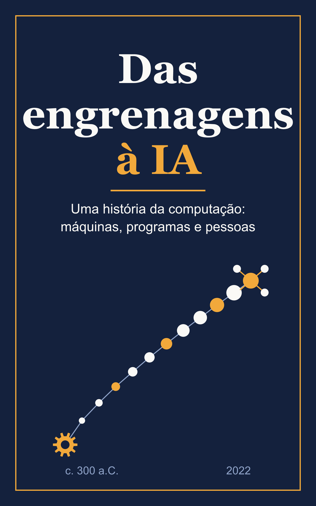

# Das engrenagens à IA

*Uma história da computação: máquinas, programas e pessoas*

Para pessoas curiosas, sem formação em computação, que querem entender de onde vieram os computadores e a IA de hoje. Ao terminar, você conta a história da computação das calculadoras mecânicas à IA generativa, com datas e nomes certos, explica a causa de cada virada e separa fato de lenda.

## Comece aqui

- [Como estudar este livro e teste de nivelamento](chapters/00-como-estudar-este-livro.md)
- [Capítulo 1: Contar antes de computar](chapters/01-contar-antes-de-computar-do-abaco.md)

## 📇 O livro numa página

![O livro numa página, em 12 cartões: 1. Contar e computar (calcular × computar; Pascalina e aritmômetro; cartão troca o desenho). 2. Babbage e Lovelace (diferencial só soma; analítica: Store e Mill; Nota G é fato, o resto não). 3. Cartões e censo (Hollerith e o censo de 1890; computadores humanos; analógico × digital). 4. Boole, Turing, Shannon (E, OU, NÃO com 0 e 1; fita, cabeça e estados; bit: escolha entre duas). 5. Guerra e válvulas (relé × válvula; Z3, ABC, Colossus, ENIAC; primeiro depende da definição). 6. Programa armazenado (programa na memória; Baby 1948, EDSAC 1949; UNIVAC, IBM, Zezinho). 7. Transistor ao chip (transistor 1947; chip e Lei de Moore; Intel 4004, Patinho Feio). 8. Nasce o software (compilador traduz; FORTRAN e COBOL; mariposa não criou o bug). 9. PC em cada mesa (Altair e Apple II; IBM PC e Macintosh; Lei 7.232 e reserva). 10. Tudo conectado (pacotes e ARPANET; internet × web; AlterNex e CGI.br). 11. Máquinas que aprendem (Dartmouth e invernos; Deep Blue e AlphaGo; Transformer e ChatGPT). 12. Seu museu (15 marcos com causa; checar uma lenda; pelo menos 2 brasileiros).](img/c00-o-livro-numa-pagina.svg)

<!-- map:start -->
## 🗺️ Mapa do livro

- [0. Como estudar este livro](chapters/00-como-estudar-este-livro.md)
- [1. Contar antes de computar: do ábaco às calculadoras mecânicas](chapters/01-contar-antes-de-computar-do-abaco.md) · ⏱️ ~40 min
- [2. Babbage e Lovelace: a máquina que não ficou pronta](chapters/02-babbage-e-lovelace-a-maquina-que-nao-ficou.md) · ⏱️ ~45 min
- [3. Cartões, censos e computadores de carne e osso](chapters/03-cartoes-censos-e-computadores-de-carne-e-osso.md) · ⏱️ ~45 min
- [4. A ideia de máquina universal: Boole, Turing e Shannon](chapters/04-a-ideia-de-maquina-universal-boole-turing.md) · ⏱️ ~50 min
- [5. Guerra e válvulas: Zuse, Colossus e ENIAC](chapters/05-guerra-e-valvulas-zuse-colossus-e-eniac.md) · ⏱️ ~50 min
- [6. O programa vai para a memória: von Neumann e os primeiros computadores à venda](chapters/06-o-programa-vai-para-a-memoria-von-neumann.md) · ⏱️ ~45 min
- [7. Do transistor ao chip](chapters/07-do-transistor-ao-chip.md) · ⏱️ ~50 min
- [8. Ensinar a máquina a entender gente: o nascimento do software](chapters/08-ensinar-a-maquina-a-entender-gente-o-nascimento-do-software.md) · ⏱️ ~50 min
- [9. Um computador em cada mesa](chapters/09-um-computador-em-cada-mesa.md) · ⏱️ ~45 min
- [10. Tudo conectado: ARPANET, web e celular](chapters/10-tudo-conectado-arpanet-web-e-celular.md) · ⏱️ ~50 min
- [11. Máquinas que aprendem: a longa estrada da inteligência artificial](chapters/11-maquinas-que-aprendem-a-longa-estrada.md) · ⏱️ ~55 min
- [12. Projeto final: seu museu da computação](chapters/12-projeto-final-seu-museu-da-computacao.md) · ⏱️ ~60 min
- [13. Simulado final](chapters/13-simulado-final.md)
- [14. Glossário](chapters/14-glossario.md)
<!-- map:end -->

## Sobre este livro

> Escrito com IA (Claude) a partir das fontes citadas em cada capítulo. Conferido em 28 de novembro de 2026. Revisão humana: não. Edição 1.0.

## Erratas

Achou um erro? Use o formulário "Report an error" do repositório.

<!-- credit:start -->
📘 *Criado pela skill Claude Syllabook - Joshpcbrrj* · [github.com/Joshpcbrrj/syllabook](https://github.com/Joshpcbrrj/syllabook)
<!-- credit:end -->
