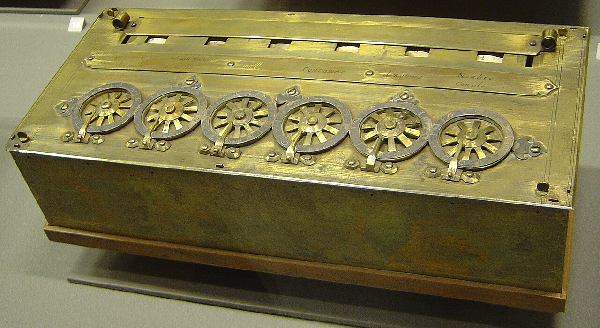
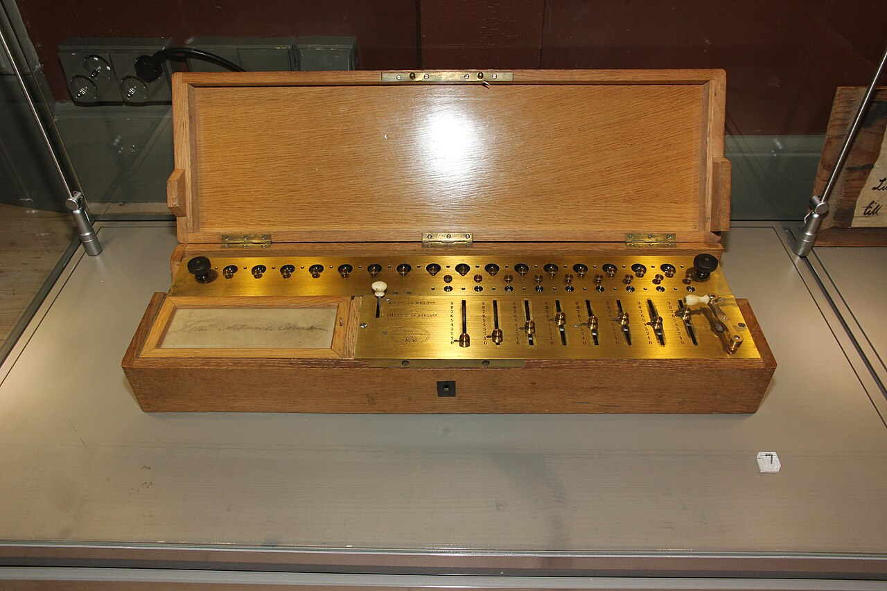
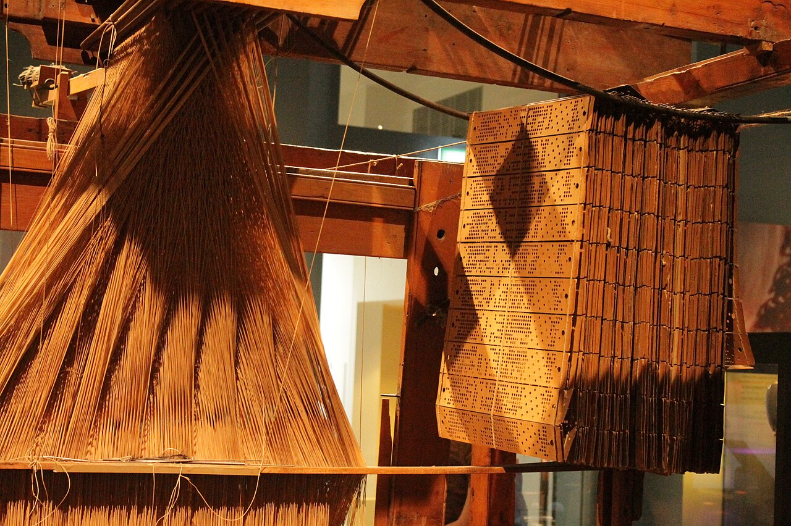
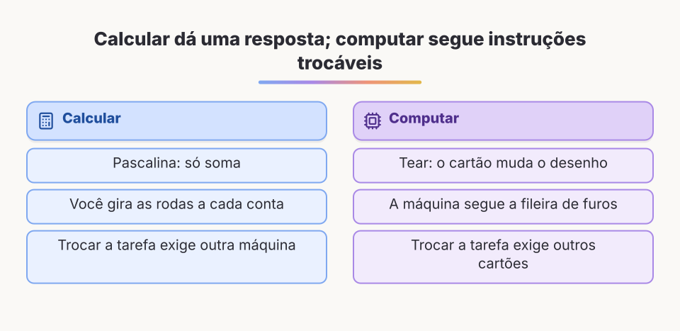
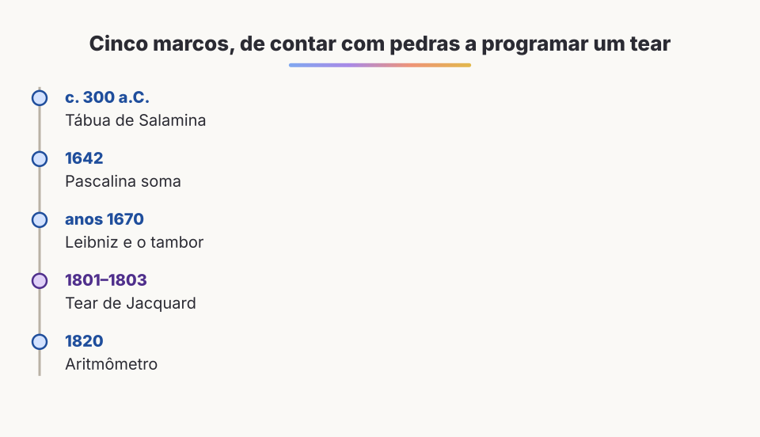

# 1. Contar antes de computar: do ábaco às calculadoras mecânicas

> 🗺️ **Neste capítulo:** você monta uma linha do tempo de cinco marcos, do ábaco ao tear de Jacquard, e aprende a diferença entre *calcular* e *computar*. · ⏱️ ~40 min

### 📇 Folha-resumo: parte 1

![Folha-resumo da parte 1: Ábaco e Salamina (c. 300 a.C., mármore, guarda números da conta, quem calcula é a pessoa); Pascalina e Leibniz (Pascalina 1642, soma, ~50 feitas, ~15 vendidas, tambor de Leibniz multiplica); Tear de Jacquard (cartão perfurado, 1801, trocar cartão, trocar desenho, instruções trocáveis); Máquina Diferencial (polinômios só com somas, nº 1 inacabada, nº 2 construída em 2002); Máquina Analítica (Store e Mill, cartões, 1834, nunca concluída); Notas de Lovelace (publicadas em 1843, Nota G: Bernoulli, fato × interpretação × lenda); Censo de 1890 (63 milhões de pessoas, Hollerith vence o concurso, cartão guarda dados); Computadores humanos (calculavam à mão, Langley: equipe de mulheres, profissão antes da máquina); Analisador de Bush (analógico, MIT, 1928, eixos e engrenagens, analógico × digital).](../img/c00-parte-1-das-contas-a-maquina-universal.svg)

- [1. Contar antes de computar: do ábaco às calculadoras mecânicas](01-contar-antes-de-computar-do-abaco.md)
- [2. Babbage e Lovelace: a máquina que não ficou pronta](02-babbage-e-lovelace-a-maquina-que-nao-ficou.md)
- [3. Cartões, censos e computadores de carne e osso](03-cartoes-censos-e-computadores-de-carne-e-osso.md)

Toda história precisa de um ponto de partida, e o desta é uma pergunta: **por que alguém inventaria uma máquina para fazer contas?** A resposta é sempre parecida. Alguém tinha contas demais, e errar custava caro: imposto cobrado errado, tabela com um número trocado, soma de coluna que não fecha.

Ao fim do capítulo você será capaz de:

- ordenar cinco marcos entre o ábaco e o tear de Jacquard e dizer o que cada um resolvia;
- explicar com suas palavras a diferença entre calcular e computar;
- separar o que as fontes afirmam do que a lenda acrescentou.

## Ábaco e tábuas de contar

Antes de qualquer engrenagem, as pessoas contavam movendo coisas: pedrinhas, contas, marcadores. Isso resolve um problema real: a memória humana de curto prazo é pequena, e uma conta com muitos números não cabe na cabeça.

**Um ábaco (ou tábua de contar) é uma superfície em que marcadores móveis, cada um numa posição, guardam os números de uma conta enquanto ela é feita.**

A palavra vem do grego *abax* ou *abakon*, "mesa" ou "tábua", e talvez de uma raiz semita que significa "areia" (fonte: Universidade Metropolitana de Toronto, veja *Fontes*).

O exemplo mais antigo que chegou até nós é a **tábua de Salamina**: uma placa de mármore branco de cerca de 150 × 75 × 4,5 cm, de por volta de 300 a.C., achada na ilha de Salamina, na Grécia, em 1846. Os pesquisadores primeiro a tomaram por um tabuleiro de jogo, mas ela traz cinco grupos de marcações, e hoje se entende que servia para contar.

> ⚖️ **Fato × interpretação.** A data (c. 300 a.C.), o material, as medidas e o local da descoberta constam da página da universidade de Toronto. *Como* se contava na placa é interpretação, e há discordância sobre quem a usou: a página de Toronto fala em babilônios; a Wikipédia, que serve aqui só como mapa e não como fonte, a descreve como tábua de contar grega, com seixos (*calculi*, em latim) movidos sobre as linhas e guardada hoje no Museu Epigráfico de Atenas. Este livro não toma partido: o que se sabe é a data, o tamanho e o achado.

O ábaco de contas em varetas, que você talvez conheça, é um parente mais novo. O chinês *suan-pan* aparece nos registros por volta de 1200, e o japonês *soroban* adotou, por volta de 1600, o modelo "1/5" (uma conta na parte de cima e cinco embaixo), segundo a mesma fonte de Toronto.

**Erro comum:** chamar o ábaco de "a primeira calculadora". Quem calcula é a pessoa; o ábaco só guarda os números enquanto ela pensa. Guarde essa diferença: ela volta na última seção.

## Pascalina e Leibniz: a conta feita pela máquina

Em 1623, o alemão Wilhelm Schickard teria construído duas calculadoras com rodas dentadas. O que sobrou delas foi uma carta ao astrônomo Kepler, e é essa carta o único registro sobrevivente, segundo o Museu da História da Computação (CHM). Por isso, a máquina de Schickard fica como uma nota de rodapé honesta: existiu, mas pouco se sabe dela.

Quem entra de fato na história é **Blaise Pascal**. Nos anos 1640 ele fez uma máquina de somar para ajudar o pai, cobrador de impostos, que passava dias somando colunas. A primeira ficou pronta em 1642, segundo o Museu Whipple. O CHM a chama de "a primeira máquina de somar produzida em quantidade, ainda que modesta": Pascal construiu cerca de 50 e vendeu cerca de 15.

*Uma Pascalina no Musée des Arts et Métiers, em Paris. Cada roda da tampa guarda um dígito. Foto: David.Monniaux, CC BY-SA 3.0, via Wikimedia Commons.*

**A Pascalina é uma calculadora mecânica que soma números por meio de rodas dentadas, uma roda por dígito.**

Como funciona, em termos simples: para entrar com um número, você enfia um estilete no furo do dígito desejado e gira a roda até ela parar. O difícil era o "vai um". Quando uma roda passa de 9 para 0, a roda vizinha precisa avançar uma casa. A máquina de Pascal fazia isso com pesos que caíam, e o CHM descreve esse mecanismo como "complicado e pouco confiável".

Veja o "vai um" numa conta, como a máquina precisava resolvê-lo. Some 478 + 356, da direita para a esquerda:

| Coluna | Conta | Dígito escrito | "Vai um" |
| --- | --- | --- | --- |
| unidades | 8 + 6 = 14 | 4 | 1 |
| dezenas | 7 + 5 + 1 = 13 | 3 | 1 |
| centenas | 4 + 3 + 1 = 8 | 8 | 0 |

Resultado: **834**. Cada linha só depende da anterior por um número, o "vai um". É exatamente isso que as rodas de Pascal passavam adiante.

A máquina de Pascal só somava. Já **Gottfried Wilhelm Leibniz** queria mais: soma, subtração, multiplicação, divisão e raiz quadrada. Ele começou a trabalhar nisso nos anos 1670 (Museu Whipple). Sua ideia mais famosa é o **tambor escalonado** (*stepped drum*): um cilindro com fileiras de dentes de tamanhos diferentes. Uma roda desliza ao longo de um eixo e engrena em mais ou menos dentes, e assim escolhe qual dígito (de 0 a 9) será somado. Para multiplicar por 7, em vez de somar sete vezes à mão, você gira a manivela sete vezes.

> 💡 **Analogia:** o tambor escalonado é como uma escada de pratos de tamanhos diferentes. Cada degrau (um comprimento de dente) vale um dígito; a roda deslizante é a pessoa que escolhe em qual degrau pisar. **Onde a analogia falha:** numa escada você pisa uma vez; no tambor, cada volta da manivela repete a mesma escolha, e é essa repetição que faz a multiplicação.

> ⚖️ **Cuidado com o "primeiro".** O Whipple diz que Leibniz *queria* fazer divisão e raiz quadrada, mas não afirma que a máquina conseguia. Não repita que a máquina de Leibniz "fazia as quatro operações": a fonte só garante a intenção.

**Erro comum:** "Pascal inventou o primeiro computador". A Pascalina somava; não guardava instruções e não decidia nada. Era uma calculadora.

## Aritmômetro: a calculadora vira produto

Pascal vendeu 15 máquinas. Quase dois séculos depois, uma calculadora mecânica finalmente virou mercadoria. Em 1820, o francês **Charles Xavier Thomas de Colmar** começou a produzir o **aritmômetro**, que usava o tambor escalonado de Leibniz e fazia as quatro operações. Thomas era dono de seguradoras (fundou três a partir de 1819), isto é, de empresas que viviam de contas. O CHM registra que quase 2.000 aritmômetros foram vendidos e que a máquina ficou em produção até o século XX.

*Um aritmômetro de cerca de 1860. Os números entram pelas alavancas deslizantes, e a manivela (à direita) executa a conta. Foto: MKFI, domínio público, via Wikimedia Commons.*

Para usar, você posicionava alavancas deslizantes (uma por dígito) e dava uma volta na manivela; nos primeiros modelos, em vez da manivela, puxava-se uma fita de seda (CHM).

**O aritmômetro foi uma calculadora mecânica produzida em série e vendida a empresas e repartições** (o CHM a trata como calculadora "produzida em massa", no sentido do século XIX: milhares, não milhões).

> ⚖️ **Fato × interpretação.** "Primeira vendida em escala" depende da definição. Para o CHM, a Pascalina foi a primeira máquina de somar produzida *em quantidade modesta*, e o aritmômetro entra na seção de calculadoras produzidas em massa. Quem lê "primeira calculadora comercial" em outro lugar pode estar usando outro critério. As datas de fabricação variam de uma fonte para outra; aqui usamos 1820, a do CHM.

**Erro comum:** achar que, por haver milhares de aritmômetros, ele já "computava". Continuava a ser uma máquina de uma tarefa só: contas aritméticas, uma de cada vez, com uma pessoa colocando os números.

## Tear de Jacquard: instruções num cartão

Agora uma virada, e ela não vem de uma calculadora, mas do mundo dos tecidos. Tecer um tecido com desenho exige levantar certos fios e deixar outros, linha após linha. Fazer isso à mão, a cada linha, era lento.

Em 1801, em Paris, **Joseph Marie Jacquard** mostrou um tear melhorado; por volta de 1803 surgiu o "acessório Jacquard"; e em 1806 a cidade de Lyon comprou a patente (The Henry Ford). A ideia: uma **cadeia contínua de cartões perfurados**. Cada gancho do tear corresponde a uma posição do cartão, e o furo (ou a falta dele) decide se o gancho levanta ou não o fio.

*Um tear de Jacquard no Museu Nacional da Escócia. À direita, os cartões perfurados; à esquerda, os fios que eles controlam. Foto: Stephencdickson, CC BY-SA 4.0, via Wikimedia Commons.*

**O tear de Jacquard é um tear controlado por cartões perfurados: trocar os cartões troca o desenho, sem trocar a máquina.**

Preste atenção no que mudou. Na Pascalina, a "tarefa" estava na própria máquina: ela só somava. No tear, a tarefa está nos **cartões**, que são dados e instruções ao mesmo tempo, e podem ser trocados. Quem escreveu os cartões "programou" o desenho. Essa separação entre a máquina fixa e as instruções trocáveis é a ideia que atravessa o resto do livro.

> 💡 **Analogia: a receita.** A cozinha é a máquina, a receita são os cartões. Com a mesma cozinha você faz bolo ou feijão, só trocando a receita. Cada furo é como uma linha da receita: "levante este fio" ou "deixe este fio". **Onde a analogia falha:** uma receita admite "a gosto" e o cozinheiro interpreta; o tear não interpreta nada, só obedece aos furos.

Foi essa ideia que chamou a atenção de **Charles Babbage**: o The Henry Ford conta que os cartões o inspiraram, e que em 1837 ele projetou a Máquina Analítica aplicando esse mesmo modelo. A história dessa máquina é o assunto do próximo capítulo.

**Erro comum:** dizer que o tear de Jacquard era "um computador". Ele não calculava nada: apenas repetia um desenho. O que ele mostrou foi *como guardar instruções num meio físico*.

## Calcular × computar

Chegou a hora de nomear a diferença que atravessou o capítulo. Estas são definições de trabalho deste livro; não há um consenso único sobre onde traçar a linha.

| | Calcular | Computar |
| --- | --- | --- |
| O que faz | uma operação aritmética por vez | segue uma sequência de instruções |
| Quem decide a tarefa | a pessoa, a cada conta | as instruções (cartões, programa) |
| Trocar de tarefa | exige outra máquina | exige outras instruções |
| Exemplos deste capítulo | ábaco, Pascalina, aritmômetro | tear de Jacquard (só a *ideia* de instruções) |

Uma linha do tempo dos cinco marcos, para fixar a ordem:

Note que o tear (1801–1803) vem *antes* do aritmômetro (1820): as ideias de instruções e de calculadoras comerciais andaram em paralelo, sem uma ser consequência da outra. As duas ideias, a da máquina que calcula e a da máquina que segue instruções, só se encontram no capítulo 2.

## 🏋️ Pratique

**1. Exemplo resolvido.** Some 689 + 457, como a Pascalina faria, coluna por coluna.

- Unidades: 9 + 7 = 16 → escreve 6, vai 1.
- Dezenas: 8 + 5 + 1 = 14 → escreve 4, vai 1.
- Centenas: 6 + 4 + 1 = 11 → escreve 1, vai 1 para a casa dos milhares.
- Resultado: **1.146**. Repare que o último "vai um" criou um dígito novo.

**2. Complete.** Some 275 + 168. Preencha:
unidades 5 + 8 = ___ → escreve ___, vai ___; dezenas 7 + 6 + ___ = ___ → escreve ___, vai ___; centenas 2 + 1 + ___ = ___.

Ver resposta

Unidades: 5 + 8 = 13 → escreve 3, vai 1. Dezenas: 7 + 6 + 1 = 14 → escreve 4, vai 1. Centenas: 2 + 1 + 1 = 4. Resultado: **443**. Erro comum: esquecer de somar o "vai um" da coluna anterior na coluna seguinte (dá 433).

**3. Por conta própria.** Ordene do mais antigo ao mais recente: aritmômetro, tábua de Salamina, tear de Jacquard, Pascalina. Em uma frase cada, diga que problema cada um resolvia.

Ver resposta

Ordem: tábua de Salamina (c. 300 a.C.) → Pascalina (1642) → tear de Jacquard (1801–1803) → aritmômetro (1820). Problemas: a tábua guardava os números de uma conta; a Pascalina somava para quem cobrava impostos; o tear guardava o desenho em cartões para não depender da habilidade do tecelão; o aritmômetro oferecia contas mecânicas a empresas como seguradoras.

Erro comum: trocar tear e aritmômetro por parecer que "calculadora vem antes de cartão". Veja a nota logo abaixo da linha do tempo, na última seção.

**4. Desafio (transferir a ideia).** Pense numa tarefa do seu dia que você faz seguindo uma lista de passos (uma receita, um jogo de tabuleiro, uma rota de ônibus). Escreva em 3 ou 4 linhas: (a) o que seria a "máquina" e o que seriam os "cartões"; (b) se trocar o cartão muda a tarefa; (c) onde a pessoa ainda precisa decidir algo sozinha.

Ver resposta

Resposta aberta. Confira com esta rubrica: (1) separou o que é fixo (cozinha, tabuleiro, ônibus) do que é trocável (receita, regras, rota); (2) mostrou que mudar o trocável muda a tarefa sem mudar o fixo; (3) apontou ao menos um ponto em que ainda precisa de julgamento (como o "a gosto"), o que ainda não é "computar" no sentido do tear; (4) usou exemplos concretos, não só termos gerais.

## 🧠 Revisão rápida

1. Por que o ábaco não é considerado uma calculadora mecânica?
2. Qual era o ponto mais frágil da Pascalina e por quê?
3. O que o tambor escalonado de Leibniz permitiu fazer com a multiplicação?
4. O que diferencia o tear de Jacquard de uma calculadora como o aritmômetro?
5. O que a fonte garante sobre a máquina de Leibniz, e o que ela *não* garante?

Ver respostas

1. Porque quem faz a conta é a pessoa; o ábaco só guarda os números. 2. O "vai um", resolvido por pesos em queda, descrito pelo CHM como complicado e pouco confiável. 3. Multiplicar girando a manivela o número de vezes, em vez de somar à mão. 4. O tear segue instruções trocáveis (os cartões); o aritmômetro faz uma conta de cada vez, com os números dados pela pessoa. 5. Garante que Leibniz quis soma, subtração, multiplicação, divisão e raiz; não garante que a máquina fizesse divisão e raiz.

## 🤖 Estude com um tutor de IA

- "Faça-me 5 perguntas, uma de cada vez, sobre os marcos do ábaco ao tear de Jacquard. Espere minha resposta antes de comentar e não me dê as respostas antes."
- "Aqui está minha resposta ao exercício [número do exercício]: [minha resposta]. Aponte meus erros sem me dar a solução."

> ➡️ **Próximo passo:** o tear de Jacquard deu a Charles Babbage a ideia de uma máquina que seguiria instruções em cartões. No capítulo 2 você conhece a máquina que ele projetou, a que não ficou pronta, e a mulher que escreveu sobre ela: Ada Lovelace.

## 📌 Resumo

| Item | Em uma frase |
| --- | --- |
| Tábua de Salamina | Placa de mármore de c. 300 a.C., achada em 1846, usada para contar. |
| Pascalina | Somadora de rodas dentadas feita nos anos 1640 (a primeira, em 1642); cerca de 50 feitas, 15 vendidas. |
| Tambor escalonado | Peça de Leibniz (anos 1670) que permite multiplicar girando a manivela. |
| Aritmômetro | Calculadora de quatro operações produzida a partir de 1820; quase 2.000 vendidas. |
| Tear de Jacquard | Tear de cartões perfurados (1801–1803): trocar o cartão troca o desenho. |
| Calcular × computar | Uma conta por vez × seguir instruções trocáveis. |

## 📚 Fontes

- Computer History Museum, [Schickard's Calculator and The Pascaline](https://www.computerhistory.org/revolution/calculators/1/47), consultado em 27/11/2026.
- Computer History Museum, [Mass-Produced Calculators](https://www.computerhistory.org/revolution/calculators/1/52), consultado em 27/11/2026.
- Whipple Museum (Universidade de Cambridge), [Mechanical Calculation](https://www.whipplemuseum.cam.ac.uk/node/158), consultado em 27/11/2026.
- The Henry Ford, [Sparking Innovation: The Jacquard Loom](https://www.thehenryford.org/explore/blog/sparking-innovation-the-jacquard-loom), consultado em 27/11/2026.
- Universidade Metropolitana de Toronto, [The Abacus: A Brief History](https://www.ee.torontomu.ca/~elf/abacus/history.html), consultado em 27/11/2026.

> 🔁 **Revise hoje:** este é o primeiro capítulo; volte a ele amanhã e refaça a linha do tempo de memória.

<!-- nav:start -->
---

[◀ Capítulo anterior](00-como-estudar-este-livro.md) · [Mapa do livro](../README.md) · [Próximo capítulo ▶](02-babbage-e-lovelace-a-maquina-que-nao-ficou.md)
<!-- nav:end -->
