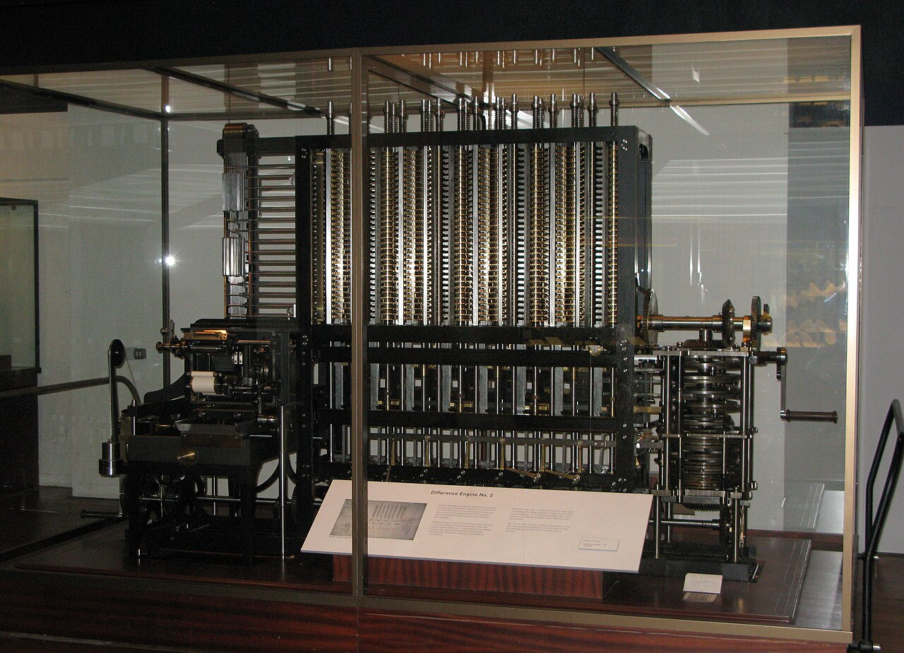
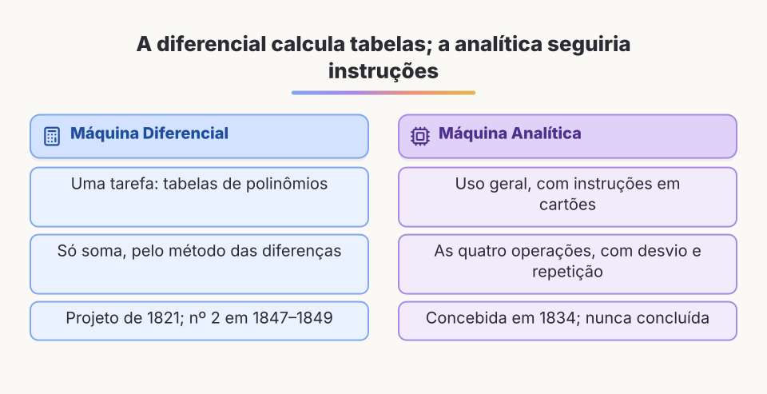
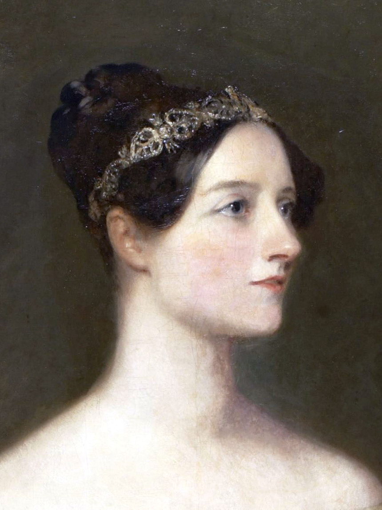
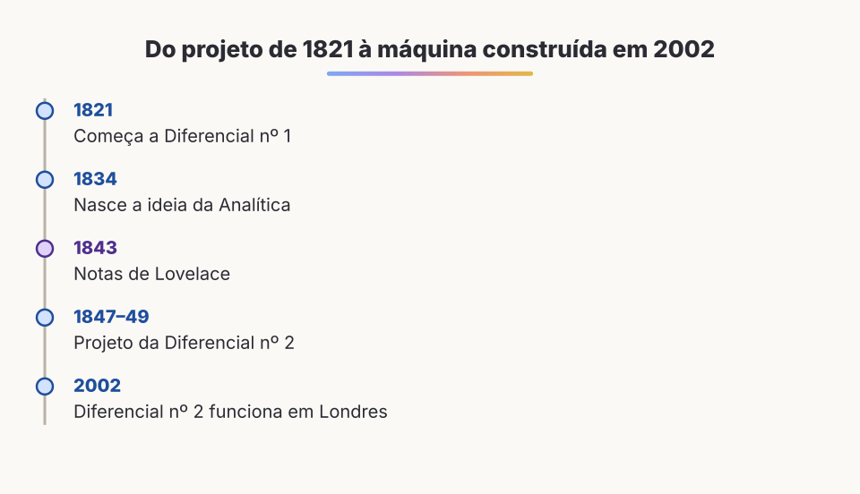

# 2. Babbage e Lovelace: a máquina que não ficou pronta

> 🗺️ **Neste capítulo:** você compara as duas máquinas de Charles Babbage, uma que calculava tabelas e outra que seguiria instruções, e avalia com fontes o título de "primeira programadora" de Ada Lovelace. · ⏱️ ~45 min

> 🔥 **Aquecimento:** (1) O que o tear de Jacquard guardava nos cartões perfurados? (2) Qual é a diferença entre calcular e computar?
>
> <details>
> <summary>Ver respostas</summary>
>
> (1) As instruções do desenho: cada furo, ou a falta dele, decidia se um fio subia. (2) Calcular é fazer uma conta de cada vez, com a pessoa dando os números; computar é seguir instruções que podem ser trocadas.
>
> </details>

## De onde paramos

No capítulo 1 você viu duas ideias andando separadas: calculadoras de rodas dentadas e um tear que obedecia a cartões. Neste capítulo elas se encontram na cabeça de um inglês, Charles Babbage. **A pergunta-guia é: o que Babbage projetou, por que nada disso ficou pronto, e o que Ada Lovelace de fato acrescentou?**

## Máquina diferencial: tabelas sem erro

No começo do século XIX, quem precisava de resultados prontos dependia de **tabelas** impressas, e as contas por trás delas eram feitas por pessoas (o capítulo 3 mostra quem eram). Um número trocado em qualquer etapa seguia para todos que usassem a tabela. Babbage queria uma máquina que calculasse a tabela *e a imprimisse*, sem mãos humanas no meio. Segundo um dos artigos que citamos, o governo financiou o projeto na esperança de que saísse mais barato do que pagar computadores humanos (Prospect, veja *Fontes*).

Em 1821 ele começou a **Máquina Diferencial nº 1**.

**A máquina diferencial é uma calculadora mecânica que produz tabelas de polinômios usando só somas, pelo método das diferenças finitas.**

O método é mais simples do que o nome. Veja com a função f(x) = x² + x + 41. Calcule os valores de x = 0 a 6 sem multiplicar nada:

1. Parta de f(0) = 41.
2. A cada passo, some ao valor atual a "primeira diferença", que começa em 2.
3. Depois de cada passo, some 2 à primeira diferença (a "segunda diferença", que neste polinômio é sempre 2).

Em Python, a mesma receita fica assim. O código é meu, escrito para este livro:

```python
# Tabela de f(x) = x*x + x + 41 só com somas, como a Máquina Diferencial
# f(0), primeira diferença e segunda diferença (constante)
valor, d1, d2 = 41, 2, 2
for x in range(0, 7):
    print(x, valor)
    valor += d1   # cada passo soma a primeira diferença ao valor
    d1 += d2      # e atualiza a primeira diferença com a segunda
```

Saída real, rodada ao escrever o capítulo:

```text
0 41
1 43
2 47
3 53
4 61
5 71
6 83
```

Para conferir, eu calculei x² + x + 41 de forma direta para x de 0 a 6 e obtive 41, 43, 47, 53, 61, 71 e 83: os mesmos números. O truque é que a máquina nunca multiplica, e multiplicar era a parte difícil de fazer com engrenagens. O Museu da História da Computação (CHM) resume: máquinas diferenciais "são estritamente calculadoras", que repetem somas.

> 💡 **Analogia: a receita.** Pense na máquina diferencial como uma cozinha que só sabe fazer uma receita: bolo de polinômio. Os ingredientes são os valores iniciais (41, 2, 2); o passo a passo é "some, atualize, some de novo"; o cozinheiro é o conjunto de engrenagens. **Onde a analogia falha:** a receita da diferencial está *embutida* nas engrenagens; você não troca de receita, só muda os ingredientes.

Os números do projeto de 1830 da nº 1, segundo o CHM: 16 dígitos, seis ordens de diferença, cerca de 25.000 peças, umas quatro toneladas e oito pés de altura (cerca de 2,4 m), se algum dia fosse construída. Em 1832 a obra parou por uma briga com o engenheiro Joseph Clement, e em 1842 o governo cortou a verba. O que Babbage chegou a montar foi um sétimo da máquina, com cerca de 2.000 peças, e esse pedaço funciona até hoje.



*A Máquina Diferencial nº 2, construída segundo os desenhos de Babbage. As colunas de rodas dentadas guardam os dígitos; à esquerda fica a impressora. Foto: User:geni, CC BY-SA 4.0, via Wikimedia Commons.*

Entre 1847 e 1849 Babbage projetou uma versão melhorada, a **nº 2**, com números de 31 dígitos e polinômios até a sétima ordem, usando só cerca de um terço das peças da primeira. Ninguém a construiu em vida dele. Ela só ficou pronta em Londres em 2002, 153 anos depois do projeto, com 8.000 peças e cinco toneladas, e funcionou. Isso mostra que o projeto funcionava como Babbage o desenhou.

**Erro comum:** achar que, porque não foi terminada, a máquina "não funcionava". O projeto de Babbage funcionou quando foi construído fielmente.

## Máquina analítica: a ideia do computador

Com a diferencial parada, Babbage fez algo ousado: em vez de terminar uma máquina de uma tarefa, imaginou uma que pudesse fazer *qualquer* conta que alguém soubesse descrever. O CHM data a concepção da **Máquina Analítica** de 1834; o The Henry Ford fala em projeto de 1837 (as datas variam conforme se conta a ideia ou o projeto detalhado).

**A máquina analítica foi o projeto de uma máquina de uso geral, programada por cartões perfurados, com memória e unidade de cálculo separadas.**

O ponto que importa para você vem do capítulo 1: os cartões vieram do tear de Jacquard. A máquina teria duas partes que lembram um computador de hoje:

- o **"Store"** (armazém), onde ficam os números e os resultados intermediários, equivalente à memória;
- o **"Mill"** (moinho), onde acontece a aritmética, equivalente ao processador.

Segundo o CHM, ela faria as quatro operações, e teria o que hoje chamamos de desvio condicional ("se isto, faça aquilo") e repetição (fazer o mesmo passo várias vezes). Babbage não usava esses nomes, que são modernos. A máquina também seria **decimal**, não binária: cada dígito de 0 a 9 numa roda dentada.



> 💡 **Analogia: a receita, de novo.** Na analítica, a cozinha (Store e Mill) é fixa, e as receitas vêm em cartões: troque os cartões e a mesma máquina faz outra conta. É a analogia do capítulo 1 aplicada de verdade, e aqui ela quase não falha. **Onde falha:** uma máquina que nunca foi construída não cozinhou nada; tudo o que sabemos vem de desenhos e de um pequeno pedaço montado antes da morte de Babbage, em 1871.

**Erro comum:** dizer que Babbage "inventou o computador". O próprio CHM diz que ele "invented computers but failed to build them". Segundo um dos autores que citamos, ele também teve pouco impacto direto nos computadores eletrônicos que vieram depois, e a fama de "pai da computação" só começou em 1971, quando Maurice Wilkes o celebrou como pioneiro (Prospect).

## Notas de Lovelace: o que ela escreveu

Em 1843, **Ada Lovelace** (1815–1852), filha do poeta Lord Byron, publicou uma tradução para o inglês de um artigo sobre a máquina analítica escrito pelo engenheiro italiano Luigi Menabrea. Ela conhecia Babbage desde 1833, quando tinha 17 anos e viu uma pequena parte funcional da diferencial. A tradução saiu com **notas** assinadas por ela, e as notas eram tão extensas que, segundo a Prospect, tinham o dobro do tamanho do texto original.



*Ada Lovelace, retrato de Margaret Sarah Carpenter. Domínio público, via Wikimedia Commons.*

O que as notas dizem, segundo o CHM, tem duas partes:

1. As notas trazem, nas palavras do CHM, a "primeira descrição publicada de uma sequência passo a passo de operações" para resolver certos problemas matemáticos. A mais famosa é a **Nota G**, uma tabela para calcular os números de Bernoulli, uma sequência matemática importante (a Prospect é quem a descreve).
2. Uma ideia que, vista de hoje, impressiona: a máquina "might act upon other things besides number" ("poderia agir sobre outras coisas além de números"), e Lovelace chega a imaginar que ela comporia música. Para ela, a máquina "tece padrões algébricos assim como o tear de Jacquard tece flores e folhas". O CHM vê nisso a passagem de *calcular* para *computar*, uma ideia que o capítulo 1 já tinha apresentado.

> 🔎 **Para ir além: o que "programar" quer dizer.** Um **programa** é uma sequência de instruções que uma máquina pode seguir por conta própria. A Nota G é uma tabela que mostra as etapas de um cálculo numa máquina que, como sabemos, nunca existiu. Uma crítica comum, que você vai avaliar abaixo, é que mostrar as etapas num papel não é o mesmo que escrever um programa que *roda*.

**Erro comum:** achar que as notas são só uma "tradução". Elas são comentário original, mais longo que o artigo traduzido: uma descrição passo a passo e uma visão do que máquinas assim poderiam representar.

## Lenda × registro: Ada foi a "primeira programadora"?

A frase "Ada Lovelace, a primeira programadora do mundo" é popular. Vamos separar o que sabemos em três camadas, como pede o método deste livro:

| Camada | O que dizer |
| --- | --- |
| **Fato** | Em 1843, Lovelace publicou notas que descrevem uma sequência passo a passo de operações (CHM), entre elas uma tabela para calcular números de Bernoulli, a Nota G (Prospect), para uma máquina que nunca foi construída. |
| **Interpretação** | O CHM diz que ela é "frequentemente chamada de primeira programadora" e que biógrafos discutem a extensão e a originalidade da contribuição. A Prospect chama o título de "enganoso": a Nota G "não é um programa", mas mostra as etapas que ocorreriam numa máquina já programada, se existisse. |
| **Lenda** | "Ela escreveu o primeiro programa de computador e inventou a programação sozinha." Nenhuma das duas fontes sustenta isso: a autoria exata é incerta, e a Prospect lembra que Babbage pode ter colaborado, "impossível saber quanto". |

Duas coisas completam o quadro. Primeiro, a fama moderna dela cresceu depois que, no fim dos anos 1970, o Departamento de Defesa dos EUA batizou uma linguagem de programação de ADA em sua homenagem (Prospect). Segundo, o astrônomo John Herschel, contemporâneo dela, escreveu que se sentia perdido ao ler as notas, o que mostra que a admiração de hoje não era unânime entre os contemporâneos.

> ⚖️ **Analisando uma fonte.** Os dois textos que usamos têm propósitos diferentes. O CHM é um museu de computadores: tende a valorizar a ideia de que Ada "viu mais longe" que Babbage. A Prospect é uma revista de ideias, e o artigo é de opinião de uma historiadora da ciência, que quer desmontar mitos de "heróis solitários". Os dois usam fatos, mas escolhem o que destacar. E o mesmo artigo da Prospect afirma que o termo *debugging* nasceu da mariposa tirada de um computador por Grace Hopper. Isso está errado: o capítulo 8 mostra que a palavra *bug* é anterior, citando outra fonte. Uma fonte pode estar certa num ponto e errada em outro, e por isso este livro confere cada afirmação.

**O que concluir?** A resposta honesta é: Ada Lovelace publicou, segundo o CHM, a primeira descrição passo a passo de operações para uma máquina assim e foi a primeira a expressar que ela poderia agir sobre mais do que números. Se isso a torna "a primeira programadora" depende do que você chama de programa, e por isso um bom livro de história diz "depende" e mostra por quê.



## 🏋️ Pratique

**1. Exemplo resolvido.** Complete a tabela de f(x) = x² + x + 41 até x = 8 usando só somas, como a Máquina Diferencial.

- Partindo de f(6) = 83, a primeira diferença nesse ponto é 14 (começou em 2 e subiu 2 por passo: 2, 4, 6, 8, 10, 12, 14).
- f(7) = 83 + 14 = 97. Agora a diferença sobe para 16.
- f(8) = 97 + 16 = 113.
- Conferência direta: 8² + 8 + 41 = 64 + 8 + 41 = 113. ✔

**2. Complete.** Tabele g(x) = x² + 5, para x de 0 a 4, só com somas. Preencha: g(0) = ___; primeira diferença inicial = g(1) − g(0) = ___; segunda diferença = ___. Depois: g(1) = ___, g(2) = ___, g(3) = ___, g(4) = ___.

<details>
<summary>Ver resposta</summary>

g(0) = 5; g(1) = 6, então a primeira diferença inicial é 1; g(2) = 9, então a primeira diferença seguinte é 3, e a segunda diferença é 3 − 1 = 2. Tabela: g(0) = 5, g(1) = 6, g(2) = 9, g(3) = 14, g(4) = 21. Veja que as diferenças são 1, 3, 5, 7, e a segunda é sempre 2. Erro comum: esquecer de atualizar a primeira diferença a cada passo, o que dá uma sequência de diferenças todas iguais.

</details>

**3. Por conta própria.** Preencha a tabela com a diferença entre as duas máquinas:

| Pergunta | Diferencial | Analítica |
| --- | --- | --- |
| Faz uma tarefa ou várias? | | |
| Como recebe as instruções? | | |
| Ficou pronta? | | |

<details>
<summary>Ver resposta</summary>

Diferencial: uma tarefa (tabelas de polinômios, só com somas); a receita está nas engrenagens; a nº 2 foi construída em 2002, a nº 1 só em parte. Analítica: uso geral, com instruções em cartões perfurados (ideia do tear de Jacquard), memória (Store) separada da unidade de cálculo (Mill); nunca ficou pronta, só um pequeno pedaço experimental. Erro comum: dizer que a analítica "só somava" ou que a diferencial usava cartões.

</details>

**4. Desafio (analisar uma fonte).** Leia de novo a tabela fato × interpretação × lenda. Escreva 4 ou 5 linhas respondendo: (a) com qual das duas fontes você concorda mais no caso de Ada Lovelace e por quê; (b) que informação você ainda gostaria de ver numa terceira fonte.

<details>
<summary>Ver resposta</summary>

Resposta aberta. Confira com esta rubrica: (1) separou o que as duas fontes afirmam de forma igual (as notas de 1843 e a Nota G) do que elas interpretam de formas diferentes; (2) justificou sua escolha por um critério (propósito da fonte, tipo de texto, o que cada uma destaca), não só por gosto; (3) apontou uma informação concreta que falta (por exemplo, o manuscrito original, ou uma análise da divisão de trabalho entre Babbage e Lovelace); (4) não repetiu a lenda ("ela escreveu o primeiro programa sozinha") como se fosse fato.

</details>

## 🧠 Revisão rápida

1. Por que a máquina diferencial só precisa somar?
2. Qual ideia do tear de Jacquard Babbage usou na máquina analítica?
3. O que o "Store" e o "Mill" fazem, e a que partes de um computador de hoje correspondem?
4. Por que não se pode dizer que Babbage construiu um computador?
5. (Do capítulo 1) Por que o tear de Jacquard não é considerado um computador?

<details>
<summary>Ver respostas</summary>

1. Porque o método das diferenças finitas transforma uma tabela de polinômio numa sequência de somas, e a multiplicação era a parte mais difícil de construir. 2. Os cartões perfurados como forma de guardar instruções. 3. O Store guarda números e resultados (memória); o Mill faz a aritmética (processador). 4. A analítica nunca foi concluída; só ficaram desenhos e um pequeno pedaço experimental. 5. Porque só repetia um desenho e não calculava nada.

</details>

## 🤖 Estude com um tutor de IA

- "Faça-me 5 perguntas, uma de cada vez, sobre as máquinas de Babbage e as notas de Ada Lovelace. Espere minha resposta antes de comentar e não me dê as respostas antes."
- "Aqui está minha resposta ao exercício [número do exercício]: [minha resposta]. Aponte meus erros sem me dar a solução."

> ➡️ **Próximo passo:** as máquinas de Babbage dependiam de gente fazendo tabelas à mão, e foi o excesso de dados que fez a próxima virada. No capítulo 3 você vê como cartões perfurados aceleraram o censo dos Estados Unidos em 1890 e conhece os "computadores" de carne e osso.

## 📌 Resumo

| Item | Em uma frase |
| --- | --- |
| Máquina Diferencial | Calculadora de tabelas de polinômios que usa só somas; a nº 1 começou em 1821, a nº 2 foi projetada em 1847–1849 e construída em 2002. |
| Máquina Analítica | Projeto de uso geral com cartões, memória (Store) e processador (Mill); concebida em 1834 e nunca concluída. |
| Notas de Lovelace | Publicadas em 1843, trazem a Nota G (números de Bernoulli) e a ideia de que a máquina poderia agir além dos números. |
| "Primeira programadora" | Título debatido: o fato é a Nota G; o resto é interpretação ou lenda. |
| Fato × interpretação × lenda | Três camadas que você separa antes de repetir uma história de origem. |

## 📚 Fontes

- Computer History Museum, [The Babbage Engine: Engines](https://www.computerhistory.org/babbage/engines/), consultado em 27/11/2026.
- Computer History Museum, [The Babbage Engine](https://www.computerhistory.org/babbage/), consultado em 27/11/2026.
- Computer History Museum, [Ada Lovelace](https://www.computerhistory.org/babbage/adalovelace/), consultado em 27/11/2026.
- Patricia Fara, Prospect, [Debugging the mythology: was Ada Lovelace really the first computer programmer?](https://prospectmagazine.co.uk/ideas/technology/38160/debugging-the-mythology-was-ada-lovelace-really-the-first-computer-programmer), 22/11/2021, consultado em 27/11/2026.
- The Henry Ford, [Sparking Innovation: The Jacquard Loom](https://www.thehenryford.org/explore/blog/sparking-innovation-the-jacquard-loom), consultado em 27/11/2026.

> 🔁 **Revise hoje:** capítulo 1

<!-- nav:start -->
---

[◀ Capítulo anterior](01-contar-antes-de-computar-do-abaco.md) · [Mapa do livro](../README.md) · [Próximo capítulo ▶](03-cartoes-censos-e-computadores-de-carne-e-osso.md)
<!-- nav:end -->
