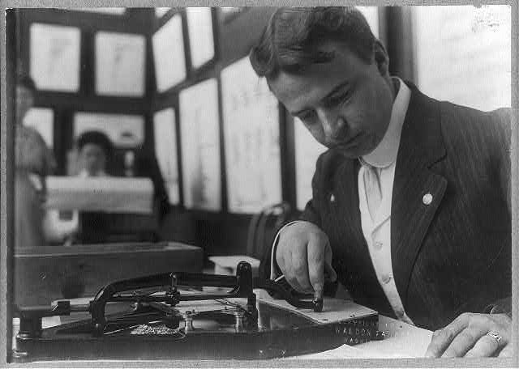
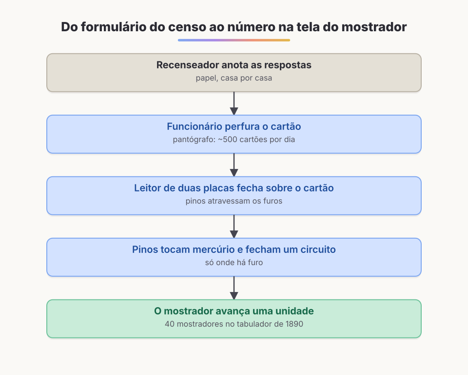
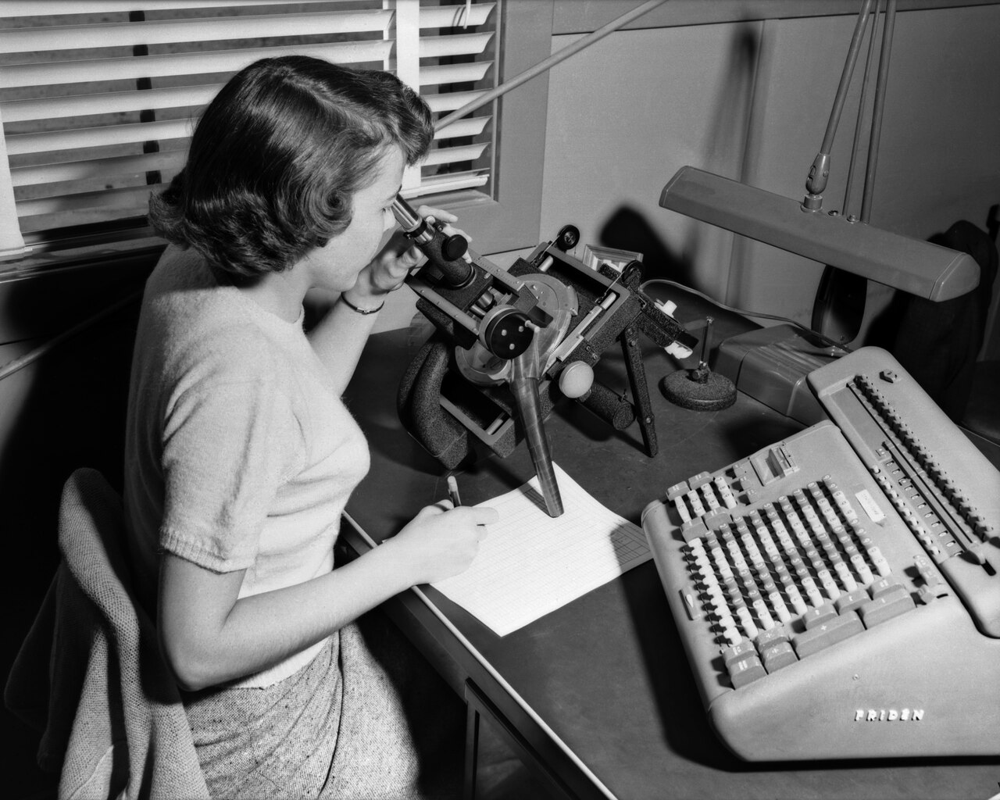
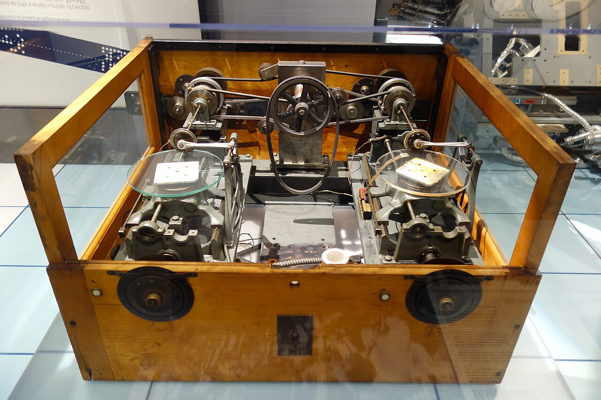
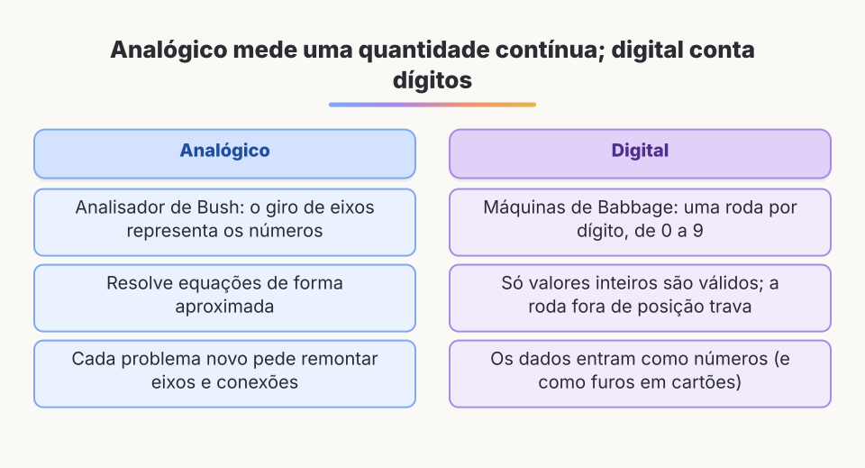

# 3. Cartões, censos e computadores de carne e osso

> 🗺️ **Neste capítulo:** você entende como os cartões perfurados de Hollerith aceleraram o censo americano de 1890, descobre quem eram os "computadores" de carne e osso e vê por que o analisador diferencial de Bush ainda não era um computador digital. · ⏱️ ~45 min

> 🔥 **Aquecimento:** (1) Por que a máquina diferencial de Babbage só precisa somar? (2) O que a Nota G, de Ada Lovelace, descreve?
>
> 

> 
Ver respostas

>
> (1) Porque o método das diferenças finitas troca a tabela de um polinômio por uma sequência de somas. (2) Uma sequência passo a passo de operações para calcular números de Bernoulli numa máquina que nunca foi construída.
>
> 

## De onde paramos

No capítulo 2, as máquinas de Babbage eram projetos que dependiam de dinheiro e de peças que o século XIX não entregou. Neste capítulo o problema vira outro: sobrou *dado* e faltou gente para contá-lo. **A pergunta-guia é: o que acontece quando o volume de números cresce mais depressa que a capacidade de uma pessoa de somá-los, e quem fez esse trabalho enquanto as máquinas não davam conta?**

## Hollerith e o censo de 1890

A Constituição dos Estados Unidos exige um censo a cada dez anos. Em 1790 isso era administrável, com menos de quatro milhões de habitantes. Em 1890 já eram 63 milhões, e as estimativas diziam que o censo de 1890 não ficaria pronto antes do de 1900 começar (Museu da História da Computação, CHM, veja *Fontes*). O governo respondeu com um concurso para achar um método mais rápido. Quem venceu foi **Herman Hollerith**.

Hollerith propôs registrar os dados em **cartões perfurados** e lê-los com uma máquina.

**Um cartão perfurado de dados é um cartão em que cada posição de furo representa uma resposta, e o conjunto de furos descreve uma pessoa ou um fato.**

Preste atenção na diferença para o capítulo 1. No tear de Jacquard, o cartão guardava *instruções*: levante este fio, deixe aquele. No censo, o cartão guarda *dados*: esta pessoa é casada, aquela é agricultora. É a mesma tecnologia, o furo no papel, servindo a duas coisas diferentes.

> 💡 **Analogia: a receita.** No tear, o cartão era a *receita*. No censo, o cartão é o *ingrediente*: cada um descreve uma pessoa, e a máquina é a cozinha que conta quantos ingredientes de cada tipo há na despensa. **Onde a analogia falha:** ingredientes se gastam, e cartões não. Os mesmos cartões podem passar de novo pela máquina para responder a outra pergunta.

Como a coisa funcionava, segundo o Census Bureau e o CHM:

1. Os recenseadores anotavam as respostas em formulários de papel.
2. Funcionários passavam as informações para cartões usando um **pantógrafo**, um aparelho em que o operador posiciona uma ponta sobre o furo desejado de um molde e aperta. Cada funcionário preparava cerca de 500 cartões por dia.
3. Na **máquina tabuladora**, o leitor era uma peça de duas placas articuladas, que lembrava uma máquina de waffle. Pinos de metal atravessavam os furos e caíam em poços de mercúrio.
4. O mercúrio fechava um circuito elétrico onde havia furo, e isso fazia avançar um mostrador. O tabulador de 1890 tinha 40 mostradores, cada um para um tipo de dado do censo.

**Uma máquina tabuladora é uma máquina que lê cartões perfurados e soma, em mostradores, quantos cartões têm cada combinação de furos.**

*Um homem opera um pantógrafo de perfurar cartões, c. 1908. Foto: U.S. Census Bureau employees, domínio público, via Wikimedia Commons.*

Os números do CHM: o censo de 1890 usou cerca de 60 milhões de cartões. Um operador médio processava cerca de 7.000 cartões por dia, "pelo menos dez vezes mais rápido que o método manual". Dá para ver a conta: 60.000.000 ÷ 7.000 é cerca de 8.571 dias de trabalho de operador. Já perfurar, na taxa de 500 cartões por dia, dá 60.000.000 ÷ 500 = 120.000 dias de trabalho de funcionário. Essa é uma conta minha, a partir dos dois números do CHM e do Census Bureau, e ela sugere que o trabalho humano de *perfurar* pesava mais que o de *contar*.

Além de contar, a máquina podia cruzar dados: com um classificador ligado às combinações de furos, dava para saber, por exemplo, quantos agricultores casados tinham mais de 40 anos (CHM). Em 1895 Hollerith fundou a Tabulating Machine Company (CHM); segundo a Prospect, ela foi uma das origens da IBM, que reaparece no capítulo 6. O Census Bureau usou versões do sistema até o UNIVAC começar a substituí-las, nos anos 1950.

> ⚖️ **Fato × interpretação.** A data de fundação da empresa de Hollerith varia entre as fontes (o CHM diz 1895; outras dizem 1896), e a cadeia de fusões que levou ao nome IBM não foi conferida para este capítulo, por isso ela fica para o capítulo 6. Também é interpretação dizer que o censo "foi salvo" pela máquina: as previsões de quanto tempo o método manual levaria eram estimativas, não medições.

**Erro comum:** achar que Hollerith "inventou o computador". A tabuladora contava e cruzava cartões, mas não executava um programa trocável: o que ela fazia estava nas ligações da máquina.

## Computadoras humanas: quando "computador" era uma profissão

Antes das máquinas eletrônicas, a palavra "computador" nomeava uma **profissão**. A NASA registra que, antes do desenvolvimento dos computadores eletrônicos, o termo se referia a pessoas, não a máquinas: era o cargo de quem fazia contas matemáticas à mão.

**Um computador humano é uma pessoa contratada para fazer, à mão e em grande quantidade, cálculos que hoje uma máquina faz.**

O trabalho existia desde o fim do século XIX, com homens e mulheres, em astronomia, estatística e balística (NASA). O capítulo 2 já tinha dado uma pista: o governo britânico esperava que a máquina de Babbage saísse mais barata que contratar computadores humanos.

O exemplo mais bem documentado que usamos é o do laboratório de Langley, nos Estados Unidos, da agência que antecedeu a NASA (a NACA). Segundo a NASA:

- em setembro de 1935, Virginia Tucker chegou a Langley para integrar o primeiro "computer pool", com outras quatro mulheres;
- o trabalho era ler os filmes de testes em túneis de vento, fazer contas e traçar gráficos, que serviam à pesquisa aeronáutica e depois espacial;
- a Segunda Guerra Mundial expandiu o setor: Langley passou a recrutar mulheres ativamente, em parte para compensar os homens que foram para as Forças Armadas, e em 1946 já tinha treinado cerca de 400 mulheres;
- a "West Area" do laboratório tinha instalações segregadas, como mostra uma planta de 1944 do refeitório, e as seções de computação ficaram mais integradas depois dos primeiros anos; Katherine Johnson entrou nos West Computers em 1953, ficou poucas semanas e depois calculou trajetórias das missões de Alan Shepard e John Glenn.

*Uma computadora do laboratório de Langley (NACA), em 1952, com um instrumento de leitura de dados e uma calculadora Friden ao lado. Foto: NASA Langley Research Center / NACA Langley, domínio público, via Wikimedia Commons.*

> ⚖️ **Fato × interpretação × lenda.**
> **Fato:** a NASA descreve a computação como profissão de homens e mulheres desde o fim do século XIX, e as computadoras de Langley fizeram trabalho central para a pesquisa do laboratório.
> **Interpretação:** por que Langley recrutou tantas mulheres. A NASA liga isso à guerra e à falta de homens; outras explicações aparecem em outros textos, que este livro não conferiu.
> **Lenda a evitar:** que "computador humano" era só um nome para auxiliares sem importância. A própria NASA registra que, em Langley, elas tinham papel central na pesquisa.

**Erro comum:** achar que o trabalho "acabou" quando surgiram as máquinas. Segundo a NASA, o trabalho de computação em Langley vai de meados dos anos 1930 até os anos 1970, e algumas das primeiras computadoras, como Vera Huckel e Helen Willey, tiveram carreiras de décadas na NACA e na NASA.

## Analisador diferencial de Bush: o computador de engrenagens e eixos

Ao mesmo tempo, no MIT, uma máquina enorme atacava um tipo diferente de problema. O **analisador diferencial** de Vannevar Bush foi iniciado em 1928 por um aluno dele, Harold Hazen. Era uma sala cheia de engrenagens e eixos movidos por motores elétricos, com "integradores" de disco e roda ligados a 18 eixos, e resolvia, de forma aproximada, equações diferenciais de até a sexta ordem (CHM). Foi usado em problemas de redes de energia, física, sismologia e balística.

**Um computador analógico é uma máquina que representa os números por uma quantidade física contínua, como o giro de um eixo, e não por dígitos.**

*Uma unidade integradora do analisador diferencial de Bush e Hazen (1928–1931), no MIT Museum. Foto: Daderot, CC0, via Wikimedia Commons.*

O ponto fraco era a **montagem**. Para cada problema novo, seis integradores e várias mesas de entrada e saída tinham que ser conectados à mão. O CHM diz que isso exigia habilidade mecânica e "disposição para se sujar de óleo". Cópias da máquina, na Moore School e no campo de provas de Aberdeen, calculavam tabelas de artilharia, mas eram lentas demais, o que, segundo o CHM, inspirou o ENIAC (capítulo 5). Uma versão posterior, o Rockefeller Differential Analyzer, usava fita de papel e relés para simplificar a montagem e funcionou até 1954.

Compare com o que você viu no capítulo 2: as máquinas de Babbage eram *digitais* (uma roda por dígito, de 0 a 9) e, no projeto, trabalhavam só com números inteiros, tanto que a roda fora de posição travava a máquina para avisar de um erro (CHM). O analisador de Bush era *analógico*.

**Erro comum:** achar que "analógico" quer dizer "antigo" e "digital" quer dizer "moderno". A máquina de Babbage, do século XIX, já era digital; e o Rockefeller Differential Analyzer, analógico, funcionou até 1954.

## 🏋️ Pratique

**1. Exemplo resolvido.** Suponha que um operador processe 7.000 cartões por dia. Quantos dias ele leva para passar 14.000.000 cartões, e quantos dias levaria o método manual, supondo que ele seja dez vezes mais lento?

- Com a máquina: 14.000.000 ÷ 7.000 = 2.000 dias.
- Manual (10 vezes mais lento): 2.000 × 10 = 20.000 dias.
- Conferência: 7.000 × 2.000 = 14.000.000 ✔. Repare que é uma estimativa: o CHM diz "pelo menos" dez vezes.

**2. Complete.** Ligue cada situação ao tipo de cartão: "instrução" (como no tear) ou "dado" (como no censo).
(a) Um cartão diz se um gancho do tear sobe: ___. (b) Um cartão diz que uma pessoa tem 42 anos e é agricultora: ___. (c) Qual dos dois a máquina tabuladora de Hollerith lia? ___.

Ver resposta

(a) instrução; (b) dado; (c) dado. Erro comum: achar que, por serem os dois "cartões perfurados", fazem o mesmo papel. O formato é parecido, mas o tear usa o cartão para dizer *o que fazer* e o censo usa o cartão para dizer *o que contar*.

**3. Por conta própria.** Escreva em uma frase cada: (a) o que era um computador humano; (b) o que era a máquina tabuladora; (c) por que o analisador de Bush não é considerado digital.

Ver resposta

(a) Uma pessoa contratada para fazer cálculos à mão em grande quantidade. (b) Uma máquina que lê cartões perfurados e conta, em mostradores, quantos têm cada combinação de furos. (c) Porque representa os números pelo giro contínuo de eixos, não por dígitos, e resolve as equações de forma aproximada. Erro comum: dizer que "não era digital porque era mecânico": as máquinas de Babbage também eram mecânicas e eram digitais.

**4. Desafio (analisar uma fonte).** Releia o trecho "Computadoras humanas". Ele se apoia num texto da NASA. Responda em 4 ou 5 linhas: (a) quem escreveu o texto e para quem; (b) o que ele destaca; (c) o que um texto de outro tipo (um jornal da época, um relato de uma das computadoras) poderia mostrar que ele deixa de fora.

Ver resposta

Resposta aberta. Confira com esta rubrica: (1) identificou que o texto é da própria instituição (NASA History), e pensou em para quem ele foi escrito e com que objetivo; (2) apontou o que ele destaca (a organização do trabalho, números, a expansão na guerra, a importância das computadoras); (3) sugeriu uma informação que um relato pessoal traria (como era o dia a dia, como cada pessoa viveu a segregação, o que cada uma pensava do trabalho); (4) não tratou a ausência de um ponto como prova de que ele não aconteceu.

## 🧠 Revisão rápida

1. Qual era o problema do censo de 1890 que levou ao concurso vencido por Hollerith?
2. Em que o papel do cartão no censo difere do papel do cartão no tear de Jacquard?
3. O que é um computador analógico? Dê um exemplo deste capítulo.
4. O que era um "computador" antes de 1940?
5. (Do capítulo 2) Por que a máquina analítica de Babbage é considerada "de uso geral", e a diferencial não?

Ver respostas

1. A população tinha crescido para 63 milhões e o método manual não terminaria antes do censo seguinte. 2. No tear, o cartão é instrução; no censo, é dado. 3. Uma máquina que representa números por uma quantidade contínua, como o giro de eixos; o analisador diferencial de Bush. 4. Uma pessoa que fazia cálculos à mão. 5. A analítica seguiria instruções em cartões (e teria desvio e repetição); a diferencial só fazia tabelas de polinômios por somas.

## 🤖 Estude com um tutor de IA

- "Faça-me 5 perguntas, uma de cada vez, sobre o censo de 1890, os cartões de Hollerith e os computadores humanos. Espere minha resposta antes de comentar e não me dê as respostas antes."
- "Aqui está minha resposta ao exercício [número do exercício]: [minha resposta]. Aponte meus erros sem me dar a solução."

> ➡️ **Próximo passo:** até aqui, as máquinas eram de engrenagens e eixos, e cada uma resolvia um problema prático. No capítulo 4 você sai das oficinas e entra na matemática: a lógica de Boole, a máquina imaginária de Alan Turing e o bit de Claude Shannon.

## 📌 Resumo

| Item | Em uma frase |
| --- | --- |
| Censo de 1890 | 63 milhões de pessoas e a estimativa de que o método manual não terminaria a tempo levaram ao concurso que Hollerith venceu. |
| Cartão perfurado de dados | Cartão em que cada furo é uma resposta; no censo guarda dados, no tear guardava instruções. |
| Máquina tabuladora | Lê os cartões com pinos e mercúrio e soma em mostradores. |
| Computador humano | Profissão de quem calculava à mão, com homens e mulheres; em Langley, a equipe era de mulheres. |
| Analisador diferencial de Bush | Máquina analógica de eixos e engrenagens (MIT, iniciada em 1928) que resolvia equações de forma aproximada. |
| Analógico × digital | Quantidade contínua × dígitos. |

## 📚 Fontes

- Computer History Museum, [Making Sense of the Census: Hollerith's Punched Card Solution](https://www.computerhistory.org/revolution/story/2), consultado em 27/11/2026.
- U.S. Census Bureau, [The Hollerith Machine](https://www.census.gov/about/history/bureau-history/census-innovations/technology/hollerith-machine.html), consultado em 27/11/2026.
- NASA History, [When the Computer Wore a Skirt: Langley's Computers, 1935–1970](https://www.nasa.gov/history/when-the-computer-wore-a-skirt-langleys-computers-1935-1970/), consultado em 27/11/2026.
- Computer History Museum, [Bush's Analog Solution](https://www.computerhistory.org/revolution/story/143), consultado em 27/11/2026.
- Computer History Museum, [The Babbage Engine: Engines](https://www.computerhistory.org/babbage/engines/), consultado em 27/11/2026.
- Patricia Fara, Prospect, [Debugging the mythology](https://prospectmagazine.co.uk/ideas/technology/38160/debugging-the-mythology-was-ada-lovelace-really-the-first-computer-programmer), consultado em 27/11/2026.

> 🔁 **Revise hoje:** capítulos 2 e 1

<!-- nav:start -->
---

[◀ Capítulo anterior](02-babbage-e-lovelace-a-maquina-que-nao-ficou.md) · [Mapa do livro](../README.md) · [Próximo capítulo ▶](04-a-ideia-de-maquina-universal-boole-turing.md)
<!-- nav:end -->
