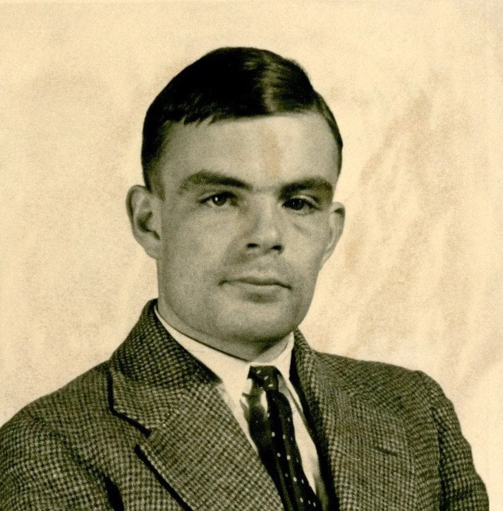

# 4. A ideia de máquina universal: Boole, Turing e Shannon

> 🗺️ **Neste capítulo:** você aprende como a lógica de Boole virou conta com 0 e 1, descreve com suas palavras o que uma máquina de Turing faz e entende por que o bit, de Shannon, uniu essas ideias. · ⏱️ ~50 min

### 📇 Folha-resumo: parte 2

![Folha-resumo da parte 2: Lógica de Boole (obras de 1847 e 1854, E, OU, NÃO, contas com 0 e 1); Máquina de Turing (1936–37, fita, cabeça, estados, universal: lê outra tabela); Shannon e o bit (relés e álgebra de Boole, artigo de 1948, bit: duas opções); Relé × válvula (relé: chave mecânica, válvula: chave de vidro, válvula é mais rápida); Colossus (válvulas de Flowers, ataca a cifra Lorenz, segredo até os anos 1970); ENIAC (Mauchly e Eckert, seis programadoras, fios e chaves); Programa armazenado (von Neumann, 1945, programa junto dos dados, Baby 1948, EDSAC 1949); UNIVAC e IBM (UNIVAC I, 1951, 46 unidades, IBM: nome de 1924); Zezinho do ITA (1961, computador didático, não executava computação).](../img/c00-parte-2-logica-guerra-e-memoria.svg)

- [4. A ideia de máquina universal: Boole, Turing e Shannon](04-a-ideia-de-maquina-universal-boole-turing.md)
- [5. Guerra e válvulas: Zuse, Colossus e ENIAC](05-guerra-e-valvulas-zuse-colossus-e-eniac.md)
- [6. O programa vai para a memória: von Neumann e os primeiros computadores à venda](06-o-programa-vai-para-a-memoria-von-neumann.md)


> 🔥 **Aquecimento:** (1) No tear de Jacquard o cartão guardava instruções; no censo de Hollerith, o que ele guardava? (2) Por que o analisador diferencial de Bush é chamado de analógico?
>
> <details>
> <summary>Ver respostas</summary>
>
> (1) Dados: cada furo era uma resposta sobre uma pessoa. (2) Porque representa os números por uma quantidade contínua, o giro de eixos, e não por dígitos.
>
> </details>

## De onde paramos

Até o capítulo 3 você viu máquinas de engrenagens, cartões e eixos, cada uma feita para um tipo de problema. Neste capítulo a história sai da oficina e entra no papel: três pessoas, em épocas diferentes, resolvem em teoria o que as máquinas ainda não resolviam em metal. **A pergunta-guia é: que ideias de matemática tornaram possível uma máquina que faz qualquer conta que se saiba descrever, e por que tudo isso acabou em 0 e 1?**

## Lógica de Boole: pensar com contas

George Boole publicou duas obras sobre o assunto: *The Mathematical Analysis of Logic* (1847) e *The Laws of Thought* (1854), segundo a Stanford Encyclopedia of Philosophy (veja *Fontes*). A ideia dele era tratar frases como "é verdade" ou "é falso" com a mesma disciplina da álgebra.

**A lógica booleana é um sistema de contas em que as variáveis só podem valer 0 ou 1 e as operações combinam esses valores.**

Segundo a Stanford Encyclopedia, a álgebra de Boole lidava com polinômios cujas variáveis ficavam restritas aos valores 0 e 1. No texto de 1847, a multiplicação *xy* dava a classe dos que são ao mesmo tempo X e Y, e 1 − *x* dava "não X". Hoje usamos três operações, que você vai ver rodando:

- **E**: só dá 1 se os dois valores forem 1;
- **OU**: dá 1 se pelo menos um for 1;
- **NÃO**: troca 0 por 1 e 1 por 0.

Em Python, o código é meu, escrito para este livro:

```python
# Tabela-verdade de E, OU e NÃO com os valores 0 e 1
print("a b | E  OU NÃO(a)")
for a in (0, 1):
    for b in (0, 1):
        print(a, b, "|", a & b, " ", a | b, " ", 1 - a)
```

Saída real, rodada ao escrever o capítulo:

```text
a b | E  OU NÃO(a)
0 0 | 0   0   1
0 1 | 0   1   1
1 0 | 0   1   0
1 1 | 1   1   0
```

A coluna do E é a multiplicação de Boole: 1 × 1 = 1 e todo o resto dá 0. E o NÃO é o 1 − *a* da mesma obra.

> 💡 **Analogia: a receita.** Pense numa receita com condições: "se tem ovo **E** tem farinha, faça o bolo". Cada condição é um ingrediente que está presente (1) ou ausente (0), e o E decide se o passo acontece. **Onde a analogia falha:** na cozinha há meio-termo ("tem um pouco de ovo"); na lógica de Boole só há 0 ou 1.

**Erro comum:** achar que Boole pensou em computadores. A Stanford Encyclopedia descreve um trabalho de lógica e de matemática do século XIX. A ligação com máquinas só veio quase um século depois, e é o assunto das próximas seções.

## Turing, 1936: o que é calcular?

Em 1936–37, Alan Turing publicou "On computable numbers, with an application to the Entscheidungsproblem". Segundo a Stanford Encyclopedia sobre Turing, o artigo definiu o que é computar e mostrou um limite absoluto do que a computação pode fazer. Ele descreveu dispositivos que chamou de "automatic machines", hoje chamados de máquinas de Turing. Independentemente dele, Emil Post e Alonzo Church chegaram a formulações diferentes e logicamente equivalentes.



*Alan Turing em 1936, em Princeton, quando publicou o artigo sobre computar. Foto: fotógrafo desconhecido, domínio público, via Wikimedia Commons.*

**Uma máquina de Turing é um dispositivo abstrato com uma fita dividida em quadrados, cada um com um símbolo, e uma cabeça que lê e escreve um símbolo por vez, seguindo uma tabela de estados.**

Segundo a Stanford Encyclopedia sobre máquinas de Turing, a fita tem quadrados que carregam cada um um símbolo, e a máquina tem um número finito de estados. A "tabela" diz: se estou neste estado e leio este símbolo, escrevo tal símbolo, ando para um lado e passo para outro estado. Ela é um programa.

Veja uma que soma 1 a um número binário. Escrevi a tabela para este livro: a máquina vai até o fim da fita, volta, e vai trocando 1 por 0 (o "vai um") até achar um 0 ou um quadrado vazio, onde escreve 1.

```python
# Máquina de Turing que soma 1 a um número binário na fita
# tabela: (estado, símbolo lido) -> (símbolo a escrever, movimento, novo estado)
tabela = {
    ("ir_ao_fim", "0"): ("0", +1, "ir_ao_fim"),
    ("ir_ao_fim", "1"): ("1", +1, "ir_ao_fim"),
    ("ir_ao_fim", "_"): ("_", -1, "somar"),
    ("somar", "1"): ("0", -1, "somar"),   # 1 + 1 = 0, vai um
    ("somar", "0"): ("1", 0, "fim"),
    ("somar", "_"): ("1", 0, "fim"),
}
fita = list("1011") + ["_"]
cabeca, estado = 0, "ir_ao_fim"
passos = 0
while estado != "fim":
    escreve, move, estado = tabela[(estado, fita[cabeca])]
    fita[cabeca] = escreve
    cabeca += move
    if cabeca < 0:
        fita.insert(0, "_"); cabeca = 0
    passos += 1
print("".join(fita).strip("_"), "em", passos, "passos")
```

Saída real, rodada ao escrever o capítulo:

```text
1100 em 8 passos
```

Conferência: 1011 em binário é 8 + 0 + 2 + 1 = 11, e 1100 é 8 + 4 = 12. Somou 1, certo. Repare que o programa Python apenas *lê* a tabela: quem soma é a tabela. Troque a tabela e a mesma engrenagem faz outra coisa.

Aí está a ideia que dá nome ao capítulo. Segundo a Stanford Encyclopedia, a **máquina universal** é, grosso modo, uma máquina de Turing capaz de calcular o que qualquer outra máquina de Turing calcula: ela lê a tabela de outra máquina e faz o que ela faria. O nosso `while` acima é uma versão pequena disso, com a tabela como dado. É a mesma ideia da Máquina Analítica do capítulo 2, em que os cartões trocavam a "receita", e das notas de Lovelace, que falavam de uma máquina que "poderia agir sobre outras coisas além de números". A diferença é que Turing deu à ideia uma definição matemática.

> 💡 **Analogia: a receita, de novo.** A máquina universal é um cozinheiro que sabe ler *qualquer* receita escrita num caderno, e não só uma. **Onde falha:** uma máquina de Turing tem fita sem limite; nenhuma cozinha real tem espaço infinito.

**Erro comum:** achar que Turing construiu a máquina de 1936. Ela é um objeto matemático, uma definição. Máquinas físicas só vêm nos próximos capítulos.

## Shannon e os circuitos: a lógica vira eletricidade

Claude Shannon escreveu, no MIT, uma dissertação de mestrado em engenharia elétrica chamada "A Symbolic Analysis of Relay and Switching Circuits", orientada por Frank L. Hitchcock. O repositório do MIT registra a data de 1940 (veja *Fontes*); este livro não afirma o ano em que o trabalho foi escrito, porque não o conferi numa fonte aberta. A ideia, que o título já indica, é que circuitos de relés e chaves, que só deixam a corrente passar ou bloqueiam, podem ser descritos com a álgebra de Boole: chave fechada é 1, aberta é 0.

**Um circuito lógico é um conjunto de chaves ou portas ligadas de modo que a saída seja uma função E, OU ou NÃO das entradas.**

Isso muda tudo, porque a lógica deixa de ser só pensamento e vira peça: dá para *projetar* um circuito que calcula escrevendo uma fórmula. Segundo o CHM, o somador "Model K", de George Stibitz, feito com relés em 1937, provou a aplicação da lógica booleana ao projeto de computadores. Veja como uma soma de dois bits sai de duas portas, o chamado meio-somador:

```python
# Meio-somador: soma = OU exclusivo (^), vai-um = E (&)
print("a b | soma vai-um")
for a in (0, 1):
    for b in (0, 1):
        print(a, b, "|", a ^ b, "   ", a & b)
```

```text
a b | soma vai-um
0 0 | 0     0
0 1 | 1     0
1 0 | 1     0
1 1 | 0     1
```

Em cada linha, a soma de dois bits (0+0, 0+1, 1+0 e 1+1 = 10 em binário) aparece como "soma" (o dígito da direita) e "vai-um" (o da esquerda). O `^` é o "OU exclusivo", que dá 1 só quando os dois são diferentes. A coluna "vai-um" é o E que você já viu.

> 💡 **Analogia: a receita.** Um circuito lógico é uma receita feita de ferragem: o executor deixou de ser uma pessoa e virou um conjunto de chaves. **Onde falha:** o circuito não "entende" a receita; ela é o próprio desenho dele.

**Erro comum:** achar que o computador "pensa" em lógica como uma pessoa. Cada chave só faz E, OU ou NÃO; a inteligência aparente vem de um número enorme de combinações.

## O bit: a unidade da informação

Em julho de 1948, Shannon publicou "A Mathematical Theory of Communication" no *Bell System Technical Journal* (volume 27, p. 379–423; veja *Fontes*). Não consegui conferir numa fonte aberta quem cunhou a palavra **bit**, então este livro não afirma isso.

**Um bit é a quantidade de informação de uma escolha entre duas possibilidades igualmente prováveis, e se escreve com um dígito, 0 ou 1.**

Uma conta mostra por que o bit serve de unidade. Com 1 bit você distingue 2 opções; com 3 bits, 8; com 8 bits, 256. Vista ao contrário, a conta diz que o número de bits necessários é o logaritmo na base 2 do número de opções.

```python
import math
print(math.log2(2), math.log2(8), math.log2(256))
```

```text
1.0 3.0 8.0
```

Por isso o 0 e o 1 de Boole, as chaves de Shannon e a fita de Turing se encontram: tudo que cabe numa fita, num cartão ou num circuito pode ser escrito em bits, e qualquer coisa escrita em bits pode ser guardada e processada pela mesma máquina.

> ⚖️ **Fato × interpretação.** É fato que Turing (1936–37), Shannon (tese registrada em 1940 e artigo de 1948) e Boole (1847 e 1854) publicaram essas obras. É interpretação dizer que "os computadores nasceram daí": as máquinas do capítulo 5 também respondem a problemas práticos da guerra, como o ENIAC, que o CHM liga às tabelas de artilharia (capítulo 3), e não só a teoria.

**Erro comum:** achar que bit e byte são a mesma coisa. Um bit é uma escolha entre dois valores; grupos de bits formam números e letras.

## 🏋️ Pratique

**1. Exemplo resolvido.** Quantos bits são necessários para distinguir 16 opções?

- Cada bit dobra o número de opções: 1 bit = 2, 2 bits = 4, 3 bits = 8, 4 bits = 16.
- Conferência: log₂(16) = 4. ✔

**2. Complete.** Usando a máquina de Turing do capítulo, preveja a fita final para a entrada 111 (7 em binário): o número final é ___ e, em decimal, vale ___. Quantos quadrados a fita precisa ter a mais que a entrada? ___.

<details>
<summary>Ver resposta</summary>

A máquina troca todos os 1 por 0 e, ao chegar ao começo, a cabeça sai da fita pela esquerda: o código insere um quadrado vazio e escreve 1. Resultado: 1000, que em decimal vale 8 (7 + 1). A fita precisa de um quadrado a mais. Erro comum: esquecer o quadrado extra e achar que o resultado tem 3 dígitos.

</details>

**3. Por conta própria.** Escreva em uma frase cada: (a) o que a tabela de uma máquina de Turing diz; (b) o que é a máquina universal; (c) o que Shannon descobriu sobre circuitos de chaves.

<details>
<summary>Ver resposta</summary>

(a) Para cada combinação de estado e símbolo lido, o que escrever, para onde andar e qual o próximo estado. (b) Uma máquina que lê a tabela de outra máquina e faz o que ela faria. (c) Que circuitos de chaves se descrevem com a álgebra de Boole, então dá para projetá-los por fórmulas. Erro comum: dizer que Shannon inventou a lógica booleana.

</details>

**4. Desafio (analisar uma fonte).** O MIT registra a tese de Shannon com data de 1940, enquanto muitos textos falam em 1937. Responda em 4 ou 5 linhas: (a) que datas diferentes uma tese pode ter (escrita, defesa, título, publicação); (b) em qual fonte você confiaria mais para cada uma delas; (c) como você registraria a dúvida no texto.

<details>
<summary>Ver resposta</summary>

Resposta aberta. Confira com esta rubrica: (1) distinguiu as datas possíveis de um trabalho (escrita, defesa, título, publicação); (2) justificou a escolha da fonte por um critério (arquivo da instituição, documento original), não por gosto; (3) propôs registrar a dúvida com a atribuição, sem escolher a data mais repetida; (4) não tratou uma fonte como infalível só pelo tipo.

</details>

## 🧠 Revisão rápida

1. Que valores uma variável pode ter na álgebra de Boole?
2. Que três partes formam o "programa" de uma máquina de Turing?
3. O que é uma máquina universal?
4. Que relação Shannon viu entre circuitos de chaves e a lógica de Boole?
5. (Do capítulo 3) Qual a diferença entre computador analógico e digital?

<details>
<summary>Ver respostas</summary>

1. Só 0 ou 1. 2. Um estado, o símbolo lido e o que fazer (escrever, andar, mudar de estado), reunidos numa tabela. 3. Uma máquina de Turing que lê a tabela de outra e faz o que ela faria. 4. Chave aberta ou fechada corresponde a 0 ou 1, então circuitos se descrevem com a álgebra de Boole. 5. O analógico usa uma quantidade contínua; o digital usa dígitos.

</details>

## 🤖 Estude com um tutor de IA

- "Faça-me 5 perguntas, uma de cada vez, sobre a lógica de Boole, a máquina de Turing e o bit. Espere minha resposta antes de comentar e não me dê as respostas antes."
- "Aqui está minha resposta ao exercício [número do exercício]: [minha resposta]. Aponte meus erros sem me dar a solução."

> ➡️ **Próximo passo:** as ideias estavam prontas no papel, mas faltava construir as máquinas. No capítulo 5 você vê o que a Segunda Guerra Mundial fez com elas: Zuse, Colossus e ENIAC.

## 📌 Resumo

| Item | Em uma frase |
| --- | --- |
| Lógica de Boole | Contas com 0 e 1 e as operações E, OU e NÃO (obras de 1847 e 1854). |
| Máquina de Turing | Fita, cabeça e tabela de estados: um modelo abstrato de computar (1936–37). |
| Máquina universal | Máquina que lê a tabela de outra e faz o que ela faria. |
| Shannon e os circuitos | Chaves e relés descritos pela álgebra de Boole (tese de mestrado, MIT). |
| Bit | Unidade de informação: uma escolha entre duas opções (artigo de 1948). |

## 📚 Fontes

- Stanford Encyclopedia of Philosophy, [George Boole](https://plato.stanford.edu/entries/boole/), consultado em 27/11/2026.
- Stanford Encyclopedia of Philosophy, [Alan Turing](https://plato.stanford.edu/entries/turing/), consultado em 27/11/2026.
- Stanford Encyclopedia of Philosophy, [Turing Machines](https://plato.stanford.edu/entries/turing-machine/), consultado em 27/11/2026.
- MIT DSpace, [A symbolic analysis of relay and switching circuits](https://dspace.mit.edu/handle/1721.1/11173), consultado em 28/11/2026.
- Internet Archive, [BSTJ 27: 3, July 1948](https://archive.org/details/bstj27-3-379), consultado em 28/11/2026.
- Computer History Museum, [Timeline of Computer History](https://www.computerhistory.org/timeline/computers/), consultado em 27/11/2026.

> 🔁 **Revise hoje:** capítulos 1 e 3

<!-- nav:start -->
---

[◀ Capítulo anterior](03-cartoes-censos-e-computadores-de-carne-e-osso.md) · [Mapa do livro](../README.md) · [Próximo capítulo ▶](05-guerra-e-valvulas-zuse-colossus-e-eniac.md)
<!-- nav:end -->
