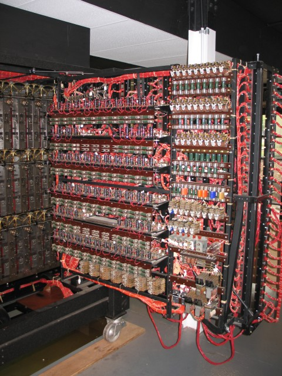
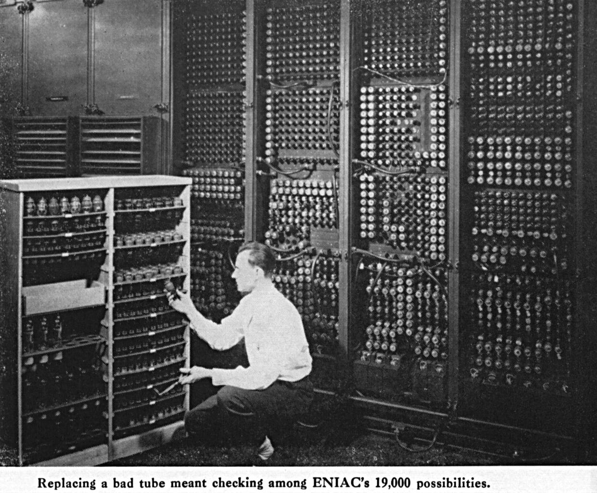

# 5. Guerra e válvulas: Zuse, Colossus e ENIAC

> 🗺️ **Neste capítulo:** você ordena as primeiras máquinas eletrônicas e eletromecânicas da Segunda Guerra Mundial e explica por que "qual foi o primeiro computador?" não tem uma resposta só. · ⏱️ ~50 min

> 🔥 **Aquecimento:** (1) O que uma máquina de Turing tem além da fita? (2) Como Shannon relacionou chaves e relés com a lógica de Boole?
>
> <details>
> <summary>Ver respostas</summary>
>
> (1) Uma cabeça que lê e escreve e uma tabela de estados, que é o programa. (2) Chave fechada é 1 e aberta é 0, então um circuito se descreve com a álgebra de Boole.
>
> </details>

## De onde paramos

No capítulo 4 as ideias de computar já estavam no papel, e o bit dava a elas uma unidade. Neste capítulo a guerra pede máquinas de verdade: para quebrar códigos, para fazer contas de artilharia, para ir além do que pessoas e engrenagens conseguiam. **A pergunta-guia é: quais foram as primeiras máquinas e por que cada fonte aponta uma diferente como "a primeira"?**

## Relé e válvula: duas peças, uma ideia

As máquinas deste capítulo usam dois tipos de peça para representar 0 e 1, a mesma ideia de chave do capítulo 4.

**Um relé é uma chave controlada por eletricidade: uma corrente pequena mexe uma peça mecânica que liga ou desliga outro circuito.**

**Uma válvula é uma chave eletrônica de vidro, sem peça que se mova, que também controla a passagem de corrente.**

A diferença está na peça que se move: o relé tem uma, e a válvula não. Mas a válvula queima: segundo o CHM, o ENIAC perdia uma válvula a cada um ou dois dias (veja *Fontes*).

> 💡 **Analogia: a receita.** Relé e válvula são as "mãos" do cozinheiro, que executam cada passo da receita. O relé é um cozinheiro que anda de um lado para o outro da cozinha; a válvula, um que só acende e apaga uma luz. **Onde a analogia falha:** nenhum dos dois decide nada; só fazem o que o circuito manda.

**Erro comum:** achar que "eletrônico" e "eletromecânico" são a mesma coisa. Os relés do Z3 eram eletromecânicos; as válvulas do Colossus e do ENIAC eram eletrônicas.

## Zuse e o Z3: uma máquina sozinha em Berlim

Konrad Zuse construiu em Berlim, quase sozinho, o Z3, concluído em 1941. Segundo o CHM, ele tinha 2.300 relés, palavra de 22 bits e aritmética binária de ponto flutuante. O original foi destruído num bombardeio no fim de 1943, e uma reconstrução feita nos anos 1960 está no Deutsches Museum, em Munique (CHM). Outras fontes dão números um pouco diferentes para os relés; este livro fica com o do CHM.

> ⚖️ **Fato × interpretação.** É fato que o Z3 funcionou em 1941, com relés. É interpretação chamá-lo de "primeiro computador": depende do que se chama de computador. Se a definição exige válvulas, ele fica de fora; se exige apenas ser digital e programável, entra.

## Atanasoff-Berry: o ABC

O ABC, de John Atanasoff e Clifford Berry, foi concluído em 1942 em Iowa State (CHM). Ele entra no capítulo por causa de uma disputa de patente, resolvida em 1973: segundo o CHM, Mauchly viu o ABC e o computador, como conceito, foi declarado não patenteável. Este livro não afirma que Mauchly "copiou" o ABC, porque a fonte só informa a decisão judicial.

## Bletchley Park e o Colossus

Na Inglaterra, os criptógrafos de Bletchley Park precisavam ler mensagens alemãs. O CHM conta que a Bombe, de Alan Turing e Harold Keen (1941), se baseava na "Bomba" polonesa de Marian Rejewski (1938). Para a cifra Lorenz, veio o **Colossus**.



*Uma réplica da Bombe em Bletchley Park. Foto: Ian Petticrew, CC BY-SA 2.0, via Wikimedia Commons.*

**O Colossus foi um computador eletrônico digital de válvulas, projetado para atacar mensagens cifradas.**

Tommy Flowers projetou o Colossus, que ficou operacional em 1944 (CHM). Dez máquinas foram construídas, com até 2.500 válvulas e leitura de fita de papel, e reduziam de semanas para horas o tempo de quebrar uma cifra Lorenz.

Um ponto central: a existência do Colossus só se tornou pública nos anos 1970 (CHM). Por isso ele ficou de fora, durante décadas, da história que se contava.

**Erro comum:** achar que o Colossus era a máquina de Turing de 1936 em metal. Ele foi projetado por Flowers para atacar uma cifra; nenhuma das fontes citadas o apresenta como a máquina universal de Turing.

## ENIAC e suas programadoras

Segundo a Universidade da Pensilvânia, o ENIAC foi projetado por John W. Mauchly e J. Presper Eckert Jr. e anunciado em fevereiro de 1946 (a página da universidade dá 14/02). O CHM acrescenta que ele foi construído entre 1943 e 1945.



*Troca de uma válvula no ENIAC. Com cerca de 18.000 delas, manutenção era rotina. Foto: M. Weik, domínio público, via Wikimedia Commons.*

Os números:

- cerca de 18.000 válvulas (Penn e CHM);
- cerca de 30 toneladas (Penn e CHM), numa sala de 30 por 50 pés (Penn);
- o CHM resume: "over 1,000 times faster than any previous computer".

**O ENIAC foi um computador eletrônico digital programado por fios e chaves: cada novo problema exigia religar cabos entre painéis.**

Segundo a Penn, o ENIAC era programado a cada trabalho "by plugging in cables and setting switches". Essa tarefa coube a mulheres. A universidade nomeia seis programadoras originais: Kathleen McNulty (Kay) Mauchly Antonelli, Jean Jennings Bartik, Frances (Betty) Snyder Holberton, Marlyn Wescoff Meltzer, Frances Bilas Spence e Ruth Lichterman Teitelbaum. Segundo o CHM, Bilas e Jennings tinham diploma de matemática.

> ⚖️ **Fato × interpretação × lenda.**
> **Fato:** seis mulheres programaram o ENIAC religando cabos e ajustando chaves, segundo a Penn.
> **Interpretação:** se esse trabalho era "programar" no sentido de hoje. Era uma tarefa de planejar a ordem das operações e converter em ligações, bem diferente de escrever texto num editor.
> **Lenda a evitar:** que elas eram só "operadoras" sem papel intelectual. Duas delas, Bilas e Jennings, tinham diploma de matemática (CHM), e a tarefa exigia converter um problema em ligações.

> 💡 **Analogia: a receita, de novo.** No ENIAC, trocar de receita era reorganizar a cozinha: mover bancadas e religar fogões para cada prato novo. **Onde falha:** o capítulo 6 mostra como guardar a receita dentro da própria máquina, e aí o problema muda.

**Erro comum:** dizer que o ENIAC era "um computador pessoal" ou "um computador moderno". Ele não guardava o programa na memória: esse é o assunto do capítulo 6.

## Qual foi o primeiro computador?

Veja lado a lado o que as fontes dizem:

| Máquina | Ano | Peça | Como se programava |
| --- | --- | --- | --- |
| Z3 | 1941 | relés | programável (CHM) |
| ABC | 1942 | sem dado nas fontes citadas | sem dado nas fontes citadas |
| Colossus | 1944 | válvulas | fita de papel (CHM) |
| ENIAC | 1946 | válvulas | fios e chaves entre painéis |

Veja a ordem em Python:

```python
# Ordena as máquinas pelo ano em que ficaram funcionando
maquinas = [
    ("ENIAC", 1946),
    ("Z3", 1941),
    ("Colossus", 1944),
    ("ABC", 1942),
]
for nome, ano in sorted(maquinas, key=lambda m: m[1]):
    print(ano, nome)
```

Saída real, rodada ao escrever o capítulo:

```text
1941 Z3
1942 ABC
1944 Colossus
1946 ENIAC
```

A ordem muda conforme o critério: "primeiro eletrônico", entre as máquinas que conferi, dá o Colossus; "primeiro digital programável", o Z3; "primeiro eletrônico e programável por fios", o ENIAC; o peso de cada critério é interpretação. Até o direito entrou na conversa: em 1973, segundo o CHM, o computador como conceito foi declarado não patenteável.

**Erro comum:** achar que existe uma resposta certa e que as outras estão erradas. O que existe é uma pergunta mal definida: toda resposta depende de uma definição.

## 🏋️ Pratique

**1. Exemplo resolvido.** Em que ano o ENIAC foi apresentado ao público e quantos anos depois do Z3 isso foi?

- ENIAC anunciado em 1946 (Penn).
- Z3 concluído em 1941.
- 1946 − 1941 = 5 anos. ✔

**2. Complete.** Ligue cada definição de "computador" à máquina que vence: (a) "digital e programável, mesmo com relés": ___; (b) "eletrônico, projetado para um uso específico": ___; (c) "eletrônico e programável por fios": ___.

<details>
<summary>Ver resposta</summary>

(a) Z3; (b) Colossus (feito para atacar a cifra Lorenz); (c) ENIAC. Note que mudar a definição muda a vencedora. Erro comum: dar só um nome e achar que vale para toda definição.

</details>

**3. Por conta própria.** Escreva em uma frase cada: (a) a diferença entre relé e válvula; (b) por que o Colossus era desconhecido por décadas; (c) como se programava o ENIAC.

<details>
<summary>Ver resposta</summary>

(a) O relé é uma chave com peça que se move; a válvula é eletrônica, sem peça móvel, mas queima. (b) Era segredo militar e só se tornou público nos anos 1970. (c) Religando cabos entre painéis e ajustando chaves, trabalho manual que se repetia a cada problema. Erro comum: dizer que o ENIAC lia um programa guardado na memória.

</details>

**4. Desafio (analisar uma fonte).** Para o ENIAC, a Universidade da Pensilvânia diz que ele foi anunciado em 14/02/1946, e outras publicações citam 15/02/1946. Responda em 4 ou 5 linhas: (a) por que duas fontes sérias podem diferir em um dia; (b) qual das duas você preferiria para esta data e por quê; (c) como registraria a dúvida no texto de um livro.

<details>
<summary>Ver resposta</summary>

Resposta aberta. Confira com esta rubrica: (1) reconheceu que a data pode mudar conforme o que se conta (anúncio, cerimônia, notícia no jornal); (2) preferiu a fonte da própria instituição que construiu a máquina, ou a primária; (3) propôs registrar as duas datas com a atribuição; (4) não escolheu uma data só por ser a mais repetida.

</details>

## 🧠 Revisão rápida

1. Qual a diferença entre relé e válvula?
2. Quem projetou o Colossus, e por que ele só ficou conhecido nos anos 1970?
3. Como se programava o ENIAC?
4. Cite duas programadoras originais do ENIAC.
5. (Do capítulo 2) O que a Máquina Analítica tinha que o ENIAC, programado por fios, não tinha?

<details>
<summary>Ver respostas</summary>

1. Relé: chave eletromecânica; válvula: chave eletrônica. 2. Tommy Flowers; era segredo militar. 3. Com fios entre painéis e chaves, refeitos a cada problema. 4. Por exemplo Kay McNulty e Betty Holberton. 5. Instruções em cartões trocáveis, separadas da unidade de cálculo.

</details>

## 🤖 Estude com um tutor de IA

- "Faça-me 5 perguntas, uma de cada vez, sobre Z3, Colossus e ENIAC. Espere minha resposta antes de comentar e não me dê as respostas antes."
- "Aqui está minha resposta ao exercício [número do exercício]: [minha resposta]. Aponte meus erros sem me dar a solução."

> ➡️ **Próximo passo:** reprogramar o ENIAC exigia religar cabos a cada problema. No capítulo 6 você vê a ideia que resolveu isso, guardar o programa na memória, e os primeiros computadores à venda.

## 📌 Resumo

| Item | Em uma frase |
| --- | --- |
| Relé × válvula | Chave eletromecânica × chave eletrônica de vidro. |
| Z3 | Máquina de relés de Zuse, concluída em 1941 e destruída em 1943. |
| ABC | Máquina de Atanasoff e Berry, concluída em 1942; ligada à disputa de patente de 1973. |
| Colossus | Máquina de válvulas de Flowers para atacar a cifra Lorenz; segredo até os anos 1970. |
| ENIAC | Máquina de válvulas de Mauchly e Eckert, programada por seis mulheres com fios e chaves. |
| "Primeiro computador" | Depende da definição usada. |

## 📚 Fontes

- Computer History Museum, [Timeline of Computer History](https://www.computerhistory.org/timeline/computers/), consultado em 27/11/2026.
- University of Pennsylvania, [ENIAC](https://www.engineering.upenn.edu/about-seas/eniac/), consultado em 28/11/2026.
- Computer History Museum, [ENIAC (Revolution)](https://www.computerhistory.org/revolution/birth-of-the-computer/4/78), consultado em 27/11/2026.

> 🔁 **Revise hoje:** capítulos 2 e 4

<!-- nav:start -->
---

[◀ Capítulo anterior](04-a-ideia-de-maquina-universal-boole-turing.md) · [Mapa do livro](../README.md) · [Próximo capítulo ▶](06-o-programa-vai-para-a-memoria-von-neumann.md)
<!-- nav:end -->
