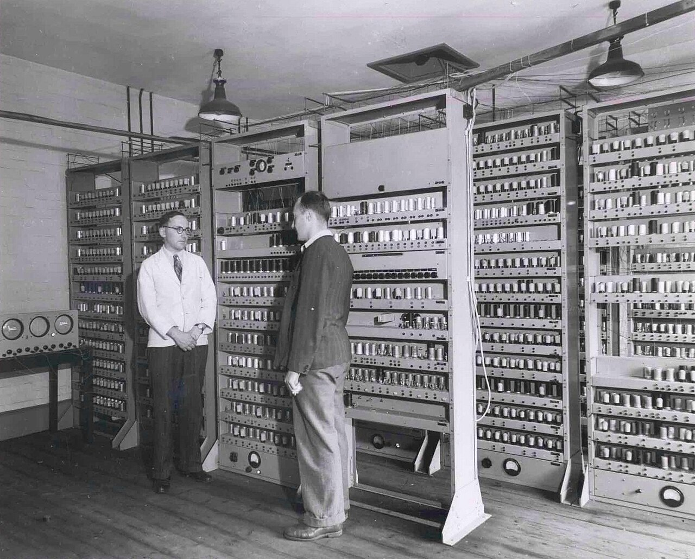

# 6. O programa vai para a memória: von Neumann e os primeiros computadores à venda

> 🗺️ **Neste capítulo:** você explica o que é um programa armazenado e por que a ideia deixou de exigir religar cabos a cada problema, acompanha os primeiros computadores à venda e conhece o Zezinho, o computador didático do ITA. · ⏱️ ~45 min

> 🔥 **Aquecimento:** (1) Como se programava o ENIAC? (2) Por que "qual foi o primeiro computador?" depende de uma definição?
>
> <details>
> <summary>Ver respostas</summary>
>
> (1) Com fios entre painéis e chaves, refeitos a cada problema. (2) Porque cada máquina vence segundo o critério escolhido: digital, eletrônica, programável, de uso geral.
>
> </details>

## De onde paramos

No capítulo 5, o ENIAC calculava depressa, mas cada problema novo exigia religar cabos. Neste capítulo a ideia muda de lugar: o programa deixa de ser fio e passa a ser dado. **A pergunta-guia é: o que muda quando o programa fica guardado na mesma memória dos números, e como isso abriu espaço para uma indústria?**

## EDVAC e o relatório de von Neumann

Em 1945, John von Neumann escreveu o *First Draft of a Report on the EDVAC* (CHM). O relatório descreve a arquitetura de programa armazenado: uma memória uniforme que guarda números e ordens, ou seja, dados e instruções. O IEEE cita o texto como "the June 1945 EDVAC Report", o que fixa a data em junho de 1945.

**Um programa armazenado é um programa guardado na mesma memória que os dados, de modo que a máquina lê as instruções dali, e trocar o programa é escrever na memória.**

É a ideia de receita que atravessa o livro, agora dentro da cozinha. Veja uma máquina mínima que escrevi para este livro: instruções e números vivem na mesma lista.

```python
# Máquina mínima de programa armazenado: instruções e dados na mesma memória
# instrução = (operação, endereço); dado = número simples
def rodar(memoria):
    acc, pc = 0, 0
    while True:
        op, end = memoria[pc]
        pc += 1
        if op == "LER":
            acc = memoria[end]
        elif op == "SOMAR":
            acc += memoria[end]
        elif op == "GUARDAR":
            memoria[end] = acc
        elif op == "PARAR":
            return memoria

#            0              1              2                3          4   5   6
mem = [("LER", 4), ("SOMAR", 5), ("GUARDAR", 6), ("PARAR", 0), 20, 22, 0]
print(rodar(mem)[6])

# Trocar o programa é só escrever na memória: agora a conta é 20 + 20
mem = [("LER", 4), ("SOMAR", 4), ("GUARDAR", 6), ("PARAR", 0), 20, 22, 0]
print(rodar(mem)[6])
```

Saída real, rodada ao escrever o capítulo:

```text
42
40
```

Conferência: 20 + 22 = 42 e 20 + 20 = 40. O programa ocupa as posições 0 a 3 da memória, e os números ficam nas posições 4 a 6. Mudar de conta foi trocar um endereço na lista, e não religar nada.

> 💡 **Analogia: a receita.** No ENIAC, a receita estava na cozinha (cabos e chaves). No programa armazenado, a receita fica no caderno, ao lado dos ingredientes, e o cozinheiro lê o caderno. **Onde a analogia falha:** na cozinha, caderno e despensa são coisas diferentes; na máquina, instrução e dado são o mesmo tipo de coisa, números na memória.

**Erro comum:** achar que von Neumann "inventou o computador". O rascunho descreve o desenho lógico de uma máquina, e não uma máquina construída.

## Manchester Baby, EDSAC e os primeiros que rodaram

A ideia no papel precisou de máquinas. A placa do IEEE diz que, no local da Universidade de Manchester, em 21/06/1948, o **Baby** "became the first computer to execute a program stored in addressable read-write electronic memory". O primeiro programa foi uma fatoração, que o IEEE descreve como uma execução de cerca de 52 minutos e cerca de 3,5 milhões de operações. As fontes divergem no tamanho do programa: o IEEE diz 25 instruções e o CHM, 17. O Baby também validou a memória de tubos de Williams e Kilburn, "later widely used".



*O EDSAC, de Cambridge, em foto de época. Foto: autor desconhecido, CC BY 2.0, via Wikimedia Commons.*

Conta de conferência: 3,5 milhões de operações em 52 minutos (3.120 segundos) dão cerca de 1.100 operações por segundo. ✔

O **EDSAC**, de Maurice Wilkes e sua equipe em Cambridge, rodou um programa em 06/05/1949 (IEEE). Segundo a Universidade de Cambridge, entrou em operação em maio de 1949 e foi "the first practical machine of its kind"; o CHM o descreve como o primeiro computador de programa armazenado prático a prestar serviço regular. A página de história de Cambridge cita, entre as ideias da máquina, as sub-rotinas e a microprogramação. O Baby foi o primeiro a rodar; o EDSAC, o primeiro a servir de forma regular. Isso mostra, de novo, que o título depende da definição.

> ⚖️ **Fato × interpretação.** É fato que o Baby rodou um programa guardado em 1948 e que o EDSAC entrou em operação em 1949. É interpretação decidir qual dos dois é "o primeiro": depende de exigir apenas rodar ou também servir de forma regular.

**Erro comum:** achar que o Baby era uma máquina útil. Era um banco de prova da memória, e o primeiro programa só fatorava um número.

## UNIVAC: o computador vira produto

O IEEE registra que a venda do UNIVAC foi anunciada em março de 1951, com entrega em junho de 1951. Foram 46 unidades vendidas, a mais de US$ 1 milhão cada (CHM). Com esses números, o computador deixa de ser um projeto de laboratório e passa a ser uma coisa que se compra.

**Um computador comercial é um computador feito para ser vendido ou alugado a clientes, e não só para uma instituição de pesquisa.**

> ⚖️ **Fato × interpretação.** É fato que o UNIVAC foi vendido em 1951, em 46 unidades segundo o CHM. É interpretação chamá-lo de "primeiro computador comercial": o CHM diz que o Ferranti Mark 1 (1951) foi "provavelmente" o primeiro comercial de uso geral.

## IBM entra no jogo

A IBM já aparecia no capítulo 3 por causa de Hollerith. Em junho de 1911 o financista Charles Ranlett Flint reuniu a Tabulating Machine Company, de Hollerith, a International Time Recording Company e a Computing Scale Company, e o resultado foi a Computing-Tabulating-Recording Company (C-T-R), segundo a IBM. Em 1924, "Watson renamed C-T-R with the more expansive moniker of International Business Machines". Isso fecha a dúvida que o capítulo 3 deixou: o nome IBM não é de 1895 nem de 1911, e sim de 1924.

Nos computadores, o CHM dá dois marcos: o IBM 701 (1953), com 19 unidades alugadas a cerca de US$ 15.000 por mês, e o IBM 650 (1954), com 450 vendidos em um ano. A conta mostra a diferença de escala: 450 ÷ 19 é cerca de 24 vezes mais máquinas. O CHM não compara os preços das duas máquinas, então este livro não explica a diferença.

> ⚖️ **Fato × interpretação.** É fato que a IBM vendeu 450 máquinas 650 em um ano, segundo o CHM. É interpretação dizer que foi por isso que a IBM virou líder: nenhuma das fontes citadas compara as vendas da IBM com as de outras empresas.

## Brasil: os primeiros computadores e o Zezinho do ITA (1961)

No Brasil, segundo a Pesquisa FAPESP, em 1961 estudantes de engenharia eletrônica do ITA, em São José dos Campos (SP), construíram o **Zezinho**, "um computador muito simples, que tinha finalidade exclusivamente didática". A revista diz que, na prática, ele "não executava tarefas de computação" e que foi a única experiência na área promovida com esforços brasileiros até o Patinho Feio, de 1972, na Poli-USP. A revista cita também um IBM 1620 que já estava no país, mas não dá a data de chegada, e este livro não afirma quando foi.

**Erro comum:** achar que o Zezinho era um computador "brasileiro" no sentido comercial. Era didático, e a própria fonte diz que não executava tarefas de computação.

## 🏋️ Pratique

**1. Exemplo resolvido.** Na máquina do capítulo, o que acontece se trocarmos `("SOMAR", 5)` por `("SOMAR", 4)`?

- A posição 4 guarda 20 e a posição 5, 22.
- Com `SOMAR 4`, a conta vira 20 + 20 = 40.
- Conferência: a saída da segunda execução foi 40. ✔

**2. Complete.** Escreva o programa para somar 5 e 9 e guardar o resultado na posição 6: `mem = [("LER", ___), ("SOMAR", ___), ("GUARDAR", 6), ("PARAR", 0), ___, ___, 0]`.

<details>
<summary>Ver resposta</summary>

`mem = [("LER", 4), ("SOMAR", 5), ("GUARDAR", 6), ("PARAR", 0), 5, 9, 0]`. O resultado é 14. Erro comum: esquecer que os números precisam estar nos endereços 4 e 5, e não dentro da instrução.

</details>

**3. Por conta própria.** Escreva em uma frase cada: (a) o que é programa armazenado; (b) o que o Baby provou; (c) o que torna um computador "comercial".

<details>
<summary>Ver resposta</summary>

(a) Um programa guardado na mesma memória dos dados. (b) Que a memória de Williams e Kilburn funcionava e que um programa guardado rodava. (c) Ser feito para vender ou alugar a clientes. Erro comum: dizer que o Baby era uma máquina para uso prático.

</details>

**4. Desafio (analisar uma fonte).** Sobre o primeiro programa do Baby, o IEEE diz 25 instruções e o CHM, 17. Responda em 4 ou 5 linhas: (a) o que isso mostra sobre as fontes; (b) que outra fonte você consultaria; (c) como você registraria a dúvida no texto.

<details>
<summary>Ver resposta</summary>

Resposta aberta. Confira com esta rubrica: (1) percebeu que duas fontes sérias podem discordar; (2) propôs uma fonte independente (o arquivo da Universidade de Manchester, um artigo de Kilburn); (3) escreveu a dúvida no texto, com o que cada trecho diz, em vez de escolher em silêncio; (4) não descartou uma das fontes por causa de um ponto.

</details>

## 🧠 Revisão rápida

1. O que muda quando o programa fica guardado na memória?
2. Qual foi o primeiro programa do Baby e quanto tempo levou?
3. Que ano a IBM recebeu esse nome?
4. O que era o Zezinho?
5. (Do capítulo 5) Como se programava o ENIAC?

<details>
<summary>Ver respostas</summary>

1. Trocar o programa passa a ser escrever na memória. 2. Uma fatoração; cerca de 52 minutos. 3. 1924. 4. Um computador didático construído por estudantes do ITA em 1961. 5. Com fios entre painéis e chaves.

</details>

## 🤖 Estude com um tutor de IA

- "Faça-me 5 perguntas, uma de cada vez, sobre programa armazenado, EDSAC e UNIVAC. Espere minha resposta antes de comentar e não me dê as respostas antes."
- "Aqui está minha resposta ao exercício [número do exercício]: [minha resposta]. Aponte meus erros sem me dar a solução."

> ➡️ **Próximo passo:** as máquinas ainda usavam válvulas, que queimavam. No capítulo 7 você vê o transistor e o chip.

## 📌 Resumo

| Item | Em uma frase |
| --- | --- |
| Programa armazenado | Programa guardado na mesma memória dos dados (von Neumann, 1945). |
| Manchester Baby | Rodou um programa guardado em 21/06/1948. |
| EDSAC | Programa em 06/05/1949; serviço regular desde maio de 1949. |
| UNIVAC I | Vendido a partir de 1951; 46 unidades (CHM). |
| IBM | Nome adotado em 1924, a partir da C-T-R de 1911. |
| Zezinho | Computador didático do ITA (1961) que não executava tarefas de computação. |

## 📚 Fontes

- IEEE ETHW, [Manchester University "Baby" Computer and its Derivatives](https://ethw.org/Milestones:Manchester_University_%22Baby%22_Computer_and_its_Derivatives,_1948-1951), consultado em 28/11/2026.
- University of Cambridge, [EDSAC blue plaque](https://www.cl.cam.ac.uk/news/2026/06-23-blue-plaque-edsac/), consultado em 28/11/2026.
- IBM, [C-T-R and IBM](https://www.ibm.com/history/ctr-and-ibm), consultado em 27/11/2026.
- Computer History Museum, [Timeline of Computer History](https://www.computerhistory.org/timeline/computers/), consultado em 27/11/2026.
- Revista Pesquisa FAPESP, [O legado do Patinho Feio](https://revistapesquisa.fapesp.br/o-legado-do-patinho-feio/), dez. 2022, consultado em 27/11/2026.

> 🔁 **Revise hoje:** capítulos 3 e 5

<!-- nav:start -->
---

[◀ Capítulo anterior](05-guerra-e-valvulas-zuse-colossus-e-eniac.md) · [Mapa do livro](../README.md) · [Próximo capítulo ▶](07-do-transistor-ao-chip.md)
<!-- nav:end -->
