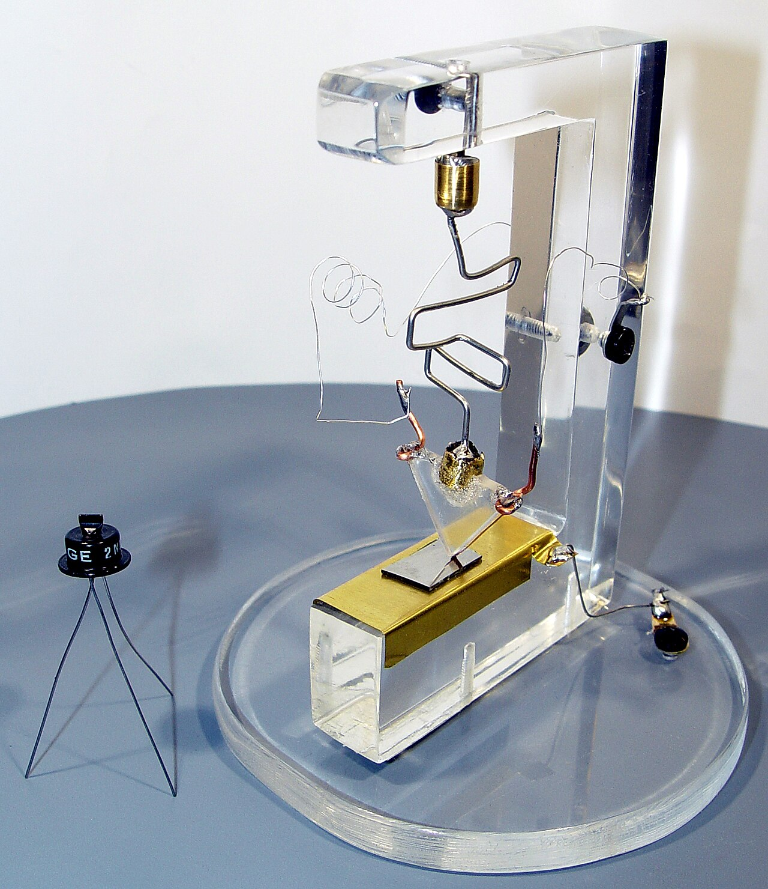

# 7. Do transistor ao chip

> 🗺️ **Neste capítulo:** você liga transistor, circuito integrado e microprocessador numa cadeia de causa e efeito, explica o que a Lei de Moore diz (e o que não diz) e conhece o Patinho Feio, o primeiro computador feito na Poli-USP. · ⏱️ ~50 min

### 📇 Folha-resumo: parte 3

![Folha-resumo da parte 3: Transistor (dezembro de 1947, Bell Labs, sem vidro, sem peça móvel); Circuito integrado (Kilby 1958, Noyce 1959, circuito num só pedaço); System/360 (7 de abril de 1964, cinco modelos, mesma programação); Lei de Moore (observação de 1965, revisada em 1975, dobra a cada dois anos); Intel 4004 (1971, 4 bits, 2.250 transistores, primeiro microprocessador); Compilador (traduz alto nível, A-0 de Hopper, 1952, FORTRAN 1957, COBOL 1960); Bug e Apollo (mariposa de 1947 existiu, palavra bug é anterior, Margaret Hamilton); Unix e C (Unix, 1969, C, 1972, Bell Labs); PC e reserva (Altair 1975, Alto 1974, Apple II, IBM PC, Mac, Lei 7.232/1984).](../img/c00-parte-3-do-chip-ao-pc.svg)

- [7. Do transistor ao chip](07-do-transistor-ao-chip.md)
- [8. Ensinar a máquina a entender gente: o nascimento do software](08-ensinar-a-maquina-a-entender-gente-o-nascimento-do-software.md)
- [9. Um computador em cada mesa](09-um-computador-em-cada-mesa.md)


> 🔥 **Aquecimento:** (1) Qual era o defeito das válvulas? (2) Por que o EDSAC e o Baby mostram que "primeiro" depende da definição?
>
> <details>
> <summary>Ver respostas</summary>
>
> (1) Eram de vidro, esquentavam e queimavam. (2) Porque o Baby foi o primeiro a rodar um programa guardado, e o EDSAC, o primeiro a prestar serviço regular.
>
> </details>

## De onde paramos

No capítulo 6 o programa foi para a memória, mas as máquinas ainda eram feitas de válvulas, caras e propensas a queimar. Neste capítulo a peça muda, e com ela o tamanho e o preço dos computadores. **A pergunta-guia é: como uma peça menor e mais barata transformou o computador de máquina de poucos em máquina de muitos?**

## O transistor (1947)

Em dezembro de 1947 John Bardeen e Walter Brattain obtiveram "transistor action" num dispositivo de germânio com contatos de ponta, nos Bell Labs, segundo o Computer History Museum (CHM). A página do CHM data de 16 de dezembro de 1947 o primeiro amplificador de semicondutor bem-sucedido, e diz que William Shockley voltou da guerra em 1945 para organizar o grupo de física do estado sólido onde isso aconteceu.



*Réplica do primeiro transistor de contato de ponta, de 1947. Foto: Mister rf, CC BY-SA 4.0, via Wikimedia Commons.*

**Um transistor é uma chave eletrônica feita de material semicondutor, sem vidro e sem peça que se mova, que também amplifica sinais.**

Compare com o capítulo 5: o relé tinha uma peça móvel; a válvula, vidro e um filamento aquecido. O transistor faz o mesmo trabalho de chave dentro de um pedaço sólido de material. Segundo o CHM, o TX-0, de 1956, foi o primeiro computador programável de uso geral feito com transistores.

> 💡 **Analogia: a receita.** O transistor é um cozinheiro que acende e apaga a luz sem esquentar a cozinha. **Onde a analogia falha:** a diferença real é de física dos materiais, e a analogia não mostra por que o germânio e o silício funcionam.

**Erro comum:** achar que o transistor "foi inventado por uma pessoa só". O CHM nomeia Bardeen e Brattain no dispositivo e Shockley como organizador do grupo.

> ⚖️ **Fato × interpretação.** É fato que o dispositivo funcionou em dezembro de 1947 nos Bell Labs, segundo o CHM. É interpretação dizer quem "merece" o crédito: este livro só relata quem a fonte cita.

## O circuito integrado

Um computador com milhares de transistores soltos precisa de milhares de fios soldados à mão. A saída foi fabricar vários componentes juntos, no mesmo pedaço de material. Segundo o CHM, em 1958 Jack Kilby produziu um microcircuito com componentes ativos e passivos feitos de material semicondutor, e em 1959 Robert Noyce, partindo do processo planar de Jean Hoerni, patenteou uma estrutura de circuito integrado monolítico.

**Um circuito integrado é um circuito completo, com vários componentes e as ligações entre eles, fabricado num único pedaço de material semicondutor.**

Duas pessoas, duas empresas, quase ao mesmo tempo: é um bom exemplo de que ideias maduras surgem em mais de um lugar. O CHM também registra o Apollo Guidance Computer como um dos primeiros usos de circuitos integrados.

**Erro comum:** achar que "chip" e "transistor" são sinônimos. Um chip contém muitos transistores.

## System/360 e os mainframes

Com peças mais baratas, o problema passou a ser outro: cada computador novo exigia reescrever todos os programas. Segundo o CHM, o IBM 1401 (1961) vendeu mais de 12.000 unidades. Em 7 de abril de 1964 a IBM anunciou o **System/360**: cinco modelos que usavam a mesma programação, com um investimento de US$ 5 bilhões, segundo o CHM.

**Um mainframe é um computador grande de uso geral, instalado numa empresa ou instituição e usado por muita gente através de operadores e terminais.**

O que o CHM destaca no 360 é a compatibilidade: a mesma programação em todos os modelos. O CHM também registra, na mesma época, o PDP-8, a US$ 18.000, um quinto do preço de um 360 pequeno. Ele abre o caminho dos computadores menores.

> 💡 **Analogia: a receita.** O 360 é uma receita que funciona em qualquer fogão da mesma marca, do pequeno ao industrial. **Onde falha:** receitas de verdade não precisam de compatibilidade, e programas precisam.

## A Lei de Moore

Em 19 de abril de 1965, Gordon Moore, então diretor de pesquisa da Fairchild, publicou na revista *Electronics* o artigo "Cramming more components onto integrated circuits". Segundo o CHM, ele traçou uma linha por cinco pontos, de 1959 a 1964, que mostravam o número de componentes por circuito integrado de menor custo por componente. Extrapolando até 1975, projetou 65.000 componentes num chip, "a doubling every 12 months". Em 1975 Moore corrigiu o ritmo para uma duplicação a cada dois anos, e o CHM diz que a previsão virou "a self-fulfilling prophecy": o setor passou a usá-la como meta. O nome "lei" veio de Carver Mead.

**A Lei de Moore é a observação de que o número de componentes por chip dobra a intervalos regulares, hoje contada em cerca de dois anos.**

Veja o que a duplicação faz com a conta. Partimos dos 2.250 transistores do Intel 4004 e simulamos duplicar a cada um ou a cada dois anos. É uma projeção minha, não um dado histórico:

```python
# Projeção simples: começa nos 2.250 transistores do Intel 4004 (1971)
base = 2250
for anos_por_dobra in (1, 2):
    print(f"dobrando a cada {anos_por_dobra} ano(s):")
    for ano in (1971, 1981, 1991, 2001):
        n = base * 2 ** ((ano - 1971) / anos_por_dobra)
        print(f"  {ano}: {n:,.0f}".replace(",", "."))
```

Saída real, rodada ao escrever o capítulo:

```text
dobrando a cada 1 ano(s):
  1971: 2.250
  1981: 2.304.000
  1991: 2.359.296.000
  2001: 2.415.919.104.000
dobrando a cada 2 ano(s):
  1971: 2.250
  1981: 72.000
  1991: 2.304.000
  2001: 73.728.000
```

Dobrar todo ano levaria a trilhões de transistores num chip em 2001, o que não aconteceu. A correção de 1975 para dois anos mostra que a "lei" é uma observação sobre um ritmo, que o próprio Moore ajustou. Não é uma lei da natureza. Este livro não compara a projeção com chips reais, porque as fontes citadas não trazem os números de chips reais.

**Erro comum:** achar que a Lei de Moore diz que os computadores ficam "duas vezes mais rápidos" a cada dois anos. A observação é sobre componentes por chip, e não sobre velocidade.

> ⚖️ **Fato × interpretação.** É fato que Moore publicou a previsão em 1965 e a revisou em 1975. É interpretação dizer que ela "causou" o progresso: o CHM a chama de profecia autorrealizável, o que já sugere que parte do efeito veio de as empresas a tomarem como meta.

## O Intel 4004 (1971)

Quando cabem milhares de transistores num chip, cabe a parte que processa de um computador inteiro. Segundo o CHM, o 4004 foi desenvolvido para a Busicom, fabricante japonesa de calculadoras, e tinha 2.250 transistores, com até 90.000 operações por segundo, em blocos de quatro bits. Federico Faggin liderou o projeto e Ted Hoff, a arquitetura. O CHM o chama de primeiro microprocessador.

**Um microprocessador é a unidade central de processamento de um computador inteira dentro de um único chip.**

Repare na ligação com a causa: o circuito integrado (1958–59) deu o meio de fabricar, a Lei de Moore (1965) deu o ritmo, e o 4004 (1971) mostrou o que cabia num chip. Foi para uma calculadora, e não para um "computador pessoal", e o capítulo 9 conta o que veio depois.

**Erro comum:** achar que o 4004 já era um computador pessoal. Era um componente para calculadoras.

## Brasil: o Patinho Feio, o G-10 e a Cobra

A mesma onda chegou ao Brasil por outro caminho. Segundo a *Revista Pesquisa FAPESP*, em 1972 a Escola Politécnica da USP construiu o **Patinho Feio**, trabalho final da disciplina de Arquitetura de Computadores da pós-graduação. Pesava cerca de 100 kg, tinha 450 pastilhas de circuito integrado, cerca de 3 mil blocos lógicos, 45 placas e memória de 4 kB. A mesma reportagem diz que ele foi a base do **G-10**, desenvolvido pela Poli-USP e pela PUC-Rio por encomenda da Marinha, e que o G-10 foi o protótipo do **MC 500**, da **Cobra**, empresa estatal criada em 1974. A revista também conta que, em 1968, a Poli estudou um IBM 1620 por engenharia reversa, e cita Edith Ranzini entre as pessoas do projeto. A reportagem não dá o ano de lançamento do MC 500, e este livro também não o afirma.

> 💡 **Analogia: a receita.** Fazer o Patinho Feio foi aprender a cozinhar desmontando um prato importado, e depois criar o seu. **Onde falha:** a engenharia reversa de um IBM 1620 foi um estudo, e o Patinho Feio foi um projeto novo, de acordo com a fonte.

**Erro comum:** achar que o Patinho Feio foi um produto comercial. Foi um projeto acadêmico; a fonte liga a ele os passos seguintes, o G-10 e o MC 500.

## 🏋️ Pratique

**1. Exemplo resolvido.** Quanto custava um 360 pequeno, se o PDP-8 custava US$ 18.000 e, segundo o CHM, era um quinto desse preço?

- O PDP-8 custava US$ 18.000, "um quinto do preço" de um 360 pequeno (CHM).
- Logo, o 360 pequeno custava 5 × 18.000 = US$ 90.000.
- Conferência: 90.000 ÷ 18.000 = 5. ✔

**2. Complete.** Ligue cada peça à época e ao problema que resolveu: (a) válvula → ___ (problema: ___); (b) transistor → 1947 (problema: ___); (c) circuito integrado → ___ (problema: ___).

<details>
<summary>Ver resposta</summary>

(a) Anos 1940, o ENIAC; problema: era de vidro e queimava. (b) Eliminou a peça móvel e o vidro. (c) 1958–59; problema: milhares de transistores soltos exigiam milhares de ligações à mão. Erro comum: confundir transistor e chip.

</details>

**3. Por conta própria.** Escreva em uma frase cada: (a) o que é um microprocessador; (b) o que a Lei de Moore diz; (c) o que o System/360 trouxe de novo.

<details>
<summary>Ver resposta</summary>

(a) A CPU inteira num único chip. (b) Que o número de componentes por chip dobra a intervalos regulares, ajustado por Moore para cerca de dois anos. (c) Compatibilidade: a mesma programação em modelos diferentes. Erro comum: dizer que a Lei de Moore trata de velocidade.

</details>

**4. Desafio (analisar uma fonte).** O CHM chama a previsão de Moore de "self-fulfilling prophecy" e a bibliografia dele usa o termo "observação". Responda em 4 ou 5 linhas: (a) qual a diferença entre lei, previsão e observação; (b) por que uma previsão pode se realizar por ser tomada como meta; (c) que evidência você pediria antes de dizer que ela "vale" hoje.

<details>
<summary>Ver resposta</summary>

Resposta aberta. Confira com esta rubrica: (1) distinguiu lei (vale sempre), previsão (olha adiante) e observação (descreve o passado); (2) explicou o efeito de meta (as empresas planejam para cumpri-la); (3) pediu dados atuais de fabricantes, e não uma frase repetida; (4) não tratou "lei" como lei da natureza.

</details>

## 🧠 Revisão rápida

1. Quem obteve "transistor action" em 1947 e onde?
2. O que é um circuito integrado?
3. O que o System/360 tinha de novo?
4. Qual a diferença entre a previsão de 1965 e a de 1975?
5. (Do capítulo 6) Por que o EDSAC é lembrado como o primeiro a prestar serviço regular?

<details>
<summary>Ver respostas</summary>

1. Bardeen e Brattain, nos Bell Labs. 2. Um circuito completo feito num único pedaço de material semicondutor. 3. Mesma programação em cinco modelos. 4. Duplicar a cada 12 meses em 1965; a cada dois anos em 1975. 5. Porque entrou em operação regular em 1949, segundo as fontes.

</details>

## 🤖 Estude com um tutor de IA

- "Faça-me 5 perguntas, uma de cada vez, sobre transistor, circuito integrado, Lei de Moore e Intel 4004. Espere minha resposta antes de comentar e não me dê as respostas antes."
- "Aqui está minha resposta ao exercício [número do exercício]: [minha resposta]. Aponte meus erros sem me dar a solução."

> ➡️ **Próximo passo:** máquinas baratas e rápidas só servem se alguém souber instruí-las. No capítulo 8 você vê como nasceu o software.

## 📌 Resumo

| Item | Em uma frase |
| --- | --- |
| Transistor | Chave de semicondutor, sem vidro e sem peça móvel; dezembro de 1947, Bell Labs. |
| Circuito integrado | Circuito completo num só pedaço de material; Kilby (1958) e Noyce (1959). |
| System/360 | Anunciado em 7/04/1964; cinco modelos com a mesma programação. |
| Lei de Moore | Observação de 1965, revisada em 1975 para duplicar a cada dois anos. |
| Intel 4004 | Primeiro microprocessador (1971); 2.250 transistores; 4 bits. |
| Patinho Feio | Computador da Poli-USP (1972); base do G-10 e do MC 500 da Cobra. |

## 📚 Fontes

- Computer History Museum, [Invention of the Point-Contact Transistor](https://www.computerhistory.org/siliconengine/invention-of-the-point-contact-transistor/), consultado em 28/11/2026.
- Computer History Museum, [Silicon Engine Timeline](https://www.computerhistory.org/siliconengine/timeline/), consultado em 28/11/2026.
- Computer History Museum, [Moore's Law Predicts the Future of Integrated Circuits](https://www.computerhistory.org/siliconengine/moores-law-predicts-the-future-of-integrated-circuits/), consultado em 28/11/2026.
- Computer History Museum, [1971](https://www.computerhistory.org/timeline/1971/), consultado em 28/11/2026.
- Computer History Museum, [Timeline of Computer History](https://www.computerhistory.org/timeline/computers/), consultado em 27/11/2026.
- Revista Pesquisa FAPESP, [O legado do Patinho Feio](https://revistapesquisa.fapesp.br/o-legado-do-patinho-feio/), dez. 2022, consultado em 27/11/2026.

> 🔁 **Revise hoje:** capítulos 4 e 6

<!-- nav:start -->
---

[◀ Capítulo anterior](06-o-programa-vai-para-a-memoria-von-neumann.md) · [Mapa do livro](../README.md) · [Próximo capítulo ▶](08-ensinar-a-maquina-a-entender-gente-o-nascimento-do-software.md)
<!-- nav:end -->
