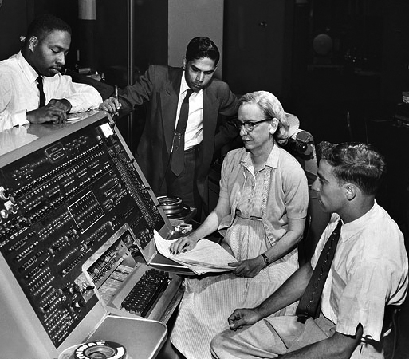

# 8. Ensinar a máquina a entender gente: o nascimento do software

> 🗺️ **Neste capítulo:** você explica o que um compilador faz, reconhece os marcos de FORTRAN, COBOL e Unix, e separa o fato da lenda no "primeiro bug". · ⏱️ ~50 min

> 🔥 **Aquecimento:** (1) O que é um programa armazenado? (2) O que o System/360 trouxe de novo?
>
> <details>
> <summary>Ver respostas</summary>
>
> (1) Um programa guardado na mesma memória dos dados. (2) A mesma programação em cinco modelos diferentes.
>
> </details>

## De onde paramos

Nos capítulos 6 e 7 as máquinas ficaram menores e mais baratas, mas programá-las ainda era escrever números e códigos de operação, como no `("LER", 4)` do capítulo 6. **A pergunta-guia é: como as pessoas deixaram de falar a língua da máquina e passaram a pedir que a máquina entendesse a delas?**

## Grace Hopper e o A-0

Segundo o Computer History Museum (CHM), em 1952 a matemática Grace Hopper completou o A-0, um programa que permitia a quem usava o computador escrever com palavras parecidas com o inglês. Em 1957 o CHM volta a ela e chama o A-0 de "compiler".



*Grace Hopper no console do UNIVAC, com colegas. Foto: autor desconhecido, CC BY 2.0, via Wikimedia Commons.*

**Um compilador é um programa que traduz um texto escrito numa linguagem humana, parecida com a nossa, para as instruções que a máquina executa.**

Para ver a ideia, aqui vai um compilador mínimo que escrevi para este livro. Ele traduz uma linha como `total = 20 + 22` para o programa da máquina do capítulo 6 e depois o roda:

```python
# Compilador mínimo: traduz "x = a + b" para a máquina do capítulo 6
def compilar(linha):
    destino, expressao = [p.strip() for p in linha.split("=")]
    a, b = [int(p) for p in expressao.split("+")]
    # programa (posições 0 a 3), dados (4 e 5) e o resultado (6)
    return [("LER", 4), ("SOMAR", 5), ("GUARDAR", 6), ("PARAR", 0), a, b, 0]

def rodar(mem):
    acc, pc = 0, 0
    while True:
        op, arg = mem[pc]
        pc += 1
        if op == "LER":
            acc = mem[arg]
        elif op == "SOMAR":
            acc += mem[arg]
        elif op == "GUARDAR":
            mem[arg] = acc
        elif op == "PARAR":
            return mem

programa = compilar("total = 20 + 22")
print(programa)
print(rodar(programa)[6])
```

Saída real, rodada ao escrever o capítulo:

```text
[('LER', 4), ('SOMAR', 5), ('GUARDAR', 6), ('PARAR', 0), 20, 22, 0]
42
```

Quem escreveu a linha `total = 20 + 22` não precisou saber em que posição da memória ficam os números. O compilador decidiu isso. Repare numa limitação do meu exemplo: ele só entende somas de dois números e ignora o nome `total`. Um compilador de verdade trata nomes, vários tipos de conta e erros.

> 💡 **Analogia: a receita.** O compilador é um tradutor que recebe a receita em português e a entrega ao cozinheiro na língua dele. **Onde a analogia falha:** o compilador traduz o programa todo antes de ele rodar, e o programa traduzido não precisa mais do tradutor.

**Erro comum:** achar que o compilador "executa" o programa. Ele só traduz; quem executa é a máquina, depois.

## FORTRAN e COBOL

Com o compilador, vieram as linguagens de programação. Segundo o CHM, em 1957 uma equipe da IBM liderada por John Backus desenvolveu o **FORTRAN**, e na mesma época Hopper completou o FLOW-MATIC e o MATH-MATIC. A IBM diz que o primeiro compilador de FORTRAN foi disponibilizado logo depois aos usuários do IBM 704.

Em 1960, segundo o CHM, uma equipe formada por vários fabricantes e pelo Pentágono desenvolveu o **COBOL**, e muitas de suas especificações vieram do FLOW-MATIC. Este livro não afirma o papel exato de Hopper no COBOL, porque as páginas citadas não o detalham.

**Uma linguagem de alto nível é uma linguagem de programação parecida com a linguagem humana ou com a matemática, que um compilador traduz para a de máquina.**

> ⚖️ **Fato × interpretação.** É fato que o FORTRAN e o FLOW-MATIC apareceram por volta de 1957 e o COBOL em 1960. É interpretação chamar alguém de "mãe" ou "pai" de uma linguagem: as fontes descrevem equipes, e não uma pessoa só.

**Erro comum:** achar que COBOL e FORTRAN eram a mesma linguagem. Um nasceu numa equipe da IBM; o outro, de um grupo de vários fabricantes e do Pentágono.

## O mito do primeiro "bug"

Uma história famosa diz que o primeiro "bug" foi uma mariposa achada num computador. A *JSTOR Daily* conta o que há de verdade. Em 1947 uma mariposa foi achada no Mark II de Harvard e colada no diário com a anotação "first actual case of a bug being found". O diário está no Smithsonian. Mas a palavra "bug" para defeito já aparecia numa carta de Edison de 1878 e no *Pall Mall Gazette* de 11/03/1889, e "debug" aparece em 1945 no *Journal of the Royal Aeronautical Society*. A reportagem diz ainda que o diário provavelmente não era de Hopper.

> ⚖️ **Fato × interpretação × lenda.**
> **Fato:** em 1947 uma mariposa foi colada num diário do Mark II e a anotação chamou aquilo de "first actual case of a bug being found".
> **Interpretação:** o "actual" da anotação sugere que "bug" já era uma palavra para defeito; é uma leitura minha, e a fonte não a afirma.
> **Lenda a evitar:** que a palavra "bug" nasceu com a mariposa, ou que Hopper a achou.

**Erro comum:** repetir a lenda como se fosse a origem da palavra.

## Margaret Hamilton e a Apollo

O CHM descreve Margaret Hamilton como a pessoa que liderou a equipe de software do programa Apollo da NASA e desenvolveu o software de voo que levou seres humanos à Lua. Ela entrou no esforço do MIT para construir o software do Apollo Guidance Computer, o computador que o capítulo 7 citou como um dos primeiros a usar circuitos integrados. O CHM diz que ela ajudou a estabelecer a engenharia de software como disciplina própria, e que o presidente Obama lhe deu a Medalha Presidencial da Liberdade em 2016. Este livro não afirma que ela "cunhou" o termo, porque não consegui conferir isso numa fonte aberta.

**Engenharia de software é a aplicação de métodos de engenharia (planejamento, testes, registro) à construção de programas, para que funcionem de forma confiável.**

Um programa de voo que leva pessoas à Lua mostra por que a engenharia de software passou a ser discutida como disciplina.

**Erro comum:** achar que software "sempre existiu junto com o computador". O próprio capítulo 6 mostrou que o programa só passou a ser um objeto separado quando foi para a memória.

## Atlas, Unix e C

Antes do Unix, os computadores já precisavam de um programa que gerenciasse os outros. Segundo o CHM, o Atlas (1962) tinha memória virtual e o "Atlas Supervisor", considerado por alguns o primeiro sistema operacional de verdade.

**Um sistema operacional é o programa que gerencia a máquina e distribui a memória, o processador e os dispositivos entre os outros programas.**

Segundo o CHM, em 1969 os programadores Kenneth Thompson e Dennis Ritchie, dos Bell Labs da AT&T, desenvolveram o **Unix** num minicomputador DEC que estava sobrando. Em 1972, Ritchie e sua equipe criaram a linguagem **C**, baseada na linguagem anterior BCPL.

> 💡 **Analogia: a receita.** O sistema operacional é o gerente da cozinha: decide quem usa qual fogão e quando. **Onde falha:** o gerente da cozinha é uma pessoa que enxerga tudo; o sistema só sabe o que a máquina lhe mostra.

**Erro comum:** achar que o sistema operacional e o hardware são a mesma coisa. O sistema é um programa como os outros, que roda na máquina.

## 🏋️ Pratique

**1. Exemplo resolvido.** Quantos anos separam o A-0 (1952) do Unix (1969)?

- A-0: 1952.
- Unix: 1969.
- 1969 − 1952 = 17 anos. ✔

**2. Complete.** No compilador mínimo do capítulo, escreva a linha que ele aceitaria para somar 15 e 27: `compilar("total = ___ + ___")`. O resultado esperado é ___.

<details>
<summary>Ver resposta</summary>

`compilar("total = 15 + 27")`. O resultado é 42, pois 15 + 27 = 42. Erro comum: achar que o compilador entende `15 × 27`; o exemplo só soma.

</details>

**3. Por conta própria.** Escreva em uma frase cada: (a) o que um compilador faz; (b) o que é um sistema operacional; (c) por que a história da mariposa não explica a origem da palavra "bug".

<details>
<summary>Ver resposta</summary>

(a) Traduz um texto de linguagem de alto nível para instruções da máquina. (b) O programa que gerencia a máquina e distribui seus recursos. (c) Porque a palavra já era usada para defeito antes de 1947 (Edison em 1878, jornal em 1889). Erro comum: dizer que o compilador executa o programa.

</details>

**4. Desafio (analisar uma fonte).** A história da mariposa aparece em muitos lugares como "o primeiro bug". Responda em 4 ou 5 linhas: (a) que evidência desmente a lenda; (b) por que uma anedota assim se espalha; (c) como você conferiria uma anedota parecida antes de repeti-la.

<details>
<summary>Ver resposta</summary>

Resposta aberta. Confira com esta rubrica: (1) citou o uso anterior da palavra (Edison, 1878; jornal, 1889); (2) explicou por que a história é boa (simples, visual, tem personagem famosa); (3) propôs voltar ao documento original ou a um historiador que o tenha examinado; (4) não afirmou o que a fonte não diz, como a autoria do diário.

</details>

## 🧠 Revisão rápida

1. O que é um compilador?
2. Quem liderou o desenvolvimento do FORTRAN na IBM?
3. Que dois usos da palavra "bug" são anteriores a 1947?
4. O que o CHM diz que Margaret Hamilton fez na Apollo?
5. (Do capítulo 5) Por que o ENIAC precisava ser religado a cada problema?

<details>
<summary>Ver respostas</summary>

1. Um programa que traduz linguagem de alto nível para a da máquina. 2. John Backus. 3. A carta de Edison de 1878 e o *Pall Mall Gazette* de 1889. 4. Liderou a equipe de software de voo. 5. Porque o programa estava em cabos e chaves, e não na memória.

</details>

## 🤖 Estude com um tutor de IA

- "Faça-me 5 perguntas, uma de cada vez, sobre compilador, FORTRAN, COBOL, o mito do bug e o Unix. Espere minha resposta antes de comentar e não me dê as respostas antes."
- "Aqui está minha resposta ao exercício [número do exercício]: [minha resposta]. Aponte meus erros sem me dar a solução."

> ➡️ **Próximo passo:** com software, os computadores ficaram úteis, e com chips ficaram baratos. No capítulo 9 eles chegam às casas e ao Brasil dos anos 1980.

## 📌 Resumo

| Item | Em uma frase |
| --- | --- |
| Compilador | Programa que traduz linguagem de alto nível para instruções da máquina. |
| A-0 | Programa de Grace Hopper de 1952, que usava palavras parecidas com o inglês. |
| FORTRAN | Linguagem da IBM, equipe de John Backus, 1957. |
| COBOL | Linguagem de 1960 de uma equipe de fabricantes e do Pentágono; herdou do FLOW-MATIC. |
| Mariposa de 1947 | Verdadeira, mas a palavra "bug" já existia (1878, 1889). |
| Margaret Hamilton | Liderou o software de voo da Apollo (CHM). |
| Unix e C | Bell Labs: Unix em 1969 (Thompson e Ritchie), C em 1972. |

## 📚 Fontes

- Computer History Museum, [1952](https://www.computerhistory.org/timeline/1952/), consultado em 28/11/2026.
- Computer History Museum, [1957](https://www.computerhistory.org/timeline/1957/), consultado em 28/11/2026.
- Computer History Museum, [Software and Languages](https://www.computerhistory.org/timeline/software-languages/), consultado em 28/11/2026.
- Computer History Museum, [Margaret Hamilton in her own words](https://computerhistory.org/blog/margaret-hamilton-in-her-own-words/), consultado em 28/11/2026.
- IBM, [FORTRAN](https://www.ibm.com/history/fortran), consultado em 28/11/2026.
- JSTOR Daily, [The Bug in the Computer Bug Story](https://daily.jstor.org/the-bug-in-the-computer-bug-story), consultado em 27/11/2026.
- Computer History Museum, [Timeline of Computer History](https://www.computerhistory.org/timeline/computers/), consultado em 27/11/2026.

> 🔁 **Revise hoje:** capítulos 1, 5 e 7

<!-- nav:start -->
---

[◀ Capítulo anterior](07-do-transistor-ao-chip.md) · [Mapa do livro](../README.md) · [Próximo capítulo ▶](09-um-computador-em-cada-mesa.md)
<!-- nav:end -->
