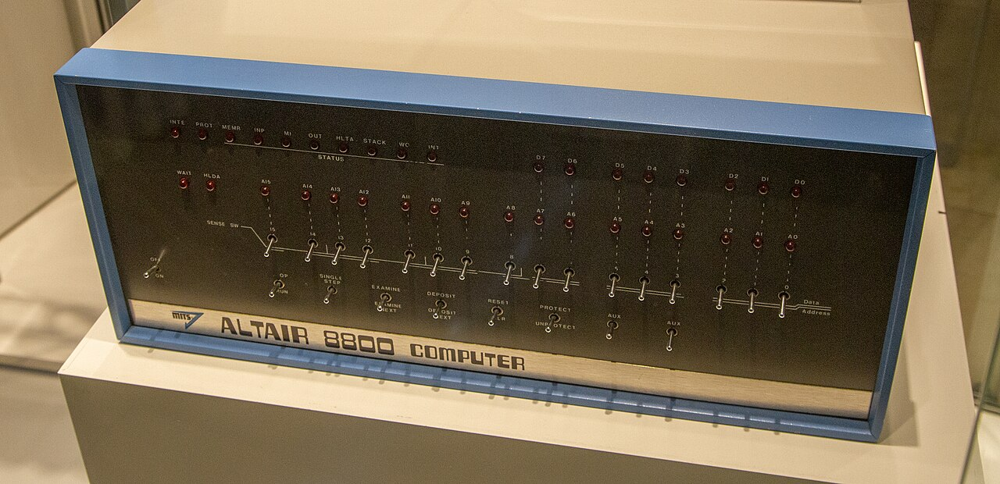
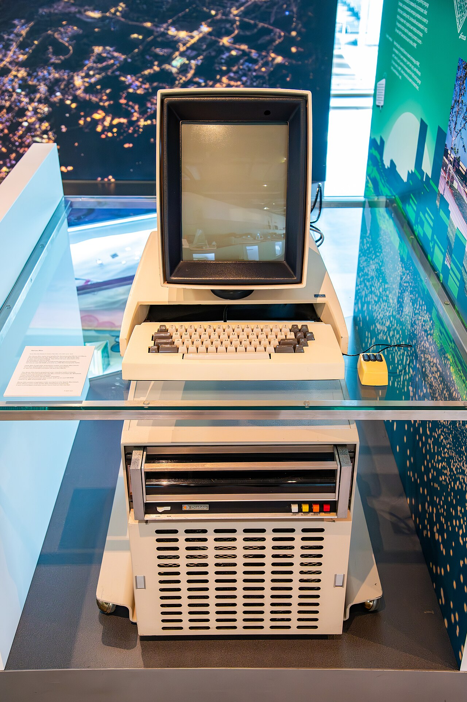

# 9. Um computador em cada mesa

> 🗺️ **Neste capítulo:** você explica por que o computador pessoal surgiu nos anos 1970, quais ideias do Xerox PARC chegaram até hoje e o que a Lei 7.232/1984 dizia sobre a informática no Brasil. · ⏱️ ~45 min

> 🔥 **Aquecimento:** (1) O que era o Intel 4004 e para quem foi feito? (2) Por que o Unix e o C importam na história do software?
>
> <details>
> <summary>Ver respostas</summary>
>
> (1) O primeiro microprocessador, feito para a Busicom, fabricante japonesa de calculadoras. (2) Foram criados nos Bell Labs (1969 e 1972) e deram ao software um sistema operacional e uma linguagem que outros programadores reutilizaram.
>
> </details>

## De onde paramos

No capítulo 7 o chip ficou barato, e no capítulo 8 as pessoas aprenderam a escrever programas sem falar a língua da máquina. Falta uma peça: alguém comprar o computador para si. **A pergunta-guia é: o que fez o computador sair do centro de processamento e chegar à mesa de uma pessoa?**

## O Altair e os clubes

O **Altair 8800** apareceu na capa da revista *Popular Electronics* de janeiro de 1975, segundo o Computer History Museum (CHM). O CHM dá os preços: "\$297, or \$395 with a case", ou seja, o kit para montar custava US$ 297 e, com caixa, US$ 395. Bill Gates e Paul Allen licenciaram o BASIC para a fabricante, a MITS, segundo o CHM.



*Um Altair 8800. Foto: Maksym Kozlenko, CC BY-SA 4.0, via Wikimedia Commons.*

**Um computador pessoal é um computador barato e pequeno o bastante para ser comprado e usado por uma pessoa, e não por uma instituição.**

Repare no que mudou em relação ao capítulo 7: o 4004 foi para uma calculadora, e o Altair, para quem quisesse montar um computador em casa. Era uma máquina para entusiastas, vendida em kit.

> 💡 **Analogia: a receita.** O Altair é uma cozinha em kit: vem o fogão desmontado e você faz o resto. **Onde a analogia falha:** na cozinha em kit a receita já existe, e no Altair quase tudo, até o BASIC, precisou ser escrito.

**Erro comum:** achar que o Altair vinha pronto para usar. Era um kit, e a versão com caixa custava a mais, segundo o próprio CHM.

## Xerox PARC e a interface gráfica

O CHM registra, em 1974, o **Xerox Alto**, "a groundbreaking computer with wide influence on the computer industry". Segundo o CHM, ele tinha interface gráfica com janelas, ícones e mouse, rede local e impressora a laser, e o Lisa e o Macintosh foram inspirados nele.



*Um Xerox Alto. Foto: Bc4040, CC BY 4.0, via Wikimedia Commons.*

**Uma interface gráfica é uma forma de usar o computador por imagens (janelas, ícones, um ponteiro) em vez de comandos digitados.**

Para ver o contraste, imagine pedir "copie o arquivo A para a pasta B". Na linha de comando você digita as palavras; na interface gráfica, arrasta o ícone. A segunda forma dispensa decorar comandos; é o argumento comum a favor dela, que as fontes do capítulo não discutem.

**Erro comum:** achar que a interface gráfica nasceu com o Macintosh. O CHM a coloca no Alto, dez anos antes, e diz que o Macintosh foi inspirado nele.

## Apple II, IBM PC e Macintosh

Em 1977 o CHM registra o **Apple II**, vendido completo, com placa lógica, fonte, teclado, caixa e manual. Em 1981 vem o **IBM PC**, formalmente o IBM Model 5150, e em 1984 o **Macintosh**, a US$ 2.500, apresentado num comercial exibido durante o Super Bowl XVIII, em 22 de janeiro de 1984. O CHM também lista o Osborne 1 (US$ 1.795), o primeiro portátil produzido em massa, e o Commodore 64 (1982, US$ 595).

Veja os preços lado a lado, em dólares da época, sem correção pela inflação:

```python
# Preços de lançamento citados pelo CHM (dólares da época, sem correção)
maquinas = [
    ("Altair 8800 (kit)", 1975, 297),
    ("Altair 8800 (com caixa)", 1975, 395),
    ("Osborne 1", 1981, 1795),
    ("Commodore 64", 1982, 595),
    ("Macintosh", 1984, 2500),
]
for nome, ano, preco in sorted(maquinas, key=lambda m: m[2]):
    print(f"{preco:>5}  {ano}  {nome}")
print("Macintosh / Commodore 64 =", round(2500 / 595, 1))
```

Saída real, rodada ao escrever o capítulo:

```text
  297  1975  Altair 8800 (kit)
  395  1975  Altair 8800 (com caixa)
  595  1982  Commodore 64
 1795  1981  Osborne 1
 2500  1984  Macintosh
Macintosh / Commodore 64 = 4.2
```

O Macintosh custava cerca de 4,2 vezes o Commodore 64. Como os preços são de anos diferentes e sem correção, a conta mostra uma ordem de grandeza, e não uma comparação exata.

> ⚖️ **Fato × interpretação.** É fato que o IBM PC saiu em 1981 e o Macintosh em 1984, a US$ 2.500, segundo o CHM. É interpretação dizer que um "venceu" o outro: as fontes citadas não comparam as vendas.

**Erro comum:** achar que o IBM PC foi o primeiro computador pessoal. Ele veio depois do Altair e do Apple II.

## Software como produto

O Altair mostra um fato menos óbvio: o programa podia ser vendido separado da máquina. Segundo o CHM, Gates e Allen licenciaram o BASIC à MITS. Dizer que foi por isso que o software virou um negócio por si só seria interpretação, e as fontes citadas não a fazem.

**Software como produto é um programa vendido ou licenciado separadamente da máquina em que roda.**

**Erro comum:** achar que antes de 1975 "não havia software à venda". O capítulo 8 mostrou linguagens como FORTRAN e COBOL, que já existiam em 1957 e 1960. Aqui o que muda é o público: a pessoa, e não a instituição.

## Brasil: a Lei 7.232/1984 e a reserva de mercado

No Brasil, o computador pessoal chegou sob outra regra. A **Lei nº 7.232, de 29 de outubro de 1984**, instituiu a Política Nacional de Informática. Segundo o texto original (publicado no *Diário Oficial* de 30/10/1984):

- Art. 2º: a política tem por objetivo "a capacitação nacional nas atividades de informática, em proveito do desenvolvimento social".
- Art. 9º: para dar proteção às empresas nacionais "enquanto não estiverem consolidadas e aptas a competir no mercado internacional", a lei prevê "restrições de natureza transitória".
- Art. 11: os órgãos públicos "darão preferência nas aquisições de bens e serviços de informática aos produzidos por empresas nacionais".
- Art. 1º e 8º: cria o Conselho Nacional de Informática e Automação (CONIN), e a Secretaria Especial de Informática (SEI) é órgão subordinado a ele.
- Art. 4º, VIII: prevê "o controle das importações de bens e serviços de informática por 8 (oito) anos a contar da publicação desta Lei".
- Art. 45: a lei entra em vigor 60 dias depois de publicada.

Repare que a expressão "reserva de mercado" não aparece no texto. É o nome que se deu, depois, ao conjunto de restrições. A sigla CAPRE, que muita gente associa ao tema, também não aparece, e por isso este livro não explica esse órgão.

**A reserva de mercado de informática foi a política de proteger empresas nacionais do setor com restrições às importações e preferência nas compras públicas.**

O que aconteceu depois? Em 2004, José Ellis Ripper Filho disse à *Revista Pesquisa FAPESP*: "Quiseram acabar com a reserva e acabaram com o mercado", sobre o governo Collor, e explicou que, no caso dos componentes, "ficou mais barato importar um kit para montar o equipamento aqui". Ele fala de um setor específico, o de componentes, e é um testemunho, não um balanço do período. A Lei nº 8.248, de 1991, voltou ao assunto: define "empresa brasileira de capital nacional" com remissão à Lei 7.232 e troca benefícios e incentivos, mas o texto da lei não diz que ela encerra a reserva.

> ⚖️ **Fato × interpretação.** É fato que a lei previu controle de importação por oito anos e preferência nas compras públicas. É interpretação dizer se a política "deu certo" ou "atrasou o país": as fontes citadas trazem o texto da lei e um depoimento, e não um balanço.

**Erro comum:** achar que a Lei 7.232 proibiu os computadores importados. O texto fala em "restrições de natureza transitória" e em controle das importações, e não em proibição.

## 🏋️ Pratique

**1. Exemplo resolvido.** Quanto mais custava o Altair com caixa do que o kit?

- Kit: US$ 297. Com caixa: US$ 395.
- 395 − 297 = US$ 98.
- Conferência: 297 + 98 = 395. ✔

**2. Complete.** Escreva o que cada sigla ou nome representa: Altair 8800 → ___ (ano ___); Xerox Alto → ___ (ano ___); Lei 7.232 → ___ (ano ___).

<details>
<summary>Ver resposta</summary>

Altair: computador em kit para entusiastas, 1975. Alto: computador com interface gráfica e mouse, 1974. Lei 7.232: Política Nacional de Informática, 1984. Erro comum: trocar os anos do Alto (1974) e do Altair (1975).

</details>

**3. Por conta própria.** Escreva em uma frase cada: (a) o que é uma interface gráfica; (b) o que o art. 9º da Lei 7.232 previa; (c) por que a expressão "reserva de mercado" não aparece no texto da lei.

<details>
<summary>Ver resposta</summary>

(a) Usar o computador por janelas, ícones e ponteiro, em vez de comandos digitados. (b) Restrições de natureza transitória para proteger as empresas nacionais enquanto não estivessem aptas a competir. (c) Porque é um nome dado depois ao conjunto das medidas. Erro comum: dizer que a lei proibiu as importações.

</details>

**4. Desafio (analisar uma fonte).** Ripper diz, em entrevista de 2004, que "acabaram com o mercado". A lei, por sua vez, é um texto de 1984. Responda em 4 ou 5 linhas: (a) que tipo de fonte é cada um; (b) o que cada um prova e o que não prova; (c) como você chegaria a uma conclusão sobre os efeitos da política.

<details>
<summary>Ver resposta</summary>

Resposta aberta. Confira com esta rubrica: (1) distinguiu texto legal (diz o que a norma previa) de depoimento (diz o que uma pessoa viu e lembra); (2) reconheceu que nenhum dos dois mede o resultado; (3) propôs dados como produção, preços e empregos, de fontes independentes; (4) não tomou a frase do entrevistado como balanço geral.

</details>

## 🧠 Revisão rápida

1. Quanto custava o Altair 8800 em kit?
2. Que ideias o CHM atribui ao Xerox Alto?
3. Em que ano saiu o IBM PC e em que ano o Macintosh?
4. Que diz o art. 9º da Lei 7.232?
5. (Do capítulo 8) O que é um compilador?

<details>
<summary>Ver respostas</summary>

1. US$ 297. 2. Janelas, ícones, mouse, rede local e impressora a laser. 3. 1981 e 1984. 4. Restrições transitórias para proteger empresas nacionais até que possam competir. 5. Um programa que traduz linguagem de alto nível para instruções da máquina.

</details>

## 🤖 Estude com um tutor de IA

- "Faça-me 5 perguntas, uma de cada vez, sobre o Altair, o Xerox Alto, o IBM PC e a Lei 7.232. Espere minha resposta antes de comentar e não me dê as respostas antes."
- "Aqui está minha resposta ao exercício [número do exercício]: [minha resposta]. Aponte meus erros sem me dar a solução."

> ➡️ **Próximo passo:** computadores em casa logo querem falar uns com os outros. No capítulo 10 você vê como nasceu a rede e a internet.

## 📌 Resumo

| Item | Em uma frase |
| --- | --- |
| Altair 8800 | Computador em kit, capa da *Popular Electronics* em janeiro de 1975; US$ 297 (kit) ou US$ 395 (com caixa). |
| Xerox Alto | Máquina de 1974 com janelas, ícones, mouse e rede local; influenciou o Lisa e o Macintosh. |
| Apple II, IBM PC, Macintosh | 1977, 1981 e 1984; o Macintosh custava US$ 2.500. |
| Software como produto | Programa vendido separado da máquina; o BASIC do Altair é um exemplo. |
| Lei 7.232/1984 | Política Nacional de Informática: proteção transitória a empresas nacionais, preferência nas compras públicas e controle de importação por 8 anos. |

## 📚 Fontes

- Computer History Museum, [1974](https://www.computerhistory.org/timeline/1974/), consultado em 28/11/2026.
- Computer History Museum, [1975](https://www.computerhistory.org/timeline/1975/), consultado em 28/11/2026.
- Computer History Museum, [1977](https://www.computerhistory.org/timeline/1977/), consultado em 28/11/2026.
- Computer History Museum, [1981](https://www.computerhistory.org/timeline/1981/), consultado em 28/11/2026.
- Computer History Museum, [1984](https://www.computerhistory.org/timeline/1984/), consultado em 28/11/2026.
- Computer History Museum, [Timeline of Computer History](https://www.computerhistory.org/timeline/computers/), consultado em 27/11/2026.
- Câmara dos Deputados, [Lei nº 7.232, de 29 de outubro de 1984 (publicação original)](https://www2.camara.leg.br/legin/fed/lei/1980-1987/lei-7232-29-outubro-1984-356182-publicacaooriginal-1-pl.html), consultado em 28/11/2026.
- Presidência da República, [Lei nº 8.248, de 1991](https://www.planalto.gov.br/ccivil_03/leis/l8248.htm), consultado em 28/11/2026.
- Revista Pesquisa FAPESP, [José Ellis Ripper Filho: alternativas do saber](https://revistapesquisa.fapesp.br/jos%C3%A9-ellis-ripper-filho-alternativas-do-saber/), jul. 2004, consultado em 28/11/2026.

> 🔁 **Revise hoje:** capítulos 2, 6 e 8

<!-- nav:start -->
---

[◀ Capítulo anterior](08-ensinar-a-maquina-a-entender-gente-o-nascimento-do-software.md) · [Mapa do livro](../README.md) · [Próximo capítulo ▶](10-tudo-conectado-arpanet-web-e-celular.md)
<!-- nav:end -->
