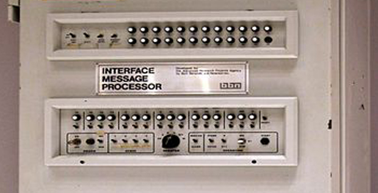
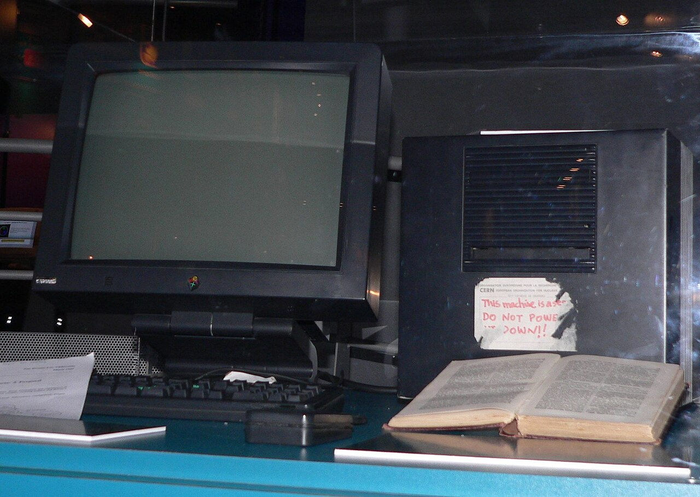
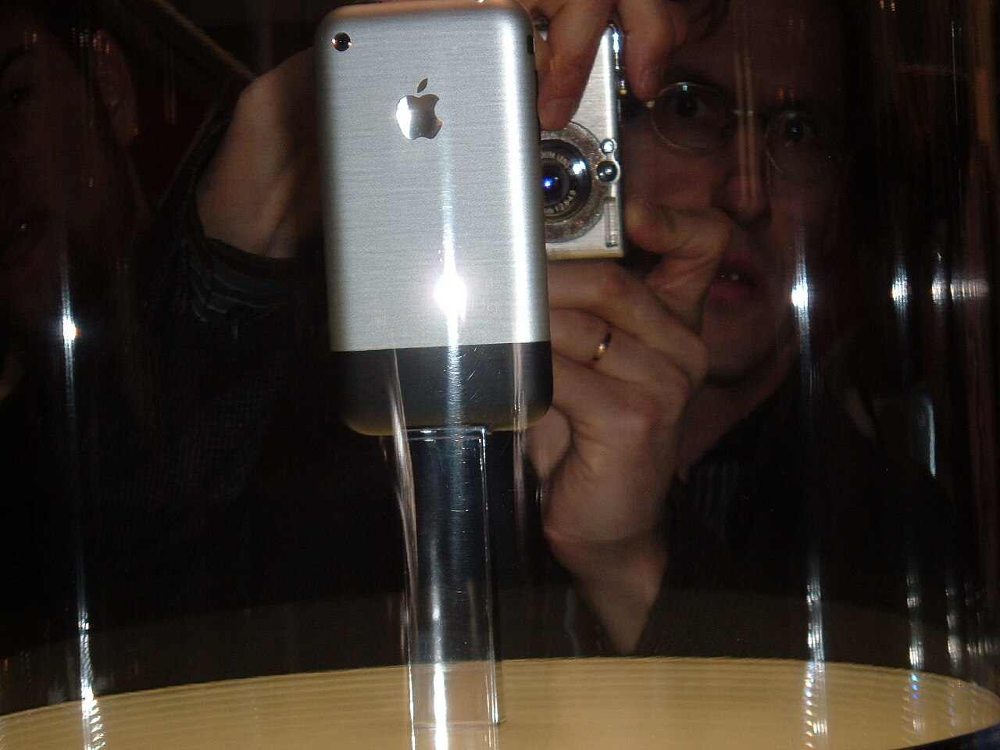

# 10. Tudo conectado: ARPANET, web e celular

> 🗺️ **Neste capítulo:** você distingue internet de web, explica a comutação de pacotes e o TCP/IP, acompanha o caminho da ARPANET ao smartphone e conhece o começo da internet no Brasil (AlterNex, RNP e CGI.br). · ⏱️ ~50 min

### 📇 Folha-resumo: parte 4

![Folha-resumo da parte 4: Comutação de pacotes (mensagem em pacotes, numerados e remontados, caminhos diferentes); ARPANET e TCP/IP (ligada em outubro de 1969, TCP/IP em 1º/1/1983, liga redes diferentes); Web (Berners-Lee, 1989, liberada no CERN, 1991, web ≠ internet); iPhone (anunciado em 9/1/2007, telefone, iPod, internet, celular vira computador); Internet no Brasil (AlterNex, julho de 1989, RNP e CGI.br (1995), internet comercial); Teste e Dartmouth (Turing, 1950, Dartmouth, 31/8/1955, invernos da IA); Deep Blue a AlphaGo (Deep Blue 1997, rede de 2012: 18,9% de erro, AlphaGo 4 a 1, 2016); Transformer (atenção, 2017, ChatGPT, 2022, AI Act em vigor 2024); Museu (15 marcos com causa, checar uma lenda, 2+ marcos brasileiros).](../img/c00-parte-4-rede-ia-e-museu.svg)

- [10. Tudo conectado: ARPANET, web e celular](10-tudo-conectado-arpanet-web-e-celular.md)
- [11. Máquinas que aprendem: a longa estrada da inteligência artificial](11-maquinas-que-aprendem-a-longa-estrada.md)
- [12. Projeto final: seu museu da computação](12-projeto-final-seu-museu-da-computacao.md)


> 🔥 **Aquecimento:** (1) Que ideia o Xerox Alto trouxe que usamos até hoje? (2) O que o art. 9º da Lei 7.232/1984 previa?
>
> <details>
> <summary>Ver respostas</summary>
>
> (1) A interface gráfica, com janelas, ícones e mouse, e também a rede local. (2) "Restrições de natureza transitória" para proteger as empresas nacionais até que pudessem competir.
>
> </details>

## De onde paramos

No capítulo 9 o computador chegou à mesa de uma pessoa. Cada máquina, porém, trabalhava sozinha. Neste capítulo os computadores aprendem a conversar. **A pergunta-guia é: qual é a diferença entre a internet e a web, e como ligar máquinas diferentes passou a ser possível?**

## Comutação de pacotes

Ligar dois computadores por uma linha telefônica ocupa a linha inteira durante a conversa. A saída foi cortar a mensagem em partes pequenas e deixar cada parte seguir seu caminho.

**Comutação de pacotes é a técnica de dividir uma mensagem em pedaços (pacotes), enviar cada um separadamente e remontar tudo no destino.**

Segundo a Internet Society, Leonard Kleinrock publicou o primeiro artigo sobre a teoria da comutação de pacotes em julho de 1961 e o primeiro livro sobre o assunto em 1964. Veja a ideia numa simulação mínima, escrita para este livro: a mensagem é cortada, os pacotes chegam fora de ordem e cada um carrega o número que permite remontar.

```python
import random

mensagem = "A receita viaja em pedaços e chega inteira."
tam = 8
n = (len(mensagem) + tam - 1) // tam
pacotes = [(i, mensagem[i * tam:(i + 1) * tam]) for i in range(n)]
for numero, texto in pacotes:
    print("Enviado:", numero, repr(texto))

random.seed(1)
chegada = pacotes[:]
random.shuffle(chegada)
print("Chegaram:", [n for n, _ in chegada])

remontada = "".join(texto for _, texto in sorted(chegada))
print("Remontada:", remontada)
print("Igual ao original?", remontada == mensagem)
```

Saída real, rodada ao escrever o capítulo:

```text
Enviado: 0 'A receit'
Enviado: 1 'a viaja '
Enviado: 2 'em pedaç'
Enviado: 3 'os e che'
Enviado: 4 'ga intei'
Enviado: 5 'ra.'
Chegaram: [2, 3, 5, 0, 4, 1]
Remontada: A receita viaja em pedaços e chega inteira.
Igual ao original? True
```

Conferência: a mensagem tem 43 caracteres, e 43 dividido em blocos de 8 dá 5 blocos cheios e um de 3 caracteres, ou seja, 6 pacotes. ✔ A ordem de chegada (2, 3, 5, 0, 4, 1) não importa, porque o número de cada pacote permite colocá-los em fila de novo.

> 💡 **Analogia: a receita.** Em vez de mandar o caderno inteiro, você manda a receita em folhas numeradas, por caminhos diferentes, e o destinatário monta a pilha na ordem. **Onde a analogia falha:** na vida real, uma folha perdida é apenas uma folha perdida; na rede, o protocolo precisa perceber a falta e pedir de novo.

**Erro comum:** achar que os pacotes seguem todos o mesmo caminho e chegam em ordem. O exemplo acima mostra o contrário: a ordem de chegada pode mudar, e por isso cada pacote leva um número.

## ARPANET e TCP/IP

Segundo o CHM, a **ARPAnet** foi ligada no fim de outubro de 1969 e foi a primeira rede de grande escala e uso geral a conectar tipos diferentes de computador. A Internet Society dá mais detalhes: em setembro de 1969 a BBN instalou o primeiro processador de interface (IMP) na UCLA, e o Stanford Research Institute (SRI) foi o segundo nó. Antes disso, em 1965, Lawrence Roberts e Thomas Merrill tinham ligado dois computadores por uma linha telefônica comum, o TX-2, em Massachusetts, e o Q-32, na Califórnia, segundo a mesma fonte.

O CHM acrescenta que outras redes surgiram em semanas ou meses: a NPL, no Reino Unido, a ALOHANET, no Havaí, e o projeto CYCLADES, na França. A ARPANET, portanto, não foi a única rede da época, mas o CHM diz que seu grande financiamento a fez ficar à frente das rivais.

Cada rede falava um protocolo próprio. Era preciso uma regra comum.

**Um protocolo é um conjunto de regras combinadas para que dois computadores se entendam. O TCP/IP é o protocolo que permite a redes diferentes se ligarem numa só rede de redes.**

Segundo a Internet Society, Robert Kahn e Vinton Cerf especificaram o que viria a ser o TCP/IP, e a primeira versão escrita circulou como INWG#39, numa reunião de setembro de 1973 na Universidade de Sussex; uma versão refinada foi publicada em 1974. A mesma fonte lista regras que Kahn considerava essenciais: cada rede teria de funcionar sozinha, sem mudanças internas para se conectar, e a comunicação seria "best effort": se um pacote não chegasse, seria retransmitido pela origem.

Em 1º de janeiro de 1983 a ARPANET trocou seu protocolo antigo (NCP) pelo TCP/IP, todos os computadores ao mesmo tempo. A Internet Society diz que a transição foi planejada por anos e deu certo "surprisingly smoothly", tanto que se distribuíram botões com a frase "I survived the TCP/IP transition". O CHM chama 1983 de lançamento oficial da Internet, então ainda uma rede experimental de redes do governo dos EUA. Em 1989 ela já tinha 100.000 computadores ligados, e o CHM considera que o fator decisivo foi "provavelmente" o dinheiro do governo, em especial o da NSFNET.



*Um IMP, o computador que ligava cada máquina à ARPANET. Foto: ARPANET IMP, domínio público, via Wikimedia Commons.*

> ⚖️ **Fato × interpretação.** É fato que a ARPANET foi ligada em 1969 e que o TCP/IP passou a ser o protocolo dela em 1º de janeiro de 1983. É interpretação dizer que o dinheiro público "foi o motivo" do sucesso da internet: o CHM apresenta isso como o fator provavelmente decisivo, entre outros.

**Erro comum:** achar que a ARPANET "é" a internet. A ARPANET foi uma das redes que se ligaram pelo TCP/IP, e a internet é o conjunto das redes ligadas assim.

## Berners-Lee e a web

Agora a distinção que dá nome à pergunta-guia. A internet é a infraestrutura: redes ligadas pelo TCP/IP. A web é um serviço que roda em cima dela.

**A World Wide Web é um sistema de páginas ligadas por hiperlinks, que se acessa por um navegador usando a internet.**

Segundo o histórico do W3C, em março de 1989 Tim Berners-Lee escreveu no CERN a proposta "Information Management: A Proposal". O CERN registra que o chefe dele, Mike Sendall, anotou na proposta: "Vague, but exciting". Em outubro de 1990 Berners-Lee começou a escrever um navegador-editor num computador NeXT e criou o nome "WorldWideWeb". O W3C data de 17 de maio de 1991 a liberação geral do WWW nas máquinas centrais do CERN, e de 12 de dezembro de 1991 o primeiro servidor web fora da Europa, no SLAC.

A web não ganhou sozinha. O CHM diz que o Gopher, que organizava o conteúdo em pastas e não em links clicáveis, cresceu mais depressa que a web no início dos anos 1990 e era seu concorrente mais direto. Sobre os navegadores, o CHM conta que, em 1994, metade da equipe do Mosaic saiu e fundou a Netscape com Jim Clark, e que em 1995 Netscape e Microsoft disputavam o mercado numa "Browser War II".

> 💡 **Analogia: a receita.** A internet é a rede de estradas e caminhões; a web é a livraria de receitas com índice remissivo, onde uma receita manda você para outra. **Onde a analogia falha:** a livraria só existe porque as estradas existem, mas as estradas servem a muitas outras coisas além dela, como o e-mail.



*O servidor NeXT do CERN. Foto: Rama, CC BY-SA 2.0 fr, via Wikimedia Commons.*

**Erro comum:** usar "internet" e "web" como sinônimos. O e-mail e a ARPANET existiam antes da web, e a Internet Society cita a web como exemplo de aplicação construída sobre a infraestrutura.

## Busca e redes sociais

Buscadores e redes sociais também fazem parte dessa história, mas as fontes abertas consultadas para este capítulo não trazem datas nem números sobre eles. Por isso o livro não diz quem fundou cada serviço nem quando: deixa a lacuna em vez de repetir uma data de memória. Uma coisa decorre da própria história da web: com páginas espalhadas por servidores do mundo todo, achar uma delas virou um problema novo.

## Smartphone

Em 9 de janeiro de 2007 a Apple anunciou o iPhone, que o comunicado descreve como a combinação de três produtos: um telefone celular, um iPod de tela larga com controles de toque e um aparelho de comunicação pela internet, com e-mail, navegação, busca e mapas. A venda nos EUA começaria em junho de 2007, a US$ 499 (4 GB) e US$ 599 (8 GB). O CHM registra o aparelho como a união de navegador, tocador de música e telefone celular, capaz de baixar novas funções na forma de "apps" de uma loja online.



*Um iPhone na Macworld de 2007. Foto: ArnoldReinhold, CC BY-SA 4.0, via Wikimedia Commons.*

**Um smartphone é um telefone celular que também é um computador de bolso: tem tela de toque, navegador e roda aplicativos instalados pelo usuário.**

A conta de preço mostra o que mudou desde o capítulo 9. O Macintosh custava US$ 2.500 em 1984 e o iPhone de 8 GB, US$ 599 em 2007 (dólares da época, sem correção): o iPhone custava cerca de 24% do preço do Macintosh. Como os valores não foram corrigidos pela inflação, a conta serve só como ordem de grandeza.

> ⚖️ **Fato × interpretação.** É fato que a Apple apresentou o iPhone em 2007, com apps e acesso à web. É interpretação chamá-lo de "o primeiro smartphone": os documentos do capítulo não comparam o iPhone com aparelhos anteriores, então este livro não dá esse título a ninguém.

**Erro comum:** achar que o celular é apenas um telefone sem fio. O CHM o descreve como navegador, tocador de música e telefone ao mesmo tempo.

## Brasil: AlterNex, RNP, CGI.br e a internet comercial (1995)

Segundo Carlos Alberto Afonso, em artigo de 1996 publicado pelo CGI.br, até 1994 a internet no Brasil era restrita, com uma exceção, a iniciativas acadêmicas coordenadas pela **RNP**, a Rede Nacional de Pesquisa. Ela era financiada pelo CNPq, com apoio do Programa das Nações Unidas para o Desenvolvimento, e a fase experimental do backbone nacional começou em 1990.

A exceção foi a **AlterNex**, do Ibase (Instituto Brasileiro de Análises Sociais e Econômicas), inaugurada oficialmente em julho de 1989: um serviço de correio eletrônico e conferências por computador, em sistemas UNIX. O artigo conta que o correio internacional passava por uma parceria com o IGC, de San Francisco, e que uma máquina do IGC ligava para a AlterNex duas vezes por dia.

O artigo diz que o interesse da imprensa, a partir do começo de 1994, fez o número de usuários crescer rápido. No fim de 1994 a Embratel, monopólio estatal de longa distância, iniciou um serviço experimental de internet, e em maio de 1995 os Ministérios da Ciência e Tecnologia e das Comunicações criaram o Comitê Gestor da Internet no Brasil. O **CGI.br**, como se apresenta hoje, estabelece diretrizes estratégicas para a internet no país, o registro de domínios .br e a alocação de endereços IP.

Os números de 1996, segundo o mesmo artigo, mostram o ritmo. Veja a conta:

```python
# Hosts da internet brasileira em 1996, segundo Afonso (CGI.br)
hosts = {"jan/1996": 17429, "fev/1996": 25960, "mar/1996": 28473}
meses = list(hosts)
for a, b in zip(meses, meses[1:]):
    print(f"{a} -> {b}: +{hosts[b] - hosts[a]} hosts "
          f"({hosts[b] / hosts[a]:.2f}x)")
print(f"jan -> mar: {hosts['mar/1996'] / hosts['jan/1996']:.2f}x")
```

Saída real, rodada ao escrever o capítulo:

```text
jan/1996 -> fev/1996: +8531 hosts (1.49x)
fev/1996 -> mar/1996: +2513 hosts (1.10x)
jan -> mar: 1.63x
```

Em março de 1996 o artigo estimava cerca de 200 mil usuários no Brasil e 28.473 computadores ligados (hosts), e observava que toda a infraestrutura de telecomunicações estava sob o monopólio estatal da Telebras. Em dois meses os hosts cresceram 1,63 vez, mas o artigo não explica o motivo desse ritmo. Este livro também não escolhe uma data única para a "abertura comercial" da internet brasileira: as fontes abertas consultadas dão os marcos acima, e não um ato único.

> ⚖️ **Fato × interpretação.** É fato que a AlterNex foi inaugurada em julho de 1989 e que o CGIB foi criado em maio de 1995, segundo o artigo de Afonso. É interpretação dizer que o Brasil "chegou atrasado" à internet: o texto compara só a América Latina, onde diz que o país já liderava em usuários e hosts em 1996.

**Erro comum:** achar que a internet brasileira nasceu comercial. Segundo o artigo, ela nasceu acadêmica, com a exceção da AlterNex.

## 🏋️ Pratique

**1. Exemplo resolvido.** Quantos anos separam a ligação de dois computadores por Roberts e Merrill (1965) da troca para o TCP/IP na ARPANET (1983)?

- Ligação de Roberts e Merrill: 1965.
- TCP/IP na ARPANET: 1983.
- 1983 − 1965 = 18 anos. ✔

**2. Complete.** Escreva o que cada nome representa e o ano: ARPAnet → ___ (ano ___); TCP/IP → ___ (ano de adoção na ARPANET ___); WorldWideWeb → ___ (ano do nome ___).

<details>
<summary>Ver resposta</summary>

ARPAnet: rede de computadores diferentes, ligada em 1969. TCP/IP: protocolo comum entre redes, adotado em 1983. WorldWideWeb: nome do primeiro navegador-editor de Berners-Lee, 1990. Erro comum: dizer que a web nasceu em 1969 junto com a ARPANET.

</details>

**3. Por conta própria.** Escreva em uma frase cada: (a) a diferença entre internet e web; (b) o que é um pacote; (c) por que a AlterNex é uma exceção na história da internet brasileira.

<details>
<summary>Ver resposta</summary>

(a) A internet é a infraestrutura de redes ligadas por TCP/IP; a web é um serviço de páginas com hiperlinks que roda nela. (b) Um pedaço de mensagem, com número, que viaja separado e é remontado no destino. (c) Até 1994 a internet no Brasil era acadêmica, e a AlterNex, do Ibase, foi o serviço fora desse circuito. Erro comum: dizer que o e-mail só existiu depois da web.

</details>

**4. Desafio (analisar uma fonte).** O artigo de Afonso é de 1996, escrito por alguém que participou do processo. Responda em 4 ou 5 linhas: (a) que vantagem e que limite isso dá à fonte; (b) que outra fonte você buscaria para comparar; (c) como registraria, no texto de um livro, um número como "28.473 hosts".

<details>
<summary>Ver resposta</summary>

Resposta aberta. Confira com esta rubrica: (1) reconheceu que quem participou conhece os fatos de perto, mas também tem interesse em contá-los de certa forma; (2) propôs uma fonte independente (a RNP, o CGI.br ou um registro oficial de domínios); (3) registrou o número com a fonte, a data e o mês a que se refere; (4) não tratou o número de 1996 como valor atual.

</details>

## 🧠 Revisão rápida

1. O que é comutação de pacotes?
2. Que mudou na ARPANET em 1º de janeiro de 1983?
3. Quem escreveu a proposta da web e onde?
4. Quem era a exceção acadêmica na internet brasileira até 1994?
5. (Do capítulo 9) Que ideias o CHM atribui ao Xerox Alto?

<details>
<summary>Ver respostas</summary>

1. Dividir a mensagem em pacotes numerados, enviá-los separados e remontar no destino. 2. O protocolo passou de NCP para TCP/IP, em todos os computadores ao mesmo tempo. 3. Tim Berners-Lee, no CERN, em março de 1989. 4. A AlterNex, do Ibase. 5. Janelas, ícones, mouse, rede local e impressora a laser.

</details>

## 🤖 Estude com um tutor de IA

- "Faça-me 5 perguntas, uma de cada vez, sobre comutação de pacotes, TCP/IP, web e a internet no Brasil. Espere minha resposta antes de comentar e não me dê as respostas antes."
- "Aqui está minha resposta ao exercício [número do exercício]: [minha resposta]. Aponte meus erros sem me dar a solução."

> ➡️ **Próximo passo:** as máquinas agora se falam e guardam quantidades enormes de dados. No capítulo 11 você vê a longa estrada da inteligência artificial.

## 📌 Resumo

| Item | Em uma frase |
| --- | --- |
| Comutação de pacotes | Mensagem cortada em pacotes numerados, enviados separados e remontados no destino. |
| ARPANET | Ligada no fim de outubro de 1969; primeiro nó na UCLA (setembro de 1969). |
| TCP/IP | Protocolo que liga redes diferentes; adotado pela ARPANET em 1º de janeiro de 1983. |
| Web | Serviço de páginas com hiperlinks sobre a internet; proposta de Berners-Lee em 1989, liberada no CERN em 1991. |
| iPhone | Anunciado em 9/1/2007: telefone, iPod de toque e aparelho de internet em um só. |
| AlterNex | Serviço do Ibase, inaugurado em julho de 1989, fora do circuito acadêmico da RNP. |
| CGI.br | Comitê criado em maio de 1995; define diretrizes e administra domínios .br e IPs. |

## 📚 Fontes

- Computer History Museum, [1969](https://www.computerhistory.org/timeline/1969/), consultado em 28/11/2026.
- Computer History Museum, [1989](https://www.computerhistory.org/timeline/1989/), consultado em 28/11/2026.
- Computer History Museum, [1993](https://www.computerhistory.org/timeline/1993/), [1995](https://www.computerhistory.org/timeline/1995/) e [2007](https://www.computerhistory.org/timeline/2007/), consultados em 28/11/2026.
- Internet Society, [Brief History of the Internet](https://www.internetsociety.org/internet/history-internet/brief-history-internet/), consultado em 28/11/2026.
- W3C, [A little history of the World Wide Web](https://www.w3.org/History.html), consultado em 28/11/2026.
- CERN, [Tim Berners-Lee's proposal](https://info.cern.ch/Proposal.html), consultado em 28/11/2026.
- Apple, [Apple Reinvents the Phone with iPhone](https://www.apple.com/newsroom/2007/01/09Apple-Reinvents-the-Phone-with-iPhone/), 9/1/2007, consultado em 28/11/2026.
- Carlos Alberto Afonso, [Internet no Brasil](https://www.cgi.br/noticia/releases/internet-no-brasil/) (CGI.br, 1996), consultado em 28/11/2026.
- CGI.br, [Sobre o CGI.br](https://cgi.br/sobre/), consultado em 28/11/2026.

> 🔁 **Revise hoje:** capítulos 3, 7 e 9

<!-- nav:start -->
---

[◀ Capítulo anterior](09-um-computador-em-cada-mesa.md) · [Mapa do livro](../README.md) · [Próximo capítulo ▶](11-maquinas-que-aprendem-a-longa-estrada.md)
<!-- nav:end -->
