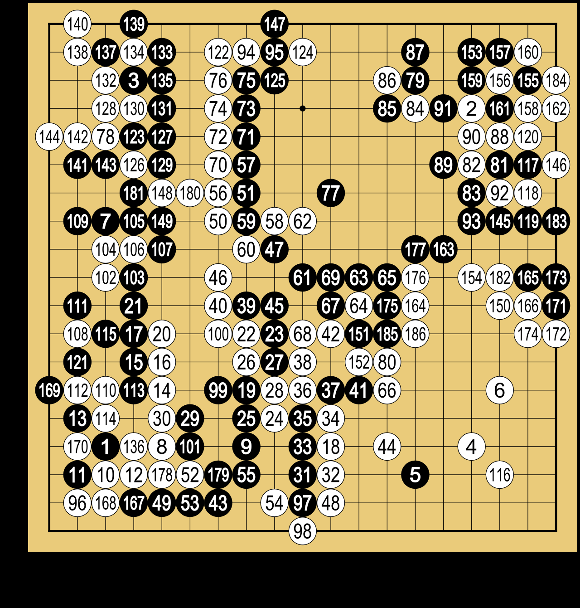

# 11. Máquinas que aprendem: a longa estrada da inteligência artificial

> 🗺️ **Neste capítulo:** você conta as fases da inteligência artificial, da proposta de Dartmouth aos grandes modelos de linguagem, e separa o que as fontes mostram do que se diz por aí sobre a IA. · ⏱️ ~55 min

> 🔥 **Aquecimento:** (1) Qual é a diferença entre internet e web? (2) O que é um pacote, na comutação de pacotes?
>
> <details>
> <summary>Ver respostas</summary>
>
> (1) A internet é a infraestrutura de redes ligadas por TCP/IP; a web é um serviço de páginas com hiperlinks que roda nela. (2) Um pedaço numerado da mensagem, enviado separado e remontado no destino.
>
> </details>

## De onde paramos

No capítulo 10 as máquinas passaram a se ligar umas às outras. Este capítulo volta no tempo para acompanhar uma pergunta mais antiga que a ARPANET: uma máquina pode aprender? **A pergunta-guia é: o que mudou, de uma fase da IA para outra, e o que cada fase realmente provou?**

## O teste de Turing e a proposta de Dartmouth

Em 1950 Alan Turing propôs um jogo de imitação. Segundo a *Stanford Encyclopedia of Philosophy*, o teste usa um canal remoto de texto para separar a inteligência de outras faculdades humanas, e não é um jogo em que a máquina imita um homem que imita uma mulher, como alguns leitores supuseram. A enciclopédia também diz que Turing defendia um "fair play for machines": se julgamos que as outras pessoas pensam só pelo que observamos delas, o mesmo critério valeria para as máquinas.

**O teste de Turing é um critério de observação: se, numa conversa por texto, uma pessoa não consegue distinguir a máquina de um ser humano, a máquina passa no teste.**

A expressão "inteligência artificial" aparece no título de um documento de 31 de agosto de 1955, a proposta de um projeto de verão em Dartmouth College, assinada por John McCarthy, Marvin Minsky, Nathaniel Rochester e Claude Shannon. Eles propunham um estudo de dois meses com dez pessoas, no verão de 1956, "on the basis of the conjecture that every aspect of learning or any other feature of intelligence can in principle be so precisely described that a machine can be made to simulate it". O documento dizia que o obstáculo principal não era a capacidade das máquinas, mas "our inability to write programs taking full advantage of what we have".


*Dartmouth Hall, no campus do Dartmouth College, onde foi proposto o projeto de 1956. Foto: Kane5187, domínio público, via Wikimedia Commons.*

> ⚖️ **Fato × interpretação.** É fato que a proposta de 1955 existe e traz a conjectura citada acima. É interpretação dizer que ela "inventou" a IA: o documento é uma proposta de estudo para um verão, e o próprio texto trata a IA como um problema a investigar.

**Erro comum:** achar que o teste de Turing prova que a máquina "pensa". Pela enciclopédia, ele é um critério de observação externa, escolhido justamente para evitar a discussão sobre o que é pensar.

## Os primeiros jogos e o relatório Lighthill

Segundo o CHM, o IBM 701 já rodava em 1953 um programa de damas de Arthur Samuel. Era uma ideia que se repetiria: usar um jogo como campo de prova, porque as regras são claras e o resultado se mede.

Em julho de 1972, Sir James Lighthill entregou ao Science Research Council, do Reino Unido, o relatório *Artificial Intelligence: A General Survey*, encomendado para avaliar um número crescente de pedidos de apoio à pesquisa em IA. O texto diz que as expectativas "have been frequently disappointed" e que o progresso em reconhecimento de fala e em tradução automática era, até então, "very disappointing".

Esse período é chamado, às vezes, de "inverno da IA". O nome é uma interpretação posterior: as fontes consultadas para este capítulo registram o relatório e seu tom crítico, mas não trazem dados sobre cortes de verba, e por isso o livro não afirma que o relatório causou algum.

> 💡 **Analogia: a receita.** Os primeiros programas de IA eram receitas escritas à mão, passo a passo, por pessoas que achavam que bastava escrever regras suficientes. **Onde a analogia falha:** a promessa de Dartmouth ("aprender" ou simular qualquer traço de inteligência) é mais ampla que uma receita; a receita não muda sozinha.

**Erro comum:** achar que o relatório Lighthill "matou" a IA. Ele é uma avaliação de uma pessoa de fora do campo, a pedido do conselho de pesquisa; o que aconteceu depois não está nas fontes deste capítulo.

## Deep Blue: força bruta contra o campeão

Segundo a IBM, em maio de 1997 o Deep Blue foi o primeiro sistema a vencer um campeão mundial de xadrez, Garry Kasparov, num match sob regras de torneio, de seis partidas. A IBM diz que o computador tinha 32 processadores e que avaliava cerca de 200 milhões de posições por segundo; o CHM dá o mesmo número e informa que o Deep Blue ganhou duas partidas, Kasparov uma e três terminaram empatadas.

Pela regra do xadrez de torneio (vitória vale 1 ponto, empate meio ponto), isso dá 2 + 1,5 = 3,5 pontos para o Deep Blue e 1 + 1,5 = 2,5 para Kasparov. ✔ A conta é do livro; as fontes citam as partidas, e não a pontuação.

**Força bruta é resolver um problema examinando um número enorme de possibilidades, em vez de aprender com a experiência.**

A IBM diz que o Deep Blue obteve seu desempenho por "brute force computing power". Ele não "aprendeu" a jogar como as redes neurais que vêm a seguir.

**Erro comum:** achar que o Deep Blue "pensava como uma pessoa". Segundo a IBM, a força dele vinha da quantidade de posições examinadas.

## Aprendizado profundo: a rede de 2012

Uma **rede neural** é um programa organizado em camadas de unidades simples, cujos pesos se ajustam a partir de exemplos. Em 2012 Alex Krizhevsky e colaboradores treinaram uma rede convolucional profunda para classificar 1,3 milhão de imagens do ImageNet em 1.000 classes. No artigo apresentado na NeurIPS, a rede alcançou erros top-1 de 39,7% e top-5 de 18,9%, "considerably better than the previous state-of-the-art results", com 60 milhões de parâmetros e 500.000 neurônios.

**Aprendizado profundo é treinar redes neurais com muitas camadas, que extraem sozinhas, dos dados, os padrões que antes eram escritos à mão.**

Para ter uma noção do tamanho desse resultado, veja uma conta feita para este livro, junto com o intervalo entre os marcos do capítulo:

```python
# Marcos da IA com fonte no capítulo; (+n) = anos desde o marco anterior
marcos = [
    (1955, "Proposta de Dartmouth"),
    (1972, "Relatório Lighthill"),
    (1997, "Deep Blue vence Kasparov"),
    (2012, "Rede convolucional no ImageNet"),
    (2016, "AlphaGo vence Lee Sedol"),
    (2017, "Artigo do Transformer"),
    (2022, "ChatGPT apresentado"),
]
for (a, _), (b, nome) in zip(marcos, marcos[1:]):
    print(f"{b}  (+{b - a:>2})  {nome}")

# Sorteando 5 classes entre 1.000, o erro top-5 seria:
print("Erro top-5 por sorteio:", f"{(1 - 5 / 1000) * 100:.1f}%")
print("Erro top-5 da rede de 2012:", "18.9%")
```

Saída real, rodada ao escrever o capítulo:

```text
1972  (+17)  Relatório Lighthill
1997  (+25)  Deep Blue vence Kasparov
2012  (+15)  Rede convolucional no ImageNet
2016  (+ 4)  AlphaGo vence Lee Sedol
2017  (+ 1)  Artigo do Transformer
2022  (+ 5)  ChatGPT apresentado
Erro top-5 por sorteio: 99.5%
Erro top-5 da rede de 2012: 18.9%
```

Conferência: 2022 − 2017 = 5; 2017 − 2016 = 1; 2016 − 2012 = 4. ✔ Os intervalos ficam mais curtos nos últimos marcos, mas isso mostra só o que este capítulo escolheu listar, e não um ritmo da área. Quanto ao erro: sortear 5 de 1.000 classes acerta a certa com probabilidade 5/1.000, ou seja, erra 99,5% das vezes, e a rede errou 18,9%.

**Erro comum:** achar que 18,9% de erro "é pouco" ou "é muito" sem comparar. O número só diz algo quando comparado com um ponto de referência, como o sorteio (99,5%) ou o melhor resultado anterior.

## AlphaGo: aprender jogando

Segundo a DeepMind, o Go é um jogo muito mais complexo que o xadrez: cerca de 10 elevado a 170 configurações possíveis do tabuleiro. Os melhores programas de Go só chegavam ao nível de amadores humanos. O AlphaGo combinou redes neurais profundas com busca: uma rede, chamada "policy network", escolhe o próximo lance; outra, a "value network", prevê quem vai ganhar. Primeiro ele estudou milhares de partidas de especialistas, depois jogou milhares de vezes contra versões de si mesmo.

Em outubro de 2015 o AlphaGo venceu o campeão europeu Fan Hui por 5 a 0, e em março de 2016 venceu o campeão mundial Lee Sedol por 4 a 1, em Seul, numa disputa que, segundo a DeepMind, mais de 200 milhões de pessoas acompanharam.



*Registro da partida 1 entre Lee Sedol (pretas) e AlphaGo (brancas). Diagrama: Wesalius, CC BY-SA 4.0, via Wikimedia Commons.*

> ⚖️ **Fato × interpretação.** É fato que o AlphaGo venceu Lee Sedol por 4 a 1 em março de 2016. É interpretação dizer que ele "tem criatividade" ou que "entende" o jogo: a página da DeepMind, que é parte interessada, chama o sistema de criativo ao citar jogadores, e o texto dela é uma fonte do projeto, não uma avaliação independente.

**Erro comum:** achar que o AlphaGo é uma versão mais rápida do Deep Blue. Pelas descrições da IBM e da DeepMind, o Deep Blue avaliava posições em grande quantidade, e o AlphaGo aprendeu com partidas, com redes neurais e busca.

## Transformers e IA generativa

Em 12 de junho de 2017, Vaswani e colaboradores enviaram ao arXiv o artigo "Attention Is All You Need". Eles propuseram o **Transformer**, uma arquitetura de rede "based solely on attention mechanisms, dispensing with recurrence and convolutions entirely". Na tarefa de tradução do inglês para o alemão do WMT 2014, o modelo alcançou 28,4 BLEU, e o artigo diz que ele era superior aos anteriores e mais paralelizável, ou seja, exigia bem menos tempo de treinamento.

Em 30 de novembro de 2022 a OpenAI apresentou o **ChatGPT**, um modelo que conversa. Segundo o texto de lançamento, ele foi treinado com aprendizado por reforço a partir de feedback humano (RLHF), com os mesmos métodos do InstructGPT, e podia responder a perguntas de seguimento, admitir erros e recusar pedidos impróprios. Na época, o uso era gratuito, durante uma pré-visualização de pesquisa.

**IA generativa é um sistema que produz conteúdo novo (texto, imagem, som) a partir do que aprendeu com muitos exemplos.**

O mesmo texto de lançamento lista limitações: o ChatGPT "sometimes writes plausible-sounding but incorrect or nonsensical answers", é sensível a pequenas mudanças na formulação da pergunta e pode, numa formulação, dizer que não sabe e, noutra, responder. Isso importa para quem estuda sozinho: uma resposta bem escrita não é prova de que está certa, e vale conferir numa fonte.

> 💡 **Analogia: a receita.** Um modelo de linguagem é um cozinheiro que leu milhões de receitas e escreve uma nova que parece certa. **Onde a analogia falha:** o cozinheiro de verdade prova o prato; o modelo escreve a receita sem saber se ela funciona, e por isso pode errar com firmeza.

> ⚖️ **Fato × interpretação × lenda.**
> **Fato:** o ChatGPT foi apresentado em 30/11/2022, e o texto do lançamento admite respostas plausíveis, porém incorretas.
> **Interpretação:** se esses modelos "entendem" ou "raciocinam". As fontes do capítulo descrevem como foram treinados, não o que se passa dentro deles.
> **Lenda a evitar:** que a IA de hoje é "inteligente como uma pessoa". As fontes do capítulo mostram resultados em tarefas específicas, como jogar, classificar imagens e conversar por texto.

**Erro comum:** achar que o capítulo diz como é a IA hoje. As fontes vão de 2012 a 2024, e o estado da IA em novembro de 2026 não foi verificado aqui; confira a data de qualquer fonte antes de confiar nela.

## De 2023 em diante: o que as fontes abertas mostram

Em 15 de março de 2023 a OpenAI enviou ao arXiv o *GPT-4 Technical Report*. O resumo do artigo descreve o GPT-4 como um modelo multimodal que aceita "image and text inputs" e produz texto, e diz que ele "exhibits human-level performance on various professional and academic benchmarks". O mesmo resumo afirma que o modelo é "less capable than humans in many real-world scenarios". Como o resumo vem da própria empresa, ele é uma fonte do projeto, não uma avaliação independente.

Em 1º de agosto de 2024 entrou em vigor o AI Act, a lei europeia de inteligência artificial. Segundo a Comissão Europeia, ela traz "a risk-based approach": a maioria dos sistemas, como filtros de spam, não tem obrigação nenhuma; chatbots devem informar que o usuário fala com uma máquina; sistemas de alto risco, como os usados em recrutamento, têm requisitos estritos; e o "social scoring" é proibido. A página diz que as regras sobre IA de uso geral passariam a valer 12 meses depois.

> ⚖️ **Fato × interpretação.** É fato que o relatório do GPT-4 e a lei europeia existem, com as datas acima. É interpretação dizer que o GPT-4 é "inteligente como uma pessoa": o resumo do artigo, que é da própria OpenAI, diz "human-level" para certos testes e "less capable than humans" em muitas situações reais.

> ⚠️ **Lacuna declarada.** Este capítulo abriu fontes datadas só de 2023 e 2024. Os marcos de 2025 e 2026 não foram verificados aqui, e o livro não os afirma. Esta parte envelhece rápido: por isso o `review_by` do livro é novembro de 2027.

## 🏋️ Pratique

**1. Exemplo resolvido.** Quantos anos separam a proposta de Dartmouth (1955) do Deep Blue (1997)?

- Dartmouth: 1955.
- Deep Blue: 1997.
- 1997 − 1955 = 42 anos. ✔

**2. Complete.** Ligue cada marco à técnica principal: Deep Blue → ___; AlphaGo → ___; Transformer → ___.

<details>
<summary>Ver resposta</summary>

Deep Blue: força bruta, com busca em cerca de 200 milhões de posições por segundo. AlphaGo: redes neurais profundas (policy e value) combinadas com busca. Transformer: arquitetura baseada só em atenção. Erro comum: dizer que o AlphaGo é apenas "um Deep Blue mais rápido".

</details>

**3. Por conta própria.** Escreva em uma frase cada: (a) o que é o teste de Turing; (b) o que o relatório Lighthill disse sobre o progresso; (c) o que é uma limitação que o texto de lançamento do ChatGPT admite.

<details>
<summary>Ver resposta</summary>

(a) Um critério de observação: numa conversa por texto, a máquina passa se não se distingue de uma pessoa. (b) Que as expectativas tinham sido frequentemente frustradas e que o progresso em fala e tradução era "muito decepcionante". (c) Respostas que soam plausíveis, mas são incorretas ou sem sentido. Erro comum: dizer que o relatório causou cortes de verba, que as fontes do capítulo não trazem.

</details>

**4. Desafio (analisar uma fonte).** O texto sobre o AlphaGo é da própria DeepMind, e o sobre o ChatGPT é da própria OpenAI. Responda em 4 ou 5 linhas: (a) que tipo de fonte é cada um; (b) o que cada um pode provar e o que não pode; (c) que outra fonte você buscaria antes de afirmar algo sobre o que esses sistemas fazem.

<details>
<summary>Ver resposta</summary>

Resposta aberta. Confira com esta rubrica: (1) identificou que são fontes das próprias empresas, de quem tem interesse em destacar o produto; (2) separou o que é descrição técnica e resultado (partidas, treinamento) do que é avaliação ("criativo", "capaz"); (3) propôs uma fonte independente, como o artigo científico revisado, uma avaliação de terceiros ou uma reportagem com dados; (4) não tratou o texto da empresa como balanço neutro.

</details>

## 🧠 Revisão rápida

1. O que o teste de Turing mede?
2. Que conjectura a proposta de Dartmouth faz?
3. Como o Deep Blue ganhou de Kasparov?
4. O que o Transformer dispensou, segundo o artigo de 2017?
5. (Do capítulo 10) O que o TCP/IP permite a redes diferentes?

<details>
<summary>Ver respostas</summary>

1. Se, numa conversa por texto, a máquina pode ser distinguida de uma pessoa. 2. Que qualquer aspecto do aprendizado ou da inteligência pode ser descrito com precisão suficiente para uma máquina simulá-lo. 3. Avaliando cerca de 200 milhões de posições por segundo (força bruta). 4. A recorrência e as convoluções. 5. Ligar-se numa só rede de redes.

</details>

## 🤖 Estude com um tutor de IA

- "Faça-me 5 perguntas, uma de cada vez, sobre o teste de Turing, Dartmouth, Deep Blue, AlphaGo e Transformers. Espere minha resposta antes de comentar e não me dê as respostas antes."
- "Aqui está minha resposta ao exercício [número do exercício]: [minha resposta]. Aponte meus erros sem me dar a solução."

> ➡️ **Próximo passo:** no capítulo 12 você junta as peças do livro e vê para onde apontam as perguntas em aberto.

## 📌 Resumo

| Item | Em uma frase |
| --- | --- |
| Teste de Turing | Critério de observação por texto, proposto em 1950. |
| Dartmouth | Proposta de 31/8/1955 de um estudo de verão sobre inteligência artificial. |
| Relatório Lighthill | Avaliação de julho de 1972 que chamou de decepcionante o progresso em fala e tradução. |
| Deep Blue | Venceu Kasparov em maio de 1997 por força bruta (200 milhões de posições por segundo). |
| Rede de 2012 | Rede convolucional profunda com 18,9% de erro top-5 no ImageNet. |
| AlphaGo | Redes neurais e busca; venceu Lee Sedol por 4 a 1 em março de 2016. |
| Transformer e ChatGPT | Arquitetura de atenção (2017) e modelo de conversa (2022), com limitações admitidas. |
| GPT-4 e AI Act | Relatório de março de 2023 e lei europeia em vigor desde 1/8/2024; 2025–2026 não verificados. |

## 📚 Fontes

- Stanford Encyclopedia of Philosophy, [Alan Turing](https://plato.stanford.edu/entries/turing/), consultado em 28/11/2026.
- J. McCarthy et al., [A Proposal for the Dartmouth Summer Research Project on Artificial Intelligence](http://www-formal.stanford.edu/jmc/history/dartmouth/dartmouth.html), 1955, consultado em 28/11/2026.
- Computer History Museum, [Timeline of Computer History](https://www.computerhistory.org/timeline/computers/), consultado em 27/11/2026, e [1997](https://www.computerhistory.org/timeline/1997/), consultado em 28/11/2026.
- J. Lighthill, [Artificial Intelligence: A General Survey](https://www.chilton-computing.org.uk/inf/literature/reports/lighthill_report/p001.htm), 1972, consultado em 28/11/2026.
- IBM, [Deep Blue](https://www.ibm.com/history/deep-blue), consultado em 27/11/2026.
- A. Krizhevsky et al., [ImageNet Classification with Deep Convolutional Neural Networks](https://papers.nips.cc/paper/2012/hash/c399862d3b9d6b76c8436e924a68c45b-Abstract.html), NeurIPS 2012, consultado em 28/11/2026.
- Google DeepMind, [AlphaGo](https://deepmind.google/research/breakthroughs/alphago/), consultado em 28/11/2026.
- A. Vaswani et al., [Attention Is All You Need](https://arxiv.org/abs/1706.03762), arXiv, 2017, consultado em 28/11/2026.
- OpenAI, [Introducing ChatGPT](https://openai.com/index/chatgpt/), 30/11/2022, consultado em 28/11/2026.
- OpenAI, [GPT-4 Technical Report](https://arxiv.org/abs/2303.08774), arXiv, 2023, consultado em 28/11/2026.
- Comissão Europeia, [AI Act enters into force](https://commission.europa.eu/news/ai-act-enters-force-2024-08-01_en), 1/8/2024, consultado em 28/11/2026.

> 🔁 **Revise hoje:** capítulos 4, 8 e 10

<!-- nav:start -->
---

[◀ Capítulo anterior](10-tudo-conectado-arpanet-web-e-celular.md) · [Mapa do livro](../README.md) · [Próximo capítulo ▶](12-projeto-final-seu-museu-da-computacao.md)
<!-- nav:end -->
