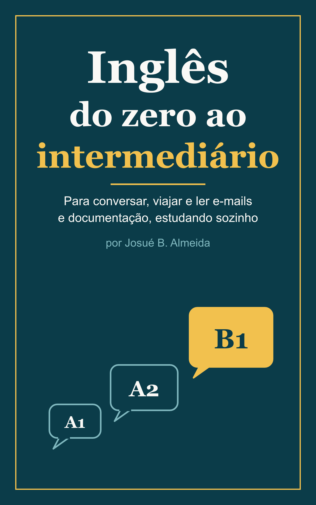

# Inglês do zero ao intermediário

*Para conversar, viajar e ler e-mails e documentação, estudando sozinho*

Para falantes de português que sabem só algumas palavras soltas e querem inglês para o trabalho e para viajar. Ao terminar, você mantém uma conversa simples de 5 minutos sobre trabalho e viagem, escreve e responde um e-mail de trabalho e lê uma página de documentação técnica, no nível B1 do CEFR.

## Comece aqui

- [Como estudar este livro e teste de nivelamento](chapters/00-como-estudar-este-livro.md)
- [Capítulo 1: Hello! Suas primeiras frases](chapters/01-hello-suas-primeiras-frases.md)

## 📇 O livro numa página

![O livro numa página, em 11 cartões: 1. Hello! (am, is, are e I'm, Good evening x Good night, apresentar-se em 30 s); 2. Perguntas e números (Where are you from?, at 5, on Monday, in May, soletrar o e-mail); 3. Rotina e trabalho (só he/she/it levam -s, Does she work...?, always antes do verbo); 4. Viagem I (Could I have... / I'd like, some e any, How much / How many); 5. Agora e depois (I'm working / I'm going to, in, on, at, marcar uma reunião); 6. Passado (-ed e went, wrote, sent, Did you go...?, first, then, finally); 7. E-mails (assunto, saudação, pedido, Could you please...?, I've attached); 8. Documentação (skimming e scanning, Click, Do not, must x should x may); 9. Conversas (I've been to..., bigger than, the best, I agree / I see your point); 10. Imprevistos (I'll check / won't, If it works, I'll call, Could you repeat that?); 11. Projeto final (2 e-mails e 1 resumo, conversa de 5 minutos, autoavaliação B1).](img/c00-o-livro-numa-pagina.svg)

<!-- map:start -->
## 🗺️ Mapa do livro

- [0. Como estudar este livro](chapters/00-como-estudar-este-livro.md)
- [1. Hello! Suas primeiras frases](chapters/01-hello-suas-primeiras-frases.md) · ⏱️ ~60 min
- [2. Perguntas, números e horários](chapters/02-perguntas-numeros-e-horarios.md) · ⏱️ ~60 min
- [3. Minha rotina e meu trabalho](chapters/03-minha-rotina-e-meu-trabalho.md) · ⏱️ ~70 min
- [4. Viagem I: aeroporto, hotel e restaurante](chapters/04-viagem-i-aeroporto-hotel-e-restaurante.md) · ⏱️ ~70 min
- [5. Agora e depois: agenda e planos](chapters/05-agora-e-depois-agenda-e-planos.md) · ⏱️ ~70 min
- [6. Contando o que aconteceu](chapters/06-contando-o-que-aconteceu.md) · ⏱️ ~75 min
- [7. E-mails de trabalho](chapters/07-e-mails-de-trabalho.md) · ⏱️ ~75 min
- [8. Lendo documentação técnica](chapters/08-lendo-documentacao-tecnica.md) · ⏱️ ~75 min
- [9. Conversas mais longas: experiências e opiniões](chapters/09-conversas-mais-longas-experiencias-e-opinioes.md) · ⏱️ ~80 min
- [10. Imprevistos, ligações e videochamadas](chapters/10-imprevistos-ligacoes-e-videochamadas.md) · ⏱️ ~80 min
- [11. Projeto final: uma semana de trabalho no exterior](chapters/11-projeto-final-uma-semana-de-trabalho-no-exterior.md) · ⏱️ ~120 min
- [12. Simulado final](chapters/12-simulado-final.md)
- [13. Glossário](chapters/13-glossario.md)
<!-- map:end -->

## Sobre este livro

> Escrito com IA (Claude) a partir das fontes citadas em cada capítulo. Conferido em 28 de novembro de 2026. Revisão humana: não. Edição 1.0.

Algumas fontes (CEFR Companion Volume, Nation 1996 e dicionários online) não abriram na conferência; os capítulos dizem quais.

## Erratas

Achou um erro? Use o formulário "Report an error" do repositório.

<!-- credit:start -->
📘 *Criado pela skill Claude Syllabook - Joshpcbrrj* · [github.com/Joshpcbrrj/syllabook](https://github.com/Joshpcbrrj/syllabook)
<!-- credit:end -->
