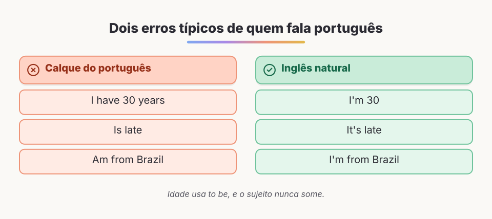
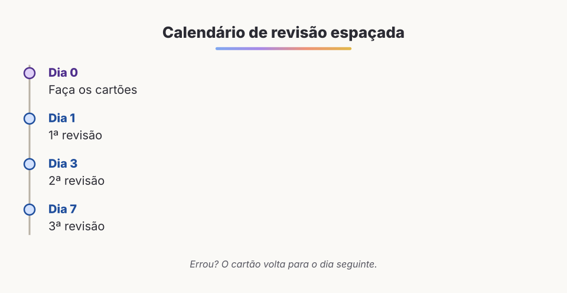

# 1. Hello! Suas primeiras frases

> 🗺️ **Neste capítulo:** você vai aprender o verbo *to be*, os pronomes e os cumprimentos mais comuns, e terminar dizendo em voz alta uma apresentação de 30 segundos (nome, cidade, trabalho) · ⏱️ ~60 min

### 📇 Folha-resumo: parte 1

![Folha-resumo da parte 1: To be (am, is, are, I'm, you're, she's, idade: I'm 30); Pronomes (I, you, he, she, it, we, they, sujeito é obrigatório); Cumprimentos (Good morning, Good evening, Good night é despedida, a ou an pelo som); Revisão espaçada (rever após 1, 3 e 7 dias, cartões com frases inteiras, IPA mais aproximação); Perguntas (palavra + am/is/are + sujeito, What time is it?, Where, When, Who, How); Números e horas (thirteen x thirty, past até a meia hora, to depois, at hora, on dia, in mês); Soletrar (E x I, G x J, A x E, @ é at, . é dot, use example.com); Presente simples (só he/she/it levam -s, -es, -ies, has, /s/, /z/, /ɪz/); Do e does (Does she work...?, verbo volta à forma base, to be não usa do); Frequência (always antes do verbo, depois do to be, never já é negativo).](../img/c00-parte-1-primeiros-passos.svg)

- [1. Hello! Suas primeiras frases](01-hello-suas-primeiras-frases.md)
- [2. Perguntas, números e horários](02-perguntas-numeros-e-horarios.md)
- [3. Minha rotina e meu trabalho](03-minha-rotina-e-meu-trabalho.md)

**Meta do capítulo (CEFR A1):** apresentar-se em voz alta, sem olhar o livro, em cerca de 30 segundos.

## Comece pelo resultado

Leia este texto curto. Ele foi escrito para o livro, e você já entende quase tudo por causa das palavras parecidas com o português.

> **Lucy:** Hello! I'm Lucy. What's your name?
> **Bruno:** Hi, Lucy. I'm Bruno. Nice to meet you.
> **Lucy:** Nice to meet you, too. Where are you from?
> **Bruno:** I'm from São Paulo. And you?
> **Lucy:** I'm from Manchester. I'm an engineer.
> **Bruno:** I'm a developer. How are you today?
> **Lucy:** I'm fine, thanks. And you?
> **Bruno:** Fine, thanks!

Em 8 falas, há 5 frases que você já pode reaproveitar amanhã: *I'm ...*, *Nice to meet you*, *Where are you from?*, *I'm from ...*, *I'm a ...*. O resto do capítulo explica por que elas funcionam.

## O verbo *to be*

Em português, usamos dois verbos para dizer quem somos e como estamos: **ser** e **estar** ("sou Bruno", "estou bem"). O inglês usa um só: ***to be***. Ele resolve o problema de dizer **quem é**, **de onde é**, **qual é a profissão** e **como está**.

**No presente, *to be* tem três formas: *am*, *is* e *are*, e a escolha depende do sujeito.**

| Sujeito | Forma | Forma curta (fala e e-mail informal) | Tradução |
| --- | --- | --- | --- |
| I | am | I'm | eu sou / eu estou |
| you | are | you're | você é / você está (ou vocês) |
| he | is | he's | ele é / ele está |
| she | is | she's | ela é / ela está |
| it | is | it's | isso é / isso está |
| we | are | we're | nós somos / estamos |
| they | are | they're | eles / elas são / estão |

A **forma curta** (contração) é a que se ouve quase sempre. Use **I'm** em vez de *I am* na fala, e guarde a forma completa para quando quiser dar ênfase.

Para negar, acrescente ***not***: *I'm not a teacher*; *she isn't here*; *they aren't from Brazil*. Para perguntar, **inverta**: *You are from Recife.* → ***Are you*** *from Recife?*

> ⚠️ **Erro comum de quem fala português:** dizer "*I have 30 years*" para a idade. Em português, "tenho 30 anos"; em inglês, a idade usa *to be*: ***I'm 30*** (ou *I'm 30 years old*). Outro erro típico é omitir o sujeito: em português, "Está chovendo" funciona sem sujeito, mas em inglês o sujeito é obrigatório: ***It's*** *raining*.

### O que uma frase com *to be* diz

Uma frase com *to be* sempre diz uma destas coisas:

| O que você diz | Modelo |
| --- | --- |
| nome | I'm Ana. / My name is Ana. |
| origem | I'm from Recife. |
| profissão | I'm a developer. |
| idade | I'm 30. |
| como está | I'm fine. |

## Pronomes pessoais

Em português, o verbo já mostra a pessoa ("falo", "fala"), e muitas vezes cortamos o *eu* e o *ele*. Em inglês, o verbo quase não muda de forma, então **o sujeito precisa aparecer na frase**.

**Pronome pessoal (*subject pronoun*) é a palavra que faz o papel de sujeito: *I, you, he, she, it, we, they*.**

- ***you*** vale para uma pessoa ou para várias: não existe "tu" e "vocês" separados.
- ***it*** é para coisas, animais e situações (*It's late*, *It's a laptop*). Não use *he* ou *she* para objetos.
- ***I*** é sempre maiúsculo, mesmo no meio da frase.

| Português | Inglês |
| --- | --- |
| (Eu) Sou engenheira. | **I'm** an engineer. |
| (Ele) Está em casa. | **He's** at home. |
| É tarde. | **It's** late. |

> ⚠️ **Erro comum:** escrever "*Is late*" ou "*Am from Brazil*". Se falta o sujeito, a frase está incompleta em inglês.

## Cumprimentos e apresentação

Cumprimentos são **blocos prontos** (*chunks*): você os aprende inteiros, como se fossem uma palavra só. Isso é mais rápido do que montar cada frase palavra por palavra.

| Situação | Bloco | Resposta comum |
| --- | --- | --- |
| Chegando de manhã | Good morning. | Good morning. |
| Depois do meio-dia | Good afternoon. | Good afternoon. |
| No fim do dia | Good evening. | Good evening. |
| Informal | Hello. / Hi. | Hi. / Hello. |
| Perguntando como está | How are you? | Fine, thanks. And you? |
| Conhecendo alguém | Nice to meet you. | Nice to meet you, too. |
| Despedindo-se | Goodbye. / Bye. / See you. | See you. |
| Despedindo-se à noite | Good night. | Good night. |

> ⚠️ **Erro comum:** usar ***Good night*** para dizer "boa noite" ao chegar. Em inglês, *Good night* é **só despedida** (ou antes de dormir). Para cumprimentar à noite, use *Good evening*.

**Sua apresentação de 30 segundos** tem quatro partes, cada uma uma frase curta:

1. *Hello! I'm [seu nome].*
2. *I'm from [sua cidade].*
3. *I'm a [sua profissão].* (use *an* antes de som de vogal: *an engineer*, *an analyst*)
4. *I work at [empresa]. / I live in [cidade].*

> 💬 *I work at* e *I live in* são blocos prontos por enquanto. Você vai entender como o verbo funciona no capítulo 3; aqui, basta repetir o bloco.

Exemplo completo (cerca de 15 segundos falados devagar):

> Hello! I'm Ana Lima. I'm from Recife. I'm a data analyst. I work at a small company. Nice to meet you.

A regra do *a/an* depende do **som**, não da letra: ***an** hour* (o *h* é mudo), ***a** university* (começa com som de "iu").

## Como ler a pronúncia

O inglês não se lê como se escreve. Por isso, este livro mostra a pronúncia de duas formas:

- **IPA** (Alfabeto Fonético Internacional): símbolos entre barras, como /həˈloʊ/. Os dicionários usam esse alfabeto, então vale se acostumar.
- **Aproximação em português**, entre aspas: "hê-LÔU". É uma aproximação, não o som exato.

A sílaba que recebe a força vem marcada com **ˈ** no IPA e em MAIÚSCULAS na aproximação.

| Palavra | IPA (inglês americano) | Aproximação |
| --- | --- | --- |
| hello | /həˈloʊ/ | "hê-LÔU" |
| name | /neɪm/ | "nêim" |
| nice to meet you | /naɪs tə miːt juː/ | "náis tu mít iu" |
| thanks | /θæŋks/ | "thênks" (veja abaixo) |
| engineer | /ˌendʒɪˈnɪr/ | "endji-NÍR" |
| developer | /dɪˈveləpər/ | "di-VÉ-lo-per" |

Três atenções para quem fala português:

1. **Sem vogal extra no fim.** Não diga "nêimi" ou "frômi": termine na consoante (*name*, *from*).
2. ***th* em *thanks*:** coloque a ponta da língua entre os dentes e solte o ar. Não é "t", "f" nem "s". O "th" escrito em português serve de pista, não de som: treine ouvindo.
3. ***h* em *hello*:** é um sopro leve, mais fraco que o "rr" de "carro".

> 🎧 O livro não toca som. Para ouvir cada palavra, procure-a em um dicionário online com áudio (como o Cambridge Dictionary) e escolha a versão britânica ou a americana; escolha uma e fique com ela por enquanto. O British Council também tem [áudios de nível A1](https://learnenglish.britishcouncil.org/free-resources/listening/a1) gratuitos. Você também pode pedir a um tutor de IA com voz que fale as frases devagar.

## Como montar sua revisão espaçada

Você vai esquecer parte do que aprender. Isso é normal. O que ajuda é **rever no momento certo**, antes de esquecer de vez.

**Revisão espaçada é rever o mesmo conteúdo em intervalos cada vez maiores.** Pesquisas sobre aprendizado de segunda língua mostram que o espaçamento ajuda, e que intervalos maiores tendem a ser melhores quando o teste é depois de dias (meta-análise de Kim e Webb, 2022; veja as fontes). A maior parte dessas pesquisas foi feita em laboratório e em sala de aula, não com quem estuda sozinho, então trate o método como uma boa aposta, não como garantia.

**Como fazer, sem aplicativo:**

1. Pegue cartões de papel (ou papéis dobrados). De um lado, a frase em português; do outro, em inglês.
2. Escreva **frases completas**, não palavras soltas: *I'm from Recife.*, não só *from*.
3. Revise os cartões **no dia seguinte**, **depois de 3 dias** e **depois de 7 dias**.
4. Leia o lado do português e **diga a frase em inglês em voz alta** antes de virar o cartão. Se acertou, o cartão avança para o próximo prazo. Se errou, volte para o dia seguinte.

> 💡 **Analogia:** pense em uma trilha no mato. Se você passa uma vez, a grama volta a crescer. Se passa de novo antes de a trilha sumir, ela fica mais marcada e dura mais. Se você passa a cada dia por uma semana, a trilha fica quase permanente.
> **Pares:** a trilha é a memória da frase; passar de novo é rever; a grama crescendo é o esquecimento.
> **Onde a analogia falha:** a memória não some de forma regular como a grama, e recuperar a frase *sem olhar* ajuda mais do que reler.

Faça os seus 8 primeiros cartões agora, com as frases do diálogo: *I'm Bruno.*, *Nice to meet you.*, *Where are you from?*, *I'm from São Paulo.*, *I'm an engineer.*, *How are you today?*, *I'm fine, thanks.*, *And you?*.

## 🏋️ Pratique

**1. Exemplo resolvido.** Complete com a forma de *to be*: "She ___ from Recife."

Ver resposta

**is**, forma curta *She's*. *She* usa *is*. Quem escreveu *are* misturou com *you/we/they*.

**2. Complete.** Escolha *am*, *is* ou *are*.

a) I ___ a developer.
b) They ___ from Manchester.
c) It ___ late.
d) We ___ fine, thanks.

Ver resposta

a) **am**. *I* é a única pessoa com *am*.
b) **are**. *They* pede *are*.
c) **is**. *It* pede *is*.
d) **are**. *We* pede *are*.

Se você errou, volte à tabela do *to be*: o sujeito decide a forma.

**3. Faça sozinho.** Corrija os erros (cada frase tem um):

a) Have 30 years.
b) Is a nice day.
c) Good night, Lucy! (ao chegar à noite em uma reunião)

Ver resposta

a) **I'm 30.** Idade usa *to be*, e o sujeito é obrigatório.
b) **It's a nice day.** O sujeito *it* não pode faltar.
c) **Good evening, Lucy!** *Good night* só vale como despedida.

**4. Desafio (fala).** Grave com o celular a sua apresentação de 30 segundos (nome, cidade, profissão, onde trabalha). Ouça e confira esta lista:

- [ ] Disse meu nome, minha cidade e minha profissão.
- [ ] Usei *I'm* (não esqueci o sujeito).
- [ ] Usei *a* ou *an* antes da profissão.
- [ ] Não acrescentei vogal no fim das palavras (*name*, *from*).
- [ ] Falei sem olhar o livro.

Repita a gravação até marcar os cinco itens. Depois, faça os cartões da revisão espaçada com as suas frases.

## 🧠 Revisão rápida

1. Que forma de *to be* combina com *we*?
2. Como se diz "tenho 30 anos" em inglês?
3. Por que não se diz *Good night* ao chegar à noite?
4. Qual é a diferença entre *a engineer* e *an engineer*? Qual está certa?

Ver resposta

1. **are** (*we are*, ou *we're*).
2. ***I'm 30*** (ou *I'm 30 years old*).
3. Porque *Good night* é despedida. Para cumprimentar à noite, use *Good evening*.
4. A certa é ***an engineer***: *an* vem antes de som de vogal.

## 🤖 Estude com um tutor de IA

> 💬 **Prompt 1 (conversa):** "Você será minha parceira de conversa em inglês no nível A1. Faça uma pergunta de cada vez sobre meu nome, minha cidade e minha profissão. Espere a minha resposta antes de continuar. Corrija meus erros no fim, explicando em português. Use frases curtas."

> 💬 **Prompt 2 (correção):** "Aqui está a minha apresentação: [minha apresentação em inglês]. Aponte meus erros sem dar a versão corrigida; só diga onde está o erro e por quê. Depois me peça para reescrever."

> ⚠️ A IA pode errar e tende a elogiar demais. Confira o que ela disser com o dicionário e com a lista de checagem do capítulo. Não escreva dados reais da sua empresa nos prompts.

> ➡️ **Próximo passo:** no capítulo 2 você vai fazer perguntas (*what*, *where*, *when*) e aprender números, horas e a soletrar nomes e e-mails.

## 📌 Resumo

| Item | Em uma frase |
| --- | --- |
| *To be* | Um único verbo para "ser" e "estar": *am, is, are*. |
| Forma curta | *I'm, you're, he's, she's, it's, we're, they're* são as mais usadas. |
| Pronomes | O sujeito é obrigatório em inglês: *I, you, he, she, it, we, they*. |
| Idade | Usa *to be*: *I'm 30*, nunca *I have 30 years*. |
| *Good night* | É despedida; ao chegar à noite, diga *Good evening*. |
| *A/an* | Depende do som da palavra seguinte, não da letra. |
| Pronúncia | IPA e aproximação em português: use ambas, mas ouça a palavra. |
| Revisão espaçada | Rever frases completas após 1, 3 e 7 dias. |

**Você consegue?** Diga em voz alta, sem olhar: seu nome, sua cidade, sua profissão e um cumprimento. Se conseguiu, cumpriu a meta do capítulo.

## 📚 Fontes

- Council of Europe. *CEFR Companion Volume* (2020), descritores de nível A1: https://rm.coe.int/16809ea0d4 (não foi possível abrir em 2026-11-28; sem data de conferência)
- Nation, P. *The four strands of a language course* (1996): https://openaccess.wgtn.ac.nz/articles/journal_contribution/The_four_strands_of_a_language_course/12560387 (não foi possível abrir em 2026-11-28; sem data de conferência)
- Kim, Y. e Webb, S. *The Effects of Spaced Practice on Second Language Learning: A Meta-Analysis* (*Language Learning*, 2022): https://eld.bl.uk/catalog/100152978253_0x000001 (não foi possível abrir em 2026-11-28; sem data de conferência)
- British Council LearnEnglish, áudios A1: https://learnenglish.britishcouncil.org/free-resources/listening/a1 (conferido em 2026-11-28)
- Estudo sobre epêntese vocálica em aprendizes brasileiros: https://repositorioslatinoamericanos.uchile.cl/handle/2250/937107 (não foi possível abrir em 2026-11-28; sem data de conferência)

> 🔁 **Revise hoje:** este é o primeiro capítulo; faça seus 8 cartões e revise-os amanhã.

<!-- nav:start -->
---

[◀ Capítulo anterior](00-como-estudar-este-livro.md) · [Mapa do livro](../README.md) · [Próximo capítulo ▶](02-perguntas-numeros-e-horarios.md)
<!-- nav:end -->
