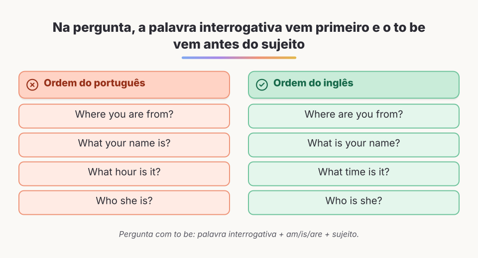
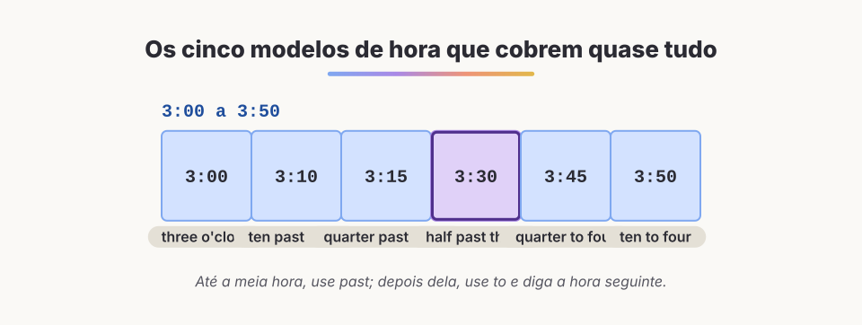

# 2. Perguntas, números e horários

> 🗺️ **Neste capítulo:** você vai aprender a fazer perguntas com *what, where, when, who* e *how*, a dizer números, horas e datas e a soletrar nomes e e-mails, para pedir e dar nome, telefone, e-mail e horário · ⏱️ ~60 min

**Meta do capítulo (CEFR A1):** pedir e dar nome, telefone, e-mail soletrado e horário de uma reunião, em voz alta.

> 🔥 **Aquecimento:** (1) Como se diz "tenho 30 anos" em inglês? (2) Que forma de *to be* combina com *they*?
>
> 

> 
Ver resposta

>
> (1) ***I'm 30.*** (2) ***are*** (*they are*, ou *they're*).
>
> 

## De onde paramos

No capítulo 1 você se apresentou: nome, cidade e profissão. Agora a outra pessoa também quer saber coisas, e você vai querer perguntar. Este capítulo dá as ferramentas para isso: palavras de pergunta, números, horas e o alfabeto para soletrar.

## Comece pelo resultado

Lucy organiza um evento e precisa registrar Bruno. Leia o diálogo, escrito para o livro. Os dados são fictícios.

> **Lucy:** What's your full name?
> **Bruno:** Bruno Souza.
> **Lucy:** How do you spell Souza?
> **Bruno:** S-O-U-Z-A.
> **Lucy:** What's your phone number?
> **Bruno:** It's five five five, oh one four two.
> **Lucy:** And your email?
> **Bruno:** It's bruno dot souza at example dot com. That's B-R-U-N-O, dot, S-O-U-Z-A, at, E-X-A-M-P-L-E, dot, C-O-M.
> **Lucy:** Great. When is the meeting?
> **Bruno:** It's on Thursday, at half past nine.
> **Lucy:** What time is it now?
> **Bruno:** It's a quarter to nine.

Nesse diálogo há **várias perguntas diferentes** e quatro tipos de informação: nome, telefone, e-mail e horário. O resto do capítulo mostra como cada peça funciona.

> 💬 *How do you spell...?* aparece aqui como bloco pronto. O *do* nessa pergunta é o assunto do capítulo 3; por enquanto, repita a frase inteira.

## Perguntas com *what, where, when, who* e *how*

Uma pergunta que começa com palavra interrogativa pede uma **informação**, não apenas "sim" ou "não". Em português, falamos "Onde você mora?" e a ordem é quase a mesma da afirmação. Em inglês, a ordem muda.

**Palavra interrogativa (*wh-word*) é a palavra que abre a pergunta e diz o que você quer saber.** Quase todas começam com *wh-*, e *how* é a exceção que entra no grupo.

| Palavra | Pergunta sobre | Exemplo | Pronúncia (americano) |
| --- | --- | --- | --- |
| *what* | coisa, nome, informação | What's your name? | /wʌt/ ≈ "uát" |
| *where* | lugar | Where are you from? | /wer/ ≈ "uér" |
| *when* | tempo, data | When is the meeting? | /wen/ ≈ "uén" |
| *who* | pessoa | Who is she? | /huː/ ≈ "rú" |
| *how* | modo, estado, idade | How are you? / How old are you? | /haʊ/ ≈ "ráu" |

**Com o verbo *to be*, a ordem é: palavra interrogativa + *am/is/are* + sujeito.**

| Palavra | *to be* | Sujeito | |
| --- | --- | --- | --- |
| Where | **are** | you | from? |
| What | **is** | your phone number | ? |
| Who | **is** | she | ? |
| How | **are** | you | today? |

Na fala, *is* se junta à palavra interrogativa: ***What's*** your name?, ***Where's*** the meeting?, ***Who's*** she?, ***How's*** your day?, ***When's*** the meeting? A resposta curta também usa o sujeito: *It's 555 0142.*

Perguntas que em português usam "quantos anos" ou "que horas" também ganham a sua própria fórmula em inglês: ***How old** are you?* (idade), ***What time** is it?* (hora).

> ⚠️ **Erro comum:** manter a ordem do português: "*Where you are from?*". Em inglês, o *to be* vem **antes** do sujeito. Outro erro: dizer "*What hour is it?*" por causa de "que horas são". Em inglês, pergunta-se ***What time** is it?*.

## Números

Você vai usar números o tempo todo: telefone, preço, idade, quantidade. Os números de 0 a 20 são palavras próprias; depois, a regra é regular.

| 0–10 | 11–20 |
| --- | --- |
| 0 zero (ou *oh*), 1 one, 2 two, 3 three, 4 four, 5 five, 6 six, 7 seven, 8 eight, 9 nine, 10 ten | 11 eleven, 12 twelve, 13 thirteen, 14 fourteen, 15 fifteen, 16 sixteen, 17 seventeen, 18 eighteen, 19 nineteen, 20 twenty |

**Acima de 20, junte a dezena e a unidade com hífen:** 21 *twenty-one*, 34 *thirty-four*, 99 *ninety-nine*. As dezenas são *twenty, thirty, forty, fifty, sixty, seventy, eighty, ninety*. Para centenas e milhares: 100 *one hundred*, 250 *two hundred (and) fifty*, 1.000 *one thousand*. O *and* depois de *hundred* é comum no inglês britânico e costuma ser omitido no americano.

**O par que mais confunde: -teen × -ty.**

| Número | Palavra | IPA (americano) | Força |
| --- | --- | --- | --- |
| 13 | thirteen | /ˌθɜːrˈtiːn/ | no final: thir-**TEEN** |
| 30 | thirty | /ˈθɜːrti/ | no começo: **THIR**-ty |
| 15 | fifteen | /ˌfɪfˈtiːn/ | no final: fif-**TEEN** |
| 50 | fifty | /ˈfɪfti/ | no começo: **FIF**-ty |

Em *-teen*, a sílaba final é longa e forte. Em *-ty*, a força está no começo e o final é curto. O mesmo vale para 14/40, 16/60, 17/70, 18/80 e 19/90.

**Telefone** se diz **dígito por dígito**, em grupos: 555 0142 → *five five five, oh one four two*. Para 0 vale *zero* ou *oh*; as duas formas são aceitas. Em inglês britânico, dois dígitos iguais seguidos costumam virar *double*: 77 → *double seven*.

> ⚠️ **Erro comum:** confundir *thirteen* e *thirty* ao ouvir ou falar. Para evitar mal-entendidos em dados importantes (preço, telefone), repita o número dígito por dígito: "*Thirteen: one, three?*".

## Horas e datas

**Horas.** Pergunte ***What time is it?*** Responda ***It's*** + a hora. Os modelos abaixo cobrem quase todos os casos.

| Hora | Como se diz | Regra |
| --- | --- | --- |
| 3:00 | *It's three o'clock.* | hora cheia: *o'clock* |
| 3:15 | *It's a quarter past three.* | *quarter* = quarto |
| 3:30 | *It's half past three.* | *half* = meia |
| 3:45 | *It's a quarter to four.* | depois da meia hora, *to* + a próxima hora |
| 3:10 | *It's ten past three.* | minutos + *past* |
| 3:50 | *It's ten to four.* | minutos + *to* |

Há uma forma mais simples, que ninguém estranha: **diga os números**. 3:45 vira *three forty-five*; 9:05 vira *nine oh five*. Para perguntar o horário de um evento, use ***What time is the meeting?*** e responda com ***at***: *It's **at** half past nine.*

Para saber **a que horas** algo acontece, a preposição é *at* (*at nine*). Para dia da semana, *on* (*on Thursday*). Para mês, *in* (*in March*).

A.M. e P.M. servem para a manhã (*a.m.*) e para a tarde e a noite (*p.m.*): *9 a.m.*, *6 p.m.* Horários de transporte, como no aeroporto, costumam aparecer em 24 horas, mas se falam do mesmo jeito: 14:30 → *two thirty*; 18:45 → *six forty-five* (ou *a quarter to seven*).

> ⚠️ **Erro comum:** pronunciar o *h* de ***hour*** e ***honest***. Nessas palavras o *h* é mudo: *hour* /aʊər/ ≈ "áuer" e *honest* /ˈɑːnɪst/ ≈ "ÔNest". E lembre que *an hour* usa *an*, como no capítulo 1.

**Datas.** Os meses são *January, February, March, April, May, June, July, August, September, October, November* e *December*, sempre com letra maiúscula. Os dias da semana também: *Monday, Tuesday, Wednesday, Thursday, Friday, Saturday, Sunday*.

A data usa **numeral ordinal** (*first, second...*), não o cardinal:

| Número | Ordinal | Número | Ordinal |
| --- | --- | --- | --- |
| 1º | first | 5º | fifth |
| 2º | second | 12º | twelfth |
| 3º | third | 20º | twentieth |
| 4º | fourth | 21º | twenty-first |

Do 4º em diante, a regra: acrescente *-th*, exceto nos três primeiros (*first, second, third*), em *twelfth* e em *twentieth*. Escrevendo, abrevia-se: 1st, 2nd, 3rd, 4th, 12th, 21st.

Em **inglês americano**, a data fala-se mês + dia (*March twelfth*). Em **inglês britânico**, o dia vem antes (*the twelfth of March*). Pergunta: ***What's the date today?*** ou ***When is the meeting?***; resposta: ***It's on Thursday, March 12th.*** (Em 2026, 12 de março cai numa quinta-feira, como no exemplo.)

> ⚠️ **Cuidado com 03/04:** nos Estados Unidos, significa 4 de março; no Reino Unido e no Brasil, 3 de abril. Em e-mail e documento de trabalho, **escreva o mês por extenso** (*3 April*, *April 3*) para não haver dúvida.

## O alfabeto e como soletrar

Você precisa soletrar quando dita nome, e-mail ou código, e quando alguém não entende. Em inglês, o alfabeto tem 26 letras, e **o nome das letras é diferente do português**.

| Letra | Nome (americano) | Aproximação | Letra | Nome | Aproximação |
| --- | --- | --- | --- | --- | --- |
| A | /eɪ/ | "êi" | N | /en/ | "én" |
| B | /biː/ | "bí" | O | /oʊ/ | "ôu" |
| C | /siː/ | "sí" | P | /piː/ | "pí" |
| D | /diː/ | "dí" | Q | /kjuː/ | "quiú" |
| E | /iː/ | "í" | R | /ɑːr/ | "ár" |
| F | /ef/ | "éf" | S | /es/ | "és" |
| G | /dʒiː/ | "djí" | T | /tiː/ | "tí" |
| H | /eɪtʃ/ | "êitch" | U | /juː/ | "iú" |
| I | /aɪ/ | "ái" | V | /viː/ | "ví" |
| J | /dʒeɪ/ | "djêi" | W | /ˈdʌbəl juː/ | "dâbliu" |
| K | /keɪ/ | "quêi" | X | /eks/ | "écs" |
| L | /el/ | "él" | Y | /waɪ/ | "uái" |
| M | /em/ | "ém" | Z | /ziː/ | "zí" |

No inglês britânico, o Z se diz /zed/ ("zéd"). As duas formas estão certas.

**Pares que confundem brasileiros** (porque a letra em português tem outro nome): **E** × **I** ("í" × "ái"), **G** × **J** ("djí" × "djêi") e **A** × **E** ("êi" × "í"). Treine em voz alta: *E-I-A, G-J-E*.

Para e-mails e sites, aprenda estas palavras:

| Símbolo | Como se diz |
| --- | --- |
| @ | *at* |
| . | *dot* |
| - | *dash* (ou *hyphen*) |
| _ | *underscore* |

Exemplo: `ana.lima@example.com` → *ana dot lima at example dot com*. Para pedir a soletração: ***Could you spell that, please?*** ou ***How do you spell that?*** Para confirmar: ***Is that S as in sugar?***, e a outra pessoa responde *Yes* ou corrige.

> 🔎 **Para ir além:** muitos profissionais soletram com palavras-código (*A as in apple*). Existe também um alfabeto fonético internacional de rádio e aviação (*Alpha, Bravo, Charlie...*). Não é necessário agora; se quiser, procure a lista oficial antes de decorar.

> ⚠️ **Erro comum:** soletrar com os nomes das letras do português. Você dita "ê-mi-pê-éli-i" e a pessoa do outro lado entende "M-P-L-E" errado. Pratique o alfabeto inglês até soletrar o seu nome sem pensar.

## 🏋️ Pratique

**1. Exemplo resolvido.** Faça a pergunta: "Onde ele está?" (*where*, *he*, *to be*).

Ver resposta

***Where is he?***, ou ***Where's he?***. Ordem: palavra interrogativa + *is* + sujeito. Quem escreveu *Where he is?* manteve a ordem do português.

**2. Complete.** Escreva a pergunta com a palavra certa (*what, where, when, who, how*):

a) ___ is your phone number?
b) ___ is the meeting? (em que horário/dia)
c) ___ are you from?
d) ___ is she? (a pessoa)
e) ___ old are you?

Ver resposta

a) **What**. Pede uma informação.
b) **When** (dia e data) ou **What time** (hora). As duas estão certas, conforme a informação que você quer.
c) **Where**. Pede um lugar.
d) **Who**. Pede uma pessoa.
e) **How**. *How old* pergunta a idade.

**3. Faça sozinho.** Diga em voz alta e escreva por extenso:

a) 13 e 30
b) 8:15 e 8:45
c) 3rd e 12th
d) o telefone 555 0187

Ver resposta

a) *thirteen* (força no final) e *thirty* (força no começo).
b) *a quarter past eight* e *a quarter to nine*. Depois da meia hora, usa-se a hora seguinte.
c) *third* e *twelfth*. O *twelfth* é irregular: o *v* de *twelve* some.
d) *five five five, oh one eight seven* (ou *zero*).

Se errou o item b, olhe a tabela de horas: até 30 minutos, *past*; depois disso, *to*.

**4. Soletre.** Soletre em voz alta o seu nome e um e-mail de exemplo, `maria.silva@example.com`. Escreva como falaria.

Ver resposta

*maria dot silva at example dot com*. Soletrado: *M-A-R-I-A, dot, S-I-L-V-A, at, E-X-A-M-P-L-E, dot, C-O-M*. Atenção ao *I* (/aɪ/ "ái") e ao *A* (/eɪ/ "êi"), que não são os nomes do português.

**5. Desafio (fala e escrita).** Grave com o celular uma conversa de 30 segundos em que você faz as perguntas do diálogo (nome, soletração, telefone, e-mail, horário da reunião) e responde com **dados fictícios**. Depois, escreva a conversa. Confira:

- [ ] Fiz as cinco perguntas com a ordem certa (*palavra + to be + sujeito*).
- [ ] Soletrei com os nomes das letras em inglês.
- [ ] Disse o telefone dígito por dígito.
- [ ] Usei *at* para a hora e *on* para o dia.
- [ ] Falei sem ler.

**Fluência:** repita a gravação **três vezes**, cada vez mais rápido e mais curto (por exemplo: 30 s, 25 s, 20 s), sem perder a ordem das palavras. Depois, faça os cartões deste capítulo.

## 🧠 Revisão rápida

1. Qual é a ordem de uma pergunta com *to be* e palavra interrogativa?
2. Como se diz 14 e 40, e onde está a força de cada um?
3. Como se diz 7:50?
4. Como se soletra *bruno@example.com*?
5. (Capítulo 1) Que forma de *to be* combina com *I*, e por que não se diz *Have 30 years*?

Ver resposta

1. Palavra interrogativa + *am/is/are* + sujeito (*Where are you from?*).
2. *fourteen* (força no final) e *forty* (força no começo).
3. *It's ten to eight* (ou *seven fifty*).
4. *B-R-U-N-O, at, E-X-A-M-P-L-E, dot, C-O-M*.
5. ***am***. E a idade usa *to be*: ***I'm 30***.

## 🤖 Estude com um tutor de IA

> 💬 **Prompt 1 (conversa):** "Você será o atendente de uma recepção de evento e eu serei o participante. Estou no nível A1. Peça meu nome, a soletração, o telefone, o e-mail e o horário da reunião, uma pergunta de cada vez. Espere a minha resposta. Use só dados fictícios, com e-mails do domínio example.com. No fim, aponte meus erros e explique em português."

> 💬 **Prompt 2 (correção):** "Aqui está a minha conversa de recepção: [minha conversa em inglês]. Aponte meus erros de ordem de pergunta, de número e de hora sem dar a versão corrigida; diga só onde está o erro e por quê. Depois me peça para reescrever."

> ⚠️ A IA pode errar e tende a elogiar demais. Confira com o dicionário e com as listas do capítulo. Não escreva telefones nem e-mails reais seus ou de clientes nos prompts.

> ➡️ **Próximo passo:** no capítulo 3 você vai usar o presente simples para falar da sua rotina e do seu trabalho, e vai entender o *do/does* que apareceu em *How do you spell...?*.

## 📌 Resumo

| Item | Em uma frase |
| --- | --- |
| Pergunta com *to be* | Palavra interrogativa + *am/is/are* + sujeito: *Where are you from?* |
| *What time* | É assim que se pergunta a hora; *What hour* não existe nesse uso. |
| -teen × -ty | *thirteen* tem força no final; *thirty*, no começo. |
| Telefone | Dígito por dígito; 0 é *zero* ou *oh*. |
| Hora | *past* até a meia hora, *to* depois; ou diga os números. |
| *at / on / in* | *at* para hora, *on* para dia da semana, *in* para mês. |
| Data | Usa ordinais (*first, second, third*); EUA: mês + dia; Reino Unido: dia + mês. |
| Soletrar | O nome das letras em inglês é outro; E/I, G/J e A/E confundem. |
| E-mail | *@* = *at*, *.* = *dot*; use sempre *example.com* em exercícios. |

**Você consegue?** Sem olhar, pergunte nome, telefone e e-mail de alguém, soletre o seu nome e diga a hora de uma reunião. Se conseguiu, cumpriu a meta do capítulo.

## 📚 Fontes

- Council of Europe. *CEFR Companion Volume* (2020), descritores de nível A1: https://rm.coe.int/16809ea0d4 (não foi possível abrir em 2026-11-28; sem data de conferência)
- British Council LearnEnglish, áudios A1: https://learnenglish.britishcouncil.org/free-resources/listening/a1 (conferido em 2026-11-28)

> 🔁 **Revise hoje:** capítulo 1 (seus cartões de 1, 3 e 7 dias).

<!-- nav:start -->
---

[◀ Capítulo anterior](01-hello-suas-primeiras-frases.md) · [Mapa do livro](../README.md) · [Próximo capítulo ▶](03-minha-rotina-e-meu-trabalho.md)
<!-- nav:end -->
