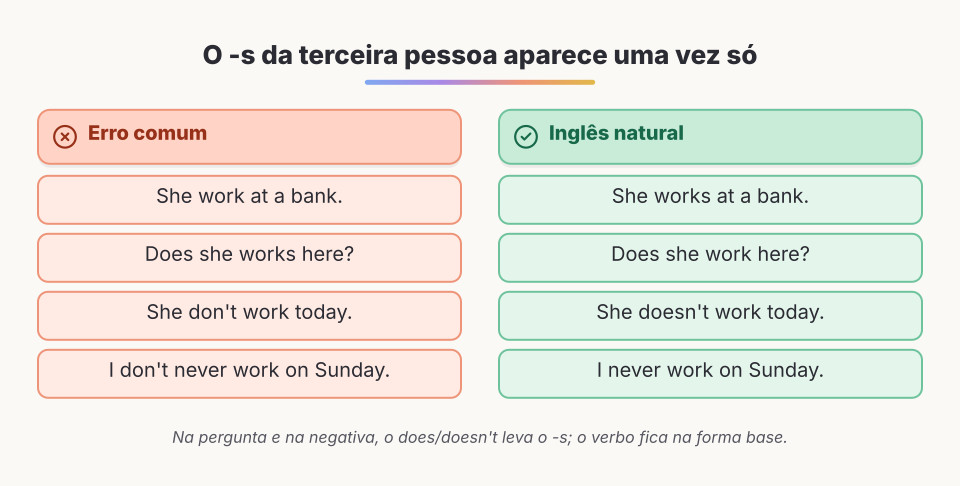
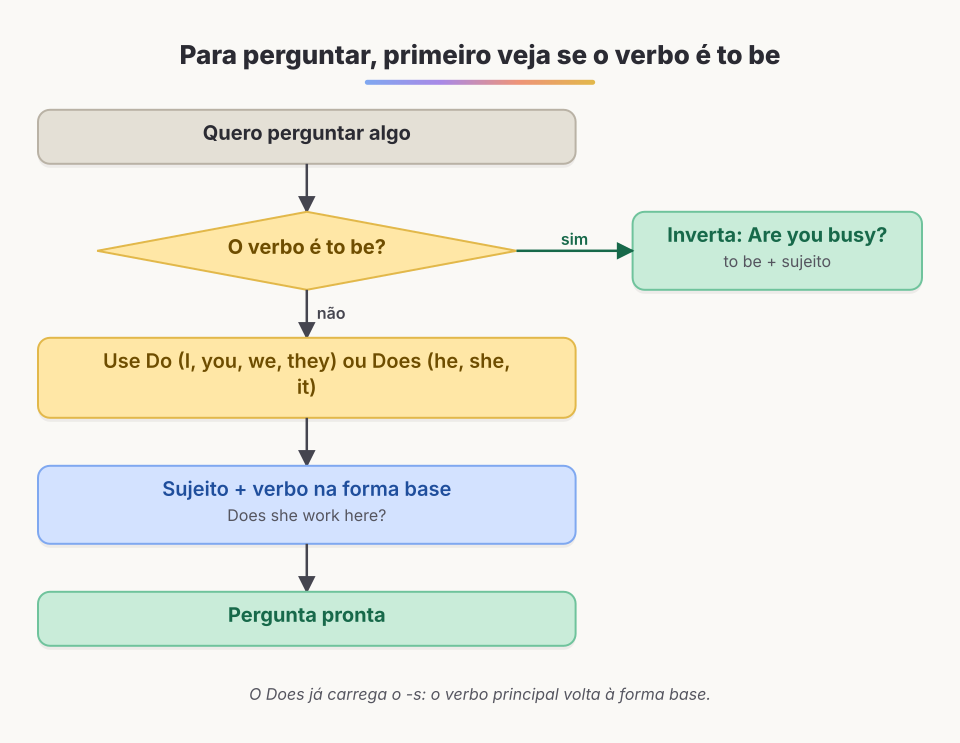

# 3. Minha rotina e meu trabalho

> 🗺️ **Neste capítulo:** você vai usar o presente simples (*I work, she works*), o *do/does* em perguntas e negativas e os advérbios de frequência para descrever a sua rotina e a sua função no trabalho em 6 frases · ⏱️ ~70 min

**Meta do capítulo (CEFR A1/A2):** descrever, em voz alta e por escrito, a sua rotina e a sua função no trabalho em 6 frases.

> 🔥 **Aquecimento:** (1) Como se pergunta de onde alguém é, e por que *Where you are from?* está errado? (2) Como se diz 8:45?
>
> 

> 
Ver resposta

>
> (1) ***Where are you from?*** A ordem é palavra interrogativa + *to be* + sujeito. (2) ***It's a quarter to nine*** (ou *eight forty-five*).
>
> 

## De onde paramos

No capítulo 2 você perguntou nome, telefone e horário, e usou *How do you spell...?* como bloco pronto. Agora vamos abrir esse bloco: o *do* faz parte da forma de perguntar sobre **hábitos e fatos**, e é com ele que você vai falar do seu trabalho.

## Comece pelo resultado

Leia este texto escrito para o livro. Lucy descreve a rotina dela em 6 frases.

> I'm Lucy. I work at a software company in Manchester. I usually start work at nine. My manager always sends the agenda the day before. I often have meetings in the morning. I never work on Sundays.

Repare em três detalhes: *work* (sem -s) com *I*, ***sends*** (com -s) com *my manager*, e palavras como *usually*, *always*, *often* e *never* no meio da frase. O capítulo explica cada um.

## O presente simples

Você usa o presente simples (*simple present*) para falar de **hábitos** (*I start work at nine*), **fatos** (*She works in a bank*) e **rotinas**. É o tempo da sua apresentação profissional.

**No presente simples, o verbo fica na forma base (*work, start, live*), e só *he, she* e *it* levam um -s no verbo (*works, starts, lives*).**

| Sujeito | Verbo *work* | Verbo *study* |
| --- | --- | --- |
| I | work | study |
| you | work | study |
| he / she / it | **works** | **studies** |
| we | work | study |
| they | work | study |

Em português, todas as pessoas mudam de terminação (*trabalho, trabalha, trabalhamos*). Em inglês, só uma pessoa muda. Por isso, esquecer o -s de *he/she/it* é um erro muito comum entre brasileiros. Em geral, a pessoa ainda é entendida, mas a frase soa descuidada.

**Como escrever o -s:**

| Se o verbo termina em... | Faça | Exemplo |
| --- | --- | --- |
| a maioria dos verbos | + **-s** | work → works, start → starts, live → lives |
| -s, -sh, -ch, -x, -z, -o | + **-es** | watch → watches, fix → fixes, go → goes |
| consoante + **y** | tire o y e ponha **-ies** | study → studies, try → tries |
| vogal + **y** | + **-s** | play → plays, say → says |
| *have* | irregular: **has** | she has two meetings |

**Como pronunciar o -s:** são três sons.

| Som | Quando | Exemplo | Aproximação |
| --- | --- | --- | --- |
| /s/ | depois de /p t k f/ | works /wɜːrks/ | "uérks" |
| /z/ | depois de vogal e dos demais sons vozeados | plays /pleɪz/ | "plêiz" |
| /ɪz/ | depois de s, z, sh, ch, j | watches /ˈwɑːtʃɪz/ | "UÓ-tchiz" |

Só no terceiro caso o -s vira uma sílaba extra. Nos outros, não coloque vogal depois: diga "uérks", não "uérkis".

> 💡 **Analogia:** o -s da terceira pessoa é como o **crachá de visitante** de um prédio: quem entra com *he, she* ou *it* precisa de um crachá, e só existe um por pessoa. Se a frase tem *does*, o crachá fica com o *does*, e o verbo principal fica sem crachá.
> **Pares:** *he/she/it* é o visitante; o -s é o crachá; *does* e o verbo principal são as duas pessoas que poderiam usar o crachá, mas ele só pode estar em uma.
> **Onde a analogia falha:** o -s não existe por segurança, é uma regra da língua; a imagem serve para lembrar que o -s não aparece duas vezes.

> ⚠️ **Erro comum:** esquecer o -s (*She work at a bank*) ou colocar o -s em tudo (*I works*). Antes de falar a frase, pergunte: o sujeito é *he, she* ou *it*? Então o verbo leva -s.

## *Do* e *does* em perguntas e negativas

Em português, perguntamos só mudando a entonação: "Você trabalha aqui?". Em inglês, o verbo principal fica parado, e **um verbo auxiliar** faz o trabalho de dar o tempo e a pessoa.

**Verbo auxiliar (*auxiliary verb*) é o verbo que ajuda o principal a formar perguntas e negativas; no presente simples, ele é *do* (ou *does*).**

| Para... | Com *I, you, we, they* | Com *he, she, it* |
| --- | --- | --- |
| Afirmar | I work here. | She works here. |
| Perguntar | **Do** you work here? | **Does** she work here? |
| Negar | I **don't** work here. | She **doesn't** work here. |
| Resposta curta | Yes, I **do**. / No, I **don't**. | Yes, she **does**. / No, she **doesn't**. |

*Don't* = *do not*; *doesn't* = *does not*. O que importa: **depois de *do/does/don't/doesn't*, o verbo volta para a forma base**, sem -s. O -s da terceira pessoa já está no *does*.

Com palavra interrogativa, a palavra vem primeiro: ***What time does** the meeting start?*, ***Where do** you work?*, ***How do** you spell that?* (o bloco do capítulo 2).

**Exceção importante: *to be* não usa *do/does*.** Fica *Are you busy?*, nunca *Do you are busy?*; e *I'm not busy*, nunca *I don't am busy*. O mesmo vale para as perguntas do capítulo 2.

> ⚠️ **Erro comum:** *Does she works here?*, com o -s duas vezes, ou *She don't work today.* O -s fica só no *does/doesn't*.

## Advérbios de frequência

Para dizer **com que frequência** você faz algo, use um advérbio de frequência (*adverb of frequency*).

| Advérbio | Frequência | Exemplo |
| --- | --- | --- |
| always | 100% das vezes | I always check my email. |
| usually | quase sempre | She usually starts at nine. |
| often | muitas vezes | We often have meetings. |
| sometimes | às vezes | I sometimes work from home. |
| rarely | quase nunca | He rarely arrives late. |
| never | nunca | They never work on Sundays. |

(As frequências são aproximações para você se orientar, não porcentagens oficiais.)

**A posição é fixa: antes do verbo principal e depois do verbo *to be*.**

- Com verbo comum: *She **always** arrives early.* (antes de *arrives*)
- Com *to be*: *She is **always** late.* (depois de *is*)

*Sometimes* também pode abrir ou fechar a frase: *Sometimes I work late.*

***Never* já é negativo.** Não use *don't* junto: *I **never** work on Sundays*, nunca *I don't never work*.

> ⚠️ **Erro comum:** pôr o advérbio no lugar errado, como *I check always my email*. O advérbio fica entre o sujeito e o verbo.

## Profissões e lugares de trabalho

Para falar do trabalho, você precisa de alguns substantivos e de quatro pequenas palavras de lugar.

| Palavra | Significado |
| --- | --- |
| developer, engineer, analyst, designer | desenvolvedor, engenheiro, analista, designer |
| manager, team, client | gerente, equipe, cliente |
| meeting, deadline, schedule | reunião, prazo, agenda (de horários) |
| report, project, task | relatório, projeto, tarefa |

Cuidado: em inglês, *agenda* é a **pauta** de uma reunião, não a agenda de horários (*schedule*).

**As quatro preposições do trabalho:**

| Preposição | Para... | Exemplo |
| --- | --- | --- |
| **at** | a empresa (como lugar) | I work **at** a small company. |
| **in** | área, departamento ou cidade | I work **in** IT. / She works **in** Recife. |
| **for** | quem emprega | He works **for** a bank. |
| **on** | o projeto ou a tarefa | We work **on** a new app. |

Em português, você diz "trabalho com software". Em inglês, *I work with software* existe e está correto; para dizer a **área**, o mais natural é *I work **in** IT*.

> ⚠️ **Erro comum:** dizer *I am working at...* para falar do trabalho de sempre. Para hábitos e fatos, use o presente simples: *I work at...*.

## 🏋️ Pratique

**1. Exemplo resolvido.** Complete com o verbo certo: "Bruno ___ (work) at a bank."

Ver resposta

**works**. *Bruno* equivale a *he*, então leva -s. Quem escreveu *work* esqueceu o crachá da terceira pessoa.

**2. Complete.** Escreva a forma certa do verbo:

a) She ___ (study) English every day.
b) He ___ (watch) the news at night.
c) My team ___ (have) a meeting on Monday.
d) We ___ (go) to the office by bus.
e) They ___ (play) football on Saturdays.

Ver resposta

a) **studies**. Consoante + *y* vira *-ies*.
b) **watches**. Terminação *-ch* pede *-es*.
c) **has**. *Have* é irregular na terceira pessoa. *My team* equivale a *it*.
d) **go**. *We* não leva -s.
e) **play**. *They* não leva -s; e *play* só ganharia *-s* com *he/she/it*.

**3. Complete (pergunta e negativa).** Forme a pergunta ou a negativa:

a) (Pergunta) she / work / on Fridays → ___
b) (Negativa) I / work / on Sundays → ___
c) (Pergunta com palavra) What time / the meeting / start → ___
d) (Pergunta) you / busy → ___

Ver resposta

a) **Does she work on Fridays?**
b) **I don't work on Sundays.**
c) **What time does the meeting start?** O verbo *start* fica na forma base.
d) **Are you busy?** *To be* não usa *do*. Se escreveu *Do you busy?* ou *Do you are busy?*, volte à exceção.

**4. Faça sozinho.** Corrija o erro de cada frase:

a) She work in Recife.
b) Does he works here?
c) I check always my email.
d) I don't never work on Sundays.

Ver resposta

a) **She works in Recife.** Terceira pessoa leva -s.
b) **Does he work here?** O *does* já carrega o -s.
c) **I always check my email.** O advérbio vem antes do verbo principal.
d) **I never work on Sundays.** *Never* já é negativo.

**5. Desafio (fala e escrita).** Escreva e depois grave com o celular a sua rotina e o seu trabalho em **6 frases**, com **dados verdadeiros ou inventados**, mas sem nomes de clientes nem dados da sua empresa. Use pelo menos:

- 2 frases com advérbio de frequência;
- 1 frase com *at*, *in*, *for* ou *on* do trabalho;
- 1 frase com *he/she* sobre um colega ou a sua gerente (para treinar o -s);
- 1 frase negativa com *don't* ou *doesn't*.

Confira:

- [ ] Todas as frases têm sujeito.
- [ ] O -s está nas frases com *he, she* ou *it* (e só nelas).
- [ ] Depois de *don't/doesn't*, o verbo está na forma base.
- [ ] Os advérbios estão antes do verbo (ou depois de *to be*).
- [ ] Falei sem ler, e sem vogal extra no fim das palavras (*works*, não "uérkis").

**Fluência:** grave a fala **três vezes**, cada vez mais rápido e mais curto (por exemplo: 40 s, 30 s, 25 s), mantendo as 6 frases. Depois, faça os cartões do capítulo.

## 🧠 Revisão rápida

1. Quando o verbo leva -s no presente simples?
2. Como se forma a pergunta *Does...*, e qual é a forma do verbo principal?
3. Onde fica o advérbio *always* com um verbo comum? E com *to be*?
4. Qual a preposição para dizer a área em que você trabalha (*IT*)?
5. (Capítulo 2) Como se diz 3:45 e como se soletra *ana@example.com*?

Ver resposta

1. Só com *he, she* e *it*: *works, studies, has*.
2. *Does* + sujeito + verbo na **forma base**: *Does she work here?*.
3. Antes do verbo comum (*She always arrives early*) e depois do *to be* (*She is always late*).
4. ***in***: *I work in IT*.
5. *It's a quarter to four* (ou *three forty-five*); *A-N-A, at, E-X-A-M-P-L-E, dot, C-O-M*.

## 🤖 Estude com um tutor de IA

> 💬 **Prompt 1 (conversa):** "Você será um colega de trabalho novo, e eu estou no nível A1/A2. Pergunte sobre a minha rotina e o meu trabalho em frases curtas, uma pergunta de cada vez, usando *do/does*. Espere a minha resposta. No fim, aponte meus erros e explique em português. Não peça dados reais da minha empresa."

> 💬 **Prompt 2 (correção):** "Aqui estão as minhas 6 frases sobre a minha rotina: [minhas frases em inglês]. Aponte onde errei o -s, o *do/does* ou a posição dos advérbios, sem dar a versão corrigida; diga só onde está o erro e por quê. Depois me peça para reescrever."

> ⚠️ A IA pode errar e tende a elogiar demais. Confira com a lista do capítulo e com um dicionário. Não cole dados de clientes ou da sua empresa nos prompts.

> ➡️ **Próximo passo:** no capítulo 4 você vai viajar: fazer check-in, pedir comida e resolver um pedido simples com *Could I have...?*, *I'd like...* e *some/any*.

## 📌 Resumo

| Item | Em uma frase |
| --- | --- |
| Presente simples | Hábitos e fatos; só *he/she/it* levam -s. |
| Escrever o -s | *-s* na maioria; *-es* depois de s, sh, ch, x, z, o; consoante + y vira *-ies*; *have* vira *has*. |
| Pronunciar o -s | /s/, /z/ ou /ɪz/; só /ɪz/ vira sílaba extra. |
| *Do/does* | Auxiliar da pergunta e da negativa; o verbo principal volta à forma base. |
| *To be* | Não usa *do/does*: *Are you busy?*. |
| Advérbios | Antes do verbo comum, depois do *to be*; *never* já é negativo. |
| Preposições de trabalho | *at* (empresa), *in* (área), *for* (empregador), *on* (projeto). |

**Você consegue?** Diga e escreva 6 frases sobre a sua rotina e o seu trabalho, sem olhar. Se conseguiu, cumpriu a meta do capítulo.

## 📚 Fontes

- Council of Europe. *CEFR Companion Volume* (2020), descritores de nível A1/A2: https://rm.coe.int/16809ea0d4 (não foi possível abrir em 2026-11-28; sem data de conferência)
- British Council LearnEnglish, recursos gratuitos de gramática e prática: https://learnenglish.britishcouncil.org/getting-started (conferido em 2026-11-28)

> 🔁 **Revise hoje:** capítulo 2 (e, se ainda tem cartões, o capítulo 1).

<!-- nav:start -->
---

[◀ Capítulo anterior](02-perguntas-numeros-e-horarios.md) · [Mapa do livro](../README.md) · [Próximo capítulo ▶](04-viagem-i-aeroporto-hotel-e-restaurante.md)
<!-- nav:end -->
