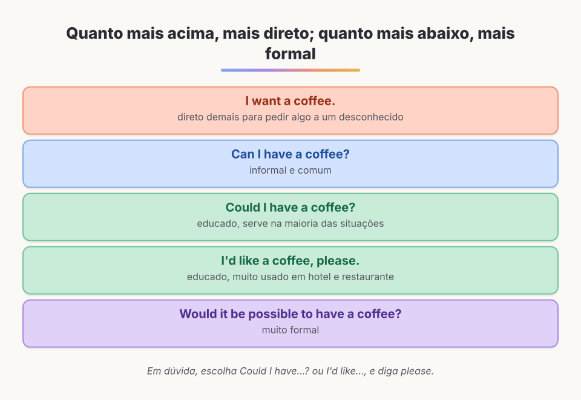
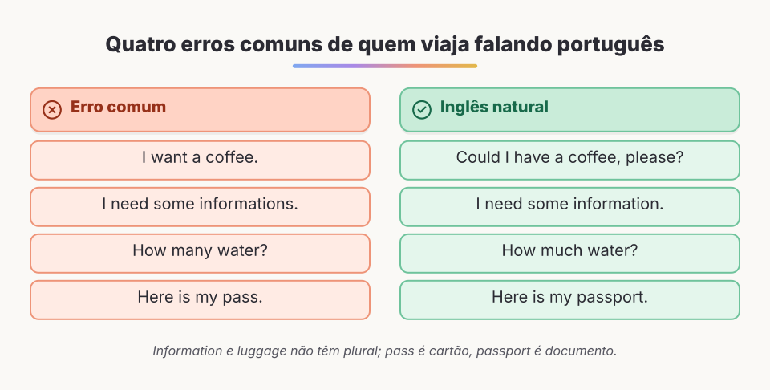

# 4. Viagem I: aeroporto, hotel e restaurante

> 🗺️ **Neste capítulo:** você vai pedir as coisas com educação (*Could I have...?*, *I'd like...*), usar *some/any*, *how much/how many* e as palavras de aeroporto, hotel e restaurante para fazer check-in, pedir comida e resolver um pedido simples · ⏱️ ~70 min

### 📇 Folha-resumo: parte 2

![Folha-resumo da parte 2: Pedidos educados (Could I have... / I'd like..., I want soa seco, I'm afraid... para negar); Some e any (some: afirmativa e oferta, any: pergunta e negativa, information não tem plural); Quantidade (How many + contável, How much + incontável, boarding pass x passport); Presente contínuo (am/is/are + -ing, agora ou já marcado, know e want ficam simples); Going to (plano ou previsão, am/is/are going to + base, gonna só reconhecer); In, on, at (at hora, on dia, in mês, at night, in the morning, agenda é pauta); Passado regular (verbo + -ed, sons /t/, /d/, /ɪd/, sem -s na 3ª pessoa); Irregulares (went, wrote, sent, took, Did you go...?, was e were sem did); Conectores (first, then, after that, later, finally).](../img/c00-parte-2-viajar-e-planejar.svg)

- [4. Viagem I: aeroporto, hotel e restaurante](04-viagem-i-aeroporto-hotel-e-restaurante.md)
- [5. Agora e depois: agenda e planos](05-agora-e-depois-agenda-e-planos.md)
- [6. Contando o que aconteceu](06-contando-o-que-aconteceu.md)

**Meta do capítulo (CEFR A2):** fazer check-in, pedir comida e resolver um pedido simples em uma viagem, em voz alta.

> 🔥 **Aquecimento:** (1) Complete com a forma certa: "She ___ (work) at a bank." (2) Como se diz 7:15 em inglês?
>
> 

> 
Ver resposta

>
> (1) ***works***: *she* leva -s. (2) ***It's a quarter past seven*** (ou *seven fifteen*).
>
> 

## De onde paramos

No capítulo 3 você falou da sua rotina e do seu trabalho, e usou *Do you...?* e *Does she...?* para perguntar. Agora vamos viajar. Em um aeroporto, em um hotel e em um restaurante, quase tudo é **pedir algo** e **entender uma resposta curta**. O capítulo ensina a fazer isso sem soar seco.

## Comece pelo resultado

Leia este check-in, escrito para o livro. Lucy está em um balcão de companhia aérea. Os dados são fictícios.

> **Agent:** Good morning. Can I see your passport, please?
> **Lucy:** Sure. Here you are.
> **Agent:** How many bags do you have?
> **Lucy:** Just one, and a carry-on.
> **Agent:** Would you like a window seat or an aisle seat?
> **Lucy:** An aisle seat, please. Could I have my boarding pass, too?
> **Agent:** Of course. Here it is. Your gate is B12, and boarding is at 10:15.
> **Lucy:** Thank you. Is the flight on time?
> **Agent:** Yes, it is. Have a nice flight.

Há aqui três frases novas: *How many...?* pede uma quantidade, *Could I have...?* pede algo com educação, e *Would you like...?* oferece uma escolha. O resto do capítulo organiza tudo isso.

> 💬 *Is the flight on time?* usa *to be* (capítulo 1), então não leva *do*. *Is there...?* e *Here you are* aparecem como blocos prontos por enquanto.

## Pedidos educados: *can, could* e *would like*

Em português, "Quero um café" é um pedido comum, e ninguém estranha. Em inglês, ***I want a coffee*** soa **seco**, quase uma ordem, principalmente para um desconhecido. Em hotel, restaurante e aeroporto, use uma forma mais suave.

**Um pedido educado em inglês tem uma abertura (*Could I have...?* ou *I'd like...*) e a palavra *please*.**

| Forma | Quando usar | Exemplo |
| --- | --- | --- |
| *Can I have...?* | informal, comum | Can I have a coffee? |
| *Could I have...?* | educado, serve quase sempre | Could I have the menu, please? |
| *I'd like...* | educado, afirmativo | I'd like a double room, please. |
| *Would it be possible to...?* | muito formal | Would it be possible to check in early? |

*I'd* é a forma curta de *I would*. ***Would like*** significa "gostaria". Depois dele vêm um substantivo (*I'd like a coffee*) ou ***to* + verbo** (*I'd like to check in*). Para oferecer algo a alguém, use ***Would you like...?***: *Would you like some water?*

Respostas educadas curtas: ***Sure.***, ***Of course.***, ***Certainly.*** Para negar com educação, a pessoa começa com ***I'm afraid...***: *I'm afraid we don't have any double rooms.* (afraid = "infelizmente" aqui, não "com medo").

**Pronúncia.** *I'd like* /aɪd laɪk/ ≈ "aid láik"; *Could I* /kʊd aɪ/ ≈ "cud ái". Termine *like* em /k/, sem acrescentar "i".

> ⚠️ **Erro comum:** pedir com *I want...* ou só apontar e dizer o nome do prato. Troque por *Could I have...?* ou *I'd like...*, e acrescente *please* no fim. Outro erro: *Can I to have...*; depois de *can* e *could*, o verbo vem sem *to*.

## Palavras de viagem

Aprenda estes blocos por situação, inteiros.

| Aeroporto | Hotel | Restaurante |
| --- | --- | --- |
| check-in, boarding pass, gate | reservation (ou booking), single/double room | menu, starter, main course, dessert |
| flight, delay, connection | check-in, check-out, key card | bill (UK) / check (US), tip |
| passport control, customs | Wi-Fi password | I'm allergic to... |
| baggage claim, carry-on | breakfast | water, a table for two |

**Variantes britânicas e americanas.** Algumas palavras mudam: *bill* (UK) × *check* (US) para "a conta"; *lift* (UK) × *elevator* (US); *flat* (UK) × *apartment* (US). Os dois lados entendem os dois, mas escolha um e fique com ele.

**Gorjeta (*tip*).** Os costumes variam muito de país para país e mudam com o tempo. Este livro **não dá valores**: confira o costume do seu destino antes de viajar.

**Pronúncia que costuma dar problema.** Em *passport* /ˈpæspɔːrt/ ≈ "PÉS-pórt" e *luggage* /ˈlʌɡɪdʒ/ ≈ "LÂ-guidj", não coloque vogal depois do *t* nem do *dj*: "pésspórti" e "lâguidji" são os erros de quem fala português. Em *allergic* /əˈlɜːrdʒɪk/ ≈ "a-LÉR-djic", a força está na segunda sílaba.

> ⚠️ **Erro comum:** confundir ***pass*** (cartão, passe, como em *boarding pass*) com ***passport*** (o documento). No balcão, diga *Here is my passport*.

> 🛡️ **Segurança:** a frase ***I'm allergic to [peanuts]*** é útil em restaurante. Diga também ao garçom que a alergia é séria e repita o nome do alimento. Este livro não substitui orientação médica; em caso de alergia grave, procure um profissional antes de viajar.

## *Some* e *any*

Em um restaurante ou hotel, você pergunta se **existe** algo e pede **um pouco** dele. Para isso, o inglês usa *some* e *any*.

**Use *some* em frases afirmativas e *any* em perguntas e negativas.**

| Tipo de frase | Palavra | Exemplo |
| --- | --- | --- |
| Afirmativa | *some* | I'd like **some** water. |
| Pergunta | *any* | Do you have **any** vegetarian dishes? |
| Negativa | *any* | We don't have **any** double rooms. |

**Exceção:** em ofertas e pedidos, use *some* mesmo em pergunta: ***Would you like some** tea?*, ***Could I have some** water?* Nesses casos você espera que a resposta seja "sim".

*Some* e *any* servem para substantivos **plurais** (*some rooms*) e **incontáveis** (*some water*). Com um substantivo singular contável, use *a/an*: *a room*, *an apple*.

> ⚠️ **Erro comum:** dizer *I don't have some money* (certo: *I don't have **any** money*) ou *Do you have some rooms?* (melhor: *Do you have **any** rooms?*).

## Contáveis e incontáveis, *how much* e *how many*

**Substantivo contável é o que você conta em unidades (*a bag, two bags*); incontável é o que você mede ou vê como massa (*water, information, luggage*).**

> 💡 **Analogia:** pense em **tijolos** e **areia**. Você conta tijolos (*one brick, two bricks*), mas não conta areia: usa um saco ou uma pá. Em inglês, *luggage*, *water*, *information* e *advice* são "areia". Para contar, use um recipiente: ***a piece of** information*, ***two pieces of** luggage*, ***a glass of** water*.
> **Pares:** tijolo = *bag*, *room*, *ticket*; areia = *luggage*, *water*, *information*; o saco de areia = *a piece of*, *a glass of*.
> **Onde a analogia falha:** a divisão é uma regra da língua, não da realidade: em português "informações" e "bagagens" aceitam plural, e em inglês não. Por isso é preciso decorar.

| Contáveis (têm plural) | Incontáveis (sem plural) |
| --- | --- |
| a bag / two bags | luggage (ou baggage) |
| a room / three rooms | information |
| a ticket / two tickets | advice, water, furniture |

Para perguntar **quantidade**, a palavra depende desse tipo:

| Pergunta | Use com | Exemplo |
| --- | --- | --- |
| ***How many*** | contável no plural | How many bags do you have? |
| ***How much*** | incontável | How much luggage do you have? |
| ***How much*** | preço | How much is the room? |

*Much* e *many* aparecem sobretudo em perguntas e negativas (*I don't have much luggage*). Nas afirmativas, use ***a lot of***: *I have a lot of bags*; *We have a lot of time*.

> ⚠️ **Erro comum:** dizer ***informations*** ou ***luggages***, que não existem. Também *How many water?*; o certo é *How much water?*. E *How much bags?*; o certo é *How many bags?*.

## Dois diálogos para treinar

**Hotel.** Bruno chega a um hotel. Dados fictícios.

> **Bruno:** Good evening. I have a reservation. My name is Bruno Souza.
> **Reception:** Welcome, Mr. Souza. Can I see your passport, please?
> **Bruno:** Here you are. Could I have the Wi-Fi password, please?
> **Reception:** Of course. Here is your key card, and the password is on the card. Breakfast is from seven to ten.
> **Bruno:** Thank you. Is there a lift?
> **Reception:** Yes, it's over there. Enjoy your stay.

**Restaurante.** Lucy pede o jantar.

> **Lucy:** Could we have a table for two, please?
> **Waiter:** Of course. Here is the menu.
> **Lucy:** Thank you. Do you have any vegetarian dishes?
> **Waiter:** Yes, we do. The vegetable pasta is very popular.
> **Lucy:** I'd like the vegetable pasta, please. And I'm allergic to peanuts. Is there any peanut in it?
> **Waiter:** No, there isn't. Would you like some water?
> **Lucy:** Yes, please. And could we have the bill later?

Repare em ***Is there a lift?*** e ***Is there any peanut in it?***, que usam *Is there...?* ("há...?") como bloco pronto: guarde a frase inteira. Repare também em ***lift***, a palavra britânica para "elevador", e em *Do you have any...?*, que é o *do* do capítulo 3.

## 🏋️ Pratique

**1. Exemplo resolvido.** Transforme em um pedido educado: "I want the menu."

Ver resposta

***Could I have the menu, please?*** (ou *I'd like the menu, please.*). O pedido ganhou uma abertura educada e *please*. Quem escreveu *Can I to have* acrescentou um *to* que não existe.

**2. Complete.** Escolha *some* ou *any*:

a) Would you like ___ coffee?
b) We don't have ___ single rooms.
c) Do you have ___ vegetarian dishes?
d) I'd like ___ water, please.

Ver resposta

a) **some**. É uma oferta.
b) **any**. É uma negativa.
c) **any**. É uma pergunta comum.
d) **some**. É uma afirmativa (um pedido).

Se errou o item a, lembre da exceção: em ofertas e pedidos, a pergunta usa *some*.

**3. Complete.** Escolha *how much* ou *how many*:

a) ___ bags do you have?
b) ___ luggage do you have?
c) ___ is the room?
d) ___ tickets do you need?

Ver resposta

a) **How many**. *Bags* é contável no plural.
b) **How much**. *Luggage* é incontável.
c) **How much**. É a pergunta do preço.
d) **How many**. *Tickets* é contável no plural.

**4. Faça sozinho.** Corrija o erro de cada frase:

a) I need some informations about the hotel.
b) I want a table for two.
c) Here is my pass. (no controle de passaportes)
d) How many water do you want?

Ver resposta

a) **I need some information about the hotel.** *Information* não tem plural.
b) **Could we have a table for two, please?** (ou *I'd like a table for two, please.*)
c) **Here is my passport.** *Pass* é um cartão ou passe; o documento é *passport*.
d) **How much water do you want?** *Water* é incontável.

**5. Desafio (fala e escrita).** Escolha **uma** das três situações (check-in, hotel ou restaurante) e escreva o seu diálogo de **6 falas**, com dados fictícios. Depois, grave os dois papéis com o celular. Confira:

- [ ] Fiz pelo menos dois pedidos com *Could I have...?* ou *I'd like...*.
- [ ] Usei *please*.
- [ ] Usei *some* ou *any* de forma correta.
- [ ] Usei *how many* ou *how much* de forma correta.
- [ ] Não usei *informations* nem *luggages*.
- [ ] Falei sem ler e sem vogal extra no fim das palavras (*passport*, *luggage*).

**Fluência:** repita a gravação **três vezes**, cada vez mais rápido e mais curto, mantendo os pedidos educados. Depois, faça os cartões do capítulo.

## 🧠 Revisão rápida

1. Por que *I want a coffee* soa seco, e o que dizer no lugar?
2. Quando se usa *some* e quando se usa *any*?
3. *How much* ou *how many* com *luggage*? E com *bags*?
4. O que significa *I'm afraid we don't have...*?
5. (Capítulo 3) Como se forma a pergunta *Does she...?*, e qual é a forma do verbo principal?

Ver resposta

1. Porque em inglês um pedido direto soa quase como uma ordem. Diga *Could I have a coffee, please?* ou *I'd like a coffee, please.*
2. *Some* em afirmativas, ofertas e pedidos; *any* em perguntas e negativas.
3. ***How much luggage*** (incontável) e ***how many bags*** (contável plural).
4. É uma forma educada de dizer "infelizmente, não temos...".
5. *Does* + sujeito + verbo na forma base: *Does she work here?*.

## 🤖 Estude com um tutor de IA

> 💬 **Prompt 1 (conversa):** "Você será um atendente de hotel (depois, de restaurante) e eu serei o cliente. Estou no nível A2. Faça uma pergunta de cada vez e espere a minha resposta. Use frases curtas e peça que eu use *Could I have...?* ou *I'd like...*. No fim, aponte meus erros e explique em português. Use só dados fictícios."

> 💬 **Prompt 2 (correção):** "Aqui está o meu diálogo de viagem: [meu diálogo em inglês]. Aponte onde errei *some/any*, *how much/how many* ou a educação dos pedidos, sem dar a versão corrigida; diga só onde está o erro e por quê. Depois me peça para reescrever."

> ⚠️ A IA pode errar e tende a elogiar demais. Confira com a lista do capítulo e com um dicionário. Não cole dados reais de passaporte, cartão ou reserva nos prompts.

> ➡️ **Próximo passo:** no capítulo 5 você vai falar de **agora** e de **planos**: o que está fazendo neste momento e o que vai fazer amanhã.

## 📌 Resumo

| Item | Em uma frase |
| --- | --- |
| Pedido educado | *Could I have...?* ou *I'd like...*, mais *please*; *I want* soa seco. |
| *Would like* | Depois dele vem substantivo ou *to* + verbo; *Would you like...?* oferece. |
| Resposta educada | *Sure / Of course / Certainly*; para negar, *I'm afraid...*. |
| *Some / any* | *Some* em afirmativas, ofertas e pedidos; *any* em perguntas e negativas. |
| Contável × incontável | *Information* e *luggage* não têm plural; use *a piece of...*. |
| *How many / how much* | *Many* com contáveis; *much* com incontáveis e preço. |
| *Pass* × *passport* | O cartão é *boarding pass*; o documento é *passport*. |
| Gorjeta e alergia | Confira o costume do destino; *I'm allergic to...* é uma frase de segurança. |

**Você consegue?** Sem olhar, faça um pedido educado em um balcão, em um quarto e em uma mesa de restaurante, e pergunte uma quantidade. Se conseguiu, cumpriu a meta do capítulo.

## 📚 Fontes

- Council of Europe. *CEFR Companion Volume* (2020), descritores de nível A2: https://rm.coe.int/16809ea0d4 (não foi possível abrir em 2026-11-28; sem data de conferência)
- British Council LearnEnglish, recursos gratuitos de leitura e escuta: https://learnenglish.britishcouncil.org/getting-started (conferido em 2026-11-28)

> 🔁 **Revise hoje:** capítulos 1 e 3.

<!-- nav:start -->
---

[◀ Capítulo anterior](03-minha-rotina-e-meu-trabalho.md) · [Mapa do livro](../README.md) · [Próximo capítulo ▶](05-agora-e-depois-agenda-e-planos.md)
<!-- nav:end -->
