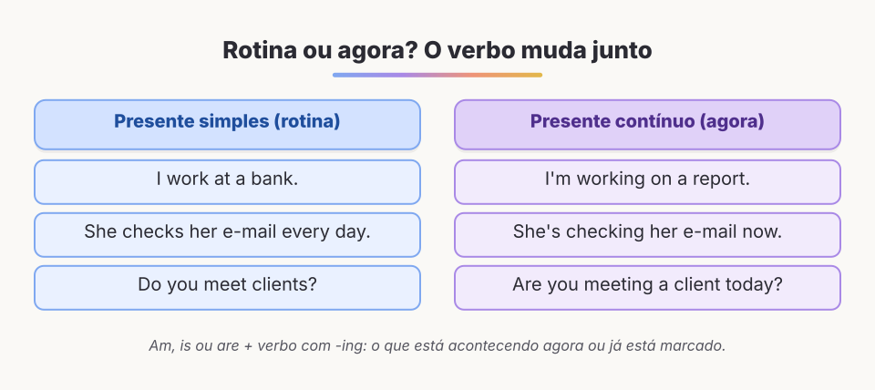
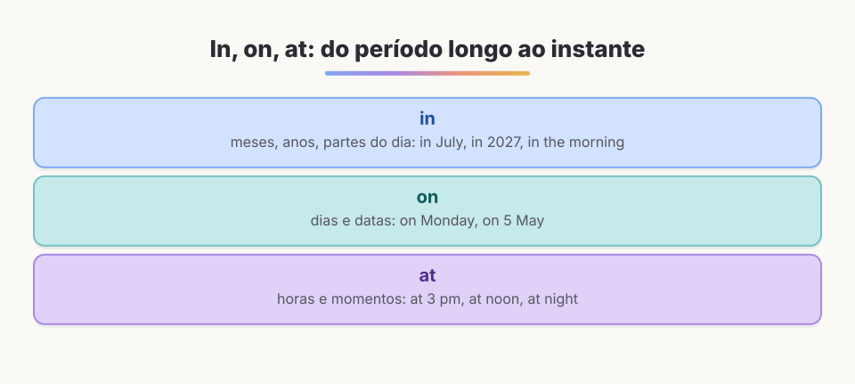
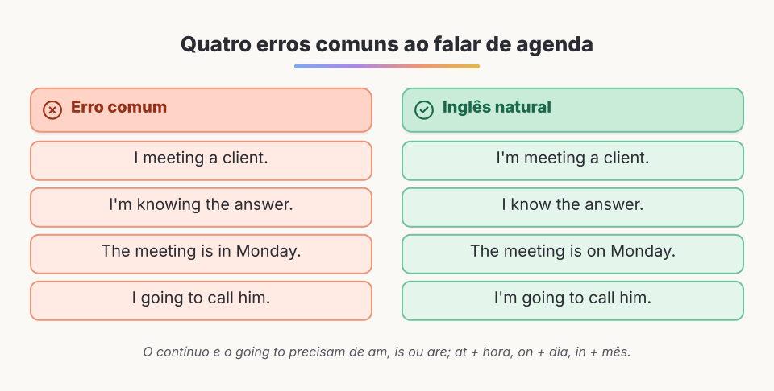

# 5. Agora e depois: agenda e planos

> 🗺️ **Neste capítulo:** você vai dizer o que está fazendo agora (*I'm working*), o que vai fazer (*I'm going to send...*) e usar *in*, *on* e *at* para marcar uma reunião · ⏱️ ~70 min

**Meta do capítulo (CEFR A2):** marcar uma reunião e dizer o que você está fazendo e o que vai fazer, em voz alta.

> 🔥 **Aquecimento:** (1) *How much* ou *how many*: "___ bags do you have?" (2) Complete: "Does she ___ (work) here?"
>
> 

> 
Ver resposta

>
> (1) ***How many***: *bags* é contável no plural. (2) ***work***: depois de *does*, o verbo fica na forma base.
>
> 

## De onde paramos

No capítulo 4 você pediu comida e quarto com educação. O presente simples dos capítulos 1 a 3 fala de **rotina** e de **fatos**: *I work at a bank*. Falta falar do que acontece **agora** e do que **vai acontecer**. Esse é o assunto de qualquer conversa de agenda: "o que você está fazendo?" e "quando a gente se encontra?".

## Comece pelo resultado

Leia esta conversa, escrita para o livro. Lucy está em Manchester e Bruno, em São Paulo. Os dados são fictícios.

> **Lucy:** Hi Bruno. Are you free on Thursday?
> **Bruno:** Let me check. I'm writing a report in the morning, but I'm free in the afternoon.
> **Lucy:** Great. Does 2 p.m. work for you? I mean 2 p.m. my time.
> **Bruno:** Yes, 2 p.m. your time works for me.
> **Lucy:** Perfect. I'm going to send you the agenda today.
> **Bruno:** Thanks. I'm going to prepare the numbers tomorrow morning.
> **Lucy:** See you on Thursday!

Há três ideias novas: ***I'm writing*** (algo em andamento), ***I'm going to send*** (um plano) e as pequenas palavras ***on***, ***in*** e ***at*** diante do dia e da hora.

## Presente contínuo: o que está acontecendo

Em português você diz "estou escrevendo um relatório". O inglês faz o mesmo com o verbo *to be* (capítulo 1) mais o verbo com **-ing**.

**O presente contínuo (*present continuous*) usa *am, is* ou *are* mais o verbo com *-ing*, e fala do que está acontecendo agora ou de um compromisso já marcado.**

| Tipo | Forma | Exemplo |
| --- | --- | --- |
| Afirmativa | sujeito + *am/is/are* + verbo-*ing* | I'm writing a report. |
| Negativa | *am/is/are* + *not* + verbo-*ing* | She isn't working today. |
| Pergunta | *Am/Is/Are* + sujeito + verbo-*ing*? | Are you working now? |
| Pergunta com *what* | *What* + *am/is/are* + sujeito + verbo-*ing*? | What are you doing? |

Perceba que a pergunta **não usa *do/does***. O verbo *to be* já faz o trabalho de auxiliar, como na pergunta *Where are you from?* do capítulo 2.

> 💡 **Analogia:** o presente simples é uma **gravação** que descreve o seu hábito (*I work at a bank*). O presente contínuo é uma **transmissão ao vivo** (*I'm working on a report*). *Am/is/are* é o botão de "estou no ar", e o *-ing* é a câmera ligada.
> **Pares:** gravação = rotina e fatos; ao vivo = o que acontece agora; botão = *am/is/are*; câmera ligada = *-ing*.
> **Onde a analogia falha:** o contínuo também fala do futuro marcado (*I'm meeting a client at 3*), e aí nada está "no ar" ainda.

**Como escrever o *-ing*:**

| Regra | Exemplo |
| --- | --- |
| Em geral, some *-ing* | work → *working*, study → *studying* |
| Verbo terminado em *-e* mudo: tire o *e* | make → *making*, write → *writing*, have → *having* |
| Uma sílaba, vogal + consoante: dobre a consoante | run → *running*, sit → *sitting*, plan → *planning* |

**Pronúncia.** *Meeting* /ˈmiːtɪŋ/ ≈ "MI-tin" e *writing* /ˈraɪtɪŋ/ ≈ "RAI-tin". O final *-ing* /ɪŋ/ é um som só, nasal, sem um "gue" no fim: não diga "mítingui". Em inglês americano, o *t* no meio dessas palavras costuma soar quase como um *d* leve; ouça os dois no Cambridge Dictionary, que traz áudio britânico e americano.

**Verbos de estado.** Alguns verbos falam de um estado, não de uma ação em andamento, e normalmente ficam no presente simples: *know, want, like, need, understand*. Diga *I know the answer* e *I like this plan*, e não *I'm knowing* nem *I'm liking*. Em inglês informal moderno você às vezes ouve um desses verbos com *-ing*, mas, no seu nível, siga a regra básica.

> ⚠️ **Erro comum:** esquecer o *am/is/are*: *I meeting a client* (certo: ***I'm meeting** a client*). Em português você não cortaria o "estou" de "estou me reunindo com um cliente"; em inglês, o *am/is/are* também é obrigatório.

## *Going to*: planos para depois

Quando a ideia já está na sua cabeça, mas ainda não foi para a agenda, use *going to*.

**A estrutura *am/is/are going to* mais um verbo na forma base fala de um plano ou de uma previsão que você faz a partir de algo que já vê.**

| Tipo | Exemplo |
| --- | --- |
| Afirmativa | I'm going to send the agenda today. |
| Negativa | She isn't going to attend the meeting. |
| Pergunta | Are you going to call the client? |
| Previsão com evidência | Look at the sky. It's going to rain. |

Repare que o verbo depois de *going to* fica na **forma base**, sem *-s* e sem *-ing*: *She is going to **work***, e não *She is going to works*. A pergunta também usa *am/is/are*, nunca *do/does*.

**Pronúncia.** *Going to* /ˈɡoʊɪŋ tuː/ ≈ "GÔ-uin tu". Na fala rápida você ouve ***gonna*** /ˈɡʌnə/ ≈ "GÂ-na": reconheça, mas escreva *going to* em e-mails e em textos de trabalho.

**Presente contínuo ou *going to* para o futuro?** Os dois servem. Use o **contínuo** quando já existe um arranjo com hora e pessoa (*I'm meeting Ana at 3*) e *going to* quando é um plano ou uma intenção (*I'm going to study tonight*). Na dúvida, *going to* funciona.

> ⚠️ **Erro comum:** dizer *I going to call him* (certo: *I'**m** going to call him*) ou usar o presente simples para um plano pessoal: *I travel tomorrow*. O presente simples só combina com horários fixos (*The train leaves at 9*).

## *In, on* e *at*: quando

Para dizer **quando**, o inglês escolhe a preposição pelo tamanho do período.

**Use *at* para horas e momentos, *on* para dias e datas, e *in* para meses, anos e partes do dia.**

| Preposição | Use com | Exemplos |
| --- | --- | --- |
| *at* | hora, momento | at 3 pm, at noon, at night |
| *on* | dia da semana, data | on Monday, on 5 May, on Friday morning |
| *in* | mês, ano, parte do dia | in July, in 2027, in the morning |

Duas exceções que você usa muito: ***at night*** (e não *in the night*) e o fim de semana, que é ***at the weekend*** no inglês britânico e ***on the weekend*** no americano. Para algo que acontece daqui a um tempo, use ***in* + período**: *I'm leaving in ten minutes* ("daqui a dez minutos").

**Datas.** Escreva *5 May* ou *May 5*. A forma com barras é ambígua: *3/4* é 4 de março nos Estados Unidos (mês primeiro) e 3 de abril no Reino Unido (dia primeiro), como você viu no capítulo 2. Em um convite, escreva o mês por extenso.

> ⚠️ **Erro comum:** usar a preposição do português ("na segunda"): *The meeting is in Monday* (certo: *on Monday*). E também *at the morning* (certo: *in the morning*).

## Marcar uma reunião

Estas frases cobrem quase todo o convite. Aprenda cada uma inteira.

| Para... | Diga |
| --- | --- |
| perguntar se a pessoa pode | Are you free on Thursday? |
| propor um horário | Does 2 p.m. work for you? |
| sugerir | Let's meet at 2. |
| aceitar | Yes, that works for me. |
| recusar com educação | I'm afraid I'm busy at that time. |
| mudar o horário | Can we reschedule? |
| avisar o fuso | 9 a.m. my time |

**Fuso horário (*time zone*).** Quando as pessoas estão em países diferentes, diga de quem é a hora: ***9 a.m. my time***, ***3 p.m. your time***. Muitos convites trazem também o **UTC**, a hora de referência mundial. Confira o fuso de cada pessoa em um conversor de horas antes de confirmar; este livro não faz a conta por você, porque o horário de verão muda de país para país e de época para época.

> 💬 *Does 2 p.m. work for you?* mantém o *do/does* do capítulo 3, porque *work* aqui é um verbo comum ("funcionar").

**A agenda (*agenda*).** Em inglês, a palavra *agenda* é a **pauta** da reunião, a lista dos assuntos. O caderno de compromissos é *calendar* ou *diary* (britânico) / *planner*. *Agenda*, no sentido de "compromissos", é um falso cognato.

Exemplo de pauta curta:

> **Agenda: Thursday, 2 p.m.**
> 1. Status of the report
> 2. Numbers for the client
> 3. Next steps

## 🏋️ Pratique

**1. Exemplo resolvido.** Complete com o presente contínuo: "Bruno ___ (write) a report now."

Ver resposta

***is writing***. *Bruno* é *he*, então o auxiliar é *is*. O verbo *write* termina em *-e*, que sai antes do *-ing*: *writing*, e não *writeing*.

**2. Complete.** Use o presente contínuo ou *going to*, como indicado:

a) They ___ (have) lunch now. (contínuo)
b) She ___ (not / work) today. (contínuo)
c) ___ you ___ (meet) a client at 3? (contínuo)
d) I ___ (call) him tomorrow. (*going to*)
e) We ___ (not / travel) in July. (*going to*)

Ver resposta

a) **are having**. *They* pede *are*; *have* perde o *e*.
b) **isn't working** (ou *is not working*).
c) **Are ... meeting**. A pergunta começa por *are*.
d) **am going to call**. Depois de *going to*, o verbo fica na forma base.
e) **aren't going to travel**. A negativa leva *not* depois do auxiliar.

Se errou o item c, cuidado: não existe *Do you meeting*.

**3. Complete.** Escolha *in*, *on* ou *at*:

a) The meeting is ___ Thursday.
b) It starts ___ 2 p.m.
c) I'm free ___ the afternoon.
d) The report is due ___ July.
e) She doesn't work ___ night.

Ver resposta

a) **on**. Dia da semana.
b) **at**. Hora.
c) **in**. Parte do dia.
d) **in**. Mês.
e) **at**. *At night* é uma expressão fixa.

**4. Faça sozinho.** Corrija o erro de cada frase:

a) I writing an e-mail now.
b) Are you knowing his name?
c) We meet in Monday at 3.
d) What do you doing?
e) He is going to works tomorrow.

Ver resposta

a) **I'm writing an e-mail now.** Faltou o *am*.
b) **Do you know his name?** *Know* é verbo de estado e fica no presente simples.
c) **We're meeting on Monday at 3.** (ou *We meet on Monday at 3*, se for um horário fixo). Dia da semana leva *on*.
d) **What are you doing?** A pergunta usa *are*, e não *do*.
e) **He is going to work tomorrow.** Depois de *going to*, a forma base: sem *-s*.

**5. Desafio (fala e escrita).** Escreva e grave, com dados fictícios, uma conversa de **6 falas** em que você marca uma reunião com um colega. Inclua: uma pergunta com *Are you free...?*, um horário com *at*, um dia com *on*, o que você **está fazendo** agora e o que você **vai fazer** antes da reunião. Depois, escreva uma pauta de **3 itens**. Confira:

- [ ] Usei *at* para a hora e *on* para o dia.
- [ ] Usei *am/is/are* em todas as frases com *-ing*.
- [ ] Usei *going to* com o verbo na forma base.
- [ ] Disse de quem é o horário (*my time* ou *your time*).
- [ ] Não usei *do/does* com o contínuo.
- [ ] Falei sem ler e terminei *meeting* e *writing* em /ŋ/, sem "gue".

**Fluência:** repita a gravação **três vezes**, cada vez mais rápido e mais curto. Depois, faça os cartões do capítulo.

## 🧠 Revisão rápida

1. Qual é a diferença entre *I work* e *I'm working*?
2. Como se forma uma pergunta no presente contínuo, e por que não se usa *do*?
3. Complete com *in*, *on* ou *at*: "___ Friday ___ 10 a.m."
4. O que o verbo faz depois de *going to*?
5. (Capítulo 4) Qual é a forma educada de pedir um café em um restaurante?

Ver resposta

1. *I work* é rotina ou fato; *I'm working* é o que está acontecendo agora.
2. Com *am/is/are* no início: *Are you working?*. O *to be* já é o auxiliar.
3. ***On** Friday **at** 10 a.m.*
4. Fica na forma base: *I'm going to **send** it*.
5. *Could I have a coffee, please?* ou *I'd like a coffee, please.*

## 🤖 Estude com um tutor de IA

> 💬 **Prompt 1 (conversa):** "Vamos treinar agenda em inglês, nível A2. Você será um colega de trabalho que quer marcar uma reunião comigo. Faça uma pergunta de cada vez, espere a minha resposta e peça que eu diga o que estou fazendo agora e o que vou fazer. No fim, aponte meus erros e explique em português. Use só dados fictícios."

> 💬 **Prompt 2 (correção):** "Aqui está a minha conversa de agenda: [minha conversa em inglês]. Aponte onde errei o presente contínuo, *going to* ou *in/on/at*, sem dar a versão corrigida; diga só onde está o erro e por quê. Depois me peça para reescrever."

> ⚠️ A IA pode errar e tende a elogiar demais. Confira com a lista do capítulo e com um dicionário. Não cole agendas, e-mails ou nomes reais de clientes nos prompts.

> ➡️ **Próximo passo:** no capítulo 6 você vai contar o que **já aconteceu**: sua última viagem ou semana de trabalho, no passado.

## 📌 Resumo

| Item | Em uma frase |
| --- | --- |
| Presente contínuo | *Am/is/are* + verbo-*ing*: o que acontece agora ou já está marcado. |
| Escrita do *-ing* | *make → making*, *run → running*, *work → working*. |
| Verbos de estado | *Know, want, like, need* ficam no presente simples. |
| *Going to* | *Am/is/are going to* + verbo na forma base: plano ou previsão com evidência. |
| *At / on / in* | *At* hora, *on* dia e data, *in* mês, ano e parte do dia. |
| Fuso | Diga de quem é a hora: *9 a.m. my time*. |
| *Agenda* | Em inglês é a pauta da reunião, não o caderno de compromissos. |

**Você consegue?** Sem olhar, marque uma reunião para quinta-feira às 2 da tarde, diga o que você está fazendo agora e o que vai fazer antes dela. Se conseguiu, cumpriu a meta do capítulo.

## 📚 Fontes

- Cambridge English. *International language standards* (escala CEFR de A1 a C2): https://www.cambridgeenglish.org/exams-and-tests/cefr/ (conferido em 2026-11-28)
- British Council LearnEnglish, gramática A1-A2 (inclui *Prepositions of time: at, in, on*): https://learnenglish.britishcouncil.org/grammar/a1-a2-grammar (conferido em 2026-11-28)
- Council of Europe. *CEFR Companion Volume* (2020), descritores de nível A2: https://rm.coe.int/16809ea0d4 (não foi possível abrir em 2026-11-28; sem data de conferência)

> 🔁 **Revise hoje:** capítulos 2 e 4.

<!-- nav:start -->
---

[◀ Capítulo anterior](04-viagem-i-aeroporto-hotel-e-restaurante.md) · [Mapa do livro](../README.md) · [Próximo capítulo ▶](06-contando-o-que-aconteceu.md)
<!-- nav:end -->
