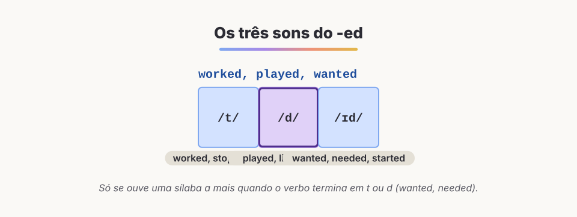
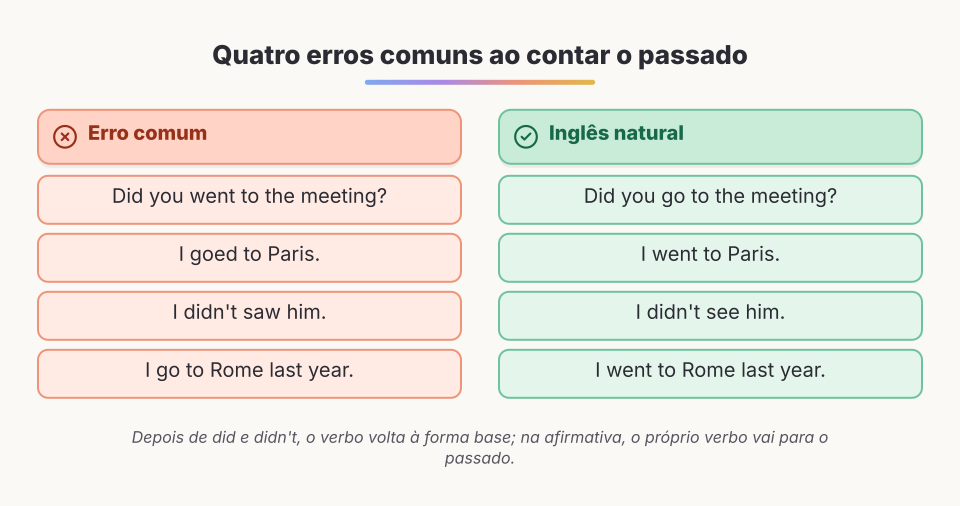
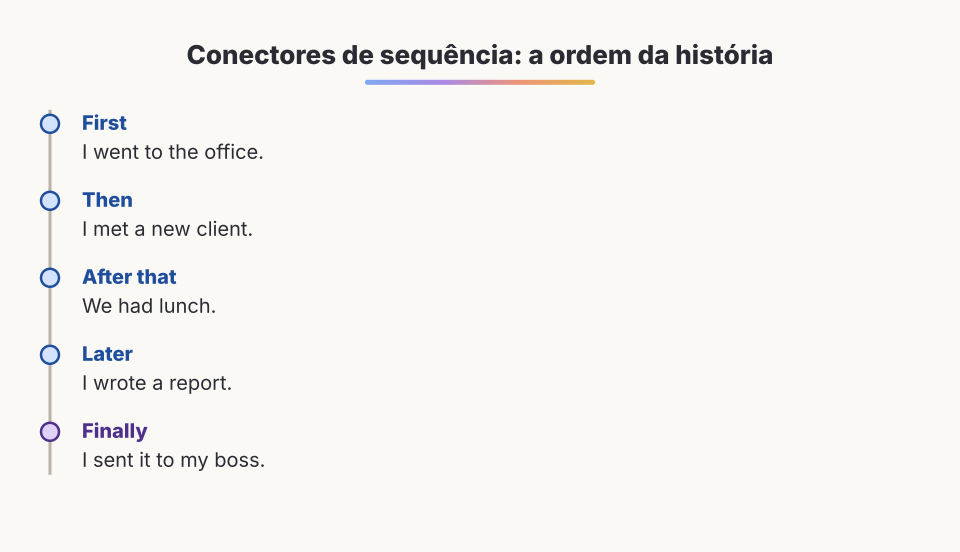

# 6. Contando o que aconteceu

> 🗺️ **Neste capítulo:** você vai contar sua última viagem ou semana de trabalho no passado, com o passado simples (*I worked*, *I went*), as perguntas com *did* e os conectores *first, then, finally* · ⏱️ ~75 min

**Meta do capítulo (CEFR A2):** contar sua última viagem ou semana de trabalho em 8 frases no passado, em voz alta.

> 🔥 **Aquecimento:** (1) Complete: "I ___ going to call him tomorrow." (2) *In*, *on* ou *at*: "The meeting is ___ Thursday ___ 2 p.m."
>
> 

> 
Ver resposta

>
> (1) ***am***: *I'm going to call him tomorrow*. Depois de *going to*, o verbo fica na forma base. (2) ***on** Thursday **at** 2 p.m.*
>
> 

## De onde paramos

No capítulo 5 você falou de agora e de planos. Em uma reunião ou em uma conversa de corredor, a pergunta seguinte costuma ser "e como foi?". Hoje você aprende a **contar o que já aconteceu**. Você vai usar o *to be* do capítulo 1 e o *do/does* do capítulo 3 de um jeito novo.

## Comece pelo resultado

Leia este relato, escrito para o livro. Lucy conta a semana passada. Os dados são fictícios.

> **Last week was busy.** First, on Monday, I went to the office and met a new client. Then, on Tuesday, I wrote a report and sent it to my boss. After that, on Wednesday, I took a train to London for a meeting. Later, I read an e-mail from the client and answered it. On Thursday I didn't work because I felt ill. Finally, on Friday, I went back to the office and finished the report.

Cada verbo está no **passado**. Alguns terminam em *-ed* (*answered, finished*), mas muitos mudam de forma (*went, wrote, sent, took*). O capítulo trata desses dois grupos e da pergunta *Did you...?*.

## Passado simples: os verbos regulares

Em português, o passado muda o final do verbo ("trabalhei", "trabalhou"). Em inglês, a maioria dos verbos faz o passado com um único final, o ***-ed***, para **todas** as pessoas.

**O passado simples (*past simple*) fala de algo que começou e terminou em um momento do passado, e os verbos regulares formam esse passado com *-ed*.**

| Pessoa | Presente | Passado |
| --- | --- | --- |
| I | I work | I **worked** |
| you | you work | you **worked** |
| she / he / it | she works | she **worked** |
| we / they | they work | they **worked** |

Não existe -s na terceira pessoa no passado: *she worked*, e não *she workeds*. Essa parte é mais simples que o presente.

**Como escrever o *-ed*:**

| Regra | Exemplo |
| --- | --- |
| Em geral, some *-ed* | work → *worked*, answer → *answered* |
| Verbo terminado em *-e*: some só *-d* | live → *lived*, arrive → *arrived* |
| Consoante + *y*: troque o *y* por *-ied* | study → *studied*, try → *tried* |
| Vogal + *y*: só some *-ed* | play → *played*, stay → *stayed* |
| Uma sílaba, vogal + consoante: dobre a consoante | stop → *stopped*, plan → *planned* |

**Pronúncia.** O *-ed* tem **três sons**, e quase nunca se diz "éd" sozinho.

- Depois de sons sem vibração na garganta (p, k, f, s, *sh*, *ch*), o *-ed* soa como /t/: *worked* /wɜːrkt/ ≈ "uérkt", *stopped* /stɑːpt/ ≈ "stóppt".
- Depois de vogais e de sons com vibração (l, n, v, b...), soa como /d/: *played* /pleɪd/ ≈ "plêid", *lived* /lɪvd/ ≈ "livd".
- Depois de *t* ou *d*, ganha uma sílaba: *wanted* /ˈwɑːntɪd/ ≈ "UÓN-tid" (no inglês americano; no britânico, /ˈwɒntɪd/).

O erro típico de quem fala português é pronunciar uma vogal depois do *-ed*: "uérkiti" ou "stópiti" em vez de *worked* e *stopped*. Termine no /t/ ou no /d/, sem vogal. Ouça cada um no Cambridge Dictionary, com áudio britânico e americano.

> ⚠️ **Erro comum:** achar que todo *-ed* é uma sílaba nova. Só *wanted*, *needed*, *started* e verbos parecidos (terminados em *t* ou *d*) têm sílaba a mais.

## Verbos irregulares: os 30 que mais valem a pena

Alguns dos verbos mais comuns do inglês **não** usam *-ed*: cada um tem uma forma própria. Não há regra que cubra todos; **decore a forma de passado junto com a frase**, e não em listas soltas.

| Presente | Passado | Exemplo |
| --- | --- | --- |
| be | **was / were** | I was tired. They were late. |
| have | **had** | We had lunch. |
| do | **did** | She did her homework. |
| go | **went** | I went to the office. |
| see | **saw** | I saw the manager. |
| take | **took** | I took a train. |
| make | **made** | He made a mistake. |
| get | **got** | I got an e-mail. |
| come | **came** | She came on Monday. |
| give | **gave** | They gave me a key. |
| say | **said** | He said yes. |
| know | **knew** | I knew the answer. |
| think | **thought** | I thought it was easy. |
| buy | **bought** | I bought a ticket. |
| send | **sent** | I sent the report. |
| write | **wrote** | She wrote an e-mail. |
| read | **read** | I read the message. |
| meet | **met** | We met a client. |
| leave | **left** | He left at 6. |
| find | **found** | I found the hotel. |
| tell | **told** | She told me the news. |
| feel | **felt** | I felt ill. |
| begin | **began** | The meeting began at 2. |
| eat | **ate** | We ate fish. |
| drink | **drank** | I drank some water. |
| fly | **flew** | He flew to Lisbon. |
| run | **ran** | I ran to the gate. |
| pay | **paid** | She paid the bill. |
| lose | **lost** | I lost my key card. |

**Pronúncia que costuma pegar.** *Read* no passado se escreve igual ao presente, mas soa /red/ ≈ "réd" (o presente soa /riːd/ ≈ "rid"). *Said* /sed/ ≈ "séd". *Went* /went/ ≈ "uént". *Bought* /bɔːt/ ≈ "bót" e *thought* /θɔːt/ ≈ "thót": o *gh* não tem som.

**Grupos que ajudam a memorizar:**

- Mudam só a vogal: *begin → began*, *drink → drank*, *run → ran*, *come → came*.
- Terminam em *-ought*: *buy → bought*, *think → thought*.
- Terminam em *-t*: *send → sent*, *leave → left*, *feel → felt*, *lose → lost*, *meet → met*.

> 💡 **Analogia:** pense no passado como um **carimbo no passaporte**. Cada verbo viaja com um carimbo de passado, e ele fica no próprio verbo (*went*, *wrote*, *worked*). Nas perguntas e negativas, quem leva o carimbo é o ***did***, e o verbo principal volta à sua forma básica (*Did you **go**?*).
> **Pares:** viajante = verbo; carimbo = marca de passado (*-ed*, *went*, *did*); passaporte já carimbado = *did*, que carimba uma vez só.
> **Onde a analogia falha:** *did* e *didn't* ficam na pergunta e na negativa, mas na afirmativa o carimbo vai no verbo; dizer *I did went* mistura as duas coisas.

> ⚠️ **Erro comum:** criar o passado "à portuguesa": *goed*, *buyed*, *writed*. Esses verbos são irregulares: *went*, *bought*, *wrote*.

## Perguntas e negativas com *did*

No capítulo 3 você usou *do/does*. No passado, o auxiliar é um só, ***did***, para todas as pessoas.

**Na pergunta e na negativa do passado, use *did* ou *didn't* e deixe o verbo principal na forma base.**

| Tipo | Forma | Exemplo |
| --- | --- | --- |
| Afirmativa | sujeito + verbo no passado | I **went** to London. |
| Negativa | sujeito + *didn't* + verbo base | I **didn't go** to London. |
| Pergunta | *Did* + sujeito + verbo base? | **Did** you **go** to London? |
| Pergunta com *wh-* | *wh-* + *did* + sujeito + verbo base? | Where **did** you **go**? |
| Resposta curta | *Yes, I did. / No, I didn't.* | Did you like it? Yes, I did. |

**Exceção: o *to be*.** O verbo *to be* **não** usa *did*. No passado, ele vira ***was*** (*I, he, she, it*) ou ***were*** (*you, we, they*). A pergunta inverte a ordem, como no capítulo 2: *Was she late?*, *Were you at the meeting?*. A negativa usa *wasn't* e *weren't*.

> ⚠️ **Erro comum:** colocar o passado duas vezes: *Did you went...?* e *I didn't saw*. O passado já está no *did*; o verbo volta à forma base: *Did you **go**...?*, *I didn't **see***.

## Quando aconteceu: marcadores de tempo

O passado simples costuma vir com uma marca de tempo que mostra que aquilo já terminou.

| Marcador | Exemplo |
| --- | --- |
| *yesterday* | I wrote the report yesterday. |
| *last week / last month / last year* | We met a client last week. |
| *two days ago* | She left two days ago. |
| *on* + dia / *in* + ano ou mês | He arrived on Monday. I went to Rome in 2024. |

Repare que *last week*, *yesterday* e *two days ago* **não levam** preposição. Já *on Monday* e *in 2024* seguem o capítulo 5.

> ⚠️ **Erro comum:** esquecer de trocar o verbo quando a frase tem um marcador de passado: *I go to Rome last year* (certo: ***I went** to Rome last year*). Não use *have* no lugar (*I have been in Paris last year*): essa forma é de outro tempo, que você vê no capítulo 9.

## Conectores de sequência

Para contar uma história em ordem, use palavras que marcam cada etapa.

| Conector | Use para |
| --- | --- |
| *First* | começar a história |
| *Then* | a etapa seguinte |
| *After that* | outra etapa depois da anterior |
| *Later* | mais tarde no mesmo dia ou na mesma semana |
| *Finally* / *In the end* | a última etapa ou o resultado |

*Finally* e *in the end* marcam o último passo da história. Depois de *first*, *then*, *after that*, *later* e *finally*, use uma vírgula: *First, I went to the office.*

## Dois diálogos para treinar

**Sobre a viagem.** Bruno conversa com Lucy depois de uma viagem. Dados fictícios.

> **Bruno:** Did you enjoy the trip?
> **Lucy:** Yes, I did. I stayed in a small hotel near the station.
> **Bruno:** What did you eat?
> **Lucy:** I ate fish on Monday, and I tried a local dish on Tuesday.
> **Bruno:** Did you meet the client?
> **Lucy:** Yes, we met on Wednesday.
> **Bruno:** Was it a long meeting?
> **Lucy:** No, it wasn't. We finished in an hour.

**Sobre um atraso.** Bruno explica por que chegou tarde.

> **Lucy:** Why were you late?
> **Bruno:** I missed my train. I waited for the next one, and I arrived at 9:30.
> **Lucy:** Did you call the office?
> **Bruno:** Yes, I did. I called at 9 and told them.

Repare nas perguntas *Did you enjoy...?*, *What did you eat?* e *Why were you late?*: as duas primeiras usam *did* mais o verbo base, e a última usa *were*, do *to be*.

## 🏋️ Pratique

**1. Exemplo resolvido.** Passe para o passado: "I **work** at the office and **send** an e-mail."

Ver resposta

***I worked at the office and sent an e-mail.*** *Work* é regular (*worked*) e *send* é irregular (*sent*). Cada um recebe a sua forma, e não existe -s na terceira pessoa.

**2. Complete.** Escreva o passado do verbo entre parênteses:

a) Yesterday I ___ (go) to a meeting.
b) She ___ (write) a long report.
c) We ___ (want) a table for two.
d) They ___ (study) English last year.
e) He ___ (not / see) the manager.

Ver resposta

a) **went**. Irregular.
b) **wrote**. Irregular.
c) **wanted**. Regular; o *-ed* soa /ɪd/ porque o verbo termina em *t*.
d) **studied**. Consoante + *y* troca por *-ied*.
e) **didn't see**. Depois de *didn't*, a forma base.

**3. Complete.** Faça a pergunta:

a) ___ you ___ (like) the hotel?
b) Where ___ she ___ (go) last week?
c) ___ they late? (to be)
d) What time ___ the meeting ___ (begin)?

Ver resposta

a) **Did ... like**. *Did* mais forma base.
b) **did ... go**. Pergunta com *wh-*: *Where did she go...?*.
c) **Were**. *To be* não usa *did*: *Were they late?*.
d) **did ... begin**. *What time did the meeting begin?*.

Se errou o item c, lembre: *was/were* fazem a pergunta sozinhos.

**4. Faça sozinho.** Corrija o erro de cada frase:

a) Did you went to London?
b) I goed to the bank yesterday.
c) She didn't wrote the report.
d) We buyed tickets last week.
e) I meet a client yesterday.

Ver resposta

a) **Did you go to London?** Depois de *did*, a forma base.
b) **I went to the bank yesterday.** *Go* é irregular.
c) **She didn't write the report.** Depois de *didn't*, a forma base.
d) **We bought tickets last week.** *Buy* é irregular.
e) **I met a client yesterday.** *Yesterday* pede passado; *meet* → *met*.

**5. Desafio (fala e escrita).** Conte sua última viagem **ou** sua última semana de trabalho em **8 frases** no passado, com dados fictícios se preferir. Use pelo menos **3 verbos irregulares**, **2 verbos regulares**, **1 negativa com *didn't*** e **3 conectores** (*first, then, after that, later, finally*). Grave a fala com o celular e confira:

- [ ] Todas as frases estão no passado.
- [ ] Usei pelo menos 3 verbos irregulares na forma certa.
- [ ] Usei *didn't* com o verbo na forma base.
- [ ] Usei conectores de sequência com vírgula depois.
- [ ] Usei um marcador de tempo (*yesterday*, *last week*, *on Monday*).
- [ ] Pronunciei *worked*, *stopped* e *asked* sem vogal no fim.

**Fluência:** repita a gravação **três vezes**, cada vez mais rápido e mais curto. Depois, faça os cartões do capítulo, com um verbo irregular por cartão, em uma frase completa.

## 🧠 Revisão rápida

1. Qual é a forma do verbo depois de *did* e *didn't*?
2. Como se pronuncia o *-ed* de *worked*, *played* e *wanted*?
3. Passe para o passado: *buy*, *write*, *meet*, *feel*.
4. Qual é a pergunta de *She was late*?
5. (Capítulo 5) Complete com *in*, *on* ou *at*: "___ Monday ___ 9 a.m."

Ver resposta

1. A forma base: *Did you go?*, *I didn't go*.
2. /t/ em *worked*, /d/ em *played* e /ɪd/ em *wanted*.
3. ***bought, wrote, met, felt***.
4. ***Was she late?*** O *to be* inverte com o sujeito e não usa *did*.
5. ***On** Monday **at** 9 a.m.*

## 🤖 Estude com um tutor de IA

> 💬 **Prompt 1 (conversa):** "Vamos conversar em inglês, nível A2. Faça perguntas sobre a minha última viagem ou semana de trabalho, uma de cada vez, no passado. Espere a minha resposta e, no fim, aponte meus erros de passado e explique em português. Use só dados fictícios."

> 💬 **Prompt 2 (correção):** "Aqui está o meu relato no passado: [meu relato em inglês]. Aponte os verbos que errei (regulares, irregulares ou depois de *did*) sem dar a versão corrigida; diga só onde está o erro e por quê. Depois me peça para reescrever."

> ⚠️ A IA pode errar e tende a elogiar demais. Confira as formas de passado em um dicionário. Não cole relatórios ou e-mails reais da sua empresa nos prompts.

> ➡️ **Próximo passo:** no capítulo 7 você vai usar o que aprendeu (pedidos, planos e passado) para ler e escrever **e-mails de trabalho**.

## 📌 Resumo

| Item | Em uma frase |
| --- | --- |
| Passado regular | Verbo + *-ed* para todas as pessoas; sem -s na terceira pessoa. |
| Som do *-ed* | /t/, /d/ ou /ɪd/; a sílaba a mais só aparece depois de *t* ou *d*. |
| Verbos irregulares | Cada um tem forma própria: *went, wrote, sent, took, saw...*; decore com a frase. |
| Negativa e pergunta | *Didn't* e *did* mais a forma base; não existe *Did you went*. |
| *Was / were* | O *to be* no passado não usa *did*. |
| Marcadores | *Yesterday, last week, two days ago, on Monday, in 2024*. |
| Conectores | *First, then, after that, later, finally* organizam a história. |

**Você consegue?** Sem olhar, conte em 8 frases o que você fez na semana passada, com 3 verbos irregulares e uma negativa. Se conseguiu, cumpriu a meta do capítulo.

## 📚 Fontes

- Cambridge English. *International language standards* (escala CEFR de A1 a C2): https://www.cambridgeenglish.org/exams-and-tests/cefr/ (conferido em 2026-11-28)
- British Council LearnEnglish, gramática A1-A2 (traz *Past continuous and past simple*): https://learnenglish.britishcouncil.org/grammar/a1-a2-grammar (conferido em 2026-11-28)
- British Council LearnEnglish, lista de verbos irregulares (confere 27 dos 30 verbos da tabela do capítulo; *fly*, *drink* e *read* não constam da página, e as formas desses três não foram conferidas em fonte aberta): https://learnenglish.britishcouncil.org/free-resources/grammar/english-grammar-reference/irregular-verbs (conferido em 2026-11-28)
- Council of Europe. *CEFR Companion Volume* (2020), descritores de nível A2: https://rm.coe.int/16809ea0d4 (não foi possível abrir em 2026-11-28; sem data de conferência)

> 🔁 **Revise hoje:** capítulos 3 e 5.

<!-- nav:start -->
---

[◀ Capítulo anterior](05-agora-e-depois-agenda-e-planos.md) · [Mapa do livro](../README.md) · [Próximo capítulo ▶](07-e-mails-de-trabalho.md)
<!-- nav:end -->
