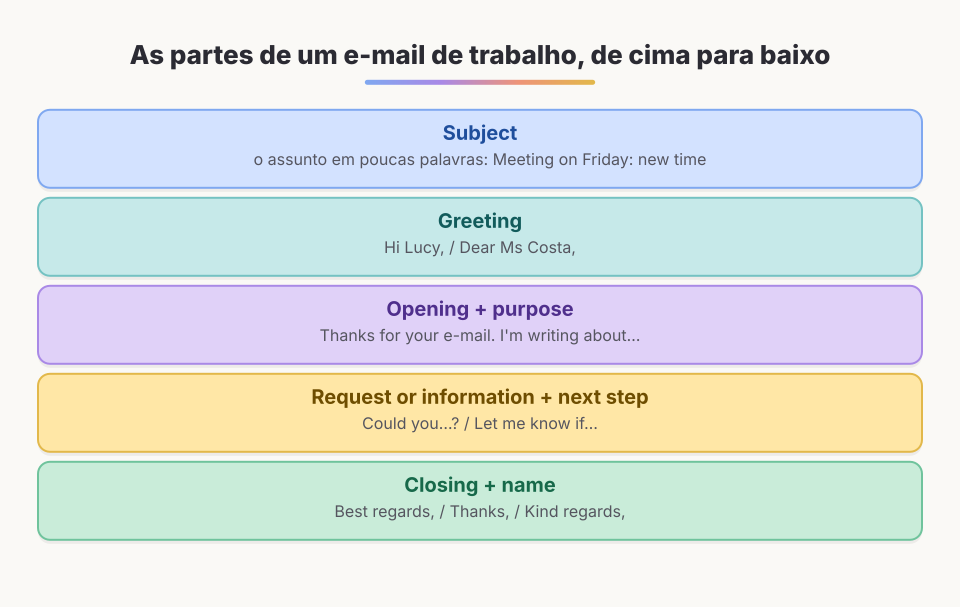
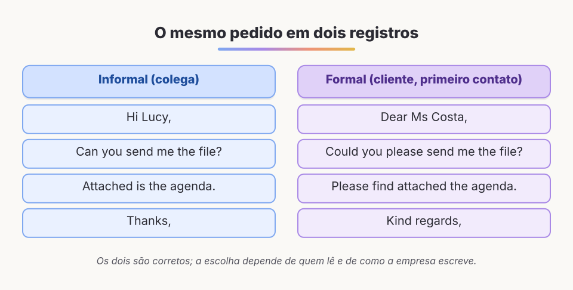
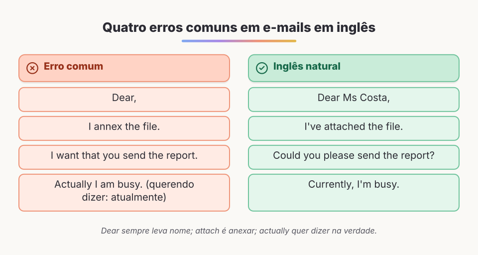

# 7. E-mails de trabalho

> 🗺️ **Neste capítulo:** você vai ler, escrever e responder um e-mail de trabalho de 80 a 120 palavras: a estrutura (assunto, saudação, pedido, fecho), o tom formal e o informal e as frases prontas para pedir e confirmar · ⏱️ ~75 min

### 📇 Folha-resumo: parte 3

![Folha-resumo da parte 3: Estrutura do e-mail (assunto e saudação, motivo e pedido, fecho com nome); Registro (formal para cliente, informal para colega, na dúvida, neutro); Frases prontas (Could you please...?, I've attached, Let me know if...); Skimming e scanning (ideia geral primeiro, depois o dado específico, avisos antes dos passos); Falsos cognatos (actually: na verdade, eventually: por fim, support: apoio); Instruções (Click Settings, Do not / Don't, must, should, may); Present perfect (have/has + particípio, for x since, sem data: perfect); Comparar (-er than, more ... than, the -est, the most, better e worse); Opinião (I think... because..., I agree, sem am, devolva a pergunta).](../img/c00-parte-3-trabalho-e-conversa.svg)

- [7. E-mails de trabalho](07-e-mails-de-trabalho.md)
- [8. Lendo documentação técnica](08-lendo-documentacao-tecnica.md)
- [9. Conversas mais longas: experiências e opiniões](09-conversas-mais-longas-experiencias-e-opinioes.md)

**Meta do capítulo (CEFR A2 a B1):** ler, escrever e responder um e-mail de trabalho de 80 a 120 palavras.

> 🔥 **Aquecimento:** (1) Passe para o passado: "I send the report and write an e-mail." (2) Qual é a pergunta de *They were late*?
>
> 

> 
Ver resposta

>
> (1) ***I sent the report and wrote an e-mail.*** (2) ***Were they late?***: o *to be* inverte com o sujeito e não usa *did*.
>
> 

## De onde paramos

Nos capítulos 4, 5 e 6 você aprendeu a pedir com educação, a marcar uma reunião e a contar o que aconteceu. Um e-mail de trabalho junta tudo isso em um texto curto: você pede algo, informa um plano e confirma um horário. A diferença é que, por escrito, quem lê não vê o seu rosto, então a **estrutura** e o **tom** fazem o trabalho do gesto e da voz.

## Comece pelo resultado

Leia estes dois e-mails, escritos para o livro. Bruno propõe mudar o horário da reunião, e Lucy responde. Os dados são fictícios.

> **Subject:** Meeting on Friday: new time
>
> Hi Lucy,
>
> Thanks for your e-mail. I'm writing about our meeting on Friday. I'm afraid I'm busy at 2 p.m. because I'm meeting a client. Could we meet at 4 p.m. instead? I know this is a change, and I'm sorry about that. I'm going to send the report before the meeting, so you can read it first. Please find attached the agenda. If Friday is a problem, I'm free on Thursday afternoon too. Let me know if 4 p.m. works for you.
>
> Best regards,
> Bruno

> **Subject:** Re: Meeting on Friday: new time
>
> Hi Bruno,
>
> Thanks for letting me know. 4 p.m. on Friday works for me. I'm going to book a room and send an invitation today. I'm also going to invite Ana, because she is working on the numbers. I read the agenda, and it looks good. Could you also send me the numbers for the client? I'm going to check them tonight. Sorry for the delay in my reply: I was in meetings all morning. See you on Friday!
>
> Thanks,
> Lucy

Contando saudação e fecho, o primeiro tem 86 palavras e o segundo, 81: os dois estão na faixa da meta. Você já conhece quase tudo: *Could we...?* (capítulo 4), *I'm going to...* e *on Friday* (capítulo 5), *I read the agenda* e *I was in meetings* (capítulo 6). O que muda é a **ordem** das partes e as **frases de e-mail**.

## A estrutura de um e-mail

**Um e-mail de trabalho tem cinco partes, sempre na mesma ordem: assunto, saudação, abertura e motivo, pedido ou informação com o próximo passo, e fecho com o nome.**

| Parte | O que fazer | Exemplo |
| --- | --- | --- |
| Assunto (*subject*) | dizer o tema em poucas palavras | *Meeting on Friday: new time* |
| Saudação (*greeting*) | cumprimentar com o nome da pessoa | *Hi Ana,* / *Dear Mr Silva,* |
| Abertura e motivo | agradecer e dizer por que escreve | *Thanks for your e-mail. I'm writing about...* |
| Pedido ou informação | pedir, informar e dizer o próximo passo | *Could you please send...? Let me know if...* |
| Fecho (*closing*) | despedir-se e assinar | *Best regards,* + nome |

**Por que nesta ordem?** Quem lê dezenas de e-mails decide em segundos se aquele é urgente. Um assunto claro e um motivo logo na primeira linha poupam o tempo da pessoa, e o pedido no fim da mensagem diz o que você espera dela.

**Vocabulário de e-mail.** *Reply* (responder), *Reply all* (responder a todos), *forward* (encaminhar), *attachment* (anexo), *Cc* (com cópia, para quem deve ficar informado) e *Bcc* (cópia oculta). Cuidado com *Reply all*: a resposta vai para todos, até para quem não precisava ler.

**Pronúncia.** *Attachment* /əˈtætʃmənt/ ≈ "a-TÉTCH-ment" e *regards* /rɪˈɡɑːrdz/ ≈ "ri-GÁRDZ". Em *attached*, o *-ed* soa /t/ (capítulo 6): /əˈtætʃt/ ≈ "a-TÉTCHT", sem vogal no fim.

> ⚠️ **Erro comum:** escrever só *Dear,* sem o nome, ou deixar o assunto em branco. Em inglês, *Dear* sempre leva um nome (*Dear Ms Costa,*), e um assunto vazio faz o e-mail parecer descuidado.

## Registro: formal ou informal

**Registro é o nível de formalidade da sua escrita: o jeito de falar com um cliente que você não conhece é diferente do jeito de falar com um colega de equipe.**

| Situação | Saudação | Pedido | Fecho |
| --- | --- | --- | --- |
| Colega próximo | *Hi Lucy,* | *Can you send me...?* | *Thanks,* / *Best,* |
| Colega, tom neutro | *Hi Bruno,* | *Could you please send...?* | *Best regards,* |
| Cliente ou primeiro contato | *Dear Ms Costa,* | *I would be grateful if you could send...* | *Kind regards,* |

Um exemplo formal, com dados fictícios:

> **Subject:** Request for information about the course
>
> Dear Ms Costa,
>
> I am writing to ask about the English course in May. Could you please send me the dates and the price? I would be grateful if you could also tell me if there are any places left. Please find attached my registration form. I look forward to hearing from you.
>
> Kind regards,
> Ana Lima

**Como decidir?** Observe como a outra pessoa escreve e acompanhe o tom dela. Em muitas empresas de tecnologia o tom é informal e direto, mas isso depende da cultura da empresa e de quem lê; não é regra. Em dúvida, use um tom neutro (*Hi Bruno,* + *Could you please...?* + *Best regards,*), que não ofende ninguém.

> ⚠️ **Erro comum:** usar um tom informal demais com alguém que você não conhece (*Hey! Send me the file.*), ou um tom pesado demais com um colega (*I would be most grateful if you could kindly...*). O primeiro soa seco, e o segundo soa distante.

## Frases prontas

Aprenda cada frase inteira, como no capítulo 4.

| Para... | Escreva |
| --- | --- |
| começar | *Thanks for your e-mail.* / *Thanks for getting back to me.* |
| explicar o motivo | *I'm writing to ask about...* / *I'm writing about...* |
| pedir | *Could you please send...?* / *Could you let me know...?* |
| informar um plano | *I'm going to send you...* / *I'll get back to you by Friday.* |
| lembrar com educação | *Just a quick reminder about...* |
| anexar | *I've attached...* / *Please find attached...* |
| confirmar | *Yes, that works for me.* / *Thanks for confirming.* |
| pedir desculpa | *Sorry for the delay.* / *Sorry for the confusion.* |
| encerrar | *Let me know if you have any questions.* / *Looking forward to hearing from you.* |
| despedir-se | *Best regards,* / *Kind regards,* / *Thanks,* / *Best,* |

*I'll get back to you by...* ("eu retorno até...") traz a forma curta *I'll*, de *I will*; o capítulo 10 explica o *will*. Por enquanto, guarde a frase inteira.

**Anexo.** O verbo é ***attach***, e não *annex*. Diga *I've attached the report* ou, mais formal, *Please find attached the report*. Em português dizemos "segue em anexo", mas *annex* não é o verbo que se usa para anexar um arquivo em inglês.

**Falsos cognatos que aparecem em e-mails.** ***Actually*** quer dizer "na verdade", e não "atualmente" (essa ideia é ***currently***). ***Pretend*** é "fingir", e não "pretender" (a ideia de "pretender" é *I intend to...* ou *I plan to...*).

**Uma nota cultural, que é uma interpretação e não uma regra.** A frase ***Thanks in advance*** ("obrigado desde já") é comum, mas alguns leitores a veem como se você já desse a resposta por certa. Se quiser evitar essa impressão, escreva *Thanks for your help* ou *Could you please...?* no pedido.

> 🛡️ **Segurança:** desconfie de e-mails em inglês que pedem **pagamento urgente**, **senha** ou um **link para entrar na conta**. Não clique, não responda e confirme por outro canal (uma ligação para o número que você já tem). E nunca cole um e-mail real de cliente em uma ferramenta de IA: use uma versão fictícia, com nomes e dados inventados (domínio *example.com*).

## Como ler um e-mail mais rápido

Você não precisa entender cada palavra para agir. Faça três perguntas, nesta ordem:

1. **Quem escreve e sobre o quê?** Leia o assunto e a primeira frase.
2. **O que a pessoa quer de mim?** Procure *Could you...?*, *Please...*, *Let me know...*.
3. **Existe um prazo?** Procure dias e horas: *by Friday*, *at 4 p.m.*, *tomorrow*.

Os e-mails do British Council LearnEnglish (leitura A2), como *An email from a friend* e *An invitation to a job interview*, são bons para treinar essa leitura depois deste capítulo.

## 🏋️ Pratique

**1. Exemplo resolvido.** Leia este e-mail e responda: o que a pessoa pede, e até quando?

> **Subject:** Report for the client
>
> Hi Bruno,
>
> Could you please send me the report by Thursday? The client is going to read it on Friday morning. Let me know if you have any questions.
>
> Best,
> Lucy

Ver resposta

Lucy pede o relatório (*Could you please send me the report*), com prazo na quinta-feira (*by Thursday*). A leitura do cliente na sexta de manhã explica o prazo. Repare que a pergunta *Could you...?* revela o pedido.

**2. Complete.** Escolha a frase certa: *I'm writing about, Could you please, Please find attached, Kind regards*.

a) ___ send me the dates?
b) ___ the new price list.
c) ___ our meeting on Friday.
d) Dear Ms Costa, ... ___, Ana Lima.

Ver resposta

a) **Could you please**. Um pedido educado.
b) **Please find attached**. Anexo, em tom formal.
c) **I'm writing about**. O motivo do e-mail.
d) **Kind regards**. O fecho formal que combina com *Dear Ms Costa*.

**3. Leia e responda.** Releia o primeiro e-mail de Bruno, no início do capítulo.

a) Por que Bruno não pode às 14 h na sexta?
b) Qual é o novo horário proposto?
c) O que Bruno vai enviar antes da reunião, e o que vai anexado?
d) Qual alternativa ele dá se a sexta for um problema?

Ver resposta

a) Porque está se reunindo com um cliente (*I'm meeting a client*).
b) 4 p.m. (16 h).
c) Vai enviar o relatório (*the report*); o anexo é a pauta (*the agenda*).
d) Estar livre na quinta à tarde (*I'm free on Thursday afternoon*).

**4. Faça sozinho.** Corrija o erro de cada frase:

a) Dear, I'm writing about the invoice.
b) I annex the file to this e-mail.
c) I want that you send the report today.
d) Actually, I'm busy this week. (quer dizer "atualmente")

Ver resposta

a) **Dear Mr Silva, I'm writing about the invoice.** *Dear* leva um nome.
b) **I've attached the file to this e-mail.** O verbo é *attach*.
c) **Could you please send the report today?** O pedido educado usa *Could you...?*, e não *I want that*.
d) **Currently, I'm busy this week.** (ou *I'm busy this week*, sem advérbio). *Actually* quer dizer "na verdade".

**5. Desafio (leitura e escrita).** Leia este e-mail (dados fictícios) e **responda em 80 a 120 palavras**.

> **Subject:** Call on Monday
>
> Hi,
>
> Thanks for your time last week. Could we have a short call on Monday at 10 a.m.? I'd like to talk about the schedule for May. Please let me know if that works for you.
>
> Best,
> Sam

Sua resposta deve **aceitar ou propor outro horário**, **fazer um pedido** e **dizer o que você vai fazer antes da chamada**. Depois, confira:

- [ ] Tem assunto (*Re: Call on Monday*), saudação, motivo, pedido e fecho com nome.
- [ ] Tem entre 80 e 120 palavras (conte, sem contar o assunto).
- [ ] Usei *Could you...?* ou *Let me know if...* no pedido.
- [ ] Usei *on* com o dia e *at* com a hora.
- [ ] Usei *I'm going to...* para o que vou fazer antes da chamada.
- [ ] O tom combina com o do e-mail do Sam (neutro) e não usei *Dear* sem nome.

Ver um exemplo de resposta

> **Subject:** Re: Call on Monday
>
> Hi Sam,
>
> Thanks for your e-mail. I'm afraid I'm in a meeting on Monday at 10 a.m., but I'm free at 2 p.m. the same day. Does that work for you? I'm going to send you the schedule on Friday, so you can read it before the call. Could you also let me know who is going to join us? I'd like to invite my manager, Ana. I'm sorry for the change, and thanks for your patience. Let me know if 2 p.m. is a problem. Looking forward to talking to you on Monday.
>
> Best regards,
> [seu nome]

O exemplo tem 98 palavras, contando saudação e fecho. Escreva a sua resposta com as suas palavras, e não copie esta.

**Fluência:** leia a sua resposta em voz alta três vezes, cada vez mais rápido, sem tropeçar em *attachment*, *regards* e *schedule*. Depois, faça os cartões do capítulo com as frases prontas.

## 🧠 Revisão rápida

1. Quais são as cinco partes de um e-mail de trabalho, na ordem?
2. Qual é a diferença entre *Hi Lucy,* e *Dear Ms Costa,*?
3. Como se diz "segue em anexo" em inglês, em tom formal e em tom neutro?
4. O que *actually* significa em inglês?
5. (Capítulo 6) Qual é o passado de *send* e *write*, e como fica a negativa de *I wrote it*?

Ver resposta

1. Assunto, saudação, abertura com o motivo, pedido ou informação com o próximo passo, e fecho com o nome.
2. *Hi Lucy,* é informal (colega); *Dear Ms Costa,* é formal (cliente ou primeiro contato).
3. Formal: *Please find attached...*; neutro: *I've attached...*.
4. "Na verdade", e não "atualmente" (que é *currently*).
5. ***Sent*** e ***wrote***; a negativa é ***I didn't write it***.

## 🤖 Estude com um tutor de IA

> 💬 **Prompt 1 (conversa):** "Vamos treinar e-mails de trabalho em inglês, nível A2. Você será um colega que me manda um e-mail curto pedindo algo. Eu respondo, e você me manda a próxima mensagem. No fim, aponte meus erros de tom, de estrutura e de gramática e explique em português. Use só dados fictícios."

> 💬 **Prompt 2 (correção):** "Aqui está o meu e-mail: [meu e-mail em inglês]. Aponte onde errei a estrutura, o tom (formal ou informal) ou as frases prontas, sem dar a versão corrigida; diga só onde está o erro e por quê. Depois me peça para reescrever."

> ⚠️ A IA pode errar e tende a elogiar demais. Confira com a lista do capítulo e com um dicionário. Nunca cole um e-mail real da sua empresa ou de um cliente nos prompts.

> ➡️ **Próximo passo:** no capítulo 8 você vai usar a leitura rápida de e-mail para ler **documentação técnica**: encontrar o que importa e seguir as instruções.

## 📌 Resumo

| Item | Em uma frase |
| --- | --- |
| Estrutura | Assunto, saudação, abertura e motivo, pedido com próximo passo, fecho com nome. |
| Registro | Formal para clientes e primeiro contato; informal para colegas; na dúvida, neutro. |
| Pedir | *Could you please...?* e *Let me know if...* soam educados. |
| Anexar | *I've attached...* ou *Please find attached...*; o verbo é *attach*. |
| Falsos cognatos | *Actually* é "na verdade"; *pretend* é "fingir". |
| Segurança | Desconfie de pedidos urgentes de pagamento ou senha; use dados fictícios com IA. |
| Leitura rápida | Quem escreve, o que pede e qual é o prazo. |

**Você consegue?** Sem olhar, escreva um e-mail de 80 a 120 palavras que peça algo, diga o que você vai fazer e combine um horário. Se conseguiu, cumpriu a meta do capítulo.

## 📚 Fontes

- Cambridge English. *International language standards* (escala CEFR de A1 a C2): https://www.cambridgeenglish.org/exams-and-tests/cefr/ (conferido em 2026-11-28)
- British Council LearnEnglish, leitura A2 (inclui *An email from a friend* e *An invitation to a job interview*): https://learnenglish.britishcouncil.org/skills/reading/a2-reading (conferido em 2026-11-28)
- Council of Europe. *CEFR Companion Volume* (2020), descritores de nível A2 a B1: https://rm.coe.int/16809ea0d4 (não foi possível abrir em 2026-11-28; sem data de conferência)

> 🔁 **Revise hoje:** capítulos 4 e 6.

<!-- nav:start -->
---

[◀ Capítulo anterior](06-contando-o-que-aconteceu.md) · [Mapa do livro](../README.md) · [Próximo capítulo ▶](08-lendo-documentacao-tecnica.md)
<!-- nav:end -->
