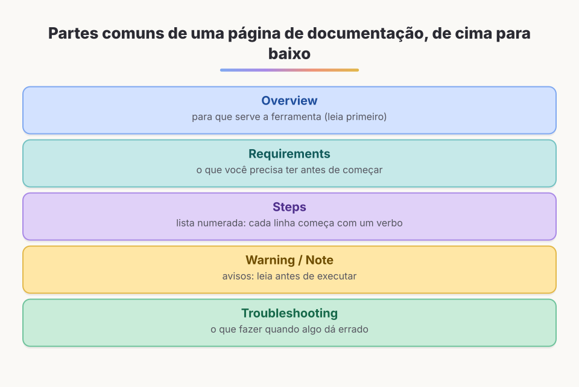
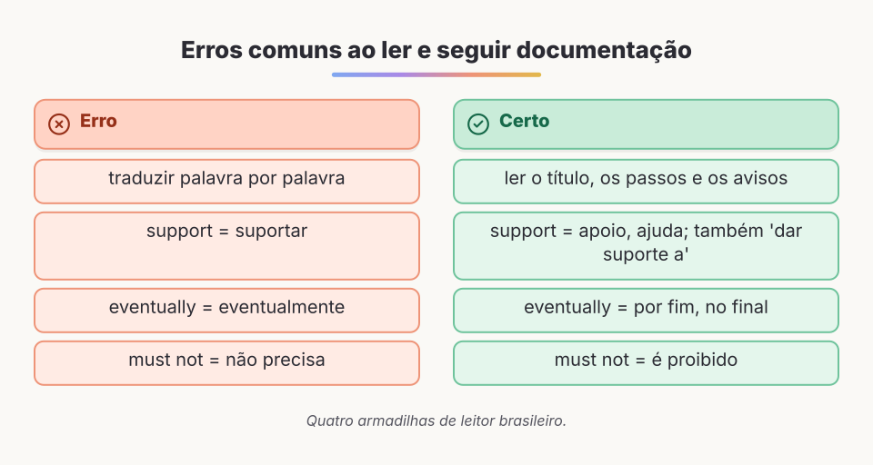
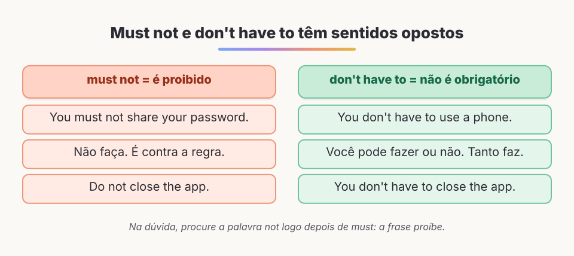

# 8. Lendo documentação técnica

> 🗺️ **Neste capítulo:** você vai seguir as instruções de uma página de documentação em inglês e resumir em português o que ela pede: ler sem traduzir tudo (*skimming* e *scanning*), cuidar dos falsos cognatos, entender as ordens (imperativo) e saber o que é obrigatório, recomendado ou permitido (*must*, *should*, *may*) · ⏱️ ~75 min

**Meta do capítulo (CEFR B1):** seguir as instruções de uma página de documentação e resumir em português o que ela pede.

> 🔥 **Aquecimento:** (1) Qual é o passado de *write* e *send*? (2) Escreva em inglês uma frase educada pedindo um arquivo.
>
> 

> 
Ver resposta

>
> (1) ***wrote*** e ***sent***. (2) Por exemplo, ***Could you please send me the file?***
>
> 

## De onde paramos

No capítulo 7 você aprendeu a ler um e-mail de trabalho de forma rápida: quem escreve, o que pede e qual é o prazo. A documentação técnica pede o mesmo olhar, com uma diferença: ela raramente precisa ser lida de cima a baixo. Quem lê bem acha **o que importa** em poucos minutos e deixa o resto de lado.

## Comece pelo resultado

Leia esta página de documentação. Ela foi escrita para este livro, e a ferramenta, a *Notesync*, **não existe**: não procure nem execute nada do que está aqui.

> **Notesync: Quick start guide**
>
> **Overview**
> Notesync copies your notes between your computer and your phone. It works on Windows, macOS and Linux. This guide takes about 10 minutes.
>
> **Requirements**
> You need a computer with 200 MB of free space, a free account and version 2.0 or later of the app. You must have an internet connection. You don't have to use a phone: the computer app works alone.
>
> **Steps**
> 1. Download the installer from the official website.
> 2. Open the file and follow the instructions on the screen.
> 3. Sign in with your e-mail and password.
> 4. Click **Settings**, then **Sync**, then **Turn on**.
>
> **Warning**
> Do not close the app while it is syncing. You must not share your password. You should make a backup before you start. You may choose a different folder for your notes.
>
> **Troubleshooting**
> If you see "Error 12", check your connection and try again. If the problem continues, contact support. Eventually, all your notes appear on your phone.

Você entendeu o essencial sem traduzir quase nada? Provavelmente sim: palavras como *document*, *version* e *support* se parecem com o português, e a página tem uma **estrutura previsível**. É disso que o capítulo trata.

## Skimming e scanning

**Skimming é passar o olho pela página para entender a ideia geral; *scanning* é procurar um dado específico, como um número, um nome ou um comando.**

São dois movimentos diferentes, e cada um responde a uma pergunta:

| Estratégia | Pergunta que responde | Onde o olho vai |
| --- | --- | --- |
| *Skimming* | Do que esta página trata? | título, primeiro parágrafo, títulos de seção |
| *Scanning* | Quanto espaço eu preciso? Qual botão clico? | números, nomes próprios, **negrito**, listas |

**Por que isso importa?** Em português você não lê o manual do micro-ondas palavra por palavra. Em inglês, o hábito de traduzir cada palavra cansa e faz você perder o fio. Se você tem uma meta (instalar a ferramenta), lê só o que serve a ela.

**Um roteiro para qualquer página de documentação:**

1. **Skimming (30 segundos).** Leia o título e o *Overview*. Pergunte: para que serve? Serve para o que eu preciso?
2. **Scanning dos requisitos.** Olhe *Requirements* e confira números e versões (aqui: 200 MB, versão 2.0).
3. **Leia os avisos antes dos passos.** *Warning* e *Note* dizem o que **não** fazer. Quem executa primeiro e lê depois perde dados.
4. **Siga os passos em ordem.** A lista numerada é a única parte que você lê com atenção, linha por linha.
5. **Guarde o *Troubleshooting*** para quando algo der errado.

**Inferir pelo contexto.** Se aparece uma palavra desconhecida, pergunte: é verbo, substantivo ou nome de botão? Na frase *Click Settings, then Sync*, você não precisa de dicionário para *Settings* e *Sync*: o negrito e o verbo *click* já mostram que são botões. Procure no dicionário só a palavra que **bloqueia** a tarefa.

> ⚠️ **Erro comum:** traduzir a página inteira antes de agir. Você gasta 20 minutos e perde o que importa (o aviso sobre a senha, por exemplo). Primeiro o objetivo, depois a leitura.

## Falsos cognatos em documentação

**Cognatos são palavras parecidas nas duas línguas e com o mesmo sentido; falsos cognatos se parecem, mas têm sentido diferente.**

A boa notícia: a documentação técnica está cheia de **cognatos verdadeiros**, e isso ajuda muito:

| Inglês | Português |
| --- | --- |
| *document* | documento |
| *version* | versão |
| *error* | erro |
| *option* | opção |
| *function* | função |
| *parameter* | parâmetro |
| *install* | instalar |
| *configure* | configurar |

Agora as armadilhas, que aparecem em textos técnicos:

| Palavra | Parece ser | Significa |
| --- | --- | --- |
| *eventually* | eventualmente (às vezes) | **por fim**, depois de um tempo |
| *support* | suportar (aguentar) | **apoiar, dar suporte a**; no substantivo, "apoio" ou "suporte técnico" |
| *actually* | atualmente | **na verdade** (capítulo 7) |
| *attend* | atender | **comparecer a**, ir a (*attend a meeting*) |
| *realize* | realizar (fazer) | **perceber, dar-se conta** |

Na página da *Notesync*, *Eventually, all your notes appear on your phone* quer dizer "**por fim**, todas as suas notas aparecem no celular", e não "às vezes". E *contact support* é "fale com o suporte", e não "aguente".

> ⚠️ **Erro comum:** achar que toda palavra parecida é a mesma palavra. Quando uma frase não faz sentido com o significado "óbvio", desconfie de um falso cognato e consulte o dicionário.

## Imperativo: a língua das instruções

**O imperativo é a forma base do verbo, sem sujeito, usada para dar instruções: *Open the file. Click Settings.***

**Por que existe?** Em instruções, o leitor é sempre "você" e não faz sentido repetir. Por isso cada passo começa por um verbo. É mais fácil do que o português, porque a forma não muda: *open* serve para qualquer pessoa.

| Afirmativo | Negativo |
| --- | --- |
| *Download the installer.* | *Do not download the installer.* |
| *Sign in with your e-mail.* | *Don't sign in on a public computer.* |
| *Click **Settings**.* | *Do not click **Delete**.* |

Para negar, use ***do not*** (mais formal, comum em avisos) ou ***don't*** (mais curto). O verbo principal fica na forma base, como depois do *do* do capítulo 3.

**Passos em sequência.** Os conectores do capítulo 6 reaparecem: *First, ... Then, ... After that, ... Finally, ...* e, nas listas, apenas os números.

**Ordem e tom.** Em documentação, o imperativo **não é grosseiro**: é o padrão. Já numa conversa, falar *Send me the file* soa seco; por isso o capítulo 4 ensinou *Could you...?*. Use o imperativo para ler e escrever instruções, e *Could you...?* para pedir algo a uma pessoa.

> ⚠️ **Erro comum:** colocar *you* antes do verbo (*You open the file*) ou usar *-s* (*Opens the file*). O passo usa apenas o verbo na forma base.

## Must, should, may e need to

Os avisos da página usam alguns verbos que dizem **o quanto** algo é obrigatório. Eles se chamam **verbos modais** (*modal verbs*): vêm antes de outro verbo na forma base e **não levam *-s*** na terceira pessoa (*She must go*, e não *She musts go*).

| Modal | Ideia | Exemplo |
| --- | --- | --- |
| ***must*** | obrigação forte | *You must have an internet connection.* |
| ***need to*** | é necessário | *You need to sign in first.* |
| ***should*** | recomendado, boa ideia | *You should make a backup.* |
| ***may*** | permitido, possível | *You may choose a different folder.* |
| ***must not*** | proibido | *You must not share your password.* |
| ***don't have to*** | não é obrigatório | *You don't have to use a phone.* |

Em uma escala, do mais forte ao mais fraco: ***must*** (tem de) → ***should*** (é melhor) → ***may*** (pode, se quiser).

**A armadilha de brasileiro: *must not* x *don't have to*.** Os dois têm *not*, mas dizem o oposto:

- ***You must not close the app.*** → você **não pode** fechar. (Se fechar, dá problema.)
- ***You don't have to close the app.*** → você **não precisa** fechar. (Pode fechar ou não.)

> 💡 **Analogia:** pense em **sinais de trânsito**. *Must* é a placa de "Pare": obrigatória. *Should* é a placa de "Velocidade recomendada": é melhor seguir. *May* é a placa de "Estacionamento permitido": você pode, se quiser. *Must not* é a placa de "Proibido estacionar". E *don't have to* é a ausência de placa: ninguém obriga.
> **Pares:** placa de pare = *must*; velocidade recomendada = *should*; estacionamento permitido = *may*; proibido estacionar = *must not*; sem placa = *don't have to*.
> **Onde a analogia falha:** placas de trânsito têm multa; numa página de documentação, ignorar um *must* nem sempre gera punição, mas a ferramenta pode **não funcionar**, ou você pode perder dados.

**Outros usos.** *May* também aparece em avisos de possibilidade (*Notesync may be slow with large files*, "pode ficar lento"). O sentido depende do contexto: *You may...* é permissão e *It may...* é possibilidade.

**Pergunta com modais.** Para perguntar, inverta: *Must I sign in?* soa formal; no dia a dia use *Do I have to sign in?* e *Do I need to...?*. Para pedir licença, *May I...?* é mais formal que *Can I...?* (capítulo 4).

> ⚠️ **Erro comum:** *You must to sign in* ou *She musts sign in*. Depois de um modal vem a forma base, **sem *to*** e sem *-s*. (*Need to* é uma exceção: o *to* faz parte dele, e *need* muda como um verbo comum: *She needs to sign in*.)

## 🏋️ Pratique

**1. Exemplo resolvido.** Frase: *You should make a backup before you start.*

Passo 1: ache o modal: *should*. Passo 2: veja a força: recomendado, não obrigatório. Passo 3: resuma em português: "É recomendável fazer um backup antes de começar."

Observe: *before you start* ("antes de começar") é um bloco pronto. *If you see...* (do *Troubleshooting*) também: o capítulo 10 explica o *if*; por enquanto, trate-os como blocos.

**2. Complete.** Escolha: *must, should, may, must not, don't have to*.

a) You ___ share your password. (proibido)
b) You ___ use a phone. (não é obrigatório)
c) You ___ have an internet connection. (obrigatório)
d) You ___ choose a different folder. (permitido)
e) You ___ make a backup. (recomendado)

Ver resposta

a) **must not**. Proibição.
b) **don't have to**. Não precisa; a página diz isso do celular.
c) **must**. Obrigação forte.
d) **may**. Permissão.
e) **should**. Recomendação.

**3. Leia e responda (scanning).** Sem reler tudo, procure na página da *Notesync* a resposta de cada pergunta:

a) Quantos MB de espaço livre o computador precisa ter?
b) Que versão do aplicativo é necessária?
c) Qual botão você clica depois de *Settings*?
d) O que fazer se aparece o *Error 12*?
e) Em que sistemas a ferramenta funciona?

Ver resposta

a) **200 MB** (*Requirements*).
b) **Versão 2.0 ou mais nova** (*2.0 or later*).
c) ***Sync*** e, depois, ***Turn on***.
d) Verificar a conexão e tentar de novo; se continuar, falar com o suporte (*contact support*).
e) **Windows, macOS e Linux** (*Overview*).

**4. Faça sozinho.** Corrija o erro de cada frase:

a) You must to sign in.
b) You don't have to share your password. (a página proíbe)
c) Eventually means "às vezes".
d) She musts have an account.

Ver resposta

a) **You must sign in.** Depois de *must* não há *to*.
b) **You must not share your password.** *Don't have to* diz que não é obrigatório; a página **proíbe**.
c) ***Eventually* quer dizer "por fim".** "Às vezes" é *sometimes* ou *occasionally*.
d) **She must have an account.** Modais não levam *-s*.

**5. Desafio (leitura, escrita em português e fala).** Leia esta segunda página, também fictícia, e **escreva em português um resumo de 3 a 5 linhas** do que ela pede: o que fazer, o que é proibido e o que é opcional.

> **Notesync: Changing your password**
>
> **Overview**
> This page explains how to change your password. It takes 2 minutes.
>
> **Before you start**
> You need your old password. You should use at least 12 characters. You must not use your name or your birth date. You may use spaces.
>
> **Steps**
> 1. Click **Settings**, then **Account**.
> 2. Type your old password.
> 3. Type your new password two times.
> 4. Click **Save**.
>
> **Note**
> Do not write your password in an e-mail. You don't have to sign out after you change it.

Confira o seu resumo:

- [ ] Diz o objetivo da página (trocar a senha, em 2 minutos).
- [ ] Lista os passos na ordem certa (Settings → Account → senha antiga → senha nova duas vezes → Save).
- [ ] Marca o que é **obrigatório ou recomendado** (senha antiga; mínimo recomendado de 12 caracteres).
- [ ] Marca o que é **proibido** (nome e data de nascimento; senha por e-mail).
- [ ] Marca o que é **opcional** (espaços; não é preciso sair da conta).
- [ ] Está em português natural, sem tradução palavra por palavra.

Ver um exemplo de resumo

> A página explica como trocar a senha, em cerca de 2 minutos. Entre em Settings, depois em Account, digite a senha antiga, digite a nova duas vezes e clique em Save. É recomendável usar pelo menos 12 caracteres. Não use seu nome nem sua data de nascimento, e não escreva a senha em e-mails. Você pode usar espaços e não precisa sair da conta depois.

**Fala:** diga em voz alta, em inglês, três regras da página, usando *must*, *must not* e *don't have to*. Grave, ouça e confira se disse *to* depois de *must* (não deve ter).

**Fluência:** leia os passos da página da senha em voz alta três vezes, cada vez mais rápido. Depois, faça os cartões do capítulo, com um modal por cartão em uma frase completa.

## 🧠 Revisão rápida

1. Qual é a diferença entre *skimming* e *scanning*?
2. Por que os avisos (*Warning*) devem ser lidos **antes** dos passos?
3. O que *eventually* e *support* significam, e o que eles **não** significam?
4. Qual é a diferença entre *must not* e *don't have to*?
5. (Capítulo 7) Como se diz "segue em anexo" em tom formal, e qual é a ordem das cinco partes de um e-mail?

Ver resposta

1. *Skimming* é entender a ideia geral; *scanning* é achar um dado específico.
2. Porque dizem o que **não** fazer; quem executa antes de ler pode perder dados.
3. *Eventually* = "por fim" (não "às vezes"); *support* = "apoio, suporte" (não "suportar/aguentar").
4. *Must not* = proibido; *don't have to* = não é obrigatório.
5. ***Please find attached***. Assunto, saudação, abertura e motivo, pedido ou informação com próximo passo, fecho com nome.

## 🤖 Estude com um tutor de IA

> 💬 **Prompt 1 (conversa):** "Vou treinar leitura de documentação técnica em inglês, nível B1. Escreva uma página de documentação **fictícia** curta (Overview, Requirements, Steps, Warning) para uma ferramenta que não existe. Depois me faça 5 perguntas, uma de cada vez, e espere minha resposta antes de dizer se acertei."

> 💬 **Prompt 2 (correção):** "Aqui está o meu resumo em português da página que você escreveu: [meu resumo]. Aponte o que ficou de fora e o que entendi errado (por exemplo, *must not* x *don't have to*), sem dar a versão corrigida. Depois me peça para reescrever."

> ⚠️ A IA pode errar e tende a elogiar demais. Confira com a lista do capítulo. **Nunca execute comandos que você não entende** e nunca cole senhas ou documentos da sua empresa nos prompts.

> ➡️ **Próximo passo:** no capítulo 9 você deixa o texto e volta à fala: vai falar de **experiências** (*I've been to...*) e dar **opinião** comparando duas opções.

## 📌 Resumo

| Item | Em uma frase |
| --- | --- |
| *Skimming* | Passe o olho para entender a ideia geral: título, *Overview*, subtítulos. |
| *Scanning* | Procure o dado específico: números, nomes, botões em negrito. |
| Ordem de leitura | Objetivo, requisitos, **avisos**, passos; o *Troubleshooting* só se precisar. |
| Falsos cognatos | *Eventually* = por fim; *support* = apoio; *attend* = comparecer; *realize* = perceber. |
| Imperativo | Verbo na forma base: *Click Settings*; negativa com *Do not* ou *Don't*. |
| *Must* / *should* / *may* | Obrigatório / recomendado / permitido; depois deles, forma base sem *to* e sem *-s*. |
| *Must not* x *don't have to* | Proibido x não é obrigatório. |

**Você consegue?** Sem olhar, leia uma página de documentação curta em inglês e, em 3 a 5 linhas em português, diga o que ela pede, o que proíbe e o que é opcional. Se conseguiu, cumpriu a meta do capítulo.

## 📚 Fontes

- British Council LearnEnglish, *Modals: permission and obligation* (*must*, *mustn't*, *have to*, *don't have to*; *should* e *may* não constam dessa página e seguem o uso comum): https://learnenglish.britishcouncil.org/free-resources/grammar/b1-b2/modals-permission-obligation (conferido em 2026-11-28)
- British Council LearnEnglish, seção de leitura (níveis A1 a C1; a página não define *skimming* nem *scanning*, que aqui são apresentados como prática comum de leitura): https://learnenglish.britishcouncil.org/skills/reading (conferido em 2026-11-28)
- Cambridge Dictionary e Oxford Learner's Dictionaries (sentido de *eventually*, *support*, *attend* e *realize*): não foi possível abrir em 2026-11-28 (HTTP 403); os sentidos citados são os usuais do inglês, sem conferência em dicionário nesta sessão.

> 🔁 **Revise hoje:** capítulos 1, 5 e 7.

<!-- nav:start -->
---

[◀ Capítulo anterior](07-e-mails-de-trabalho.md) · [Mapa do livro](../README.md) · [Próximo capítulo ▶](09-conversas-mais-longas-experiencias-e-opinioes.md)
<!-- nav:end -->
