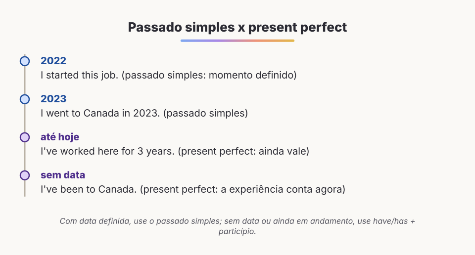
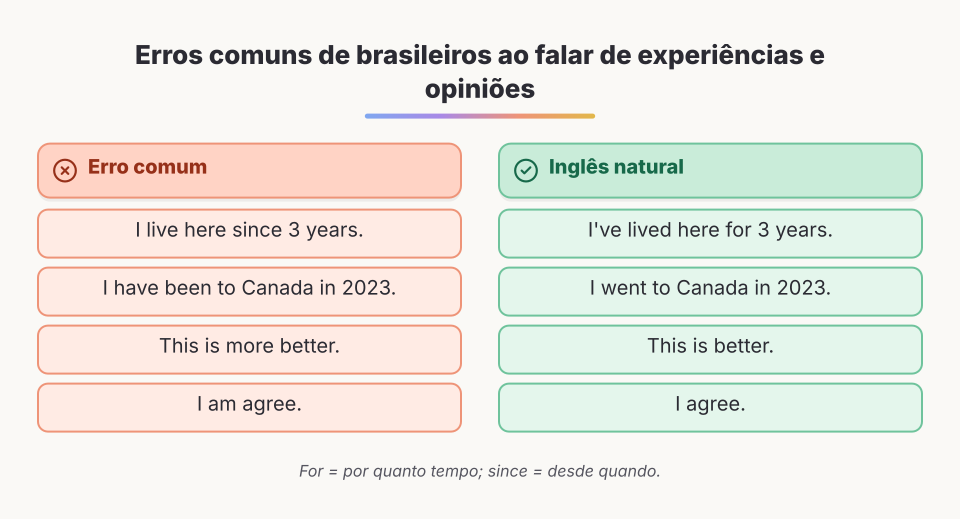

# 9. Conversas mais longas: experiências e opiniões

> 🗺️ **Neste capítulo:** você vai falar por 2 minutos sobre experiências (*I've been to...*, *I've worked here for 3 years*) e comparar duas opções dando a sua opinião, com o *present perfect*, os comparativos e as frases de opinião e de conversa leve (*small talk*) · ⏱️ ~80 min

**Meta do capítulo (CEFR B1):** falar 2 minutos sobre experiências e comparar duas opções dando sua opinião.

> 🔥 **Aquecimento:** (1) Escreva em inglês, com *must not*: "Você não pode compartilhar a sua senha." (2) O que *eventually* quer dizer?
>
> 

> 
Ver resposta

>
> (1) ***You must not share your password.*** Depois de *must* vem a forma base, sem *to*. (2) "Por fim", e não "eventualmente".
>
> 

## De onde paramos

No capítulo 8 você leu texto técnico e aprendeu o que é obrigatório e o que é opcional. Agora a meta volta à conversa. Em uma reunião, em um almoço ou em uma viagem, as pessoas perguntam *Have you been here before?* ou *What do you think?*. Para responder em mais de duas frases, você precisa de **um tempo verbal novo**, de **comparações** e de **frases de opinião**.

## Comece pelo resultado

Leia esta conversa curta, escrita para o livro. Lucy e Bruno se encontram em um evento em Londres. Os dados são fictícios.

> **Lucy:** Hi Bruno! Have you been to London before?
> **Bruno:** No, I haven't. This is my first time. But I've been to Manchester twice.
> **Lucy:** Really? I lived there for five years. I've worked in London since 2024.
> **Bruno:** How do you like London?
> **Lucy:** In my opinion, it's more exciting than Manchester, but it's also more expensive. What do you think?
> **Bruno:** I agree. Manchester is cheaper and quieter, but London has the best restaurants. I'd say it's the busiest city I've visited.

Em 6 falas, aparecem três ideias novas: ***have been*** (experiência), ***since*** (desde quando) e os **comparativos** (*more exciting, cheaper, the best*). Os modelos de opinião *In my opinion* e *I'd say* ficam para o fim do capítulo.

## Present perfect: experiências e situações que continuam

**O *present perfect* se forma com *have* ou *has* mais o particípio do verbo (*been, seen, done*) e liga o passado ao presente.**

Em português, você usa o presente para dizer "moro aqui há 3 anos". Em inglês, isso exige o *present perfect*: ***I've lived here for 3 years***. A frase em passado simples (*I lived here for 3 years*) diz que você **já não mora** lá.

**Como se forma:**

| Frase | Forma |
| --- | --- |
| Afirmativa | *I **have** worked here. / She **has** worked here.* |
| Contração | *I've worked. / She's worked.* |
| Negativa | *I **haven't** been there. / He **hasn't** seen it.* |
| Pergunta | ***Have** you been there? / **Has** she seen it?* |

**Particípio.** Nos verbos regulares, é igual ao passado (*worked, visited*). Nos irregulares (capítulo 6), muitos têm uma terceira forma:

| Verbo | Passado | Particípio |
| --- | --- | --- |
| be | was / were | **been** |
| go | went | **gone** |
| see | saw | **seen** |
| do | did | **done** |
| write | wrote | **written** |
| take | took | **taken** |
| eat | ate | **eaten** |
| speak | spoke | **spoken** |
| buy | bought | **bought** |
| make | made | **made** |
| have | had | **had** |

**Quatro usos que cobrem a maior parte da conversa:**

1. **Experiência de vida, sem data:** *I've been to Canada. Have you ever eaten sushi?* Use ***ever*** nas perguntas e ***never*** nas negativas (*I've never been to Canada*).
2. **Situação que continua:** *I've worked here **for** 3 years / **since** 2022.* Use ***for*** + período de tempo (*for 3 years, for two weeks*) e ***since*** + ponto de partida (*since 2022, since Monday*). A pergunta é ***How long have you worked here?***
3. **Resultado agora:** *I've lost my key card.* (E, por isso, não consigo entrar.)
4. **Notícia recente, com *just, already, yet*:** *I've just sent the e-mail. I've already seen it. Have you finished yet?* (*Yet* vai nas perguntas e negativas e vem no fim da frase.)

**A regra que decide entre os dois tempos.** Com **data definida** (*yesterday, last week, in 2023, two days ago*), use o **passado simples** (capítulo 6). Sem data, ou com uma situação que ainda vale hoje, use o **present perfect**.

- *I went to Canada **in 2023**.* (data definida)
- *I've been to Canada.* (sem data; a experiência importa agora)
- *I've worked here **since** 2022.* (ainda trabalho aqui)

> 💡 **Analogia:** pense no *present perfect* como **uma ponte** entre o passado e o presente. O passado simples é uma foto datada na parede ("2023, Canadá"): ela mostra um momento que acabou. O *present perfect* é um álbum que continua aberto: o que está dentro ainda vale para quem você é hoje.
> **Pares:** foto datada = passado simples; álbum aberto = *present perfect*; a data na foto = *yesterday, in 2023, last week*.
> **Onde a analogia falha:** o álbum guarda **tudo** o que já aconteceu, mas o *present perfect* só cabe quando a experiência ou a situação tem relação com o presente. Para um fato isolado, use o passado simples.

**Pronúncia.** *I've* soa /aɪv/ ≈ "aiv"; *she's* soa /ʃiːz/ ≈ "chiz"; *haven't* /ˈhævənt/ ≈ "rávent". A contração é a forma normal na fala: dizer *I have worked* devagar soa duro. Treine a contração.

> ⚠️ **Erro comum 1:** *I live here since 3 years.* O correto é ***I've lived here for 3 years.*** *Since* pede um ponto de partida (*since 2022*); *for* pede um período (*for 3 years*).
>
> ⚠️ **Erro comum 2:** *I have been to Canada in 2023.* Com data definida, o passado simples: ***I went to Canada in 2023.***
>
> ⚠️ **Erro comum 3:** *I have 3 years working here.* O correto é ***I've worked here for 3 years.***

## Comparativos e superlativos

Para escolher entre duas opções (dois hotéis, dois planos, duas cidades), você compara. Em inglês, a forma do adjetivo depende do tamanho dele.

**O comparativo diz que uma coisa tem mais (ou menos) de uma qualidade do que outra; o superlativo diz que é o máximo entre três ou mais.**

| Tipo de adjetivo | Comparativo (com *than*) | Superlativo |
| --- | --- | --- |
| 1 sílaba | *cheap → cheap**er** than* | *the cheap**est*** |
| 1 sílaba terminada em *-e* | *safe → safe**r** than* | *the safe**st*** |
| vogal + consoante (dobra) | *big → big**ger** than* | *the big**gest*** |
| 2 sílabas em *-y* | *busy → bus**ier** than* | *the bus**iest*** |
| 2 ou mais sílabas | ***more** expensive than* | ***the most** expensive* |
| irregulares | *good → **better** than* | *the **best*** |
| irregulares | *bad → **worse** than* | *the **worst*** |

Alguns de duas sílabas aceitam as duas formas (por exemplo, *simple*: *simpler* ou *more simple*). Na dúvida, escolha a que você ouve mais.

**A palavra *than*.** É ***than***, e não *that*: *Manchester is cheaper **than** London*. **Igualdade:** ***as ... as***: *This hotel is as expensive as that one.* **Menos:** ***less*** + adjetivo (*less expensive*) ou ***not as ... as*** (*not as big as*).

> ⚠️ **Erro comum 1:** *more better* e *more cheaper*. Um adjetivo recebe **uma** marca só: *better* ou *more expensive*, nunca as duas.
>
> ⚠️ **Erro comum 2:** *Manchester is cheaper that London.* O certo é *than*.

## Dar opinião, concordar e discordar

**Opinião** é o que você pensa; precisa vir **com um motivo**, senão a conversa trava. A fórmula é: **opinião + *because* / *so* / *although*** + motivo.

| Função | Frases prontas |
| --- | --- |
| Dar opinião | *I think... / In my opinion... / I'd say...* |
| Concordar | *I agree. / That's true. / Me too. / I see your point.* |
| Discordar com educação | *I see your point, but... / I'm not sure about that. / I don't think so.* |
| Dar o motivo | *because (porque) / so (por isso) / although (embora)* |

**Exemplo completo:** *In my opinion, the train is better than the bus because it's faster. I agree that it's more expensive, **although** the seats are more comfortable.*

- ***because*** dá o motivo: *It's better **because** it's cheaper.*
- ***so*** dá a consequência: *It's cheap, **so** I prefer it.*
- ***although*** mostra um contraste: *It's slow, **although** it's cheap.*

**A armadilha de "concordo".** Em português, "eu estou de acordo". Em inglês, o verbo é *agree*, sem *to be*: ***I agree***, e não *I am agree*. Para discordar: ***I disagree*** ou, mais suave, *I'm not sure about that*.

**Tom.** Em reuniões, *I don't think so* soa direto demais para um colega que você mal conhece; prefira *I see your point, but...* e diga o seu motivo.

> ⚠️ **Erro comum:** *I am agree.* O verbo *agree* já traz a ideia de "estar de acordo": *I agree.*

## Small talk: conversa leve que abre a conversa

***Small talk* é a conversa curta e leve que as pessoas têm antes de falar de trabalho: tempo, fim de semana, viagem, comida.** Ela serve para criar clima, e não para trocar informação.

| Situação | Pergunta | Resposta com um complemento |
| --- | --- | --- |
| Segunda-feira | *How was your weekend?* | *It was nice, thanks. I went to the beach. And yours?* |
| Evento | *What do you do?* | *I work in IT. I've been here for three years.* |
| Cidade nova | *Have you been here before?* | *No, it's my first time. Have you?* |
| Hotel | *How do you like the city?* | *I like it. It's busier than my city.* |

**A regra de ouro é "responda e devolva":** responda a pergunta com **uma ou duas frases** e **devolva a pergunta** (*And you? / And yours? / Have you?*). Assim a conversa não vira um interrogatório.

**Assuntos que costumam ser seguros:** o tempo, a viagem, a comida, o trabalho em geral, o fim de semana. **Evite** como primeira pergunta: dinheiro, política, religião e idade. Cada cultura tem regras diferentes, então observe o que o outro faz.

## 🏋️ Pratique

**1. Exemplo resolvido.** Quebre a frase **"Eu trabalho aqui há 3 anos"** em passos:

Passo 1: a situação **ainda continua** → *present perfect*. Passo 2: *work* → particípio *worked*. Passo 3: três anos é um **período** → *for*. Resultado: ***I've worked here for 3 years.***

**2. Complete.** Escolha: *been, for, since, worse, than, agree*.

a) I've lived here ___ 2022.
b) Have you ever ___ to Canada?
c) The hotel is cheaper ___ the hostel.
d) I ___ with you.
e) My old phone was bad, but this one is ___.

Ver resposta

a) **since**. 2022 é um ponto de partida.
b) **been**. Particípio de *be*.
c) **than**. Comparação; nunca *that*.
d) **agree**. Sem *am*.
e) **worse**. Irregular, e não *more bad*.

**3. Leia e responda.** Releia a conversa de Lucy e Bruno, no início do capítulo.

a) Bruno já esteve em Londres?
b) Quantas vezes ele esteve em Manchester?
c) Por quanto tempo Lucy morou em Manchester, e desde quando trabalha em Londres?
d) Para Lucy, o que é mais caro: Londres ou Manchester?
e) Para Bruno, o que Londres tem de melhor?

Ver resposta

a) Não (*No, I haven't. This is my first time*).
b) Duas vezes (*twice*).
c) Por cinco anos (*for five years*); trabalha em Londres desde 2024 (*since 2024*).
d) Londres (*more expensive*).
e) Os melhores restaurantes (*the best restaurants*).

**4. Faça sozinho.** Corrija o erro de cada frase:

a) I live here since three years.
b) She has gone to Canada in 2023.
c) This is more better than that.
d) I am agree with you.
e) London is bigger that Manchester.

Ver resposta

a) **I've lived here for three years.** *For* + período, e o tempo certo é o *present perfect*.
b) **She went to Canada in 2023.** Data definida pede o passado simples.
c) **This is better than that.** Uma marca só.
d) **I agree with you.** Sem *am*.
e) **London is bigger than Manchester.** *Than*, e não *that*.

**5. Desafio (fala).** Grave com o celular uma fala de **2 minutos** (só a sua voz) com este roteiro, usando dados reais ou fictícios:

1. **Uma experiência** (*I've been to... / I've never...*) e **uma situação que continua** (*I've worked/lived/studied... for/since...*).
2. **Uma comparação** entre duas opções (duas cidades, dois hotéis, dois jeitos de trabalhar): *A is ...er than B*, *B is more ... than A*.
3. **Uma opinião com motivo** (*In my opinion... because...*) e uma frase com *although*.
4. **Uma pergunta de volta** ao ouvinte (*What do you think?*).

Depois de gravar, confira:

- [ ] Usei *present perfect* **sem** data definida (e passado simples **com** data).
- [ ] Usei *for* com um período e *since* com um ponto de partida.
- [ ] Fiz uma comparação com *than* e um superlativo com *the*.
- [ ] Dei uma opinião **com motivo** (*because* ou *so*).
- [ ] Concordei ou discordei **com educação** (*I see your point, but...*).
- [ ] A fala dura cerca de 2 minutos.

Ver um exemplo de fala

> I've lived in São Paulo for ten years. I've been to Rio three times, but I've never been to Salvador. I think São Paulo is bigger and busier than Rio, but Rio is more beautiful. In my opinion, São Paulo has the best restaurants, although it's more expensive. I've worked from home since 2023, so I like quiet places. Which city do you prefer? What do you think?

Esse exemplo tem 68 palavras, o que dá menos de 1 minuto de fala. Para chegar a 2 minutos, acrescente detalhes: o que você fez, quando e por quê. Fale com as suas palavras, e não decore este texto.

**Fluência:** a técnica das repetições do capítulo 6 serve aqui também. Faça a mesma fala três vezes seguidas: a primeira com 60 segundos, a segunda com 45 e a terceira com 30. A cada repetição você corta o que é desnecessário e fala mais solto. Esse formato é uma adaptação simples da ideia de repetir a mesma fala; não tem um número mágico. Depois, faça os cartões do capítulo, com uma frase completa de *present perfect* por cartão.

## 🧠 Revisão rápida

1. Quando se usa *for* e quando se usa *since*?
2. Por que *I have been to Canada in 2023* está errado?
3. Quais são o comparativo e o superlativo de *good*, *cheap* e *expensive*?
4. Como se concorda e como se discorda com educação?
5. (Capítulo 6) Qual é o passado de *go* e de *buy*, e como fica a pergunta *Você foi ao banco ontem?*

Ver resposta

1. *For* + período (*for 3 years*); *since* + ponto de partida (*since 2022*).
2. Porque há uma data definida (*in 2023*); o certo é ***I went to Canada in 2023.***
3. *Good* → *better, the best*; *cheap* → *cheaper, the cheapest*; *expensive* → *more expensive, the most expensive*.
4. *I agree. / That's true.*; *I see your point, but... / I'm not sure about that.*
5. ***Went*** e ***bought***; ***Did you go to the bank yesterday?***

## 🤖 Estude com um tutor de IA

> 💬 **Prompt 1 (conversa):** "Vamos treinar conversa em inglês, nível B1. Você será uma pessoa que conheci em um evento. Faça *small talk* comigo e pergunte sobre minhas experiências (*Have you ever...?*) e opiniões. Faça uma pergunta de cada vez, espere minha resposta e, no fim, aponte meus erros de *present perfect*, comparativos e opinião, explicando em português. Use só dados fictícios."

> 💬 **Prompt 2 (correção):** "Aqui está a transcrição da minha fala de 2 minutos: [minha fala]. Aponte onde errei o uso de *for/since*, de *present perfect* x passado simples e de comparativos, sem dar a versão corrigida. Depois me peça para falar de novo."

> ⚠️ A IA pode errar e tende a elogiar demais. Confira com a lista do capítulo. Se o seu aplicativo tem modo de voz, use-o para treinar a pronúncia, mas **não compartilhe dados pessoais ou da empresa**.

> ➡️ **Próximo passo:** no capítulo 10 você vai resolver **imprevistos** em uma ligação e em uma videochamada, com *will*, a primeira condicional (*if*) e frases para pedir que repitam.

## 📌 Resumo

| Item | Em uma frase |
| --- | --- |
| *Present perfect* | *Have/has* + particípio: experiência sem data ou situação que continua. |
| *For* x *since* | *For* + período; *since* + ponto de partida. |
| Passado simples x *present perfect* | Com data definida, passado simples; sem data, *present perfect*. |
| Comparativo | *-er than* ou *more ... than*; irregulares *better* e *worse*. |
| Superlativo | *the -est* ou *the most ...*; *the best*, *the worst*. |
| Opinião | *I think / In my opinion / I'd say* + motivo (*because, so, although*). |
| Concordar e discordar | *I agree* (sem *am*); *I see your point, but...* |
| *Small talk* | Responda em uma ou duas frases e devolva a pergunta. |

**Você consegue?** Sem olhar, fale por 2 minutos sobre uma experiência, compare duas opções e dê a sua opinião com um motivo. Se conseguiu, cumpriu a meta do capítulo.

## 📚 Fontes

- British Council LearnEnglish, *Present perfect* (experiência, *ever/never*, *for/since*, *just/already/yet*): https://learnenglish.britishcouncil.org/free-resources/grammar/b1-b2/present-perfect (conferido em 2026-11-28)
- British Council LearnEnglish, *Comparative adjectives* (regras de *-er*, *more*, irregulares e *than*; a página não trata de superlativos, que aqui seguem o uso comum): https://learnenglish.britishcouncil.org/free-resources/grammar/a1-a2/comparative-adjectives (conferido em 2026-11-28)
- British Council LearnEnglish, lista de verbos irregulares (particípios *been, gone, seen, done, written, taken, eaten, spoken*): https://learnenglish.britishcouncil.org/free-resources/grammar/english-grammar-reference/irregular-verbs (conferido em 2026-11-28)

> 🔁 **Revise hoje:** capítulos 2, 6 e 8.

<!-- nav:start -->
---

[◀ Capítulo anterior](08-lendo-documentacao-tecnica.md) · [Mapa do livro](../README.md) · [Próximo capítulo ▶](10-imprevistos-ligacoes-e-videochamadas.md)
<!-- nav:end -->
