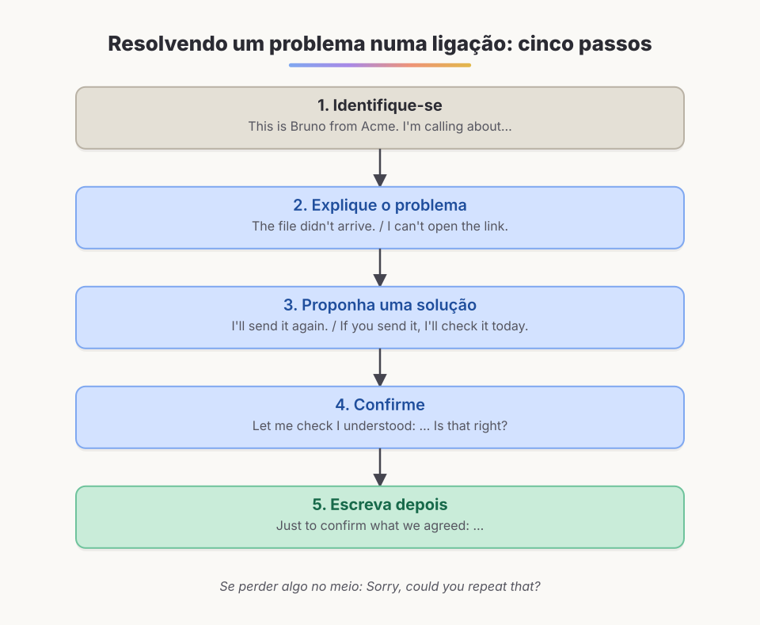
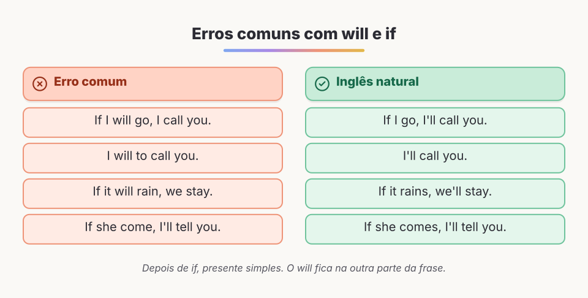

# 10. Imprevistos, ligações e videochamadas

> 🗺️ **Neste capítulo:** você vai resolver um problema em uma ligação ou videochamada: explicar o que aconteceu, propor uma solução com *will* e com a primeira condicional (*if*), pedir que repitam quando não entender e confirmar o combinado · ⏱️ ~80 min

### 📇 Folha-resumo: parte 4

![Folha-resumo da parte 4: Will (decisão na hora, oferta e promessa, won't); Primeira condicional (if + presente simples, will + verbo, nunca If I will); Pedir repetição (Could you repeat that?, more slowly, Let me check I understood); Ligação e vídeo (Hold on, You're on mute, You're breaking up); Confirmar (Just to confirm..., por escrito, grave só a sua voz); Entregas (2 e-mails de 80 a 120 palavras, resumo da documentação, conversa de 5 minutos); Autoavaliação (10 linhas, notas de 1 a 3, não é certificação, a entrega é a prova); Continuidade (20 minutos por dia, cartões, leitura, escuta, fala ou escrita).](../img/c00-parte-4-imprevistos-e-projeto.svg)

- [10. Imprevistos, ligações e videochamadas](10-imprevistos-ligacoes-e-videochamadas.md)
- [11. Projeto final: uma semana de trabalho no exterior](11-projeto-final-uma-semana-de-trabalho-no-exterior.md)

**Meta do capítulo (CEFR B1):** resolver um problema numa ligação: explicar, propor solução e confirmar.

> 🔥 **Aquecimento:** (1) Complete: *I ___ here since 2022.* (*work*) (2) Qual é o comparativo de *good* e de *expensive*?
>
> 

> 
Ver resposta

>
> (1) ***I've worked here since 2022.*** *Since* + ponto de partida pede o *present perfect*. (2) ***better*** e ***more expensive***.
>
> 

## De onde paramos

No capítulo 9 você falou de experiências e de opiniões em uma conversa tranquila. Um imprevisto é outra situação: o arquivo não chegou, a reunião caiu, o voo atrasou. Você precisa **explicar o problema**, **propor uma solução** e **conferir se entendeu**, muitas vezes em voz, sem ver o rosto da pessoa. É o contexto mais difícil para quem estuda sozinho, e por isso tem um roteiro.

## Comece pelo resultado

Leia esta ligação, escrita para o livro. Bruno liga para o suporte técnico de uma empresa porque não consegue abrir um arquivo. Os dados são fictícios.

> **Sam:** Good morning, Acme support. This is Sam. How can I help you?
> **Bruno:** Hi Sam, this is Bruno Souza from Brightway. I'm calling about a file. I can't open the link in your e-mail.
> **Sam:** I'm sorry to hear that. Could you tell me the error message?
> **Bruno:** It says "access denied".
> **Sam:** Sorry, could you repeat that more slowly?
> **Bruno:** Of course. A-C-C-E-S-S, denied.
> **Sam:** Thanks. I'll send you a new link now. If you open it today, I'll check that it works.
> **Bruno:** That would be great. Let me check I understood: you'll send a new link, and I'll tell you if it works. Is that right?
> **Sam:** Exactly. I'll write you an e-mail to confirm.

A conversa tem cinco movimentos: **se identificar, explicar, propor, confirmar** e **registrar por escrito**. Neste capítulo você aprende as frases de cada um.

## Will: decisões na hora, ofertas e promessas

**Usamos *will* (forma curta: *'ll*) para decidir algo no momento em que falamos, para oferecer ajuda e para prometer.**

Em português, "eu envio agora" e "vou enviar" são parecidos. Em inglês, a escolha muda o sentido:

| Situação | Forma | Exemplo |
| --- | --- | --- |
| Decisão **na hora** | *will* | *There's no signal. **I'll** call you back.* |
| Oferta de ajuda | *will* | *I'll send you a new link.* |
| Promessa | *will* | *I'll check it today.* |
| Plano **já decidido** | *going to* (cap. 5) | *I'm going to call the client at 3.* |

**Forma.** *Will* é um verbo modal, como *must* e *should* do capítulo 8: vem antes de um verbo na forma base, **sem *to*** e **sem *-s*** na terceira pessoa (*She'll call*, e não *She wills call*).

| Afirmativa | Negativa | Pergunta |
| --- | --- | --- |
| *I'll send it.* | *I **won't** forget.* (*will not*) | ***Will** you send it?* |
| *She'll call you.* | *It **won't** work.* | ***Will** he be there?* |

**Pronúncia.** *I'll* soa /aɪl/ ≈ "ail"; *you'll* /juːl/ ≈ "iul"; *won't* /wəʊnt/ no inglês britânico e /woʊnt/ no americano ≈ "uônt". *Won't* e *want* são parecidos; ouça a vogal, e não só o final.

**Will x going to.** *Going to* é para um plano que já existia antes de você falar (*I'm going to call the client at 3*). *Will* é para o que você decide ali, na hora (*Oh, the line is bad. I'll call you back*).

> 💡 **Analogia:** pense em ***will* como apertar um botão agora**, e em ***going to* como uma agenda já preenchida**. Quando alguém diz "o arquivo não chegou", você decide ali ("I'll send it again"): botão. Quando você já marcou para as 3 da tarde, está na agenda: *going to*.
> **Pares:** botão apertado agora = *will*; agenda preenchida = *going to*.
> **Onde a analogia falha:** o botão também serve para promessas e ofertas, que não são "decisões súbitas"; mas a ideia de que a decisão vem **junto com a fala** continua valendo.

> ⚠️ **Erro comum:** *I will to call you.* ou *I will calls you.* Depois de *will*, a forma base: ***I'll call you.***

## Primeira condicional: *if* + presente, *will* + verbo

**A primeira condicional fala de algo que pode acontecer no futuro e do que vai acontecer então: *If* + presente simples, *will* + verbo.**

*If you send the file, I'll check it today.* ("Se você mandar o arquivo, eu confiro hoje.")

A frase tem duas partes:

| Condição (com *if*) | Resultado (com *will*) |
| --- | --- |
| *If it arrives tomorrow,* | *I'll call you.* |
| *If you open the link,* | *I'll check it.* |
| *If the connection is bad,* | *we'll use the phone.* |

**A parte que surpreende brasileiros:** depois de *if*, o verbo fica **no presente simples**, e não no futuro. Em português, usamos o futuro do subjuntivo ("se você mandar"). Em inglês, o *if* já traz a ideia de futuro: *If you **send**...*, e não *If you will send...*. O *will* fica só no **resultado**.

**Ordem.** As duas partes podem trocar de lugar. Com a vírgula, a frase com *if* vem primeiro: *If you open it, I'll check it.* Sem vírgula, o resultado vem primeiro: *I'll check it **if** you open it.*

**Outras palavras de condição.** *When* é para algo que vai acontecer com certeza (*When I arrive, I'll call you*); *if* é para algo possível. *Unless* quer dizer "a menos que" (*I'll call you unless you e-mail me first*).

> ⚠️ **Erro comum 1:** *If I will go, I call you.* O correto é ***If I go, I'll call you.*** O *will* vai no resultado, não depois de *if*.
>
> ⚠️ **Erro comum 2:** esquecer o *-s* na terceira pessoa do *if*: *If she come...* O certo é ***If she comes, I'll tell you.***

## Pedir repetição e esclarecer

Em uma ligação ou videochamada você não vê a boca de quem fala, e o áudio pode falhar. Pedir que repitam **não é falta de educação**; é parte da conversa. A estratégia é: **diga o que não entendeu**, **peça de novo** e **confirme com as suas palavras**.

| O que você quer | Frase pronta |
| --- | --- |
| Pedir que repita | *Sorry, could you repeat that?* |
| Pedir mais devagar | *Could you speak a bit more slowly?* |
| Entender uma palavra | *How do you spell that?* / *What does ... mean?* |
| Conferir o que entendeu | *Let me check I understood: ... Is that right?* |
| Perguntar se entendeu certo | *Do you mean ...?* |
| Pedir um momento | *Hold on a moment. / Just a second.* |

**A regra do reparo:** não diga só "what?" (soa brusco) nem "I don't understand" sem pedir nada. Diga **o que fazer**: *Could you repeat the last part?*.

**Soletrar.** Use o alfabeto do capítulo 2 para nomes e e-mails: *B-R-U-N-O*, *at*, *dot*. Para letras parecidas, diga *B as in boy*, ou seja, uma palavra comum que começa com a letra.

> ⚠️ **Erro comum:** ficar em silêncio e responder "yes" sem ter entendido. O pior resultado é um combinado errado. Peça de novo: *Sorry, I didn't catch that.* ("Desculpe, não ouvi direito.")

## Telefone e videochamada

**Telefone**, em ordem de uso:

| Momento | Frase |
| --- | --- |
| Atender | *Hello, this is Sam. / Acme support, Sam speaking.* |
| Ligar | *Hi, this is Bruno from Brightway. I'm calling about...* |
| Pedir alguém | *Could I speak to Lucy, please?* |
| Esperar | *Hold on, please. / One moment.* |
| Transferir | *I'll put you through.* |
| Terminar | *Thanks for your help. Have a good day!* |

**Videochamada.** Frases comuns em reuniões online:

- ***Can you hear me?*** / ***Can you see my screen?***
- ***You're on mute.*** (O seu microfone está desligado.)
- ***Could you share your screen?***
- ***The connection is bad.*** / ***You're breaking up.*** (A sua voz está falhando.)
- ***Let me turn my camera on.***

Algumas expressões de escritório, como *Let's circle back* ("vamos retomar isso depois"), aparecem em reuniões, mas são jargão de empresa e **variam entre empresas e países**. Reconheça-as; você não precisa usá-las.

**Confirme por escrito.** Depois da ligação, mande um e-mail curto (capítulo 7): *Just to confirm what we agreed: you'll send a new link today, and I'll let you know if it works.* Isso evita mal-entendidos e deixa um registro.

**Privacidade.** Não grave a conversa de outra pessoa sem a autorização dela; as regras sobre gravação variam por país, e este livro não as resume. Peça permissão (*Do you mind if I record this?*) e confira as regras locais. Para os exercícios deste livro, grave **só a sua própria voz**.

## 🏋️ Pratique

**1. Exemplo resolvido.** Frase: *Se você me mandar o número, eu confiro hoje.*

Passo 1: é uma condição possível no futuro → primeira condicional. Passo 2: a condição fica no **presente simples**: *If you send me the number*. Passo 3: o resultado leva *will*: *I'll check it today*. Resultado: ***If you send me the number, I'll check it today.***

**2. Complete.** Escolha: *I'll, won't, will, call, calls, speak*.

a) The line is bad. ___ call you back.
b) If he ___ me, I'll tell him.
c) I ___ forget. I promise.
d) ___ you send it today?
e) Could you ___ a bit more slowly?

Ver resposta

a) **I'll**. Decisão na hora.
b) **calls**. Depois de *if*, o presente simples, com *-s* na terceira pessoa.
c) **won't**. Promessa negativa (*will not*).
d) **Will**. Pergunta com *will*.
e) **speak**. Depois de *could*, a forma base.

**3. Leia e responda.** Releia a ligação de Bruno e Sam, no início do capítulo.

a) Qual é o problema de Bruno?
b) Que mensagem de erro aparece?
c) Como Sam pede que Bruno repita mais devagar?
d) O que Sam promete fazer? E o que Bruno vai fazer?
e) Que frase Bruno usa para conferir que entendeu?

Ver resposta

a) Ele não consegue abrir o link do e-mail (*I can't open the link*).
b) *Access denied*.
c) *Sorry, could you repeat that more slowly?*
d) Sam envia um novo link agora e confere se funciona; Bruno abre o link hoje e avisa (*If you open it today, I'll check that it works*).
e) *Let me check I understood: ... Is that right?*

**4. Faça sozinho.** Corrija o erro de cada frase:

a) If I will see him, I tell him.
b) I will to send it tomorrow.
c) What? I don't understand.
d) If she come early, I'll wait.

Ver resposta

a) **If I see him, I'll tell him.** Presente depois de *if*; *will* no resultado.
b) **I'll send it tomorrow.** Sem *to*.
c) **Sorry, could you repeat that?** *What?* soa brusco, e "não entendo" sozinho não pede nada.
d) **If she comes early, I'll wait.** *-s* na terceira pessoa.

**5. Desafio (fala).** Encene em voz alta uma ligação de **cerca de 1 minuto** com este problema: **o seu pedido de hotel não aparece na reserva**. Você liga para a recepção e precisa: (1) se identificar, (2) explicar o problema, (3) propor uma solução com *I'll* e uma frase com *if*, (4) pedir que repitam uma vez e (5) confirmar o combinado. Grave só a sua voz e confira:

- [ ] Me identifiquei (*This is... I'm calling about...*).
- [ ] Expliquei o problema em uma ou duas frases curtas.
- [ ] Usei *will* para uma oferta ou promessa, sem *to* depois.
- [ ] Usei uma frase com *if* + presente + *will*.
- [ ] Pedi que repetissem de forma educada (*Could you...?*).
- [ ] Confirmei com *Let me check I understood: ...*.

Ver um exemplo de ligação

> **Bruno:** Hello, this is Bruno Souza. I'm calling about my reservation for next week. I can't find it in the system.
> **Reception:** Could you spell your last name, please?
> **Bruno:** S-O-U-Z-A. Sorry, could you speak a bit more slowly?
> **Reception:** Of course. We can't see it. If you send me the confirmation e-mail, I'll check it today.
> **Bruno:** I'll send it now. Let me check I understood: you'll check the reservation if I send the e-mail. Is that right?
> **Reception:** That's right.

**Fluência:** repita a sua ligação três vezes, cada vez mais rápido e sem ler. Depois, faça os cartões do capítulo: um cartão por frase de reparo, com a frase completa.

## 🧠 Revisão rápida

1. Quando se usa *will* e quando se usa *going to*?
2. Qual é a estrutura da primeira condicional, e por que *If I will go* está errado?
3. Que frase você usa para pedir que repitam mais devagar?
4. Como se confere o que entendeu, em inglês?
5. (Capítulo 8) Qual é a diferença entre *must not* e *don't have to*? (Capítulo 9) Complete: *I ___ here for three years.* (*live*)

Ver resposta

1. *Will* para decisão na hora, oferta e promessa; *going to* para plano já decidido.
2. *If* + presente simples, *will* + verbo; depois de *if* o verbo fica no presente, e o *will* vai no resultado.
3. *Sorry, could you repeat that more slowly?* ou *Could you speak a bit more slowly?*
4. *Let me check I understood: ... Is that right?*
5. *Must not* = proibido; *don't have to* = não é obrigatório. ***I've lived here for three years.***

## 🤖 Estude com um tutor de IA

> 💬 **Prompt 1 (conversa):** "Vamos treinar uma ligação de trabalho em inglês, nível B1. Você será um atendente de suporte e eu sou um cliente com um problema. Faça uma pergunta de cada vez, fale um pouco rápido e, se eu não entender, espere que eu peça para repetir. No fim, aponte meus erros de *will*, de *if* e de pedido de repetição, explicando em português. Use só dados fictícios."

> 💬 **Prompt 2 (correção):** "Aqui está a transcrição da minha ligação: [minha ligação]. Aponte onde errei o uso de *will* e de *if* e onde faltou confirmar o combinado, sem dar a versão corrigida. Depois me peça para falar de novo."

> ⚠️ A IA pode errar e tende a elogiar demais. Confira com a lista do capítulo. Não compartilhe dados de clientes ou da empresa. Se for gravar, grave só a sua voz.

> ➡️ **Próximo passo:** no capítulo 11 você junta tudo em um **projeto final**: uma semana de trabalho no exterior, com e-mails, leitura de documentação e uma conversa gravada de 5 minutos.

## 📌 Resumo

| Item | Em uma frase |
| --- | --- |
| *Will* | Decisão na hora, oferta ou promessa; forma base depois, sem *to*. |
| *Won't* | *Will not*; serve para promessas negativas e para dizer que algo não funciona. |
| *Will* x *going to* | *Will* decide agora; *going to* é plano já feito. |
| Primeira condicional | *If* + presente simples, *will* + verbo; nunca *If I will*. |
| Pedir repetição | *Sorry, could you repeat that? / more slowly?* |
| Conferir | *Let me check I understood: ... Is that right?* |
| Telefone | *This is... I'm calling about... / Hold on / I'll put you through.* |
| Videochamada | *You're on mute / Can you see my screen? / You're breaking up.* |
| Confirmar por escrito | *Just to confirm what we agreed: ...* |
| Privacidade | Não grave outras pessoas sem permissão; no exercício, só a sua voz. |

**Você consegue?** Sem olhar, resolva um problema numa ligação de 1 minuto: explique, proponha uma solução com *I'll* e *if*, peça que repitam uma vez e confirme o combinado. Se conseguiu, cumpriu a meta do capítulo.

## 📚 Fontes

- British Council LearnEnglish, *Conditionals: zero, first and second* (primeira condicional: *if/when* + presente simples, *will* + infinitivo): https://learnenglish.britishcouncil.org/free-resources/grammar/b1-b2/conditionals-zero-first-second (conferido em 2026-11-28)
- British Council LearnEnglish, *Future forms: will, be going to, present continuous* (*will* para decisões no momento da fala; *going to* para planos já decididos): https://learnenglish.britishcouncil.org/free-resources/grammar/b1-b2/future-forms-will-be-going-present-continuous (conferido em 2026-11-28)
- British Council LearnEnglish, seção de escuta (níveis A1 a C1; a página não traz estratégias, e as frases de ligação e de videochamada deste capítulo seguem o uso comum, escritas para o livro): https://learnenglish.britishcouncil.org/skills/listening (conferido em 2026-11-28)

> 🔁 **Revise hoje:** capítulos 3, 7 e 9.

<!-- nav:start -->
---

[◀ Capítulo anterior](09-conversas-mais-longas-experiencias-e-opinioes.md) · [Mapa do livro](../README.md) · [Próximo capítulo ▶](11-projeto-final-uma-semana-de-trabalho-no-exterior.md)
<!-- nav:end -->
