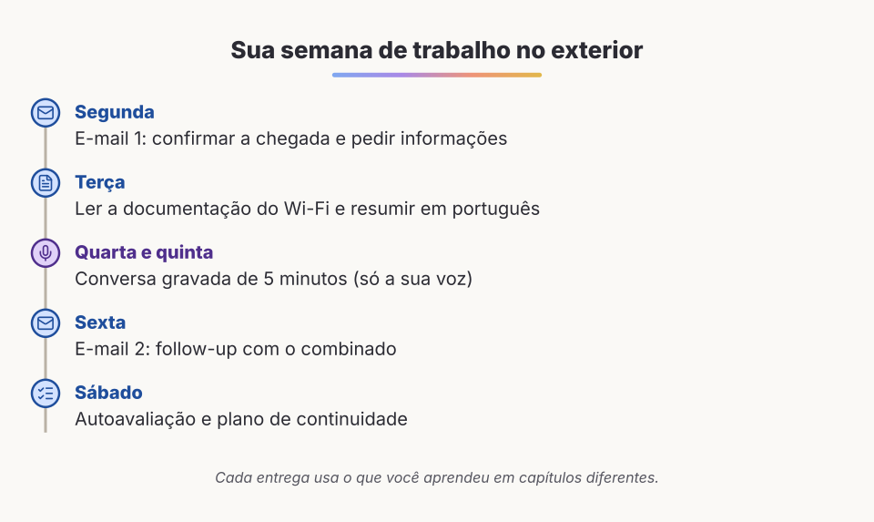
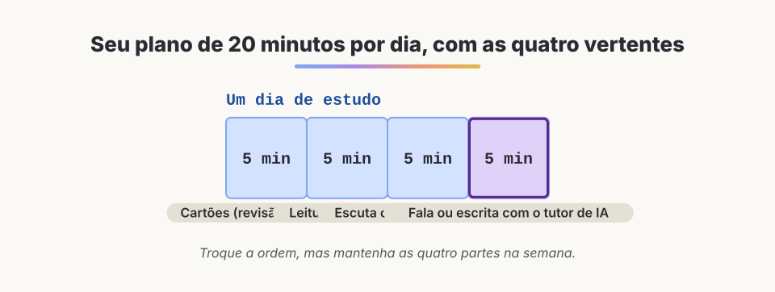

# 11. Projeto final: uma semana de trabalho no exterior

> 🗺️ **Neste capítulo:** você vai juntar tudo em uma semana de trabalho fictícia no exterior: escrever 2 e-mails, ler e resumir uma página de documentação e gravar uma conversa de 5 minutos, e depois avaliar o seu nível com uma lista de "eu consigo" e montar um plano para continuar · ⏱️ ~120 min

**Meta do capítulo (CEFR B1):** entregar 2 e-mails, 1 resumo de documentação e uma conversa de 5 minutos gravada, avaliados pela lista B1.

> 🔥 **Aquecimento:** (1) Complete: *If you ___ the link, I'll check it.* (*open*) (2) Como se pede que repitam mais devagar?
>
> 

> 
Ver resposta

>
> (1) ***If you open the link, I'll check it.*** Depois de *if*, o presente simples. (2) ***Sorry, could you repeat that more slowly?***
>
> 

## De onde paramos

Nos capítulos 1 a 10 você aprendeu a se apresentar, perguntar, falar da rotina, viajar, marcar reuniões, contar o que aconteceu, escrever e-mails, ler documentação, conversar sobre experiências e resolver imprevistos. Este capítulo **não ensina nada novo**: ele pede que você use o que já sabe, **sem olhar**, em uma situação que junta tudo. É o jeito de saber se você chegou à meta do livro.

## Como funciona o projeto

Você é uma pessoa que viaja a trabalho para uma semana em uma filial no exterior. Todos os nomes e dados são fictícios; use dados inventados em tudo o que escrever e gravar.

| Dia | Entrega | Capítulos usados |
| --- | --- | --- |
| Segunda | **E-mail 1:** confirmar a chegada e pedir uma informação (80 a 120 palavras) | 4, 5, 7 |
| Terça | **Resumo:** ler a documentação do Wi-Fi e resumir em português; fazer 3 perguntas em inglês | 8 |
| Quarta e quinta | **Conversa:** 5 minutos, gravados | 3, 9, 10 |
| Sexta | **E-mail 2:** follow-up do combinado (80 a 120 palavras) | 6, 7, 10 |
| Sábado | **Autoavaliação** e plano de continuidade | todos |

**Regras do projeto.**

1. **Construa primeiro, confira depois.** Faça cada entrega sem abrir os capítulos. Só então use a lista de checagem. Se travar em uma frase, anote e consulte; anote também o que foi difícil.
2. **Sem copiar os exemplos.** Os modelos ficam dentro de *Ver um exemplo*; use-os só para comparar.
3. **Grave só a sua voz.** Não grave outras pessoas sem a autorização delas.
4. **Dados fictícios em tudo**, inclusive nos prompts do tutor de IA.

## Segunda: o e-mail de chegada

**Cenário.** Você chega à filial na segunda-feira. Escreva para **Ms Clark**, a gerente local (formal, é o primeiro contato): confirme que chegou, diga o que você vai fazer nos próximos dias e peça **uma informação** (a senha do Wi-Fi de visitantes **ou** o horário da primeira reunião).

**Entrega:** um e-mail de **80 a 120 palavras**, com assunto, saudação, abertura e motivo, pedido com próximo passo e fecho com nome (capítulo 7).

**Lista de checagem (B1):**

- [ ] Tem as cinco partes do e-mail e o registro **formal** (*Dear Ms Clark*, *Kind regards*).
- [ ] Tem entre 80 e 120 palavras (sem contar o assunto).
- [ ] Usei *I'm going to...* ou o presente contínuo para o que vou fazer (capítulo 5).
- [ ] Pedi com *Could you please...?* (capítulo 4) e disse o próximo passo.
- [ ] Usei *on*/*at*/*in* corretamente nos horários e dias.

Ver um exemplo de e-mail

> **Subject:** Arrival on Monday and Wi-Fi information
>
> Dear Ms Clark,
>
> I'm writing to confirm that I arrived at the office this morning. Thank you for your help with my visit. This week, I'm going to work with the sales team, and I'm going to attend the meeting on Wednesday at 10 a.m. Could you please send me the visitor code for the Wi-Fi? I'd also like to know where the meeting room is. I'm free all afternoon, so you can call me at any time. Please let me know if you need anything from me before the meeting. Thank you again for your support.
>
> Kind regards,
> [seu nome]

O exemplo tem 101 palavras, contando saudação e fecho. *Attend* quer dizer "comparecer" (capítulo 8).

## Terça: ler a documentação

**Cenário.** Ms Clark responde e manda o guia do Wi-Fi da filial (texto fictício, escrito para o livro). **Aplique o roteiro do capítulo 8**: *skimming* para o objetivo, *scanning* para os dados e leitura dos avisos antes dos passos.

> **Visitor Wi-Fi: Quick guide**
>
> **Overview**
> This guide shows how to connect your laptop or phone to the office Wi-Fi. It takes about 5 minutes.
>
> **Requirements**
> You need a visitor code from the front desk. The code works for 24 hours. You must turn on the Wi-Fi on your device. You don't have to use a computer: a phone is fine.
>
> **Steps**
> 1. Open your Wi-Fi settings.
> 2. Choose the network **Brightway-Guest**.
> 3. Type your visitor code.
> 4. Open a web page and click **Accept**.
>
> **Warning**
> Do not share your code. You must not connect to the staff network. You should save your work before you connect. You may ask the front desk for a new code.
>
> **Troubleshooting**
> If the page does not open, turn the Wi-Fi off and on again. If the problem continues, contact support. Support is open from 9 a.m. to 5 p.m.

**Entrega (em duas partes):**

1. **Resumo em português, de 3 a 5 linhas**, que diga: o que a página pede, o que é obrigatório, o que é proibido e o que é opcional.
2. **Três perguntas em inglês** que a página responde (por exemplo, sobre o prazo, o nome da rede ou o horário do suporte), e as respostas curtas em inglês.

**Lista de checagem (B1):**

- [ ] O resumo diz o objetivo (conectar ao Wi-Fi, em cerca de 5 minutos).
- [ ] Separa **obrigatório** (código; Wi-Fi ligado), **recomendado** (salvar o trabalho), **proibido** (compartilhar o código; usar a rede dos funcionários) e **opcional** (celular basta; pedir um novo código).
- [ ] Os passos estão na ordem certa.
- [ ] Não traduzi palavra por palavra e não confundi *must not* com *don't have to*.
- [ ] As três perguntas estão em inglês correto (ordem de pergunta do capítulo 2; *do/does* do capítulo 3).

Ver um exemplo de resumo e de perguntas

> **Resumo:** a página explica como conectar o notebook ou o celular ao Wi-Fi de visitantes, em cerca de 5 minutos. Você precisa de um código da recepção, que vale por 24 horas, e o Wi-Fi do aparelho tem de estar ligado. Os passos são: abrir as configurações de Wi-Fi, escolher a rede Brightway-Guest, digitar o código e clicar em Accept numa página da web. É recomendável salvar o trabalho antes. Não compartilhe o código nem use a rede dos funcionários. Pedir um novo código é permitido, e o celular basta. Se a página não abrir, desligue e ligue o Wi-Fi; se continuar, fale com o suporte, que atende das 9h às 17h.
>
> **Perguntas:** *How long does the code work?* (*It works for 24 hours.*) *What is the name of the network?* (*Brightway-Guest.*) *When is support open?* (*From 9 a.m. to 5 p.m.*)

## Quarta e quinta: a conversa de 5 minutos

**Cenário.** Na quinta, na hora do almoço, você conversa com **Alex**, um colega da filial. Ele pergunta sobre você, sobre a sua cidade e sobre o seu trabalho, e depois surge um problema: o código do Wi-Fi expirou e você precisa resolvê-lo por telefone com o suporte.

**Como treinar.** Você pode fazer a conversa com um **parceiro de estudo** ou com um **tutor de IA em modo de voz**. Use o prompt abaixo. **Grave só a sua voz.** Com um parceiro de estudo, só grave a conversa inteira se ele concordar.

**Roteiro (cerca de 5 minutos, em quatro blocos):**

| Bloco | Tempo | O que fazer | Capítulos |
| --- | --- | --- | --- |
| 1. Apresentação e *small talk* | 1 min | Dizer quem você é, onde mora e trabalha; responder sobre o fim de semana | 1, 3, 9 |
| 2. Experiências | 1 min | Falar de uma viagem (*I've been to...*) e de uma situação que continua (*for/since*) | 6, 9 |
| 3. Comparação e opinião | 1 min 30 s | Comparar a sua cidade com a de Alex; dar uma opinião com motivo | 9 |
| 4. Imprevisto | 1 min 30 s | Resolver o código vencido por telefone: explicar, propor (*I'll...*, *if*), pedir repetição e confirmar | 10 |

**Lista de checagem (B1):**

- [ ] Falei por cerca de 5 minutos, sem parar por mais de alguns segundos.
- [ ] Usei *present perfect* e passado simples corretamente (*for/since*, datas).
- [ ] Fiz uma comparação (*than*) e dei uma opinião com motivo (*because*).
- [ ] Usei *will* e uma frase com *if* para propor a solução do imprevisto.
- [ ] Pedi que repetissem de forma educada e confirmei o combinado com *Let me check I understood: ...*.
- [ ] Quando não sabia uma palavra, expliquei com outras palavras em vez de parar.

Ver um trecho de exemplo (bloco 4)

> **Reception:** Brightway support, Sam speaking.
> **You:** Hi, this is [seu nome]. I'm calling about the Wi-Fi. My visitor code doesn't work.
> **Reception:** Could you read the code, please?
> **You:** Sure. Sorry, could I spell it? It's B-7-K-2. Hold on, I'll check the number again.
> **Reception:** Thanks. The code is old. If you come to the front desk, I'll give you a new one.
> **You:** Let me check I understood: I'll go to the front desk, and you'll give me a new code. Is that right?
> **Reception:** That's right.

## Sexta: o e-mail de follow-up

**Cenário.** Depois da conversa, você escreve para **Alex**, um colega (neutro ou informal), confirmando o que foi combinado e o que **você já fez** na semana.

**Entrega:** um e-mail de **80 a 120 palavras** com:

1. **o que aconteceu** (passado simples: *I went to the front desk, I got a new code*; capítulo 6);
2. **o que você já fez ou nunca fez** (*present perfect*; capítulo 9), em uma frase;
3. **o combinado** (*Just to confirm what we agreed: ...*; capítulo 10);
4. **um pedido** com *Could you...?* e o próximo passo.

**Lista de checagem (B1):**

- [ ] Tem as cinco partes do e-mail e o tom neutro (*Hi Alex*, *Best*).
- [ ] Tem entre 80 e 120 palavras.
- [ ] Usei passado simples para o que aconteceu e *present perfect* sem data definida.
- [ ] Usei *Just to confirm what we agreed:* e um pedido educado.
- [ ] Não usei *If I will*; depois de *if*, o presente.

Ver um exemplo de e-mail

> **Subject:** Following up on our lunch
>
> Hi Alex,
>
> Thanks for the lunch on Thursday. It was great to talk about our cities. After lunch, I went to the front desk and got a new Wi-Fi code, so now everything works. I've already read the guide, and I've never had a problem with the network since then. Just to confirm what we agreed: I'm going to send you the report on Monday, and you'll send me the numbers. Could you please let me know if you need anything else? If you are free on Tuesday, I'd like to meet at 10 a.m.
>
> Best regards,
> [seu nome]

O exemplo tem 99 palavras, contando saudação e fecho.

## Sábado: autoavaliação

**Autoavaliação não é certificação.** A lista abaixo é **sua**, escrita para este livro com base nas metas dos capítulos e no nível B1 de uso comum do inglês. Ela serve para você ver onde está; para um nível **oficial**, só um exame reconhecido (este livro não cita nome de exame, preço ou data).

Para cada linha, marque uma nota: **1** (ainda não consigo), **2** (consigo com ajuda ou olhando) ou **3** (consigo sozinho, sem olhar). Use as entregas da semana como **prova**: um "3" só vale se o e-mail, o resumo ou a gravação mostram isso.

| # | Eu consigo... | Prova | Capítulos |
| --- | --- | --- | --- |
| 1 | Me apresentar e fazer *small talk* por cerca de 1 minuto | gravação, bloco 1 | 1, 3, 9 |
| 2 | Pedir e dar informações com perguntas corretas (*what, where, when, who, how*) | gravação | 2 |
| 3 | Descrever a minha rotina e o meu trabalho | gravação, bloco 1 | 3 |
| 4 | Fazer pedidos educados e resolver situações de viagem | e-mail 1 | 4 |
| 5 | Falar do que estou fazendo e do que vou fazer, e marcar horários | e-mail 1 | 5 |
| 6 | Contar o que aconteceu, em ordem | e-mail 2 | 6 |
| 7 | Escrever um e-mail de trabalho de 80 a 120 palavras, no tom certo | e-mails 1 e 2 | 7 |
| 8 | Seguir instruções de uma página de documentação e resumir em português | resumo | 8 |
| 9 | Falar de experiências, comparar e dar opinião com um motivo | gravação, blocos 2 e 3 | 9 |
| 10 | Resolver um imprevisto em uma ligação: explicar, propor, pedir repetição e confirmar | gravação, bloco 4 | 10 |

**Como ler o resultado.**

| Soma (de 10 a 30) | O que significa | O que fazer |
| --- | --- | --- |
| 25 a 30 | Você cumpriu as metas do livro | Siga o plano de continuidade abaixo |
| 18 a 24 | Falta firmeza em algumas partes | Refaça os capítulos das linhas com nota 1 ou 2 e repita a entrega |
| 10 a 17 | Várias partes ainda precisam de apoio | Volte ao capítulo da linha mais baixa e refaça a sua prática, com os cartões |

Esses limites são uma **sugestão deste livro**, e não uma regra oficial. O que importa é cada linha: uma nota 1 mostra **exatamente** o capítulo que vale rever.

## Plano de continuidade: 20 minutos por dia

Aprender inglês não termina no capítulo 11. O que mantém o ritmo é **uma rotina pequena e repetida**. A estrutura é a das quatro vertentes do livro: entender (ler e escutar), falar e escrever, estudar a língua e treinar a fluência.

| Parte | O que fazer em 5 minutos | Onde |
| --- | --- | --- |
| Cartões | Rever as frases dos cartões: no dia seguinte, em 3 dias e em 1 semana | seus cartões (capítulo 1) |
| Leitura | Ler um texto curto de nível A2 ou B1 | seção de leitura do British Council LearnEnglish |
| Escuta | Ouvir um áudio curto e conferir as palavras novas em um dicionário com áudio | seção de escuta do British Council LearnEnglish |
| Fala ou escrita | Conversar ou escrever um parágrafo com o tutor de IA e pedir correção | prompts dos capítulos |

**Como manter.** Marque um horário fixo; comece pelos cartões (é a parte mais curta); troque a ordem das partes quando enjoar, mas **não deixe de fazer as quatro** na mesma semana; e, a cada 2 semanas, repita uma entrega deste projeto e compare com a primeira.

**Cuidado.** A IA pode errar e elogiar demais: confira com a lista do capítulo e com um dicionário. Evidências de estudo costumam vir de salas de aula e laboratórios, e não de quem estuda sozinho; por isso, o melhor teste é o seu: **você consegue fazer, sem olhar, o que a lista diz?**

Para ir além, os **Próximos caminhos** do livro sugerem três trilhas: inglês B1 → B2 para o trabalho (apresentações e negociação), inglês técnico para TI (vocabulário técnico, voz passiva e escrita de *issues*) e pronúncia e escuta para brasileiros.

## 🏋️ Pratique

O projeto da semana **é** a prática deste capítulo, e o *Pratique* tem uma escada com quatro degraus:

**1. Exemplo resolvido.** Veja o e-mail de exemplo de segunda. Marque, com cores ou números, as **cinco partes** (assunto, saudação, abertura, pedido, fecho) e os trechos de cada capítulo (*I'm going to* do 5, *Could you please* do 4, *attend* do 8).

**2. Complete.** Escolha: *since, for, if, will, must not, than*.

a) I've worked here ___ 2022.
b) ___ you send it, I'll check it today.
c) You ___ share your code.
d) The office is bigger ___ my old one.
e) I ___ call you back.

Ver resposta

a) **since**. Ponto de partida.
b) **If**. Condição; depois dela, o presente simples.
c) **must not**. Proibição (capítulo 8).
d) **than**. Comparação.
e) **will**. Decisão na hora (*I'll call you back*).

**3. Faça sozinho.** Corrija o erro de cada frase:

a) I have been to Canada in 2023.
b) I will to send the file tomorrow.
c) You don't have to share your code. (a página proíbe)
d) I am agree with you.
e) What? I don't understand.

Ver resposta

a) **I went to Canada in 2023.** Data definida: passado simples.
b) **I'll send the file tomorrow.** Sem *to*.
c) **You must not share your code.** *Don't have to* não é "proibido".
d) **I agree with you.** Sem *am*.
e) **Sorry, could you repeat that?** Pede a repetição de forma educada.

**4. Desafio.** Faça o **projeto completo** (segunda, terça, quarta e quinta, sexta e sábado). O desafio é cumprir cada lista de checagem **sem consultar os capítulos** e, no fim, preencher a autoavaliação com notas honestas.

## 🧠 Revisão rápida

1. Qual é a ordem das cinco partes de um e-mail de trabalho?
2. Qual é a diferença entre *skimming* e *scanning*, e por que ler os avisos antes dos passos?
3. Quando se usa *for* e quando se usa *since*?
4. Qual é a estrutura da primeira condicional?
5. Qual nota você deu à linha mais baixa da autoavaliação, e qual capítulo vai rever primeiro?

Ver resposta

1. Assunto, saudação, abertura e motivo, pedido ou informação com próximo passo, fecho com nome.
2. *Skimming* é a ideia geral; *scanning* é o dado específico; os avisos dizem o que **não** fazer.
3. *For* + período; *since* + ponto de partida.
4. *If* + presente simples, *will* + verbo.
5. Resposta pessoal: a linha de nota mais baixa indica o capítulo da coluna da direita.

## 🤖 Estude com um tutor de IA

> 💬 **Prompt 1 (conversa):** "Vamos fazer uma conversa de 5 minutos em inglês, nível B1. Você será Alex, um colega de uma filial no exterior. Comece com *small talk*, depois pergunte sobre minhas experiências e opiniões e, no fim, finja que há um problema com o meu código de Wi-Fi e eu preciso resolver por telefone. Fale em ritmo normal, e eu vou pedir para repetir quando precisar. Depois, aponte meus erros de tempo verbal, de *will* e *if* e de pedido de repetição, explicando em português. Use só dados fictícios."

> 💬 **Prompt 2 (correção):** "Aqui está o meu e-mail de follow-up: [meu e-mail em inglês]. Avalie pela lista B1: estrutura, tom, passado simples x *present perfect*, *Just to confirm what we agreed* e número de palavras. Aponte os erros sem dar a versão corrigida e depois me peça para reescrever."

> ⚠️ A IA pode errar e tende a elogiar demais. Confira com a lista do capítulo e com um dicionário. Não compartilhe dados reais de clientes, de colegas ou da empresa.

> ➡️ **Próximo passo:** veja os **Próximos caminhos** do livro e escolha uma trilha: B1 → B2 para o trabalho, inglês técnico para TI ou pronúncia e escuta para brasileiros.

## 📌 Resumo

| Item | Em uma frase |
| --- | --- |
| Projeto | Dois e-mails, um resumo de documentação e uma conversa de 5 minutos, feitos sem consulta. |
| Regra | Construa primeiro; confira depois pela lista de checagem. |
| Privacidade | Grave só a sua voz; use dados fictícios, também com a IA. |
| Autoavaliação | Dez linhas de "eu consigo", notas de 1 a 3, com a entrega como prova. |
| Limite | Autoavaliação não é certificação; nível oficial só em exame reconhecido. |
| Continuidade | 20 minutos por dia: cartões, leitura, escuta e fala ou escrita. |
| Próximo passo | B1 → B2 para o trabalho, inglês técnico para TI ou pronúncia e escuta. |

**Você consegue?** Sem olhar, escreva um e-mail de 80 a 120 palavras, resuma em português uma página de documentação curta e converse por 5 minutos sobre experiências, opiniões e um imprevisto. Se conseguiu, cumpriu a meta do livro.

## 📚 Fontes

- British Council LearnEnglish, seção de leitura (textos por nível, de A1 a C1): https://learnenglish.britishcouncil.org/skills/reading (conferido em 2026-11-28)
- British Council LearnEnglish, seção de escuta (áudios por nível, de A1 a C1): https://learnenglish.britishcouncil.org/skills/listening (conferido em 2026-11-28)
- Council of Europe. *CEFR Companion Volume* (2020): https://rm.coe.int/16809ea0d4 (não foi possível abrir em 2026-11-28; sem data de conferência). A lista de autoavaliação deste capítulo **não** é a do documento: foi escrita para o livro a partir das metas dos capítulos.

> 🔁 **Revise hoje:** capítulos 4, 8 e 10.

<!-- next-steps:start -->
## 🧭 Próximos caminhos

- **Inglês B1 → B2 para o trabalho**: Para reuniões, apresentações e negociação com mais fluência (apresentações · negociação · phrasal verbs frequentes · segunda condicional)
- **Inglês técnico para TI**: Para ler documentação, issues e escrever mensagens técnicas (vocabulário técnico · voz passiva · escrever issues e PRs)
- **Pronúncia e escuta para brasileiros**: Para entender sotaques reais e ser entendido com facilidade (vogais longas e curtas · connected speech · entonação)
<!-- next-steps:end -->

<!-- nav:start -->
---

[◀ Capítulo anterior](10-imprevistos-ligacoes-e-videochamadas.md) · [Mapa do livro](../README.md) · [Próximo capítulo ▶](12-simulado-final.md)
<!-- nav:end -->
