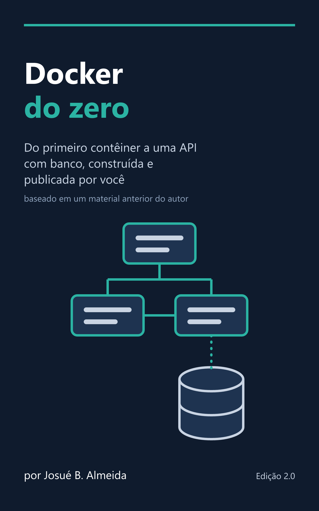

# Docker do zero

Do primeiro contêiner a uma API com banco, construída e publicada por você

Para quem programa, mas nunca usou contêineres. Ao terminar, você vai empacotar uma API com banco de dados em contêineres, com os dados persistentes numa rede própria, e publicar a imagem num registro. Referência: Docker Engine 29.9.3 e Docker Desktop 4.99.

## Comece aqui

- [Como estudar este livro](chapters/00-como-estudar-este-livro.md): organização, ritmos e hábitos de estudo.
- [Teste de nivelamento](chapters/00-como-estudar-este-livro.md#teste-de-nivelamento): descubra por qual capítulo começar, se você já usou o Docker.

## 📇 O livro numa página

![O livro numa página: 1. Por que contêineres: contêiner = processo isolado, usa o kernel do host sem VM, imagem é a receita e contêiner a cozinha. 2. Desktop no Windows: ligar WSL 2 e a virtualização, instalar o Docker Desktop, hello-world confirma a instalação. 3. Linux e Mac: Engine pelo repositório oficial, grupo docker equivale a root, Docker Desktop no Mac. 4. Ciclo de vida: run -d -p 127.0.0.1:8080:8000, stop dá exit 143 e kill dá exit 137, logs, exec e inspect --format. 5. Desktop na prática: janela e CLI falam com o mesmo motor, docker context ls e use, o que se repete fica na CLI. 6. Imagens e Docker Hub: nome registro/ns/repo:tag, a tag muda e o digest não, pull, tag, rmi, save e load. 7. Primeiro Dockerfile: docker build -t dz-api:1.0 ., CMD na forma exec e USER app, .dockerignore deixa o .env de fora. 8. Builds enxutos: requirements antes do código, multi-stage de 511 MB para 197 MB, limpar no mesmo RUN. 9. Volumes: docker rm não apaga o volume, volume × bind mount × tmpfs, backup com tar e teste da restauração. 10. Redes: rede própria acha por nome, localhost é o próprio contêiner, só a API com -p 127.0.0.1. 11. Publicar a imagem: docker tag e docker push, versão 1.1.0 e 1.1 e não só latest, login com token e nunca a senha. 12. Projeto final: API e banco na rede dz-net, configuração por -e, dados no volume dz-dados.](img/c00-o-livro-numa-pagina.svg)

## Sobre este livro

> Escrito com IA (Claude) a partir das fontes citadas em cada capítulo. Conferido em 26/11/2026. Revisão humana: não. Edição 2.0.

Este livro aprimora um material anterior do autor (notas em Markdown). Só a estrutura, os temas e os objetivos dele foram aproveitados: o texto, os exemplos e as saídas foram refeitos do zero.

## Erratas

Nenhuma errata registrada até agora. Achou um erro? Anote o capítulo, o trecho e o que você esperava ver, e envie ao autor.

<!-- map:start -->
## 🗺️ Mapa do livro

- [0. Como estudar este livro](chapters/00-como-estudar-este-livro.md)
- [1. Por que contêineres existem](chapters/01-por-que-conteineres-existem.md) · ⏱️ ~40 min
- [2. Docker Desktop no Windows: ativar e instalar](chapters/02-docker-desktop-no-windows-ativar-e-instalar.md) · ⏱️ ~45 min
- [3. Instalar no Linux e no Mac](chapters/03-instalar-no-linux-e-no-mac.md) · ⏱️ ~45 min
- [4. Ciclo de vida do contêiner na linha de comando](chapters/04-ciclo-de-vida-do-conteiner-pela-linha-de-comando.md) · ⏱️ ~50 min
- [5. Docker Desktop na prática: interface × linha de comando](chapters/05-docker-desktop-na-pratica-interface-linha-de.md) · ⏱️ ~35 min
- [6. Imagens e o Docker Hub](chapters/06-imagens-e-o-docker-hub.md) · ⏱️ ~45 min
- [7. Seu primeiro Dockerfile](chapters/07-seu-primeiro-dockerfile.md) · ⏱️ ~50 min
- [8. Builds rápidos e imagens enxutas](chapters/08-builds-rapidos-e-imagens-enxutas.md) · ⏱️ ~45 min
- [9. Volumes: dados que sobrevivem](chapters/09-volumes-dados-que-sobrevivem.md) · ⏱️ ~55 min
- [10. Redes: contêineres que conversam](chapters/10-redes-conteineres-que-conversam.md) · ⏱️ ~40 min
- [11. Publicar a imagem](chapters/11-publicar-a-imagem.md) · ⏱️ ~45 min
- [12. Projeto final: API com banco em contêineres](chapters/12-projeto-final-api-com-banco-em-conteineres.md) · ⏱️ ~60 min
- [13. Simulado final](chapters/13-simulado-final.md)
- [Glossário](chapters/glossario.md)
<!-- map:end -->

<!-- credit:start -->
📘 *Criado pela skill Claude Syllabook - Joshpcbrrj* · [github.com/Joshpcbrrj/syllabook](https://github.com/Joshpcbrrj/syllabook)
<!-- credit:end -->
