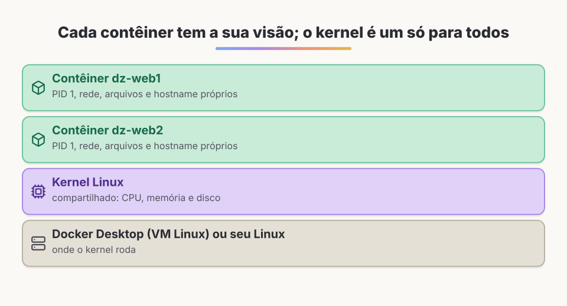

# 1. Por que contêineres existem

> 🗺️ **Neste capítulo:** você vê o problema que os contêineres resolvem, descobre o que é (e o que não é) um contêiner e coloca no ar a primeira versão do projeto do livro, uma página de tarefas, dentro de um. · ⏱️ ~40 min

## 📇 A parte 1 numa página

![Parte 1, capítulos 1 a 4. Contêiner × imagem: contêiner é processo isolado, imagem é pacote somente leitura, uma imagem gera vários contêineres. Contêiner × VM: VM tem kernel próprio e boot, contêiner usa o kernel do host, isola processos, rede e arquivos, divide CPU, memória e disco. As peças: a CLI pede, o Engine (dockerd) executa, o Desktop traz Engine e janela. Windows: WSL 2.1.5+ e virtualização ligada, WSL 2 é o backend padrão; wsl --install e docker run hello-world. Linux: repositório oficial do Docker, grupo docker equivale a root, sudo usermod -aG docker $USER. Rodar: opções antes da imagem, -p host:contêiner, 127.0.0.1 só no seu computador. Estados: created, running, paused, exited; depois do rm o contêiner some. Parar: SIGTERM, prazo, SIGKILL; 143 é SIGTERM e 137 é SIGKILL; defina o prazo com -t. Listar e limpar: ps -a mostra os parados, rm apaga e rm -f força. Observar: logs, exec e inspect --format.](../img/c01-resumo-parte-1.svg)

- [Capítulo 1: Por que contêineres existem](01-por-que-conteineres-existem.md)
- [Capítulo 2: Docker Desktop no Windows: ativar e instalar](02-docker-desktop-no-windows-ativar-e-instalar.md)
- [Capítulo 3: Instalar no Linux e no Mac](03-instalar-no-linux-e-no-mac.md)
- [Capítulo 4: Ciclo de vida do contêiner pela linha de comando](04-ciclo-de-vida-do-conteiner-pela-linha-de-comando.md)

## "Na minha máquina funciona"

Ana escreveu uma API em Python no notebook dela e tudo funciona. Quando ela a leva para o servidor da empresa, a API quebra na primeira requisição. O código é o mesmo; o que mudou é o chão em que ele roda: a versão do Python é outra, uma biblioteca do sistema não está instalada e uma variável de configuração tem outro valor. O que mudou foi o **ambiente**.

Você pode entregar só o código e torcer para o outro computador ser igual ao seu, ou entregá-lo **acompanhado do ambiente de que ele depende**: interpretador, bibliotecas, arquivos de configuração e o comando que dá a partida. A segunda opção é a ideia dos contêineres.

**Um contêiner (*container*) é um processo comum do sistema, executado em isolamento: ele só enxerga os arquivos, a rede e os processos que são dele.** Ele não é um computador em miniatura: é um programa comum, só que com uma visão limitada do que existe na máquina.

O ambiente já montado fica guardado numa **imagem** (*image*). Com a mesma imagem, o notebook da Ana, o servidor e o computador de quem entrar na equipe amanhã obtêm um ambiente idêntico.

> ⚠️ **Erro comum:** achar que o contêiner resolve *toda* diferença entre ambientes. Ele leva o software, mas não leva os dados, as senhas nem as variáveis que você passa na hora de rodar. Se cada máquina passar um valor diferente, o comportamento muda do mesmo jeito.

### O projeto que acompanha o livro

Para ter algo real para empacotar, o livro constrói uma **API de tarefas**. Neste capítulo ela ainda é apenas uma página (`Tarefas v0`) servida por um contêiner. No capítulo 7 vira uma API de verdade com seu próprio Dockerfile, e no capítulo 12 ganha um banco de dados. Cada capítulo acrescenta uma peça.

## Contêiner × máquina virtual

A alternativa mais antiga para isolar um programa é a **máquina virtual (VM)**. Um *hipervisor* finge ser um computador completo, e dentro desse computador de mentira roda um sistema operacional inteiro, com **kernel** próprio: o núcleo que fala com o hardware e decide quem usa o processador a cada instante. Isso funciona, mas cada VM pesa gigabytes e leva tempo para inicializar.

O contêiner segue por outro caminho: **ele não traz kernel**. Todos os contêineres de uma máquina usam o kernel dela, o do **host**.


Antes de continuar, preveja: se você perguntar a versão do kernel de dentro de dois contêineres feitos de imagens diferentes, uma do Alpine Linux e outra do Debian, as respostas serão iguais ou diferentes? Rode e confira (o laboratório no fim do capítulo explica o terminal e o preparo):

```bash
# uma imagem baseada em Alpine e outra em Debian, a mesma pergunta
docker run --rm alpine:3.23 uname -r
docker run --rm python:3.14-slim uname -r
```

Saída nesta máquina:

```text
6.18.58.1-microsoft-standard-WSL2
6.18.58.1-microsoft-standard-WSL2
```

Os valores são iguais porque só existe um kernel, o da máquina, e os dois contêineres o consultam. Os sistemas de arquivos, esses sim, diferem (Alpine num, Debian 13 no outro):

```bash
# o sistema "de dentro" de cada imagem
docker run --rm alpine:3.23 cat /etc/os-release
docker run --rm python:3.14-slim cat /etc/os-release
```

```text
NAME="Alpine Linux"
ID=alpine
PRETTY_NAME="Debian GNU/Linux 13 (trixie)"
NAME="Debian GNU/Linux"
```

(Para ocupar pouco espaço, a saída mostra só duas linhas de cada.)

> 💡 **Analogia:** pense numa cozinha compartilhada (*dark kitchen*), um prédio cheio de cozinhas alugadas. **A imagem é a receita** fechada: ingredientes, utensílios e passo a passo. **O contêiner é uma cozinha em funcionamento**, montada a partir da receita, com bancada, equipe e panelas próprias. Todas as cozinhas do prédio usam a **mesma rede de gás e de luz**, e essa rede é o kernel. Uma VM seria cada restaurante num prédio só dele, com gerador e caixa d'água próprios. Abrir uma cozinha no prédio é rápido, mas uma pane na rede de gás atinge todas. *Onde a analogia falha:* uma cozinha é um lugar físico, enquanto o contêiner é apenas um processo com visão restrita.

Isso tem um efeito prático: contêiner Linux precisa de kernel Linux. Windows e Mac não têm um, então o **Docker Desktop** liga uma VM Linux pequena e roda os seus contêineres lá dentro. No Windows, essa VM usa o WSL 2, e o `6.18.58.1-microsoft-standard-WSL2` da saída acima é o kernel dessa VM. O capítulo 2 mostra como isso se instala.

> ⚠️ **Erro comum:** chamar o contêiner de "VM leve". A imagem engana: ele é um processo isolado, e essa diferença muda o que esperar dele (o próximo bloco mostra por quê).

## Imagem × contêiner

Os dois termos aparecem juntos em todo tutorial, e confundi-los atrapalha a leitura.

**Uma imagem é um pacote somente leitura com tudo de que um programa precisa para rodar; um contêiner é uma execução dessa imagem.**

| | Imagem | Contêiner |
| --- | --- | --- |
| Natureza | Arquivo estático, só para leitura | Processo em execução (ou já encerrado) |
| Muda? | Não: para mudar, você cria outra imagem | Sim: pode criar e alterar arquivos |
| Quantos | Uma, por exemplo `python:3.14-slim` | Quantos você quiser, da mesma imagem |
| Comando para listar | `docker image ls` | `docker ps` |

Na cozinha da analogia: a mesma receita pode abrir várias cozinhas, e uma cozinha que pega fogo não altera a receita. O nome `python:3.14-slim` tem duas partes: `python` é o nome da imagem e `3.14-slim` é a **tag**, que diferencia versões e variantes. O capítulo 6 explica o nome completo e o Docker Hub.

## O que fica isolado e o que é compartilhado

Quem faz a separação é o próprio kernel Linux, com dois recursos. Os **namespaces** entregam a cada contêiner a sua visão de processos, rede, nome da máquina e arquivos. Os **cgroups** (*control groups*) medem e limitam o consumo de CPU, memória e disco de cada um. A documentação do Docker descreve exatamente isso: ao rodar `docker run`, o Docker cria um conjunto de namespaces e de cgroups para o contêiner.

O contêiner tem só para ele:

- **processos:** o programa principal é o processo número 1 (PID 1) e não enxerga os do host;
- **rede:** IP e portas só dele; para uma porta ficar visível no host, é preciso **publicá-la**;
- **arquivos:** o conteúdo da imagem mais o que o contêiner criar;
- **nome da máquina (*hostname*):** por padrão, o começo do id do contêiner.

O que ele não tem só para si é o **kernel**, e junto com o kernel o processador, a memória e o disco da máquina, usados por todos.



Veja o nome da máquina dentro de dois contêineres criados em sequência:

```bash
# cada contêiner novo tem o seu próprio hostname
docker run --rm python:3.14-slim hostname
docker run --rm python:3.14-slim hostname
```

```text
5fc86c6383f3
1680a93b504f
```

Os dois valores são o início do id de cada contêiner, e mudam a cada execução.

> ⚠️ **Erro comum:** supor que o contêiner protege tanto quanto uma VM. Como o kernel é de todos, uma vulnerabilidade nele (ou um contêiner com privilégios em excesso) pode chegar ao host. Para isolar código em que você não confia, use uma VM, ou contêineres dentro de VMs separadas.

## Docker, a ferramenta

A tecnologia de contêineres existe no Linux faz bastante tempo, mas configurar namespaces e cgroups manualmente é trabalhoso. **O Docker reúne as ferramentas que empacotam um programa numa imagem e, com um comando, criam contêineres a partir dela.** O livro usa três peças:

- **Docker CLI:** o comando `docker` que você digita; ele apenas manda pedidos, não executa contêiner nenhum;
- **Docker Engine:** o serviço (`dockerd`) que atende esses pedidos pela API do Docker e administra imagens, contêineres, redes e volumes. Para criar o processo isolado, ele aciona o `containerd` e o `runc`;
- **Docker Desktop:** o aplicativo para Windows, Mac e Linux que instala tudo isso, roda o Engine numa VM Linux e acrescenta uma interface gráfica. No Linux você também pode instalar só o Engine (capítulo 3).


O comando `docker version` mostra as duas pontas, o cliente e o servidor. Para ver só o essencial, peça os campos que interessam:

```bash
# versões do cliente, do Engine e dos componentes por baixo dele
docker version \
  --format 'cliente {{.Client.Version}}, servidor {{.Server.Version}}'
docker version --format \
  '{{range .Server.Components}}{{.Name}} {{.Version}}; {{end}}'
```

```text
cliente 29.9.3, servidor 29.9.3
Engine 29.9.3; containerd v2.4.2; runc 1.5.2; docker-init 0.19.0;
```

O livro foi escrito com o Docker Engine 29.9.3 e o Docker Desktop 4.99. No seu computador os números podem ser maiores, e os conceitos continuam valendo.

> ⚠️ **Erro comum:** confundir "Docker" com "Docker Desktop". Se o `docker` responde `Cannot connect to the Docker daemon`, o comando está certo: quem não está de pé é o Engine. No Windows e no Mac, quase sempre é o Docker Desktop fechado.

## Quando um contêiner não é a melhor escolha

O contêiner brilha em serviços: APIs, sites, bancos de dados, filas e ferramentas de linha de comando. Mas não serve para tudo.

| Caso | O que usar | Motivo |
| --- | --- | --- |
| Programa gráfico de desktop | Instalar normalmente | O contêiner foi pensado para processos sem janela |
| Exige outro sistema operacional ou kernel | Máquina virtual | O contêiner depende do kernel do host |
| Código de terceiros em que você não confia | VM (ou contêiner dentro de VM) | Kernel compartilhado é uma fronteira mais frágil |
| Script pequeno que só você roda | Rodar direto | O trabalho de empacotar supera o ganho |
| Acesso direto a hardware ou a drivers | Rodar no host ou numa VM | Pede configuração extra e afrouxa o isolamento |

> ⚠️ **Erro comum:** guardar dados importantes só dentro do contêiner e depois apagá-lo. Tudo o que foi gravado lá some junto. Dados que precisam sobreviver ficam num volume, assunto do capítulo 9.

## 🧪 Laboratório: a página de tarefas num contêiner

O Docker ainda não precisa estar instalado: a instalação fica para os capítulos 2 (Windows) e 3 (Linux e Mac). Leia agora e refaça os passos depois. Abra um terminal Bash: no Linux e no Mac serve o terminal comum; no Windows, o do Ubuntu no WSL 2 (veja o [guia de WSL da skill](https://github.com/Joshpcbrrj/syllabook/blob/main/docs/integrations/wsl.md)) ou o Git Bash.

> ⚠️ **No Git Bash do Windows**, rode `export MSYS_NO_PATHCONV=1` antes dos comandos. Sem isso, o Git Bash converte um argumento como `/etc/os-release` num caminho do Windows. Aconteceu ao testar: `cat: can't open 'C:/Program Files/Git/etc/os-release'`. No terminal do WSL isso não acontece.

Todos os nomes do laboratório começam com `dz-` (de *Docker do zero*), para você reconhecê-los e remover só o que criou.

**Objetivo:** colocar um servidor web num contêiner, acessá-lo do seu computador e conferir na prática o que ficou isolado.

**Passo 1: rodar o servidor.** O contêiner escreve a página e liga o servidor web que já vem com o Python, na porta 8000. Com `-p 127.0.0.1:8080:8000`, essa porta 8000 aparece como 8080 no seu computador, **só para você** (o `127.0.0.1` impede que outros aparelhos da rede acessem). O `mkdir -p` cria a pasta sem reclamar se ela já existir; você vai ver no capítulo 4 por que isso importa quando um contêiner é reiniciado.

```bash
# -d: segundo plano; --name: um nome fácil de achar
# -p: porta 8080 do host -> porta 8000 do contêiner
# exec: o Python vira o processo principal (PID 1)
docker run -d --name dz-web -p 127.0.0.1:8080:8000 python:3.14-slim \
  sh -c 'mkdir -p /site && cd /site
         echo "<h1>Tarefas v0</h1>" > index.html
         exec python -m http.server 8000'
```

Saída: o id completo do contêiner criado (e, na primeira vez, as linhas do download da imagem).

```text
488326804cfcf55b8eec414d79a749656585b26659ecd2d509783e9361b4fbe2
```

**Passo 2: ver o contêiner rodando.**

```bash
# lista só o contêiner deste laboratório
docker ps --filter name=dz-web
```

```text
CONTAINER ID   IMAGE              COMMAND                  CREATED         STATUS         PORTS                      NAMES
488326804cfc   python:3.14-slim   "sh -c 'mkdir -p /si…"   4 seconds ago   Up 3 seconds   127.0.0.1:8080->8000/tcp   dz-web
```

A coluna `PORTS` confirma a publicação: o que chega na 8080 do seu computador vai para a 8000 do contêiner.

**Passo 3: acessar de fora.** Use o `curl` (ou abra `http://127.0.0.1:8080` no navegador). A segunda linha tenta a porta interna, que você não publicou.

```bash
curl -s http://127.0.0.1:8080
curl -sS http://127.0.0.1:8000
```

```text
<h1>Tarefas v0</h1>
curl: (7) Failed to connect to 127.0.0.1:8000 after 0 ms: Could not connect to server
```

Isso é o isolamento de **rede**: dentro do contêiner o servidor escuta na 8000, e o seu computador só alcança o que foi publicado.

**Passo 4: o mesmo processo, de fora e de dentro.**

```bash
# de fora: o Docker mostra o processo com o PID que ele tem no kernel
docker top dz-web -o pid,cmd
# de dentro: a imagem slim não traz o comando ps, então listamos /proc
docker exec dz-web python -c "import glob; print(glob.glob('/proc/[0-9]*'))"
```

```text
PID                 CMD
40770               python -m http.server 8000
['/proc/1', '/proc/9']
```

O servidor tem dois números: 40770 para o kernel (o número muda a cada execução) e 1 lá dentro. De dentro, só existem dois processos: o servidor (`/proc/1`) e o próprio `python` do comando (`/proc/9`). Os outros processos da máquina ficam invisíveis. Isso é o isolamento de **processos**.

**Passo 5: arquivos.**

```bash
# a página existe dentro do contêiner...
docker exec dz-web ls /site
# ...mas não no seu computador
ls /site
```

```text
index.html
ls: cannot access '/site': No such file or directory
```

**Passo 6: o hostname e os registros do servidor.**

```bash
docker exec dz-web hostname
# o que o servidor escreveu na saída
docker logs dz-web
```

```text
488326804cfc
172.17.0.1 - - [26/Nov/2026 13:51:19] "GET / HTTP/1.1" 200 -
```

O hostname é o começo do id do contêiner. O acesso do `curl` chegou como `172.17.0.1`: é o seu computador, visto de dentro da rede do contêiner. O horário vem em UTC.

**Passo 7: parar e remover.**

```bash
# para o contêiner (ele continua existindo, parado)
docker stop dz-web
# -a mostra também os parados
docker ps -a --filter name=dz-web
# remove de vez
docker rm dz-web
```

```text
dz-web
CONTAINER ID   IMAGE              COMMAND                  CREATED          STATUS                                PORTS     NAMES
488326804cfc   python:3.14-slim   "sh -c 'mkdir -p /si…"   10 seconds ago   Exited (137) Less than a second ago             dz-web
dz-web
```

Repare em duas coisas. O contêiner parado continua na lista até o `docker rm`, e a imagem `python:3.14-slim` continua no seu computador depois do `rm`: a receita sobrevive à cozinha. Segundo, o `docker stop` levou alguns segundos e o código de saída foi 137 (128 + 9, o sinal `SIGKILL`): o servidor não obedeceu ao pedido educado de parada e o Docker o encerrou à força. O capítulo 4 explica o porquê e como evitar.

> 💡 O `docker top` e o `docker logs` do laboratório rodaram com o Docker Desktop 4.99 no Windows 11 (WSL 2). Ids, PIDs e horários mudam a cada execução.

## 🏋️ Pratique

**1. Resolvido: publicar outra porta.** Rode o mesmo servidor, mas publicando a porta **9090** do seu computador. O que respondem `curl -s http://127.0.0.1:9090` e `curl -sS http://127.0.0.1:8080`? Confirme com `docker port dz-web`.

<details>
<summary>Ver resposta</summary>

```bash
# só o número da esquerda muda; o servidor segue na 8000
docker run -d --name dz-web -p 127.0.0.1:9090:8000 python:3.14-slim \
  sh -c 'mkdir -p /site && cd /site
         echo "<h1>Tarefas v0</h1>" > index.html
         exec python -m http.server 8000'
curl -s http://127.0.0.1:9090
curl -sS http://127.0.0.1:8080
docker port dz-web
# -f para e remove numa etapa só
docker rm -f dz-web
```

```text
<h1>Tarefas v0</h1>
curl: (7) Failed to connect to 127.0.0.1:8080 after 1 ms: Could not connect to server
8000/tcp -> 127.0.0.1:9090
dz-web
```

A 9090 responde; a 8080 falha, porque do lado de fora só existe a porta publicada. A ordem do `-p` é sempre `porta-do-host:porta-do-contêiner`.

</details>

**2. Complete:** crie **dois** contêineres a partir da mesma imagem: `dz-web1` com a 8081 do seu computador e `dz-web2` com a 8082. Preencha as lacunas e responda: o PID do servidor lá dentro é o mesmo nos dois? E os hostnames?

```bash
CMD='mkdir -p /site && cd /site
     echo "<h1>Tarefas v0</h1>" > index.html
     exec python -m http.server 8000'
# o número do meio é a porta do seu computador
docker run -d --name dz-web1 -p 127.0.0.1:____:8000 \
  python:3.14-slim sh -c "$CMD"
docker run -d --name dz-web2 -p 127.0.0.1:____:8000 \
  python:3.14-slim sh -c "$CMD"
```

<details>
<summary>Ver resposta</summary>

As lacunas são `8081` e `8082`. Depois, para cada contêiner:

```bash
docker exec dz-web1 python -c "import glob; print(glob.glob('/proc/[0-9]*'))"
docker top dz-web1 -o pid,cmd
docker exec dz-web1 hostname
# (repita com dz-web2) e limpe:
docker rm -f dz-web1 dz-web2
```

```text
['/proc/1', '/proc/8']
PID                 CMD
41069               python -m http.server 8000
7958d7b51256
['/proc/1', '/proc/8']
PID                 CMD
41157               python -m http.server 8000
1c6fb823f78e
```

Dentro, os dois servidores são o PID 1, cada um no seu espaço de processos. Para o kernel são processos diferentes (41069 e 41157), e os hostnames também diferem. As duas portas respondem com a mesma página, porque as duas cozinhas saíram da mesma receita.

</details>

**3. Por conta própria:** antes de rodar, preveja. Se você executar `docker run --rm python:3.14-slim hostname` duas vezes seguidas, os valores serão iguais? Por quê?

<details>
<summary>Ver resposta</summary>

Serão diferentes (na nossa execução, `5fc86c6383f3` e `1680a93b504f`). Cada `docker run` cria um contêiner **novo**, e o hostname padrão é o começo do id dele. A imagem é a mesma, mas os contêineres não são.

</details>

**4. Desafio:** em cada caso, escolha entre contêiner e máquina virtual e justifique: (a) manter um PostgreSQL de teste enquanto você desenvolve uma API; (b) executar um aplicativo que só existe para Windows, estando num Linux; (c) rodar trechos de código enviados por desconhecidos numa plataforma de exercícios.

<details>
<summary>Ver resposta</summary>

(a) **Contêiner**, porque é um serviço que sobe em segundos e desaparece sem deixar rastro (como guardar os dados fica para o capítulo 9). (b) **VM:** o contêiner emprega o kernel do host, e um programa de Windows exige Windows. (c) **VM**, ou contêineres dentro de VMs separadas: o código é desconhecido e o kernel compartilhado é uma barreira mais frágil que a de uma VM.

</details>

## 🧠 Revisão rápida

**1.** Por que `uname -r` dá o mesmo resultado dentro de contêineres de imagens diferentes?

<details>
<summary>Ver resposta</summary>

Porque o contêiner não tem kernel próprio: todos usam o kernel que roda por baixo. O que muda entre imagens é o sistema de arquivos (Alpine, Debian etc.), não o kernel.

</details>

**2.** Dentro do contêiner o servidor usa a porta 8000. Por que `curl http://127.0.0.1:8000` falha no seu computador?

<details>
<summary>Ver resposta</summary>

Porque a rede do contêiner é isolada. Só aparece no seu computador a porta publicada (aqui, a 8080, com `-p 127.0.0.1:8080:8000`).

</details>

**3.** Qual a diferença entre imagem e contêiner?

<details>
<summary>Ver resposta</summary>

A imagem é o pacote de leitura apenas; o contêiner é uma execução dela, que pode ser parada e apagada sem tocar na imagem.

</details>

**4.** O `docker` responde `Cannot connect to the Docker daemon`. O que está errado?

<details>
<summary>Ver resposta</summary>

O comando está certo; falta o Engine ligado. No Windows e no Mac, normalmente o Docker Desktop está fechado.

</details>

## 🤖 Estude com um tutor de IA

Cole o texto abaixo num assistente de IA e responda cada pergunta antes de pedir a resposta.

> Faça 5 perguntas sobre a diferença entre contêiner e máquina virtual, uma de cada vez. Espere a minha resposta antes de dar o retorno e não me dê as respostas antes.

> Esta é a minha resposta ao exercício 4 do capítulo 1 de "Docker do zero": <sua resposta>. Aponte os meus erros sem me dar a solução.

> ➡️ **Próximo passo:** para refazer o laboratório na sua máquina, falta instalar o Docker. No Windows, antes do instalador é preciso ligar a virtualização e o WSL 2, o que o capítulo 2 explica. No Linux ou no Mac, siga para o capítulo 3.

## 📌 Resumo

| Item | Em uma frase |
| --- | --- |
| Problema | O mesmo código roda aqui e falha ali porque o ambiente muda de uma máquina para outra |
| Contêiner | Processo isolado, com o ambiente de que precisa embalado junto |
| Contêiner × VM | A VM simula um computador inteiro, com kernel próprio; o contêiner aproveita o kernel do host |
| Imagem | Pacote de leitura apenas, a partir do qual nascem os contêineres |
| Isola | Processos (o PID 1 de dentro), rede, arquivos e nome da máquina |
| Compartilha | O kernel e, junto dele, o processador, a memória e o disco |
| Porta publicada | `-p 127.0.0.1:8080:8000` leva a porta 8080 do seu computador à 8000 do contêiner |
| Docker | A CLI faz o pedido, o Engine (`dockerd`) o executa e o Desktop reúne tudo com uma janela |
| Evitar | Programas gráficos, outro SO, código desconhecido e scripts triviais |

## 📚 Fontes

Conferido em 26/11/2026.

- [Documentação: o que é um contêiner](https://docs.docker.com/get-started/docker-concepts/the-basics/what-is-a-container/)
- [Documentação: o que é uma imagem](https://docs.docker.com/get-started/docker-concepts/the-basics/what-is-an-image/)
- [Segurança do Docker Engine (namespaces e cgroups)](https://docs.docker.com/engine/security/)
- [Docker Desktop com backend WSL 2](https://docs.docker.com/desktop/features/wsl/)
- [Referência do comando docker container run](https://docs.docker.com/reference/cli/docker/container/run/)

<!-- nav:start -->
---

[◀ Capítulo anterior](00-como-estudar-este-livro.md) · [Mapa do livro](../README.md) · [Próximo capítulo ▶](02-docker-desktop-no-windows-ativar-e-instalar.md)
<!-- nav:end -->
