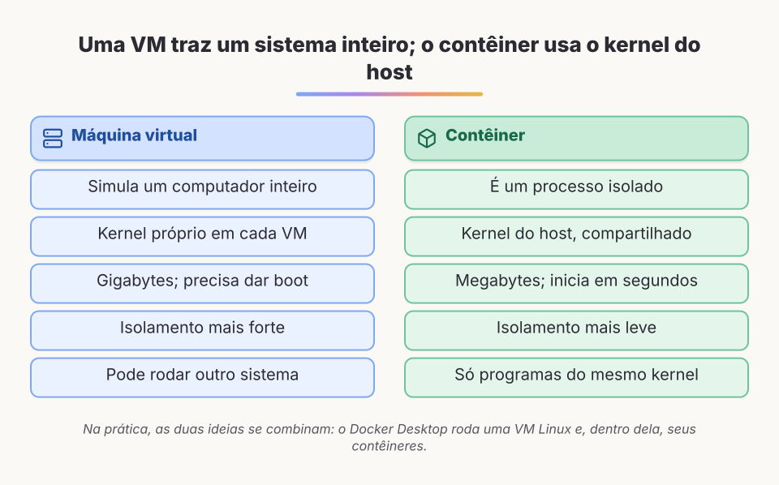
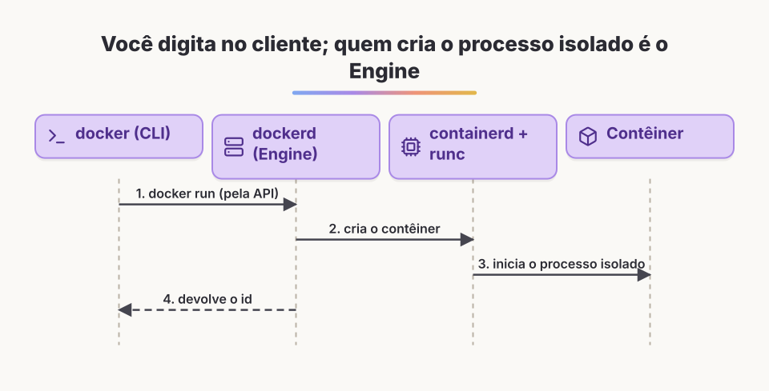

# 1. Por que contêineres existem

> 🗺️ **Neste capítulo:** você vê o problema que os contêineres resolvem, descobre o que é (e o que não é) um contêiner e coloca no ar a primeira versão do projeto do livro, uma página de tarefas, dentro de um. · ⏱️ ~40 min

## "Na minha máquina funciona"

Ana escreveu uma API em Python no notebook dela e tudo funciona. Quando ela a leva para o servidor da empresa, a API quebra na primeira requisição. O código é o mesmo, mas o servidor tem outra versão do Python, falta uma biblioteca do sistema e uma variável de ambiente vale outra coisa. O que mudou foi o **ambiente**.

Você pode entregar só o código e torcer para o outro computador ser igual ao seu, ou entregar o código **junto com o ambiente de que ele precisa**: o interpretador, as bibliotecas, os arquivos de configuração e o comando que inicia o programa. A segunda opção é a ideia dos contêineres.

**Um contêiner (*container*) é um processo comum do sistema que roda isolado: ele enxerga só os próprios arquivos, a própria rede e os próprios processos.** Não é um computador inteiro, é um programa com uma visão restrita da máquina.

O pacote que guarda esse ambiente pronto é a **imagem** (*image*). A mesma imagem produz o mesmo ambiente no notebook da Ana, no servidor e na máquina de quem entrar na equipe amanhã.

> ⚠️ **Erro comum:** achar que o contêiner resolve *toda* diferença entre ambientes. Ele leva o software, mas não leva os dados, as senhas nem as variáveis que você passa na hora de rodar. Se cada máquina passar um valor diferente, o comportamento muda do mesmo jeito.

### O projeto que acompanha o livro

Para ter algo real para empacotar, o livro constrói uma **API de tarefas**. Neste capítulo ela ainda é apenas uma página (`Tarefas v0`) servida por um contêiner. No capítulo 7 vira uma API de verdade com seu próprio Dockerfile, e no capítulo 12 ganha um banco de dados. Cada capítulo acrescenta uma peça.

## Contêiner × máquina virtual

Antes dos contêineres, a forma comum de isolar um programa era a **máquina virtual (VM)**. Um software chamado *hipervisor* simula um computador completo, e dentro dele roda um sistema operacional inteiro, com o seu próprio **kernel**: o núcleo do sistema, a parte que conversa com o hardware e agenda os processos. Funciona bem, mas cada VM carrega gigabytes de sistema e precisa dar boot.

O contêiner faz um corte diferente: **ele não traz kernel**. Todos os contêineres de uma máquina usam o kernel dela, o do **host**.



Antes de continuar, preveja: se você perguntar a versão do kernel de dentro de dois contêineres feitos de imagens diferentes, uma do Alpine Linux e outra do Debian, as respostas serão iguais ou diferentes? Rode e confira (o laboratório no fim do capítulo explica o terminal e o preparo):

```bash
# uma imagem baseada em Alpine e outra em Debian, a mesma pergunta
docker run --rm alpine:3.23 uname -r
docker run --rm python:3.14-slim uname -r
```

Saída nesta máquina:

```text
6.18.58.1-microsoft-standard-WSL2
6.18.58.1-microsoft-standard-WSL2
```

A resposta é idêntica porque não existe um segundo kernel: o contêiner pergunta ao mesmo kernel, o que está rodando por baixo. Os dois sistemas de arquivos são mesmo diferentes (o primeiro é Alpine, o segundo é Debian 13), e só o kernel é o mesmo:

```bash
# o sistema "de dentro" de cada imagem
docker run --rm alpine:3.23 cat /etc/os-release
docker run --rm python:3.14-slim cat /etc/os-release
```

```text
NAME="Alpine Linux"
ID=alpine
PRETTY_NAME="Debian GNU/Linux 13 (trixie)"
NAME="Debian GNU/Linux"
```

(Para ocupar pouco espaço, a saída mostra só duas linhas de cada.)

> 💡 **Analogia:** pense numa cozinha compartilhada (*dark kitchen*), um prédio cheio de cozinhas alugadas. **A imagem é a receita** fechada: ingredientes, utensílios e passo a passo. **O contêiner é uma cozinha em funcionamento**, montada a partir da receita, com bancada, equipe e panelas próprias. Todas as cozinhas do prédio usam a **mesma rede de gás e de luz**, e essa rede é o kernel. Uma VM seria cada restaurante num prédio só dele, com gerador e caixa d'água próprios. Abrir uma cozinha no prédio é rápido, mas uma pane na rede de gás atinge todas. *Onde a analogia falha:* uma cozinha é um lugar físico, enquanto o contêiner é apenas um processo com visão restrita.

Há uma consequência prática: um contêiner Linux precisa de um kernel Linux. No Windows e no Mac não existe esse kernel, e por isso o **Docker Desktop** roda uma VM Linux pequena e coloca seus contêineres dentro dela. No Windows, essa VM usa o WSL 2, e o `6.18.58.1-microsoft-standard-WSL2` da saída acima é o kernel dessa VM. O capítulo 2 mostra como isso se instala.

> ⚠️ **Erro comum:** dizer que "contêiner é uma VM leve". Não é: é um processo isolado, e a diferença muda o que você pode esperar dele (o próximo bloco mostra por quê).

## Imagem × contêiner

Os dois termos aparecem juntos em todo tutorial, e confundi-los atrapalha a leitura.

**Uma imagem é um pacote somente leitura com tudo de que um programa precisa para rodar; um contêiner é uma instância criada a partir de uma imagem.**

| | Imagem | Contêiner |
| --- | --- | --- |
| O que é | Pacote parado, somente leitura | Processo rodando (ou já parado) |
| Muda? | Não: para mudar, você cria outra imagem | Sim: pode criar e alterar arquivos |
| Quantos | Uma, por exemplo `python:3.14-slim` | Quantos você quiser, da mesma imagem |
| Comando para listar | `docker image ls` | `docker ps` |

Na cozinha da analogia: a mesma receita pode abrir várias cozinhas, e uma cozinha que pega fogo não altera a receita. O nome `python:3.14-slim` tem duas partes: `python` é o nome da imagem e `3.14-slim` é a **tag**, que diferencia versões e variantes. O capítulo 6 explica o nome completo e o Docker Hub.

## O que o contêiner isola e o que ele divide

O isolamento vem de recursos do próprio kernel Linux. Os **namespaces** dão a cada contêiner uma visão própria de processos, rede, nome da máquina e sistema de arquivos. Os **cgroups** (*control groups*) medem e limitam quanto de CPU, memória e disco cada um usa. A documentação do Docker descreve exatamente isso: ao rodar `docker run`, o Docker cria um conjunto de namespaces e de cgroups para o contêiner.

O contêiner tem só para ele:

- **processos:** o programa principal é o processo número 1 (PID 1) e não enxerga os do host;
- **rede:** endereço IP e portas próprios; uma porta só aparece no host se você a **publicar**;
- **arquivos:** o conteúdo da imagem mais o que o contêiner criar;
- **nome da máquina (*hostname*):** por padrão, o começo do id do contêiner.

E divide com todos os outros o **kernel**, e com ele a CPU, a memória e o disco da máquina.


Veja o nome da máquina dentro de dois contêineres criados em sequência:

```bash
# cada contêiner novo tem o seu próprio hostname
docker run --rm python:3.14-slim hostname
docker run --rm python:3.14-slim hostname
```

```text
5fc86c6383f3
1680a93b504f
```

Os dois valores são o início do id de cada contêiner, e mudam a cada execução.

> ⚠️ **Erro comum:** tratar o contêiner como uma barreira de segurança tão forte quanto uma VM. Como o kernel é compartilhado, uma falha nele (ou um contêiner com privilégios demais) pode alcançar o host. Para separar códigos em que você não confia, a recomendação é uma VM, ou contêineres dentro de VMs separadas.

## O que é o Docker

Contêineres existem no Linux há muito tempo, mas montar namespaces e cgroups à mão dá trabalho. **O Docker é o conjunto de ferramentas que empacota um programa numa imagem e cria contêineres a partir dela com um comando.** Você vai usar três peças:

- **Docker CLI:** o comando `docker` que você digita. Ele não roda contêineres, só envia pedidos;
- **Docker Engine:** o serviço `dockerd`, que recebe os pedidos pela API do Docker e cuida de imagens, contêineres, redes e volumes. Por baixo, ele pede ao `containerd` e ao `runc` que criem o processo isolado;
- **Docker Desktop:** o aplicativo para Windows, Mac e Linux que instala tudo isso, roda o Engine numa VM Linux e acrescenta uma interface gráfica. No Linux você também pode instalar só o Engine (capítulo 3).



O comando `docker version` mostra as duas pontas, o cliente e o servidor. Para ver só o essencial, peça os campos que interessam:

```bash
# versões do cliente, do Engine e dos componentes por baixo dele
docker version \
  --format 'cliente {{.Client.Version}}, servidor {{.Server.Version}}'
docker version --format \
  '{{range .Server.Components}}{{.Name}} {{.Version}}; {{end}}'
```

```text
cliente 29.9.3, servidor 29.9.3
Engine 29.9.3; containerd v2.4.2; runc 1.5.2; docker-init 0.19.0;
```

O livro foi escrito com o Docker Engine 29.9.3 e o Docker Desktop 4.99. No seu computador os números podem ser maiores, e os conceitos continuam valendo.

> ⚠️ **Erro comum:** achar que "Docker" e "Docker Desktop" são a mesma coisa. Quando o `docker` responde `Cannot connect to the Docker daemon`, o problema não está no comando: o Engine não está rodando. No Windows e no Mac, em geral é porque o Docker Desktop está fechado.

## Quando não usar contêineres

Contêiner é ótimo para serviços: APIs, sites, bancos de dados, filas e ferramentas de linha de comando. Não é a resposta para tudo.

| Situação | Melhor escolha | Por quê |
| --- | --- | --- |
| Programa gráfico de desktop | Instalar normalmente | O contêiner foi feito para processos sem janela |
| Precisa de outro sistema operacional ou outro kernel | Máquina virtual | O contêiner usa o kernel do host |
| Código de terceiros em que você não confia | VM (ou contêiner dentro de VM) | O kernel compartilhado é uma fronteira mais fraca |
| Script pequeno que só você roda | Rodar direto | Empacotar custa mais do que resolve |
| Acesso direto a hardware ou drivers | Rodar no host ou numa VM | Exige configuração extra e enfraquece o isolamento |

> ⚠️ **Erro comum:** guardar dados importantes só dentro do contêiner e depois apagá-lo. Tudo o que foi gravado lá some junto. Dados que precisam sobreviver ficam num volume, assunto do capítulo 9.

## 🧪 Laboratório: a página de tarefas num contêiner

Você ainda não precisa ter o Docker instalado: a instalação vem nos capítulos 2 (Windows) e 3 (Linux e Mac). Leia agora e refaça os passos depois. Use um terminal Bash: no Linux e no Mac, o terminal padrão; no Windows, o do Ubuntu no WSL 2 (veja o [guia de WSL da skill](https://github.com/Joshpcbrrj/syllabook/blob/main/docs/integrations/wsl.md)) ou o Git Bash.

> ⚠️ **No Git Bash do Windows**, rode `export MSYS_NO_PATHCONV=1` antes dos comandos. Sem isso, o Git Bash converte um argumento como `/etc/os-release` num caminho do Windows. Aconteceu ao testar: `cat: can't open 'C:/Program Files/Git/etc/os-release'`. No terminal do WSL isso não acontece.

Todos os nomes do laboratório começam com `dz-` (de *Docker do zero*), para você reconhecê-los e remover só o que criou.

**Objetivo:** subir um servidor web num contêiner, acessá-lo pelo seu computador e ver com os próprios olhos o que ficou isolado.

**Passo 1: rodar o servidor.** O contêiner cria a página e inicia o servidor web embutido do Python na porta 8000. O `-p 127.0.0.1:8080:8000` publica a porta 8000 do contêiner como 8080 do seu computador, **só para você** (o `127.0.0.1` impede que outros aparelhos da rede acessem). O `mkdir -p` cria a pasta sem reclamar se ela já existir; você vai ver no capítulo 4 por que isso importa quando um contêiner é reiniciado.

```bash
# -d: segundo plano; --name: um nome fácil de achar
# -p: porta 8080 do host -> porta 8000 do contêiner
# exec: o Python vira o processo principal (PID 1)
docker run -d --name dz-web -p 127.0.0.1:8080:8000 python:3.14-slim \
  sh -c 'mkdir -p /site && cd /site
         echo "<h1>Tarefas v0</h1>" > index.html
         exec python -m http.server 8000'
```

Saída: o id completo do contêiner criado (e, na primeira vez, as linhas do download da imagem).

```text
488326804cfcf55b8eec414d79a749656585b26659ecd2d509783e9361b4fbe2
```

**Passo 2: ver o contêiner rodando.**

```bash
# lista só o contêiner deste laboratório
docker ps --filter name=dz-web
```

```text
CONTAINER ID   IMAGE              COMMAND                  CREATED         STATUS         PORTS                      NAMES
488326804cfc   python:3.14-slim   "sh -c 'mkdir -p /si…"   4 seconds ago   Up 3 seconds   127.0.0.1:8080->8000/tcp   dz-web
```

A coluna `PORTS` confirma a publicação: o que chega na 8080 do seu computador vai para a 8000 do contêiner.

**Passo 3: acessar de fora.** Use o `curl` (ou abra `http://127.0.0.1:8080` no navegador). A segunda linha tenta a porta interna, que você não publicou.

```bash
curl -s http://127.0.0.1:8080
curl -sS http://127.0.0.1:8000
```

```text
<h1>Tarefas v0</h1>
curl: (7) Failed to connect to 127.0.0.1:8000 after 0 ms: Could not connect to server
```

Isso é o isolamento de **rede**: dentro do contêiner o servidor escuta na 8000, e o seu computador só alcança o que foi publicado.

**Passo 4: o mesmo processo, de fora e de dentro.**

```bash
# de fora: o Docker mostra o processo com o PID que ele tem no kernel
docker top dz-web -o pid,cmd
# de dentro: a imagem slim não traz o comando ps, então listamos /proc
docker exec dz-web python -c "import glob; print(glob.glob('/proc/[0-9]*'))"
```

```text
PID                 CMD
40770               python -m http.server 8000
['/proc/1', '/proc/9']
```

O servidor tem dois números: 40770 para o kernel (o número muda a cada execução) e 1 lá dentro. De dentro, só existem dois processos: o servidor (`/proc/1`) e o próprio `python` do comando (`/proc/9`). Os outros processos da máquina ficam invisíveis. Isso é o isolamento de **processos**.

**Passo 5: arquivos.**

```bash
# a página existe dentro do contêiner...
docker exec dz-web ls /site
# ...mas não no seu computador
ls /site
```

```text
index.html
ls: cannot access '/site': No such file or directory
```

**Passo 6: o hostname e os registros do servidor.**

```bash
docker exec dz-web hostname
# o que o servidor escreveu na saída
docker logs dz-web
```

```text
488326804cfc
172.17.0.1 - - [26/Nov/2026 13:51:19] "GET / HTTP/1.1" 200 -
```

O hostname é o começo do id do contêiner. O acesso do `curl` chegou como `172.17.0.1`: é o seu computador, visto de dentro da rede do contêiner. O horário vem em UTC.

**Passo 7: parar e remover.**

```bash
# para o contêiner (ele continua existindo, parado)
docker stop dz-web
# -a mostra também os parados
docker ps -a --filter name=dz-web
# remove de vez
docker rm dz-web
```

```text
dz-web
CONTAINER ID   IMAGE              COMMAND                  CREATED          STATUS                                PORTS     NAMES
488326804cfc   python:3.14-slim   "sh -c 'mkdir -p /si…"   10 seconds ago   Exited (137) Less than a second ago             dz-web
dz-web
```

Repare em duas coisas. O contêiner parado continua na lista até o `docker rm`, e a imagem `python:3.14-slim` continua no seu computador depois do `rm`: a receita sobrevive à cozinha. Segundo, o `docker stop` levou alguns segundos e o código de saída foi 137 (128 + 9, o sinal `SIGKILL`): o servidor não obedeceu ao pedido educado de parada e o Docker o encerrou à força. O capítulo 4 explica o porquê e como evitar.

> 💡 O `docker top` e o `docker logs` do laboratório rodaram com o Docker Desktop 4.99 no Windows 11 (WSL 2). Ids, PIDs e horários mudam a cada execução.

## 🏋️ Pratique

**1. Resolvido: publicar outra porta.** Rode o mesmo servidor, mas publicando a porta **9090** do seu computador. O que respondem `curl -s http://127.0.0.1:9090` e `curl -sS http://127.0.0.1:8080`? Confirme com `docker port dz-web`.

<details>
<summary>Ver resposta</summary>

```bash
# só o número da esquerda muda; o servidor segue na 8000
docker run -d --name dz-web -p 127.0.0.1:9090:8000 python:3.14-slim \
  sh -c 'mkdir -p /site && cd /site
         echo "<h1>Tarefas v0</h1>" > index.html
         exec python -m http.server 8000'
curl -s http://127.0.0.1:9090
curl -sS http://127.0.0.1:8080
docker port dz-web
# -f para e remove numa etapa só
docker rm -f dz-web
```

```text
<h1>Tarefas v0</h1>
curl: (7) Failed to connect to 127.0.0.1:8080 after 1 ms: Could not connect to server
8000/tcp -> 127.0.0.1:9090
dz-web
```

A 9090 responde e a 8080 não: só existe no seu computador a porta que você publicou. A ordem do `-p` é sempre `porta-do-host:porta-do-contêiner`.

</details>

**2. Complete:** suba **dois** contêineres da mesma imagem, `dz-web1` na porta 8081 e `dz-web2` na 8082. Preencha as lacunas e responda: o PID do servidor lá dentro é o mesmo nos dois? E os hostnames?

```bash
CMD='mkdir -p /site && cd /site
     echo "<h1>Tarefas v0</h1>" > index.html
     exec python -m http.server 8000'
# o número do meio é a porta do seu computador
docker run -d --name dz-web1 -p 127.0.0.1:____:8000 \
  python:3.14-slim sh -c "$CMD"
docker run -d --name dz-web2 -p 127.0.0.1:____:8000 \
  python:3.14-slim sh -c "$CMD"
```

<details>
<summary>Ver resposta</summary>

As lacunas são `8081` e `8082`. Depois, para cada contêiner:

```bash
docker exec dz-web1 python -c "import glob; print(glob.glob('/proc/[0-9]*'))"
docker top dz-web1 -o pid,cmd
docker exec dz-web1 hostname
# (repita com dz-web2) e limpe:
docker rm -f dz-web1 dz-web2
```

```text
['/proc/1', '/proc/8']
PID                 CMD
41069               python -m http.server 8000
7958d7b51256
['/proc/1', '/proc/8']
PID                 CMD
41157               python -m http.server 8000
1c6fb823f78e
```

Dentro, os dois servidores são o PID 1, cada um no seu espaço de processos. Para o kernel são processos diferentes (41069 e 41157), e os hostnames também diferem. As duas portas respondem com a mesma página, porque as duas cozinhas saíram da mesma receita.

</details>

**3. Por conta própria:** antes de rodar, preveja. Se você executar `docker run --rm python:3.14-slim hostname` duas vezes seguidas, os valores serão iguais? Por quê?

<details>
<summary>Ver resposta</summary>

Serão diferentes (na nossa execução, `5fc86c6383f3` e `1680a93b504f`). Cada `docker run` cria um contêiner **novo**, e o hostname padrão é o começo do id dele. A imagem é a mesma, mas os contêineres não são.

</details>

**4. Desafio:** para cada situação, diga se você usaria um contêiner ou uma máquina virtual, e por quê: (a) rodar o PostgreSQL para desenvolver uma API no seu notebook; (b) testar um programa que só existe para Windows, estando num Linux; (c) executar códigos enviados por desconhecidos numa plataforma de correção de exercícios.

<details>
<summary>Ver resposta</summary>

(a) **Contêiner:** é um serviço, sobe em segundos e some sem deixar rastro (o capítulo 9 mostra como guardar os dados). (b) **VM:** um contêiner usa o kernel do host, e um programa para Windows precisa do Windows. (c) **VM**, ou contêineres dentro de VMs isoladas: o código não é confiável, e o kernel compartilhado é uma fronteira mais fraca do que a de uma VM.

</details>

## 🧠 Revisão rápida

**1.** Por que `uname -r` dá o mesmo resultado dentro de contêineres de imagens diferentes?

<details>
<summary>Ver resposta</summary>

Porque o contêiner não tem kernel próprio: todos usam o kernel que roda por baixo. O que muda entre imagens é o sistema de arquivos (Alpine, Debian etc.), não o kernel.

</details>

**2.** O servidor escuta na porta 8000 dentro do contêiner. Por que `curl http://127.0.0.1:8000` no seu computador falha?

<details>
<summary>Ver resposta</summary>

Porque a rede do contêiner é isolada. Só aparece no seu computador a porta publicada (aqui, a 8080, com `-p 127.0.0.1:8080:8000`).

</details>

**3.** Qual a diferença entre imagem e contêiner?

<details>
<summary>Ver resposta</summary>

A imagem é o pacote somente leitura. O contêiner é uma instância criada a partir dela, que roda e pode ser parada e removida sem alterar a imagem.

</details>

**4.** O `docker` responde `Cannot connect to the Docker daemon`. O que está errado?

<details>
<summary>Ver resposta</summary>

O comando está certo: é o Engine que não está rodando. No Windows e no Mac, em geral o Docker Desktop está fechado.

</details>

## 🤖 Estude com um tutor de IA

Cole o texto abaixo num assistente de IA e responda cada pergunta antes de pedir a resposta.

> Faça 5 perguntas sobre a diferença entre contêiner e máquina virtual, uma de cada vez. Espere a minha resposta antes de dar o retorno e não me dê as respostas antes.

> Esta é a minha resposta ao exercício 4 do capítulo 1 de "Docker do zero": <sua resposta>. Aponte os meus erros sem me dar a solução.

> ➡️ **Próximo passo:** para repetir este laboratório no seu computador, você precisa do Docker instalado. No Windows, isso exige ativar a virtualização e o WSL 2 antes do instalador: **2. Docker Desktop no Windows: ativar e instalar**. No Linux ou no Mac, vá direto ao capítulo 3.

## 📌 Resumo

| Item | Em uma frase |
| --- | --- |
| Problema | O código funciona numa máquina e quebra noutra porque o ambiente é diferente |
| Contêiner | Processo isolado que leva junto o ambiente de que precisa |
| Contêiner × VM | A VM simula um computador com kernel próprio; o contêiner usa o kernel do host |
| Imagem | Pacote somente leitura do qual saem os contêineres |
| Isola | Processos (PID 1 lá dentro), rede, arquivos e hostname |
| Divide | O kernel, e com ele CPU, memória e disco |
| Porta publicada | `-p 127.0.0.1:8080:8000` leva a porta 8080 do seu computador à 8000 do contêiner |
| Docker | A CLI pede, o Engine (`dockerd`) executa, o Desktop empacota tudo com interface |
| Quando não usar | Apps gráficos, outro SO, código não confiável e scripts triviais |

## 📚 Fontes

Conferido em 26/11/2026.

- [What is a container?](https://docs.docker.com/get-started/docker-concepts/the-basics/what-is-a-container/)
- [What is an image?](https://docs.docker.com/get-started/docker-concepts/the-basics/what-is-an-image/)
- [Docker Engine security (namespaces e cgroups)](https://docs.docker.com/engine/security/)
- [Docker Desktop: WSL 2 backend](https://docs.docker.com/desktop/features/wsl/)
- [docker container run](https://docs.docker.com/reference/cli/docker/container/run/)
