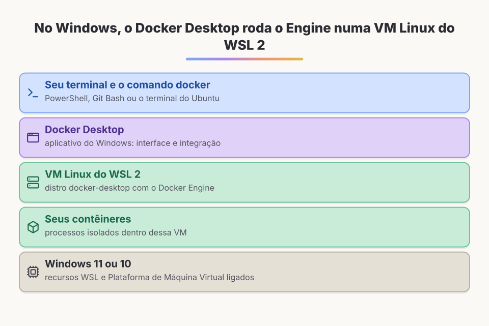
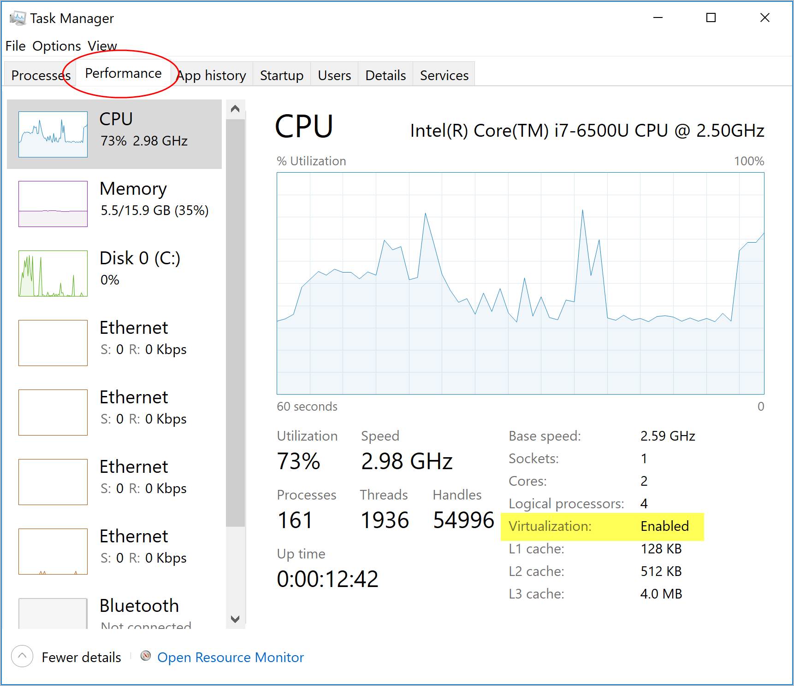
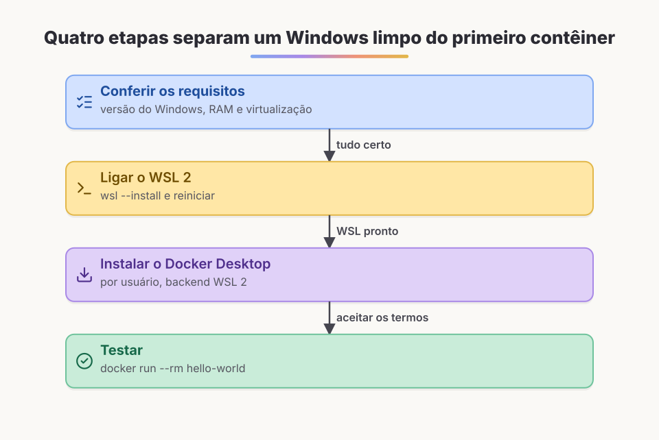
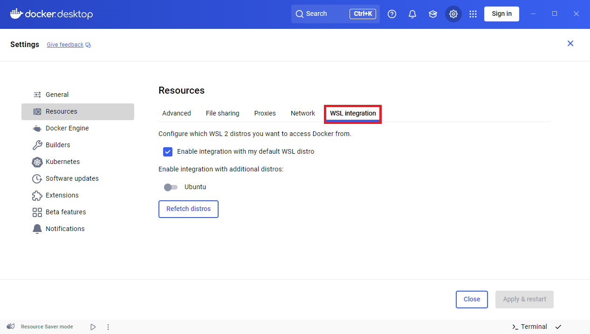

# 2. Docker Desktop no Windows: ativar e instalar

> 🗺️ **Neste capítulo:** você confere se o seu Windows atende aos requisitos, liga o WSL 2, instala o Docker Desktop e confirma que o primeiro contêiner roda. · ⏱️ ~45 min

> 🔥 **Aquecimento:** (1) Por que `uname -r` dá o mesmo resultado dentro de contêineres de imagens diferentes? (2) O que significa a mensagem `Cannot connect to the Docker daemon`?
>
> <details>
> <summary>Ver resposta</summary>
>
> (1) Contêineres não têm kernel próprio: todos usam o que roda por baixo. (2) O Engine não está rodando; no Windows, em geral o Docker Desktop está fechado (capítulo 1).
>
> </details>

## De onde paramos

No capítulo 1 você viu que um contêiner Linux precisa de um kernel Linux, e que o Windows não tem um. Este capítulo resolve isso: o Docker Desktop usa o **WSL 2** para criar uma pequena VM Linux, e é nela que o Docker Engine e os seus contêineres rodam. Se você usa Linux ou Mac, pode pular para o capítulo 3.



## Requisitos: o que o seu Windows precisa ter

Os requisitos abaixo são os da página oficial de instalação do Docker Desktop para Windows com o backend WSL 2 (conferida em 26/11/2026):

| Requisito | Valor exigido |
| --- | --- |
| Windows 10 | 64 bits, Enterprise, Pro ou Education, versão 22H2 (build 19045) |
| Windows 11 | 64 bits, Enterprise, Pro ou Education, versão 23H2 (build 22631) ou mais nova |
| WSL | a partir da 2.1.5, com o recurso WSL 2 ativado |
| Processador | 64 bits, com SLAT (*Second Level Address Translation*) |
| RAM | no mínimo 8 GB |
| Firmware | virtualização por hardware habilitada na BIOS/UEFI |
| Serviço do Windows | **Servidor** (`LanmanServer`) em execução, com início Automático |

Duas observações. O Windows **Home** não aparece na tabela, mas a mesma página diz que as edições Home e Education só rodam contêineres Linux, e é isso que este livro usa. E o Windows Server não é suportado.

Antes de instalar, confira o que dá para conferir pelo terminal. No PowerShell ou no Git Bash:

```bash
# versão do WSL e da distro que ele roda
wsl --version
wsl -l -v
# o serviço Servidor: STATE e START_TYPE
sc query LanmanServer
sc qc LanmanServer
```

Saída nesta máquina (Windows 11 Pro, build 26300), mostrando só as linhas que importam:

```text
WSL version: 3.0.5.0
Kernel version: 6.18.58.1-1
  NAME              STATE           VERSION
* Ubuntu-26.04      Running         2
  docker-desktop    Running         2
        STATE              : 4  RUNNING
        START_TYPE         : 2   AUTO_START
```

O WSL aqui está na versão 3.0.5, bem acima da 2.1.5 exigida, e a coluna `VERSION` mostra `2` nas duas distros: ambas rodam no WSL 2. A distro `docker-desktop` é a que o Docker Desktop cria sozinho para o Engine; ela é criada pela instalação do Docker Desktop.

Para a memória e a versão do Windows, o jeito mais simples é digitar `winver` (versão e build) e abrir o Gerenciador de Tarefas, aba **Desempenho**. Em **CPU**, a linha **Virtualização** (*Virtualization*) deve dizer **Habilitado** (*Enabled*).



*Gerenciador de Tarefas do Windows 10, em inglês; no Windows 11 a aba Desempenho fica no menu da esquerda, com os mesmos dados. Imagem: docker/docs contributors, Apache 2.0, via GitHub (docker/docs).*

> ⚠️ **Erro comum:** achar que o campo de virtualização consultado pelo PowerShell é uma prova. Ao testar, o comando `Get-CimInstance Win32_Processor | Select-Object -ExpandProperty VirtualizationFirmwareEnabled` respondeu `False` numa máquina onde o WSL 2 e o Docker funcionam, porque o Windows já usa o hipervisor e esse campo deixa de refletir a BIOS. O teste que vale é outro: se o WSL 2 inicia uma distro, a virtualização está ligada. O `systeminfo` também só diz `A hypervisor has been detected`.

## Três backends: WSL 2, Hyper-V e Docker VMM

O Docker Desktop precisa de um motor de virtualização por baixo, o **backend**. A documentação lista três, e os dois primeiros são os que você vai encontrar:

| | WSL 2 (o deste livro) | Hyper-V | Docker VMM (Beta) |
| --- | --- | --- | --- |
| Instalação | Por usuário ou para todos | Só para todos os usuários | Por usuário ou para todos |
| Administrador | Não, na instalação por usuário | Sim | Conforme o modo |
| Integração com distros do WSL | Sim | Não | Só a CLI nas distros |
| Contêineres Windows | Não | Sim, com instalação para todos | Não |
| Quando escolher | Quase sempre | Você precisa de contêineres Windows | Quer testar a recuperação de memória ociosa |

Para quem estuda e desenvolve, o WSL 2 é o padrão: usa a mesma VM leve das suas distros Linux e dispensa o administrador. O livro inteiro usa Linux containers com WSL 2.

## Ligar o WSL 2

Há três caminhos. O primeiro é o recomendado pela Microsoft; os outros servem para builds mais antigos ou para quando você precisa ligar um recurso por vez.

**Forma 1: `wsl --install`.** Abra o PowerShell **como administrador** (botão direito no menu Iniciar) e rode:

```powershell
# instala o WSL, a Plataforma de Máquina Virtual e uma distro Linux
wsl --install
```

Reinicie o Windows quando ele pedir. O comando só vale se o WSL ainda não está instalado; se ele mostrar a ajuda do `wsl`, use `wsl --list --online` para ver as distros e `wsl --install -d <Nome>` para escolher uma.

**Forma 2: recurso por recurso, com `dism.exe`.** Também no PowerShell de administrador:

```powershell
# 1) o Subsistema do Windows para Linux
dism.exe /online /enable-feature `
  /featurename:Microsoft-Windows-Subsystem-Linux /all /norestart
# 2) a Plataforma de Máquina Virtual, usada pela VM do WSL 2
dism.exe /online /enable-feature `
  /featurename:VirtualMachinePlatform /all /norestart
# reinicie o Windows e, depois, faça do 2 o padrão
wsl --set-default-version 2
```

**Forma 3: pela janela.** Em *Recursos do Windows*, marque **Subsistema do Windows para Linux** e **Plataforma de Máquina Virtual**, confirme e reinicie.

Depois do reinício, confirme e atualize o WSL:

```powershell
# a primeira linha mostra a versão do WSL: precisa ser 2.1.5 ou mais nova
wsl --version
# baixa a versão mais recente do WSL
wsl --update
```

Se o Windows reclamar de virtualização (por exemplo, o erro `0x80370102`), a Microsoft indica duas causas: a **Plataforma de Máquina Virtual** não está ligada, ou a virtualização está desligada na **BIOS/UEFI**. Esse ajuste muda de fabricante para fabricante e costuma ficar entre as opções do processador (Intel VT-x, AMD-V ou SVM).

## Instalar o Docker Desktop

**Baixe** o instalador pela página oficial de instalação (`Docker Desktop Installer.exe`) e escolha o **modo de instalação**:

| | Por usuário (recomendado) | Para todos os usuários |
| --- | --- | --- |
| Onde instala | `%LOCALAPPDATA%\Programs\DockerDesktop` | `C:\Program Files\Docker\Docker` |
| Conta de administrador | Dispensada, até nas atualizações | Necessária para instalar e atualizar |
| Backends possíveis | WSL 2 ou Docker VMM | WSL 2, Hyper-V ou ainda Docker VMM |
| Roda contêineres Windows | Não | Sim |

Trocar de modo depois exige desinstalar e reinstalar. Na tela de configuração do instalador, deixe marcada a opção **Use WSL 2** (a documentação diz que, desde a versão 4.97, essa página lista os backends como opções). Conclua o assistente e **inicie o Docker Desktop manualmente**: ele não abre sozinho depois de instalar.

**Pela linha de comando**, as opções documentadas do instalador permitem aceitar os termos e fixar o backend:

```powershell
# por usuário, sem administrador; --accept-license aceita os termos
# na hora e --backend=wsl-2 fixa o backend deste livro
Start-Process 'Docker Desktop Installer.exe' -Wait `
  -ArgumentList 'install', '--user', '--accept-license', '--backend=wsl-2'
```

O `winget` também tem o pacote: `winget show --id Docker.DockerDesktop --source winget` achou o `Docker.DockerDesktop`, na versão 4.100.1, quando conferi, e `winget install -e --id Docker.DockerDesktop` o instalaria. Atenção: a versão 4.100.0 e a 4.100.1 têm um problema conhecido nas notas de versão: contêineres e imagens podem ficar escondidos depois da atualização, até você desmarcar *Use containerd for pulling and storing images* em **Settings > General**. Se acontecer, o conteúdo não foi apagado.

**Primeiro início:** o Docker Desktop mostra o *Docker Subscription Service Agreement*. A licença é gratuita em quatro casos: uso pessoal, ensino, projetos abertos sem fins comerciais e empresas pequenas (menos de 250 funcionários **e** receita anual abaixo de US$ 10 milhões). Fora deles, é preciso assinar um plano. Sem aceitar, o Docker Desktop não roda. O login numa conta Docker é opcional para este livro.



## A integração com o WSL

Com o WSL 2, o comando `docker` funciona direto no PowerShell. Para usá-lo também **dentro de uma distro** (por exemplo, o Ubuntu), ligue a integração em **Settings > Resources > WSL integration**, escolhendo a distro. Antes, desinstale qualquer Docker Engine que você tenha instalado dentro dessa distro: os dois juntos causam conflito, e o Docker Desktop recomenda remover o antigo. A distro precisa rodar em WSL 2 (`wsl -l -v` mostra `2` na coluna `VERSION`; para converter, `wsl --set-version <Distro> 2`).



*A tela da integração com o WSL, na documentação da Microsoft; o visual pode mudar conforme a versão do Docker Desktop (o livro usa a 4.99), mas os nomes das opções são os mesmos. Imagem: MicrosoftDocs/WSL contributors, CC BY 4.0, via GitHub (MicrosoftDocs/WSL).*

Aqui, a integração estava ligada para o Ubuntu 26.04. Do terminal dele, o mesmo contêiner roda:

```bash
# executado dentro da distro Ubuntu-26.04 do WSL
docker version --format '{{.Server.Version}}'
docker run --rm hello-world
```

```text
29.9.3
Hello from Docker!
This message shows that your installation appears to be working correctly.
```

A versão do servidor é a mesma de antes, porque o Engine é um só: o do Docker Desktop. A distro Ubuntu só leva o *cliente* `docker`.

## Problemas comuns

| Sintoma | Causa provável | O que fazer |
| --- | --- | --- |
| Erro de virtualização ou `0x80370102` ao abrir o WSL ou o Docker Desktop | Plataforma de Máquina Virtual desligada, ou virtualização desligada na BIOS/UEFI | Ligar o recurso (forma 2) e conferir a BIOS/UEFI |
| `wsl --version` não é reconhecido, ou aviso de WSL desatualizado | WSL embutido antigo | `wsl --update` no PowerShell |
| Docker Desktop preso em *Starting the Docker Engine* | VM do WSL travada ou em estado antigo | Fechar o Docker Desktop, rodar `wsl --shutdown` e abrir de novo |
| `docker: command not found` no Ubuntu | Integração com a distro desligada | Settings > Resources > WSL integration |
| A distro não aparece na lista da integração | Ela roda no WSL 1 | `wsl --set-version <Distro> 2` |
| `Cannot connect to the Docker daemon` | Docker Desktop fechado | Abrir o Docker Desktop e esperar o Engine ficar em execução |

O `wsl --shutdown` desliga todas as distros e a VM do WSL 2, inclusive a `docker-desktop`; o Docker Desktop recria o que precisa na próxima abertura. Salve o que estiver aberto nas distros antes.

## 🧪 Laboratório: instalar e testar

> ⚠️ **O que não foi executado:** o computador usado para produzir o livro já tinha o Docker Desktop instalado, e instalar de novo mudaria o ambiente de quem o escreve. Por isso os **passos 2 a 4** (ligar o WSL, instalar e abrir o Docker Desktop) estão descritos a partir da documentação oficial e **não foram executados** aqui. Os passos 1 e 5 foram executados, com a saída real.

**Objetivo:** sair de um Windows sem o Docker até um `hello-world` rodando.

**Passo 1: conferir os requisitos.** Rode os comandos da seção de requisitos. Você precisa de Windows 10 22H2 ou Windows 11 23H2 (ou mais novos), 8 GB de RAM, WSL 2.1.5 ou mais novo e o serviço `LanmanServer` em `AUTO_START`.

**Passo 2: ligar o WSL 2.** No PowerShell de administrador, `wsl --install`, e reinicie. Depois, `wsl --version` e `wsl --update`.

**Passo 3: instalar.** Rode o instalador no modo por usuário, com **Use WSL 2** marcado.

**Passo 4: iniciar e aceitar os termos.** Abra o Docker Desktop pelo menu Iniciar, aceite o acordo e espere o Engine ficar em execução.

**Passo 5: testar.**

```bash
# versão do cliente e do servidor, e o contexto ativo
docker version --format '{{.Client.Version}} {{.Server.Version}}'
docker context ls
# o contêiner mais simples do mundo
docker run --rm hello-world
```

```text
29.9.3 29.9.3
NAME              DESCRIPTION                               DOCKER ENDPOINT
default           Current DOCKER_HOST based configuration   npipe:////./pipe/docker_engine
desktop-linux *   Docker Desktop                            npipe:////./pipe/dockerDesktopLinuxEngine
Hello from Docker!
This message shows that your installation appears to be working correctly.
```

A mensagem `Hello from Docker!` confirma o caminho completo: o cliente falou com o Engine, o Engine baixou a imagem `hello-world` e criou o contêiner. O `docker context ls` mostra que a CLI está falando com o contexto `desktop-linux`, o do Docker Desktop; o capítulo 5 explica contextos.

> 💡 O visual do Docker Desktop mudou na versão 4.100 (novo logotipo e novas cores). As telas e os nomes de menu deste livro seguem a versão 4.99, e os caminhos que cito (Settings > Resources, Settings > General) continuam os mesmos.

## 🏋️ Pratique

**1. Resolvido:** considere esta saída de `wsl -l -v` (um exemplo montado para o exercício, com o Docker Desktop recém-instalado). Em qual distro roda o Docker Engine, e o Ubuntu pode usar o `docker`?

```text
  NAME              STATE           VERSION
* Ubuntu           Running         2
  docker-desktop    Running         2
```

<details>
<summary>Ver resposta</summary>

O Engine roda na distro `docker-desktop`, criada pelo próprio Docker Desktop. O Ubuntu está em WSL 2 (coluna `VERSION`), então pode usar o `docker`, mas só depois de ligar a integração em **Settings > Resources > WSL integration**. Sem isso, o comando dá `docker: command not found` no Ubuntu.

</details>

**2. Complete:** o seu Windows 11 está no build 22621. Ele atende ao requisito? Se não, o que você faz? Preencha: "o Windows 11 exige a versão ____ (build ____) ou mais nova".

<details>
<summary>Ver resposta</summary>

A versão 23H2, build 22631. O build 22621 é da 22H2, e ela não atende: atualize o Windows pelo Windows Update antes de instalar o Docker Desktop.

</details>

**3. Por conta própria:** abra um terminal e rode `docker info --format '{{.OperatingSystem}} | {{.OSType}}'`. O que o resultado diz sobre onde o Engine está rodando e que tipo de contêiner você vai criar?

<details>
<summary>Ver resposta</summary>

Aqui a saída foi `Docker Desktop | linux`. O Engine é o do Docker Desktop (a VM do WSL 2) e os contêineres que você cria são **Linux**, que é o que o livro usa.

</details>

**4. Desafio:** Marina tem um notebook com Windows 11 Home e quer rodar contêineres Windows para testar um sistema antigo. Isso é possível? E contêineres Linux?

<details>
<summary>Ver resposta</summary>

Contêineres Windows não: a documentação diz que eles exigem Windows 10 ou 11 Pro ou Enterprise (e a instalação para todos os usuários). Contêineres Linux sim, com o backend WSL 2, mesmo no Home. Para o sistema antigo, uma alternativa é uma VM.

</details>

## 🧠 Revisão rápida

**1.** Qual é a diferença entre o WSL 2 e o Hyper-V como backend do Docker Desktop?

<details>
<summary>Ver resposta</summary>

O WSL 2 usa a VM leve das distros Linux e roda na instalação por usuário, sem administrador. O Hyper-V exige a instalação para todos os usuários e é o caminho para contêineres Windows.

</details>

**2.** O Docker Desktop abriu, mas o `docker` não existe dentro do Ubuntu do WSL. O que falta?

<details>
<summary>Ver resposta</summary>

Ligar a integração com a distro em Settings > Resources > WSL integration (e não ter outro Engine instalado dentro dela).

</details>

**3.** (Do capítulo 1) Qual é a diferença entre imagem e contêiner?

<details>
<summary>Ver resposta</summary>

A imagem é o pacote somente leitura; o contêiner é a instância criada a partir dela.

</details>

## 🤖 Estude com um tutor de IA

> Faça 5 perguntas sobre a instalação do Docker Desktop no Windows (requisitos, WSL 2, backends), uma de cada vez. Espere a minha resposta antes de dar o retorno e não me dê as respostas antes.

> Descrevo o erro que apareceu ao abrir o Docker Desktop: [mensagem]. Liste as causas prováveis em ordem e o comando que testa cada uma, sem pedir que eu reinstale nada antes.

> ➡️ **Próximo passo:** com o Docker funcionando, falta conhecer o Linux e o Mac, ou ir direto ao uso: **3. Instalar no Linux e no Mac** (pule se não é o seu caso) e depois **4. Ciclo de vida do contêiner pela linha de comando**.

## 📌 Resumo

| Item | Em uma frase |
| --- | --- |
| Requisitos | Windows 10 22H2 ou 11 23H2 (ou mais novo), 8 GB de RAM, WSL 2.1.5+, virtualização ligada |
| Backend | WSL 2 é o padrão e roda sem administrador; Hyper-V é para contêineres Windows |
| Ligar o WSL | `wsl --install` como administrador, reiniciar e `wsl --update` |
| Instalação | Por usuário em `%LOCALAPPDATA%`; trocar de modo exige reinstalar |
| Termos de uso | Grátis para uso pessoal, ensino e empresas pequenas |
| Integração | Settings > Resources > WSL integration, uma distro por vez |
| Teste | `docker run --rm hello-world` |

## 📚 Fontes

Conferido em 26/11/2026.

- [Instalação do Docker Desktop no Windows](https://docs.docker.com/desktop/setup/install/windows-install/)
- [Backend WSL 2 do Docker Desktop](https://docs.docker.com/desktop/features/wsl/)
- [Notas de versão do Docker Desktop](https://docs.docker.com/desktop/release-notes/)
- [Instalação do WSL (Microsoft)](https://learn.microsoft.com/en-us/windows/wsl/install)
- [Instalação manual do WSL (Microsoft)](https://learn.microsoft.com/en-us/windows/wsl/install-manual)
- [Solução de problemas do WSL (Microsoft)](https://learn.microsoft.com/en-us/windows/wsl/troubleshooting)

<!-- nav:start -->
---

[◀ Capítulo anterior](01-por-que-conteineres-existem.md) · [Mapa do livro](../README.md) · [Próximo capítulo ▶](03-instalar-no-linux-e-no-mac.md)
<!-- nav:end -->
