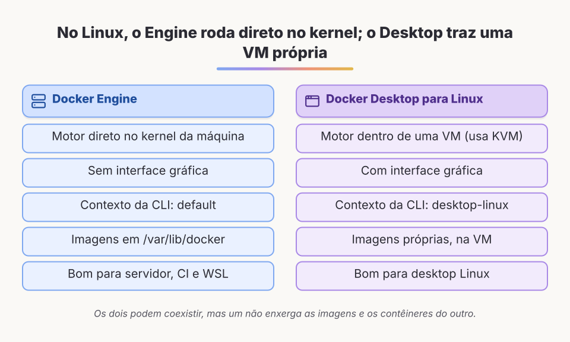
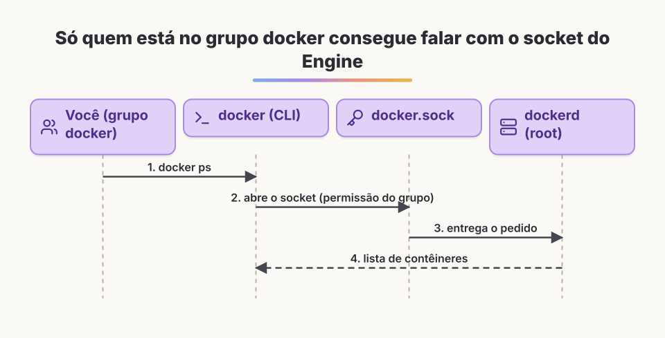

# 3. Instalar no Linux e no Mac

> 🗺️ **Neste capítulo:** você instala o Docker Engine no Ubuntu pelo repositório oficial, libera o uso sem `sudo` com o grupo `docker`, vê como ficaria no Ubuntu do WSL e instala o Docker Desktop no Mac. · ⏱️ ~45 min

> 🔥 **Aquecimento:** (1) Por que o Windows precisa do WSL 2 para rodar contêineres Linux? (2) O que uma imagem tem que um contêiner não tem, e vice-versa?
>
> <details>
> <summary>Ver resposta</summary>
>
> (1) Porque o contêiner Linux usa o kernel do host e o Windows não tem um: o Docker Desktop cria uma VM Linux pelo WSL 2 (capítulo 2). (2) A imagem é o pacote somente leitura; o contêiner é a instância em execução, que pode criar e mudar arquivos (capítulo 1).
>
> </details>

## De onde paramos

No capítulo 2 o Docker chegou ao Windows dentro de uma VM. No Linux o kernel já está ali: o Engine roda direto na máquina, sem VM no meio. No Mac, como no Windows, o Docker Desktop cria uma VM Linux por baixo.

Se você usa Windows e quer apenas seguir o livro, o capítulo 2 basta e você pode pular este.

## Linux: Docker Engine ou Docker Desktop para Linux?

Há dois produtos de nome parecido, e escolher um sem entender a diferença costuma dar dor de cabeça.

**O Docker Engine é o servidor (`dockerd`) mais a CLI, instalados no próprio sistema; o Docker Desktop para Linux é um aplicativo com interface gráfica, que traz um motor seu dentro de uma VM.**



A documentação admite os dois na mesma máquina, mas com estoques separados de imagens e contêineres (o Desktop cria o contexto `desktop-linux`, e o que você criou antes no Engine não aparece nele). Os dois também podem disputar as mesmas portas, e a recomendação é parar o Engine enquanto usa o Desktop. Este livro usa o **Engine**: é o que roda em servidores, em CI e no Ubuntu do WSL.

> ⚠️ **Erro comum:** supor que o `docker.io` do Ubuntu seja "o Docker oficial". Ele é montado pela equipe do Ubuntu, que decide a versão e quando atualizar, e a documentação manda removê-lo antes de instalar os pacotes da Docker.

## Instalar o Docker Engine no Ubuntu pelo repositório oficial

No Ubuntu, o **apt** instala programas a partir das fontes que o sistema conhece. A Docker mantém uma fonte própria, em `download.docker.com`. **Instalar pelo repositório oficial significa registrar essa fonte no apt, com a chave que garante a origem dos pacotes, e instalar o `docker-ce` a partir dela.** A vantagem é que depois o `apt upgrade` atualiza o Docker junto com o resto do sistema.

As versões de Ubuntu citadas na documentação, todas de 64 bits, são a 26.10 e as LTS 26.04, 24.04 e 22.04, para x86_64, armhf, arm64, s390x e ppc64le. Derivados, como o Linux Mint, não são oficialmente suportados.


> ⚠️ **Como este passo a passo foi testado:** o computador usado para escrever o livro tem o Docker Desktop, e instalar o Engine num Ubuntu do WSL com a integração ligada causaria conflito. Por isso os passos 1 a 4 foram executados de verdade, mas num **contêiner descartável** do `ubuntu:26.04`, com um usuário comum (`ana`) que usa `sudo`, como num Ubuntu recém-instalado. Dentro de um contêiner não há `systemd`, então iniciar e testar o serviço (passo 5) **não foi executado** aqui.

### Passos 1 a 4

Todos os comandos abaixo vêm da página oficial de instalação (conferida em 26/11/2026).

**1. Remover os pacotes conflitantes.** Se nenhum estiver instalado, o apt avisa e não remove nada, o que é normal. Imagens e volumes antigos em `/var/lib/docker` não são apagados.

```bash
# remove só os conflitantes que estiverem instalados:
# o dpkg filtra e o cut pega só o nome do pacote
sudo apt remove $(dpkg --get-selections \
  docker.io docker-compose docker-compose-v2 \
  docker-doc docker-buildx podman-docker \
  containerd runc | cut -f1)
```

```text
Solving dependencies...
Summary:
  Upgrading: 0, Installing: 0, Removing: 0, Not Upgrading: 4
```

**2. Guardar a chave GPG da Docker.**

```bash
sudo apt update
sudo apt install ca-certificates curl
# a pasta das chaves, com as permissões do apt
sudo install -m 0755 -d /etc/apt/keyrings
sudo curl -fsSL https://download.docker.com/linux/ubuntu/gpg \
  -o /etc/apt/keyrings/docker.asc
sudo chmod a+r /etc/apt/keyrings/docker.asc
```

**3. Cadastrar o repositório.** O arquivo usa o formato novo do apt (*deb822*). As duas substituições entre `$( )` descobrem sozinhas o nome da versão do Ubuntu e a arquitetura:

```bash
# grava o arquivo da fonte; o EOF fecha o texto
sudo tee /etc/apt/sources.list.d/docker.sources <<EOF
Types: deb
URIs: https://download.docker.com/linux/ubuntu
Suites: $(. /etc/os-release && echo "${UBUNTU_CODENAME:-$VERSION_CODENAME}")
Components: stable
Architectures: $(dpkg --print-architecture)
Signed-By: /etc/apt/keyrings/docker.asc
EOF
sudo apt update
```

O arquivo gerado no teste (num Ubuntu 26.04, de codinome `resolute`, em amd64) e as linhas do `apt update` que mostram a fonte da Docker sendo lida:

```text
Types: deb
URIs: https://download.docker.com/linux/ubuntu
Suites: resolute
Components: stable
Architectures: amd64
Signed-By: /etc/apt/keyrings/docker.asc
Get:1 https://download.docker.com/linux/ubuntu resolute InRelease [32.5 kB]
Get:2 https://download.docker.com/linux/ubuntu resolute/stable amd64 Packages [41.3 kB]
```

Antes de instalar, confirme **de onde** o apt vai buscar o pacote:

```bash
# Candidate e a origem (download.docker.com) dizem que a fonte está certa
apt-cache policy docker-ce | head -6
```

```text
docker-ce:
  Installed: (none)
  Candidate: 5:29.10.1-1~ubuntu.26.04~resolute
  Version table:
     5:29.10.1-1~ubuntu.26.04~resolute 500
        500 https://download.docker.com/linux/ubuntu resolute/stable amd64 Packages
```

**4. Instalar os pacotes.**

```bash
# o Engine, a CLI, o containerd e os plugins buildx e compose
sudo apt install docker-ce docker-ce-cli containerd.io \
  docker-buildx-plugin docker-compose-plugin
```

Versões instaladas no teste:

```text
containerd.io 2.4.2-4~ubuntu.26.04~resolute
docker-buildx-plugin 0.39.1-1~ubuntu.26.04~resolute
docker-ce 5:29.10.1-1~ubuntu.26.04~resolute
docker-ce-cli 5:29.10.1-1~ubuntu.26.04~resolute
docker-compose-plugin 5.8.0-1~ubuntu.26.04~resolute
```

```text
Docker version 29.10.1, build c48360f
```

Repare que o repositório já entrega o Engine **29.10.1**, uma versão acima da 29.9.3 do restante do livro: o repositório acompanha as versões novas, e os conceitos e comandos seguem iguais.

**5. Testar (não executado aqui).** Numa instalação normal do Ubuntu, com `systemd`:

```bash
# o serviço deve aparecer como active (running)
sudo systemctl status docker
# se não estiver rodando: sudo systemctl start docker
sudo docker run hello-world
```

> ⚠️ **Erro comum:** o `ufw` e o `firewalld` **não bloqueiam** as portas que você publica com o Docker: elas passam por fora das regras desses firewalls. A documentação de instalação alerta que o Docker só é compatível com `iptables-nft` e `iptables-legacy`, e que regras próprias devem ir na cadeia `DOCKER-USER`. Por isso o livro publica portas com `127.0.0.1` na frente (capítulo 1).

## Pós-instalação: usar o `docker` sem `sudo`

O Engine roda como `root` e conversa com a CLI por um **socket** Unix (`/var/run/docker.sock`), um arquivo especial pelo qual os programas se falam. Por padrão, só o `root` pode escrever nele, e é por isso que você precisa de `sudo`. Ao ser iniciado, o Engine cria o socket acessível aos membros do grupo `docker`.



Para dar acesso a um usuário, coloque-o nesse grupo:

```bash
# cria o grupo (se o pacote já não criou), adiciona você e
# ativa na sessão atual sem sair
sudo groupadd docker
sudo usermod -aG docker $USER
newgrp docker
```

Os pacotes da Docker já criam o grupo. No teste, o `groupadd` respondeu que ele já existia, e o `usermod` colocou a usuária no grupo:

```text
groupadd: group 'docker' already exists
uid=1001(ana) gid=1001(ana) groups=1001(ana),994(docker)
docker:x:994:ana
```

Sem o `newgrp`, é preciso sair da sessão e entrar de novo (numa VM, às vezes reiniciar) para o novo grupo valer. Depois disso, `docker run hello-world` funciona sem `sudo`.

> 💡 **Analogia:** o grupo `docker` é a chave do portão do prédio de máquinas: quem tem a chave aciona o Engine sem pedir permissão. O problema é que o Engine é o zelador com acesso a todas as salas (roda como `root`), e por isso a chave vale quase tanto quanto a de administrador. *Onde a analogia falha:* uma chave física abre uma porta só; já o grupo permite montar qualquer pasta do computador dentro de um contêiner.

> ⚠️ **Erro comum:** colocar qualquer usuário no grupo `docker` por comodidade. A documentação avisa: **o grupo `docker` concede privilégios de root**. Use-o só na sua máquina de estudo, e em servidores compartilhados prefira `sudo` ou o modo *rootless* (o Docker sem root, descrito na documentação).

Outro tropeço descrito na documentação: se você rodou comandos com `sudo` e só depois entrou no grupo, o arquivo `~/.docker/config.json` pode ter ficado com permissão de `root`, e a CLI avisa que não consegue lê-lo. A correção é refazer a posse e a permissão da pasta:

```bash
# devolve a pasta ~/.docker ao seu usuário
sudo chown "$USER":"$USER" /home/"$USER"/.docker -R
sudo chmod g+rwx "$HOME/.docker" -R
```

Quando o Engine não está rodando, a CLI avisa. Você pode ver a mensagem apontando para um socket que não existe:

```bash
DOCKER_HOST=unix:///var/run/nao-existe.sock docker ps
```

```text
Cannot connect to the Docker daemon at unix:///var/run/nao-existe.sock. Is the docker daemon running?
```

## Docker Engine direto no Ubuntu do WSL

No Windows, você também pode instalar o Engine **dentro** do Ubuntu do WSL, sem o Docker Desktop. É um caminho legítimo para quem quer um Linux "de verdade" e dispensa a interface. Os passos são os do Ubuntu, com um pré-requisito: o `systemd` precisa estar ligado na distro. Segundo a Microsoft, você o liga em `/etc/wsl.conf`:

```ini
[boot]
systemd=true
```

Depois, rode `wsl --shutdown` no PowerShell e abra a distro de novo.

> ⚠️ **Não misture:** com a integração do Docker Desktop ligada para a mesma distro, os dois Engines entram em conflito, e o Docker Desktop recomenda desinstalar o Engine de dentro da distro antes de usar a integração. Escolha um caminho por distro. Esta seção **não foi executada** na máquina do livro, que usa o Desktop.

## Docker Desktop no Mac

No Mac, o caminho é o Docker Desktop, e a instalação não pede a senha do administrador:

1. Baixe o `Docker.dmg` da página oficial, na versão certa para o seu processador: **Apple silicon** (os chips da linha M) ou **Intel**.
2. Abra o `.dmg` e leve o ícone do Docker até a pasta **Applications** (o padrão é `/Applications/Docker.app`).
3. Abra o `Docker.app`, leia e aceite o acordo de assinatura e espere o Engine iniciar.
4. Confira no Terminal:

```bash
# deve mostrar o cliente e o servidor, como no capítulo 2
docker version
docker run --rm hello-world
```

O que a documentação exige: uma versão suportada do macOS (a atual e as duas anteriores) e pelo menos 4 GB de RAM. A Rosetta 2 é recomendada para um conjunto de ferramentas de linha de comando opcionais, mas não é mais obrigatória (`softwareupdate --install-rosetta` instala). Antes de instalar, feche programas que chamam o Docker em segundo plano (VS Code, terminais). Se aparecer o aviso `"Docker.app" is damaged`, a documentação tem uma página própria sobre a correção.

> ⚠️ **O que não foi executado:** a instalação no Mac **não foi executada**, porque o autor não tem um Mac. Os passos vêm da documentação oficial, conferida em 26/11/2026.

## 🧪 Laboratório: do Ubuntu limpo ao grupo `docker`

**Objetivo:** reproduzir a instalação pelo repositório oficial e conferir o grupo `docker`, num ambiente descartável que não mexe no seu computador.

> ⚠️ **O que difere do seu ambiente:** o autor executou estes mesmos comandos por um script dentro de um contêiner `ubuntu:26.04` (sem digitar um a um). Num Ubuntu real (uma VM ou um computador), pule o passo 1 e use `sudo` normalmente; a saída do `systemctl` só existe lá.

**Passo 1: abrir um Ubuntu limpo.** Se você já tem o Docker (por exemplo, o Desktop), um contêiner serve de Ubuntu de teste. Este comando entra num Ubuntu 26.04 descartável como `root`, cria a usuária `ana` com `sudo` e troca para ela:

```bash
# --rm apaga o contêiner ao sair; nada fica no seu computador
docker run --rm -it --name dz-ubuntu ubuntu:26.04 bash
apt-get update && apt-get install -y sudo curl ca-certificates
useradd -m -s /bin/bash ana
echo "ana ALL=(ALL) NOPASSWD:ALL" > /etc/sudoers.d/ana
su - ana
```

**Passo 2: instalar.** Rode os comandos dos passos 1 a 4 da seção de instalação. Os pacotes são baixados da internet, então a duração depende da sua conexão.

**Passo 3: conferir.**

```bash
# versão instalada e quem pode usar o socket
docker --version
id
getent group docker
```

```text
Docker version 29.10.1, build c48360f
uid=1001(ana) gid=1001(ana) groups=1001(ana)
docker:x:994:
```

**Passo 4: entrar no grupo e conferir de novo.**

```bash
sudo usermod -aG docker $USER
id ana
getent group docker
```

```text
uid=1001(ana) gid=1001(ana) groups=1001(ana),994(docker)
docker:x:994:ana
```

O `id ana` agora lista o grupo `docker`. Sair do `bash` (`exit`, duas vezes) apaga tudo, pois o contêiner foi criado com `--rm`.

> ⚠️ **Limite deste laboratório:** dentro de um contêiner não há Engine rodando, então o `docker run hello-world` do passo 5 **não foi executado** aqui. Num Ubuntu real, ele confirma a instalação.

## 🏋️ Pratique

**1. Resolvido:** `apt-cache policy docker-ce` mostra `Candidate: (none)`. O que isso indica, e o que você confere primeiro?

<details>
<summary>Ver resposta</summary>

O apt não encontrou o pacote em nenhuma fonte: o repositório da Docker não foi cadastrado ou o `apt update` não rodou depois do cadastro. Confira o arquivo `/etc/apt/sources.list.d/docker.sources` (campos `Suites` e `Architectures`), a chave em `/etc/apt/keyrings/docker.asc` e rode `sudo apt update` de novo. Quando funciona, a origem `download.docker.com` aparece na tabela de versões.

</details>

**2. Complete:** o comando que coloca o usuário atual no grupo `docker` é `sudo ____ -aG docker $USER`. Depois dele, o que mais é preciso para o grupo valer?

<details>
<summary>Ver resposta</summary>

`usermod`. Depois é preciso reiniciar a sessão (sair e entrar) ou ativá-la no terminal atual com `newgrp docker`.

</details>

**3. Por conta própria:** você tem um servidor Ubuntu compartilhado com três colegas e quer que todos usem o Docker sem `sudo`. Que risco existe e o que a documentação sugere?

<details>
<summary>Ver resposta</summary>

O grupo `docker` equivale a privilégios de `root`: quem está nele pode, por exemplo, montar qualquer pasta do servidor dentro de um contêiner. Num servidor compartilhado, prefira que cada pessoa use `sudo` ou o modo *rootless* do Docker.

</details>

**4. Desafio:** Rui tem um Mac e um notebook Windows com Ubuntu no WSL. Em que cada um instalaria o Docker, e qual erro ele deve evitar no Ubuntu do WSL?

<details>
<summary>Ver resposta</summary>

No Mac, o Docker Desktop (arrastar o `Docker.app` para Applications). No Windows, o Docker Desktop com a integração com o Ubuntu ligada (capítulo 2) ou, se preferir só o Engine, o Engine dentro do Ubuntu com `systemd` ligado. O erro é misturar os dois na mesma distro: o Engine instalado dentro dela conflita com a integração do Desktop.

</details>

## 🧠 Revisão rápida

**1.** Qual a diferença entre Docker Engine e Docker Desktop para Linux?

<details>
<summary>Ver resposta</summary>

O Engine roda direto no kernel e não tem interface. O Desktop roda o próprio motor numa VM, com interface gráfica, e usa o contexto `desktop-linux`, sem enxergar o que o Engine criou.

</details>

**2.** Por que o repositório da Docker precisa de uma chave GPG?

<details>
<summary>Ver resposta</summary>

Para o apt verificar que os pacotes vieram da Docker. O campo `Signed-By` do `docker.sources` aponta para ela.

</details>

**3.** Por que colocar um usuário no grupo `docker` exige cuidado?

<details>
<summary>Ver resposta</summary>

Porque o grupo dá acesso ao socket do Engine, que roda como `root`: na prática, equivale a privilégios de administrador.

</details>

**4.** (Do capítulo 1) Por que `curl http://127.0.0.1:8000` falhava, mesmo com o servidor rodando num contêiner?

<details>
<summary>Ver resposta</summary>

Porque a porta 8000 só existia dentro do contêiner; no seu computador só existe o que foi publicado com `-p` (a 8080).

</details>

## 🤖 Estude com um tutor de IA

> Faça 5 perguntas sobre instalar o Docker Engine no Ubuntu pelo repositório oficial e sobre o grupo `docker`, uma de cada vez. Espere a minha resposta antes de dar o retorno e não me dê as respostas antes.

> Aqui está a saída do meu `apt-cache policy docker-ce`: <saída>. Aponte o que está errado sem me dar o comando pronto.

> ➡️ **Próximo passo:** com o Docker instalado, é hora de usá-lo. No capítulo **4. Ciclo de vida do contêiner pela linha de comando**, você roda, lista, para e remove contêineres e lê os logs.

## 📌 Resumo

| Item | Em uma frase |
| --- | --- |
| Engine × Desktop | O Engine roda direto no kernel; o Desktop roda o motor numa VM, com interface |
| Repositório oficial | Chave GPG em `/etc/apt/keyrings`, fonte em `docker.sources`, pacotes `docker-ce` |
| Pacotes | `docker-ce`, `docker-ce-cli`, `containerd.io`, `docker-buildx-plugin`, `docker-compose-plugin` |
| Conflitantes | `docker.io`, `podman-docker`, `containerd` e `runc` do Ubuntu saem antes |
| Grupo `docker` | Dá acesso ao socket sem `sudo`, mas equivale a root |
| Firewall | Portas publicadas passam por fora do `ufw` e do `firewalld` |
| WSL | Engine no Ubuntu do WSL pede `systemd=true`; não misture com a integração do Desktop |
| Mac | `Docker.dmg`, arrastar para Applications, aceitar o acordo |

## 📚 Fontes

Conferido em 26/11/2026.

- [Instalação do Docker Engine no Ubuntu](https://docs.docker.com/engine/install/ubuntu/)
- [Passos pós-instalação no Linux](https://docs.docker.com/engine/install/linux-postinstall/)
- [Instalação do Docker Desktop no Linux](https://docs.docker.com/desktop/setup/install/linux/)
- [Instalação do Docker Desktop no Mac](https://docs.docker.com/desktop/setup/install/mac-install/)
- [Configurações avançadas do WSL: systemd (Microsoft)](https://learn.microsoft.com/en-us/windows/wsl/wsl-config)

<!-- nav:start -->
---

[◀ Capítulo anterior](02-docker-desktop-no-windows-ativar-e-instalar.md) · [Mapa do livro](../README.md) · [Próximo capítulo ▶](04-ciclo-de-vida-do-conteiner-pela-linha-de-comando.md)
<!-- nav:end -->
