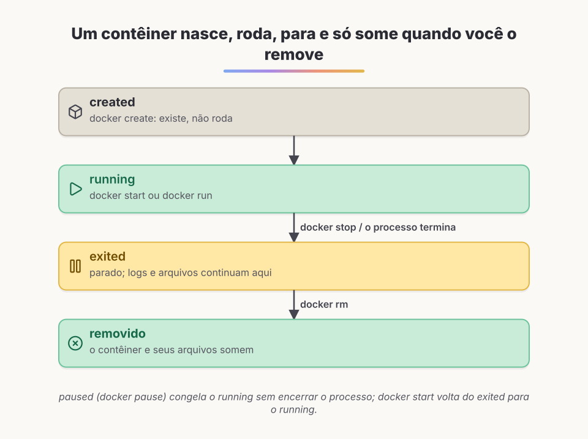
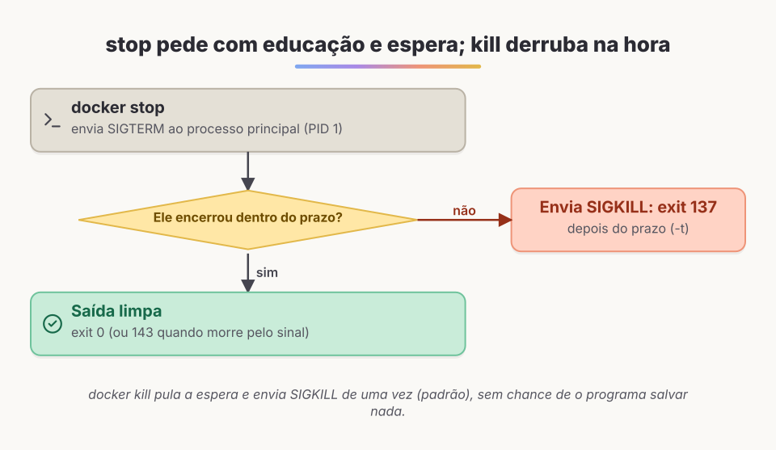

# 4. Ciclo de vida do contêiner na linha de comando

> 🗺️ **Neste capítulo:** você aprende a ler um `docker run` por partes e a conduzir um contêiner do nascimento ao fim: rodar, listar, pausar, parar, ler os logs, entrar nele e removê-lo, tudo com o servidor do projeto. · ⏱️ ~50 min

> 🔥 **Aquecimento:** (1) Por que estar no grupo `docker` do Linux equivale a ter poder de root? (2) No Windows, em que lugar o contêiner Linux realmente roda?
>
> <details>
> <summary>Ver resposta</summary>
>
> (1) Porque quem fala com o socket do Engine pode pedir ao `dockerd`, que roda como root, para montar qualquer pasta do sistema num contêiner (capítulo 3). (2) Dentro de uma VM Linux criada pelo Docker Desktop com o WSL 2 (capítulo 2).
>
> </details>

## De onde paramos

No capítulo 1 você subiu o servidor da página de tarefas, olhou e apagou. Naquele momento os comandos eram receita pronta. Agora você vai entender cada peça: o que significa cada opção do `docker run`, em que estados um contêiner passa e o que acontece de verdade quando você o para.

Todos os nomes deste capítulo começam com `dz-`, como no capítulo 1, e as portas ficam só no seu computador (`127.0.0.1`). Os comandos valem em Linux, macOS e no terminal do Windows (Git Bash ou o Ubuntu do WSL). Se você usa o Git Bash, rode antes `export MSYS_NO_PATHCONV=1`, para ele não reescrever caminhos como `/site`.

## Anatomia do docker run

Você já usou `docker run`, mas ele junta quatro decisões numa linha só, e quase todo erro de iniciante vem de misturar a ordem delas.

**O `docker run` cria um contêiner novo a partir de uma imagem e já o inicia; tudo o que vem antes do nome da imagem são opções do Docker, e tudo o que vem depois é o comando que roda dentro do contêiner.**

```text
docker run  [opções]                            imagem          [comando e argumentos]
docker run  -d --name dz-web -p 127.0.0.1:8080:8000  python:3.14-slim  sh -c '...'
            └── como o Docker deve rodar ──────┘  └── de qual ──┘  └── o que roda dentro ┘
```

As opções que você vai usar o tempo todo:

| Opção | O que faz |
| --- | --- |
| `-d` (*detach*) | roda em segundo plano e devolve o terminal; sem ela, o contêiner prende o terminal |
| `--name` | dá um nome fácil; sem ele o Docker sorteia um, como `laughing_bhaskara` |
| `-p host:contêiner` | publica a porta do contêiner numa porta do seu computador; a ordem é sempre **host primeiro** |
| `--rm` | remove o contêiner assim que ele termina |
| `-i` | mantém a entrada padrão aberta (para receber o que você digita ou um texto vindo de um pipe) |
| `-t` | aloca um terminal; `-it` juntos servem para conversar com um programa interativo |
| `--label chave=valor` | cola uma etiqueta no contêiner, útil para achar e limpar depois |
| `-e VAR=valor` | define uma variável de ambiente |

Primeiro o caso mais simples: sem `-d`, o contêiner roda **em primeiro plano**, escreve na tela e, quando o programa termina, ele também termina.

```bash
# --rm: não deixa o contêiner parado depois que o programa acabar
docker run --rm python:3.14-slim python -c "print('olá do contêiner')"
```

```text
olá do contêiner
```

Agora o servidor do projeto, em segundo plano. Preveja antes de rodar: o que o `docker run -d` vai imprimir, e como você vê que o servidor está de pé?

```bash
# -d: segundo plano; --name: nome fácil; --label: etiqueta para limpar no fim
# -p: porta 8080 do host (só em 127.0.0.1) -> porta 8000 do contêiner
# mkdir -p: não falha se a pasta já existir (veja por quê na seção "Parar")
docker run -d --name dz-web --label dz=livro -p 127.0.0.1:8080:8000 \
  python:3.14-slim \
  sh -c 'mkdir -p /site && cd /site
         echo "<h1>Tarefas v0</h1>" > index.html
         exec python -m http.server 8000'
```

```text
dd73473b532be0df8b779050f2c2d3f7680bb0abe0104ac8a7144630b3fad15d
```

Ele imprime só o **id completo** do contêiner novo. O servidor você confere com o `curl`:

```bash
curl -s http://127.0.0.1:8080
```

```text
<h1>Tarefas v0</h1>
```

Diferença para o capítulo 1: acrescentamos `--label dz=livro`. Você vai ver no fim do capítulo por que ela vale ouro.

### Dois erros clássicos do docker run

**1. Opção depois da imagem.** O Docker para de ler opções no nome da imagem, então o que vem depois vira o comando do contêiner:

```bash
# ERRADO: --name e -d depois da imagem viram o "comando"
docker run python:3.14-slim --name dz-x -d
```

```text
docker: Error response from daemon: failed to create task for container: failed to create shim task: OCI runtime create failed: runc create failed: unable to start container process: error during container init: exec: "--name": executable file not found in $PATH
```

Leia a mensagem de trás para a frente: o Docker tentou executar um programa chamado `--name`. Repare que, mesmo com erro, ele chegou a **criar** o contêiner (com nome sorteado) e o deixou lá; você verá isso na próxima seção.

**2. Portas invertidas.** O `-p` é `host:contêiner`. Se você trocar, a porta do seu computador aponta para uma porta onde ninguém escuta:

```bash
# o servidor escuta na 8000, mas publicamos "8000 do host -> 9090 do contêiner"
docker run -d --name dz-inv --label dz=livro -p 127.0.0.1:8000:9090 \
  python:3.14-slim sh -c 'cd /tmp && exec python -m http.server 8000'
curl -sS -m 3 http://127.0.0.1:8000
docker port dz-inv
```

```text
curl: (52) Empty reply from server
9090/tcp -> 127.0.0.1:8000
```

O `docker port` mostra o mapeamento que você pediu de fato: porta 9090 do contêiner na 8000 do host. Sem erro nenhum do Docker, só uma resposta vazia: por isso, na dúvida, rode `docker port <nome>`. (Para remover o `dz-inv`, use `docker rm -f dz-inv`; a seção sobre remoção explica o `-f`.)

## Os estados de um contêiner

Um contêiner não "está ligado ou desligado": ele passa por estados, e cada comando que você usa só funciona em certos estados.

**O estado de um contêiner diz em que ponto da vida ele está: `created` (criado, nunca rodou), `running` (rodando), `paused` (congelado), `exited` (parou) e, raramente, `restarting` e `dead`.**



Você pode ver cada estado com `docker create` (cria sem iniciar) e `docker inspect`:

```bash
docker create --name dz-novo --label dz=livro \
  python:3.14-slim python -c "print(1)"
# --format escolhe um único campo do inspect (mais na seção Inspecionar)
docker inspect --format '{{.State.Status}}' dz-novo dz-web
```

```text
created
running
```

Iniciando o `dz-novo`, ele roda `print(1)` e termina na hora:

```bash
docker start dz-novo
docker inspect --format '{{.State.Status}} {{.State.ExitCode}}' dz-novo
docker logs dz-novo
```

```text
exited 0
1
```

`exited 0` quer dizer que o programa terminou sem erro. O código de saída (*exit code*) importa: 0 é sucesso, qualquer outro número é uma falha ou uma interrupção.

O `paused` congela os processos sem encerrá-los. Pause o `dz-web` e tente acessar:

```bash
docker pause dz-web
docker inspect --format '{{.State.Status}} {{.State.Paused}}' dz-web
# -m 2: desiste depois de 2 segundos
curl -s -m 2 http://127.0.0.1:8080 ; echo "curl saiu com $?"
docker unpause dz-web
curl -s http://127.0.0.1:8080
```

```text
paused true
curl saiu com 28
<h1>Tarefas v0</h1>
```

O código 28 do `curl` significa tempo esgotado: a porta aceita a conexão, mas ninguém responde, porque o servidor está congelado. Ao despausar, tudo volta como estava. Para encerrar de verdade, use o `stop`.

> ⚠️ **Erro comum:** achar que `exited` é o mesmo que "apagado". Um contêiner `exited` continua existindo, com seus arquivos e seus logs. Ele só some com `docker rm`.

## Listar: ps e ps -a

Você precisa enxergar o que existe antes de agir sobre o que existe.

**O `docker ps` lista os contêineres em execução; com `-a` (*all*), lista também os parados e os apenas criados.**

```bash
# --filter: só os que o nome começa com dz-
docker ps -a --filter name=dz-
```

```text
CONTAINER ID   IMAGE              COMMAND                  CREATED         STATUS                     PORTS                      NAMES
9706c55b42f7   python:3.14-slim   "python -c print(1)"     2 seconds ago   Exited (0) 1 second ago                               dz-novo
77705c424a67   python:3.14-slim   "sh -c 'mkdir -p /si…"   5 seconds ago   Up 4 seconds               127.0.0.1:8080->8000/tcp   dz-web
```

(A saída é de uma execução de verdade; seus ids e tempos serão outros.) Sem o `-a`, o `dz-novo` não apareceria, e é aí que o iniciante pensa que "sumiu". As colunas que mais ajudam: `STATUS` (com o código de saída), `PORTS` (a publicação) e `NAMES`.

Filtros e formatos úteis:

```bash
# só os ids dos que rodam: bom para usar em scripts
docker ps -q --filter name=dz-
# colunas escolhidas, com a sintaxe de template do Go
docker ps --filter name=dz- --format 'table {{.Names}}\t{{.Status}}\t{{.Ports}}'
# -s: acrescenta o tamanho que o contêiner escreveu por conta própria
docker ps -s --filter name=dz-web --format 'table {{.Names}}\t{{.Size}}'
```

```text
dd73473b532b
NAMES     STATUS         PORTS
dz-web    Up 2 seconds   127.0.0.1:8080->8000/tcp
NAMES     SIZE
dz-web    2.64MB (virtual 137MB)
```

O `SIZE` mostra duas medidas: o que o **contêiner** escreveu (2,64 MB) e, entre parênteses, esse valor somado à imagem (137 MB). Isso antecipa o capítulo 6: a imagem é compartilhada e somente leitura, e cada contêiner tem só a sua pequena camada de escrita.

E para ver quanto o contêiner consome agora:

```bash
docker stats --no-stream dz-web \
  --format 'table {{.Name}}\t{{.MemUsage}}\t{{.PIDs}}'
```

```text
NAME      MEM USAGE / LIMIT     PIDS
dz-web    20.45MiB / 15.54GiB   1
```

Um único processo (`PIDS 1`) e uns 20 MiB de memória. O limite de 15,54 GiB é o da VM do Docker Desktop nesta máquina; o seu será outro.

## Parar: stop × kill

Parar um contêiner parece trivial, mas aqui mora a diferença entre encerrar um programa com cuidado e arrancar o programa da tomada.

**O `docker stop` envia o sinal SIGTERM ao processo principal, espera um prazo e, se ele continuar vivo, envia SIGKILL; o `docker kill` envia SIGKILL direto, sem espera.** Um **sinal** é um aviso que o sistema manda a um processo. O SIGTERM significa "termine quando puder", e o programa pode capturá-lo para salvar dados e fechar conexões. O SIGKILL não pode ser capturado: o processo é encerrado na hora.



Existe um detalhe que pega muita gente. O processo principal do contêiner é o **PID 1**, e no Linux o PID 1 não recebe o tratamento padrão dos sinais: se o programa não instalou um tratador de SIGTERM, o sinal é ignorado. Veja na prática, com um programa que **trata** o SIGTERM e outro que não:

```bash
# programa que trata o SIGTERM: avisa e sai
docker run -d --name dz-gentil --label dz=livro python:3.14-slim python -u -c "
import signal, sys, time
def sair(*a):
    print('recebi SIGTERM, encerrando', flush=True); sys.exit(0)
signal.signal(signal.SIGTERM, sair)
print('pronto', flush=True)
while True: time.sleep(1)"
# time: mede quanto o comando demora
time docker stop dz-gentil
docker inspect --format 'exit={{.State.ExitCode}}' dz-gentil
docker logs dz-gentil
```

```text
dz-gentil

real	0m0.603s
exit=0
pronto
recebi SIGTERM, encerrando
```

Parou em 0,6 s, com código 0 e a mensagem nos logs: o programa recebeu o aviso e se despediu. Agora um servidor que **não** trata o sinal, como o `python -m http.server` (e também o `sleep`):

```bash
time docker stop dz-web
docker inspect --format '{{.State.Status}} exit={{.State.ExitCode}}' dz-web
```

```text
dz-web

real	0m3.589s
exited exit=137
```

Demorou cerca de 3,5 s e terminou com **137**. Esse número é 128 + 9: o programa morreu pelo sinal 9 (SIGKILL). Ou seja, o Docker mandou SIGTERM, o PID 1 ignorou, a espera acabou e veio o SIGKILL. **Quanto tempo o Docker espera?** A documentação oficial diz que, sem prazo configurado no contêiner, quem decide é o daemon (o servidor do Docker): são **10 segundos** para contêineres Linux (e 30 para Windows). O Engine 29.7.0 acrescentou a opção `default-stop-timeout` do daemon para mudar esse padrão. Nesta máquina, porém, o `docker stop` sem opções demorou **cerca de 3,5 s**, e eu não encontrei o motivo: o contêiner não tinha prazo próprio (`docker inspect` mostra `<nil>` em `.Config.StopTimeout`) e o `daemon.json` não menciona o assunto. Já com `-t 10`, a espera foi mesmo de 10 s, e com `--stop-timeout 5` no `run`, de 5 s. A lição prática: o padrão pode variar de instalação para instalação, então, quando o prazo importar, **defina você mesmo**, com `-t` no `stop` ou `--stop-timeout` no `run`:

```bash
# -t 1: espera no máximo 1 segundo antes do SIGKILL
time docker stop -t 1 dz-teimoso2
```

Isso é o que acontece com qualquer processo que ignora o SIGTERM, e a correção está no programa ou numa opção do `run`: a opção `--init` coloca um mini-processo (o `tini`) como PID 1, que repassa os sinais.

```bash
docker run -d --name dz-init --init --label dz=livro python:3.14-slim sleep 300
time docker stop dz-init
docker inspect --format 'exit={{.State.ExitCode}}' dz-init
```

```text
dz-init

real	0m0.461s
exit=143
```

Agora o mesmo `sleep` parou em 0,46 s com código **143** (128 + 15: terminou pelo SIGTERM). Esse é o jeito saudável de parar. Repare no resumo dos códigos:

| Código | Significa | Quando aparece |
| --- | --- | --- |
| 0 | terminou normalmente | o programa acabou ou tratou o SIGTERM e saiu |
| 143 | morreu por SIGTERM (128 + 15) | parou rápido, sem tratador |
| 137 | morreu por SIGKILL (128 + 9) | `docker kill`, ou `docker stop` que estourou o prazo |

O `docker kill` é o último recurso:

```bash
docker run -d --name dz-k --label dz=livro python:3.14-slim sleep 300
time docker kill dz-k
docker inspect --format 'exit={{.State.ExitCode}}' dz-k
```

```text
dz-k

real	0m0.478s
exit=137
```

### Parar e iniciar de novo: o comando roda outra vez

`docker start` não cria um contêiner novo: ele **reinicia o mesmo**, com o mesmo sistema de arquivos e o mesmo comando original. Duas consequências que você precisa ver.

A primeira: o que foi gravado no contêiner **sobrevive** a `stop` e `start` (só some no `rm`):

```bash
docker exec dz-web sh -c 'echo ficou > /site/extra.txt'
docker restart dz-web
curl -s http://127.0.0.1:8080/extra.txt
```

```text
dz-web
ficou
```

A segunda: o comando de início roda de novo. Foi por isso que usamos `mkdir -p` desde o capítulo 1. Veja o que aconteceria sem o `-p`: com um `mkdir /site` simples, o segundo início falha, porque a pasta já existe:

```bash
# sobe, para, reinicia e olha o que sobrou
docker run -d --name dz-web1 --label dz=livro python:3.14-slim \
  sh -c 'mkdir /site && cd /site && exec python -m http.server 8000'
docker stop dz-web1
docker start dz-web1
docker ps -a --filter name=dz-web1 --format '{{.Names}} {{.Status}}'
docker logs dz-web1
```

```text
dz-web1 Exited (1) 1 second ago
mkdir: cannot create directory ‘/site’: File exists
```

Quando um contêiner "não sobe de novo", o primeiro lugar a olhar é o código de saída e os logs. Eles estão na seção sobre logs, logo adiante.

## Remover: rm, rm -f e prune

Contêineres parados acumulam: cada um guarda arquivos e ocupa espaço. Limpar faz parte do ciclo.

**O `docker rm` apaga um contêiner parado e tudo o que ele escreveu; o `-f` (*force*) permite apagar um que ainda roda (envia SIGKILL primeiro); o `docker container prune` apaga todos os parados de uma vez.**

```bash
docker rm dz-web
```

```text
Error response from daemon: cannot remove container "dz-web": container is running: stop the container before removing or force remove
```

O Docker protege você: não apaga o que está rodando. Pare antes (`docker stop dz-web && docker rm dz-web`) ou use `docker rm -f dz-web`, que faz os dois de uma vez, sem a despedida educada do `stop`. Vários nomes de uma vez funcionam:

```bash
docker rm dz-novo dz-k
```

```text
dz-novo
dz-k
```

Para contêineres descartáveis, o `--rm` do `run` faz o `rm` sozinho:

```bash
docker run --rm --name dz-efemero --label dz=livro \
  python:3.14-slim python -c "print('some depois')"
# a lista deve ficar vazia
docker ps -a --filter name=dz-efemero --format '{{.Names}}'
```

```text
some depois
```

### Cuidado com o prune

O `docker container prune` é o limpa-tudo: ele apaga **todos os contêineres parados da máquina**, não só os seus. Numa máquina com outros projetos, isso apaga o que não é seu. Antes de rodá-lo, veja o que ele pegaria:

```bash
# o que está parado e NÃO é do livro
docker ps -a --filter status=exited --format '{{.Names}}' | grep -v '^dz-'
```

```text
projeto-site-1
cariockko-minio-init
```

Nesta máquina existem dois contêineres de outros projetos parados; um `prune` sem filtro os apagaria. A saída é restringir com um filtro, e é para isso que serve a etiqueta `dz=livro` que você colou:

```bash
# -f: não pergunta confirmação; --filter: só os que têm a etiqueta
docker container prune --filter label=dz=livro -f
```

```text
Deleted Containers:
fb6a508ba620dbf45e616cc77a7896a1324f8cb62450ef44e82f7c1a0df6a24c
790727fece656388d4f5640aaa4e139b9c10aa37d65d12540052620891ba9269
e5f0a533d68794ed2b86e7eeb3c9de992292c2a7161c03f1365f11654f80fe66
b23c8316a7f8023221fda215a0d478d0f2843f71001034c4f6b18fd4d4786591
6a32b0a493890b8e65f1c06c7bc19282edb0d1eef5590ddee30a0c05544623d0

Total reclaimed space: 237.6kB
```

Só os parados com a etiqueta foram embora. O `--filter` aceita também `until=24h` (parados há mais de 24 horas).

> ⚠️ **Erro comum:** rodar `docker container prune` (ou `docker system prune`) para "dar uma limpada" sem ler o que vai ser apagado. Etiquete o que é seu e filtre.

Um último resíduo: lembra do `docker run python:3.14-slim --name dz-x -d` com erro? Ele deixou um contêiner no estado `created` com nome sorteado, que o `docker ps -a` mostrou como `laughing_bhaskara`. Esse nome sorteado é a prova de que um `run` com erro pode deixar lixo: confira com `docker ps -a --filter status=created`.

## Ler os logs

Contêiner não tem janela: o que o programa escreve na saída padrão e na saída de erro é guardado pelo Docker, e é a primeira coisa a olhar quando algo não funciona.

**O `docker logs` mostra tudo o que o processo principal do contêiner escreveu na saída padrão (`stdout`) e na saída de erro (`stderr`).** Faça duas requisições para o servidor e leia:

```bash
curl -s http://127.0.0.1:8080/ > /dev/null
curl -s http://127.0.0.1:8080/nao-existe > /dev/null
docker logs dz-web
```

```text
172.17.0.1 - - [26/Nov/2026 14:02:00] "GET / HTTP/1.1" 200 -
172.17.0.1 - - [26/Nov/2026 14:02:06] "GET / HTTP/1.1" 200 -
172.17.0.1 - - [26/Nov/2026 14:02:06] code 404, message File not found
172.17.0.1 - - [26/Nov/2026 14:02:06] "GET /nao-existe HTTP/1.1" 404 -
```

(Trecho do que a execução devolveu; o log completo tinha também outras requisições.) Cada linha é um acesso: o IP de quem pediu (`172.17.0.1` é o seu computador visto de dentro da rede do contêiner), o horário em UTC, o pedido e o status HTTP: 200 deu certo e 404, a página não existe.

Para não despejar um log gigante, restrinja:

```bash
# só a última linha, com a hora que o Docker registrou
docker logs --tail 1 -t dz-web
# só o que apareceu nos últimos 5 segundos
docker logs --since 5s dz-web
```

```text
2026-11-26T14:02:06.613891025Z 172.17.0.1 - - [26/Nov/2026 14:02:06] "GET /nao-existe HTTP/1.1" 404 -
172.17.0.1 - - [26/Nov/2026 14:02:06] "GET / HTTP/1.1" 200 -
172.17.0.1 - - [26/Nov/2026 14:02:06] code 404, message File not found
172.17.0.1 - - [26/Nov/2026 14:02:06] "GET /nao-existe HTTP/1.1" 404 -
```

Para acompanhar em tempo real, use `-f` (*follow*), que fica esperando novas linhas até você apertar `Ctrl+C`. No teste, uma requisição feita um segundo depois de abrir o `docker logs -f --tail 0 dz-web` apareceu na hora:

```text
172.17.0.1 - - [26/Nov/2026 14:04:45] "GET / HTTP/1.1" 200 -
```

Dois detalhes importantes. Primeiro, **os logs só existem enquanto o contêiner existe**: ao fazer `docker rm`, eles vão junto. Segundo, o `docker logs` só mostra o que o programa escreve na saída padrão; se um programa grava os logs num arquivo dentro do contêiner, o `docker logs` não os vê. Por isso as imagens oficiais costumam mandar o log para a saída padrão.

## Entrar no contêiner: exec

Às vezes você precisa olhar dentro, por exemplo conferir se um arquivo está lá ou rodar uma checagem.

**O `docker exec` roda um comando novo dentro de um contêiner que já está rodando, sem criar outro contêiner.**

```bash
docker exec dz-web ls /site
docker exec dz-web whoami
docker exec dz-web pwd
# -w muda a pasta de trabalho; -e define uma variável só para esse comando
docker exec -w /site -e SAUDACAO=oi dz-web sh -c 'pwd; echo $SAUDACAO'
```

```text
index.html
root
/
/site
oi
```

Veja que o usuário é `root` (o padrão dessa imagem) e que o `exec` acrescenta um processo ao contêiner, em vez de substituir o servidor.

Para uma sessão interativa, combine `-i` e `-t`. Você abre um `sh` dentro do contêiner e digita nele:

```bash
docker exec -it dz-web sh
```

> ⚠️ **Não executado como bloco do livro:** o `-it` precisa de um terminal de verdade, e a execução do capítulo foi feita num ambiente sem terminal, onde o Docker respondeu `cannot attach stdin to a TTY-enabled container because stdin is not a terminal`. Rode no seu terminal: você verá um prompt `#`; digite `ls /site` e `exit` para sair. O contêiner continua rodando depois do `exit`, porque o que terminou foi só o `sh` que você abriu.

Quando não há terminal, mas há texto para alimentar o programa, só o `-i` basta (aqui com `run`, com um texto vindo de um *pipe*):

```bash
echo 'print(2+2)' | docker run --rm -i python:3.14-slim python
```

```text
4
```

Duas lições do `exec`:

- **Só funciona em contêiner em execução.** Em um parado, o Docker recusa:

  ```bash
  docker exec dz-novo ls
  ```

  ```text
  Error response from daemon: container 9706c55b42f7636953c62e3f87044f1e3a793f9657446f8dfe44950ed9dac6b7 is not running
  ```

- **Mexer dentro de um contêiner com `exec` não é um jeito de "instalar" nada de forma durável.** Você editou o arquivo, funciona, mas o contêiner nasceu da imagem: quem o recriar não terá a mudança. Para mudar de verdade o que roda, você mudará a **imagem**, assunto dos capítulos 6 e 7.

## Inspecionar: inspect e --format

Quando `ps` e `logs` não bastam, o `docker inspect` mostra o cadastro completo de um contêiner: configuração, estado, rede e mais.

**O `docker inspect` devolve, em JSON, todos os dados de um contêiner (ou de uma imagem, volume ou rede); com `--format` você extrai só o campo que quer.**

O JSON inteiro tem centenas de linhas. O começo dele:

```bash
docker inspect dz-web | head -9
```

```text
[
    {
        "Id": "77705c424a67487b93c1389f2997e0b81e8e633c8c0d01657001975b654ff611",
        "Created": "2026-11-26T14:07:49.479518386Z",
        "Path": "sh",
        "Args": [
            "-c",
            "mkdir -p /site \u0026\u0026 cd /site\n         echo \"\u003ch1\u003eTarefas v0\u003c/h1\u003e\" \u003e index.html\n         exec python -m http.server 8000"
        ],
```

Repare que o `Path` e os `Args` guardam o comando que o contêiner roda (o `\u0026` é o `&` escrito em JSON); é ele que o `docker start` repete. Procurar à mão num bloco desse tamanho cansa; o `--format` usa a sintaxe de *templates* do Go: `{{.Campo.Subcampo}}`.

```bash
docker inspect --format '{{.State.Status}}' dz-web
docker inspect --format '{{.Config.Image}}' dz-web
docker inspect --format '{{.HostConfig.RestartPolicy.Name}}' dz-web
# json: devolve o campo como JSON
docker inspect --format '{{json .HostConfig.PortBindings}}' dz-web
docker inspect --format '{{.State.StartedAt}}' dz-web
```

```text
running
python:3.14-slim
no
{"8000/tcp":[{"HostIp":"127.0.0.1","HostPort":"8080"}]}
2026-11-26T14:01:51.396195515Z
```

O `RestartPolicy` `no` quer dizer que, se o Docker reiniciar, esse contêiner não volta sozinho. O `PortBindings` confirma que a porta está presa em `127.0.0.1`.

O IP interno do contêiner mostra uma pegadinha de versão: o campo antigo `.NetworkSettings.IPAddress` não existe mais no Engine 29.9. Ele dá erro:

```bash
docker inspect --format '{{.NetworkSettings.IPAddress}}' dz-web
```

```text
template parsing error: template: :1:18: executing "" at <.NetworkSettings.IPAddress>: map has no entry for key "IPAddress"
```

O IP agora fica dentro de cada rede a que o contêiner está ligado:

```bash
# range percorre as redes; "bridge" é a rede padrão
docker inspect --format \
  '{{range $n, $r := .NetworkSettings.Networks}}{{$n}} {{$r.IPAddress}}{{end}}'\
  dz-web
```

```text
bridge 172.17.0.2
```

Por que o contêiner tem um IP e uma rede, e como os contêineres conversam entre si, é o assunto do capítulo 10.

## 🧪 Laboratório: o ciclo completo do servidor do projeto

**Objetivo:** percorrer do `run` ao `rm`, conferindo cada estado, e limpar só o que é seu.

1. Suba o servidor, etiquetado, só no seu computador:

   ```bash
   # a mesma linha de antes, agora etiquetada
   docker run -d --name dz-web --label dz=livro -p 127.0.0.1:8080:8000 \
     python:3.14-slim \
     sh -c 'mkdir -p /site && cd /site
            echo "<h1>Tarefas v0</h1>" > index.html
            exec python -m http.server 8000'
   ```

2. Confirme que está de pé: `docker ps --filter name=dz-web` e `curl -s http://127.0.0.1:8080`. Esperado: o status `Up` e `<h1>Tarefas v0</h1>`.
3. Edite a página por dentro e veja o efeito:

   ```bash
   docker exec dz-web sh -c 'echo "<h1>Tarefas v0.1</h1>" > /site/index.html'
   curl -s http://127.0.0.1:8080
   ```

   ```text
   <h1>Tarefas v0.1</h1>
   ```

4. Reinicie e observe que a página **volta** para a v0, porque o comando de início reescreve o arquivo (já o `extra.txt` da seção anterior sobreviveria):

   ```bash
   docker restart dz-web
   curl -s http://127.0.0.1:8080
   ```

   ```text
   dz-web
   <h1>Tarefas v0</h1>
   ```

5. Tente subir um segundo contêiner na mesma porta 8080 e leia o erro:

   ```bash
   docker run -d --name dz-outro --label dz=livro \
     -p 127.0.0.1:8080:8000 python:3.14-slim sleep 5
   ```

   ```text
   docker: Error response from daemon: failed to set up container networking: driver failed programming external connectivity on endpoint dz-outro (0b1c4ed1...): Bind for 127.0.0.1:8080 failed: port is already allocated

   Run 'docker run --help' for more information
   ```

   O erro diz que a **porta do host** já está alocada. O `dz-outro` ficou em `Created`: confira com `docker ps -a --filter name=dz-outro` e remova com `docker rm dz-outro`. A saída é trocar a porta do host (por exemplo, `8081`).

6. Pare, veja o código de saída e remova:

   ```bash
   docker stop dz-web
   docker inspect --format '{{.State.Status}} exit={{.State.ExitCode}}' dz-web
   docker rm dz-web
   ```

   ```text
   dz-web
   exited exit=137
   dz-web
   ```

7. Confira que sobrou só o que não é seu: `docker ps -a --filter label=dz=livro` deve vir vazio. Se sobrou algo, remova pelo nome: `docker rm -f <nome>`.

**Esperado no final:** nenhum contêiner `dz-*` e a porta 8080 livre.

## 🏋️ Pratique

**1. Resolvido: ler um `docker run`.** Diga o que faz este comando e o que `curl` vai receber em `http://127.0.0.1:9100`:

```bash
docker run -d --name dz-a --rm -p 127.0.0.1:9100:8000 python:3.14-slim \
  sh -c 'mkdir -p /s && cd /s && echo oi > index.html \
         && exec python -m http.server 8000'
```

<details>
<summary>Ver resposta</summary>

Cria e inicia em segundo plano (`-d`) um contêiner chamado `dz-a`, que se **remove sozinho ao parar** (`--rm`), publicando a porta 8000 do contêiner na 9100 do seu computador, só em `127.0.0.1`. O servidor serve uma página com o texto `oi`, então o `curl` recebe `oi`. Como tem `--rm`, depois de `docker stop dz-a` ele não aparece nem em `docker ps -a`. O erro mais comum é inverter o `9100:8000` (ficaria uma porta sem ninguém escutando, como vimos na seção de anatomia). Para limpar: `docker rm -f dz-a`.

</details>

**2. Complete:** preencha as lacunas e responda: qual código de saída aparece?

```bash
# sobe um contêiner de espera, no qual o PID 1 ignora o SIGTERM
docker run -d --name dz-b --label dz=livro python:3.14-slim ____ 300
# para esperando no máximo 1 segundo
docker ____ -t 1 dz-b
docker inspect --format 'exit={{.State.ExitCode}}' dz-b
```

<details>
<summary>Ver resposta</summary>

As lacunas são `sleep` e `stop`. O `sleep` como PID 1 não trata o SIGTERM; depois de 1 s o Docker envia SIGKILL e o código é `exit=137`. Se você usasse `--init` no `run`, sairia `143`, porque o `tini` repassaria o SIGTERM. Quem respondeu `0` esqueceu que o código 0 só ocorre quando o programa sai por conta própria. Limpe com `docker rm dz-b`.

</details>

**3. Por conta própria:** preveja antes de rodar. Você faz `docker run -d --name dz-c --label dz=livro python:3.14-slim sleep 300`, depois `docker stop dz-c`, depois `docker exec dz-c ls`. O que acontece em cada passo e por quê? Em seguida, diga qual comando apaga `dz-c` sem apagar nenhum contêiner de outro projeto.

<details>
<summary>Ver resposta</summary>

O `run` imprime o id; o `stop` demora alguns segundos (o `sleep` ignora o SIGTERM) e termina com 137; o `exec` falha com `container ... is not running`, porque só funciona em contêiner em execução. Para apagar só o seu: `docker rm dz-c` (pelo nome). O `docker container prune --filter label=dz=livro` também serviria; o `prune` sem filtro, não.

</details>

**4. Desafio:** o `docker logs dz-web` do seu servidor mostra `code 404` toda vez que o navegador pede `/favicon.ico`. Sem mexer na imagem, ache em quantas requisições `404` o seu servidor já respondeu, usando só `docker logs` e um filtro de texto do seu terminal. Depois diga por que essa contagem some se você apagar o contêiner.

<details>
<summary>Ver resposta</summary>

```bash
# 2>&1 junta stderr no pipe: o servidor escreve os logs no stderr
docker logs dz-web 2>&1 | grep -c '" 404 '
```

Usamos o `grep -c` para contar as linhas de status 404. O `2>&1` é necessário porque o servidor do Python escreve o log no `stderr`, e o `docker logs` devolve cada fluxo no seu fluxo de origem: sem o redirecionamento, o `grep` não veria essas linhas. A contagem some no `docker rm` porque os logs pertencem ao contêiner, e não à imagem.

</details>

## 🧠 Revisão rápida

**1.** Qual a diferença entre `docker ps` e `docker ps -a`?

<details>
<summary>Ver resposta</summary>

O `ps` mostra só os contêineres em execução; o `-a` inclui os parados (`exited`) e os criados que nunca rodaram (`created`).

</details>

**2.** Um `docker stop` demorou vários segundos e o código de saída foi 137. O que aconteceu?

<details>
<summary>Ver resposta</summary>

O PID 1 ignorou o SIGTERM, a espera acabou e o Docker mandou SIGKILL (128 + 9 = 137). A saída é o programa tratar o sinal ou usar `--init`.

</details>

**3.** Por que o `docker exec` falha num contêiner parado?

<details>
<summary>Ver resposta</summary>

Porque o `exec` acrescenta um processo a um contêiner **em execução**; num parado não existe um ambiente rodando para receber o processo. Use `docker start` primeiro.

</details>

**4.** (Capítulo 1) O que é a imagem e o que é o contêiner? Em qual deles o `exec` grava o arquivo que você criou?

<details>
<summary>Ver resposta</summary>

A imagem é o pacote somente leitura; o contêiner é a instância em execução. O arquivo vai para a camada de escrita **do contêiner**, e some quando ele é removido; a imagem não muda.

</details>

**5.** (Capítulo 3) Num Linux, por que um `docker ps` sem `sudo` pode dar "permission denied" e o que resolve?

<details>
<summary>Ver resposta</summary>

O seu usuário não está no grupo `docker`, e só quem está nele acessa o socket do Engine. Adicione com `sudo usermod -aG docker $USER` e reabra a sessão (lembrando que isso equivale a ter poder de root).

</details>

## 🤖 Estude com um tutor de IA

1. "Faça 5 perguntas, uma por vez, sobre os estados de um contêiner Docker (created, running, paused, exited) e os comandos que levam de um para outro. Espere a minha resposta antes de dar o retorno e não me dê as respostas antes."
2. "Aqui está o meu exercício 3 do capítulo 4: <minha resposta>. Aponte os meus erros sobre `stop`, `exec` e `rm` sem me dar a solução pronta."

> ➡️ **Próximo passo:** no capítulo 5 você faz as mesmas operações pela interface do Docker Desktop e compara o que ele mostra com o que a linha de comando mostrou, para saber qual usar em cada situação.

## 📌 Resumo

| Item | Em uma frase |
| --- | --- |
| `docker run` | cria e inicia um contêiner; opções antes da imagem, comando depois dela |
| `-p host:contêiner` | publica uma porta; host primeiro; `127.0.0.1:` mantém só no seu computador |
| Estados | `created`, `running`, `paused`, `exited` e, depois do `rm`, o contêiner some |
| `docker ps -a` | lista também os parados; o `STATUS` traz o código de saída |
| `docker stop` | SIGTERM, espera, SIGKILL; PID 1 que ignora o sinal leva ao 137 |
| Códigos de saída | 0 normal; 143 morto por SIGTERM; 137 morto por SIGKILL |
| `docker rm` / `-f` | apaga um parado / força um em execução; os logs vão junto |
| `docker container prune` | apaga todos os parados da máquina; use `--filter label=` |
| `docker logs` | o que o processo escreveu em stdout/stderr; `--tail`, `--since`, `-t`, `-f` |
| `docker exec` | roda um comando num contêiner que já roda; `-it` para sessão interativa |
| `docker inspect --format` | extrai um campo do cadastro; no Engine 29 o IP fica em `.NetworkSettings.Networks` |

## 📚 Fontes

- docker stop: https://docs.docker.com/reference/cli/docker/container/stop/ (conferido em 26/11/2026)
- docker run: https://docs.docker.com/reference/cli/docker/container/run/ (conferido em 26/11/2026)
- docker container prune: https://docs.docker.com/reference/cli/docker/container/prune/ (conferido em 26/11/2026)
- Notas de versão do Docker Engine 29 (opção `default-stop-timeout`, 29.7.0): https://docs.docker.com/engine/release-notes/29/ (conferido em 26/11/2026)
- Iniciar contêineres automaticamente: https://docs.docker.com/engine/containers/start-containers-automatically/ (conferido em 26/11/2026)
- Execução e saída real: Docker Engine 29.9.3 com Docker Desktop, Windows 11 e Git Bash, em 26/11/2026.

> 🔁 **Revise hoje:** capítulos 1 e 3

<!-- nav:start -->
---

[◀ Capítulo anterior](03-instalar-no-linux-e-no-mac.md) · [Mapa do livro](../README.md) · [Próximo capítulo ▶](05-docker-desktop-na-pratica-interface-linha.md)
<!-- nav:end -->
