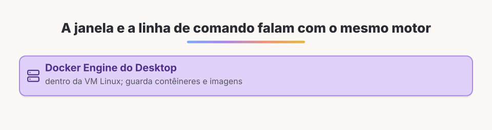
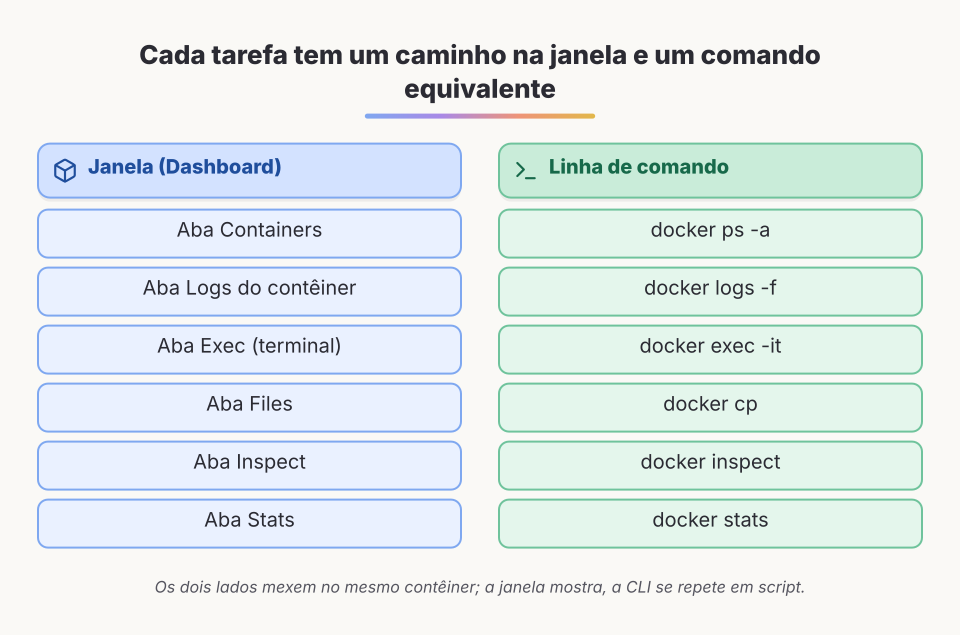

# 5. Docker Desktop na prática: interface × linha de comando

> 🗺️ **Neste capítulo:** você faz as mesmas tarefas do capítulo 4 pela janela do Docker Desktop e pelo terminal, descobre que os dois falam com o mesmo motor, aprende o que são contextos da CLI e vê quem pode usar o Docker Desktop de graça. · ⏱️ ~35 min

> 🔥 **Aquecimento:** (1) Um `docker stop` demorou alguns segundos e o código de saída foi 137. O que aconteceu? (2) O que o `docker exec` precisa para funcionar?
>
> <details>
> <summary>Ver resposta</summary>
>
> (1) O processo principal ignorou o SIGTERM, o prazo acabou e o Docker mandou SIGKILL (128 + 9 = 137). (2) Que o contêiner esteja em execução (capítulo 4).
>
> </details>

## 📇 A parte 2 numa página

![Parte 2, capítulos 5 a 8. Janela × CLI: ambas são clientes do mesmo motor, o que uma cria a outra enxerga, o que se reproduz fica na CLI. Contextos: um nome guarda o endereço de um motor, --context vale para um comando; docker context ls e use. Nome da imagem: registro/ns/repo:tag, sem tag vale latest, o digest sha256 é fixo. Mexer em imagens: pull baixa só o que falta, tag dá outro nome sem copiar, rmi recusa se um contêiner usa. Dockerfile: uma camada por instrução, RUN no build e CMD a cada início, EXPOSE só documenta a porta; docker build -t x:1 . CMD × ENTRYPOINT: programa fixo, padrão que o run troca, forma exec com PID 1 no programa. Build seguro: .dockerignore, ARG e ENV aparecem no history, USER app. Cache: mudou uma camada as seguintes refazem, o que muda menos vem primeiro. Multi-stage: vários FROM, COPY --from= traz só o necessário, --target. Imagem enxuta: limpar no mesmo RUN, Alpine (musl) × slim (glibc).](../img/c05-resumo-parte-2.svg)

- [Capítulo 5: Docker Desktop na prática: interface × linha de comando](05-docker-desktop-na-pratica-interface-linha-de.md)
- [Capítulo 6: Imagens e o Docker Hub](06-imagens-e-o-docker-hub.md)
- [Capítulo 7: Seu primeiro Dockerfile](07-seu-primeiro-dockerfile.md)
- [Capítulo 8: Builds rápidos e imagens enxutas](08-builds-rapidos-e-imagens-enxutas.md)

## De onde paramos

No capítulo 4 você conduziu um contêiner só pela linha de comando. Se você instalou o Docker Desktop (Windows ou Mac), existe uma janela que mostra tudo isso com cliques. Agora o objetivo é saber quando usar cada uma, sem achar que são coisas diferentes.

> ⚠️ **As telas deste capítulo:** o livro foi escrito com o Docker Desktop **4.99**. A versão 4.100.0, de 19/11/2026, trouxe um visual novo, então o que você vê pode ser diferente do que está descrito aqui: os nomes das abas e das ações seguem a documentação oficial. Capturas de tela reais da janela ainda não estão nesta edição.

## Duas portas para o mesmo motor

**O Docker Desktop é um aplicativo que reúne o motor (o Docker Engine, rodando dentro da VM Linux), a linha de comando `docker` e uma janela gráfica, o Dashboard; a janela e o terminal são duas formas de dar ordens ao mesmo motor.**



Isso explica a regra de ouro do capítulo: **o que você cria num lado aparece no outro**. Se você subir um contêiner pelo terminal, ele aparece na aba de contêineres da janela. Se parar pela janela, o `docker ps` não o mostra mais. Não existe uma cópia "da interface" e outra "da linha de comando": só existe o motor.

O Desktop também oferece uma CLI para o próprio aplicativo (não para os contêineres). Veja o estado dele:

```bash
# o motor do Desktop está de pé?
docker desktop status
```

```text
Name                Value
Status              running
SessionID           50462a2a-4e45-437b-84cb-b7ca36396907
```

Os subcomandos são `start`, `stop`, `restart`, `status`, `logs`, `diagnose` e `update`, entre outros. Atenção: `docker desktop stop` e `restart` derrubam **todos** os contêineres da máquina, não só os seus; por isso o livro não os executa.

> ⚠️ **Erro comum:** achar que a janela e o terminal são "motores diferentes", e então estranhar que um contêiner criado de um lado "apareça" do outro. Ou o contrário: abrir o terminal com o Desktop fechado e receber um erro de conexão. A CLI é apenas o cliente; sem o motor rodando, não há com quem falar.

## Um passeio pela janela

A janela principal se chama **Dashboard**. Segundo a documentação, ela reúne contêineres, imagens, volumes, *builds* (construções de imagem), recursos do Kubernetes e logs, e dá acesso a extensões, às configurações e à ajuda. Os pontos que importam para este livro:

- **Menu lateral:** a navegação da esquerda pode ser personalizada: clique com o botão direito, escolha **Customize** e marque, desmarque ou reordene as abas.
- **Cabeçalho:** busca rápida, entrada para **Sign in** (a conta do Docker, que você só precisará no capítulo 11), ícone de **configurações** e ícone de solução de problemas.
- **Notificações:** o sino no canto inferior direito.
- **Extras:** recursos de IA (Gordon, Docker Model Runner), Docker Hub, extensões e o Docker Offload. Nada disso é necessário para o livro.

Nas **configurações** (a engrenagem do cabeçalho) você vai mexer pouco. Os três lugares que o livro cita:

| Onde | Para quê |
| --- | --- |
| **General** | opções gerais, como a de usar o armazenamento *containerd* para imagens (veja o aviso abaixo) e a de ligar o Docker Debug por padrão |
| **Resources** (no Windows, **WSL integration**) | escolher quais distribuições do WSL enxergam o Docker (capítulo 2) |
| **Sign in** (cabeçalho) | entrar com a conta do Docker Hub (capítulo 11) |

> ⚠️ **Aviso das versões 4.100.0 e 4.100.1:** as notas de versão registram um problema conhecido: com o armazenamento *containerd* ligado, contêineres e imagens podem parecer "sumidos" na janela. A solução documentada é desmarcar **Use containerd for pulling and storing images** em **Settings > General**. Seus dados não foram apagados, a janela é que não os mostra. Esta máquina usa a 4.99, então o livro não reproduziu o problema.

## A aba Containers por dentro

A aba de contêineres lista os que estão rodando e os parados, inclusive aplicativos do Docker Compose (livro seguinte da trilha). Segundo a documentação:

- A barra de ferramentas tem busca, a chave **Only show running containers** (equivale ao `docker ps` sem `-a`, enquanto desligada equivale ao `-a`) e o botão **Columns**, que mostra CPU, memória, uso de disco, rede, PIDs e o horário do último início.
- Uma caixa de seleção em cada linha permite agir em vários de uma vez: iniciar, pausar, parar ou apagar.
- Cada contêiner tem ações para iniciar, parar, pausar, retomar, reiniciar, apagar, **abrir um terminal no contêiner**, **abrir a porta publicada no navegador** e **copiar o comando `docker run`**.

Clicando num contêiner, você entra na visão detalhada, com estas abas:

| Aba | O que mostra | Comando parecido |
| --- | --- | --- |
| **Logs** | a saída do contêiner em tempo real, com busca, hora e a opção de copiar tudo | `docker logs -f -t` |
| **Inspect** | dados de baixo nível: caminhos, imagem, mapeamento de portas | `docker inspect` |
| **Exec** | um terminal dentro do contêiner em execução (equivale a `docker exec -it <id> /bin/sh`) | `docker exec -it` |
| **Files** | os arquivos do contêiner: ver o que mudou, editar, arrastar para dentro e para fora, baixar | `docker cp` |
| **Stats** | CPU, memória, rede e disco ao longo do tempo | `docker stats` |
| **Bind mounts** | a documentação cita a aba, mas não descreve o conteúdo | (capítulo 9) |

Existe ainda a aba **Debug**, que aparece quando o Docker Debug está ligado e oferece ferramentas como `vim`, `curl` e `htop` mesmo em imagens sem *shell*.



## As mesmas tarefas, lado a lado

Vamos repetir o ciclo do capítulo 4 com o servidor `dz-web`, primeiro pela CLI (executado de verdade) e depois pela janela (descrito pela documentação). Suba o contêiner:

```bash
# o mesmo servidor do capítulo 4: só no seu computador, na porta 8080
docker run -d --name dz-web --label dz=livro -p 127.0.0.1:8080:8000 \
  python:3.14-slim \
  sh -c 'mkdir -p /site && cd /site
         echo "<h1>Tarefas v0</h1>" > index.html
         exec python -m http.server 8000'
```

Agora três tarefas, na CLI e na janela.

**Tarefa 1: ver os logs.**

```bash
curl -s http://127.0.0.1:8080/ > /dev/null
docker logs --tail 1 -t dz-web
```

```text
2026-11-26T14:11:01.131973326Z 172.17.0.1 - - [26/Nov/2026 14:11:01] "GET / HTTP/1.1" 200 -
```

Na janela: abra a aba de contêineres, clique em `dz-web` e vá em **Logs**. A mesma linha aparece lá (há uma opção para mostrar a hora de cada linha, como o `-t`).

**Tarefa 2: tirar um arquivo de dentro e colocar outro.** Na CLI, o `docker cp` copia entre o contêiner e o seu computador, nos dois sentidos:

```bash
# traz o arquivo do contêiner para a pasta atual
docker cp dz-web:/site/index.html ./index.html
cat index.html
# manda um arquivo novo no lugar do index.html do contêiner
echo '<h1>Tarefas v0.2</h1>' > nova.html
docker cp nova.html dz-web:/site/index.html
curl -s http://127.0.0.1:8080
```

```text
<h1>Tarefas v0</h1>
<h1>Tarefas v0.2</h1>
```

Na janela é a aba **Files**: você navega até `/site`, abre o `index.html` no editor embutido ou arrasta um arquivo do seu computador para dentro. É o caso em que a janela vence: ver a árvore de arquivos e editar um texto é mais rápido com o mouse.

**Tarefa 3: ver o consumo e agir.**

```bash
docker stats --no-stream dz-web \
  --format '{{.Name}} cpu={{.CPUPerc}} mem={{.MemUsage}} pids={{.PIDs}}'
docker pause dz-web
docker unpause dz-web
docker restart dz-web
```

```text
dz-web cpu=0.02% mem=20.96MiB / 15.54GiB pids=1
dz-web
dz-web
dz-web
```

Na janela, **Stats** mostra os mesmos números em gráfico, e as ações de pausar, retomar e reiniciar ficam na própria linha do contêiner. Para parar e apagar, há as ações de parar e de apagar (esta faz o `rm`), e a documentação diz que dá para marcar vários e apagar de uma vez.

### Qual usar

| Situação | Melhor escolha |
| --- | --- |
| Explorar: ver o que existe, abrir a porta, olhar arquivos | **Janela** |
| Acompanhar consumo ao longo do tempo | **Janela** (os gráficos) |
| Repetir a mesma coisa várias vezes, ou num servidor | **Linha de comando** |
| Escrever o passo a passo num README ou numa receita para o time | **Linha de comando** (copiar e colar) |
| Máquina Linux sem Desktop, servidor remoto, CI | **Linha de comando** (não há janela) |
| Pedir ajuda: mostrar exatamente o que você fez | **Linha de comando** |

A regra do livro: **o que precisa ser reproduzido fica na linha de comando**, e a janela é para olhar. Por isso os próximos capítulos continuam com comandos.

## Contextos: para qual motor a CLI está falando

A CLI `docker` é apenas um cliente. Ela precisa saber **para qual motor** mandar os pedidos, e isso é o trabalho do **contexto**.

**Um contexto (*context*) é um nome que guarda o endereço de um motor Docker; o contexto ativo diz para onde a CLI manda os comandos.**

```bash
# * marca o contexto ativo
docker context ls
```

```text
NAME              DESCRIPTION                               DOCKER ENDPOINT                             ERROR
default           Current DOCKER_HOST based configuration   npipe:////./pipe/docker_engine              
desktop-linux *   Docker Desktop                            npipe:////./pipe/dockerDesktopLinuxEngine   
```

O Docker Desktop cria o contexto `desktop-linux` e o deixa ativo. O endereço é um *named pipe* do Windows (`npipe:`); no Linux e no Mac, os endereços são de socket (`unix:///...`), como no capítulo 3. O contexto `default` aponta para o endereço padrão (ou para o que a variável `DOCKER_HOST` indicar). Nesta máquina, os dois chegam ao mesmo motor:

```bash
docker --context desktop-linux ps --filter name=dz- \
  --format '{{.Names}} {{.Status}}'
docker --context default ps --filter name=dz- \
  --format '{{.Names}} {{.Status}}'
```

```text
dz-web Up 1 second
dz-web Up 2 seconds
```

Três jeitos de escolher o contexto:

| Jeito | Alcance | Exemplo |
| --- | --- | --- |
| `docker --context <nome>` | só aquele comando | `docker --context default ps` |
| `DOCKER_CONTEXT=<nome>` | o terminal atual, enquanto a variável existir | `DOCKER_CONTEXT=default docker context show` |
| `docker context use <nome>` | tudo, até você mudar de novo (grava na configuração) | `docker context use default` |

```bash
# a variável de ambiente vale só para este comando
DOCKER_CONTEXT=default docker context show
docker context show
```

```text
default
desktop-linux
```

Também dá para criar um contexto novo, o que é útil para controlar um motor remoto. Aqui criamos um que aponta para o motor do Desktop só para ver o ciclo, e removemos em seguida:

```bash
docker context create dz-ctx \
  --docker "host=npipe:////./pipe/dockerDesktopLinuxEngine"
docker --context dz-ctx version --format 'server={{.Server.Version}}'
docker context rm dz-ctx
```

```text
dz-ctx
Successfully created context "dz-ctx"
server=29.9.3
dz-ctx
```

(No Linux ou no Mac, o endereço teria a forma `unix:///var/run/docker.sock`; num servidor remoto, `ssh://usuario@servidor`.)

> ⚠️ **Erro comum:** ficar com o contexto errado ativo e achar que "o Docker perdeu meus contêineres". No Linux com os dois instalados, o Engine e o Desktop têm cada um o seu contexto, e as imagens e os contêineres de um não aparecem no outro (capítulo 3). Quando algo "sumir", rode `docker context ls` antes de qualquer outra coisa.

## Licença: quem pode usar de graça

O Docker Desktop tem regras de licença que o Docker Engine, instalado direto no Linux, não tem. Segundo a página de instalação (conferida em 26/11/2026), o Docker Desktop é **gratuito** para uso pessoal, educação, pequenas empresas (menos de 250 pessoas **e** menos de US$ 10 milhões de receita anual) e projetos de código aberto não comerciais. Para outras situações, como empresas maiores e governo, é preciso uma assinatura paga.

Para quem estuda com este livro, em casa ou na escola, o uso é gratuito. Se você usa na empresa, confira os termos atuais na página oficial e consulte quem cuida das licenças aí. Este livro não é aconselhamento jurídico. Uma alternativa para quem não pode usar o Desktop é instalar só o Engine num Linux ou no Ubuntu do WSL (capítulo 3).

## 🧪 Laboratório: uma tarefa, dois caminhos

**Objetivo:** fazer a mesma tarefa pela janela e pelo terminal e provar, com um comando, que é o mesmo contêiner.

1. Suba o `dz-web` com o comando da seção "As mesmas tarefas" e confirme: `docker ps --filter name=dz-web`.
2. **Na janela:** abra o Docker Desktop, entre na aba de contêineres e ache `dz-web`. Confira o nome, a imagem (`python:3.14-slim`) e a porta (`127.0.0.1:8080`).
3. **Na janela:** clique em `dz-web`, abra **Logs**, e no terminal rode `curl -s http://127.0.0.1:8080`. Uma linha nova aparece nos logs da janela em seguida.
4. **Na janela:** use a ação de pausar. **No terminal:** `docker inspect --format '{{.State.Status}}' dz-web`. Esperado: `paused`. Depois retome pela janela e rode o comando de novo: `running`.
5. **Na janela:** pare o contêiner. **No terminal:** `docker ps -a --filter name=dz-web --format '{{.Names}} {{.Status}}'`. Esperado: algo como `dz-web Exited (137) ...`: a janela também usou o `stop`, e o código de saída é o mesmo do capítulo 4.
6. Limpe: `docker rm -f dz-web` (ou a ação de apagar da janela). Confirme com `docker ps -a --filter label=dz=livro`: a lista deve vir vazia.

> ⚠️ **Não executado:** os passos 2 a 5 usam a janela e dependem de olhar a tela, o que a execução do capítulo não fez. O resultado esperado vem da documentação (a janela e a CLI usam o mesmo motor, e o `docker context ls` provou isso para os dois contextos). A execução real foi dos comandos do terminal.

**Esperado no final:** nenhum contêiner `dz-*` na lista.

## 🏋️ Pratique

**1. Resolvido: em que motor eu estou?** Um colega diz que "sumiram os contêineres". Você roda `docker context ls` e vê `default *` na primeira coluna. Como confirmar se os contêineres estão no outro contexto, sem mudar nada de permanente?

<details>
<summary>Ver resposta</summary>

```bash
# olha o outro contexto só neste comando
docker --context desktop-linux ps -a
```

O `--context` vale só para aquele comando, então o contexto ativo não muda. Se os contêineres aparecerem lá, o problema era o contexto, e `docker context use desktop-linux` resolve de vez. Erro comum: usar o `docker context use` só para olhar e esquecer de voltar.

</details>

**2. Complete:** ligue cada ação da janela ao comando. Preencha as lacunas.

| Janela | Comando |
| --- | --- |
| Aba **Logs**, com a hora ligada | `docker ____ -t dz-web` |
| Aba **Files**, baixar um arquivo | `docker ____ dz-web:/site/index.html .` |
| Chave **Only show running containers** desligada | `docker ps ____` |

<details>
<summary>Ver resposta</summary>

`logs`, `cp` e `-a`. O `cp` copia nos dois sentidos: contêiner para o computador (`docker cp dz-web:/site/index.html .`) e o contrário (`docker cp nova.html dz-web:/site/index.html`). Quem escreveu `exec` na segunda lacuna trocou "ver o arquivo" por "rodar um comando": o `exec` roda um programa, o `cp` traz o arquivo.

</details>

**3. Por conta própria:** crie um contexto chamado `dz-meu` que aponte para o mesmo motor do seu contexto ativo (copie o endereço da coluna `DOCKER ENDPOINT` do `docker context ls`), confira com `docker --context dz-meu version --format '{{.Server.Version}}'` e remova o contexto.

<details>
<summary>Ver resposta</summary>

```bash
# o host vem da coluna DOCKER ENDPOINT do seu docker context ls
docker context create dz-meu --docker "host=<seu endereço>"
docker --context dz-meu version --format '{{.Server.Version}}'
docker context rm dz-meu
```

A versão impressa é a do seu motor (aqui, `29.9.3`). Se der erro de conexão, o endereço foi copiado com um caractere a mais. Nunca remova o contexto `default` nem o que o Desktop criou: esses são do sistema.

</details>

**4. Desafio:** você quer rodar um único `docker ps` apontando para o contexto `default`, sem alterar o contexto ativo nem a configuração, de duas maneiras diferentes. Quais?

<details>
<summary>Ver resposta</summary>

`docker --context default ps` e `DOCKER_CONTEXT=default docker ps`. As duas valem só para aquele comando; já `docker context use default` muda o contexto de tudo o que vier depois.

</details>

## 🧠 Revisão rápida

**1.** Por que um contêiner criado no terminal aparece na janela do Docker Desktop?

<details>
<summary>Ver resposta</summary>

Porque os dois são clientes do mesmo Docker Engine; a janela só mostra o que o motor tem.

</details>

**2.** O que é um contexto da CLI e como ver o ativo?

<details>
<summary>Ver resposta</summary>

É um nome que guarda o endereço de um motor Docker; o ativo é o que tem `*` no `docker context ls`, e `docker context show` imprime só o nome.

</details>

**3.** Para que serve o `docker cp`, e qual aba da janela é parecida?

<details>
<summary>Ver resposta</summary>

Copia arquivos entre o contêiner e o seu computador; a aba parecida é **Files**.

</details>

**4.** (Capítulo 4) O que acontece se você tentar `docker rm` num contêiner que está rodando?

<details>
<summary>Ver resposta</summary>

O Docker recusa e pede para parar antes; com `docker rm -f` ele força a remoção.

</details>

**5.** (Capítulo 2) Para que serve a integração com o WSL nas configurações do Docker Desktop?

<details>
<summary>Ver resposta</summary>

Para escolher quais distribuições do WSL enxergam o Docker, de modo que o comando `docker` funcione dentro delas.

</details>

## 🤖 Estude com um tutor de IA

1. "Faça 5 perguntas, uma por vez, sobre a relação entre o Docker Desktop (janela), a CLI `docker` e o Docker Engine. Espere a minha resposta antes de dar o retorno e não me dê as respostas antes."
2. "Aqui está a minha resposta ao exercício 2 do capítulo 5: <minha resposta>. Aponte os meus erros sobre o equivalente de cada aba da janela na linha de comando, sem me dar a solução."

> ➡️ **Próximo passo:** no capítulo 6 você deixa de só usar contêineres e passa a olhar de onde eles vêm: as imagens, as camadas e o Docker Hub.

## 📌 Resumo

| Item | Em uma frase |
| --- | --- |
| Docker Desktop | aplicativo com o motor (numa VM), a CLI e a janela (Dashboard) |
| Janela × CLI | duas formas de dar ordens ao mesmo motor; o que um cria, o outro vê |
| Abas do contêiner | Logs, Inspect, Exec, Files, Stats (e Debug com o Docker Debug ligado) |
| `docker cp` | copia arquivos entre o contêiner e o computador; a aba Files é parecida |
| `docker desktop status` | mostra o estado do Desktop; `stop` e `restart` derrubam todos os contêineres |
| Contexto | nome que guarda o endereço de um motor; `docker context ls`, `show`, `use` |
| Escolher o contexto | `--context` (um comando), `DOCKER_CONTEXT` (o terminal), `context use` (tudo) |
| Licença do Desktop | grátis para uso pessoal, educação, pequenas empresas e código aberto não comercial |
| Regra do livro | o que precisa ser reproduzido fica na linha de comando |

## 📚 Fontes

- Interface do Docker Desktop: https://docs.docker.com/desktop/use-desktop/ (conferido em 26/11/2026)
- Visão de contêineres do Desktop: https://docs.docker.com/desktop/use-desktop/container/ (conferido em 26/11/2026)
- Notas de versão do Docker Desktop: https://docs.docker.com/desktop/release-notes/ (conferido em 26/11/2026)
- Instalar o Docker Desktop no Windows (licença): https://docs.docker.com/desktop/setup/install/windows-install/ (conferido em 26/11/2026)
- Contextos: https://docs.docker.com/reference/cli/docker/context/ (conferido em 26/11/2026)
- Execução e saída real dos comandos de terminal: Docker Engine 29.9.3 com Docker Desktop 4.99.0, Windows 11, Git Bash, em 26/11/2026.

> 🔁 **Revise hoje:** capítulos 2 e 4

<!-- nav:start -->
---

[◀ Capítulo anterior](04-ciclo-de-vida-do-conteiner-pela-linha-de-comando.md) · [Mapa do livro](../README.md) · [Próximo capítulo ▶](06-imagens-e-o-docker-hub.md)
<!-- nav:end -->
