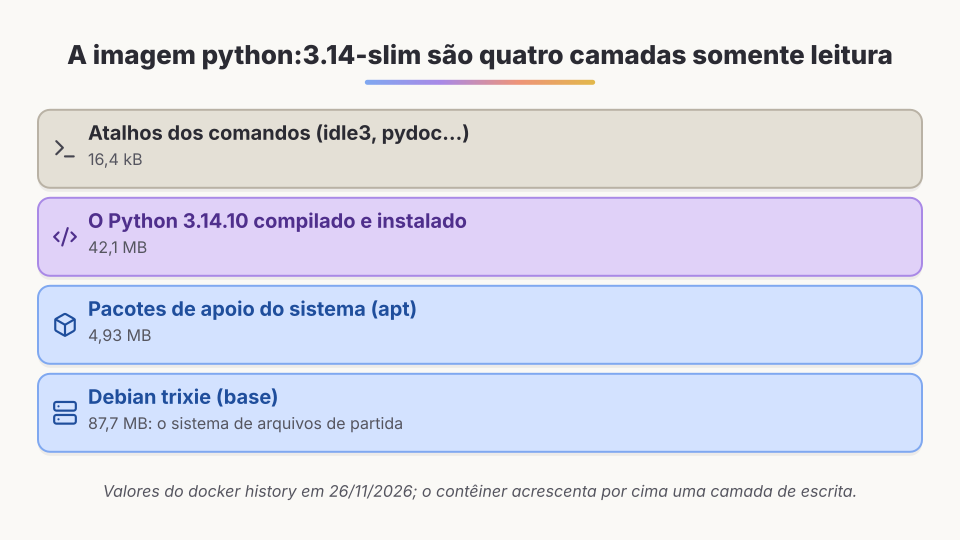
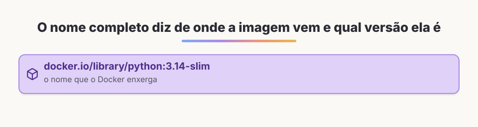
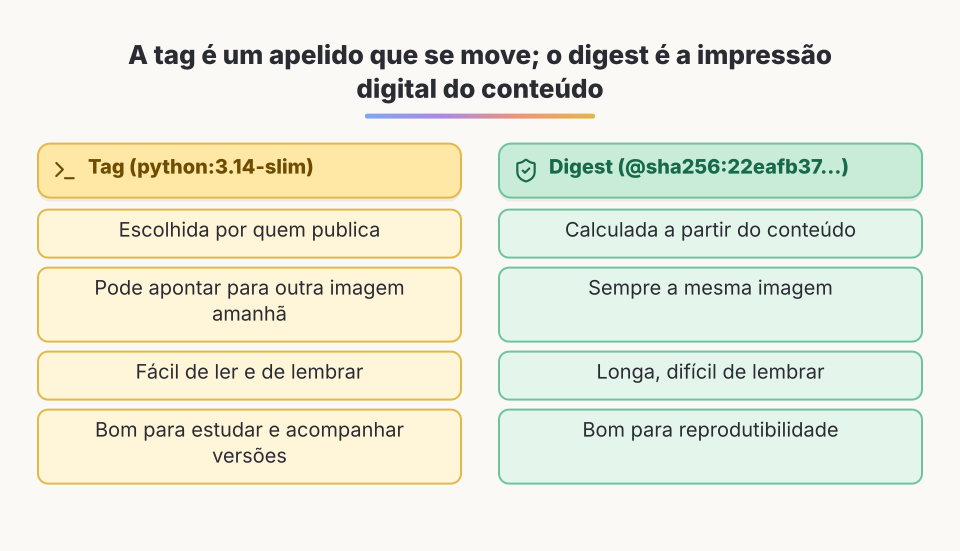

# 6. Imagens e o Docker Hub

> 🗺️ **Neste capítulo:** você aprende a ler o nome completo de uma imagem, entende a diferença entre tag e digest, escolhe imagens confiáveis no Docker Hub e aprende a baixar, marcar, remover e levar imagens de um computador para outro. · ⏱️ ~45 min

> 🔥 **Aquecimento:** (1) O que é um contexto da CLI do Docker? (2) Um `docker exec` funciona num contêiner parado?
>
> <details>
> <summary>Ver resposta</summary>
>
> (1) Um nome que guarda o endereço de um motor Docker; o contexto ativo diz para onde a CLI manda os comandos (capítulo 5). (2) Não: o `exec` só funciona em contêiner em execução (capítulo 4).
>
> </details>

## De onde paramos

Até aqui você usou `python:3.14-slim` sem perguntar de onde ela veio. O Docker a baixou na primeira vez que você rodou o contêiner, e depois a guardou no seu computador. Neste capítulo você abre essa caixa: o que é uma imagem por dentro, como se lê o nome dela e como escolher uma imagem em quem confiar.

Os nomes criados aqui começam com `dz-`, como nos capítulos anteriores. Nada neste capítulo publica portas.

## O que é uma imagem

No capítulo 1 você viu que a imagem é o pacote somente leitura de que o contêiner nasce. Falta ver a forma desse pacote.

**Uma imagem é uma pilha de camadas (*layers*) somente leitura, mais uma configuração (qual comando rodar, variáveis de ambiente); cada camada guarda só o que mudou em relação à anterior.**

Veja a imagem do projeto por dentro, com o `docker history`:

```bash
# cada linha é um passo da construção; a mais nova fica no topo
docker history python:3.14-slim
```

```text
IMAGE          CREATED      CREATED BY                                      SIZE      COMMENT
22eafb370920   2 days ago   CMD ["python3"]                                 0B        buildkit.dockerfile.v0
<missing>      2 days ago   RUN /bin/sh -c set -eux;  for src in idle3 p…   16.4kB    buildkit.dockerfile.v0
<missing>      2 days ago   RUN /bin/sh -c set -eux;   savedAptMark="$(a…   42.1MB    buildkit.dockerfile.v0
<missing>      2 days ago   ENV PYTHON_SHA256=de414a57119abef52784d8993e…   0B        buildkit.dockerfile.v0
<missing>      2 days ago   ENV PYTHON_VERSION=3.14.10                      0B        buildkit.dockerfile.v0
<missing>      2 days ago   RUN /bin/sh -c set -eux;  apt-get update;  a…   4.93MB    buildkit.dockerfile.v0
<missing>      2 days ago   ENV LANG=C.UTF-8                                0B        buildkit.dockerfile.v0
<missing>      2 days ago   ENV PATH=/usr/local/bin:/usr/local/sbin:/usr…   0B        buildkit.dockerfile.v0
<missing>      3 days ago   # debian.sh --arch 'amd64' out/ 'trixie' '@1…   87.7MB    debuerreotype 0.17
```

Leia de baixo para cima: primeiro o sistema Debian (87,7 MB), depois alguns pacotes de apoio, depois o Python 3.14.10 instalado (42,1 MB), depois os atalhos dos comandos. Os passos com `0B` (`ENV`, `CMD`) só gravam configuração. As quatro linhas com tamanho são as camadas de fato, e o Docker confirma:

```bash
# quantas camadas a imagem tem e para qual arquitetura foi feita
docker image inspect python:3.14-slim \
  --format 'camadas={{len .RootFS.Layers}} arq={{.Architecture}}'
```

```text
camadas=4 arq=amd64
```



Uma consequência importante, que você vai usar no capítulo 8: camadas são reaproveitadas. Duas imagens que partem do mesmo Debian guardam essa camada **uma vez só** no disco. E o contêiner, quando roda, acrescenta por cima uma camada fina de escrita que some quando ele é removido (por isso, no capítulo 4, o `docker ps -s` mostrou só 2,64 MB de escrita contra 137 MB de imagem).

> 💡 **Analogia:** no capítulo 1, a imagem era a receita fechada. Pense agora no **Docker Hub como uma biblioteca de receitas**: cada receita tem um nome e várias edições. A **tag** é a etiqueta na lombada ("3ª edição"), que o editor pode trocar de uma edição para outra. O **digest** é o código impresso no miolo, calculado a partir do texto: se uma vírgula mudar, o código muda. A analogia falha num ponto: um livro de papel não troca sozinho a etiqueta da lombada, mas uma tag do Docker Hub pode passar a apontar para outra imagem a qualquer momento.

## O nome completo de uma imagem

Você escreveu `python:3.14-slim`, mas esse é um apelido curto. O Docker completa o resto sozinho, e entender a forma completa evita confusão quando a imagem vem de outro lugar.

**O nome completo de uma imagem tem quatro partes: `registro/namespace/repositório:tag`.**



| Parte | Exemplo | O que é |
| --- | --- | --- |
| Registro (*registry*) | `docker.io` | o servidor que guarda imagens; o Docker Hub é o padrão |
| Namespace | `library` | o dono; `library` é o das imagens oficiais |
| Repositório | `python` | o conjunto de versões de um programa |
| Tag | `3.14-slim` | o rótulo de uma versão ou variante; se faltar, vale `latest` |

Por isso `python:3.14-slim`, `python` e `docker.io/library/python:3.14-slim` são o mesmo repositório, e só a tag faz diferença. O nome de uma imagem de outra pessoa leva o namespace dela (como `meuusuario/minha-api`, de uma conta pessoal), e a de outro registro leva o endereço dele na frente (como `localhost:5000/minha-api`, de um registro rodando no próprio computador).

> ⚠️ **Erro comum:** escrever `python` sem tag e achar que vem "a versão mais nova e boa". O Docker entende `python:latest`, que é apenas a tag que o publicador quis chamar assim, e que muda com o tempo. Em qualquer coisa que você queira reproduzir depois, fixe a tag.

## Tag × digest

Você pode baixar `python:3.14-slim` hoje e outra pessoa baixar daqui a um mês, e as duas receberem imagens diferentes. Isso acontece porque a tag é um simples rótulo.

**Uma tag é um apelido que o publicador pode mover para outra imagem; um digest (`sha256:...`) é a impressão digital do conteúdo, e por isso identifica sempre exatamente a mesma imagem.**



No Docker com o armazenamento *containerd* (o desta máquina), o `IMAGE ID` que aparece no `docker images` é justamente o começo do digest:

```bash
docker image ls python:3.14-slim
```

```text
IMAGE                  ID             DISK USAGE   CONTENT SIZE   EXTRA
python:3.14-slim       22eafb370920        180MB         45.7MB    
```

O `22eafb370920` é o começo de `sha256:22eafb370920ad8b429e0aec3fff433e0669968519f5d60469d83729c138b28b`, o digest que lemos em 26/11/2026. Para pedir exatamente essa imagem, em vez da que a tag apontar no dia, escreva o digest depois de `@`:

```bash
docker pull \
  python:3.14-slim@sha256:22eafb370920ad8b429e0aec3fff433e0669968519f5d60469d83729c138b28b
```

```text
Digest: sha256:22eafb370920ad8b429e0aec3fff433e0669968519f5d60469d83729c138b28b
Status: Image is up to date for python@sha256:22eafb370920ad8b429e0aec3fff433e0669968519f5d60469d83729c138b28b
docker.io/library/python:3.14-slim@sha256:22eafb370920ad8b429e0aec3fff433e0669968519f5d60469d83729c138b28b
```

Aqui a imagem já estava no computador, então o Docker só confirmou. Os dois tamanhos da coluna merecem uma explicação: o `DISK USAGE` (180 MB) é o espaço que a imagem ocupa descompactada, e o `CONTENT SIZE` (45,7 MB) é o que ela pesa comprimida, que é o que viaja pela rede.

Qual usar? Para estudar, tags com versão (`3.14-slim`) bastam. Para algo que precisa dar o mesmo resultado daqui a meses, fixe o digest. O digest que você vê aqui é um exemplo datado: o seu será outro, porque as imagens oficiais são reconstruídas com frequência.

## Escolher bem: imagens oficiais e verificadas

O Docker Hub tem milhões de imagens, e qualquer pessoa pode publicar uma. Escolher uma imagem é decidir em quem você confia para rodar código no seu computador, e isso vale tanto quanto escolher um pacote do npm ou do pip.

Segundo a documentação do Docker Hub, existem estas categorias de conteúdo confiável:

| Categoria | O que é |
| --- | --- |
| **Docker Official Images** | repositórios curados pela Docker, no namespace `library` (`python`, `postgres`, `nginx`...) |
| **Docker Hardened Images** | imagens endurecidas e mantidas pela Docker, com foco em segurança |
| **Verified Publisher** | imagens de empresas que passaram pela verificação do Docker |
| **Docker-Sponsored Open Source** | projetos de código aberto apoiados pela Docker |

Antes de usar uma imagem de que você nunca ouviu falar, confira: o namespace é o de uma organização conhecida? Há selo de oficial ou de publicador verificado? O repositório tem documentação e é atualizado? Quando existir uma oficial para o que você precisa, use a oficial. Neste livro, todas as imagens são oficiais.

Um detalhe de uso: sem fazer login, o Docker Hub limita os downloads. A página de uso informa um limite de 100 *pulls* a cada 6 horas por endereço IPv4 (por sub-rede /64, no IPv6) para quem não está autenticado. Se um dia aparecer um erro de limite (*rate limit*), a saída é esperar ou entrar com a conta (capítulo 11).

> ⚠️ **Erro comum:** copiar um `docker run` de um tutorial ou de uma resposta qualquer sem olhar o namespace. Um nome parecido com o de uma imagem oficial (`pyhton`, `postgress`) pode ser de outra pessoa. Digite o nome com atenção e prefira o que está na documentação oficial do programa.

## Baixar, listar, marcar e remover

Os quatro verbos do dia a dia das imagens são `pull`, `images`, `tag` e `rmi`.

**Baixar (`docker pull`).** O comando busca a imagem no registro e guarda no computador. O `docker run` faz isso sozinho se a imagem não estiver aqui, mas o `pull` deixa explícito. Aqui, uma imagem pequena que não estava no computador:

```bash
docker pull busybox:1.37
```

```text
1.37: Pulling from library/busybox
68fe9bff2ad4: Pulling fs layer
68fe9bff2ad4: Download complete
9177639ff916: Download complete
68fe9bff2ad4: Pull complete
Digest: sha256:a7dbc319b1438115a207e11930dc4bb3e643dcb3ec0bdd694bb36cd8fad289ec
Status: Downloaded newer image for busybox:1.37
docker.io/library/busybox:1.37
```

Cada linha com um código hexadecimal é uma camada sendo baixada (o `busybox` tem uma só), e as camadas que o computador já tem são puladas: o Docker só baixa o que falta. A linha `Digest` é a impressão digital da imagem que você acabou de receber.

**Listar (`docker images`).** Mostra as imagens que existem aqui. O tamanho muda muito entre variantes da mesma imagem, e é um bom motivo para escolher a tag com cuidado. Baixando também a variante `-alpine` do Python, que usa o Alpine Linux, uma distribuição bem menor, em vez do Debian:

```bash
# só as imagens python: nome, id e tamanho
docker images --format 'table {{.Repository}}:{{.Tag}}\t{{.ID}}\t{{.Size}}' \
  python
```

```text
REPOSITORY:TAG       IMAGE ID       SIZE
python:3.14-alpine   5862d971d1f0   73.9MB
python:3.14-slim     22eafb370920   180MB
```

A `-slim` (Debian enxuto) tem 180 MB, e a `-alpine`, 73,9 MB. Menor não significa melhor: o Alpine usa uma biblioteca C diferente (a musl, em vez da glibc do Debian), e alguns pacotes Python precompilados só existem para a glibc. Por isso o livro usa `-slim`, e o capítulo 8 volta a comparar tamanhos.

**Marcar (`docker tag`).** Dá um segundo nome à mesma imagem. Não copia nada: cria só outra etiqueta para o mesmo conteúdo.

```bash
docker tag busybox:1.37 dz-busy:1.0
docker images --format '{{.Repository}}:{{.Tag}} {{.ID}}' \
  | grep -E "busybox|dz-"
```

```text
busybox:1.37 a7dbc319b143
dz-busy:1.0 a7dbc319b143
```

Os dois nomes têm o mesmo `IMAGE ID`: é a mesma imagem. O `tag` é como você prepara um nome para publicar (capítulo 11): para enviar uma imagem ao seu espaço no Docker Hub, o nome precisa começar pelo seu usuário.

**Remover (`docker rmi`).** Tira uma etiqueta e, se era a última da imagem, apaga a imagem. E o Docker não deixa remover uma imagem usada por um contêiner, **mesmo parado**. Veja os dois efeitos juntos, com um contêiner que usa a imagem pelo nome `dz-busy:1.0`:

```bash
docker run --name dz-uso dz-busy:1.0 echo oi
# a imagem tem dois nomes: este rmi só retira um
docker rmi busybox:1.37
# o último nome está em uso pelo contêiner parado
docker rmi dz-busy:1.0
```

```text
oi
Untagged: busybox:1.37
Error response from daemon: conflict: unable to delete dz-busy:1.0 (must be forced) - container be5352db4b20 is using its referenced image a7dbc319b143
```

O primeiro `rmi` só **retirou a etiqueta** (`Untagged`), porque a imagem ainda tinha outro nome. O segundo foi recusado: o contêiner `dz-uso`, mesmo parado, ainda referencia a imagem. A saída é remover o contêiner primeiro e depois a imagem:

```bash
docker rm dz-uso
docker rmi dz-busy:1.0
```

```text
dz-uso
Untagged: dz-busy:1.0
Deleted: sha256:a7dbc319b1438115a207e11930dc4bb3e643dcb3ec0bdd694bb36cd8fad289ec
```

Agora, sem nenhum nome e sem contêiner, a imagem foi apagada de fato (`Deleted`). Evite o `-f` no `rmi` enquanto você não entender o que ele deixa sem imagem.

> ⚠️ **Erro comum:** achar que `docker rm` apaga a imagem. O `rm` apaga o **contêiner**; a imagem fica no disco até você usar o `rmi`. Foi o que o capítulo 1 mostrou, e é por isso que o disco enche com o tempo.

## Imagens dangling e a limpeza

Às vezes uma imagem perde o nome. Isso acontece quando uma tag passa a apontar para outra imagem: a antiga continua no disco, sem nenhuma etiqueta, e aparece como `<none>:<none>`. Essas imagens se chamam **dangling** (pendentes).

**Uma imagem *dangling* é uma imagem sem nenhuma tag, que ficou para trás quando a tag passou a apontar para outra.** Para ver isso de verdade, vamos criar duas versões da mesma tag. O `docker commit` transforma um contêiner numa imagem (serve aqui só para o experimento; nos próximos capítulos, você constrói imagens com Dockerfile):

```bash
docker run -d --name dz-c1 python:3.14-slim sleep 60
# commit 1: a imagem do contêiner como está, com uma etiqueta para limpar depois
docker commit -c 'LABEL dz=livro' dz-c1 dz-img:1.0
# muda algo dentro do contêiner e grava a mesma tag de novo
docker exec dz-c1 sh -c 'echo v2 > /marca'
docker commit -c 'LABEL dz=livro' dz-c1 dz-img:1.0
docker images --format '{{.ID}} {{.Repository}}:{{.Tag}}' \
  | grep -E "dz-img|<none>"
```

```text
5dc48a1786ca dz-img:1.0
bdfad0aa16a2 <none>:<none>
```

A primeira versão perdeu a tag e virou `<none>:<none>`. Para listar só as pendentes:

```bash
docker images -f dangling=true --format '{{.ID}} {{.Repository}}:{{.Tag}}'
```

```text
bdfad0aa16a2 <none>:<none>
```

Para apagá-las existe o `docker image prune`. E aqui vale o mesmo cuidado do capítulo 4:

- `docker image prune` apaga **todas as pendentes** da máquina, não só as suas.
- `docker image prune -a` apaga **todas as imagens sem uso por nenhum contêiner**, inclusive as que você baixou para usar depois. Num computador com outros projetos, é um acidente esperando para acontecer.

A solução é a mesma de antes: um filtro por etiqueta (o `LABEL dz=livro` do `commit` serve a isso).

```bash
# -f: sem pergunta; --filter: só as pendentes com a etiqueta
docker image prune -f --filter label=dz=livro
```

```text
Deleted Images:
untagged: sha256:bdfad0aa16a29e3051d71f269d6b87eb73941cdc4271c3124273ef2a5363715a
deleted: sha256:bdfad0aa16a29e3051d71f269d6b87eb73941cdc4271c3124273ef2a5363715a

Total reclaimed space: 6.424kB
```

Só a pendente com a etiqueta foi embora. (A versão 2, que ainda tem a tag `dz-img:1.0`, ficou.)

## Multi-arquitetura, em resumo

Um computador com processador Intel ou AMD e outro com processador ARM (como os Macs com chips Apple e muitas placas Raspberry Pi) entendem instruções diferentes. Uma imagem precisa ser construída para cada arquitetura.

**Uma imagem multi-arquitetura é uma tag que aponta para uma lista de imagens, uma por plataforma; o Docker escolhe sozinho a que combina com o seu computador.** Veja a lista de `python:3.14-slim`:

```bash
# imagetools lê o registro, sem baixar a imagem
docker buildx imagetools inspect python:3.14-slim --raw
```

A saída é um JSON longo; filtrando só as plataformas que ele declara:

```text
linux/amd64, linux/armv5, linux/armv7, linux/arm64v8, linux/386,
linux/ppc64le, linux/riscv64, linux/s390x
```

(A lista foi extraída do JSON com um filtro de poucas linhas de Python; o Docker imprime o JSON inteiro.) Por isso o mesmo `docker pull python:3.14-slim` funciona num Windows com Intel, num Mac com Apple Silicon e numa Raspberry Pi: cada um recebe a variante dele. Para saber qual você recebeu, veja `Architecture` no `docker image inspect` (aqui, `amd64`).

Na prática, o que você precisa saber: se o seu computador é ARM e um dia uma imagem só existir para `amd64`, o Docker avisa sobre a diferença de plataforma e, dependendo do sistema, roda por emulação, bem mais devagar.

## Sem registro: docker save e docker load

Às vezes você precisa levar uma imagem para uma máquina sem internet, ou guardá-la num arquivo. Para isso existem o `save` e o `load`.

**O `docker save` grava uma imagem num arquivo `.tar`, e o `docker load` lê esse arquivo e recria a imagem no outro computador.**

```bash
# -o: o arquivo de saída (sem ele, o save escreve na saída padrão)
docker save -o dz-img.tar dz-img:1.0
docker rmi dz-img:1.0
docker load -i dz-img.tar
docker run --rm dz-img:1.0 cat /marca
```

```text
Untagged: dz-img:1.0
Deleted: sha256:b45b96ed91c78544a4eb00d347b7893012a0324326c2e037c889e17ab52816e7
Loaded image: dz-img:1.0
v2
```

A imagem foi apagada e voltou do arquivo, com o conteúdo (`v2`) intacto. O arquivo gerado tinha cerca de 43,5 MB. (Para a execução desta máquina, o `docker save` escreveu o arquivo numa pasta temporária, e o apagamos depois.)

> ⚠️ **Erro comum:** confundir `docker save`/`docker load` (que trabalham com **imagens**) com `docker export`/`docker import` (que trabalham com o **sistema de arquivos de um contêiner** e perdem o histórico e a configuração da imagem). Para levar uma imagem, use `save` e `load`.

## 🧪 Laboratório: escolher, baixar e conferir a imagem do projeto

**Objetivo:** baixar a imagem base do projeto, conferir de onde ela vem, dar um nome ao seu projeto e fazer a limpeza.

1. Baixe duas variantes e compare os tamanhos:

   ```bash
   # a variante enxuta com Debian e a menor, com Alpine
   docker pull python:3.14-slim
   docker pull python:3.14-alpine
   docker images --format 'table {{.Repository}}:{{.Tag}}\t{{.Size}}' python
   ```

   Esperado: duas linhas, e o tamanho da `-alpine` bem menor que o da `-slim` (aqui, 73,9 MB contra 180 MB).

2. Confira a identidade e a plataforma da que o livro usa:

   ```bash
   docker image inspect python:3.14-slim \
     --format '{{index .RepoDigests 0}} {{.Os}}/{{.Architecture}}'
   ```

   Esperado: um nome com `@sha256:` seguido do digest, e `linux/amd64` (ou `linux/arm64`, se o seu computador for ARM).

3. Dê um nome ao projeto, com a versão, e confirme que é a mesma imagem:

   ```bash
   docker tag python:3.14-slim dz-base:1.0
   docker images --format '{{.Repository}}:{{.Tag}} {{.ID}}' \
     | grep -E "python:3.14-slim|dz-base"
   ```

   Esperado: dois nomes com o mesmo `IMAGE ID`.

4. Limpe só o que é seu:

   ```bash
   # tira a etiqueta do projeto e a variante alpine usada na comparação
   docker rmi dz-base:1.0 python:3.14-alpine
   ```

   Esperado: `Untagged: dz-base:1.0` e a remoção da `-alpine`. A `python:3.14-slim` continua, porque o próximo capítulo a usa como base.

**Esperado no final:** `python:3.14-slim` presente; nenhuma imagem `dz-*` na lista de imagens.

## 🏋️ Pratique

**1. Resolvido: ler um nome.** Complete com o nome longo e diga qual é o registro, o namespace, o repositório e a tag de `nginx:1.27-alpine` e de `localhost:5000/minha-api:1.1`.

<details>
<summary>Ver resposta</summary>

`nginx:1.27-alpine` é `docker.io/library/nginx:1.27-alpine`: registro `docker.io`, namespace `library`, repositório `nginx`, tag `1.27-alpine`. Já `localhost:5000/minha-api:1.1` traz o registro na frente (`localhost:5000`, um registro local), repositório `minha-api` e tag `1.1`. Quando o nome começa por algo com um ponto ou uma porta antes da primeira barra, esse é o registro; sem isso, é o Docker Hub.

</details>

**2. Complete:** preencha as lacunas para dar o nome `dz-teste:2.0` a `python:3.14-slim`, conferir que o ID é o mesmo e remover só o nome novo.

```bash
# o mesmo conteúdo, um segundo nome
docker ____ python:3.14-slim dz-teste:2.0
docker images --format '{{.Repository}}:{{.Tag}} {{.ID}}' \
  | grep -E "python:3.14-slim|dz-teste"
docker ____ dz-teste:2.0
```

<details>
<summary>Ver resposta</summary>

`tag` na primeira lacuna e `rmi` na segunda. O `rmi` só retira a etiqueta (`Untagged: dz-teste:2.0`), porque a imagem ainda tem o nome `python:3.14-slim`; a imagem não é apagada. Quem escreveu `rm` confundiu contêiner com imagem.

</details>

**3. Por conta própria:** antes de rodar, preveja o que o Docker faz com `docker pull python:3.14-slim` agora que a imagem já está no computador, e com `docker rmi python:3.14-slim` se houver um contêiner parado criado dela. Depois confira o primeiro (o segundo você só descreve; não apague a imagem do livro).

<details>
<summary>Ver resposta</summary>

O `pull` compara o digest do registro com o local; se for o mesmo, imprime `Status: Image is up to date for python:3.14-slim` e não baixa nada. O `rmi` falharia com `conflict: unable to delete ... container ... is using its referenced image`, como vimos com `dz-busy:1.0`: o contêiner parado ainda referencia a imagem.

</details>

**4. Desafio:** um colega diz que o projeto dele "quebrou do nada", e o Dockerfile dele diz `FROM python:3.14-slim`. Ele não mudou nada. Como isso pode acontecer, e o que ele pode fazer para ter uma construção reproduzível?

<details>
<summary>Ver resposta</summary>

A tag `3.14-slim` é movida pelo publicador a cada reconstrução da imagem oficial (versão nova do Python, do Debian, correções), então `FROM python:3.14-slim` pode apontar para um conteúdo diferente de um mês para o outro. Para reproduzir, ele pode fixar a versão completa (como `python:3.14.10-slim`, que em 26/11/2026 tinha o mesmo digest `22eafb37...` da `3.14-slim`) e, para garantia total, o digest (`python:3.14-slim@sha256:...`), anotando a data. O preço é lembrar de atualizar de tempos em tempos para receber correções de segurança.

</details>

## 🧠 Revisão rápida

**1.** Quais são as quatro partes do nome completo de uma imagem?

<details>
<summary>Ver resposta</summary>

Registro, namespace, repositório e tag: `registro/namespace/repositório:tag`.

</details>

**2.** Qual a diferença entre tag e digest?

<details>
<summary>Ver resposta</summary>

A tag é um rótulo que o publicador pode mover para outra imagem; o digest é calculado a partir do conteúdo e identifica sempre a mesma imagem.

</details>

**3.** O que `docker rmi` faz quando a imagem tem dois nomes e você remove um deles?

<details>
<summary>Ver resposta</summary>

Só retira a etiqueta (`Untagged`); a imagem é apagada quando a última etiqueta sai.

</details>

**4.** (Capítulo 4) Por que `docker container prune` sem filtro é arriscado numa máquina com vários projetos? E o equivalente para imagens?

<details>
<summary>Ver resposta</summary>

Porque apaga todos os contêineres parados da máquina, não só os seus. Para imagens, `docker image prune -a` apaga todas as sem uso; a saída é filtrar por etiqueta ou apagar pelo nome.

</details>

**5.** (Capítulo 5) O que muda se você rodar `docker --context default images` no lugar de `docker images`?

<details>
<summary>Ver resposta</summary>

Só aquele comando é enviado para o motor do contexto `default`, em vez do ativo. Se o motor for outro, a lista de imagens será outra.

</details>

## 🤖 Estude com um tutor de IA

1. "Faça 5 perguntas, uma por vez, sobre o nome completo de uma imagem Docker, tags, digests e camadas. Espere a minha resposta antes de dar o retorno e não me dê as respostas antes."
2. "Aqui está a minha resposta ao exercício 4 do capítulo 6: [minha resposta]. Aponte os meus erros sobre reprodutibilidade de imagens sem me dar a solução pronta."

> ➡️ **Próximo passo:** no capítulo 7 você para de usar imagens dos outros e escreve o seu primeiro Dockerfile, para empacotar a API de tarefas numa imagem sua.

## 📌 Resumo

| Item | Em uma frase |
| --- | --- |
| Imagem | pilha de camadas somente leitura mais uma configuração; o contêiner acrescenta uma camada de escrita |
| Nome completo | `registro/namespace/repositório:tag`; sem tag, vale `latest` |
| Tag × digest | a tag é um rótulo móvel; o digest `sha256:` identifica o conteúdo exato |
| Imagens confiáveis | oficiais, endurecidas, de publicador verificado e de código aberto patrocinado |
| `docker pull` | baixa só as camadas que faltam; sem login há limite de downloads |
| `docker tag` | cria outro nome para a mesma imagem, sem copiar |
| `docker rmi` | retira a etiqueta e, na última, apaga a imagem; recusa se um contêiner a usa |
| *Dangling* | imagem sem tag (`<none>:<none>`); `image prune --filter label=` limpa só o seu |
| Multi-arquitetura | uma tag aponta para várias plataformas; o Docker escolhe a do seu computador |
| `docker save` / `load` | levam uma imagem num arquivo `.tar` e a recriam em outro lugar |

## 📚 Fontes

- Conteúdo confiável, página oficial: https://docs.docker.com/docker-hub/image-library/trusted-content/ (conferido em 26/11/2026)
- Limites de download, página oficial: https://docs.docker.com/docker-hub/usage/ (conferido em 26/11/2026)
- Limpeza de imagens sem tag: https://docs.docker.com/reference/cli/docker/image/prune/ (conferido em 26/11/2026)
- docker image save: https://docs.docker.com/reference/cli/docker/image/save/ (conferido em 26/11/2026)
- Imagem oficial do Python: https://hub.docker.com/_/python (conferido em 26/11/2026)
- Execução e saída real: Docker Engine 29.9.3 com Docker Desktop 4.99.0 (armazenamento containerd), Windows 11, Git Bash, em 26/11/2026.

> 🔁 **Revise hoje:** capítulos 3 e 5

<!-- nav:start -->
---

[◀ Capítulo anterior](05-docker-desktop-na-pratica-interface-linha.md) · [Mapa do livro](../README.md) · [Próximo capítulo ▶](07-seu-primeiro-dockerfile.md)
<!-- nav:end -->
