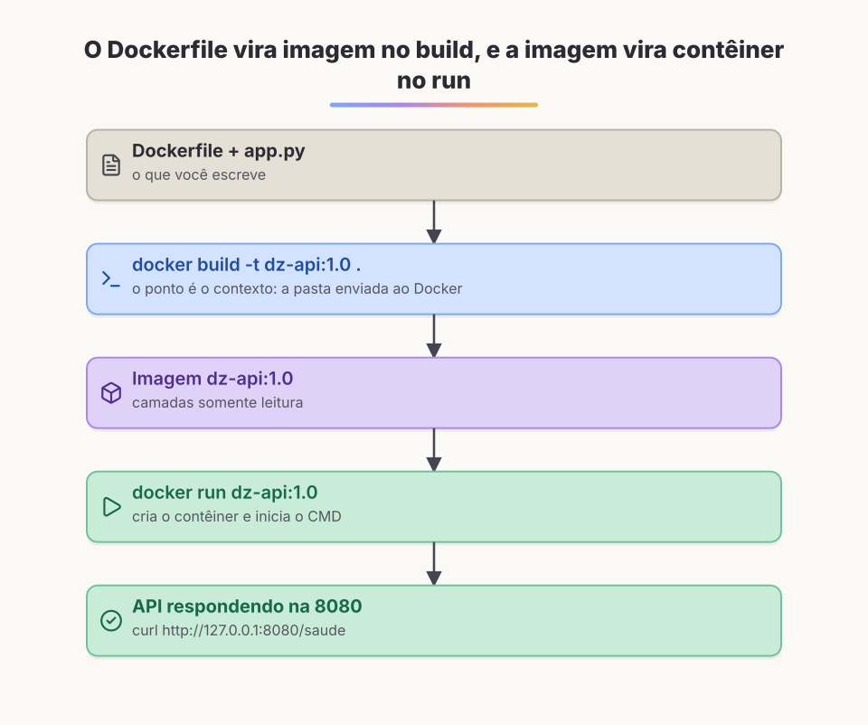
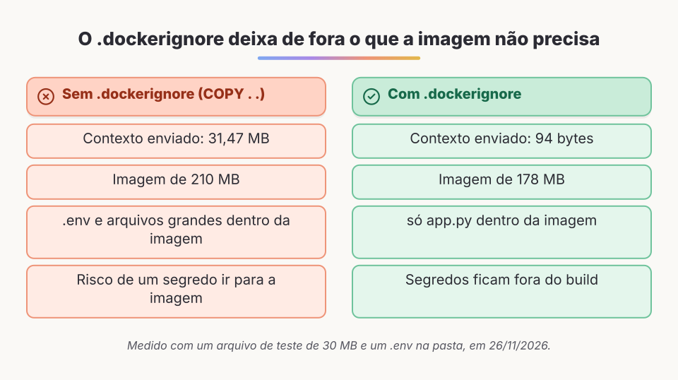

# 7. Seu primeiro Dockerfile

> 🗺️ **Neste capítulo:** você escreve a API de tarefas que acompanha o resto do livro, empacota numa imagem sua com um Dockerfile, constrói com `docker build` e a põe para responder. No caminho: as instruções essenciais, `CMD` × `ENTRYPOINT`, o contexto de build com o `.dockerignore` e `ARG` × `ENV`. · ⏱️ ~50 min

> 🔥 **Aquecimento:** (1) O que `docker rmi` faz com uma imagem que tem dois nomes quando você remove um deles? (2) Por que a tag `3.14-slim` não garante a mesma imagem daqui a um mês?
>
> <details>
> <summary>Ver resposta</summary>
>
> (1) Só retira a etiqueta (`Untagged`); a imagem é apagada quando a última etiqueta sai. (2) Porque o publicador pode mover a tag para uma imagem reconstruída; só o digest (`@sha256:...`) identifica sempre o mesmo conteúdo (capítulo 6).
>
> </details>

## De onde paramos

No capítulo 6 você baixou e inspecionou imagens feitas por outras pessoas. Agora a imagem é sua: você vai descrever, num arquivo de texto, como montar a imagem de uma aplicação, e o Docker vai montá-la sempre do mesmo jeito. É o primeiro passo do projeto que acompanha o livro: uma API de tarefas que cresce nos próximos capítulos (menor, com banco de dados, publicada).

Como nos capítulos anteriores, os nomes começam com `dz-` e as portas ficam só em `127.0.0.1`. Se você usa o Git Bash, rode `export MSYS_NO_PATHCONV=1` antes.

## A API do livro

Para ter algo real para empacotar, o livro usa uma API pequena, escrita em Python **só com a biblioteca padrão** (sem `pip`, sem framework). Uma **API** é um programa que responde a pedidos de outros programas, aqui pelo protocolo HTTP e trocando dados em JSON. Ela tem três rotas:

| Rota | Método | O que faz |
| --- | --- | --- |
| `/saude` | GET | responde que está de pé e qual a versão |
| `/tarefas` | GET | devolve a lista de tarefas |
| `/tarefas` | POST | cria uma tarefa a partir de `{"titulo": "..."}` |

A lista fica **na memória**: quando o contêiner é removido, ela some. Isso é proposital: o capítulo 9 usa exatamente esse problema para ensinar volumes.

Crie uma pasta para o projeto e entre nela (a pasta `~/api-livro` é a que o livro usa; escolha outra se preferir):

```bash
# a pasta do projeto: todos os arquivos deste capítulo ficam nela
mkdir -p ~/api-livro && cd ~/api-livro
```

<!-- project: tarefas-api -->

**app.py**

```python
# API de tarefas do livro "Docker do zero" (versão 1.0).
# Só biblioteca padrão e dados em memória: a imagem não precisa de pip.
import json
import os
import signal
from http.server import BaseHTTPRequestHandler, ThreadingHTTPServer

# tudo que muda entre máquinas vem do ambiente (ENV no Dockerfile
# ou -e no docker run), e não do código
ENDERECO = os.environ.get("ENDERECO", "0.0.0.0")
PORTA = int(os.environ.get("PORTA", "8000"))
VERSAO = os.environ.get("APP_VERSAO", "dev")

# a lista some quando o contêiner for removido: o capítulo 9 resolve
tarefas = [{"id": 1, "titulo": "Estudar Docker"}]


class Api(BaseHTTPRequestHandler):
    def enviar(self, codigo, conteudo):
        corpo = json.dumps(conteudo, ensure_ascii=False).encode("utf-8")
        self.send_response(codigo)
        self.send_header("Content-Type", "application/json; charset=utf-8")
        self.send_header("Content-Length", str(len(corpo)))
        self.end_headers()
        self.wfile.write(corpo)

    def do_GET(self):
        if self.path == "/saude":
            self.enviar(200, {"status": "ok", "versao": VERSAO})
        elif self.path == "/tarefas":
            self.enviar(200, tarefas)
        else:
            self.enviar(404, {"erro": "rota não existe"})

    def do_POST(self):
        if self.path != "/tarefas":
            self.enviar(404, {"erro": "rota não existe"})
            return
        tamanho = int(self.headers.get("Content-Length", 0))
        try:
            titulo = str(json.loads(self.rfile.read(tamanho))["titulo"])
        except (ValueError, KeyError, TypeError):
            self.enviar(400, {"erro": "envie um JSON com o campo titulo"})
            return
        nova = {"id": len(tarefas) + 1, "titulo": titulo}
        tarefas.append(nova)
        self.enviar(201, nova)


def encerrar(sinal, quadro):
    # o PID 1 não tem tratador padrão de SIGTERM (capítulo 4):
    # sair aqui faz o docker stop terminar na hora, com código 0
    raise SystemExit(0)


if __name__ == "__main__":
    signal.signal(signal.SIGTERM, encerrar)
    servidor = ThreadingHTTPServer((ENDERECO, PORTA), Api)
    print(f"Servidor pronto em {ENDERECO}:{PORTA} (versão {VERSAO})",
          flush=True)
    servidor.serve_forever()
```

Três decisões do código que o Docker vai exigir de você:

- **Escuta em `0.0.0.0`**, não em `127.0.0.1`. Dentro do contêiner, `127.0.0.1` é o próprio contêiner: um servidor ali dentro não receberia o tráfego da porta publicada. A proteção de verdade vem do `-p 127.0.0.1:8080:8000`, que decide quem alcança o contêiner por fora.
- **A porta, o endereço e a versão vêm de variáveis de ambiente** (`PORTA`, `ENDERECO`, `APP_VERSAO`), com valores padrão. Assim, o mesmo código roda em qualquer lugar, e quem muda o comportamento é o Dockerfile ou o `docker run`.
- **O `print` tem `flush=True`.** Sem isso, o Python guarda o texto em memória quando a saída não é um terminal, e o `docker logs` só mostraria a mensagem bem depois.

## O que é um Dockerfile

Você poderia montar a imagem à mão: subir um contêiner, instalar o que falta, copiar os arquivos e usar o `docker commit` (como no capítulo 6). Funcionaria uma vez, mas ninguém saberia repetir os passos.

**Um Dockerfile é um arquivo de texto com as instruções, uma por passo, para construir uma imagem; o `docker build` as lê de cima para baixo e cria uma camada para cada passo que muda arquivos.**

Como o texto é o que define a imagem, ele pode ficar no Git, ser revisado e reconstruído por qualquer pessoa, com o mesmo resultado. Crie o `Dockerfile` (sem extensão) na mesma pasta do `app.py`:

**Dockerfile**

```dockerfile
# imagem de partida: versão fixa e variante enxuta (capítulo 6)
FROM python:3.14-slim

# a pasta onde o código vive; os próximos comandos partem dela
WORKDIR /app

# copia só o que a API usa
COPY app.py .

# vale para a imagem e para o contêiner; o docker run -e sobrescreve
ENV PORTA=8000

# documenta a porta (não publica nada)
EXPOSE 8000

# forma exec: o Python vira o PID 1 e recebe os sinais (capítulo 4)
CMD ["python", "app.py"]
```



Construa a imagem. O `-t` dá o nome e a tag; **o ponto no final é obrigatório**: é a pasta de contexto, aqui a atual.

```bash
# -t: nome:tag da imagem; "." = a pasta atual é o contexto
docker build -t dz-api:1.0 .
```

Numa janela de terminal, o Docker mostra um painel animado. A saída abaixo é a versão em texto simples (a que sai quando não há terminal, ou com `--progress=plain`), resumida:

```text
#1 [internal] load build definition from Dockerfile
#2 [internal] load metadata for docker.io/library/python:3.14-slim
#3 [internal] load .dockerignore
#4 [internal] load build context
#4 transferring context: 28B done
#5 [1/3] FROM docker.io/library/python:3.14-slim@sha256:22eafb370920ad8b429e0aec3fff433e0669968519f5d60469d83729c138b28b
#6 [2/3] WORKDIR /app
#7 [3/3] COPY app.py .
#8 exporting to image
#8 naming to docker.io/library/dz-api:1.0 done
```

Cada passo `[n/total]` é uma instrução do Dockerfile, e o Docker o numera para você. Quando o passo já foi feito antes com o mesmo resultado, aparece `CACHED` (o capítulo 8 usa isso). Confira a imagem nova:

```bash
docker images dz-api --format '{{.Repository}}:{{.Tag}} {{.Size}}'
```

```text
dz-api:1.0 178MB
```

> ⚠️ **Erro comum:** esquecer o ponto final. Sem o contexto, o Docker não sabe de onde copiar os arquivos:
>
> ```text
> $ docker build -t dz-api:1.0
> ERROR: docker: 'docker buildx build' requires 1 argument
>
> Usage:  docker buildx build [OPTIONS] PATH | URL | -
> ```

## As instruções essenciais

Um Dockerfile usa poucas instruções no dia a dia. Estas cobrem quase tudo:

| Instrução | O que faz | Exemplo |
| --- | --- | --- |
| `FROM` | escolhe a imagem de partida; é sempre a primeira | `FROM python:3.14-slim` |
| `WORKDIR` | define (e cria) a pasta de trabalho dos próximos passos | `WORKDIR /app` |
| `COPY` | copia arquivos do contexto para dentro da imagem | `COPY app.py .` |
| `RUN` | executa um comando **durante o build** e grava o resultado numa camada | `RUN useradd --create-home app` |
| `ENV` | define uma variável de ambiente que fica na imagem e no contêiner | `ENV PORTA=8000` |
| `ARG` | define uma variável **só do build** (veja mais adiante) | `ARG APP_VERSAO=1.0` |
| `USER` | muda o usuário dos passos seguintes e do contêiner | `USER app` |
| `EXPOSE` | documenta a porta em que o programa escuta; **não publica** | `EXPOSE 8000` |
| `CMD` | o comando padrão que o contêiner executa ao iniciar | `CMD ["python", "app.py"]` |
| `ENTRYPOINT` | o programa fixo do contêiner (veja a próxima seção) | `ENTRYPOINT ["python"]` |

Uma observação sobre o `COPY`: existe também o `ADD`, que faz mais coisas (baixa de URLs, extrai arquivos compactados). Isso o torna menos previsível, então prefira o `COPY` sempre que ele resolver, e é o que o livro faz.

A diferença que mais confunde: `RUN` roda **uma vez, no build** (instala, cria pasta, muda permissão), e `CMD` roda **a cada início do contêiner**. Quem instalou uma biblioteca com `CMD` achou que ela estaria na imagem, e não estava.

> ⚠️ **Erro comum:** achar que o `EXPOSE 8000` abre a porta. Ele só documenta. Quem decide se a porta é acessível por fora é o `-p` do `docker run`, e é por isso que o `docker ps` do capítulo 4 mostra a publicação no `PORTS`, e não o `EXPOSE`.

## Rodar a imagem que você construiu

```bash
# a mesma anatomia do capítulo 4: opções, imagem, (sem comando: vale o CMD)
docker run -d --name dz-api --label dz=livro -p 127.0.0.1:8080:8000 dz-api:1.0
curl -s http://127.0.0.1:8080/saude
curl -s http://127.0.0.1:8080/tarefas
```

```text
95d4946ae34a1452c4d1b46267d778742f78446cee6095aee0a1aebd82c13640
{"status": "ok", "versao": "dev"}
[{"id": 1, "titulo": "Estudar Docker"}]
```

Ela respondeu! (Se o `curl` devolver `Empty reply from server` logo depois do `run`, espere um segundo e repita: o Python ainda estava iniciando.) A versão aparece como `dev`, o padrão do código, porque ainda não demos o valor (a seção sobre `ARG` e `ENV` resolve). Crie uma tarefa, provoque um erro de propósito e confira os logs:

```bash
# POST com um JSON: cria uma tarefa
curl -s -X POST -d '{"titulo":"Escrever um Dockerfile"}' \
  http://127.0.0.1:8080/tarefas
# sem o campo titulo: a API devolve 400
curl -s -X POST -d '{"nome":"x"}' -w ' [%{http_code}]\n' \
  http://127.0.0.1:8080/tarefas
curl -s http://127.0.0.1:8080/tarefas
```

```text
{"id": 2, "titulo": "Escrever um Dockerfile"}
{"erro": "envie um JSON com o campo titulo"} [400]
[{"id": 1, "titulo": "Estudar Docker"}, {"id": 2, "titulo": "Escrever um Dockerfile"}]
```

Agora o teste que justifica o capítulo 9: remova o contêiner e suba outro da mesma imagem.

```bash
docker rm -f dz-api
docker run -d --name dz-api --label dz=livro -p 127.0.0.1:8080:8000 dz-api:1.0
curl -s http://127.0.0.1:8080/tarefas
```

```text
dz-api
4807c9f71b98c801689e8d93a8709b7dfa051c6c25e985a5ee220e42c4e7f1a5
[{"id": 1, "titulo": "Estudar Docker"}]
```

A tarefa 2 sumiu. Os dados viviam na camada de escrita do contêiner, que foi removida junto com ele.

## ENTRYPOINT × CMD

As duas instruções definem o que o contêiner executa, e a diferença só aparece quando você passa argumentos ao `docker run`.

**O `ENTRYPOINT` define o programa que o contêiner sempre executa; o `CMD` define o comando padrão (ou os argumentos padrão), que o `docker run <imagem> <comando>` substitui. Quando existem os dois, o `CMD` vira argumentos do `ENTRYPOINT`.**

Veja os dois, com duas imagens pequenas feitas para este teste:

```bash
# numa pasta à parte, para não sobrescrever o Dockerfile do projeto
mkdir -p ~/eco && cd ~/eco
# imagem 1: ENTRYPOINT fixo (echo) e CMD como argumento padrão
cat > Dockerfile <<'EOF'
FROM python:3.14-slim
ENTRYPOINT ["echo", "olá,"]
CMD ["mundo"]
EOF
docker build -q -t dz-eco:1.0 .
docker run --rm dz-eco:1.0
docker run --rm dz-eco:1.0 Docker
```

```text
sha256:058c11ec2936f764eba6d8244fce2ba3c076740523e78b7b2b9842c2c99e1ac8
olá, mundo
olá, Docker
```

Com `ENTRYPOINT` fixo, o que você escreve depois do nome da imagem **substitui só o `CMD`**: virou `echo olá, Docker`. Já com só `CMD`, o que você escreve depois da imagem substitui o comando inteiro:

```bash
# imagem 2: só CMD
printf 'FROM python:3.14-slim\nCMD ["echo", "olá,", "mundo"]\n' > Dockerfile
docker build -q -t dz-eco:2.0 .
docker run --rm dz-eco:2.0
docker run --rm dz-eco:2.0 python -V
```

```text
sha256:c80444ee93e2155c75442829f732ba9d24bfe24e909f7fd96d888b4bdf5c13c4
olá, mundo
Python 3.14.10
```

Quando usar cada um:

| Situação | Use |
| --- | --- |
| Uma aplicação que roda sempre o mesmo programa (a API) | `CMD ["python", "app.py"]`, que ainda deixa você abrir um `sh` com `docker run -it dz-api:1.0 sh` para investigar |
| Uma imagem que funciona como uma ferramenta de linha de comando | `ENTRYPOINT ["ferramenta"]`, com o `CMD` como argumentos padrão |
| Trocar o `ENTRYPOINT` só uma vez, para investigar | `docker run --entrypoint python ...` |

### Forma exec × forma shell

Cada instrução `RUN`, `CMD` e `ENTRYPOINT` aceita duas formas, e a diferença afeta o `docker stop` do capítulo 4.

- **Forma exec:** uma lista JSON, `CMD ["sleep", "300"]`. O Docker executa o programa direto, e ele vira o PID 1.
- **Forma shell:** texto solto, `CMD sleep 300`. O Docker executa `/bin/sh -c "sleep 300"`: o `sh` vira o PID 1, e o seu programa é filho dele.

Veja com `docker top` a diferença entre as duas:

```bash
# forma shell: o sh é o PID 1
printf 'FROM python:3.14-slim
CMD sleep 300
' > Dockerfile
docker build -q -t dz-sh:1.0 .
docker run -d --name dz-sh dz-sh:1.0
docker top dz-sh -o pid,cmd
```

```text
PID                 CMD
71149               /bin/sh -c sleep 300
71163               sleep 300
```

```bash
# forma exec: o sleep é o PID 1; antes, remova o contêiner anterior
docker rm -f dz-sh
printf 'FROM python:3.14-slim
CMD ["sleep", "300"]
' > Dockerfile
docker build -q -t dz-sh:2.0 .
docker run -d --name dz-sh dz-sh:2.0
docker top dz-sh -o pid,cmd
docker rm -f dz-sh
```

```text
PID                 CMD
71355               sleep 300
```

(O `PID` do `docker top` é o do computador, não o de dentro do contêiner; o que importa é que, na forma shell, existem **dois** processos, e o primeiro é o `sh`.) A forma shell tem um custo: o `docker stop` envia o sinal ao `sh`, que não o repassa ao seu programa. Medido com `CMD sleep 300` na forma shell, o `docker stop` levou cerca de 3,5 s e terminou com código 137. A regra do livro: **`CMD` e `ENTRYPOINT` sempre na forma exec** (com aspas duplas, como JSON).

> ⚠️ **Erro comum:** escrever `CMD ['python', 'app.py']` com aspas simples. Para o Docker isso não é um JSON válido, e ele trata como forma shell sem avisar.

## O contexto de build e o .dockerignore

Quando você escreve `docker build ... .`, o Docker não vê o seu computador inteiro: ele só enxerga a pasta do ponto (o **contexto**).

**O contexto de build é o conjunto de arquivos que o `docker build` pode enxergar, e o `.dockerignore` é uma lista do que deve ficar de fora dele.**

Isso importa por dois motivos: **tamanho** (copiar uma pasta `.git` ou vídeos para a imagem a engorda) e **segurança** (um `.env` com senhas copiado por um `COPY . .` fica gravado na imagem, e quem receber a imagem o lê). Para ver, vamos medir numa pasta de teste com um arquivo grande (`video-grande.bin`, de 30 MB) e um `.env`. O Dockerfile aqui usa `COPY . .`, que copia tudo:

```bash
# pasta de teste: o app, um arquivo grande e um .env
mkdir -p ~/ctx && cd ~/ctx
cp ~/api-livro/app.py ~/api-livro/Dockerfile .
python -c "open('video-grande.bin','wb').write(b'0'*(30*1024*1024))"
echo "SEGREDO=abc" > .env
printf 'FROM python:3.14-slim\nWORKDIR /app\nCOPY . .\n' > Dockerfile.copy
docker build --progress=plain -f Dockerfile.copy -t dz-ctx:5.0 . 2>&1 \
  | grep "transferring context"
docker run --rm dz-ctx:5.0 ls -a /app
```

```text
#3 transferring context:
#3 transferring context: 2B 0.0s done
#4 transferring context: 26.48MB 5.1s
#4 transferring context: 31.47MB 6.3s done
.
..
.env
Dockerfile
Dockerfile.copy
app.py
video-grande.bin
```

O Docker transferiu **31,47 MB**, e o `.env` com o segredo e o `video-grande.bin` foram parar dentro da imagem (que ficou com 210 MB, contra 178 MB). Agora o mesmo build com um `.dockerignore`:

**.dockerignore**

```text
.git
__pycache__/
*.pyc
.env
```

Para o teste, acrescente também `*.bin` e `Dockerfile*` à lista e refaça o build:

```text
#3 transferring context: 68B done
#4 transferring context: 94B done
.
..
.dockerignore
app.py
```



Só **94 bytes** foram enviados, e o `.env` e o arquivo grande não entraram. (Note que o `.dockerignore` em si, e o `app.py`, ficaram.) Duas notas:

- Com `COPY app.py .`, como no nosso Dockerfile do projeto, o BuildKit (o motor de build do Docker) já transfere **só os arquivos que o `COPY` pede**: o mesmo build com o arquivo grande na pasta enviou 2,28 kB, sem `.dockerignore` nenhum. Mesmo assim, mantenha o arquivo: no dia em que alguém trocar por `COPY . .`, ele protege você.
- A sintaxe do `.dockerignore` lembra a do `.gitignore`: um padrão por linha, `*` casa qualquer nome. Ele fica na **raiz do contexto**, e não dentro de subpastas.

> ⚠️ **Erro comum:** achar que `.env` fora do Git está seguro. Se o seu Dockerfile tem `COPY . .` e não há `.dockerignore`, o `.env` entra na imagem, e quem baixar a imagem (inclusive no Docker Hub) lê as suas senhas. Senhas entram **na hora de rodar** (`-e` ou, nos próximos capítulos, outros mecanismos), nunca na imagem.

## ARG e ENV: variáveis no build e no contêiner

Duas instruções definem variáveis, e confundir as duas é a fonte de muito mal-entendido.

**O `ARG` define uma variável que existe só durante o build, e pode ser trocada com `--build-arg`; o `ENV` define uma variável que fica gravada na imagem e existe também no contêiner em execução, onde o `docker run -e` pode trocá-la.**

A versão da API tem de chegar ao código (`APP_VERSAO`) e a imagem tem de dizer qual versão é. Combinando os dois, a versão é escolhida no build e vira variável do contêiner. O Dockerfile completo do projeto passa a ser:

**Dockerfile**

```dockerfile
# imagem de partida: versão fixa e variante enxuta (capítulo 6)
FROM python:3.14-slim

# um usuário comum: o servidor não precisa ser root
RUN useradd --create-home app

# a pasta onde o código vive; os próximos comandos partem dela
WORKDIR /app

# copia só o que a API usa
COPY app.py .

# a versão entra no build (--build-arg) e fica na imagem como variável
ARG APP_VERSAO=1.0
ENV APP_VERSAO=$APP_VERSAO

# vale para a imagem e para o contêiner; o docker run -e sobrescreve
ENV PORTA=8000

# a partir daqui, tudo roda como "app"
USER app

# documenta a porta (não publica nada)
EXPOSE 8000

# forma exec: o Python vira o PID 1 e recebe os sinais (capítulo 4)
CMD ["python", "app.py"]
```

Construa com a versão padrão (`1.0`) e com outra, trocada na linha de comando; depois troque no `docker run`:

```bash
# versão padrão do ARG: 1.0
docker build -q -t dz-api:1.0 .
# trocando o ARG no build
docker build -q -t dz-api:1.0.1 --build-arg APP_VERSAO=1.0.1 .
docker run -d --name dz-api --label dz=livro -p 127.0.0.1:8080:8000 dz-api:1.0.1
curl -s http://127.0.0.1:8080/saude
docker rm -f dz-api
# o ENV pode ser trocado só nesta execução
docker run -d --name dz-api --label dz=livro -p 127.0.0.1:8080:8000 \
  -e APP_VERSAO=sobrescrito dz-api:1.0.1
curl -s http://127.0.0.1:8080/saude
docker rm -f dz-api
```

```text
{"status": "ok", "versao": "1.0.1"}
{"status": "ok", "versao": "sobrescrito"}
```

| | `ARG` | `ENV` |
| --- | --- | --- |
| Existe durante o build | sim | sim |
| Existe no contêiner em execução | **não** | **sim** |
| Como trocar | `docker build --build-arg` | `docker run -e` |
| Aparece no `docker history` | **sim** | **sim** |

A última linha da tabela é o cuidado mais importante do capítulo. O valor de um `ARG` não vai para o contêiner, mas **fica registrado nos metadados da imagem**:

```bash
# um Dockerfile de teste, numa pasta à parte: ARG, RUN que usa o ARG e ENV
mkdir -p ~/argteste && cd ~/argteste
cat > Dockerfile <<'EOF'
FROM python:3.14-slim
ARG SO_NO_BUILD=valor-do-build
RUN echo "durante o build: $SO_NO_BUILD"
ENV NA_IMAGEM=valor-do-env
EOF
docker build --progress=plain --no-cache -t dz-arg:1.0 . 2>&1 \
  | grep "durante o build"
docker run --rm dz-arg:1.0 env | grep -E "SO_NO_BUILD|NA_IMAGEM"
docker history dz-arg:1.0 --format '{{.CreatedBy}}' \
  | grep SO_NO_BUILD | cut -c1-120
```

```text
#5 0.292 durante o build: valor-do-build
NA_IMAGEM=valor-do-env
RUN |1 SO_NO_BUILD=valor-do-build /bin/sh -c…
ARG SO_NO_BUILD=valor-do-build
```

O `RUN` enxergou o `ARG` durante o build; o contêiner **não** o tem (só a `NA_IMAGEM` apareceu no `env`), mas o `docker history` mostra o valor do `ARG` para quem tiver a imagem. Por isso:

> ⚠️ **Nunca coloque senha, token ou chave em `ARG` nem em `ENV` de um Dockerfile.** O valor fica gravado na imagem e é lido por quem a baixar. Segredos entram na hora de rodar o contêiner. Para o caso (raro) em que o build precisa de um segredo, o Docker tem *secret mounts*, que não ficam na imagem; ele está fora do escopo deste livro, e a documentação em https://docs.docker.com/build/building/variables/ descreve o recurso.

## Boas práticas mínimas

Cinco hábitos que o nosso Dockerfile já segue, e que valem desde o primeiro dia:

1. **Fixe a versão da base** (`python:3.14-slim`, e não `python` nem `latest`), pelo motivo do capítulo 6.
2. **Use a forma exec** em `CMD` e `ENTRYPOINT`, para que o `docker stop` funcione bem (seção anterior).
3. **Não rode como root.** Sem o `USER`, o programa roda como `root` dentro do contêiner. O isolamento do contêiner é mais fraco que o de uma VM, então reduza o estrago de uma falha. Com o `USER app`:

   ```bash
   # o mesmo run, para olhar o usuário dentro do contêiner
   docker run -d --name dz-api --label dz=livro \
     -p 127.0.0.1:8080:8000 dz-api:1.0
   docker exec dz-api id
   ```

   ```text
   uid=1000(app) gid=1000(app) groups=1000(app)
   ```

   Antes do `USER`, o `whoami` respondia `root`. A porta 8000 funciona para um usuário comum porque está acima de 1024; portas mais baixas exigem privilégio.
4. **Copie só o que a imagem usa** e mantenha o `.dockerignore`.
5. **Sem segredos na imagem** (`ENV`, `ARG` e `COPY .env`).

Um sexto hábito ficou no código: tratar o SIGTERM. Com o `signal.signal(...)` do `app.py`, o `docker stop` do capítulo 4 passa de cerca de 3,6 s com código 137 para menos de 1 s com código 0:

```bash
time docker stop dz-api
docker inspect --format 'exit={{.State.ExitCode}}' dz-api
```

```text
dz-api

real	0m0.588s
exit=0
```

E por um caminho alternativo, a opção `--init` do `docker run` (capítulo 4) resolve sem mexer no código. O que o capítulo 8 faz a seguir é cuidar do que ainda falta: a ordem das instruções, o cache e o tamanho final.

## 🧪 Laboratório: da pasta vazia à API respondendo

**Objetivo:** criar os três arquivos do projeto, construir a imagem e provar que ela roda como usuário comum e para rápido.

1. Crie a pasta e os arquivos `app.py`, `Dockerfile` (a versão completa, com `ARG`, `ENV` e `USER`) e `.dockerignore`, como nas seções acima.
2. Confira que a pasta tem os três arquivos: `ls -a` deve mostrar `.dockerignore`, `Dockerfile` e `app.py`.
3. Construa: `docker build -t dz-api:1.0 .`. Esperado: termina sem `ERROR` e `docker images dz-api` mostra `dz-api:1.0`.
4. Rode e teste:

   ```bash
   # sobe a API, cria uma tarefa e lista
   docker run -d --name dz-api --label dz=livro \
     -p 127.0.0.1:8080:8000 dz-api:1.0
   curl -s http://127.0.0.1:8080/saude
   curl -s -X POST -d '{"titulo":"Primeira tarefa"}' \
     http://127.0.0.1:8080/tarefas
   curl -s http://127.0.0.1:8080/tarefas
   ```

   Esperado: `{"status": "ok", "versao": "1.0"}`, depois a tarefa criada (`id` 2) e a lista com as duas.
5. Confira o usuário e o tempo de parada:

   ```bash
   docker exec dz-api id
   time docker stop dz-api
   docker inspect --format 'exit={{.State.ExitCode}}' dz-api
   ```

   Esperado: `uid=1000(app)`, parada em menos de 1 s e `exit=0`.
6. Limpe o que é seu:

   ```bash
   docker rm dz-api
   docker rmi dz-api:1.0 dz-api:1.0.1
   ```

   Esperado: nenhum contêiner `dz-*` na lista e nenhuma das duas imagens `dz-api`.

Na prática, guarde a imagem `dz-api:1.0` se for continuar para o capítulo 8 logo em seguida (o capítulo reconstrói, então não faz diferença).

**Esperado no final:** a API respondendo e depois removida, sem contêineres `dz-*`.

## 🏋️ Pratique

**1. Resolvido: ler um Dockerfile.** O que faz cada linha deste arquivo, e qual será o `docker top` do contêiner?

```dockerfile
FROM python:3.14-slim
COPY app.py /app/app.py
CMD python /app/app.py
```

<details>
<summary>Ver resposta</summary>

Parte da imagem `python:3.14-slim`, copia o `app.py` do contexto para `/app/app.py` e define o comando de início. Como o `CMD` está na **forma shell**, o Docker executa `/bin/sh -c "python /app/app.py"`: o `docker top` mostra dois processos (o `sh` e o `python`), e o `docker stop` leva alguns segundos e termina com 137, porque o `sh` é o PID 1 e não repassa o SIGTERM. A correção é `CMD ["python", "/app/app.py"]`. Repare também que não há `WORKDIR` nem `USER`: tudo roda como `root`, a partir da raiz.

</details>

**2. Complete:** acrescente ao Dockerfile do projeto uma variável `AMBIENTE` com o valor padrão `estudo`, definida no build e visível no contêiner, e troque-a no `docker run`. Preencha as lacunas:

```dockerfile
____ AMBIENTE=estudo
ENV AMBIENTE=$AMBIENTE
```

```bash
docker run --rm ____ AMBIENTE=producao dz-api:1.0 env
```

<details>
<summary>Ver resposta</summary>

A primeira lacuna é `ARG` (a variável do build) e a segunda é `-e` (a troca em tempo de execução). A saída de `env` terá `AMBIENTE=producao`: o `-e` do `docker run` sobrescreve o `ENV` gravado na imagem. Sem o `ENV AMBIENTE=$AMBIENTE`, a variável não chegaria ao contêiner: o `ARG` sozinho existe só no build. (Esta linha só vale depois de reconstruir a imagem com o `ARG` e o `ENV` no Dockerfile.)

</details>

**3. Por conta própria:** a API do projeto tem a variável `ENDERECO`. Preveja o que acontece com `curl http://127.0.0.1:8080/saude` se você rodar o contêiner com `-e ENDERECO=127.0.0.1` (mantendo `-p 127.0.0.1:8080:8000`), e o que o `docker logs` mostra. Depois rode e confira.

<details>
<summary>Ver resposta</summary>

O `curl` recebe `curl: (52) Empty reply from server`, e o `docker logs` mostra `Servidor pronto em 127.0.0.1:8000 (versão 1.0)`: o servidor está de pé, mas escuta só dentro do contêiner, então o tráfego que entra pela porta publicada não o alcança. É o motivo de usar `0.0.0.0` dentro de contêineres. Compare com o erro do capítulo 4, em que a porta publicada estava errada: o sintoma (resposta vazia) é o mesmo, e a causa é outra. Limpe com `docker rm -f dz-api`.

</details>

**4. Desafio:** um colega faz `COPY . .` num Dockerfile e tem um `.env` com a senha do banco na pasta. Ele publicou a imagem no Docker Hub. O que aconteceu, e quais são os dois passos para corrigir, na ordem certa?

<details>
<summary>Ver resposta</summary>

A senha ficou gravada numa camada da imagem, e qualquer pessoa que baixar a imagem consegue lê-la (basta `docker run --rm imagem cat /app/.env` ou `docker history`). Apagar o `.env` em outro passo do Dockerfile não resolve: a camada anterior continua na imagem. Os passos, na ordem: **(1) trocar a senha** do banco imediatamente, porque a antiga já vazou e deve ser considerada comprometida; **(2)** adicionar `.env` ao `.dockerignore` (e mudar para `COPY app.py .`), reconstruir e publicar uma imagem nova (e, se possível, retirar a antiga do Docker Hub). Trocar a senha vem primeiro porque é ela que fecha o risco; a imagem nova só evita repetir o erro.

</details>

## 🧠 Revisão rápida

**1.** Para que serve o ponto no final de `docker build -t dz-api:1.0 .`?

<details>
<summary>Ver resposta</summary>

É o contexto de build: a pasta cujos arquivos o Docker pode enxergar e copiar com `COPY`. Sem ele, o `docker build` falha pedindo um argumento.

</details>

**2.** Qual a diferença entre `RUN` e `CMD`?

<details>
<summary>Ver resposta</summary>

O `RUN` executa durante o build e grava o resultado numa camada da imagem; o `CMD` define o que roda a cada início do contêiner.

</details>

**3.** Por que `CMD ["python", "app.py"]` é melhor que `CMD python app.py`?

<details>
<summary>Ver resposta</summary>

Na forma exec, o Python é o PID 1 e recebe o SIGTERM do `docker stop`; na forma shell, o PID 1 é o `sh`, que não repassa o sinal, e o stop espera o prazo e termina com 137.

</details>

**4.** Qual a diferença entre `ARG` e `ENV`, e o que as duas têm em comum de perigoso?

<details>
<summary>Ver resposta</summary>

O `ARG` existe só no build e o `ENV` também no contêiner; os dois ficam registrados na imagem (aparecem no `docker history`), então nenhum serve para guardar segredo.

</details>

**5.** (Capítulo 6) A tag `3.14-slim` e o digest da mesma imagem são equivalentes para reproduzir um build?

<details>
<summary>Ver resposta</summary>

Não: a tag pode passar a apontar para outra imagem; o digest identifica sempre o mesmo conteúdo.

</details>

**6.** (Capítulo 4) Qual código de saída aparece quando um `docker stop` estoura o prazo?

<details>
<summary>Ver resposta</summary>

137 (128 + 9, SIGKILL).

</details>

## 🤖 Estude com um tutor de IA

1. "Faça 5 perguntas, uma por vez, sobre as instruções de um Dockerfile (FROM, WORKDIR, COPY, RUN, ENV, ARG, USER, CMD, ENTRYPOINT). Espere a minha resposta antes de dar o retorno e não me dê as respostas antes."
2. "Aqui está o meu Dockerfile do exercício 1 do capítulo 7: <meu Dockerfile>. Aponte problemas de segurança e de forma exec × shell sem reescrever o arquivo por mim."

> ➡️ **Próximo passo:** no capítulo 8 você descobre por que o build às vezes é instantâneo e às vezes demora, usa o cache de camadas a seu favor e deixa a imagem menor com o build em múltiplos estágios.

## 📌 Resumo

| Item | Em uma frase |
| --- | --- |
| Dockerfile | texto com as instruções para construir uma imagem, uma camada por passo |
| `docker build -t nome:tag .` | constrói a imagem; o ponto é o contexto (obrigatório) |
| `FROM`, `WORKDIR`, `COPY` | escolhem a base, a pasta de trabalho e copiam os arquivos |
| `RUN` × `CMD` | `RUN` roda no build; `CMD` roda a cada início do contêiner |
| `EXPOSE` | só documenta a porta; quem publica é o `-p` |
| `ENTRYPOINT` × `CMD` | o primeiro é o programa fixo; o segundo é o padrão que o `docker run` substitui |
| Forma exec × shell | `["python", "app.py"]` (PID 1 é o programa) × texto solto (PID 1 é o `sh`) |
| `.dockerignore` | lista o que fica fora do contexto: menos tamanho e nenhum `.env` na imagem |
| `ARG` × `ENV` | `ARG` só no build; `ENV` também no contêiner; ambos aparecem no `docker history` |
| `USER` | roda como usuário comum, não como root |

## 📚 Fontes

- Referência do Dockerfile: https://docs.docker.com/reference/dockerfile/ (conferido em 26/11/2026)
- Contexto de build: https://docs.docker.com/build/concepts/context/ (conferido em 26/11/2026)
- Variáveis de build: https://docs.docker.com/build/building/variables/ (conferido em 26/11/2026)
- Execução e saída real: Docker Engine 29.9.3 com Docker Desktop 4.99.0, Windows 11, Git Bash, em 26/11/2026.

> 🔁 **Revise hoje:** capítulos 4 e 6
