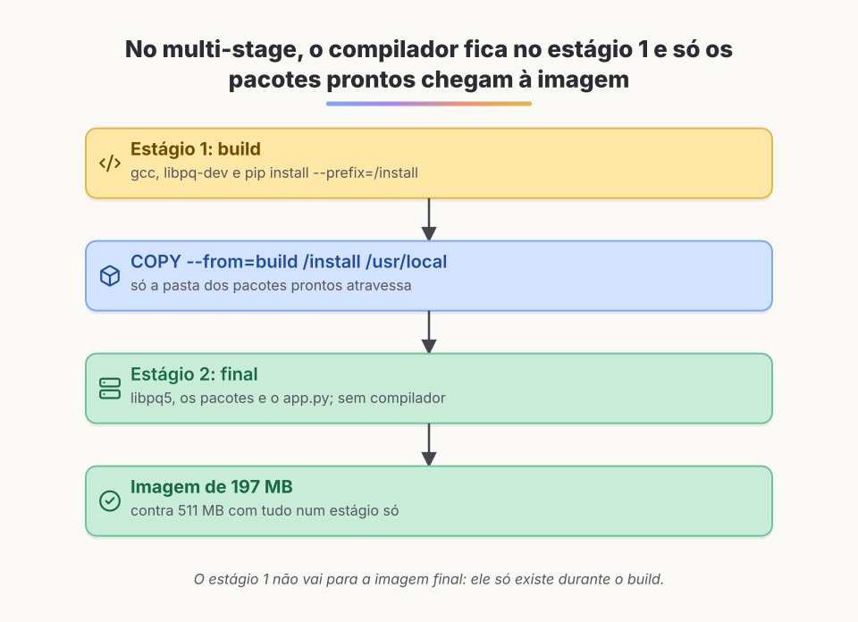

# 8. Builds rápidos e imagens enxutas

> 🗺️ **Neste capítulo:** você mede quanto o build demora e quanto a imagem pesa, entende o que invalida o cache de camadas, reordena o Dockerfile para reconstruir em segundos, limpa o que sobra no mesmo `RUN` e usa o build em múltiplos estágios para deixar o compilador de fora da imagem final. · ⏱️ ~45 min

> 🔥 **Aquecimento:** (1) Qual a diferença entre `RUN` e `CMD` num Dockerfile? (2) Por que `CMD ["python", "app.py"]` é melhor que `CMD python app.py`?
>
> <details>
> <summary>Ver resposta</summary>
>
> (1) O `RUN` executa durante o build e grava o resultado numa camada; o `CMD` define o que roda a cada início do contêiner. (2) Na forma exec, o Python é o PID 1 e recebe o SIGTERM do `docker stop`; na forma shell, o PID 1 é o `sh`, que não repassa o sinal (capítulo 7).
>
> </details>

## De onde paramos

No capítulo 7 a sua API virou uma imagem de 178 MB que roda como usuário comum. Funciona, mas a API ainda não depende de nenhuma biblioteca externa, e os Dockerfiles do dia a dia dependem. Na API 1.1, do capítulo 12, ela vai conversar com o PostgreSQL por um driver chamado `psycopg`. Vamos instalá-lo já agora, de propósito, porque é no momento de instalar dependências que o build fica lento e a imagem engorda.

Os nomes seguem com `dz-`, as portas ficam em `127.0.0.1`, e as medições vêm do Docker Engine 29.9.3 desta máquina. **Tempos e tamanhos variam de computador para computador:** compare as proporções, não os números exatos. Se você usa o Git Bash, rode `export MSYS_NO_PATHCONV=1` antes.

## Medir antes de otimizar

Otimizar sem medir é adivinhar. Três medidas bastam:

| Medida | Como obter |
| --- | --- |
| Tempo do build | `time docker build ...` (ou o tempo no fim da saída com `--progress=plain`) |
| Tamanho da imagem | `docker images <nome>` (coluna `SIZE`) |
| Onde estão os megabytes | `docker history <imagem>`, que mostra o tamanho de cada camada |

Um cuidado: **meça mais de uma vez e olhe o que foi para o cache.** O primeiro build de uma imagem é sempre o mais lento (baixa a base e instala tudo), e o segundo costuma ser quase instantâneo. O que interessa é o tempo do build que você faz **depois de mudar algo**, porque é esse que você repete cem vezes por semana.

## Cache de camadas: o que o invalida

Cada instrução do Dockerfile vira uma camada (capítulo 6), e o Docker guarda cada camada pronta. Na próxima construção, se a instrução e tudo o que ela usa forem idênticos, ele reaproveita a camada em vez de refazê-la.

**O cache de build reaproveita uma camada quando a instrução e os arquivos que ela usa não mudaram; quando uma camada muda, ela e todas as seguintes são refeitas.**

Essa segunda metade é a regra que importa: **a ordem das instruções decide o que é reaproveitado.** Veja o Dockerfile ingênuo, o que a maioria escreve primeiro. Ele copia tudo e depois instala as dependências:

```bash
# pasta de teste, com o app e uma dependência real
mkdir -p ~/cache-teste && cd ~/cache-teste
cp ~/api-livro/app.py .
echo 'psycopg[binary]==3.3.9' > requirements.txt
cat > Dockerfile <<'EOF'
FROM python:3.14-slim
WORKDIR /app
COPY . .
RUN pip install -r requirements.txt
CMD ["python", "app.py"]
EOF
time docker build --progress=plain -t dz-api:ingenuo .
```

```text
#7 [3/4] COPY . .
#7 DONE 0.0s
#8 [4/4] RUN pip install -r requirements.txt
#8 4.090 Successfully installed psycopg-3.3.9 psycopg-binary-3.3.9
#8 4.090 WARNING: Running pip as the 'root' user can result in broken permissions and conflicting behaviour with the system package manager.
#8 DONE 4.5s

real	0m9.231s
```

(O `WARNING` do pip é sobre rodar como `root`, o que é normal durante um build; o `USER` do Dockerfile final vem depois.) Agora o dia a dia: você muda **uma linha** do código e reconstrói.

```bash
# uma mudança qualquer no código
echo '# mudança' >> app.py
time docker build --progress=plain -t dz-api:ingenuo .
```

```text
#6 [2/4] WORKDIR /app
#6 CACHED
#7 [3/4] COPY . .
#7 DONE 0.5s
#8 [4/4] RUN pip install -r requirements.txt
#8 DONE 4.3s

real	0m8.922s
```

O `COPY . .` copiou um arquivo diferente, então a camada mudou, e **todas as seguintes foram refeitas, inclusive o `pip install`**, que reinstalou as mesmas bibliotecas à toa. Faça o contrário: copie primeiro **só** o arquivo que lista as dependências, instale, e só depois copie o código:

```bash
cat > Dockerfile <<'EOF'
FROM python:3.14-slim
WORKDIR /app
# primeiro só a lista de dependências: ela muda raramente
COPY requirements.txt .
RUN pip install --no-cache-dir -r requirements.txt
# o código muda o tempo todo, então vem por último
COPY app.py .
CMD ["python", "app.py"]
EOF
docker build -q -t dz-api:ordenado .
# muda o código de novo e reconstrói
echo '# mudança 2' >> app.py
time docker build --progress=plain -t dz-api:ordenado .
```

```text
#6 [2/5] WORKDIR /app
#6 CACHED
#7 [3/5] COPY requirements.txt .
#7 CACHED
#8 [4/5] RUN pip install --no-cache-dir -r requirements.txt
#8 CACHED
#9 [5/5] COPY app.py .
#9 DONE 0.1s

real	0m1.458s
```


**8,9 s viraram 1,5 s.** O `pip install` aparece como `CACHED` porque nem o `requirements.txt` nem a instrução mudaram. A regra para ordenar um Dockerfile: **o que muda menos vem primeiro; o que muda mais vem por último.**

| O que muda | Invalida | Você vê |
| --- | --- | --- |
| uma instrução `RUN`/`ENV`/`ARG` com texto diferente | essa camada e as seguintes | `DONE` a partir dela |
| um arquivo copiado por `COPY` (conteúdo) | essa camada e as seguintes | `DONE` a partir do `COPY` |
| nada | nenhuma | `CACHED` |
| a base (`FROM`) ganhou nova versão (tag movida, capítulo 6) | tudo | tudo refeito |

Há duas exceções que enganam. Um `RUN apt-get update` ou `RUN pip install` **com o mesmo texto** continua `CACHED` mesmo que o repositório de pacotes tenha atualizado desde então. Quando você quiser forçar tudo de novo (para pegar atualizações de segurança, por exemplo), use `docker build --no-cache`. E um `COPY . .` com um `.dockerignore` bem escrito (capítulo 7) muda menos, porque deixa de fora o que não importa.

> ⚠️ **Erro comum:** achar que o build "está quebrado" porque num dia demora um minuto e no outro dois segundos. É o cache. E o oposto: achar que `CACHED` significa "atualizado": o Docker só compara o **texto da instrução** e os arquivos copiados, não o mundo lá fora.

## Imagem enxuta 1: limpe no mesmo RUN

Camadas só **acrescentam**: apagar um arquivo numa camada nova não devolve o espaço, porque o arquivo continua gravado na camada em que foi criado (o Docker só o esconde nas camadas de cima). Por isso, a limpeza só funciona se ocorrer **na mesma instrução** que criou a sujeira.

**Para a limpeza reduzir a imagem, ela precisa estar no mesmo `RUN` que criou os arquivos; num `RUN` separado, ela não devolve nenhum espaço.**

O exemplo clássico é o `apt`: o `apt-get update` baixa as listas de pacotes (`/var/lib/apt/lists`), que não servem para nada depois de instalar. Compare as duas formas de instalar o `curl`:

```bash
cd ~/cache-teste
# forma 1: três RUN, a limpeza em separado
cat > Dockerfile.sep <<'EOF'
FROM python:3.14-slim
RUN apt-get update
RUN apt-get install -y --no-install-recommends curl
RUN rm -rf /var/lib/apt/lists/*
EOF
# forma 2: um RUN só, encadeado com && e quebrado com a barra
cat > Dockerfile.junto <<'EOF'
FROM python:3.14-slim
RUN apt-get update \
    && apt-get install -y --no-install-recommends curl \
    && rm -rf /var/lib/apt/lists/*
EOF
docker build -q -f Dockerfile.sep -t dz-lim:sep . > /dev/null
docker build -q -f Dockerfile.junto -t dz-lim:junto . > /dev/null
docker images dz-lim --format '{{.Tag}} {{.Size}}'
docker history dz-lim:sep --format '{{.Size}}\t{{.CreatedBy}}' | head -3
```

```text
junto 197MB
sep 235MB
20.5kB	RUN /bin/sh -c rm -rf /var/lib/apt/lists/* #…
13.5MB	RUN /bin/sh -c apt-get install -y --no-insta…
21.6MB	RUN /bin/sh -c apt-get update # buildkit
```

A base tem 178 MB. A forma 1 ficou com 235 MB, e a forma 2, com 197 MB: **38 MB de diferença para instalar a mesma coisa.** O `docker history` mostra o motivo: a camada do `apt-get update` guardou 21,6 MB de listas, e o `rm` da camada seguinte pesa só 20,5 kB, porque apenas marcou os arquivos como apagados.

Três hábitos que andam juntos na instalação de pacotes do sistema:

- **`update` e `install` no mesmo `RUN`.** Se estivessem separados, o cache poderia reaproveitar um `update` antigo e o `install` falhar por buscar um pacote que mudou de versão.
- **`--no-install-recommends`**, para o `apt` não trazer pacotes sugeridos.
- **`rm -rf /var/lib/apt/lists/*` no final do mesmo `RUN`.**

Para o `pip`, o equivalente é o `--no-cache-dir`, que evita guardar na imagem os pacotes baixados. Na medição, o Dockerfile ordenado (com `--no-cache-dir`) ficou com 211 MB, contra 220 MB do ingênuo.

## Imagem enxuta 2: builds multi-stage

Há dependências que precisam de um **compilador** para serem instaladas, e depois de compiladas ele não serve mais para nada. O driver `psycopg` tem uma variante em C (`psycopg[c]`) que precisa de `gcc` e dos arquivos de desenvolvimento do PostgreSQL. Instalar tudo num estágio só deixa o compilador dentro da imagem de produção. Veja o tamanho:

```bash
# pasta de teste: um estágio só, com compilador e psycopg em C
mkdir -p ~/multi-teste && cd ~/multi-teste
cp ~/api-livro/app.py .
echo 'psycopg[c]==3.3.9' > requirements.txt
cat > Dockerfile <<'EOF'
FROM python:3.14-slim
RUN apt-get update && apt-get install -y --no-install-recommends \
    gcc libc6-dev libpq-dev \
    && rm -rf /var/lib/apt/lists/*
WORKDIR /app
COPY requirements.txt .
RUN pip install --no-cache-dir -r requirements.txt
COPY app.py .
CMD ["python", "app.py"]
EOF
docker build -q -t dz-api:um-estagio .
docker images dz-api:um-estagio --format '{{.Tag}} {{.Size}}'
```

```text
um-estagio 511MB
```

**511 MB**, contra 178 MB da base. A maior parte é o `gcc`, o `libc6-dev` e os pacotes de desenvolvimento, que o programa não usa para rodar. (Esse build demorou cerca de um minuto e meio, e o `pip` compilou o `psycopg-c`.)

> ⚠️ **Erro comum:** instalar só o `gcc` e esquecer o `libc6-dev`. Com `--no-install-recommends`, o compilador vem sem os cabeçalhos do C, e o `pip` falha com `fatal error: assert.h: No such file or directory`. Foi o erro que esta máquina mostrou na primeira tentativa.

**Um build multi-stage usa vários `FROM` num mesmo Dockerfile: cada `FROM` começa um estágio novo, e `COPY --from=<estágio>` traz para o estágio seguinte só o que você escolher; a imagem final contém apenas o último estágio.**



O Dockerfile do projeto, agora multi-stage. Crie o `requirements.txt` e substitua o `Dockerfile` na pasta `~/api-livro`:

<!-- project: tarefas-api -->

**requirements.txt**

```text
psycopg[c]==3.3.9
```

**Dockerfile**

```dockerfile
# estágio 1 (build): tem compilador e arquivos de desenvolvimento
FROM python:3.14-slim AS build
RUN apt-get update && apt-get install -y --no-install-recommends \
    gcc libc6-dev libpq-dev \
    && rm -rf /var/lib/apt/lists/*
WORKDIR /build
# o requirements.txt vem antes do código: o pip só refaz se ele mudar
COPY requirements.txt .
# instala numa pasta à parte (/install), para copiar só ela depois
RUN pip install --no-cache-dir --prefix=/install -r requirements.txt

# estágio 2 (final): só o que o programa precisa para rodar
FROM python:3.14-slim
# a biblioteca de execução do PostgreSQL e o usuário comum, num RUN só
RUN apt-get update && apt-get install -y --no-install-recommends libpq5 \
    && rm -rf /var/lib/apt/lists/* \
    && useradd --create-home app
# os pacotes já prontos, direto do estágio 1
COPY --from=build /install /usr/local
WORKDIR /app
COPY app.py .

# a versão entra no build (--build-arg) e fica na imagem como variável
ARG APP_VERSAO=1.0
ENV APP_VERSAO=$APP_VERSAO PORTA=8000
USER app
EXPOSE 8000
# forma exec: o Python vira o PID 1 e recebe os sinais (capítulo 4)
CMD ["python", "app.py"]
```

O `AS build` dá um nome ao primeiro estágio, e o `COPY --from=build` o usa. A pasta `/install` carrega só os pacotes Python já compilados. No estágio final entram apenas a `libpq5` (a biblioteca que o `psycopg` usa em tempo de execução) e o `app.py`.

```bash
# primeiro build: compila o psycopg-c (a parte lenta)
time docker build -t dz-api:1.0 .
docker images dz-api:1.0 --format '{{.Tag}} {{.Size}}'
```

```text
real	1m42.010s
1.0 197MB
```

**511 MB viraram 197 MB**, com o mesmo `psycopg` em C funcionando. O estágio de build existiu durante a construção e depois ficou de fora. Confira que o que sobrou na imagem final é o esperado:

```bash
# a API sobe, o usuário não é root, a implementação é a em C e não há compilador
docker run -d --name dz-api --label dz=livro -p 127.0.0.1:8080:8000 \
  dz-api:1.0
curl -s http://127.0.0.1:8080/saude
docker exec dz-api id
docker exec dz-api python -c "import psycopg; print(psycopg.pq.__impl__)"
docker exec dz-api sh -c 'which gcc || echo sem gcc'
```

```text
{"status": "ok", "versao": "1.0"}
uid=1000(app) gid=1000(app) groups=1000(app)
c
sem gcc
```

(Se o `curl` devolver `Empty reply from server`, espere um segundo e repita.) E o cache continua funcionando entre os estágios. Mudando só o `app.py`:

```bash
echo '# mudança' >> app.py
( time docker build --progress=plain -t dz-api:1.0 . ) 2>&1 \
  | grep -E "CACHED|real"
```

```text
#6 [stage-1 2/5] RUN apt-get update && apt-get install -y --no-install-recommends libpq5     && rm -
#6 CACHED
#7 [build 3/5] WORKDIR /build
#7 CACHED
#8 [build 4/5] COPY requirements.txt .
#8 CACHED
...
real	0m2.086s
```

Os passos do estágio de build ficam todos em `CACHED`, e o rebuild leva cerca de 2 s em vez de 1 min 40 s. (A saída acima é resumida, com as linhas `CACHED` principais.)

Para parar no meio e olhar o estágio de build sozinho, use `--target`:

```bash
# constrói só até o estágio chamado "build"
docker build --target build -t dz-api:so-build .
docker images dz-api:so-build --format '{{.Tag}} {{.Size}}'
```

```text
so-build 511MB
```

É a imagem que **não** foi para a produção: 511 MB, com o compilador. Essa é a prova de que o multi-stage tirou esses megabytes do caminho.

## Escolher a imagem base

A base é a maior parte do tamanho, então escolhê-la bem é a maior economia. As variantes que o `python` oferece:

| Variante | Base | Tamanho medido (app do capítulo 7) |
| --- | --- | --- |
| `python:3.14-slim` | Debian enxuto (glibc) | 178 MB |
| `python:3.14-alpine` | Alpine Linux (musl) | 73,3 MB |

```bash
# o mesmo app.py, nas duas bases
cd ~/cache-teste
cat > Dockerfile.slim <<'EOF'
FROM python:3.14-slim
WORKDIR /app
COPY app.py .
CMD ["python", "app.py"]
EOF
sed 's/slim/alpine/' Dockerfile.slim > Dockerfile.alp
docker build -q -f Dockerfile.slim -t dz-lim:slim . > /dev/null
docker build -q -f Dockerfile.alp -t dz-lim:alpine . > /dev/null
docker images dz-lim --format '{{.Tag}} {{.Size}}' | grep -E "slim|alpine"
```

```text
slim 178MB
alpine 73.3MB
```

A `alpine` é bem menor e a API simples roda nela sem mudança. Mas **menor não é melhor automaticamente**:

- O Alpine usa a biblioteca C **musl**, e o Debian usa a **glibc**:

  ```bash
  # a biblioteca C de cada base
  docker run --rm python:3.14-alpine \
    python -c "import platform;print(platform.libc_ver())"
  docker run --rm python:3.14-slim \
    python -c "import platform;print(platform.libc_ver())"
  ```

  ```text
  ('musl', '1')
  ('glibc', '2.41')
  ```

- Muitos pacotes Python precompilados (os *wheels*) são feitos para a glibc. Para musl existem os `musllinux`, mas nem todo pacote os publica; quando faltam, o `pip` precisa compilar na hora, e o que era uma economia vira build lento e quebradiço.
- Para depurar, o Debian traz mais ferramentas conhecidas.

Por isso, o livro usa a `-slim`: boa economia sem pegadinhas. Escolha `alpine` quando você souber que todas as suas dependências funcionam nela e o tamanho for crítico.

> ⚠️ **Erro comum:** trocar para `alpine` só para a imagem ficar pequena e depois perder uma tarde com um pacote que não instala. Meça com a sua aplicação antes de decidir.

### Usuário não root, de novo

O Dockerfile final cria o usuário `app` e usa `USER app`. Um detalhe aparece no ambiente enxuto: o `COPY` copia os arquivos como `root`, então o usuário comum só **lê**, e não escreve na pasta da aplicação:

```bash
docker run --rm dz-api:1.0 sh -c 'ls -ld /app; touch /app/teste'
```

```text
drwxr-xr-x 1 root root 4096 Nov 26 14:35 /app
touch: cannot touch '/app/teste': Permission denied
```

Para uma API que não grava nada na própria pasta, isso é bom: um invasor que tome o processo não consegue alterar o código. Quando um programa precisar gravar (um cache, um arquivo temporário), dê a ele uma pasta própria, sem abrir a pasta do código para escrita.

## 🧪 Laboratório: o build do projeto, antes e depois

**Objetivo:** trocar o Dockerfile do capítulo 7 pela versão multi-stage e confirmar que ela é menor e mais rápida a cada mudança.

1. Em `~/api-livro`, crie o `requirements.txt` (`psycopg[c]==3.3.9`) e substitua o `Dockerfile` pelo multi-stage da seção anterior.
2. Meça o primeiro build: `time docker build -t dz-api:1.0 .`. Esperado: termina sem `ERROR`, em mais de um minuto neste computador (o `psycopg-c` é compilado), e `docker images dz-api:1.0` mostra cerca de 197 MB.
3. Mude o código: `echo '# mudança' >> app.py` e repita o `time docker build ...`. Esperado: poucos segundos, com o `pip install` em `CACHED`.
4. Verifique a imagem final:

   ```bash
   # sobe a imagem nova e confere usuário e compilador
   docker run -d --name dz-api --label dz=livro -p 127.0.0.1:8080:8000 \
     dz-api:1.0
   docker exec dz-api id
   docker exec dz-api sh -c 'which gcc || echo sem gcc'
   ```

   Esperado: `uid=1000(app)` e `sem gcc`.
5. Meça o contrário: mude o `requirements.txt` (por exemplo, para `psycopg[c]==3.3.8`) e reconstrua. Esperado: o `apt-get` do estágio de build continua em `CACHED`, mas o `pip install` é refeito e volta a ser lento (aqui, 1 min 17 s), porque o arquivo que ele copia mudou. Volte para `3.3.9` depois.
6. Limpe só o que é seu:

   ```bash
   docker rm -f dz-api
   docker rmi dz-api:1.0
   ```

   Se criou os testes das seções anteriores, remova também as imagens `dz-api:ingenuo`, `dz-api:ordenado`, `dz-api:um-estagio`, `dz-api:so-build` e `dz-lim:sep`, `dz-lim:junto`, `dz-lim:slim`, `dz-lim:alpine`, uma a uma, pelo nome.

**Esperado no final:** nenhum contêiner `dz-*`; as imagens de teste removidas.

## 🏋️ Pratique

**1. Resolvido: diagnosticar o Dockerfile.** Por que este Dockerfile reinstala as dependências a cada mudança de código? Corrija-o.

```dockerfile
# o código vem antes das dependências: o erro a corrigir
FROM python:3.14-slim
WORKDIR /app
COPY . .
RUN pip install --no-cache-dir -r requirements.txt
CMD ["python", "app.py"]
```

<details>
<summary>Ver resposta</summary>

O `COPY . .` vem antes do `pip install` e copia o código junto: qualquer mudança em qualquer arquivo muda essa camada e invalida o `pip install`. A correção é copiar primeiro só o `requirements.txt`, instalar, e depois copiar o código:

```dockerfile
# primeiro só a lista de dependências; o código por último
FROM python:3.14-slim
WORKDIR /app
COPY requirements.txt .
RUN pip install --no-cache-dir -r requirements.txt
COPY app.py .
CMD ["python", "app.py"]
```

Erro comum nessa resposta: mover o `COPY . .` para depois do `pip` mas deixar o `requirements.txt` fora da primeira cópia: aí o `pip` não encontra o arquivo.

</details>

**2. Complete:** preencha as lacunas para que o `apt` deixe a imagem enxuta.

```dockerfile
RUN apt-get update ____ \
    apt-get install -y --____ curl ____ \
    rm -rf /var/lib/apt/lists/*
```

<details>
<summary>Ver resposta</summary>

As lacunas são `&& \` (encadear e quebrar a linha), `no-install-recommends` e `&& \`. Resultado: um `RUN` só. Quem esqueceu o `&&` e deixou as linhas soltas teria uma instrução por linha, com a limpeza em camada separada, e o espaço não seria devolvido.

</details>

**3. Por conta própria:** você tem um Dockerfile com dois estágios (`AS build` e o final). Preveja o que `docker build --target build -t x .` produz, e o que acontece com o tamanho comparado à imagem final. Depois confira com o seu projeto.

<details>
<summary>Ver resposta</summary>

O `--target build` para a construção no estágio chamado `build` e produz a imagem desse estágio, com o compilador (nesta máquina, 511 MB contra 197 MB da final). Serve para depurar o estágio de build. Remova a imagem de teste depois com `docker rmi x`.

</details>

**4. Desafio:** o colega achou que `FROM python:3.14-alpine` é sempre melhor porque a imagem tem 73 MB, contra 178 MB. Dê dois motivos para ele testar antes de adotar, e um comando que prova que as duas bases têm bibliotecas C diferentes.

<details>
<summary>Ver resposta</summary>

Motivos: (1) o Alpine usa musl, e muitos pacotes precompilados são feitos para a glibc: quando não há versão para musl, o `pip` compila na hora (build lento e frágil); (2) menos ferramentas de diagnóstico prontas. Comando: `docker run --rm python:3.14-alpine python -c "import platform;print(platform.libc_ver())"`, que imprime `('musl', '1')`, enquanto na `-slim` aparece `('glibc', '2.41')`.

</details>

## 🧠 Revisão rápida

**1.** O que acontece com as camadas seguintes quando uma camada do Dockerfile é invalidada?

<details>
<summary>Ver resposta</summary>

Todas são refeitas: o cache só reaproveita camadas até a primeira que mudou.

</details>

**2.** Por que `RUN rm -rf /var/lib/apt/lists/*` em um `RUN` separado não reduz a imagem?

<details>
<summary>Ver resposta</summary>

As camadas só acrescentam: o arquivo continua gravado na camada em que foi criado, e a camada do `rm` só o esconde. A limpeza precisa estar no mesmo `RUN`.

</details>

**3.** Qual a vantagem do build multi-stage?

<details>
<summary>Ver resposta</summary>

A imagem final contém só o último estágio, então compiladores e arquivos de desenvolvimento do estágio de build ficam de fora (aqui, 511 MB viraram 197 MB).

</details>

**4.** (Capítulo 7) Por que o `.dockerignore` é importante, mesmo com `COPY app.py .`?

<details>
<summary>Ver resposta</summary>

Porque protege no dia em que alguém trocar por `COPY . .`: sem ele, um `.env` e arquivos grandes entram na imagem.

</details>

**5.** (Capítulo 1) Qual comando cria uma imagem e qual cria um contêiner a partir dela?

<details>
<summary>Ver resposta</summary>

O `docker build` cria a imagem (o pacote somente leitura); o `docker run` cria o contêiner (a instância em execução), com uma camada de escrita por cima.

</details>

**6.** (Capítulo 5) Que comando mostra o tamanho de cada camada de uma imagem?

<details>
<summary>Ver resposta</summary>

`docker history <imagem>` (capítulo 6).

</details>

## 🤖 Estude com um tutor de IA

1. "Faça 5 perguntas, uma por vez, sobre cache de camadas e build multi-stage no Docker. Espere a minha resposta antes de dar o retorno e não me dê as respostas antes."
2. "Aqui está o meu Dockerfile do exercício 1 do capítulo 8: <meu Dockerfile>. Aponte problemas de ordem de instruções e de tamanho da imagem sem reescrever o arquivo por mim."

> ➡️ **Próximo passo:** no capítulo 9 você resolve o problema que ficou aberto desde o capítulo 7: a lista de tarefas some quando o contêiner é removido. Os volumes guardam dados fora do contêiner, e você vai rodar o PostgreSQL com dados que sobrevivem.

## 📌 Resumo

| Item | Em uma frase |
| --- | --- |
| Medir | `time docker build`, `docker images` e `docker history`, mais de uma vez |
| Cache de camadas | reaproveita a camada se a instrução e os arquivos não mudaram; mudou uma, as seguintes são refeitas |
| Ordem das instruções | o que muda menos vem primeiro (`requirements.txt`, `pip`), o código por último |
| Limpar no mesmo `RUN` | só assim o espaço é devolvido; num `RUN` separado a limpeza não reduz nada |
| `apt` enxuto | `update` e `install --no-install-recommends` e `rm` das listas, no mesmo `RUN` |
| Multi-stage | vários `FROM`; `COPY --from=` traz só o necessário; a imagem final é o último estágio |
| `--target` | constrói só até um estágio; útil para depurar |
| Alpine × slim | Alpine (musl) é menor, mas muitos pacotes precompilados esperam a glibc do Debian |
| Usuário não root | `USER app`; o `COPY` deixa os arquivos como `root`, só leitura para o `app` |

## 📚 Fontes

- Invalidação do cache: https://docs.docker.com/build/cache/invalidation/ (conferido em 26/11/2026)
- Builds multi-stage: https://docs.docker.com/build/building/multi-stage/ (conferido em 26/11/2026)
- Boas práticas de build: https://docs.docker.com/build/building/best-practices/ (conferido em 26/11/2026)
- psycopg no PyPI: https://pypi.org/project/psycopg/ (versão 3.3.9, conferida em 26/11/2026)
- Execução e saída real: Docker Engine 29.9.3 com Docker Desktop 4.99.0, Windows 11, Git Bash, em 26/11/2026. Os tempos variam de máquina para máquina.

> 🔁 **Revise hoje:** capítulos 1, 5 e 7
