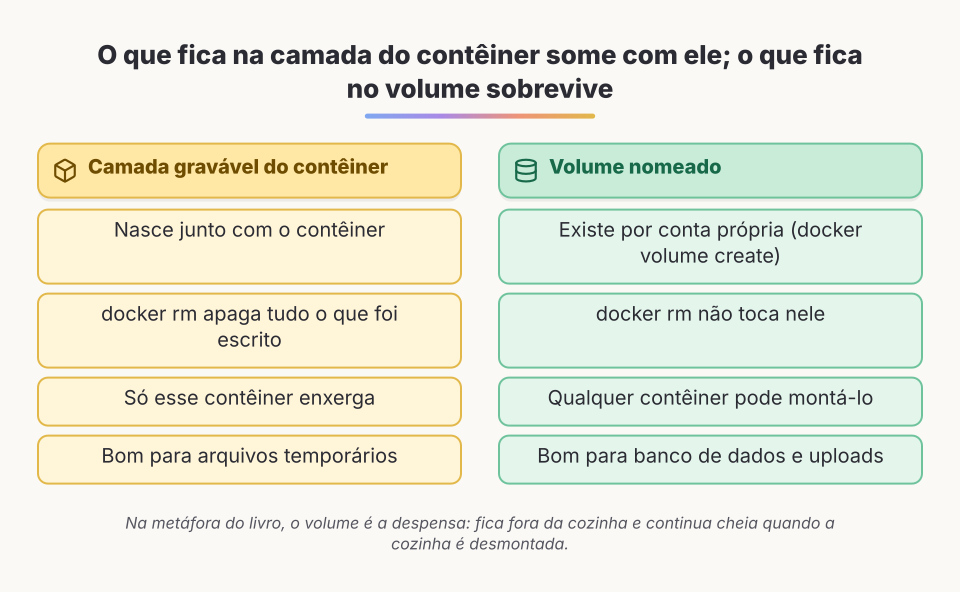
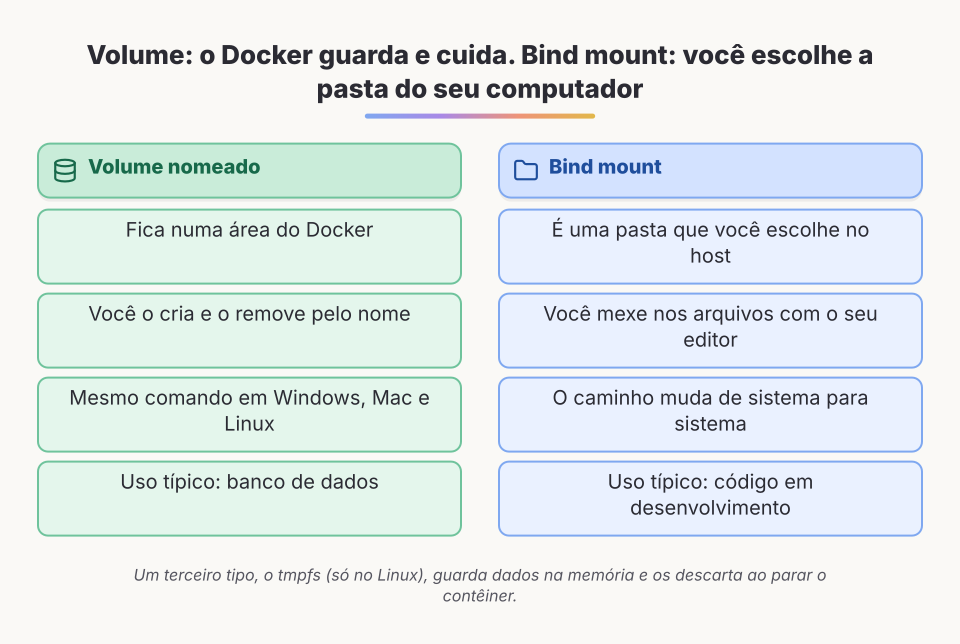
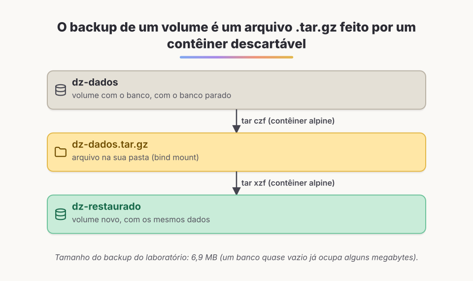

# 9. Volumes: dados que sobrevivem

> 🗺️ **Neste capítulo:** você vê por que tudo o que um contêiner escreve some com ele, aprende os três lugares onde guardar dados fora dele (volume, bind mount e tmpfs), roda o PostgreSQL 18 do projeto com os dados num volume, entende as diferenças entre `-v` e `--mount`, resolve um erro de permissão e faz backup e restauração de um volume. · ⏱️ ~55 min

> 🔥 **Aquecimento:** (1) Por que, no Dockerfile do capítulo 8, o `COPY requirements.txt .` vem antes do `COPY app.py .`? (2) O que o `docker rm` apaga, segundo o capítulo 4?
>
> <details>
> <summary>Ver resposta</summary>
>
> (1) Para que o `pip install` fique no cache: ele só é refeito quando o `requirements.txt` muda, e não a cada mudança no código. (2) O contêiner e tudo o que ele escreveu na própria camada; a imagem continua.
>
> </details>

## De onde paramos

No capítulo 8 você deixou a imagem da API pequena e rápida de reconstruir. Falta resolver um problema que apareceu desde o capítulo 4: **o que o contêiner grava some quando ele é removido.** Para uma página de teste, tudo bem. Para a lista de tarefas, que vai morar num banco de dados, é um desastre.

Os nomes continuam com `dz-`, as portas (quando há) ficam em `127.0.0.1`, e as saídas vêm do Docker Engine 29.9.3 com o Docker Desktop 4.99, no Windows 11 (Git Bash). Se você usa o Git Bash, rode `export MSYS_NO_PATHCONV=1` antes. A senha `senha-de-teste` que aparece neste capítulo só existe no laboratório: no seu projeto de verdade, nunca ponha senha num Dockerfile nem em arquivo que vá para o Git.

## A camada gravável morre com o contêiner

Lembra das camadas do capítulo 6? A imagem é somente leitura. Quando você roda um contêiner, o Docker põe por cima uma **camada gravável** (*writable layer*), e tudo o que o programa escreve vai para ela. Vamos ver isso acontecer. Preveja antes: se você grava um arquivo num contêiner, remove o contêiner e cria outro da mesma imagem, o arquivo existe no segundo?

```bash
# o contêiner grava um arquivo e fica vivo por um tempo
docker run -d --name dz-efemero --label dz=livro alpine:3.23 \
  sh -c 'echo "olá, despensa vazia" > /nota.txt; sleep 600'
# o que mudou em relação à imagem: A = arquivo adicionado
docker diff dz-efemero
docker exec dz-efemero cat /nota.txt
# remove o contêiner e tenta ler o arquivo num contêiner novo
docker rm -f dz-efemero
docker run --rm alpine:3.23 cat /nota.txt
```

```text
A /nota.txt
olá, despensa vazia
dz-efemero
cat: can't open '/nota.txt': No such file or directory
```

O `docker diff` mostra exatamente o que a camada gravável tem de diferente da imagem: a linha `A /nota.txt`. Quando o contêiner é removido, essa camada vai junto. O segundo contêiner nasce da mesma imagem, intacta, e não tem o arquivo.

**A camada gravável é o espaço de escrita que o Docker cria para cada contêiner; ela vive e morre com ele.**

Isso não é um defeito: é o que permite criar e jogar fora contêineres sem medo. Mas um banco de dados precisa do contrário, e é para isso que existem os lugares abaixo.

> 💡 **Analogia:** a imagem é a receita, o contêiner é a cozinha montada a partir dela (capítulo 1), e a camada gravável é a bancada da cozinha. Tudo o que você deixa na bancada some quando a cozinha é desmontada. O **volume** é a **despensa**: fica fora da cozinha, e qualquer cozinha nova pode ser ligada a ela. Aqui o volume é a despensa, a cozinha é o contêiner e desmontar a cozinha não esvazia a despensa. A analogia falha em um ponto: duas cozinhas ligadas à mesma despensa ao mesmo tempo podem se atrapalhar (dois bancos de dados escrevendo nos mesmos arquivos corrompem os dados).



## Três jeitos de guardar dados fora do contêiner

O Docker oferece três tipos de montagem (*mount*), cada um com um uso:

| | Volume | Bind mount | tmpfs |
| --- | --- | --- | --- |
| Onde fica | numa área gerenciada pelo Docker | numa pasta do seu computador, que você escolhe | na memória |
| Quem cuida | o Docker | você | o sistema, enquanto o contêiner roda |
| Sobrevive ao `docker rm` | sim | sim (é a sua pasta) | não |
| Uso típico | banco de dados, dados da aplicação | código em desenvolvimento, arquivos de configuração | dados temporários e sigilosos |
| Disponível em | todos os sistemas | todos os sistemas | só em contêineres Linux |

**Um volume é um espaço de armazenamento criado e gerenciado pelo Docker, com nome próprio, que existe independentemente de qualquer contêiner.** Você o liga a um contêiner, e o que o contêiner grava naquele caminho vai para o volume.

**Um bind mount liga uma pasta ou arquivo do seu computador a um caminho dentro do contêiner**, e os dois lados enxergam os mesmos arquivos. **Um tmpfs** guarda os dados só na memória, e eles desaparecem quando o contêiner para.

Para um banco de dados, a escolha é o **volume nomeado**: é portátil, o Docker cuida das permissões iniciais, e funciona igual em Windows, Mac e Linux. O bind mount brilha quando você edita o código no seu computador e quer ver o efeito no contêiner sem reconstruir a imagem. O tmpfs serve para o que não deve tocar o disco.



> ⚠️ **Erro comum:** achar que `docker rm` apaga o volume. Não apaga: o volume é do Docker, não do contêiner, e continua lá. É por isso que os dados sobrevivem, e também por isso que volumes esquecidos ocupam disco para sempre.

## Comandos de volume

Um volume pode ser criado sozinho, antes do contêiner. Estes são os comandos que você mais usa:

| Comando | O que faz |
| --- | --- |
| `docker volume create <nome>` | cria um volume |
| `docker volume ls` | lista os volumes |
| `docker volume inspect <nome>` | mostra os detalhes (onde está, rótulos, data) |
| `docker volume rm <nome>` | remove um volume que nenhum contêiner usa |

```bash
# --label dz=livro marca o volume como seu, para achá-lo depois
docker volume create --label dz=livro dz-dados
# lista só os volumes com o seu rótulo
docker volume ls --filter label=dz=livro
docker volume inspect dz-dados
```

```text
dz-dados
DRIVER    VOLUME NAME
local     dz-dados
[
    {
        "CreatedAt": "2026-11-26T17:39:12Z",
        "Driver": "local",
        "Labels": {
            "dz": "livro"
        },
        "Mountpoint": "/var/lib/docker/volumes/dz-dados/_data",
        "Name": "dz-dados",
        "Options": null,
        "Scope": "local"
    }
]
```

O `Mountpoint` é o lugar real dos dados, mas ele fica **dentro da máquina virtual do Docker Desktop** (WSL 2 no Windows), não numa pasta que você abre no Explorador de Arquivos. Não mexa ali: use sempre o Docker (um contêiner auxiliar, como no backup mais adiante) para ler e escrever num volume.

> ⚠️ **Cuidado com o `docker volume prune`:** ele apaga **todos** os volumes que nenhum contêiner está usando, e esta máquina (e talvez a sua) guarda volumes de outros projetos. Por isso, neste livro, você sempre remove volumes **pelo nome** (`docker volume rm dz-dados`). Um volume apagado não volta.

## PostgreSQL 18 com volume: os dados sobrevivem

Agora o caso real: o banco do projeto. A imagem oficial do PostgreSQL pede uma senha em `POSTGRES_PASSWORD` e pode criar um banco inicial com `POSTGRES_DB`. Falta dizer **onde** ligar o volume.

A versão 18 da imagem mudou isso: os dados ficam em `/var/lib/postgresql/18/docker`, e o volume deve ser montado em **`/var/lib/postgresql`**. Até a versão 17, o caminho era `/var/lib/postgresql/data`, e a maior parte dos tutoriais antigos ainda mostra esse. Veja o que acontece quando alguém copia um tutorial antigo (um erro de propósito):

```bash
# erro de propósito: o caminho do PostgreSQL 17 numa imagem 18
docker run -d --name dz-db-errado --label dz=livro \
  -e POSTGRES_PASSWORD=senha-de-teste \
  -v dz-dados:/var/lib/postgresql/data postgres:18
docker logs dz-db-errado
docker ps -a --filter name=dz-db-errado --format '{{.Names}} {{.Status}}'
```

```text
Error: in 18+, these Docker images are configured to store database data in a
       format which is compatible with "pg_ctlcluster" (specifically, using
       major-version-specific directory names).  This better reflects how
       PostgreSQL itself works, and how upgrades are to be performed.
       (...)
       The suggested container configuration for 18+ is to place a single mount
       at /var/lib/postgresql which will then place PostgreSQL data in a
       subdirectory, allowing usage of "pg_upgrade --link" without mount point
       boundary issues.
dz-db-errado Exited (1) 6 seconds ago
```

A imagem avisa e se recusa a subir, o que é melhor do que subir e perder os dados. A saída acima foi abreviada em `(...)`. Remova o contêiner (`docker rm dz-db-errado`; o volume `dz-dados` continua vazio e serve para o certo) e suba do jeito certo:

```bash
# volume em /var/lib/postgresql (PostgreSQL 18 ou mais novo)
docker run -d --name dz-db --label dz=livro \
  -e POSTGRES_PASSWORD=senha-de-teste -e POSTGRES_DB=tarefas \
  -v dz-dados:/var/lib/postgresql postgres:18
```

O banco leva alguns segundos para ficar pronto na primeira vez, porque cria os arquivos. Pergunte a ele, em vez de adivinhar:

```bash
# pg_isready responde "accepting connections" quando o banco aceita conexões
docker exec dz-db pg_isready -U postgres -d tarefas
```

```text
/var/run/postgresql:5432 - accepting connections
```

Agora crie a tabela do projeto, grave duas tarefas e confira onde o PostgreSQL guarda os dados:

```bash
docker exec dz-db psql -U postgres -d tarefas \
  -c "CREATE TABLE tarefas (id serial PRIMARY KEY,
      titulo text NOT NULL, feita boolean DEFAULT false);" \
  -c "INSERT INTO tarefas (titulo)
      VALUES ('Aprender volumes'), ('Fazer backup');" \
  -c "SELECT * FROM tarefas;" \
  -c "SHOW data_directory;"
# mostra onde o volume está ligado
docker inspect dz-db \
  --format '{{range .Mounts}}{{.Type}} {{.Name}} -> {{.Destination}}{{end}}'
```

```text
CREATE TABLE
INSERT 0 2
 id |      titulo      | feita 
----+------------------+-------
  1 | Aprender volumes | f
  2 | Fazer backup     | f
(2 rows)

        data_directory         
-------------------------------
 /var/lib/postgresql/18/docker
(1 row)

volume dz-dados -> /var/lib/postgresql
```

O `data_directory` está dentro do caminho montado: o que o banco escreve vai para o volume `dz-dados`. Agora a prova. **Destrua o contêiner** e crie outro com o mesmo volume:

```bash
# destrói o contêiner; o volume não é tocado
docker rm -f dz-db
# o volume continua na lista
docker volume ls --filter label=dz=livro
docker run -d --name dz-db --label dz=livro \
  -e POSTGRES_PASSWORD=senha-de-teste -e POSTGRES_DB=tarefas \
  -v dz-dados:/var/lib/postgresql postgres:18
# espere alguns segundos e pergunte
docker exec dz-db psql -U postgres -d tarefas -c "SELECT * FROM tarefas;"
docker logs dz-db 2>&1 | head -3
```

```text
dz-db
DRIVER    VOLUME NAME
local     dz-dados
 id |      titulo      | feita 
----+------------------+-------
  1 | Aprender volumes | f
  2 | Fazer backup     | f
(2 rows)


PostgreSQL Database directory appears to contain a database; Skipping initialization
```

As duas tarefas voltaram. A mensagem `Skipping initialization` mostra que o contêiner novo encontrou um banco pronto e o reaproveitou, sem recriar o `POSTGRES_DB`. Nos logs você também pode ver uma linha como `database system was interrupted`: foi o `docker rm -f` (um SIGKILL, capítulo 4) que cortou o banco no meio. O PostgreSQL se recupera sozinho ao subir. Mesmo assim, para um banco que importa, prefira `docker stop`, que dá tempo de ele desligar com calma.

Para ver o contrário, apague o volume e recrie o contêiner:

```bash
# agora o volume também é apagado: os dados se vão
docker rm -f dz-db
docker volume rm dz-dados
docker run -d --name dz-db --label dz=livro \
  -e POSTGRES_PASSWORD=senha-de-teste -e POSTGRES_DB=tarefas \
  -v dz-dados:/var/lib/postgresql postgres:18
docker exec dz-db psql -U postgres -d tarefas -c "SELECT * FROM tarefas;"
```

```text
ERROR:  relation "tarefas" does not exist
LINE 1: SELECT * FROM tarefas;
                      ^
```

Sem o volume antigo, o banco nasce vazio. **O que apaga os dados é o `docker volume rm`, não o `docker rm`.**

Recrie a tabela e as duas tarefas (os mesmos dois comandos `psql` de antes): o backup da próxima seção precisa de dados para guardar.

> ⚠️ **Erro comum:** esquecer o `-v` (ou montar no caminho errado) e só descobrir quando o contêiner for recriado. Se você omite o `-v`, a imagem do PostgreSQL ainda cria um **volume anônimo**, que você vê na seção sobre `-v` e `--mount`, e o banco "funciona" até o dia em que ninguém lembra qual volume tinha os dados.

## -v ou --mount?

Há duas sintaxes para montar. As duas produzem o mesmo resultado:

```bash
# curta: três campos separados por dois-pontos (origem:destino:opções)
docker run -v dz-dados:/var/lib/postgresql postgres:18
# longa: nome=valor, explícita
docker run --mount type=volume,source=dz-dados,target=/var/lib/postgresql postgres:18
```

| | `-v` / `--volume` | `--mount` |
| --- | --- | --- |
| Forma | `origem:destino[:opções]` | `type=...,source=...,target=...,opção` |
| Tipos | volume e bind (adivinha pelo formato da origem) | `type=volume`, `bind` ou `tmpfs` |
| Opções disponíveis | menos | todas (por exemplo `volume-nocopy`) |
| Legibilidade | curta | mais longa, mas cada pedaço tem nome |

A documentação do Docker recomenda o `--mount` por ser mais explícito e ter todas as opções. Neste livro você vai ver os dois: o `-v` é curto para digitar e aparece em quase todo tutorial, e o `--mount` é o que fica claro num arquivo que alguém vai ler.

Uma diferença que pega gente desprevenida está no **bind mount com pasta que não existe**. A documentação diz que o `-v` cria a pasta no host sozinho, e que o `--mount` reclama (`bind source path does not exist`) a menos que você use a opção `bind-create-src`. Nos testes desta máquina (Docker Desktop no Windows), o `--mount` também criou a pasta, sem erro, então **não conte com o erro**: confira o caminho antes de rodar.

### Volume anônimo

Se você monta um caminho sem dar nome, o Docker cria um volume com um nome longo e sem sentido:

```bash
# a imagem do PostgreSQL declara VOLUME em /var/lib/postgresql
docker run -d --name dz-anon --label dz=livro -e POSTGRES_PASSWORD=x postgres:18
docker inspect dz-anon \
  --format '{{range .Mounts}}{{.Type}} {{.Name}} -> {{.Destination}}{{end}}'
```

```text
volume 07161acabc7ba6e6cfc620817f5f71f4faf48f4ec80c1b11c5aa6d467b849648 -> /var/lib/postgresql
```

Um **volume anônimo** é um volume sem nome escolhido por você. Remover o contêiner **não** o remove: ele fica órfão no disco. Para juntar tudo numa limpeza, remova o contêiner com `docker rm -v` (apaga os volumes anônimos dele) ou apague o volume pelo nome longo, depois de conferir que é seu:

```bash
# guarda o nome do volume anônimo, remove o contêiner e depois o volume
V=$(docker inspect dz-anon --format '{{range .Mounts}}{{.Name}}{{end}}')
docker rm -f dz-anon
docker volume rm "$V"
```

A regra prática é dar nome a todo volume importante: um volume nomeado você acha, entende e apaga de propósito.

## Bind mount: editar sem reconstruir

O bind mount liga uma pasta do seu computador ao contêiner. É o jeito de **mudar um arquivo no seu editor e ver o efeito na hora**, sem reconstruir a imagem. O `readonly` impede que o contêiner altere a sua pasta:

```bash
# pasta de teste com uma página
mkdir -p ~/dz-site && cd ~/dz-site
echo "<h1>Tarefas v0</h1>" > index.html
# --mount com type=bind; readonly: o contêiner só lê; -w: pasta de trabalho
docker run -d --name dz-site --label dz=livro -p 127.0.0.1:8080:8000 \
  --mount type=bind,source="$PWD",target=/site,readonly \
  -w /site python:3.14-slim python -m http.server 8000
curl -s http://127.0.0.1:8080
# edita no computador, sem reiniciar nada
echo "<h1>Tarefas v1 (editado no host)</h1>" > index.html
curl -s http://127.0.0.1:8080
# o contêiner tenta escrever e não consegue
docker exec dz-site sh -c 'echo x > /site/novo.txt'
docker inspect dz-site \
  --format '{{range .Mounts}}{{.Type}} RW={{.RW}} -> {{.Destination}}{{end}}'
docker rm -f dz-site
```

```text
<h1>Tarefas v0</h1>
<h1>Tarefas v1 (editado no host)</h1>
sh: 1: cannot create /site/novo.txt: Read-only file system
bind RW=false -> /site
```

A página mudou sem nenhum comando do Docker, e o contêiner não conseguiu escrever (`Read-only file system`). Isso é bom: dá ao contêiner o menor poder possível sobre os seus arquivos. Sem o `readonly`, o contêiner pode **alterar e apagar** os arquivos da sua pasta, então monte só o que for preciso.

> ⚠️ **No Windows com WSL 2:** a documentação do Docker Desktop recomenda guardar os arquivos que você monta no sistema de arquivos do **Linux** (por exemplo `~/projeto` no Ubuntu do WSL), e não em `C:\` (visto como `/mnt/c/...`). Pelo sistema do Windows, a leitura e a escrita são bem mais lentas, e o contêiner não recebe os eventos de mudança de arquivo (*inotify*) que ferramentas de recarregamento automático usam. Para um volume nomeado, isso não importa: ele já fica dentro do Linux do Docker.

### tmpfs: dados que nunca tocam o disco

Para segredos temporários ou arquivos de trabalho que você não quer deixar no disco, o tmpfs guarda tudo na memória. Funciona só em contêineres Linux:

```bash
docker run --rm --tmpfs /tmp:size=16m alpine:3.23 \
  sh -c 'echo segredo > /tmp/a; df -h /tmp | tail -1; mount | grep " /tmp "'
```

```text
tmpfs                    16.0M      4.0K     16.0M   0% /tmp
tmpfs on /tmp type tmpfs (rw,nosuid,nodev,noexec,relatime,size=16384k)
```

O `/tmp` do contêiner é um `tmpfs` de 16 MB: quando o contêiner para, o `segredo` some. Não há `docker volume` para apagar depois.

## Permissões: quem pode escrever no volume

Quando o programa dentro do contêiner **não** roda como root (como a sua API do capítulo 8, que roda como `app`), o volume precisa pertencer a esse usuário. Um volume novo e vazio pertence ao `root`. Veja o erro de propósito:

```bash
docker volume create --label dz=livro dz-perm
# erro de propósito: o usuário 1000 tenta escrever num volume do root
docker run --rm --user 1000:1000 -v dz-perm:/dados alpine:3.23 \
  sh -c 'id; ls -ld /dados; echo oi > /dados/a.txt'
```

```text
uid=1000 gid=1000 groups=1000
drwxr-xr-x    2 root     root          4096 Nov 26 17:41 /dados
sh: can't create /dados/a.txt: Permission denied
```

A pasta é do `root` com permissão `rwxr-xr-x`: o usuário 1000 só pode ler. A correção é dar o volume ao usuário certo, com um contêiner auxiliar que roda como root:

```bash
# um contêiner descartável que troca o dono do volume
docker run --rm -v dz-perm:/dados alpine:3.23 chown 1000:1000 /dados
docker run --rm --user 1000:1000 -v dz-perm:/dados alpine:3.23 \
  sh -c 'ls -ld /dados; echo oi > /dados/a.txt && cat /dados/a.txt'
docker volume rm dz-perm
```

```text
drwxr-xr-x    2 1000     1000          4096 Nov 26 17:41 /dados
oi
```

Com o PostgreSQL você não precisa fazer isso: a imagem sobe como root, ajusta o dono dos arquivos para o usuário `postgres` (uid 999) e só então troca de usuário. Foi por isso que o volume `dz-dados` funcionou direto. O problema aparece quando **você** monta um volume para um programa que roda como não root, como a sua API.

> 🔎 **Para ir além: o que acontece com um volume vazio sobre uma pasta que já tem arquivos.** Se você monta um volume **novo e vazio** num caminho em que a imagem já tem arquivos, o Docker **copia** esses arquivos para o volume na primeira vez (e o dono dos arquivos vai junto). Com a opção `volume-nocopy` do `--mount` ele não copia, e o contêiner vê a pasta vazia. Num teste com `/etc/apk` do Alpine: com o volume comum, `ls` mostrou `arch`, `keys`, `protected_paths.d`; com `volume-nocopy`, `ls | wc -l` mostrou `0`. O caminho oposto é pior: se você monta um volume **com dados** sobre uma pasta da imagem, o que a imagem tinha ali fica escondido.

## Backup e restauração de um volume

O volume mora num lugar que você não abre, então o backup é feito por um **contêiner descartável**: ele monta o volume de um lado, uma pasta do seu computador do outro, e empacota. O banco deve estar **parado** durante a cópia, ou os arquivos podem ser copiados em estado inconsistente:

```bash
# o banco precisa estar parado para uma cópia consistente
docker stop dz-db
mkdir -p ~/dz-backup && cd ~/dz-backup
# volume só para leitura (:ro) e a pasta atual montada como /backup
docker run --rm --label dz=livro \
  -v dz-dados:/dados:ro -v "$PWD":/backup \
  alpine:3.23 tar czf /backup/dz-dados.tar.gz -C /dados .
ls -l
```

```text
total 6780
-rw-r--r-- 1 joshp 197609 6939886 Nov 26 14:40 dz-dados.tar.gz
```

Para restaurar, crie um volume novo, descompacte nele e suba um banco com o volume restaurado:

```bash
# volume novo e vazio, preenchido a partir do arquivo
docker volume create --label dz=livro dz-restaurado
docker run --rm --label dz=livro \
  -v dz-restaurado:/dados -v "$PWD":/backup:ro \
  alpine:3.23 tar xzf /backup/dz-dados.tar.gz -C /dados
# um banco novo, ligado ao volume restaurado
docker run -d --name dz-db2 --label dz=livro \
  -e POSTGRES_PASSWORD=senha-de-teste \
  -v dz-restaurado:/var/lib/postgresql postgres:18
docker exec dz-db2 psql -U postgres -d tarefas -c "SELECT * FROM tarefas;"
```

```text
dz-restaurado
 id |      titulo      | feita 
----+------------------+-------
  1 | Aprender volumes | f
  2 | Fazer backup     | f
(2 rows)
```

As tarefas voltaram no volume novo. O `tar` rodou como root dentro do contêiner e preservou os donos (o `999` do PostgreSQL) e as permissões, que o banco exige.



Há um segundo jeito, que **não precisa parar o banco**: o `pg_dump`, a ferramenta do próprio PostgreSQL, que exporta o conteúdo como comandos SQL. Ele é o backup recomendado para um banco em uso, e é portátil entre versões:

```bash
# exporta para um arquivo .sql no seu computador
docker exec dz-db pg_dump -U postgres -d tarefas > tarefas.sql
# recria o banco "copia" e importa o arquivo nele
docker exec dz-db psql -U postgres -c "CREATE DATABASE copia"
docker exec -i dz-db psql -U postgres -q -d copia < tarefas.sql
docker exec dz-db psql -U postgres -d copia -c "SELECT count(*) FROM tarefas;"
```

```text
CREATE DATABASE
 set_config 
------------
 
(1 row)

 setval 
--------
      2
(1 row)

 count 
-------
     2
(1 row)
```

As tabelas `set_config` e `setval` vêm de comandos que o próprio `pg_dump` escreveu no arquivo (ajustes de sessão e do contador do `id`); o que importa é o `count` de 2 linhas na cópia. O `tarefas.sql` desta execução ficou com 2.133 bytes. Backup que nunca foi restaurado não é backup: **teste a restauração**, como fizemos aqui.

## 🧪 Laboratório: o banco do projeto com dados persistentes

**Objetivo:** subir o PostgreSQL do projeto com um volume nomeado, provar que os dados sobrevivem à destruição do contêiner e fazer um backup.

1. Crie o volume e suba o banco: `docker volume create --label dz=livro dz-dados`, e depois o `docker run` com `-v dz-dados:/var/lib/postgresql` da seção "PostgreSQL 18 com volume". Espere o `docker exec dz-db pg_isready -U postgres -d tarefas` responder `accepting connections`.
2. Crie a tabela `tarefas` e grave duas linhas, como no exemplo. Esperado: `INSERT 0 2` e o `SELECT` com as duas linhas.
3. Rode `docker rm -f dz-db` e suba o mesmo comando de novo. Esperado: o `SELECT` ainda mostra as duas linhas, e os logs trazem `Skipping initialization`.
4. Pare o banco (`docker stop dz-db`) e faça o backup com `tar` para `~/dz-backup`. Esperado: o arquivo `dz-dados.tar.gz` com alguns megabytes.
5. Restaure num volume `dz-restaurado`, suba o `dz-db2` e confirme as duas linhas.
6. Limpe só o que é seu, pelo nome:

   ```bash
   docker rm -f dz-db dz-db2
   docker volume rm dz-dados dz-restaurado
   rm -rf ~/dz-backup ~/dz-site
   ```

**Esperado no final:** `docker ps -a --filter name=dz-` e `docker volume ls --filter label=dz=livro` sem nenhuma linha. A imagem `postgres:18` (676 MB) fica, porque o capítulo 10 a usa; se quiser liberar o espaço agora, `docker rmi postgres:18`.

> 💡 O capítulo 9 foi executado por inteiro no Docker Engine 29.9.3 (Docker Desktop 4.99, Windows 11, Git Bash). Ids, datas e o tamanho do backup mudam a cada execução.

## 🏋️ Pratique

**1. Resolvido: onde montar o volume?** Alguém lhe passa este comando de um tutorial antigo. Ele funciona com a imagem `postgres:18`? O que você muda?

```bash
docker run -d --name dz-x -e POSTGRES_PASSWORD=x \
  -v dz-dados:/var/lib/postgresql/data postgres:18
```

<details>
<summary>Ver resposta</summary>

Não funciona: o contêiner sai com `Exited (1)` e o log explica que, do PostgreSQL 18 em diante, o volume deve ser montado em `/var/lib/postgresql`, e não em `.../data`. A correção muda apenas o caminho de destino: `-v dz-dados:/var/lib/postgresql`. Um tutorial antigo tende a ensinar o caminho da versão 17 ou anterior; confira sempre a página da imagem no Docker Hub.

</details>

**2. Complete:** preencha as lacunas para montar a pasta atual como `/site`, só para leitura, com `--mount`.

```bash
docker run -d --name dz-site --label dz=livro \
  --mount type=____,source="$PWD",target=/site,____ \
  -w /site python:3.14-slim python -m http.server 8000
```

<details>
<summary>Ver resposta</summary>

As lacunas são `bind` (a origem é uma pasta do seu computador) e `readonly`. Erro comum: usar `type=volume` com um caminho de pasta. Aí o `source` seria tratado como o **nome** de um volume, e o Docker criaria um volume novo, vazio, em vez de ligar a sua pasta. Remova o contêiner depois com `docker rm -f dz-site`.

</details>

**3. Por conta própria:** crie um volume `dz-notas`, grave nele o arquivo `a.txt` com um contêiner `alpine:3.23` que roda como `--user 1000:1000`, e faça funcionar. Qual é o primeiro erro que você deve ver, e como o resolve?

<details>
<summary>Ver resposta</summary>

O primeiro erro é `Permission denied`, porque o volume novo pertence ao `root`. Resolva com um contêiner auxiliar que roda como root: `docker run --rm -v dz-notas:/dados alpine:3.23 chown 1000:1000 /dados`. Depois o contêiner do usuário 1000 grava normalmente. Se você precisar deste passo, ele aparece nos seus testes, não no PostgreSQL, que ajusta as permissões sozinho. Apague com `docker volume rm dz-notas` ao final.

</details>

**4. Desafio:** o colega diz "meu banco perdeu os dados depois de atualizar a imagem de `postgres:17` para `postgres:18`, e eu usava volume". Dê duas causas possíveis e um passo para evitar a perda.

<details>
<summary>Ver resposta</summary>

Causa 1: o volume estava montado no caminho antigo (`/var/lib/postgresql/data`), e na versão 18 a imagem espera `/var/lib/postgresql`: o banco novo iniciou do zero ou recusou subir, e os dados antigos ficaram no volume. Causa 2: os arquivos do PostgreSQL de uma versão **maior** não são lidos pela seguinte: a mudança de versão exige migrar os dados (com `pg_dump` e restauração, ou `pg_upgrade`), e não basta trocar a tag. Para evitar a perda: faça um `pg_dump` (ou um backup do volume) antes de trocar a versão, e teste a restauração na versão nova num volume à parte.

</details>

## 🧠 Revisão rápida

**1.** O que acontece com os arquivos que um contêiner grava na própria camada quando você o remove?

<details>
<summary>Ver resposta</summary>

Somem junto com o contêiner. Para os dados sobreviverem, grave num volume (ou num bind mount).

</details>

**2.** Qual a diferença entre `docker rm` e `docker volume rm` para os dados do banco?

<details>
<summary>Ver resposta</summary>

O `docker rm` remove o contêiner, mas o volume e os dados continuam. O `docker volume rm` apaga o volume e os dados, sem volta.

</details>

**3.** Quando usar um bind mount em vez de um volume?

<details>
<summary>Ver resposta</summary>

Quando você quer editar arquivos do seu computador e ver o efeito no contêiner sem reconstruir a imagem (por exemplo, código em desenvolvimento). Para dados de um banco, prefira o volume.

</details>

**4.** Por que o backup de um volume é feito por um contêiner auxiliar?

<details>
<summary>Ver resposta</summary>

Porque o volume fica dentro da máquina virtual do Docker, num caminho que você não acessa direto. O contêiner monta o volume e uma pasta sua e copia os dados para ela.

</details>

**5.** (Capítulo 8) Por que a imagem final do multi-stage não tem o compilador?

<details>
<summary>Ver resposta</summary>

Porque a imagem final é o último estágio, nada mais, e o `COPY --from=build` traz apenas os pacotes instalados, não o `gcc` do estágio de build.

</details>

## 🤖 Estude com um tutor de IA

1. "Faça 5 perguntas, uma por vez, sobre volumes, bind mounts e tmpfs no Docker. Espere a minha resposta antes de dar o retorno e não me dê as respostas antes."
2. "Aqui está o meu comando `docker run` com volume para o PostgreSQL: <meu comando>. Diga se os dados vão sobreviver à remoção do contêiner e por quê, sem reescrever o comando por mim."

> ➡️ **Próximo passo:** no capítulo 10 o banco já tem onde guardar os dados, mas a API ainda não consegue falar com ele. Você vai criar uma rede própria e ver os contêineres se encontrarem pelo nome.

## 📌 Resumo

| Item | Em uma frase |
| --- | --- |
| Camada gravável | espaço de escrita do contêiner; some com o `docker rm` |
| Volume nomeado | armazenamento criado e gerenciado pelo Docker, com nome; sobrevive ao contêiner |
| Bind mount | liga uma pasta do seu computador ao contêiner; bom para código em desenvolvimento |
| tmpfs | dados só na memória, só em Linux; somem quando o contêiner para |
| `docker volume create/ls/inspect/rm` | criam, listam, detalham e removem volumes; remova sempre pelo nome |
| PostgreSQL 18 | monte o volume em `/var/lib/postgresql`; os dados ficam em `/var/lib/postgresql/18/docker` |
| `-v` × `--mount` | a forma curta e a explícita; o `--mount` tem todas as opções |
| Volume anônimo | sem nome escolhido; sobra órfão depois do `docker rm` |
| Permissões | volume novo é do root; quem roda como não root precisa de `chown` |
| Backup | contêiner descartável com `tar` (banco parado) ou `pg_dump` (banco em uso); teste a restauração |

## 📚 Fontes

- Volumes: https://docs.docker.com/engine/storage/volumes/ (conferido em 26/11/2026)
- Bind mounts: https://docs.docker.com/engine/storage/bind-mounts/ (conferido em 26/11/2026)
- Montagens tmpfs: https://docs.docker.com/engine/storage/tmpfs/ (conferido em 26/11/2026)
- Imagem oficial do PostgreSQL: https://hub.docker.com/_/postgres (conferido em 26/11/2026)
- Docker Desktop e WSL 2, desempenho: https://docs.docker.com/desktop/features/wsl/best-practices/ (conferido em 26/11/2026)
- Execução e saída real: Docker Engine 29.9.3 com Docker Desktop 4.99.0, Windows 11, Git Bash, PostgreSQL 18.7, em 26/11/2026.

> 🔁 **Revise hoje:** capítulos 2, 6 e 8
