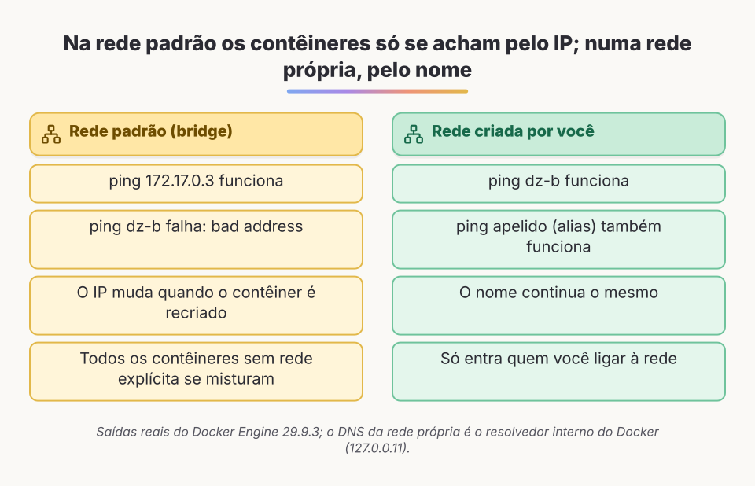
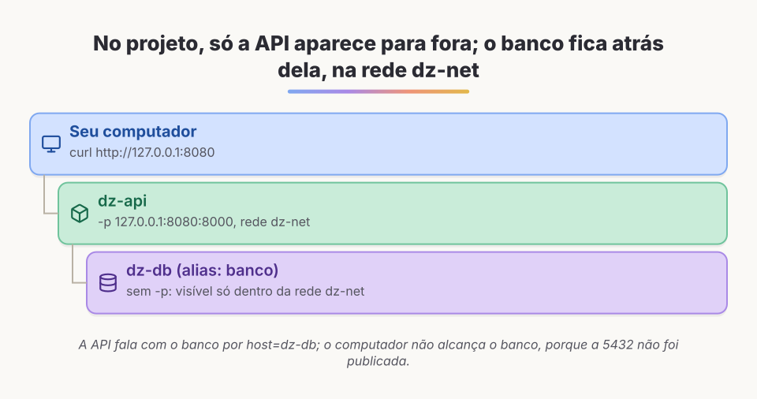

# 10. Redes: contêineres que conversam

> 🗺️ **Neste capítulo:** você descobre por que dois contêineres na rede padrão não se acham pelo nome, cria uma rede própria em que o nome funciona, liga a API ao banco do projeto, publica só a porta que precisa e conhece os drivers `host` e `none` e o `host.docker.internal`. · ⏱️ ~40 min

> 🔥 **Aquecimento:** (1) Qual comando apaga os dados do banco: `docker rm dz-db` ou `docker volume rm dz-dados`? (2) No Dockerfile do capítulo 8, o que a instrução `EXPOSE 8000` faz?
>
> <details>
> <summary>Ver resposta</summary>
>
> (1) O `docker volume rm dz-dados`: o `docker rm` remove só o contêiner, e o volume (a despensa) continua com os dados (capítulo 9). (2) Só documenta a porta em que o programa escuta; ela não é publicada para o seu computador. Quem publica é o `-p` do `docker run` (capítulos 4 e 7).
>
> </details>

## De onde paramos

No capítulo 9 o banco ganhou um lugar para guardar os dados. Falta a **API** falar com ele. Hoje as duas peças são contêineres separados, cada um no seu isolamento (capítulo 1), e a pergunta é: como um contêiner acha o outro?

Os nomes continuam com `dz-`, as portas publicadas ficam em `127.0.0.1`, e as saídas vêm do Docker Engine 29.9.3 com o Docker Desktop 4.99, no Windows 11 (Git Bash). Se usa o Git Bash, rode `export MSYS_NO_PATHCONV=1` antes. Os ids que o `docker run -d` imprime foram omitidos das saídas, para não poluir a página. Os endereços IP que aparecem (172.17.0.3 e parecidos) mudam de máquina para máquina: compare o comportamento, não os números.

## A rede padrão: IP sim, nome não

Todo contêiner que você sobe sem dizer nada sobre rede entra na rede padrão, chamada `bridge`. As três redes que o Docker cria sozinho são:

```bash
# type=builtin lista só as redes que vêm com o Docker
docker network ls --filter type=builtin
```

```text
NETWORK ID     NAME      DRIVER    SCOPE
b024c43be351   bridge    bridge    local
fc1c48b8aded   host      host      local
f28d24895c95   none      null      local
```

Preveja: se você sobe dois contêineres, `dz-a` e `dz-b`, na rede padrão, o `dz-a` consegue fazer `ping` no `dz-b` pelo IP? E pelo nome?

```bash
# dois contêineres na rede padrão (sleep 600 só os mantém vivos)
docker run -d --name dz-a --label dz=livro alpine:3.23 sleep 600
docker run -d --name dz-b --label dz=livro alpine:3.23 sleep 600
# o IP do dz-b, lido na rede chamada bridge
docker inspect dz-b --format '{{.NetworkSettings.Networks.bridge.IPAddress}}'
```

```text
172.17.0.3
```

Agora o teste, de dentro do `dz-a`:

```bash
# pelo IP
docker exec dz-a ping -c 1 -W 2 172.17.0.3
# pelo nome (erro de propósito: a rede padrão não resolve nomes)
docker exec dz-a ping -c 1 -W 2 dz-b
```

```text
PING 172.17.0.3 (172.17.0.3): 56 data bytes
64 bytes from 172.17.0.3: seq=0 ttl=64 time=1.523 ms

--- 172.17.0.3 ping statistics ---
1 packets transmitted, 1 packets received, 0% packet loss
ping: bad address 'dz-b'
```

Pelo IP funciona; pelo nome, `bad address`. **Na rede padrão, os contêineres se alcançam só pelo endereço IP, e esse endereço é dado pelo Docker na hora em que o contêiner nasce.** Programar um endereço desses dentro da API seria frágil: ele muda quando o contêiner é recriado. É a situação que a próxima seção resolve.

> ⚠️ **Erro comum:** achar que, como os dois contêineres estão "no mesmo Docker", eles se enxergam pelo nome. Na rede padrão, não: o nome só funciona numa rede criada por você.

## Rede própria: o Docker vira a lista de nomes

**Uma rede definida pelo usuário (*user-defined bridge*) é uma rede que você cria com `docker network create`; nela, o Docker resolve o nome de cada contêiner para o seu IP.** Além do nome do contêiner, você pode dar apelidos extras (*aliases*) com `--network-alias`.

```bash
# remove os de teste, cria a rede e sobe os dois dentro dela
docker rm -f dz-a dz-b
docker network create --label dz=livro dz-net
docker run -d --name dz-a --label dz=livro --network dz-net \
  alpine:3.23 sleep 600
# --network-alias: um segundo nome para o mesmo contêiner
docker run -d --name dz-b --label dz=livro --network dz-net \
  --network-alias apelido alpine:3.23 sleep 600
docker exec dz-a ping -c 1 -W 2 dz-b
docker exec dz-a ping -c 1 -W 2 apelido
```

```text
46eb486fcb9369af787f5e6004c7c68043e42b08dad07d5491401caa01543e41
PING dz-b (172.20.0.3): 56 data bytes
64 bytes from 172.20.0.3: seq=0 ttl=64 time=1.995 ms
PING apelido (172.20.0.3): 56 data bytes
64 bytes from 172.20.0.3: seq=0 ttl=64 time=0.068 ms
```

(A primeira linha é o id da rede criada.) Os dois nomes, `dz-b` e `apelido`, levam ao mesmo IP, `172.20.0.3`. Quem faz essa tradução é um servidor de nomes (DNS) embutido no Docker. Dá para ver, olhando o `resolv.conf` de um contêiner em cada tipo de rede:

```bash
# na rede própria
docker exec dz-a grep nameserver /etc/resolv.conf
```

```text
nameserver 127.0.0.11
```

O `127.0.0.11` é o resolvedor do Docker dentro do contêiner. Na rede padrão, o contêiner usa o endereço de DNS do host, que não conhece os nomes dos seus contêineres.

> 💡 **Analogia:** a rede própria é uma **agenda de contatos** compartilhada entre as cozinhas (os contêineres). Cada cozinha que entra na agenda é anotada pelo nome, e qualquer outra liga pelo nome sem saber o número do telefone (o IP). Se uma cozinha muda de número porque foi desmontada e remontada, a agenda é atualizada sozinha. Aqui a agenda é a rede, os contatos são os contêineres e o número é o IP. A analogia falha em um ponto: cada rede tem a **sua** agenda, e uma cozinha só vê os nomes das redes em que está.



## Os comandos de rede

| Comando | O que faz |
| --- | --- |
| `docker network create <nome>` | cria uma rede (driver `bridge` por padrão) |
| `docker network ls` | lista as redes |
| `docker network inspect <nome>` | detalhes: sub-rede, contêineres ligados, IPs |
| `docker network connect <rede> <contêiner>` | liga um contêiner que já existe a mais uma rede |
| `docker network disconnect <rede> <contêiner>` | desliga o contêiner dessa rede |
| `docker network rm <nome>` | remove uma rede que ninguém usa |

O `inspect` aceita `--format`, como você viu no capítulo 4:

```bash
# uma linha por contêiner ligado à rede
docker network inspect dz-net \
  --format '{{range .Containers}}{{.Name}} {{.IPv4Address}}{{"\n"}}{{end}}'
```

```text
dz-b 172.20.0.3/16
dz-a 172.20.0.2/16
```

Um contêiner pode estar em **mais de uma rede** ao mesmo tempo, com um IP em cada. O `connect` serve para isso:

```bash
# cria outra rede e liga a ela o dz-a, que já está na dz-net
docker network create --label dz=livro dz-rede2
docker network connect dz-rede2 dz-a
# o modelo do --format, guardado numa variável para caber na linha
F='{{range $n,$c := .NetworkSettings.Networks}}'
F="$F"'{{$n}} {{$c.IPAddress}}{{"\n"}}{{end}}'
docker inspect dz-a --format "$F"
```

```text
e4f0ea028cc2943945e5165c2047fb848a8b483c363631cceb2f74d1a8dcb6cb
dz-net 172.20.0.2
dz-rede2 172.21.0.2
```

Para desfazer, e ver a proteção do Docker contra remover uma rede em uso:

```bash
docker network disconnect dz-rede2 dz-a
docker network rm dz-rede2
# erro de propósito: a dz-net ainda tem contêineres ligados
docker network rm dz-net
```

```text
dz-rede2
Error response from daemon: error while removing network: network dz-net has active endpoints (name:"dz-b" id:"ab3c1188a99b", name:"dz-a" id:"1e8eb99247d8")
exit status 1
```

Para remover a rede, remova antes os contêineres (`docker rm -f dz-a dz-b`).

> ⚠️ **Cuidado com o `docker network prune`:** como os outros `prune`, ele apaga todas as redes sem uso, e não só as suas. Neste livro, remova redes pelo nome.

## Ligando a API ao banco

Agora o projeto. Monte a mesma estrutura que a aplicação terá no capítulo 12: o banco numa rede, a API na mesma, e só a API visível para fora. O banco é o do capítulo 9, com o volume `dz-dados`, e a API é a imagem `dz-api:1.0` do capítulo 8, que já traz o `psycopg`.

```bash
# remove os de teste e recria a rede, o volume e o banco
docker rm -f dz-a dz-b
docker network rm dz-net
docker network create --label dz=livro dz-net
docker volume create --label dz=livro dz-dados
# o banco: na dz-net, com o alias "banco" e SEM -p
docker run -d --name dz-db --label dz=livro --network dz-net \
  --network-alias banco \
  -e POSTGRES_PASSWORD=senha-de-teste -e POSTGRES_DB=tarefas \
  -v dz-dados:/var/lib/postgresql postgres:18
# a API: na mesma rede, com a porta publicada só para você
docker run -d --name dz-api --label dz=livro --network dz-net \
  -p 127.0.0.1:8080:8000 dz-api:1.0
```

A API ainda não usa o banco (isso é do capítulo 12), então vamos testar a conexão com um pequeno script que usa o mesmo `psycopg` da imagem. Salve como `verifica.py` na pasta `~/api-livro`:

**verifica.py**

```python
import sys

import psycopg

# o endereço do banco vem da linha de comando: o que muda é só o nome
host = sys.argv[1]
try:
    with psycopg.connect(host=host, user="postgres",
                         password="senha-de-teste", dbname="tarefas",
                         connect_timeout=3) as conexao:
        versao = conexao.execute("select version()").fetchone()[0]
        print(host, "->", versao[:23])
except psycopg.OperationalError as erro:
    print(host, "-> erro:", str(erro).strip().splitlines()[0][:110])
```

Rode o script **dentro** do contêiner da API, usando o nome do banco, depois o alias, e por fim o erro clássico, o `localhost`:

```bash
# o "-" manda o Python ler o script da entrada; < envia o arquivo
docker exec -i dz-api python - dz-db < verifica.py
docker exec -i dz-api python - banco < verifica.py
# erro de propósito: localhost, dentro do contêiner, é o próprio contêiner
docker exec -i dz-api python - localhost < verifica.py
```

```text
dz-db -> PostgreSQL 18.7 (Debian
banco -> PostgreSQL 18.7 (Debian
localhost -> erro: connection failed: connection to server at "127.0.0.1", port 5432 failed: Connection refused
```

(O banco precisa de alguns segundos depois de criado: se der `Connection refused` nos dois primeiros, espere e repita.) A API achou o banco pelo nome `dz-db` e pelo alias `banco`. Já o `localhost` falhou: dentro do contêiner da API, `localhost` é **a própria API**, e nela não há banco algum na porta 5432.

> ⚠️ **Erro comum:** escrever `localhost` (ou `127.0.0.1`) como endereço do banco na configuração da API porque "funcionava no meu computador". Dentro de um contêiner, o endereço do outro contêiner é o **nome** dele na rede.

A prova de que o nome sobrevive à troca de IP, que é o motivo de tudo isto: recrie o banco depois de ocupar o endereço dele com outro contêiner.

```bash
docker inspect dz-db \
  --format '{{(index .NetworkSettings.Networks "dz-net").IPAddress}}'
docker rm -f dz-db
# um contêiner qualquer ocupa o endereço que o banco tinha
docker run -d --name dz-x --label dz=livro --network dz-net \
  alpine:3.23 sleep 600
docker run -d --name dz-db --label dz=livro --network dz-net \
  --network-alias banco \
  -e POSTGRES_PASSWORD=senha-de-teste -e POSTGRES_DB=tarefas \
  -v dz-dados:/var/lib/postgresql postgres:18
docker inspect dz-db \
  --format '{{(index .NetworkSettings.Networks "dz-net").IPAddress}}'
# depois que o banco subir (alguns segundos), o mesmo nome funciona
docker exec -i dz-api python - dz-db < verifica.py
docker rm -f dz-x
```

```text
172.20.0.2
dz-db
172.20.0.4
dz-db -> PostgreSQL 18.7 (Debian
dz-x
```

O IP do banco passou de `172.20.0.2` para `172.20.0.4`, e a API continuou achando o banco pelo mesmo nome, sem nenhuma mudança. É por isso que, no capítulo 12, a API vai usar `dz-db` (ou `banco`) e nunca um IP.



## Publicar só o que precisa ser acessado de fora

Repare no `docker run` da API e do banco: só a API tem `-p`. O que isso significa na prática? Veja a coluna `PORTS`:

```bash
# --format com table mostra só o que interessa
docker ps --filter name=dz- \
  --format 'table {{.Names}}\t{{.Ports}}\t{{.Networks}}'
curl -s http://127.0.0.1:8080/saude
```

```text
NAMES     PORTS                      NETWORKS
dz-api    127.0.0.1:8080->8000/tcp   dz-net
dz-db     5432/tcp                   dz-net
{"status": "ok", "versao": "1.0"}
```

O `dz-db` aparece com `5432/tcp` **sem seta**: a porta existe dentro da rede, mas **não foi publicada** para o seu computador. Só os contêineres da `dz-net` chegam nela. A API, com a seta `127.0.0.1:8080->8000`, responde a você (e só a você, por causa do `127.0.0.1`).

**Publicar uma porta (`-p`) é abrir uma entrada entre o seu computador e o contêiner; entre contêineres da mesma rede não é preciso publicar nada.** O banco não precisa de `-p` para a API alcançá-lo, e quanto menos portas publicadas, menor a superfície de ataque. Só publique o banco se você mesmo for conectar a ele de fora, para depurar, e então com `127.0.0.1`, numa porta que você tenha conferido que está livre (por exemplo, `-p 127.0.0.1:5440:5432`), nunca numa porta aberta para a rede inteira.

> ⚠️ **Erro comum:** publicar a porta do banco "só para facilitar" e deixá-la assim. Com `-p 5432:5432` (sem o `127.0.0.1`), o banco fica acessível para outros aparelhos da sua rede, e o `-p` do Docker costuma passar por cima do firewall do sistema (capítulo 3). Além disso, se a 5432 já estiver ocupada por outro programa seu, o `docker run` falha com "port is already allocated" ou parecido.

## Os drivers host e none

Cada rede tem um **driver** (*driver*), que define como ela funciona. Os dois que aparecem na lista padrão, além do `bridge`, são casos especiais:

| Driver | O que faz | Quando usar |
| --- | --- | --- |
| `bridge` | rede virtual privada, com NAT para fora; é o padrão | quase sempre |
| `none` | só a interface de loopback: o contêiner fica sem rede | processamento isolado, sem acesso a nada |
| `host` | o contêiner usa a rede do host, sem isolamento de rede | desempenho de rede ou muitas portas; o `-p` perde o sentido |

Para ver a diferença, liste as interfaces de rede que o contêiner enxerga em cada caso:

```bash
# o awk deixa só o nome da interface, a família e o endereço
for n in none host bridge; do
  echo "== $n"
  docker run --rm --network $n alpine:3.23 sh -c \
    "ip -o addr | awk '{print \$2, \$3, \$4}'"
done
```

```text
== none
lo inet 127.0.0.1/8
lo inet6 ::1/128
== host
lo inet 127.0.0.1/8
lo inet6 ::1/128
services1 inet 192.168.65.6/32
services1 inet6 fdc4:f303:9324::6/128
services1 inet6 fe80::9430:1fff:fe31:1da/64
eth0 inet 192.168.65.3/24
(...)
== bridge
lo inet 127.0.0.1/8
lo inet6 ::1/128
eth0 inet 172.17.0.2/16
```

Com `none`, só o `lo` (o loopback): o contêiner não tem como falar com ninguém. Com `bridge`, ele ganha um `eth0` com um IP da rede do Docker. Com `host`, ele vê **as interfaces do próprio host**; no Docker Desktop, "host" é a máquina virtual do Docker (a lista `(...)` foi cortada), não o Windows ou o Mac.

Por isso o driver `host` merece cuidado. Num Linux com Docker Engine, ele realmente compartilha a rede do computador, e uma porta aberta pelo contêiner fica aberta no computador, sem `-p`. No Docker Desktop, a documentação diz que ele exige ativar o recurso em **Settings** (disponível desde a versão 4.34), e não o ativamos neste livro. Use `bridge` com `-p` e uma rede própria; só recorra ao `host` quando souber por quê.

## Do contêiner para o seu computador: host.docker.internal

Até agora o contêiner falou com outro contêiner. E se a API precisar falar com algo que roda **no seu computador**, fora do Docker (um servidor de desenvolvimento, um banco instalado nele)? Aqui, `localhost` também não serve: ele é o contêiner. O Docker Desktop oferece um nome especial, **`host.docker.internal`**, que aponta para o seu computador.

Vamos provar. Suba um servidor simples **no seu computador** (não num contêiner), só em `127.0.0.1`, e acesse de dentro de um contêiner:

```bash
# um servidor no host, na porta 8765, só em 127.0.0.1
mkdir -p ~/dz-hostsrv && cd ~/dz-hostsrv
echo "vim do host" > index.html
python -m http.server 8765 --bind 127.0.0.1 &
# o contêiner consulta o nome e baixa a página
docker run --rm alpine:3.23 sh -c \
  'getent hosts host.docker.internal; wget -q -T 3 -O- http://host.docker.internal:8765/'
```

```text
192.168.65.254    host.docker.internal  host.docker.internal
vim do host
```

No Docker Desktop, o nome já existe sem você fazer nada, e a página do computador chegou. Num **Linux com Docker Engine** o nome não vem pronto: você o cria com `--add-host=host.docker.internal:host-gateway`, como a documentação do `docker run` descreve (a opção também funcionou no Docker Desktop desta máquina, e devolveu o endereço IPv6 do host). Não rodamos este caso num Engine de Linux puro; confira a documentação se for o seu.

Encerre o servidor do computador quando terminar (`kill %1`, e depois `rm -rf ~/dz-hostsrv`).

> ⚠️ **Erro comum:** usar o IP do computador (como `192.168.0.10`) na configuração da API. Ele muda de rede para rede e de dia para dia. O `host.docker.internal` é estável no Desktop. E nem sempre é boa ideia: para falar com outro serviço seu, a regra do livro é pôr os dois no Docker e na mesma rede.

## 🧪 Laboratório: a API acha o banco pelo nome

**Objetivo:** subir o banco e a API na mesma rede, provar que a API acha o banco pelo nome e que o banco não está publicado.

1. Crie a rede e o volume: `docker network create --label dz=livro dz-net` e `docker volume create --label dz=livro dz-dados`.
2. Suba o `dz-db` (sem `-p`) e o `dz-api` (com `-p 127.0.0.1:8080:8000`), como na seção "Ligando a API ao banco". Se a 8080 estiver ocupada, troque o número da esquerda (por exemplo, `8090`).
3. Rode `docker ps --filter name=dz-`. Esperado: o `dz-api` com `127.0.0.1:8080->8000/tcp`; o `dz-db` só com `5432/tcp`.
4. Rode o `verifica.py` com `dz-db`, com `banco` e com `localhost`. Esperado: as duas primeiras linhas com `PostgreSQL 18.7`, a terceira com `Connection refused`.
5. Confirme o contrato de nomes: `docker exec dz-api python -c "import socket; print(socket.gethostbyname('dz-db'))"`. Esperado: um IP `172.x.x.x` da `dz-net`.
6. Limpe só o que é seu:

   ```bash
   docker rm -f dz-api dz-db
   docker network rm dz-net
   docker volume rm dz-dados
   ```

**Esperado no final:** `docker ps -a --filter name=dz-` vazio, `docker network ls --filter name=dz-` sem nenhuma rede e `docker volume ls --filter label=dz=livro` vazio. A imagem `dz-api:1.0` fica para os próximos capítulos.

> 💡 O capítulo 10 foi executado por inteiro no Docker Engine 29.9.3 (Docker Desktop 4.99, Windows 11, Git Bash). O caso `--add-host` em um Docker Engine de Linux puro não foi executado aqui.

## 🏋️ Pratique

**1. Resolvido: por que falhou?** Um colega sobe o banco e a API com `docker run`, cada um sem `--network`, e a API configura `host=dz-db`. A API falha com `failed to resolve host 'dz-db': [Errno -2] Name or service not known`. Qual é a causa e a correção mínima?

<details>
<summary>Ver resposta</summary>

Os dois estão na rede padrão (`bridge`), que não resolve nomes de contêineres. A correção mínima: criar uma rede (`docker network create dz-net`) e subir os dois com `--network dz-net`. Para um contêiner que já existe, `docker network connect dz-net <nome>` o liga à rede sem recriá-lo. Erro comum: tentar resolver pondo o IP na configuração, o que quebra na próxima vez que o contêiner for recriado.

</details>

**2. Complete:** preencha as lacunas para o banco ficar na `dz-net`, ganhar o apelido `banco` e **não** ser publicado.

```bash
docker run -d --name dz-db --label dz=livro \
  --____ dz-net --network-____ banco \
  -e POSTGRES_PASSWORD=senha-de-teste \
  -v dz-dados:/var/lib/postgresql postgres:18
```

<details>
<summary>Ver resposta</summary>

As lacunas são `network` (`--network dz-net`) e `alias` (`--network-alias banco`). Não há `-p`: a API alcança o banco pela rede, e o computador não precisa dele. Erro comum: usar `--name banco` achando que isso cria um apelido; o `--name` troca o nome do contêiner, e o apelido é o `--network-alias`.

</details>

**3. Por conta própria:** suba um contêiner `dz-teste` (`alpine:3.23`, `sleep 600`) na `dz-net` e, de dentro dele, confirme que o nome `dz-db` resolve para um IP (use `nslookup` ou `getent hosts`). Depois ligue o `dz-teste` a uma segunda rede, `dz-rede2`, e liste as redes dele com `docker inspect`. Em que redes ele resolve o nome `dz-db`?

<details>
<summary>Ver resposta</summary>

`docker exec dz-teste getent hosts dz-db` devolve o IP da `dz-net`. Depois do `docker network connect dz-rede2 dz-teste`, o `inspect` lista as duas redes, cada uma com seu IP. O nome `dz-db` resolve **apenas** pela `dz-net`, porque o `dz-db` só está nela: cada rede tem a sua "agenda", e o nome só aparece onde o outro contêiner está. Limpe com `docker rm -f dz-teste`, `docker network rm dz-rede2`.

</details>

**4. Desafio:** a API precisa falar com um serviço que roda **no seu computador**, em `127.0.0.1:9100`, fora do Docker. Que nome você põe na configuração da API, e por que `localhost` e o IP do computador são más escolhas?

<details>
<summary>Ver resposta</summary>

No Docker Desktop, `host.docker.internal:9100`. Num Linux com Engine, o mesmo nome depois de `--add-host=host.docker.internal:host-gateway` no `docker run`. O `localhost` é o próprio contêiner, e o IP do computador muda de rede para rede. Observe que o serviço precisa aceitar a conexão vinda do Docker: nos testes do capítulo, o servidor ligado só a `127.0.0.1` foi alcançado no Docker Desktop, mas no Linux o contêiner chega pelo endereço da ponte do Docker, e um serviço preso a `127.0.0.1` pode recusar a conexão (isso não foi testado aqui, então confira no seu sistema).

</details>

## 🧠 Revisão rápida

**1.** Por que dois contêineres na rede `bridge` padrão não se acham pelo nome?

<details>
<summary>Ver resposta</summary>

A rede padrão não tem a resolução de nomes. Só as redes criadas por você (`docker network create`) trazem o DNS do Docker, que traduz o nome do contêiner para o IP.

</details>

**2.** O que `localhost` significa dentro de um contêiner?

<details>
<summary>Ver resposta</summary>

O próprio contêiner. Para falar com outro contêiner, use o nome dele na rede; para falar com o seu computador, no Docker Desktop, `host.docker.internal`.

</details>

**3.** O banco precisa de `-p` para a API conversar com ele?

<details>
<summary>Ver resposta</summary>

Não. Contêineres na mesma rede se alcançam sem publicar nada. O `-p` só abre uma entrada entre o seu computador e o contêiner.

</details>

**4.** (Capítulo 9) Onde o volume do PostgreSQL 18 deve ser montado?

<details>
<summary>Ver resposta</summary>

Em `/var/lib/postgresql`; os dados ficam em `/var/lib/postgresql/18/docker`.

</details>

**5.** (Capítulo 3) Por que o `-p` sem `127.0.0.1` é um risco?

<details>
<summary>Ver resposta</summary>

Porque publica a porta em todas as interfaces do computador, e as regras do Docker costumam passar por cima do firewall do sistema; outros aparelhos da rede passam a alcançar o serviço.

</details>

## 🤖 Estude com um tutor de IA

1. "Faça 5 perguntas, uma por vez, sobre redes no Docker (bridge padrão, rede própria, DNS por nome e publicação de portas). Espere a minha resposta antes de dar o retorno e não me dê as respostas antes."
2. "Aqui está a configuração de rede de dois contêineres meus (comandos `docker run`): <meus comandos>. Diga se um acha o outro pelo nome e quais portas estão expostas ao meu computador, sem reescrever os comandos por mim."

> ➡️ **Próximo passo:** no capítulo 11 você sai do seu computador: dá a versão certa à imagem da API, entra no registro com um token (nunca com a senha) e publica a imagem para outras pessoas usarem.

## 📌 Resumo

| Item | Em uma frase |
| --- | --- |
| Rede padrão (`bridge`) | os contêineres se alcançam só pelo IP, que muda; sem resolução de nomes |
| Rede própria | criada com `docker network create`; o DNS do Docker resolve nome e `--network-alias` |
| `localhost` | dentro do contêiner é ele mesmo; use o nome do outro contêiner |
| `network connect/disconnect/inspect/rm` | ligam, desligam, detalham e removem; um contêiner pode estar em várias redes |
| Publicar portas | só o que precisa ser acessado de fora; o banco fica sem `-p` |
| `none` | só o loopback: contêiner sem rede |
| `host` | usa a rede do host; no Desktop exige ativar o recurso e é a rede da VM |
| `host.docker.internal` | nome do seu computador visto do contêiner (pronto no Desktop; no Linux, `--add-host ...:host-gateway`) |

## 📚 Fontes

- Visão geral de redes: https://docs.docker.com/engine/network/ (conferido em 26/11/2026)
- Drivers de rede, host: https://docs.docker.com/engine/network/drivers/host/ (conferido em 26/11/2026)
- Docker Desktop, conectar a um serviço do host: https://docs.docker.com/desktop/features/networking/networking-how-tos/ (conferido em 26/11/2026)
- `docker run --add-host`: https://docs.docker.com/reference/cli/docker/container/run/ (conferido em 26/11/2026)
- Execução e saída real: Docker Engine 29.9.3 com Docker Desktop 4.99.0, Windows 11, Git Bash, em 26/11/2026.

> 🔁 **Revise hoje:** capítulos 3, 7 e 9
