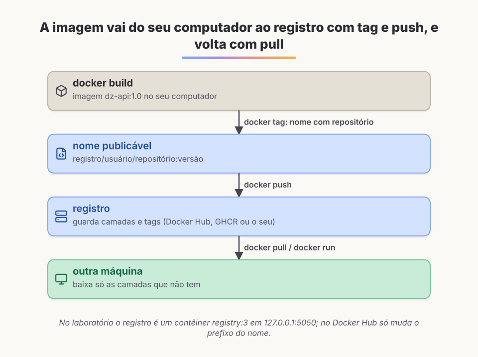

# 11. Publicar a imagem

> 🗺️ **Neste capítulo:** você entende o que é um registro, dá à imagem da API um nome publicável com versão (`docker tag`), envia (`docker push`) e baixa de volta (`docker pull`) num registro de verdade rodando no seu computador, vê como entrar no Docker Hub com um token, e confere que nenhum segredo vai dentro da imagem. · ⏱️ ~45 min

> 🔥 **Aquecimento:** (1) Por que um contêiner na rede padrão não acha outro pelo nome? (2) O que significa a publicação `-p 127.0.0.1:8080:8000` do projeto?
>
> <details>
> <summary>Ver resposta</summary>
>
> (1) A rede `bridge` padrão não traz a resolução de nomes; só as redes criadas com `docker network create` têm o DNS do Docker (capítulo 10). (2) A porta 8000 do contêiner fica acessível como 8080 do seu computador, só para você, por causa do `127.0.0.1` (capítulos 1 e 4).
>
> </details>

## De onde paramos

No capítulo 10 a API achou o banco pelo nome. Até aqui, porém, a imagem `dz-api:1.0` só existe **no seu computador**. Para outra pessoa (ou outro servidor) usar a sua API, a imagem precisa estar num lugar que os dois alcancem.

Este capítulo tem uma particularidade: **você não vai publicar nada num serviço público**. Fazer isso exige uma conta sua e um token seu, e seus dados de acesso nunca devem passar por este livro, nem por mim, nem por uma conversa com uma IA. Então o laboratório usa um **registro próprio, rodando num contêiner do seu computador**. É o mesmo funcionamento: o que muda do laboratório para o Docker Hub é apenas o prefixo do nome e o `docker login`. Esse login, e tudo o que depende de uma conta real, aparece aqui como passo a passo marcado "não executado".

Os nomes seguem com `dz-`, as portas ficam em `127.0.0.1`, e as saídas vêm do Docker Engine 29.9.3 com o Docker Desktop 4.99, no Windows 11 (Git Bash). Se usa o Git Bash, rode `export MSYS_NO_PATHCONV=1` antes. Os ids que o `docker run -d` imprime foram omitidos de algumas saídas.

## O que é um registro

Você já usou um registro sem perceber: toda vez que um `docker pull` ou `docker run` baixou o `python:3.14-slim`, ele veio do Docker Hub (capítulo 6).

**Um registro (*registry*) é um servidor que guarda imagens, organizadas em repositórios, e as entrega a quem pedir.** Um **repositório** reúne as versões (tags) de uma mesma imagem, por exemplo todas as versões do `python`.

| Registro | Endereço | Observação |
| --- | --- | --- |
| Docker Hub | `docker.io` (é o padrão, não precisa escrever) | o mais usado; imagens públicas e privadas |
| GitHub Container Registry (GHCR) | `ghcr.io` | ligado à sua conta do GitHub |
| O seu próprio | qualquer endereço | o laboratório usa um em `127.0.0.1:5050` |

> 💡 **Analogia:** a imagem é a **receita** (capítulo 1), e o registro é a **biblioteca de receitas** onde ela fica catalogada. Quem quer cozinhar o mesmo prato pede a receita à biblioteca; quem escreveu uma receita nova a deposita lá. Aqui a biblioteca é o registro, cada prateleira é um repositório e a edição de cada receita é a tag. A analogia falha em um ponto: depositar uma receita não apaga a sua cópia; o `push` envia uma cópia das camadas, e a imagem continua no seu computador.



## Dar um nome publicável: docker tag

Uma imagem só pode ser enviada para um repositório se o nome dela disser **qual**. O `dz-api:1.0` não diz: ele não tem registro nem usuário. Lembre do nome completo (capítulo 6): `registro/namespace/repositório:tag`. O `docker tag` cria esse nome novo para a mesma imagem, sem copiar nada.

No laboratório, o registro é o do seu computador, `127.0.0.1:5050`, e o namespace é `dz`. No Docker Hub, seria `docker.io/SEU_USUARIO/tarefas-api`; como o `docker.io` é o padrão, escreve-se `SEU_USUARIO/tarefas-api:1.0.0`.

Primeiro, suba o registro. A imagem oficial é a `registry:3`:

```bash
# o registro é só um contêiner; 5050 porque a 5000 pode estar ocupada
docker run -d --name dz-registro --label dz=livro \
  -p 127.0.0.1:5050:5000 registry:3
# a API do registro responde {} quando está de pé, e o catálogo está vazio
curl -s http://127.0.0.1:5050/v2/
curl -s http://127.0.0.1:5050/v2/_catalog
```

```text
f18f74e70ef4a8c9f1442e74489a04d95cfdb0cab9df3e26c3ef474615e70657
{}
{"repositories":[]}
```

Antes de continuar, confirme que a porta 5050 estava livre na sua máquina (se o `docker run` falhar com "port is already allocated" ou "address already in use", troque o número da esquerda por outro, como `5051`). Agora dê os nomes à imagem do capítulo 8 (se você a removeu, reconstrua com `docker build -t dz-api:1.0 .` em `~/api-livro`):

```bash
# a versão exata, a "menor" e a mais recente, apontando para a mesma imagem
docker tag dz-api:1.0 127.0.0.1:5050/dz/tarefas-api:1.0.0
docker tag dz-api:1.0 127.0.0.1:5050/dz/tarefas-api:1.0
docker tag dz-api:1.0 127.0.0.1:5050/dz/tarefas-api:latest
docker image ls 127.0.0.1:5050/dz/tarefas-api
```

```text
IMAGE                                  ID             DISK USAGE   CONTENT SIZE   EXTRA
127.0.0.1:5050/dz/tarefas-api:1.0      a1213192f355        197MB           48MB        
127.0.0.1:5050/dz/tarefas-api:1.0.0    a1213192f355        197MB           48MB        
127.0.0.1:5050/dz/tarefas-api:latest   a1213192f355        197MB           48MB        
```

Os três nomes têm o **mesmo ID**: é a mesma imagem com três etiquetas. A coluna `CONTENT SIZE` (48 MB) é o que de fato trafega no `push`, porque as camadas vão comprimidas; os 197 MB são o tamanho descompactado.

## Enviar: docker push

**O `docker push` envia as camadas da imagem para o registro, e só as que ele ainda não tem.**

```bash
# envia uma tag; as camadas são enviadas na primeira vez
docker push 127.0.0.1:5050/dz/tarefas-api:1.0.0
```

```text
4289ee8df414: Pushed
e1c0c3a7801c: Pushed
7fa55ee3d256: Pushed
4dea4c8fa55e: Pushed
ea48f611d7fd: Pushed
d8ff2d157126: Pushed
40748add9f4f: Pushed
1.0.0: digest: sha256:a1213192f355acb9c0478f3deebfaba7b7b4a8865e93fa4db639e6297835f1fc size: 856
```

(Mostrei só o final da saída.) Cada linha é uma camada, e a última mostra o **digest** (capítulo 6): a identidade imutável do conteúdo. Agora a segunda tag:

```bash
docker push 127.0.0.1:5050/dz/tarefas-api:1.0
```

```text
e1c0c3a7801c: Layer already exists
d8ff2d157126: Layer already exists
4289ee8df414: Layer already exists
1.0: digest: sha256:a1213192f355acb9c0478f3deebfaba7b7b4a8865e93fa4db639e6297835f1fc size: 856
```

`Layer already exists`: o registro já tinha as camadas, e só a tag nova foi registrada. O **digest é o mesmo** da `1.0.0`: as duas tags apontam para o mesmo conteúdo. Envie também a `latest` e pergunte ao registro o que ele tem:

```bash
docker push -q 127.0.0.1:5050/dz/tarefas-api:latest
curl -s http://127.0.0.1:5050/v2/_catalog
curl -s http://127.0.0.1:5050/v2/dz/tarefas-api/tags/list
```

```text
127.0.0.1:5050/dz/tarefas-api:latest
{"repositories":["dz/tarefas-api"]}
{"name":"dz/tarefas-api","tags":["1.0","1.0.0","latest"]}
```

O registro tem um repositório, `dz/tarefas-api`, com as três tags. (O `-q` do `push` mostra só o nome da imagem enviada.)

> ⚠️ **Erro comum:** fazer o `push` com o nome `dz-api:1.0` e se surpreender que o Docker tente enviar para o Docker Hub, para um repositório `library/dz-api` que não é seu. Sem prefixo de registro, o Docker supõe o Docker Hub. Dê o nome completo com o `docker tag` antes do `push`.

## Rodar em outra máquina

A prova de que a publicação funcionou é rodar a imagem **sem** tê-la localmente. Para simular outra máquina, remova todos os nomes locais e baixe do registro:

```bash
# remove todas as etiquetas, inclusive o dz-api:1.0 original
docker rmi 127.0.0.1:5050/dz/tarefas-api:1.0.0 \
  127.0.0.1:5050/dz/tarefas-api:1.0 \
  127.0.0.1:5050/dz/tarefas-api:latest dz-api:1.0
# a imagem não existe mais aqui; o run baixa do registro
docker run -d --name dz-api --label dz=livro -p 127.0.0.1:8080:8000 \
  127.0.0.1:5050/dz/tarefas-api:1.0.0
curl -s http://127.0.0.1:8080/saude
```

```text
Untagged: 127.0.0.1:5050/dz/tarefas-api:1.0.0
Untagged: 127.0.0.1:5050/dz/tarefas-api:1.0
Untagged: 127.0.0.1:5050/dz/tarefas-api:latest
Untagged: dz-api:1.0
Deleted: sha256:a1213192f355acb9c0478f3deebfaba7b7b4a8865e93fa4db639e6297835f1fc
{"status": "ok", "versao": "1.0"}
```

O `docker run` baixou do registro (as linhas do download não aparecem acima, porque saem durante a execução) e a API respondeu `versao: 1.0`. Confira que o que veio é exatamente o que você enviou, pelo digest:

```bash
docker inspect 127.0.0.1:5050/dz/tarefas-api:1.0.0 \
  --format '{{index .RepoDigests 0}}'
docker rm -f dz-api
```

```text
127.0.0.1:5050/dz/tarefas-api@sha256:a1213192f355acb9c0478f3deebfaba7b7b4a8865e93fa4db639e6297835f1fc
dz-api
```

O digest é o mesmo do `push`. Em produção, fixar o digest (`imagem@sha256:...`) garante que ninguém troque a imagem por baixo de você.

## Tags de versão e por que não só latest

Você deu três tags à mesma imagem. Cada uma tem um papel:

| Tag | Muda? | Para que serve |
| --- | --- | --- |
| `1.0.0` | nunca (a cada correção, vira `1.0.1`) | quem precisa de reprodutibilidade exata |
| `1.0` | acompanha as correções da 1.0 | quem aceita correções, mas não mudanças maiores |
| `latest` | sempre aponta para a mais nova que você quis marcar | só para testes e exemplos rápidos |

Isso é o **versionamento semântico** (*semver*): `MAIOR.MENOR.CORREÇÃO`. A `latest` é uma tag como as outras, que **você** move. Ela não significa "a mais nova" nem "a mais estável". Por isso, em qualquer coisa que rode fora do seu computador, use uma versão fixa.

> ⚠️ **Erro comum:** usar `latest` num servidor e descobrir, semanas depois, que um `docker pull` trouxe uma versão diferente da que estava testada. Publique sempre a versão exata (`1.0.0`) e, se quiser, também `1.0` e `latest`.

## Entrar no Docker Hub: login com token (não executado)

O registro do laboratório não pede senha. O Docker Hub e o GHCR pedem. Estes passos dependem de uma conta sua e **não foram executados** neste livro; siga a documentação do seu serviço para os detalhes de cada tela.

**O que você precisa antes do primeiro `push`:**

1. Uma conta no Docker Hub (https://hub.docker.com), e o seu **nome de usuário** (é o namespace do repositório).
2. Um **token de acesso pessoal** (*personal access token*, PAT) criado nas configurações da conta. Um token autentica no Docker Hub no lugar da senha, e você pode desativá-lo ou apagá-lo a qualquer momento sem trocar a senha da conta. Dê a ele o menor poder que o trabalho exige (para publicar, leitura e escrita) e, se a tela oferecer, uma data de expiração.
3. Criar o repositório pelo site do Docker Hub, escolhendo se ele é público ou privado, antes do primeiro `push`.

**O login:**

```bash
# NUNCA use a senha da conta: use o token, lido de uma variável
# --password-stdin evita que o token fique no histórico do shell
echo "$DOCKER_TOKEN" | docker login -u SEU_USUARIO --password-stdin
```

O `$DOCKER_TOKEN` é uma variável que **você** cria no seu terminal, sem escrever o token num arquivo versionado. Em um login interativo (`docker login` sem opções), a documentação atual do Docker diz que o comando abre um fluxo pelo navegador (um código que você confirma numa página do Docker); o `--password-stdin` serve para o login sem interação, como em automações.

**Onde a credencial fica guardada:** com o Docker Desktop, no cofre do sistema (por exemplo, o Gerenciador de Credenciais do Windows). Sem o Desktop, e sem um *credential store* configurado, o Docker guarda no arquivo `~/.docker/config.json` (`%USERPROFILE%\.docker\config.json` no Windows) em **base64**, que é apenas uma codificação, não uma proteção. Por isso, em servidores, configure um *credential store*.

**Enviar:**

```bash
# depois do login: nome com o seu usuário, e push
docker tag dz-api:1.0 SEU_USUARIO/tarefas-api:1.0.0
docker push SEU_USUARIO/tarefas-api:1.0.0
```

**Sair:** `docker logout` apaga a credencial guardada. Faça-o em computadores que não são só seus, e ao terminar o trabalho num servidor.

> ⚠️ **Erro comum:** usar a senha da conta no `docker login` (ou, pior, escrever a senha no comando). Se ela vazar, o atacante controla a conta inteira. Um token vazado se revoga em segundos, sem trocar a senha. E nunca cole um token numa conversa, num commit ou numa mensagem de erro.

### GHCR em resumo (não executado)

O **GitHub Container Registry** funciona igual, com o endereço `ghcr.io`: o nome fica `ghcr.io/SEU_USUARIO/tarefas-api:1.0.0`. A documentação do GitHub diz que o GitHub Packages só aceita autenticar com um *personal access token (classic)*, com os escopos `write:packages` (publicar) e `read:packages` (baixar), e o login é `docker login ghcr.io -u SEU_USUARIO --password-stdin`, de novo com o token numa variável. A vantagem é a imagem morar junto do código no GitHub.

## Nunca publique um segredo

Uma imagem publicada pode ser baixada por outras pessoas (se o repositório for público) e examinada: cada camada, cada variável, cada arquivo. **Senhas, tokens e chaves nunca entram numa imagem**, nem como `ENV`, `ARG`, nem num arquivo copiado. Veja o que acontece quando alguém erra (erro de propósito):

```bash
# pasta de teste com um .env falso
mkdir -p ~/dz-segredo && cd ~/dz-segredo
printf 'DB_SENHA=senha-de-teste\n' > .env
cat > Dockerfile <<'EOF'
FROM alpine:3.23
# erro de propósito: o segredo entra de dois jeitos
ENV DB_SENHA=senha-de-teste
COPY .env /app/.env
CMD ["sleep", "600"]
EOF
docker build -q -t dz-ruim:1 --label dz=livro .
# quem tiver a imagem lê o segredo sem rodar nada
docker history --no-trunc dz-ruim:1 \
  --format '{{.CreatedBy}}' | grep -i "senha\|\.env"
docker inspect dz-ruim:1 --format '{{json .Config.Env}}'
docker run --rm dz-ruim:1 cat /app/.env
```

```text
sha256:aa4def4b163e9800dbe9c95b6f0c9e37b447fb063c8f04620125b4f3f450456a
COPY .env /app/.env # buildkit
ENV DB_SENHA=senha-de-teste
["PATH=/usr/local/sbin:/usr/local/bin:/usr/sbin:/usr/bin:/sbin:/bin","DB_SENHA=senha-de-teste"]
DB_SENHA=senha-de-teste
```

O segredo aparece **três vezes**: no histórico da imagem (`docker history`), nas variáveis (`docker inspect`) e no arquivo copiado. Apagar o arquivo numa instrução seguinte não adianta, porque a camada do `COPY` continua na imagem (capítulo 8).

A forma certa tem duas partes: o `.env` entra no `.dockerignore`, e o segredo chega **na hora de rodar**, por `-e` (ou, no livro seguinte, pelo Compose):

```bash
printf '.env\n' > .dockerignore
printf 'FROM alpine:3.23\nCMD ["sleep", "600"]\n' > Dockerfile
docker build -q -t dz-bom:1 --label dz=livro . > /dev/null
# quantas linhas do histórico citam o segredo ou o .env: nenhuma
docker history --no-trunc dz-bom:1 \
  --format '{{.CreatedBy}}' | grep -ci "senha\|\.env"
# o segredo entra só no contêiner, na execução
docker run --rm -e DB_SENHA=senha-de-teste dz-bom:1 \
  sh -c 'echo "DB_SENHA tem ${#DB_SENHA} caracteres"; ls /app'
```

```text
0
DB_SENHA tem 14 caracteres
ls: /app: No such file or directory
```

A imagem não tem o segredo (`0` linhas e nenhum arquivo `/app`), e o contêiner o recebe na execução. Isso também vale para o seu banco: a `POSTGRES_PASSWORD` dos capítulos 9 e 10 entrou por `-e`, nunca no Dockerfile. Se um segredo já foi publicado por engano, **trate-o como vazado**: troque a senha ou revogue o token, mesmo apagando a imagem do registro.

## 🧪 Laboratório: publicar e baixar a API do projeto

**Objetivo:** dar versão à imagem da API, enviá-la a um registro, apagá-la do computador e rodá-la a partir do registro.

1. Garanta a imagem: `docker image ls dz-api:1.0`. Se ela não existir, reconstrua em `~/api-livro` com `docker build -t dz-api:1.0 .`.
2. Confirme que a porta 5050 está livre e suba o registro: `docker run -d --name dz-registro --label dz=livro -p 127.0.0.1:5050:5000 registry:3`. Esperado: `curl -s http://127.0.0.1:5050/v2/_catalog` devolve `{"repositories":[]}`.
3. Dê as três tags (`1.0.0`, `1.0`, `latest`) e envie as três. Esperado: a segunda e a terceira dizem `Layer already exists`, e o digest é o mesmo nas três.
4. Consulte `curl -s http://127.0.0.1:5050/v2/dz/tarefas-api/tags/list`. Esperado: `"tags":["1.0","1.0.0","latest"]`.
5. Remova todos os nomes locais (`docker rmi ...`) e rode `127.0.0.1:5050/dz/tarefas-api:1.0.0` com `-p 127.0.0.1:8080:8000`. Esperado: `curl -s http://127.0.0.1:8080/saude` devolve `{"status": "ok", "versao": "1.0"}`.
6. Rode a verificação de segredo: construa o `dz-ruim:1` da seção anterior, confirme que o `docker history` mostra o segredo, remova-o e construa o `dz-bom:1`, que deve devolver `0`.
7. Limpe só o que é seu:

   ```bash
   # apaga só o que é do laboratório, sempre pelo nome
   docker rm -f dz-api dz-registro
   docker rmi 127.0.0.1:5050/dz/tarefas-api:1.0.0
   docker rmi dz-ruim:1 dz-bom:1
   rm -rf ~/dz-segredo
   ```

   Se removeu o `dz-api:1.0` no passo 5 e vai seguir para o capítulo 12, reconstrua-o lá. A imagem `registry:3` (86,9 MB) fica; remova-a com `docker rmi registry:3` se não for usá-la mais.

**Esperado no final:** `docker ps -a --filter name=dz-` vazio e nenhuma imagem `127.0.0.1:5050/...`.

> 💡 O registro local e o `push` e `pull` do capítulo foram executados no Docker Engine 29.9.3 (Docker Desktop 4.99, Windows 11). **Não foram executados:** o `docker login`, o `push` ao Docker Hub e ao GHCR e a criação do token, porque exigem uma conta real. Esses passos seguem a documentação oficial indicada nas fontes.

## 🏋️ Pratique

**1. Resolvido: que nome dar?** O seu usuário no Docker Hub é `ana` e a API é a versão 2.1.0. Escreva os comandos para publicar a versão exata e a `2.1`.

<details>
<summary>Ver resposta</summary>

```bash
# o repositório é ana/tarefas-api; docker.io é o padrão
docker tag dz-api:2.1 ana/tarefas-api:2.1.0
docker tag dz-api:2.1 ana/tarefas-api:2.1
docker push ana/tarefas-api:2.1.0
docker push ana/tarefas-api:2.1
```

Como o `docker.io` é o registro padrão, não precisa escrever. Erro comum: esquecer o `ana/` e tentar enviar `tarefas-api:2.1.0`, que o Docker leria como `docker.io/library/tarefas-api`, o namespace reservado às imagens oficiais, onde você não tem permissão.

</details>

**2. Complete:** preencha as lacunas para enviar a imagem ao registro do laboratório.

```bash
docker ____ dz-api:1.0 127.0.0.1:5050/dz/tarefas-api:1.0.0
docker ____ 127.0.0.1:5050/dz/tarefas-api:1.0.0
```

<details>
<summary>Ver resposta</summary>

As lacunas são `tag` e `push`. O `tag` cria o nome completo (com registro e namespace) e o `push` envia. Erro comum: trocar a ordem, rodando o `push` com o nome curto, que o Docker tenta enviar para o Docker Hub.

</details>

**3. Por conta própria:** o seu `Dockerfile` tem `ARG TOKEN` e `RUN curl -H "Authorization: $TOKEN" ...` para baixar um arquivo privado durante o build. O token vaza? Como você descobre, e qual é a saída?

<details>
<summary>Ver resposta</summary>

Vaza: o valor do `ARG` fica registrado no histórico do build, e o `docker history --no-trunc` o mostra. Você descobre com `docker history --no-trunc <imagem> | grep -i token`. A saída está no BuildKit: o segredo de build (`RUN --mount=type=secret,id=token ...` com `docker build --secret id=token,src=arquivo`), que o disponibiliza só durante aquele `RUN`, sem gravá-lo na imagem. Não cobrimos isso em detalhe neste livro; o importante é saber que `ARG` e `ENV` **não** são para segredos. Confira a sintaxe na documentação de segredos do build antes de usar.

</details>

**4. Desafio:** a sua equipe usa `docker pull ana/tarefas-api:latest` em produção, e uma sexta-feira um deploy trouxe uma versão com defeito. Explique a causa e proponha uma mudança de processo com os três nomes do capítulo.

<details>
<summary>Ver resposta</summary>

A `latest` é uma tag que quem publica move, então o `pull` de um dia pode trazer uma imagem diferente da do dia anterior. Proposta: publicar sempre uma versão exata (`2.1.0`), fazer o deploy **dessa** tag (ou do digest, `@sha256:...`, que é imutável) e deixar `latest` só para testes. Para voltar atrás, basta fazer o deploy da versão anterior, que continua no registro.

</details>

## 🧠 Revisão rápida

**1.** Qual a diferença entre `docker tag` e `docker push`?

<details>
<summary>Ver resposta</summary>

O `tag` só cria outro nome para a mesma imagem, no seu computador, sem copiar nada. O `push` envia as camadas dela para o registro indicado pelo nome.

</details>

**2.** Por que fazer login com token e não com a senha da conta?

<details>
<summary>Ver resposta</summary>

O token tem poder limitado e pode ser revogado sem trocar a senha. A senha dá acesso a toda a conta e, se vazar, vaza tudo.

</details>

**3.** Como um segredo "escondido" por `ENV` pode ser lido por quem tem a imagem?

<details>
<summary>Ver resposta</summary>

Com `docker history --no-trunc` e `docker inspect`: o valor fica gravado nos metadados da imagem. O segredo deve entrar só na execução (`-e`), e arquivos com segredos ficam no `.dockerignore`.

</details>

**4.** (Capítulo 10) O banco do projeto precisa de `-p` para a API alcançá-lo?

<details>
<summary>Ver resposta</summary>

Não: os dois estão na mesma rede e se alcançam pelo nome. O `-p` só abre entrada entre o seu computador e o contêiner.

</details>

**5.** (Capítulo 4) O que acontece com os dados de um contêiner removido?

<details>
<summary>Ver resposta</summary>

Os arquivos da camada gravável somem com ele; só o que está num volume sobrevive (capítulo 9).

</details>

## 🤖 Estude com um tutor de IA

1. "Faça 5 perguntas, uma por vez, sobre registros, `docker tag`, `docker push` e tags de versão. Espere a minha resposta antes de dar o retorno e não me dê as respostas antes."
2. "Aqui está o meu Dockerfile: <meu Dockerfile>. Aponte qualquer lugar onde um segredo possa vazar para a imagem (`ENV`, `ARG`, `COPY`) sem reescrever o arquivo por mim. Não vou colar nenhuma senha nem token real."

> ➡️ **Próximo passo:** no capítulo 12 você junta tudo: a API 1.1, que passa a gravar as tarefas no PostgreSQL, com volume, rede própria e a imagem enxuta, e uma prévia do arquivo que o próximo livro, sobre Docker Compose, vai ensinar.

## 📌 Resumo

| Item | Em uma frase |
| --- | --- |
| Registro | servidor que guarda imagens em repositórios (Docker Hub, GHCR ou o seu) |
| `docker tag` | dá à imagem um nome completo: `registro/namespace/repositório:tag` |
| `docker push` | envia só as camadas que o registro ainda não tem; mostra o digest |
| `docker pull` / `run` | baixam da onde o nome indicar; sem prefixo, vale o Docker Hub |
| Tags de versão | `1.0.0` exata, `1.0` com correções, `latest` só para testes |
| Digest | `@sha256:...` identifica sempre o mesmo conteúdo |
| Login | `docker login` com um token numa variável e `--password-stdin`; nunca a senha da conta |
| `docker logout` | apaga a credencial guardada |
| Segredos | nunca em `ENV`, `ARG` ou arquivo copiado; entram na execução; o `.env` vai no `.dockerignore` |

## 📚 Fontes

- Docker Hub, tokens de acesso: https://docs.docker.com/security/access-tokens/ (conferido em 26/11/2026)
- `docker login`: https://docs.docker.com/reference/cli/docker/login/ (conferido em 26/11/2026)
- GHCR: https://docs.github.com/en/packages/working-with-a-github-packages-registry/working-with-the-container-registry (conferido em 26/11/2026)
- Imagem oficial do registro: https://hub.docker.com/_/registry (conferido em 26/11/2026)
- Execução e saída real do registro local: Docker Engine 29.9.3 com Docker Desktop 4.99.0, Windows 11, Git Bash, em 26/11/2026.

> 🔁 **Revise hoje:** capítulos 4, 8 e 10
