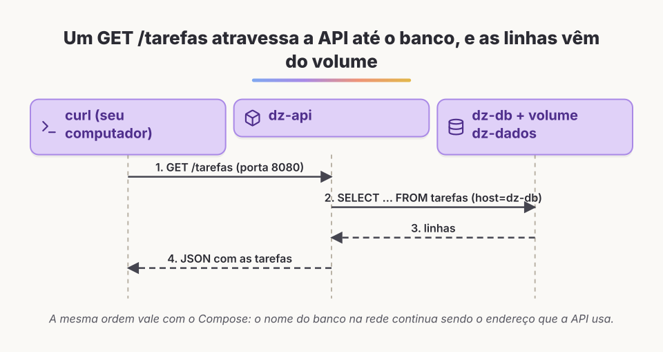

# 12. Projeto final: API com banco em contêineres

> 🗺️ **Neste capítulo:** você entrega o projeto do livro: a API de tarefas na versão 1.1, que grava no PostgreSQL, rodando em dois contêineres numa rede própria, com os dados num volume e a imagem publicada num registro. No fim, você vê o mesmo projeto num `compose.yaml`, que é o assunto do próximo livro. · ⏱️ ~60 min

> 🔥 **Aquecimento:** (1) O que acontece com o banco se você rodar `docker rm dz-db` e depois recriar o contêiner com o mesmo `-v dz-dados:/var/lib/postgresql`? (2) Por que a API usa `host=dz-db` e não `localhost`?
>
> <details>
> <summary>Ver resposta</summary>
>
> (1) Os dados continuam: o volume é independente do contêiner, e o banco novo encontra os arquivos e pula a inicialização (capítulo 9). (2) Dentro do contêiner da API, `localhost` é a própria API. O nome `dz-db` é resolvido pelo DNS da rede criada por você, e continua valendo mesmo que o IP do banco mude (capítulo 10).
>
> </details>

## De onde paramos

Você já tem todas as peças: a imagem enxuta da API (capítulo 8), o banco com volume (capítulo 9), a rede que liga os dois (capítulo 10) e o jeito de publicar a imagem (capítulo 11). Falta ligar a API ao banco **de verdade**: até aqui ela guardava as tarefas na memória e as perdia a cada remoção do contêiner, que é o problema que abriu o capítulo 9.

Este capítulo é o projeto final, então ele dá menos explicações e mais passos: você constrói primeiro, e o código de referência fica escondido, para conferir depois. Os nomes seguem com `dz-`, as portas ficam em `127.0.0.1`, e as saídas vêm do Docker Engine 29.9.3 com o Docker Desktop 4.99 e o Docker Compose v5.7.0, no Windows 11 (Git Bash). Se usa o Git Bash, rode `export MSYS_NO_PATHCONV=1` antes. Os ids que o `docker run -d` imprime foram omitidos das saídas.

## O que vamos entregar

**Configuração por variáveis de ambiente é o hábito de passar tudo o que muda entre máquinas (endereço do banco, senha, porta) como variáveis, e não escrevê-lo no código nem na imagem.** A mesma imagem da API serve para o seu computador, para um colega e para um servidor, e só as variáveis mudam. A API 1.1 lê estas:

| Variável | Para que serve | Valor no laboratório |
| --- | --- | --- |
| `DB_HOST` | nome do banco na rede | `dz-db` |
| `DB_PASSWORD` | senha do banco | `senha-de-teste` (só do laboratório) |
| `DB_NAME`, `DB_USER`, `DB_PORT` | banco, usuário e porta | `tarefas`, `postgres`, `5432` (os padrões do código) |
| `APP_VERSAO` | versão que a API informa em `/saude` | `1.1`, vinda do `--build-arg` |

As rotas são as de sempre, e agora o banco faz parte da resposta:

| Rota | Método | O que faz |
| --- | --- | --- |
| `/saude` | GET | `200` com `"banco": "ok"` se consegue consultar o banco |
| `/tarefas` | GET | lista as tarefas gravadas no PostgreSQL |
| `/tarefas` | POST | grava uma tarefa a partir de `{"titulo": "..."}` e devolve `201` |

Quando o banco estiver fora do ar, a API responde `503` em vez de quebrar. E a arquitetura é a do capítulo 10: só a API é publicada (`127.0.0.1:8080`), e o banco fica atrás dela, na rede `dz-net`, com os dados no volume `dz-dados`.



## A API 1.1: tarefas no PostgreSQL

Você pode escrever o `app.py` da versão 1.1 por conta própria, a partir do contrato acima, ou usar o de referência. Se escrever o seu, cuide de três pontos que costumam falhar:

1. **Ler a configuração do ambiente** (`os.environ.get`), com padrões razoáveis, nunca a senha escrita no código.
2. **Esperar o banco.** Quando você sobe os dois contêineres ao mesmo tempo, o banco leva alguns segundos para aceitar conexões, e a API tentaria conectar antes. Uma API que cai na primeira recusa fica reiniciando; a de referência tenta por até 30 segundos.
3. **Criar a tabela se ela não existir** (`CREATE TABLE IF NOT EXISTS`), para funcionar tanto com um banco novo quanto com um volume que já tem dados.

<details>
<summary>Ver o app.py de referência</summary>

<!-- project: tarefas-api -->

**app.py**

```python
# API de tarefas do livro "Docker do zero" (versão 1.1).
# As tarefas agora moram no PostgreSQL, e não mais na memória.
import json
import os
import signal
import sys
import time
from http.server import BaseHTTPRequestHandler, ThreadingHTTPServer

import psycopg

# tudo que muda entre máquinas vem do ambiente (ENV no Dockerfile
# ou -e no docker run), e não do código
ENDERECO = os.environ.get("ENDERECO", "0.0.0.0")
PORTA = int(os.environ.get("PORTA", "8000"))
VERSAO = os.environ.get("APP_VERSAO", "dev")

BANCO = {
    "host": os.environ.get("DB_HOST", "banco"),
    "port": os.environ.get("DB_PORT", "5432"),
    "dbname": os.environ.get("DB_NAME", "tarefas"),
    "user": os.environ.get("DB_USER", "postgres"),
    "password": os.environ.get("DB_PASSWORD", ""),
    "connect_timeout": 3,
}


def conectar():
    # uma conexão por pedido: simples de entender; o commit
    # acontece ao sair do bloco "with"
    return psycopg.connect(**BANCO)


def preparar_banco(tentativas=30):
    # o banco pode demorar a subir: tenta por até 30 segundos
    # antes de desistir, em vez de cair na primeira recusa
    for n in range(1, tentativas + 1):
        try:
            with conectar() as conexao:
                conexao.execute(
                    "CREATE TABLE IF NOT EXISTS tarefas ("
                    "id serial PRIMARY KEY, titulo text NOT NULL, "
                    "feita boolean DEFAULT false)")
            print("Banco pronto", flush=True)
            return
        except psycopg.OperationalError as erro:
            motivo = str(erro).strip().splitlines()[0][:100]
            print(f"Aguardando o banco ({n}/{tentativas}): {motivo}",
                  flush=True)
            time.sleep(1)
    sys.exit("O banco não respondeu a tempo")


class Api(BaseHTTPRequestHandler):
    def enviar(self, codigo, conteudo):
        corpo = json.dumps(conteudo, ensure_ascii=False).encode("utf-8")
        self.send_response(codigo)
        self.send_header("Content-Type", "application/json; charset=utf-8")
        self.send_header("Content-Length", str(len(corpo)))
        self.end_headers()
        self.wfile.write(corpo)

    def do_GET(self):
        try:
            if self.path == "/saude":
                with conectar() as conexao:
                    conexao.execute("SELECT 1")
                self.enviar(200, {"status": "ok", "versao": VERSAO,
                                  "banco": "ok"})
            elif self.path == "/tarefas":
                with conectar() as conexao:
                    linhas = conexao.execute(
                        "SELECT id, titulo, feita FROM tarefas "
                        "ORDER BY id").fetchall()
                self.enviar(200, [{"id": i, "titulo": t, "feita": f}
                                  for i, t, f in linhas])
            else:
                self.enviar(404, {"erro": "rota não existe"})
        except psycopg.OperationalError:
            self.enviar(503, {"erro": "banco indisponível"})

    def do_POST(self):
        if self.path != "/tarefas":
            self.enviar(404, {"erro": "rota não existe"})
            return
        tamanho = int(self.headers.get("Content-Length", 0))
        try:
            titulo = str(json.loads(self.rfile.read(tamanho))["titulo"])
        except (ValueError, KeyError, TypeError):
            self.enviar(400, {"erro": "envie um JSON com o campo titulo"})
            return
        try:
            with conectar() as conexao:
                nova = conexao.execute(
                    "INSERT INTO tarefas (titulo) VALUES (%s) "
                    "RETURNING id, titulo, feita", (titulo,)).fetchone()
            self.enviar(201, {"id": nova[0], "titulo": nova[1],
                              "feita": nova[2]})
        except psycopg.OperationalError:
            self.enviar(503, {"erro": "banco indisponível"})


def encerrar(sinal, quadro):
    # o PID 1 não tem tratador padrão de SIGTERM (capítulo 4):
    # sair aqui faz o docker stop terminar na hora, com código 0
    raise SystemExit(0)


if __name__ == "__main__":
    signal.signal(signal.SIGTERM, encerrar)
    preparar_banco()
    servidor = ThreadingHTTPServer((ENDERECO, PORTA), Api)
    print(f"Servidor pronto em {ENDERECO}:{PORTA} (versão {VERSAO})",
          flush=True)
    servidor.serve_forever()
```

</details>

Repare em três escolhas do código, todas ligadas a capítulos anteriores: o `SIGTERM` continua tratado (capítulo 4), as variáveis têm padrão (capítulo 7), e há uma conexão por pedido, o que é simples de ler e suficiente aqui. Numa API de verdade, você usaria um *pool* de conexões.

### Por que o `psycopg` já estava no `requirements.txt`

O capítulo 8 instalou o `psycopg` **antes** de qualquer código usá-lo, e a ordem tinha um motivo. Naquele capítulo você precisava de uma dependência real para ver o cache de camadas e o build multi-stage funcionarem: o `psycopg[c]` é compilado, o que pede um compilador, e foi isso que mostrou a diferença de 511 MB para 197 MB. O `app.py` só passa a importá-lo agora, na versão 1.1. Resultado: a imagem que você publica já nasceu certa, e o `requirements.txt` e o `Dockerfile` **não mudam** neste capítulo.

Isso tem uma consequência prática, que você vai medir no laboratório: ao trocar o `app.py` da 1.0 pelo da 1.1, o Docker só refaz a última camada (`COPY app.py .`), e o `pip install`, o passo lento, fica em `CACHED`. Veja o contrário (erro de propósito): numa imagem em que o `requirements.txt` **não** tivesse o `psycopg`, a API cairia assim que importasse o módulo:

```bash
# a imagem python:3.14-slim pura não traz o psycopg
docker run --rm python:3.14-slim python -c "import psycopg"
```

```text
    import psycopg
ModuleNotFoundError: No module named 'psycopg'
```

Se o seu `requirements.txt` não tem a linha `psycopg[c]==3.3.9` (porque você pulou o capítulo 8 ou escreveu outro), acrescente-a antes de construir. Quem **sempre** esquece de instalar a dependência no Dockerfile descobre o erro só ao rodar o contêiner, e não ao construir a imagem: por isso, depois do build, rode a imagem, e não confie só no `Successfully built`.

## 🧪 Laboratório: o projeto de ponta a ponta

**Objetivo:** construir a imagem 1.1, subir banco e API na rede `dz-net`, provar que os dados sobrevivem à destruição dos contêineres e publicar a imagem num registro.

**Passo 1: construir a imagem 1.1.** Em `~/api-livro`, com o `app.py` da 1.1 no lugar, o `requirements.txt` e o `Dockerfile` do capítulo 8 como estão:

```bash
cd ~/api-livro
# --build-arg APP_VERSAO: a versão que /saude vai informar
docker build -t dz-api:1.1 --label dz=livro --build-arg APP_VERSAO=1.1 .
```

Esperado: termina sem `ERROR`. O build desta máquina, logo depois de uma troca no `app.py`, levou **1,5 s**, com a camada do `pip install` em `CACHED` e só o `COPY app.py .` refeito:

```text
#11 [build 5/5] RUN pip install --no-cache-dir --prefix=/install -r requirements.txt
#11 CACHED
#13 [stage-1 5/5] COPY app.py .
#13 DONE 0.1s
```

(Num computador que nunca construiu a imagem do capítulo 8, o primeiro build recompila o `psycopg` e leva mais de um minuto.) Confira a imagem:

```bash
docker image ls dz-api:1.1 --format '{{.Repository}}:{{.Tag}} {{.Size}}'
```

```text
dz-api:1.1 197MB
```

**Passo 2: a rede, o volume e a API antes do banco.** Suba a API primeiro, de propósito, para ver por que ela espera:

```bash
docker network create --label dz=livro dz-net
docker volume create --label dz=livro dz-dados
# DB_HOST aponta para o nome do banco, que ainda não existe
docker run -d --name dz-api --label dz=livro --network dz-net \
  -p 127.0.0.1:8080:8000 \
  -e DB_HOST=dz-db -e DB_PASSWORD=senha-de-teste dz-api:1.1
# espere uns segundos e veja o que ela diz
docker logs dz-api
curl -sS http://127.0.0.1:8080/saude
```

```text
Aguardando o banco (1/30): failed to resolve host 'dz-db': [Errno -2] Name or service not known
curl: (52) Empty reply from server
```

A API não caiu: ela está tentando de novo, uma vez por segundo. O `curl` recebe `Empty reply` porque o servidor web só abre depois que o banco responde (a porta 8080 já aceita a conexão no Docker, mas ninguém atende por dentro).

**Passo 3: subir o banco.** Agora crie o banco e espere a API se conectar:

```bash
# o banco: mesma rede, volume em /var/lib/postgresql, sem -p
docker run -d --name dz-db --label dz=livro --network dz-net \
  -e POSTGRES_PASSWORD=senha-de-teste -e POSTGRES_DB=tarefas \
  -v dz-dados:/var/lib/postgresql postgres:18
# espere o /saude responder e veja o histórico da API
docker logs dz-api
curl -s http://127.0.0.1:8080/saude
```

```text
Aguardando o banco (1/30): failed to resolve host 'dz-db': [Errno -2] Name or service not known
Aguardando o banco (2/30): failed to resolve host 'dz-db': [Errno -2] Name or service not known
Aguardando o banco (3/30): connection failed: connection to server at "172.20.0.3", port 5432 failed: Connection refused
Aguardando o banco (4/30): connection failed: connection to server at "172.20.0.3", port 5432 failed: Connection refused
Banco pronto
Servidor pronto em 0.0.0.0:8000 (versão 1.1)
{"status": "ok", "versao": "1.1", "banco": "ok"}
```

O histórico conta a história da subida: primeiro o nome nem existia (`failed to resolve host`), depois o contêiner existia mas o banco ainda criava os arquivos (`Connection refused`), até o `Banco pronto`. Os números de tentativa e o IP mudam de máquina para máquina. **Essa espera na API é o que dispensa uma ordem rígida de subida**; o Compose vai oferecer outro jeito, o `healthcheck`, que você verá na prévia no fim do capítulo.

**Passo 4: usar a API.**

```bash
H='Content-Type: application/json'
curl -s -X POST -H "$H" -d '{"titulo":"Estudar volumes"}' \
  http://127.0.0.1:8080/tarefas
curl -s -X POST -H "$H" -d '{"titulo":"Publicar a imagem"}' \
  http://127.0.0.1:8080/tarefas
# erro de propósito: corpo que não é JSON
curl -s -X POST -d 'oi' -w ' (%{http_code})\n' http://127.0.0.1:8080/tarefas
curl -s http://127.0.0.1:8080/tarefas
```

```text
{"id": 1, "titulo": "Estudar volumes", "feita": false}
{"id": 2, "titulo": "Publicar a imagem", "feita": false}
{"erro": "envie um JSON com o campo titulo"} (400)
[{"id": 1, "titulo": "Estudar volumes", "feita": false}, {"id": 2, "titulo": "Publicar a imagem", "feita": false}]
```

**Passo 5: a prova de fogo: destruir tudo, menos o volume.** Pare e remova **os dois** contêineres e recrie-os:

```bash
# stop dá chance de um desligamento limpo; depois o rm
docker stop dz-api dz-db
docker rm dz-api dz-db
# o volume continua
docker volume ls --filter label=dz=livro
# recria o banco (agora com o alias "banco") e a API apontando para ele
docker run -d --name dz-db --label dz=livro --network dz-net \
  --network-alias banco \
  -e POSTGRES_PASSWORD=senha-de-teste -e POSTGRES_DB=tarefas \
  -v dz-dados:/var/lib/postgresql postgres:18
docker run -d --name dz-api --label dz=livro --network dz-net \
  -p 127.0.0.1:8080:8000 \
  -e DB_HOST=banco -e DB_PASSWORD=senha-de-teste dz-api:1.1
# espere o /saude responder e liste as tarefas
curl -s http://127.0.0.1:8080/tarefas
```

```text
dz-api
dz-db
dz-api
dz-db
DRIVER    VOLUME NAME
local     dz-dados
[{"id": 1, "titulo": "Estudar volumes", "feita": false}, {"id": 2, "titulo": "Publicar a imagem", "feita": false}]
```

As duas tarefas voltaram: os contêineres são descartáveis, e o volume guarda o que importa. Repare também que, desta vez, a API usou `DB_HOST=banco` (o alias do capítulo 10) e funcionou do mesmo jeito: a imagem é a mesma, só a variável mudou. O `docker stop` dos dois levou menos de um segundo no total (0,68 s), porque a API trata o `SIGTERM` e o PostgreSQL desliga sozinho. Confira o banco por dentro:

```bash
docker exec dz-db psql -U postgres -d tarefas \
  -c "SELECT id, titulo FROM tarefas;"
```

```text
 id |      titulo       
----+-------------------
  1 | Estudar volumes
  2 | Publicar a imagem
(2 rows)
```

**Passo 6: o banco fora do ar.** A API deve responder com elegância, e voltar sozinha:

```bash
docker stop dz-db
curl -s -w ' (%{http_code})\n' http://127.0.0.1:8080/tarefas
docker start dz-db
# espere uns 4 segundos
curl -s -w ' (%{http_code})\n' http://127.0.0.1:8080/saude
```

```text
{"erro": "banco indisponível"} (503)
{"status": "ok", "versao": "1.1", "banco": "ok"} (200)
```

Com o banco parado, `503` (e não um erro estranho); depois que ele volta, a API se recupera sem reiniciar.

**Passo 7: publicar a imagem.** Como no capítulo 11, com o registro do laboratório (porta 5050; confira que está livre):

```bash
# registro local e os dois nomes da versão
docker run -d --name dz-registro --label dz=livro \
  -p 127.0.0.1:5050:5000 registry:3
docker tag dz-api:1.1 127.0.0.1:5050/dz/tarefas-api:1.1.0
docker tag dz-api:1.1 127.0.0.1:5050/dz/tarefas-api:1.1
docker push -q 127.0.0.1:5050/dz/tarefas-api:1.1.0
docker push -q 127.0.0.1:5050/dz/tarefas-api:1.1
curl -s http://127.0.0.1:5050/v2/dz/tarefas-api/tags/list
```

```text
127.0.0.1:5050/dz/tarefas-api:1.1.0
127.0.0.1:5050/dz/tarefas-api:1.1
{"name":"dz/tarefas-api","tags":["1.1","1.1.0"]}
```

No Docker Hub, seriam os mesmos comandos com o seu usuário no lugar de `127.0.0.1:5050/dz`, depois do `docker login` com token do capítulo 11 (passo **não executado** aqui, porque exige uma conta).

**Passo 8: confira o que a imagem final tem e não tem:**

```bash
docker exec dz-api id
docker exec dz-api sh -c 'which gcc || echo sem gcc'
```

```text
uid=1000(app) gid=1000(app) groups=1000(app)
sem gcc
```

A API roda sem privilégio de root e sem compilador (capítulo 8), e o banco não tem porta publicada (capítulo 10): `docker ps --filter name=dz-` mostra o `dz-db` só com `5432/tcp`.

**Passo 9: limpe só o que é seu**, pelo nome:

```bash
docker rm -f dz-api dz-db dz-registro
docker rmi 127.0.0.1:5050/dz/tarefas-api:1.1.0 \
  127.0.0.1:5050/dz/tarefas-api:1.1
docker network rm dz-net
# apaga as tarefas para sempre: só faça quando terminar
docker volume rm dz-dados
```

**Esperado no final:** nenhum contêiner `dz-*`, nenhuma rede `dz-*` e nenhum volume com o rótulo `dz=livro`. As imagens `dz-api:1.1`, `postgres:18` e `registry:3` ficam; remova-as com `docker rmi` quando não precisar mais.

> 💡 O laboratório foi executado por inteiro (menos o login e o `push` ao Docker Hub, que exigem uma conta) no Docker Engine 29.9.3, Docker Desktop 4.99, Windows 11. Ids, IPs e tempos mudam a cada execução.

## ✅ Checklist final

Confira o seu projeto com esta lista; cada item aponta o capítulo em que ele nasceu:

- [ ] A imagem tem **versão fixa** (`dz-api:1.1`), e o `docker push` publicou `1.1.0` e `1.1` (capítulo 11).
- [ ] O Dockerfile tem **dois estágios**, o `requirements.txt` vem antes do código e a imagem final tem cerca de 197 MB (capítulo 8).
- [ ] A API roda como **usuário comum** (`uid=1000(app)`) e não tem compilador (capítulos 7 e 8).
- [ ] **Nenhum segredo** está no Dockerfile, na imagem ou num arquivo copiado: a senha entra por `-e` (capítulo 11).
- [ ] A API e o banco estão numa **rede própria** e se acham pelo nome (capítulo 10).
- [ ] **Só a API** tem `-p`, e com `127.0.0.1` (capítulos 1 e 10).
- [ ] Os dados do banco estão num **volume nomeado** montado em `/var/lib/postgresql` (capítulo 9).
- [ ] Os contêineres podem ser **destruídos e recriados** sem perder as tarefas (capítulo 9).
- [ ] Você sabe **limpar** tudo pelo nome, sem `prune` (capítulos 4 e 9).

## Prévia: o mesmo projeto num compose.yaml

Repare no que você digitou no laboratório: uma rede, um volume e dois `docker run` com várias opções cada. Isso é repetitivo e fácil de errar. O **Docker Compose** descreve o mesmo conjunto num arquivo, e o sobe com um comando. O próximo livro da trilha (*Docker Compose na prática*) ensina isso por inteiro; aqui vai só uma prévia, para você enxergar a ligação.

**Um arquivo `compose.yaml`** descreve serviços (os contêineres), redes e volumes de um projeto, e o Compose cria tudo na ordem certa. Crie a pasta `~/dz-compose` e o arquivo:

**compose.yaml**

```yaml
# O projeto inteiro em um arquivo: o mesmo que os docker run do capítulo
name: dz-tarefas

services:
  banco:
    image: postgres:18
    environment:
      POSTGRES_PASSWORD: senha-de-teste
      POSTGRES_DB: tarefas
    volumes:
      # o volume vai em /var/lib/postgresql (PostgreSQL 18)
      - dados:/var/lib/postgresql
    healthcheck:
      # só fica "healthy" quando o banco aceita conexões
      test: ["CMD", "pg_isready", "-U", "postgres", "-d", "tarefas"]
      interval: 2s
      timeout: 3s
      retries: 20

  api:
    image: dz-api:1.1
    environment:
      DB_HOST: banco
      DB_PASSWORD: senha-de-teste
    ports:
      - "127.0.0.1:8080:8000"
    depends_on:
      banco:
        condition: service_healthy

volumes:
  dados:
```

Compare com o laboratório: o serviço `banco` é o `docker run` do `dz-db`, e o `api` é o da API. A rede **não aparece**, porque o Compose cria uma rede própria para o projeto, e nela o nome do serviço (`banco`) é o endereço, como no capítulo 10. O `depends_on` com `service_healthy` faz a API esperar o `healthcheck` do banco. Repare que não há a linha `version:`, que as versões atuais do Compose não pedem. Para subir (a imagem `dz-api:1.1` precisa existir no seu computador, e a porta 8080 estar livre):

```bash
# valida o arquivo e sobe tudo em segundo plano
docker compose config --quiet && echo "config ok"
docker compose up -d
docker compose ps --format 'table {{.Name}}\t{{.Service}}\t{{.Status}}\t{{.Ports}}'
```

```text
config ok
 Network dz-tarefas_default Created 
 Container dz-tarefas-banco-1 Created 
 Container dz-tarefas-api-1 Created 
 Container dz-tarefas-banco-1 Started 
 Container dz-tarefas-banco-1 Healthy 
 Container dz-tarefas-api-1 Started 
NAME                 SERVICE   STATUS                   PORTS
dz-tarefas-api-1     api       Up Less than a second    127.0.0.1:8080->8000/tcp
dz-tarefas-banco-1   banco     Up 3 seconds (healthy)   5432/tcp
```

(Resumi a saída do `up`, que repete cada contêiner em várias fases.) Sem nenhum `docker network create` nem `docker volume create`, o projeto subiu: o `curl` de `/saude` respondeu `{"status": "ok", "versao": "1.1", "banco": "ok"}`, e `/tarefas` devolveu `[]`, porque este é um volume novo (`dz-tarefas_dados`), diferente do `dz-dados` do laboratório. Para derrubar tudo, **inclusive o volume e as tarefas**:

```bash
# -v apaga também o volume do projeto: só use quando quiser zerar
docker compose down -v
```

```text
 Container dz-tarefas-banco-1 Removed 
 Volume dz-tarefas_dados Removed 
 Network dz-tarefas_default Removed 
```

(Mostrei as linhas finais.) Guarde a versão da prévia: *Docker Compose na prática* parte dela, e vai mostrar como tirar a senha do arquivo e como lidar com o `healthcheck`.

> ⚠️ **Erro comum:** achar que o Compose substitui o que você aprendeu aqui. Ele só escreve em um arquivo os mesmos conceitos: imagem, rede, volume, porta publicada e variável de ambiente. Quem não entendeu o volume e a rede não vai entender por que o `compose.yaml` não funciona.

## 🏋️ Pratique

**1. Resolvido: a API não sobe.** O `docker logs dz-api` mostra, em loop, `Aguardando o banco (n/30): failed to resolve host 'banco'`, embora o `dz-db` esteja rodando. Qual é a causa mais provável e como confirmar?

<details>
<summary>Ver resposta</summary>

O contêiner do banco existe, mas **sem o alias `banco`** (ou em outra rede): o nome `banco` só resolve se o banco tem `--network-alias banco` e está na mesma rede da API. Para confirmar: `docker inspect dz-db --format '{{json .NetworkSettings.Networks}}'` mostra as redes e os `Aliases`. A correção é recriar o banco com `--network dz-net --network-alias banco`, ou trocar `DB_HOST` para `dz-db`, que é o nome do contêiner e sempre resolve numa rede criada por você.

</details>

**2. Complete:** preencha as lacunas para a API apontar para o banco `dz-db` e para o banco ter os dados no volume.

```bash
docker run -d --name dz-api --label dz=livro --network dz-net \
  -e ____=dz-db -e DB_PASSWORD=senha-de-teste dz-api:1.1
# o banco guarda os dados no volume (preencha o caminho)
docker run -d --name dz-db --label dz=livro --network dz-net \
  -e POSTGRES_PASSWORD=senha-de-teste \
  -v dz-dados:____ postgres:18
```

<details>
<summary>Ver resposta</summary>

As lacunas são `DB_HOST` e `/var/lib/postgresql`. Erros comuns: escrever `DB_NAME=dz-db` (isso muda o **banco**, não o servidor) e montar o volume em `/var/lib/postgresql/data`, o caminho do PostgreSQL 17 e anteriores, que faz a imagem 18 recusar a subida (capítulo 9).

</details>

**3. Por conta própria:** a sua API precisa de uma nova variável, `LIMITE`, o número máximo de tarefas devolvidas em `GET /tarefas` (padrão 100). Que partes do projeto você muda, e o que **não** muda? Pense em código, Dockerfile, comando `docker run` e imagem.

<details>
<summary>Ver resposta</summary>

Muda o `app.py`: ler `os.environ.get("LIMITE", "100")` e usá-lo no `SELECT ... LIMIT`. O `requirements.txt` e o `Dockerfile` **não** mudam: nada de novo para instalar, então o `pip install` continua em `CACHED` e só o `COPY app.py .` é refeito. A imagem ganha a tag `1.2.0` (muda comportamento). No `docker run`, você passa `-e LIMITE=10` quando quiser outro valor. O valor não vai na imagem: a mesma imagem serve para qualquer limite.

</details>

**4. Desafio:** um colega diz: "para deixar o banco acessível do meu DBeaver (um programa de banco de dados no computador dele), publiquei `-p 5432:5432`". Dê dois problemas dessa escolha e a forma mais segura de conseguir o que ele quer.

<details>
<summary>Ver resposta</summary>

Problemas: (1) sem `127.0.0.1`, o banco fica aberto para toda a rede, passando por fora do firewall do sistema; (2) a 5432 pode já estar ocupada por outro programa, e o `docker run` falha, ou, pior, ele se conecta ao banco errado. Forma mais segura: `-p 127.0.0.1:5440:5432`, com uma porta que ele conferiu estar livre, e o DBeaver configurado para `127.0.0.1:5440`; ou, melhor, só publicar durante a depuração e remover o `-p` depois. Outra opção sem publicar nada: `docker exec -it dz-db psql -U postgres -d tarefas`.

</details>

## 🧠 Revisão rápida

**1.** Por que a API tenta conectar ao banco por até 30 segundos em vez de falhar na primeira vez?

<details>
<summary>Ver resposta</summary>

Porque o banco leva alguns segundos para aceitar conexões depois de criado, e os dois contêineres sobem quase ao mesmo tempo. Uma API que cai na primeira recusa ficaria reiniciando.

</details>

**2.** Por que a imagem 1.1 foi construída em 1,5 segundo?

<details>
<summary>Ver resposta</summary>

Porque só o `app.py` mudou: o `requirements.txt` é o mesmo, então o `pip install` ficou em cache (capítulo 8) e só a última camada, o `COPY app.py .`, foi refeita.

</details>

**3.** O que garante que as tarefas sobrevivem à remoção dos contêineres?

<details>
<summary>Ver resposta</summary>

O volume nomeado `dz-dados`, montado em `/var/lib/postgresql`. O `docker rm` só apaga os contêineres; o volume só some com `docker volume rm`.

</details>

**4.** (Capítulo 5) Que comando mostra o consumo de CPU e de memória dos contêineres `dz-`?

<details>
<summary>Ver resposta</summary>

O `docker stats` (na janela do Docker Desktop, a aba Stats). Para os nomes `dz-`, `docker stats dz-api dz-db`.

</details>

**5.** (Capítulo 9) Onde o volume do PostgreSQL 18 deve ser montado?

<details>
<summary>Ver resposta</summary>

Em `/var/lib/postgresql`. O caminho `/var/lib/postgresql/data` é o das versões até a 17.

</details>

## 🤖 Estude com um tutor de IA

1. "Faça 5 perguntas, uma por vez, sobre a arquitetura do meu projeto: API, PostgreSQL, rede, volume e imagem publicada no Docker. Espere a minha resposta antes de dar o retorno e não me dê as respostas antes."
2. "Aqui estão os meus comandos `docker run` do projeto final: <meus comandos>. Revise-os com base neste checklist: versão fixa, usuário comum, nenhum segredo na imagem, rede própria, só a API publicada em 127.0.0.1 e volume no banco. Aponte o que falta sem reescrever os comandos por mim. Não vou colar nenhuma senha real."

> ➡️ **Próximo passo:** você terminou o livro. Resta fechar o ciclo: a página "Próximos caminhos" indica o que estudar depois, e o *Docker Compose na prática* continua exatamente de onde a prévia deste capítulo parou.

## 📌 Resumo

| Item | Em uma frase |
| --- | --- |
| Configuração por variáveis | endereço, senha e porta entram por `-e`, nunca no código nem na imagem |
| API 1.1 | grava no PostgreSQL com `psycopg`, espera o banco subir e responde `503` quando ele cai |
| `psycopg` no `requirements.txt` | foi instalado no capítulo 8 antes do uso; por isso o build da 1.1 refez só o `COPY app.py` |
| Rede `dz-net` | API e banco se acham pelo nome; só a API tem `-p`, com `127.0.0.1` |
| Volume `dz-dados` | em `/var/lib/postgresql`; os dados sobrevivem a `stop` e `rm` dos contêineres |
| Publicação | `docker tag` com versão (`1.1.0`, `1.1`) e `docker push`; login com token no Docker Hub |
| Compose (prévia) | o mesmo projeto num `compose.yaml`: serviços, volume e `healthcheck`, sem rede nem volume criados à mão |
| Limpeza | sempre pelo nome (`dz-`); `docker compose down -v` só quando quiser apagar os dados |

## 📚 Fontes

- Imagem oficial do PostgreSQL: https://hub.docker.com/_/postgres (conferido em 26/11/2026)
- psycopg 3: https://pypi.org/project/psycopg/ (versão 3.3.9, conferida em 26/11/2026)
- Ordem de início no Compose: https://docs.docker.com/compose/how-tos/startup-order/ (conferido em 26/11/2026)
- Volumes: https://docs.docker.com/engine/storage/volumes/ (conferido em 26/11/2026)
- Redes: https://docs.docker.com/engine/network/ (conferido em 26/11/2026)
- Execução e saída real: Docker Engine 29.9.3, Docker Desktop 4.99.0 e Docker Compose v5.7.0, Windows 11, Git Bash, em 26/11/2026.

> 🔁 **Revise hoje:** capítulos 5, 9 e 11

<!-- next-steps:start -->
## 🧭 Próximos caminhos

- **Docker Compose na prática**: Para descrever API e banco num arquivo e subir tudo com um comando (compose.yaml · serviços · redes e volumes do projeto)
- **Segurança de imagens**: Para achar e corrigir vulnerabilidades antes de publicar (docker scout · imagens mínimas · assinatura)
- **Kubernetes do zero**: Para rodar contêineres em vários servidores (pods · deployments · services)
<!-- next-steps:end -->

<!-- nav:start -->
---

[◀ Capítulo anterior](11-publicar-a-imagem.md) · [Mapa do livro](../README.md) · [Próximo capítulo ▶](13-simulado-final.md)
<!-- nav:end -->
